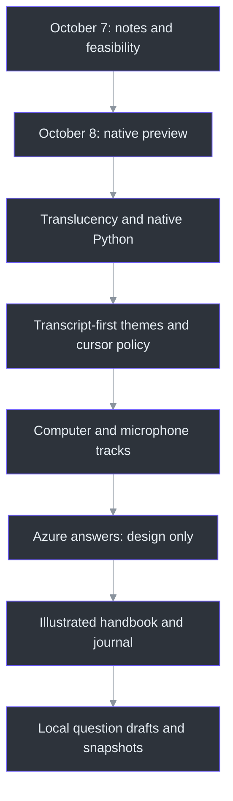
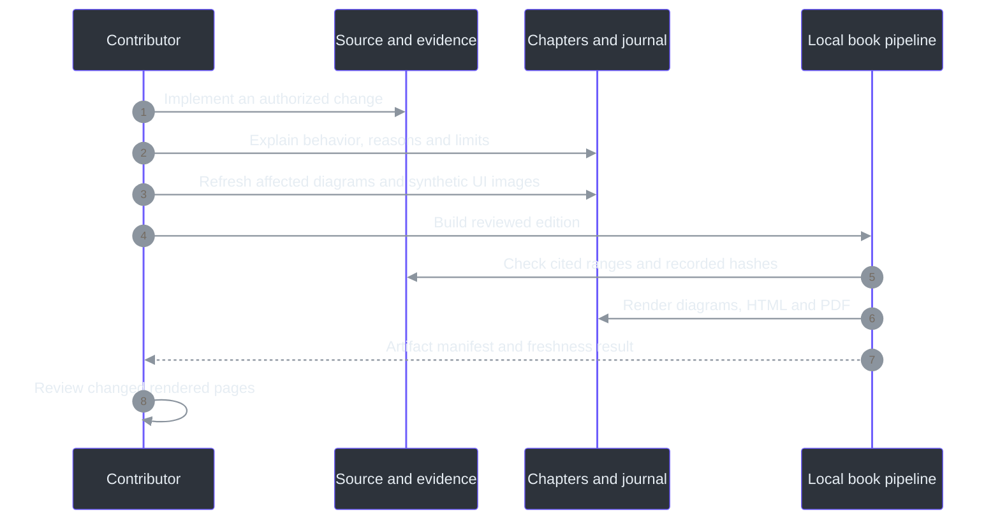

# Development Journal: The Journey of Phantom Fudge

This is the public engineering history of Phantom Fudge. It explains not only what changed, but
why the change mattered and what the evidence did **not** establish. It is not a transcript of
private conversations and contains no meeting content, personal notes or credentials.

Dates below are project-session dates in **Asia/Kolkata (UTC+05:30)**. Times identify recorded
requests or decisions, not invented release timestamps. The project moved quickly across one night
and the following day; that speed did not turn an experimental preview into a qualified release.
The [TODO ledger](TODO/16_DEVELOPMENT_LEDGER.todo) remains the concise operational history; this
journal is the narrative counterpart. The [handbook](docs/handbook/README.md) explains the system.

## The through-line

The original idea was a quiet place for presentation notes. The central challenge was not drawing
text: it was preserving useful interaction while making an honest, bounded request to the Windows
capture system. Speech then became the primary content source, and explicit AI assistance became
the next proposed extension. Throughout those changes, three decisions persisted: keep control with
the user, keep audio local by default, and never substitute a successful local test for a universal
privacy claim.

## 2026-10-07, 23:30 - An idea becomes a bounded product

The opening request was a draggable, notepad-like surface for speaker notes: absent from the normal
taskbar and omitted from screen sharing. The owner first asked for project continuity, a survey of
their existing TODO conventions, deep research and an implementation workflow rather than immediate
coding.

The repository began without an application. Planning adopted indexed, numbered `.todo` workstreams
with explicit status, dependencies, acceptance criteria, evidence and completion logs. The survey
found this useful recurring pattern, not a universal convention across every project or remote
tracker. Stable IDs made later changes possible without rewriting earlier work.

The most important early correction was conceptual. A tool window is still a real window owned by
a real process. Omitting a taskbar entry does not hide it from every application picker. Windows
display affinity can request exclusion on supported capture paths; it cannot promise that no
recorder, camera, privileged program or future OS change will reveal content. Cursor behavior is
another observable channel, not automatically solved by excluding window pixels.

Windows11 became the first platform, with Teams, Zoom, Google Meet and OBS treated as separate
qualification targets. The plan deliberately separated desk research, a local proof, usable
implementation and release acceptance. That separation would become increasingly important as
features arrived faster than real sharing environments could be qualified.

**Public record:** initial decisions and scope appear in `TODO/16_DEVELOPMENT_LEDGER.todo:75-85`;
the convention's bounded survey and evidence semantics are in `docs/TODO-CONVENTIONS.md:1-73`.
The current capture-claim limits are stated in `docs/OVERVIEW.md:34-52`.

## 2026-10-08, 00:32 onward - Implementation, and a new primary signal

The owner authorized implementation and requested eventual Docker support. Live transcription of
the **computer's meeting playback**, initially not the microphone, quickly became mandatory.
This changed the architecture from an editor with special window behavior into a small real-time
system.

C# and WPF took responsibility for the native surface, Windows interaction and WASAPI audio
capture. Python and Vosk handled local speech recognition. A narrow authenticated WebSocket
boundary connected the two. Notes and transcripts remained local; normal capture required an
explicit Start. A hidden service process being available was not permission to begin recording.

The first preview included plain-text editing, capture-affinity setup, recovery hotkeys, a
single-instance reveal path, Edit/Present modes, bounded in-memory transcripts and explicit export.
Several failure paths proved as important as the happy path: repeated close/save actions, malformed
endpoints, unfinished recognition at restart and restoring a minimized hidden utility. Those
corrections made the preview less likely to lose data or leave the user unable to recover it.

One explicitly approved synthetic playback test exercised actual default-output loopback through
the real recognizer. It did not use a microphone or establish performance on a real meeting.
Subsequent sleep instructions ruled out further speaker playback, questions, uploads and risky
system changes. Later testing therefore relied on generated PCM and isolated synthetic fixtures.
No public release or push followed from creating a local ZIP.

**Public record:** the historical implementation/evidence table and approved playback boundary are
in `docs/IMPLEMENTATION-STATUS.md:115-169`; the authorization and subsequent restrictions are preserved
in `TODO/16_DEVELOPMENT_LEDGER.todo:66-74`.

## 03:01 - A hidden window must still be recoverable

The first operational question was simple: after clicking Hide, how does the presenter get the
window back? The recovery path was already part of the product: `Ctrl+Alt+Space` reveals it, and
relaunching the executable signals the existing instance rather than creating competing surfaces.
The app also recenters on relaunch recovery.

This episode exposed a general design lesson. Removing an ordinary taskbar presence takes away a
familiar recovery mechanism. The product must replace that affordance deliberately. Hiding also
stops transcription; showing the surface again does not silently resume audio capture.

The UI should feel quiet without making the owner guess whether it is still listening or how to
reach it. The native recovery design is explained in
[the state-machine chapter](docs/handbook/11-state-machines-and-failure-containment.md).

## 03:04 - Remove repetitive acknowledgments, not technical safeguards

The owner explicitly stated that meeting permission and recipient preflight would be handled
outside the app, and asked for the associated checkboxes and repeat confirmations to disappear.
The change removed those gates from Start, Present and reset paths.

That instruction did not mean ignoring all failures. Explicit Start/Stop, token/input validation,
protection setup and unsaved-content safeguards remained. Nor did it turn an external responsibility
into recorded compatibility evidence. The lasting requirement is **not to reintroduce permission or
rehearsal prompts** under a different name during future feature work.

**Public record:** `docs/IMPLEMENTATION-STATUS.md:108-113` records the change and local artifact;
`docs/DEVELOPMENT-WORKFLOW.md:95-102` preserves the durable behavioral requirement.

## 03:12 - Seeing through the surface without washing out the text

The next request was practical: the opaque window blocked the material behind it. Instead of
reducing the opacity of the whole window, the implementation made the content background
translucent while preserving solid text. The Background slider spans10-100%, defaulting to55%.
Header and setup controls remain opaque; the surface does not become click-through.

This is more than a color change. Layered WPF rendering changes the conditions under which earlier
capture observations were made. Local affinity/readback, alpha, hit-region and synthetic GDI
observations were repeated for the changed rendering path. Their success remained bounded to that
machine and those samples. It did not qualify four meeting products or prove an uninterrupted
first-frame guarantee.

The lesson was to treat rendering changes as changes to the capture-evidence boundary, not just
visual polish.

**Public record:** `docs/IMPLEMENTATION-STATUS.md:97-106` identifies the layered result and limitations;
the implementation is explored in [chapter05](docs/handbook/05-desktop-ui-and-themes.md).

## 03:25 - Correcting Docker's place in the architecture

The owner clarified an important mismatch: Docker should come at the **absolute end**, as a future
packaging option, not as the architecture's normal operating prerequisite. The implementation was
corrected around native Python setup, startup, ownership and shutdown.

This was not a late discovery that Python might help C#. The system already used C# for Windows
integration and Python for recognition. The correction was about deployment responsibility.
Normal launch now starts or reuses an authenticated local Python service. It will not kill an
unrelated process merely because that process holds the expected port. Model/interpreter/token
setup remains explicit, and an idle running service still does not capture audio.

Docker recipes could remain useful as a future adapter around the headless boundary, but workstream20
was moved after native release17. Runtime22 became the required operational path. This distinction
prevented infrastructure work from blocking the thing the owner actually wanted to run.

**Public record:** native operation and the Docker correction are recorded in
`docs/IMPLEMENTATION-STATUS.md:76-95`; the current dependency graph is in `TODO/00_INDEX.todo`.

## The muted-laptop experiment - Compare engines, not language stereotypes

The owner also questioned whether C# transcription would be good enough and asked for a real
comparison, while planning to mute the laptop. A mute-independent experiment sent the same
generated PCM to Windows SAPI, Python Vosk and Python faster-whisper. No speakers, microphone or
cloud ASR were needed.

The corpus contained32 cases,164.07seconds of audio and292 reference words. Across two serial warm
passes, the recorded comparison was:

| Engine | Word error rate | Warm decode time |
| --- | --- | --- |
| Windows SAPI | 45.89% | 10.139seconds |
| Python Vosk | 8.22% | 41.754seconds |
| faster-whisper base.en, CPU int8 | 4.79% | 25.745seconds |

These measurements challenged an easy answer. SAPI was quickest on this batch but substantially
less accurate. Whisper looked promising on quality and warm throughput. Neither result proved
that one programming language was inherently better at speech, or that batch completion predicted
the first useful live partial. Vosk remained the production streaming recognizer; swapping it out
requires a real streaming contract and suitable latency/quality evidence.

Generated English speech also does not represent every accent, interruption, name or noisy meeting.
The historical receipt must be read with its exact harness/model provenance; the handbook notes
that today's harness hash differs from the historical receipt rather than rewriting that receipt.

**Public record:** [the full benchmark report](docs/SPEECH-BENCHMARK.md) and
[chapter12](docs/handbook/12-performance-and-benchmarks.md). Summary measurements and their limit
are recorded in `docs/IMPLEMENTATION-STATUS.md:82-85`.

## 11:31 - Transcription moves to the foreground

The owner reported two interaction cues: the recipient-side cursor could disappear when clicking
the app, and the local pointer became an I-beam over text. They also asked for transcription to
become the main view, notes to collapse by default, and DeepSeaFoam/Harbor Daylight plus Plain B/W.

The response separated what the app controls from what the recorder controls. The app now defaults
to non-activating Present mode, requests a normal Arrow and handles its own native cursor messages.
Edit remains the deliberate route for keyboard input and accessibility. These changes reduce local
focus/cursor cues; they do not establish control over a recipient's capture pipeline.

Moving to passive interaction exposed a real WPF nuance: default ListBox row selection expects
focus to succeed. The device selector needed explicit passive selection rather than pretending
that a non-activating window could use the ordinary focus path unchanged.

The transcript became primary, notes collapsed, and canonical theme tokens were used instead of
approximate colors. Automatic unprotected protection-failure message boxes were replaced by bounded
generic local notices. The already-running owner app was preserved while new candidates were
packaged separately.

**Still unresolved:** recipient-side cursor disappearance needs qualification in the actual
recorder/sharing mode. No implementation change justified the requested absolute invisibility claim.

**Public record:** `docs/IMPLEMENTATION-STATUS.md:57-74`, [cursor/theme notes](docs/CURSOR-AND-THEMES.md)
and workstreams24/25.

## 13:47-14:01 - Small UI questions clarify the evidence

The owner asked where the theme toggle was and later confirmed that themes worked. They also
asked about the footer reading "Capture exclusion requested. UNQUALIFIED PREVIEW: compatibility
varies by capture method." That text was an informational boundary, not a failed setup error.

The owner reported that Snipping Tool omitted the window. That is useful **owner observation**,
not independent proof of every recorder or sharing path. Documentation retains the distinction.
This episode also explains why this book's UI images use internal synthetic visual-tree rendering:
they can illustrate the actual controls without claiming that a desktop screenshot should succeed
or asking the owner to expose private content.

## 14:01 - Dictated questions require a microphone track

The owner wanted to read a chat question aloud and have it transcribed, while explicitly avoiding
chat-reading integration. The new requirement was to listen to both computer output and microphone
dictation. It superseded the original no-microphone product scope; it did not authorize development
tests to record a real microphone.

Computer, Mic and Both modes were added. Both is the default selection, but capture remains stopped
until Start. The sources use separate selected WASAPI inputs, bounded queues and independent Vosk
recognizers. A v2 protocol prefixes PCM with a source byte while preserving v1 compatibility.
Source labels identify inputs, not people; they do not provide diarization or guaranteed acoustic
echo cancellation.

Service management also learned to distinguish a stale, owned, idle service from an active or
foreign one. Only the first is eligible for the capability-aware restart path.

Review found a subtle stop/restart race: an audio component could report not-running before final
events and cleanup were finished. A new Start in that interval could reset transcript IDs and
mix the lifecycle of two sessions. A coalesced UI stopping gate now prevents Start/mode/clear
changes until final draining and cleanup settle.

The recorded evidence included41 Core tests,46 native synthetic groups,71 backend tests and four
manager-upgrade guards, plus real generated dual PCM and C#-to-Python v2 recognition. No actual
microphone/render endpoint or chat content was opened for this work. Hardware permissions, echo,
OS microphone indicators and recipient behavior remain to be qualified.

**Public record:** `docs/IMPLEMENTATION-STATUS.md:33-55`,
`docs/DUAL-SOURCE-AUDIO.md:1-30` and [chapters07-11](docs/handbook/07-dual-input-capture.md).

## 15:05 - An answer feature is researched before it is built

The next idea was to turn a chosen transcript question into a prompt and display the model's
answer. The owner requested deep architecture research, Azure where useful, and low latency.
The requested deliverable was design and backlog, not immediate cloud execution.

The proposed path is deliberately narrow: local ASR, an editable source-scoped question draft,
an immutable snapshot on explicit Ask, direct C# streaming from Azure OpenAI v1 Responses, then
rendering inside the same protected native surface. Audio stays local by default. The selected
question text crosses a new, deliberate cloud boundary; the entire meeting does not automatically
become prompt context.

A proposed Mic-only commit/ack avoids stopping Computer transcription to finalize a dictated
question. It needs protocol evolution; current v2 stop-all is not that feature. Planned public-client
Entra/WAM authentication must avoid embedded secrets and surprise sign-in windows during presenting.
Request cancellation must prevent stale tokens from updating a newer answer.

Research considered current model lifecycle and capabilities rather than choosing a familiar but
retiring default. No candidate was declared fastest without measuring it in the intended region
and configuration. Likewise, `store:false` is not a universal zero-retention promise.

Four design documents, workstreams27-37 and workflows04/05 capture the plan. Only research27 is
DONE. There is no implemented Ask button, composer, Azure client, source commit or answer pane.
No Azure account/resource discovery, sign-in, inference or upload was performed.

**Public record:** `docs/IMPLEMENTATION-STATUS.md:27-31`,
`docs/AI-ANSWER-ARCHITECTURE.md:44-138` and the four linked [AI design documents](docs/README.md).

## 16:11 - Turn the implementation into a teachable engineering record

The owner requested documentation detailed enough to become a book, using another project's
documentation as a depth/style reference, and asked that screenshots, diagrams and a proper
journey journal remain current thereafter.

The resulting handbook is organized into22 chapters plus this journal appendix: first-principles
onboarding, a principal engineer's guide, native Windows behavior, storage, the complete audio
pipeline, state machines, measured performance, planned Azure architecture, development/operations
and grounded reference material. The other project's prose and artwork were not copied.

Illustrations have a defined provenance. Nine images render the actual WPF visual tree with
synthetic text and device labels. They do not record audio, read chats, expose notes or capture
the desktop. They illustrate appearance, not capture exclusion. Mermaid diagrams are rendered
locally into SVG while retaining their editable sources.

The book pipeline produces offline HTML and a printable PDF with a generated manifest. It checks
source ranges, local links/images, diagram rendering, recorded source freshness and printable layout.
Those mechanical gates cannot prove a paragraph's interpretation; chapters still require source
review. Exact generated counts and artifact hashes belong in the
[edition manifest](docs/handbook/manifest.json), not a hand-maintained competing receipt.

This milestone adds a durable workflow obligation, not merely more files. Any later behavior change
must update relevant chapters and diagrams; visible UI changes must refresh synthetic images; and
significant decisions/evidence must extend this journal. Workstream38 establishes the first edition.
Workflow06 and the repository working contract carry the requirement forward.

The initial edition was completed locally. Print review exposed undersized diagrams, so their
layout was enlarged and sequence labels wrapped; narrow-screen review exposed long source paths,
so the reader gained responsive wrapping. Those corrections improved the actual artifacts rather
than treating a successful export as sufficient. Nothing was uploaded or published.

The documentation-only fixture does not replace the most recent user preview ZIP. That preview
remains the145231 dual-source bundle identified in `docs/IMPLEMENTATION-STATUS.md:49-55`.
The book does not implement Azure Ask, qualify remote cursors, or move Docker earlier.

## 2026-10-08, 17:37 - Offload the book, then implement the next safe slice

The owner asked for context-offload after the detailed documentation, followed by the next
dependency-ready implementation. The completed book was saved before code work resumed.
Research27 made local question state28 the next ready step; cloud connection30 still required
an approved destination and data/identity policy.

The implementation deliberately stopped short of pretending that an answer service existed.
It added structured transcript entries with capture-session GUID, source, utterance identity,
revision and qualified timing. The native adapter stamps session identity before queuing UI
callbacks, so delayed old-session text cannot enter a new capture. Existing display/export
formatting remains in its original buffer.

The new Question panel copies only explicitly selected segments or typed text. Mic is the initial
filter, but Computer/All sources can be selected deliberately. A chosen partial can evolve into a
final until the owner edits it; a frozen snapshot never changes. The8K-character draft limit rejects
oversized input atomically rather than silently cutting off the end of a question. Eviction from
the bounded history does not erase the copied draft's provenance.

Question typing needed a separate focus transition. Reusing global Notes Edit would have stopped
Computer audio, defeating dictation during a conversation. The new Type / edit action deliberately
takes keyboard focus in the same protected HWND while leaving transcription running and notes
read-only. Done typing/Escape returns to passive behavior. Ordinary global mode changes and Hide
retain their earlier stop policy.

**Ask as shown currently freezes locally only. Nothing is sent to Azure.** No fake answer is shown
to suggest otherwise. Accurate armed-Mic start/end boundaries remain workstream29: current v2
partials cannot reconstruct a sample-exact cut around speech already in a device or decoder buffer.
That boundary was deferred explicitly rather than guessed from display text.

The recorded local evidence is137Core tests (96new,41existing),46native synthetic groups, and
source/exact-package synthetic UI checks including CR/LF fidelity and the470x560minimum window.
The first source UI run failed its existing foreground-preservation assertion; an identical-source
repeat and subsequent runs passed. The cause was not established, so no invented focus fix or
recipient guarantee was recorded. No real audio endpoint, chat content or cloud model was accessed.

The local183107preview contains486files and76,205,175bytes, with SHA256
`C5062B6B94F3ABC63901960F1572F1A9141EA128C2CA513E6D26C4C5C3FAB27A`.
It was packaged and exercised locally without interrupting the owner's running app. The handbook
and screenshots were updated alongside the implementation, putting the new maintenance contract
into practice immediately.

**Public record:** [local question operation](docs/LOCAL-QUESTIONS.md),
[workstream28](TODO/28_QUESTION_DRAFTS.todo), [current evidence](docs/IMPLEMENTATION-STATUS.md)
and the [remaining answer architecture](docs/AI-ANSWER-ARCHITECTURE.md).

## 2026-10-08, 19:43 - A visual front door, detailed documentation behind it

The owner asked for more images and less text on the front README. The front page now emphasizes
the actual synthetic UI, local questions and three themes, with a compact status note and links.
Its setup, product explanation and capture limits moved into the product overview and expanded
documentation index rather than disappearing.

Transparent WPF renders were composited onto matching palette backgrounds for README legibility
on both light and dark GitHub pages. The derivatives retain source/output hashes and are explicitly
labelled as synthetic UI illustrations, not desktop captures. No new app capture, model request,
runtime change or upload was needed. Future README changes must keep this image-first structure.

See [the visual front page](README.md), [product overview](docs/OVERVIEW.md) and
[documentation index](docs/README.md).

## 2026-10-08, 21:24 - Installed model tools, and a simpler Agency path

The owner wanted answers through software already installed on the machine, while retaining
future Azure integration. The design gained a narrow `IAnswerProvider`: a request contains only
the exact frozen question, never its original source references or the rest of a meeting. The
window gained streamed plain-text answers, bounded rendering, Cancel and explicit Copy.

The initial implementation investigated standalone Copilot plus its documented offline
OpenAI-compatible mode. Local installation and local inference were kept separate: ordinary Copilot
uses cloud models, while an offline model requires a separately running local server. Synthetic
loopback tests established tool-free requests, literal input and bounded error/cancellation behavior;
they did not install or benchmark a real local model.

One authorized direct-Copilot cloud attempt failed at its customization/tool gate. A requested
dedicated sign-in then produced an organization-authentication popup. The owner corrected the path:
no organization-data access or new sign-in; simply run their existing Agency with a prompt in the
background. The owned login was stopped and app settings returned to SnapshotOnly. The failure was
not relabelled a success, and its model-call allowance was not silently reused.

Agency exposes `agency copilot` with profile-only configuration and controls for excluding default
MCPs/plugins. A separately authorized synthetic Agency request returned `PHANTOM_OK` using existing
authentication, with no new login flow. The recorded model surface had zero tools and no assistant
tool requests; both builtin GitHub MCP descriptors were disabled. The selected model was
`claude-sonnet-5`. No notes, meeting audio, repository files or organization-data tools were submitted.

The run took69.881seconds end to end. That proves a functional route, not a low-latency experience
or a guarantee that cached authentication will always be available. Agency remains a local process
using a remote model service; it is not an offline model. Its session/log retention also remains
separate from the application's in-memory draft policy.

The direct Azure adapter stays a future option behind the same interface. Accurate Mic-only
finalization remains workstream29; it is not required to explicitly send an already-reviewed draft.
See [provider setup](docs/ANSWER-PROVIDERS.md) and the [sanitized smoke receipt](docs/answer-provider-smoke.json).

The final adapter replays that successful protocol and uses the same restricted profile/launch.
Core268tests and the exact packaged synthetic UI passed, including cancellation, early text,
invalid settings and minimum-size layout. New preview235421contains489files and76,252,854bytes,
SHA256 `88D98E7CAFA56B067A521571778D0F661A879DDCBF5EBBE9D412987D2BFA5A69`.
No additional real model call was made for packaging. The existing app was not force-closed.

## Remaining qualification

The application is still a local unqualified preview. Full Teams/Zoom/Meet/OBS qualification,
recipient cursor behavior, hardware microphone/echo/privacy-indicator observations, long-session
quality, accessibility and owner acceptance have not been replaced by this book.

Local drafts and installed Agency answers are implemented; direct Azure still needs its approved
integration, and all provider paths need broader quality/latency and release qualification. Optional cloud ASR
and a broker are separate decisions. Docker remains a final-stage packaging option after native
release, not a prerequisite for transcription.

The next journal entry should say what actually happened, identify its public evidence and preserve
these boundaries until new evidence changes them. A useful engineering history is allowed to say
"not yet," "the earlier approach was wrong," and "this result covers only this case."
