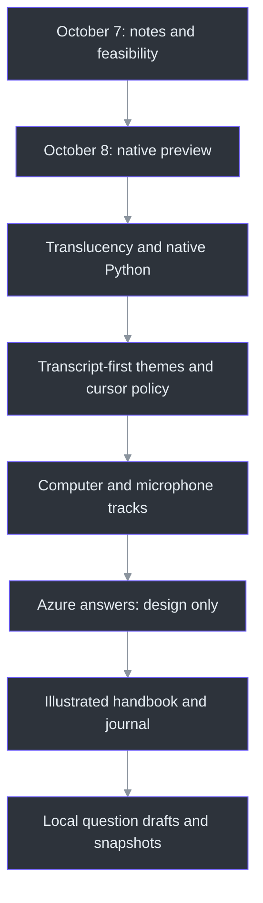
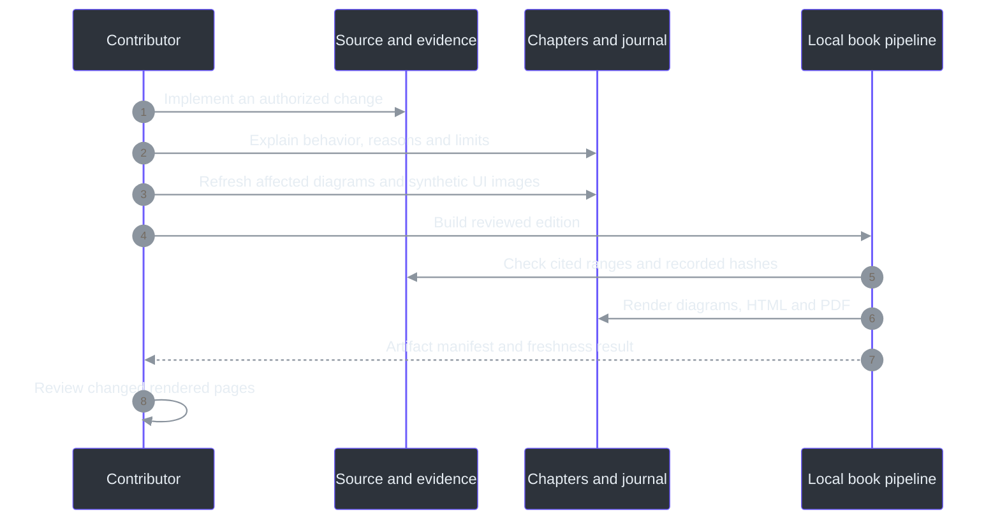

# Development Journal: The Journey of Phantom Fudge

This is the public engineering history of Phantom Fudge. It explains not only what changed, but
why the change mattered and what the evidence did **not** establish. It is not a transcript of
private conversations and contains no meeting content, personal notes or credentials.

Dates below are project-session dates in **Asia/Kolkata (UTC+05:30)**. Times identify recorded
requests or decisions, not invented release timestamps. The project moved quickly across one night
and the following day; that speed did not turn an experimental preview into a qualified release.
The [TODO ledger](TODO/16_DEVELOPMENT_LEDGER.todo) remains the concise operational history; this
journal is the narrative counterpart. The [handbook](docs/handbook/README.md) explains the system.

## The through-line

The original idea was a quiet place for presentation notes. The central challenge was not drawing
text: it was preserving useful interaction while making an honest, bounded request to the Windows
capture system. Speech then became the primary content source, and explicit AI assistance became
the next proposed extension. Throughout those changes, three decisions persisted: keep control with
the user, keep audio local by default, and never substitute a successful local test for a universal
privacy claim.

## 2026-10-07, 23:30 - An idea becomes a bounded product

The opening request was a draggable, notepad-like surface for speaker notes: absent from the normal
taskbar and omitted from screen sharing. The owner first asked for project continuity, a survey of
their existing TODO conventions, deep research and an implementation workflow rather than immediate
coding.

The repository began without an application. Planning adopted indexed, numbered `.todo` workstreams
with explicit status, dependencies, acceptance criteria, evidence and completion logs. The survey
found this useful recurring pattern, not a universal convention across every project or remote
tracker. Stable IDs made later changes possible without rewriting earlier work.

The most important early correction was conceptual. A tool window is still a real window owned by
a real process. Omitting a taskbar entry does not hide it from every application picker. Windows
display affinity can request exclusion on supported capture paths; it cannot promise that no
recorder, camera, privileged program or future OS change will reveal content. Cursor behavior is
another observable channel, not automatically solved by excluding window pixels.

Windows11 became the first platform, with Teams, Zoom, Google Meet and OBS treated as separate
qualification targets. The plan deliberately separated desk research, a local proof, usable
implementation and release acceptance. That separation would become increasingly important as
features arrived faster than real sharing environments could be qualified.

**Public record:** initial decisions and scope appear in `TODO/16_DEVELOPMENT_LEDGER.todo:75-85`;
the convention's bounded survey and evidence semantics are in `docs/TODO-CONVENTIONS.md:1-73`.
The current capture-claim limits are stated in `docs/OVERVIEW.md:48-70`.

## 2026-10-08, 00:32 onward - Implementation, and a new primary signal

The owner authorized implementation and requested eventual Docker support. Live transcription of
the **computer's meeting playback**, initially not the microphone, quickly became mandatory.
This changed the architecture from an editor with special window behavior into a small real-time
system.

C# and WPF took responsibility for the native surface, Windows interaction and WASAPI audio
capture. Python and Vosk handled local speech recognition. A narrow authenticated WebSocket
boundary connected the two. Notes and transcripts remained local; normal capture required an
explicit Start. A hidden service process being available was not permission to begin recording.

The first preview included plain-text editing, capture-affinity setup, recovery hotkeys, a
single-instance reveal path, Edit/Present modes, bounded in-memory transcripts and explicit export.
Several failure paths proved as important as the happy path: repeated close/save actions, malformed
endpoints, unfinished recognition at restart and restoring a minimized hidden utility. Those
corrections made the preview less likely to lose data or leave the user unable to recover it.

One explicitly approved synthetic playback test exercised actual default-output loopback through
the real recognizer. It did not use a microphone or establish performance on a real meeting.
Subsequent sleep instructions ruled out further speaker playback, questions, uploads and risky
system changes. Later testing therefore relied on generated PCM and isolated synthetic fixtures.
No public release or push followed from creating a local ZIP.

**Public record:** the historical implementation/evidence table and approved playback boundary are
in `docs/IMPLEMENTATION-STATUS.md:249-303`; the authorization and subsequent restrictions are preserved
in `TODO/16_DEVELOPMENT_LEDGER.todo:66-74`.

## 03:01 - A hidden window must still be recoverable

The first operational question was simple: after clicking Hide, how does the presenter get the
window back? The recovery path was already part of the product: `Ctrl+Alt+Space` reveals it, and
relaunching the executable signals the existing instance rather than creating competing surfaces.
The app also recenters on relaunch recovery.

This episode exposed a general design lesson. Removing an ordinary taskbar presence takes away a
familiar recovery mechanism. The product must replace that affordance deliberately. Hiding also
stops transcription; showing the surface again does not silently resume audio capture.

The UI should feel quiet without making the owner guess whether it is still listening or how to
reach it. The native recovery design is explained in
[the state-machine chapter](docs/handbook/11-state-machines-and-failure-containment.md).

## 03:04 - Remove repetitive acknowledgments, not technical safeguards

The owner explicitly stated that meeting permission and recipient preflight would be handled
outside the app, and asked for the associated checkboxes and repeat confirmations to disappear.
The change removed those gates from Start, Present and reset paths.

That instruction did not mean ignoring all failures. Explicit Start/Stop, token/input validation,
protection setup and unsaved-content safeguards remained. Nor did it turn an external responsibility
into recorded compatibility evidence. The lasting requirement is **not to reintroduce permission or
rehearsal prompts** under a different name during future feature work.

**Public record:** `docs/IMPLEMENTATION-STATUS.md:242-247` records the change and local artifact;
`docs/DEVELOPMENT-WORKFLOW.md:95-102` preserves the durable behavioral requirement.

## 03:12 - Seeing through the surface without washing out the text

The next request was practical: the opaque window blocked the material behind it. Instead of
reducing the opacity of the whole window, the implementation made the content background
translucent while preserving solid text. The Background slider spans10-100%, defaulting to55%.
Header and setup controls remain opaque; the surface does not become click-through.

This is more than a color change. Layered WPF rendering changes the conditions under which earlier
capture observations were made. Local affinity/readback, alpha, hit-region and synthetic GDI
observations were repeated for the changed rendering path. Their success remained bounded to that
machine and those samples. It did not qualify four meeting products or prove an uninterrupted
first-frame guarantee.

The lesson was to treat rendering changes as changes to the capture-evidence boundary, not just
visual polish.

**Public record:** `docs/IMPLEMENTATION-STATUS.md:231-240` identifies the layered result and limitations;
the implementation is explored in [chapter05](docs/handbook/05-desktop-ui-and-themes.md).

## 03:25 - Correcting Docker's place in the architecture

The owner clarified an important mismatch: Docker should come at the **absolute end**, as a future
packaging option, not as the architecture's normal operating prerequisite. The implementation was
corrected around native Python setup, startup, ownership and shutdown.

This was not a late discovery that Python might help C#. The system already used C# for Windows
integration and Python for recognition. The correction was about deployment responsibility.
Normal launch now starts or reuses an authenticated local Python service. It will not kill an
unrelated process merely because that process holds the expected port. Model/interpreter/token
setup remains explicit, and an idle running service still does not capture audio.

Docker recipes could remain useful as a future adapter around the headless boundary, but workstream20
was moved after native release17. Runtime22 became the required operational path. This distinction
prevented infrastructure work from blocking the thing the owner actually wanted to run.

**Public record:** native operation and the Docker correction are recorded in
`docs/IMPLEMENTATION-STATUS.md:210-229`; the current dependency graph is in `TODO/00_INDEX.todo`.

## The muted-laptop experiment - Compare engines, not language stereotypes

The owner also questioned whether C# transcription would be good enough and asked for a real
comparison, while planning to mute the laptop. A mute-independent experiment sent the same
generated PCM to Windows SAPI, Python Vosk and Python faster-whisper. No speakers, microphone or
cloud ASR were needed.

The corpus contained32 cases,164.07seconds of audio and292 reference words. Across two serial warm
passes, the recorded comparison was:

| Engine | Word error rate | Warm decode time |
| --- | --- | --- |
| Windows SAPI | 45.89% | 10.139seconds |
| Python Vosk | 8.22% | 41.754seconds |
| faster-whisper base.en, CPU int8 | 4.79% | 25.745seconds |

These measurements challenged an easy answer. SAPI was quickest on this batch but substantially
less accurate. Whisper looked promising on quality and warm throughput. Neither result proved
that one programming language was inherently better at speech, or that batch completion predicted
the first useful live partial. Vosk remained the production streaming recognizer; swapping it out
requires a real streaming contract and suitable latency/quality evidence.

Generated English speech also does not represent every accent, interruption, name or noisy meeting.
The historical receipt must be read with its exact harness/model provenance; the handbook notes
that today's harness hash differs from the historical receipt rather than rewriting that receipt.

**Public record:** [the full benchmark report](docs/SPEECH-BENCHMARK.md) and
[chapter12](docs/handbook/12-performance-and-benchmarks.md). Summary measurements and their limit
are recorded in `docs/IMPLEMENTATION-STATUS.md:216-219`.

## 11:31 - Transcription moves to the foreground

The owner reported two interaction cues: the recipient-side cursor could disappear when clicking
the app, and the local pointer became an I-beam over text. They also asked for transcription to
become the main view, notes to collapse by default, and DeepSeaFoam/Harbor Daylight plus Plain B/W.

The response separated what the app controls from what the recorder controls. The app now defaults
to non-activating Present mode, requests a normal Arrow and handles its own native cursor messages.
Edit remains the deliberate route for keyboard input and accessibility. These changes reduce local
focus/cursor cues; they do not establish control over a recipient's capture pipeline.

Moving to passive interaction exposed a real WPF nuance: default ListBox row selection expects
focus to succeed. The device selector needed explicit passive selection rather than pretending
that a non-activating window could use the ordinary focus path unchanged.

The transcript became primary, notes collapsed, and canonical theme tokens were used instead of
approximate colors. Automatic unprotected protection-failure message boxes were replaced by bounded
generic local notices. The already-running owner app was preserved while new candidates were
packaged separately.

**Still unresolved:** recipient-side cursor disappearance needs qualification in the actual
recorder/sharing mode. No implementation change justified the requested absolute invisibility claim.

**Public record:** `docs/IMPLEMENTATION-STATUS.md:191-208`, [cursor/theme notes](docs/CURSOR-AND-THEMES.md)
and workstreams24/25.

## 13:47-14:01 - Small UI questions clarify the evidence

The owner asked where the theme toggle was and later confirmed that themes worked. They also
asked about the footer reading "Capture exclusion requested. UNQUALIFIED PREVIEW: compatibility
varies by capture method." That text was an informational boundary, not a failed setup error.

The owner reported that Snipping Tool omitted the window. That is useful **owner observation**,
not independent proof of every recorder or sharing path. Documentation retains the distinction.
This episode also explains why this book's UI images use internal synthetic visual-tree rendering:
they can illustrate the actual controls without claiming that a desktop screenshot should succeed
or asking the owner to expose private content.

## 14:01 - Dictated questions require a microphone track

The owner wanted to read a chat question aloud and have it transcribed, while explicitly avoiding
chat-reading integration. The new requirement was to listen to both computer output and microphone
dictation. It superseded the original no-microphone product scope; it did not authorize development
tests to record a real microphone.

Computer, Mic and Both modes were added. Both is the default selection, but capture remains stopped
until Start. The sources use separate selected WASAPI inputs, bounded queues and independent Vosk
recognizers. A v2 protocol prefixes PCM with a source byte while preserving v1 compatibility.
Source labels identify inputs, not people; they do not provide diarization or guaranteed acoustic
echo cancellation.

Service management also learned to distinguish a stale, owned, idle service from an active or
foreign one. Only the first is eligible for the capability-aware restart path.

Review found a subtle stop/restart race: an audio component could report not-running before final
events and cleanup were finished. A new Start in that interval could reset transcript IDs and
mix the lifecycle of two sessions. A coalesced UI stopping gate now prevents Start/mode/clear
changes until final draining and cleanup settle.

The recorded evidence included41 Core tests,46 native synthetic groups,71 backend tests and four
manager-upgrade guards, plus real generated dual PCM and C#-to-Python v2 recognition. No actual
microphone/render endpoint or chat content was opened for this work. Hardware permissions, echo,
OS microphone indicators and recipient behavior remain to be qualified.

**Public record:** `docs/IMPLEMENTATION-STATUS.md:167-189`,
`docs/DUAL-SOURCE-AUDIO.md:1-30` and [chapters07-11](docs/handbook/07-dual-input-capture.md).

## 15:05 - An answer feature is researched before it is built

The next idea was to turn a chosen transcript question into a prompt and display the model's
answer. The owner requested deep architecture research, Azure where useful, and low latency.
The requested deliverable was design and backlog, not immediate cloud execution.

The proposed path is deliberately narrow: local ASR, an editable source-scoped question draft,
an immutable snapshot on explicit Ask, direct C# streaming from Azure OpenAI v1 Responses, then
rendering inside the same protected native surface. Audio stays local by default. The selected
question text crosses a new, deliberate cloud boundary; the entire meeting does not automatically
become prompt context.

A proposed Mic-only commit/ack avoids stopping Computer transcription to finalize a dictated
question. It needs protocol evolution; current v2 stop-all is not that feature. Planned public-client
Entra/WAM authentication must avoid embedded secrets and surprise sign-in windows during presenting.
Request cancellation must prevent stale tokens from updating a newer answer.

Research considered current model lifecycle and capabilities rather than choosing a familiar but
retiring default. No candidate was declared fastest without measuring it in the intended region
and configuration. Likewise, `store:false` is not a universal zero-retention promise.

Four design documents, workstreams27-37 and workflows04/05 capture the plan. Only research27 is
DONE. There is no implemented Ask button, composer, Azure client, source commit or answer pane.
No Azure account/resource discovery, sign-in, inference or upload was performed.

**Public record:** `docs/IMPLEMENTATION-STATUS.md:161-165`,
`docs/AI-ANSWER-ARCHITECTURE.md:82-188` and the four linked [AI design documents](docs/README.md).

## 16:11 - Turn the implementation into a teachable engineering record

The owner requested documentation detailed enough to become a book, using another project's
documentation as a depth/style reference, and asked that screenshots, diagrams and a proper
journey journal remain current thereafter.

The resulting handbook is organized into22 chapters plus this journal appendix: first-principles
onboarding, a principal engineer's guide, native Windows behavior, storage, the complete audio
pipeline, state machines, measured performance, planned Azure architecture, development/operations
and grounded reference material. The other project's prose and artwork were not copied.

Illustrations have a defined provenance. Nine images render the actual WPF visual tree with
synthetic text and device labels. They do not record audio, read chats, expose notes or capture
the desktop. They illustrate appearance, not capture exclusion. Mermaid diagrams are rendered
locally into SVG while retaining their editable sources.

The book pipeline produces offline HTML and a printable PDF with a generated manifest. It checks
source ranges, local links/images, diagram rendering, recorded source freshness and printable layout.
Those mechanical gates cannot prove a paragraph's interpretation; chapters still require source
review. Exact generated counts and artifact hashes belong in the
[edition manifest](docs/handbook/manifest.json), not a hand-maintained competing receipt.

This milestone adds a durable workflow obligation, not merely more files. Any later behavior change
must update relevant chapters and diagrams; visible UI changes must refresh synthetic images; and
significant decisions/evidence must extend this journal. Workstream38 establishes the first edition.
Workflow06 and the repository working contract carry the requirement forward.

The initial edition was completed locally. Print review exposed undersized diagrams, so their
layout was enlarged and sequence labels wrapped; narrow-screen review exposed long source paths,
so the reader gained responsive wrapping. Those corrections improved the actual artifacts rather
than treating a successful export as sufficient. Nothing was uploaded or published.

The documentation-only fixture does not replace the most recent user preview ZIP. That preview
remains the145231 dual-source bundle identified in `docs/IMPLEMENTATION-STATUS.md:183-189`.
The book does not implement Azure Ask, qualify remote cursors, or move Docker earlier.

## 2026-10-08, 17:37 - Offload the book, then implement the next safe slice

The owner asked for context-offload after the detailed documentation, followed by the next
dependency-ready implementation. The completed book was saved before code work resumed.
Research27 made local question state28 the next ready step; cloud connection30 still required
an approved destination and data/identity policy.

The implementation deliberately stopped short of pretending that an answer service existed.
It added structured transcript entries with capture-session GUID, source, utterance identity,
revision and qualified timing. The native adapter stamps session identity before queuing UI
callbacks, so delayed old-session text cannot enter a new capture. Existing display/export
formatting remains in its original buffer.

The new Question panel copies only explicitly selected segments or typed text. Mic is the initial
filter, but Computer/All sources can be selected deliberately. A chosen partial can evolve into a
final until the owner edits it; a frozen snapshot never changes. The8K-character draft limit rejects
oversized input atomically rather than silently cutting off the end of a question. Eviction from
the bounded history does not erase the copied draft's provenance.

Question typing needed a separate focus transition. Reusing global Notes Edit would have stopped
Computer audio, defeating dictation during a conversation. The new Type / edit action deliberately
takes keyboard focus in the same protected HWND while leaving transcription running and notes
read-only. Done typing/Escape returns to passive behavior. Ordinary global mode changes and Hide
retain their earlier stop policy.

**Ask as shown currently freezes locally only. Nothing is sent to Azure.** No fake answer is shown
to suggest otherwise. Accurate armed-Mic start/end boundaries remain workstream29: current v2
partials cannot reconstruct a sample-exact cut around speech already in a device or decoder buffer.
That boundary was deferred explicitly rather than guessed from display text.

The recorded local evidence is137Core tests (96new,41existing),46native synthetic groups, and
source/exact-package synthetic UI checks including CR/LF fidelity and the470x560minimum window.
The first source UI run failed its existing foreground-preservation assertion; an identical-source
repeat and subsequent runs passed. The cause was not established, so no invented focus fix or
recipient guarantee was recorded. No real audio endpoint, chat content or cloud model was accessed.

The local183107preview contains486files and76,205,175bytes, with SHA256
`C5062B6B94F3ABC63901960F1572F1A9141EA128C2CA513E6D26C4C5C3FAB27A`.
It was packaged and exercised locally without interrupting the owner's running app. The handbook
and screenshots were updated alongside the implementation, putting the new maintenance contract
into practice immediately.

**Public record:** [local question operation](docs/LOCAL-QUESTIONS.md),
[workstream28](TODO/28_QUESTION_DRAFTS.todo), [current evidence](docs/IMPLEMENTATION-STATUS.md)
and the [remaining answer architecture](docs/AI-ANSWER-ARCHITECTURE.md).

## 2026-10-08, 19:43 - A visual front door, detailed documentation behind it

The owner asked for more images and less text on the front README. The front page now emphasizes
the actual synthetic UI, local questions and three themes, with a compact status note and links.
Its setup, product explanation and capture limits moved into the product overview and expanded
documentation index rather than disappearing.

Transparent WPF renders were composited onto matching palette backgrounds for README legibility
on both light and dark GitHub pages. The derivatives retain source/output hashes and are explicitly
labelled as synthetic UI illustrations, not desktop captures. No new app capture, model request,
runtime change or upload was needed. Future README changes must keep this image-first structure.

See [the visual front page](README.md), [product overview](docs/OVERVIEW.md) and
[documentation index](docs/README.md).

## 2026-10-08, 21:24 - Installed model tools, and a simpler Agency path

The owner wanted answers through software already installed on the machine, while retaining
future Azure integration. The design gained a narrow `IAnswerProvider`: a request contains only
the exact frozen question, never its original source references or the rest of a meeting. The
window gained streamed plain-text answers, bounded rendering, Cancel and explicit Copy.

The initial implementation investigated standalone Copilot plus its documented offline
OpenAI-compatible mode. Local installation and local inference were kept separate: ordinary Copilot
uses cloud models, while an offline model requires a separately running local server. Synthetic
loopback tests established tool-free requests, literal input and bounded error/cancellation behavior;
they did not install or benchmark a real local model.

One authorized direct-Copilot cloud attempt failed at its customization/tool gate. A requested
dedicated sign-in then produced an organization-authentication popup. The owner corrected the path:
no organization-data access or new sign-in; simply run their existing Agency with a prompt in the
background. The owned login was stopped and app settings returned to SnapshotOnly. The failure was
not relabelled a success, and its model-call allowance was not silently reused.

Agency exposes `agency copilot` with profile-only configuration and controls for excluding default
MCPs/plugins. A separately authorized synthetic Agency request returned `PHANTOM_OK` using existing
authentication, with no new login flow. The recorded model surface had zero tools and no assistant
tool requests; both builtin GitHub MCP descriptors were disabled. The selected model was
`claude-sonnet-5`. No notes, meeting audio, repository files or organization-data tools were submitted.

The run took69.881seconds end to end. That proves a functional route, not a low-latency experience
or a guarantee that cached authentication will always be available. Agency remains a local process
using a remote model service; it is not an offline model. Its session/log retention also remains
separate from the application's in-memory draft policy.

The direct Azure adapter stays a future option behind the same interface. Accurate Mic-only
finalization remains workstream29; it is not required to explicitly send an already-reviewed draft.
See [provider setup](docs/ANSWER-PROVIDERS.md) and the [sanitized smoke receipt](docs/answer-provider-smoke.json).

The final adapter replays that successful protocol and uses the same restricted profile/launch.
Core268tests and the exact packaged synthetic UI passed, including cancellation, early text,
invalid settings and minimum-size layout. New preview235421contains489files and76,252,854bytes,
SHA256 `88D98E7CAFA56B067A521571778D0F661A879DDCBF5EBBE9D412987D2BFA5A69`.
No additional real model call was made for packaging. The existing app was not force-closed.

## Remaining qualification

The application is still a local unqualified preview. Full Teams/Zoom/Meet/OBS qualification,
recipient cursor behavior, hardware microphone/echo/privacy-indicator observations, long-session
quality, accessibility and owner acceptance have not been replaced by this book.

Local drafts and installed Agency answers are implemented; direct Azure still needs its approved
integration, and all provider paths need broader quality/latency and release qualification. Optional cloud ASR
and a broker are separate decisions. Docker remains a final-stage packaging option after native
release, not a prerequisite for transcription.

The next journal entry should say what actually happened, identify its public evidence and preserve
these boundaries until new evidence changes them. A useful engineering history is allowed to say
"not yet," "the earlier approach was wrong," and "this result covers only this case."

## 2026-10-09, 01:19 and 03:11 - Correcting the actual-use experience

The owner rejected the small, scroll-heavy window, low-contrast text, inaccurate technical
dictation and slow Agency responses that described workspace inspection instead of solving the
question. The later request explicitly included transparency for the answer area. A printed
command was not proof that a tool executed, but the response was still a failed answer.

The requested window is now 1240 x 1520, twice the previous dimensions, clamped to the monitor:
the observed 1920 x 1200 work area fits 1240 x 1176. Wide views put transcript and Q/A beside one
another. Main actions do not sit inside nested outer scrolling panels; long text still scrolls
within its own control. Reading text is opaque white in the dark theme and black in light/plain
themes. The answer shares the 10–100% Background slider. A quiet requested-state footer plus inline
Details replaces persistent warning clutter without claiming capture certification.

The local speech pipeline now separates fast Vosk partials from Whisper small.en CPU-int8 finals.
Verified models, four CPU threads, disclosed general technical vocabulary, independent bounded
source workers and a separate finalizer preserve strict v1/v2 messages. Finalization owns disjoint
PCM spans, targets 15 seconds, and fails visibly under sustained backlog rather than silently
dropping audio. Earlier long-window repetition, deadline and shared-queue failures are retained.

On the new two-voice synthetic/noise corpus, raw WER moved from 12.04% to 4.40%, CER from 6.37% to
0.263%, and speech-end-to-final median/p95 were 2.736/3.017 seconds. Normal Stop median/p95 were
0.480/0.746 seconds; the 90-second client cap covers a conservative 85-second backend failure/
cleanup envelope, not typical latency. Compound-token spelling and homophones remain imperfect.
No original microphone recording exists here, and these results do not qualify the owner's voice,
room or device. The earlier October 8 benchmark remains a different experiment.

Agency now uses a fixed answer-only system role over official persistent ACP, with one exact JSON
question per fresh session and no tool/permission surface. Ambiguous wording should receive a
brief stated assumption and a concrete answer, not a request for another input. The app prepares
one empty isolated session on startup/reveal/reload without submitting a model prompt, then keeps
the provider rather than paying the full cold launcher cost for every Ask. Question history does
not carry into the next session. Hide/Clear/protection failure/reload/close tear down owned state.

The final H batch used the owner's exact intended question and reported ASR string without
rewriting either. GPT-5.6 Sol Fast / low returned three complete answers in 4066, 4176 and 2992 ms;
the malformed case explicitly assumed LeetCode Two Sum. All three C# implementations compiled and
passed 33 ordinary/full-integer-boundary checks. The selected default changed accordingly. Forty-
eight client question submissions are accounted for across the authorized study; no extra model
calls were made for documentation or packaging.

This is not a universal five-second SLO: initial empty-session preparation took roughly 20–31
seconds. Earlier Haiku E success used different synthetic wording; F exact text exposed wrong-
problem/follow-up failures, and G mini exposed overflow failures. Those results remain visible.
The final three prepared-session examples are not a broad quality distribution or measured WPF
paint latency. They test interpretation of text supplied by the owner, not recognition of audio.

New rotating local diagnostics record safe stage/error/count/level metadata and request/capture
correlation. App logs are bounded to 2 MiB per file, ten files and a 1024-record queue. Backend
metadata rotates separately at 1 MiB with three backups and no transcript text. Text is an explicit
app opt-in; notes, raw audio and tokens remain excluded. Metadata export removes Text by default,
includes only allowlisted speech logs and never uploads. Old empty/deleted logs cannot reconstruct
the reported interaction retroactively.

The updated guides, source-linked book and synthetic UI illustrations follow these changes.
The current local candidate and final validation identities are recorded in
[implementation status](docs/IMPLEMENTATION-STATUS.md), not substituted for clean-machine,
recipient/cursor, actual-microphone, accessibility or owner acceptance. Save/copy needed content
and close the old app before updating; no user's running instance was force-closed.

**Public evidence:** [quality correction](docs/QUALITY-UPDATE.md),
[diagnostics](docs/DIAGNOSTICS.md), [answer results](tools/AgencyProbe/results/summary-final.json),
[speech results](tools/SpeechBench/results/synthetic-quality-20261009.json) and workstreams
[40](TODO/40_EXPANDED_READABLE_WORKSPACE.todo), [41](TODO/41_LOCAL_SPEECH_QUALITY.todo),
[42](TODO/42_DIRECT_FAST_ANSWERS.todo), [43](TODO/43_LOCAL_DIAGNOSTICS.todo).

Final review corrected three concrete failure paths: shutdown now initiates capture Stop before
awaiting provider cleanup; a failed diagnostic write remains observable even if fallback stderr also
fails; and follow-up detection anchors invitations to line starts rather than rejecting quoted
phrases inside otherwise valid answers. The parent reports final Core345, service106, native46 and
benchmark18 passes, plus the synthetic source UI including capture-before-cleanup and answer alpha.
No additional model request or real audio was needed. The runtime was then frozen for local packaging;
these bounded checks do not close owner, microphone or recipient-side qualification.

The authorized local candidate is `phantom-fudge-0.1.0-preview-win-x64-20261009-045022.zip`:
76,383,294 bytes and 508 files, SHA256
`D24E8D2C5A1AF30E3F72FDA07F535B43D730420A81CE67115645605B7667D553`.
Its exact extracted executable passed synthetic UI/question/answer checks, including capture Stop
before provider cleanup and answer-background alpha. The fixture reported zero model/cloud requests
and no recording/audio. The archive includes the required service helpers, diagnostic script pairs
and five allowlisted public quality receipts, not weights, tokens, private profiles, PCM, logs,
context stores or debug symbols. It is unsigned, not uploaded, and not a qualified release.

## 2026-10-09, 10:07 request - Click several transcript lines to compose a question

The owner wanted to click a Mic or Computer line directly in the main transcript and have it
populate the question editor, then explicitly expanded the request to **multiple lines**. The
manual source chooser alone made this unnecessarily indirect. The updated source now lets ordinary
clicks toggle whole recognition segments without Ctrl and combines their raw text in displayed
history order, not click order. A wrapped/multiline segment stays one selection; generated
timestamps/source labels are not copied into the question.

The implementation pairs immutable display rows with structured segment identity rather than
parsing rendered text. Main visible history remains selectable after the smaller256-entry/
64000-character chooser evicts records, while the unchanged display/export buffer still bounds
accumulated history. Archived unfinished partials retain identity and provisional status;
session separators cannot be selected. Selected partials follow revisions and finalization until
the user edits. New finals follow the scrollbar only when already at the end, so choosing older
history does not continually jump to new speech.

A click opens Q/A, closes source/setup/Notes and enters independent question editing. This is a
deliberate focus action, not passive no-activation. It does not stop transcription, enable Notes
editing, freeze a snapshot or send anything. Once the user edits the question, direct selection
changes retain that draft and its highlights with inline status until **Clear question**.
No popup or repeated rehearsal/permission confirmation replaces the guard. The manual **Choose
source → Mic / Computer / All → Use selected** replacement path remains available.

Both paths use `QuestionDraft.ReplaceSelection`: one capture session, at most256entries and
8192UTF-16 units including inserted newlines. Rejection is atomic, not truncation. Existing
snapshots remain immutable. The selected outline keeps shared transparency and solid white/black
reading text instead of covering the row with an opaque highlight.

**Evidence and limits:** the runtime implementer reports the first full synthetic screenshot/UI
run passed. The supplied actual WPF [multi-selection image](docs/handbook/assets/screenshots/transcript-multiselect.png)
is now linked from the guide and UI chapter. It uses synthetic content, no real audio input and no
model request; it is not recorder or owner-acceptance evidence. Final test evidence, image
re-export/provenance, baseline-citation migration and handbook build/review remain the parent's
handoff work. Workstream44 stays **IN_PROGRESS**.

This is an **updated-source** delivery through `scripts\Run-PhantomFudge.ps1`, with no new ZIP planned.
The045022ZIP above is preserved as the historical quality candidate and does not include click
selection. Save/copy needed content and close the old app before launching updated source.
No real microphone/model/org access, service operation or new login was part of this selection
documentation work; no running owner instance was force-closed.

**Public sources:** [direct selection](src/PhantomFudge.App/MainWindow.TranscriptSelection.cs),
[synthetic diagnostic](src/PhantomFudge.App/MainWindow.TranscriptSelectionDiagnostics.cs),
[draft rules](src/PhantomFudge.Core/QuestionDraft.cs),
[local workflow](docs/LOCAL-QUESTIONS.md) and [workstream44](TODO/44_TRANSCRIPT_CLICK_SELECTION.todo).

### 10:30 evidence handoff - Source validation complete, book stage pending

The final source/UI receipts in `.local\handbook-capture-20261009-101632` report PASS for all20
direct-selection checks and the existing question/answer, minimum/responsive layout, alpha,
cursor and style guards. They report zero model/cloud requests and no recording/audio capture.
The parent also reports118passing targeted Core question/transcript tests and an exporter refresh
of16synthetic WPF images plus5READMEderivatives.

After the first smoke, the final changes made the retained-edit status visible when Q/A had been
hidden, added the twentieth check that clearing the transcript retains the copied question, and
reset the synthetic fixture for readable answer images. Runtime is now frozen. Implementation
and synthetic validation are complete; citation migration, full handbook/illustration review,
freshness and final handoff remain with the parent. Workstream44 stays IN_PROGRESS for that stage,
not because the source/UI checks failed. No new ZIP, live model/audio run or capture qualification
is implied by these results.

## 10:33 - Optional interpretation before a solution

The owner requested a toggle for questions whose general meaning survived transcription but whose
wording would be cumbersome to edit. With **Clarify first** enabled, the provider should restate the
intended question; the owner can then type Yes or a correction before asking for the solution.
This explicitly supersedes the no-follow-up requirement only for this opt-in mode. Normal Ask
remains direct and history-free.

The design keeps the original draft separate from a reply field and attaches only a fixed task
instruction plus this clarification conversation. It is not permission to add device information,
logs, notes, organization data or unselected transcript. Every interpretation, correction and final
confirmation is a separate explicit request; no agent waits for interactive permission and the app
never automatically submits a reply. Cancelled or incomplete interpretations cannot enter history.

Implementation uses typed, bounded metadata behind the existing provider interface and same-HWND
controls. The toggle is off on launch; changing destination or turning it off resets the clarification
thread. Original question text remains available. Four interpretation rounds and a character budget
bound retention; model guesses still require the owner's review.

The earlier under-five-second measurements describe direct answers, not this multi-request loop.
No new live model, authentication, audio or organization-data operation is authorized merely by
implementing it. Current implementation/evidence and usage are recorded in
[workstream45](TODO/45_OPT_IN_QUESTION_CLARIFICATION.todo) and
[the clarification chapter](docs/QUESTION-CLARIFICATION.md).

### Combined source delivery

Both selection44 and clarification45 are complete locally. The combined affected Core run passed270
tests, after227provider-focused cases; the final105245synthetic UI fixture passed20selection and
16clarification cases plus the existing layout, alpha, cursor and answer lifecycle guards.
The first clarification layout was too short at470x560. Reusing the narrow transcript area while
replying made both the interpretation and reply readable without adding an outer scrollbar.

The updated edition includes17synthetic WPF images,5READMEderivatives,51diagrams and a dedicated
Clarify first chapter. Source citations were migrated once from the preserved pre-selection baseline.
The first book attempt caught an invalid SVG generated from a line-break label; shortening that
diagram label corrected it. The HTML/PDF and representative pages were then rebuilt and reviewed.
The edition manifest remains authoritative for final counts and hashes.

This remains a source-only handoff. The old045022ZIP was not modified; save/copy needed content,
close the old app with X and use the source launcher. No live model, audio, service, authentication
or organization-data operation was performed, and no commit or push was issued.

## 11:07 - From a handbook to an annotated source reference

The owner asked for deeper documentation covering every interesting line of code. The existing
conceptual handbook explained the system, but a chapter list could not demonstrate whether a
helper, diagnostic branch, test or operational script had been overlooked.

The new approach separates explanation from measurable coverage. Seven source walkthroughs trace
desktop interaction, domain state/storage, providers, native audio, Python recognition, operational
scripts and the documentation compiler. A separate annotated source atlas pairs each first-party
file with authored contiguous explanation blocks, important statement excerpts and complete
line-numbered source. The HTML is searchable; its PDF emphasizes explanations rather than printing
the entire repository twice.

The compiler checks the live local Git inventory, exact source hashes, complete non-overlapping
physical-line partitions, bounded excerpts and byte-identical PowerShell text mirrors. Generated
evidence receipts and dependency lockfiles remain explicitly classified rather than counted as
new authored code explanations. External package internals, private runtime data, model weights
and actual device/provider behavior are outside this source-reading claim.

This distinction matters: complete line assignment is not proof that every nuance is understood.
The prose still explains actual guards, counter units, mutation order, failure preservation,
ownership and test negative controls, with uncertainty stated. Tests and diagram freshness cannot
substitute for that reading. Runtime source was held unchanged; this work does not run a meeting,
an audio endpoint, a model or a capture proof.

The existing Node documentation runner now also checks the atlas compiler's path/scope, line
splitting, escaping, stale-source, gap/overlap and incomplete-output behavior. The main handbook
requires a complete current atlas before it can declare its edition current. See
[workstream46](TODO/46_ANNOTATED_SOURCE_REFERENCE.todo), the
[source reader](docs/source-atlas/index.html) and the
[documentation walkthrough](docs/handbook/28-documentation-source-walkthrough.md).

### Source-reference delivery

The finished atlas covers163first-party files and23686physical lines through956authored blocks
across seven source groups.33generated evidence files and8dependency lockfiles are indexed separately;
18PowerShell text mirrors match their canonical scripts. No runtime or non-documentation-tool
source changed during this work.

The searchable HTML contains complete escaped source, stable line links and local search across
code and explanations. Its476-page PDF carries explanations and focused excerpts. The expanded
conceptual handbook adds seven source walkthroughs and14diagrams, bringing the illustrated edition
to65diagrams. Edition manifests, rather than these rounded narrative descriptions, own final
hashes and counts.

The existing Node test runner passed18documentation tests. The rendered reader contains all163file
sections,956annotation blocks and23686source-line anchors; internal links, identifier search,
filtered deep links and print-filter restoration behaved as intended. Reader widths1440/768/390
fit without horizontal document overflow. Representative atlas/PDF pages and all seven new
handbook chapters' code/diagram views were inspected.

These are documentation and tooling results, not new microphone, model, container or recipient
capture evidence. The owner-facing app was not restarted; no credentials, local service, runtime
models or historical result receipts were changed. No commit, push or publication was performed.

## 11:55 - Reduce only the answer typography

The owner requested a50%smaller font in the answer field. Its normal size is now10WPF units rather
than20; its compact size is9rather than18. Both the XAML default and responsive layout assignment
changed, so resizing does not restore the larger text. Transcript and question text are unchanged.
Clarification interpretations use the same answer reader and inherit the smaller type.

The existing synthetic fixture now checks those exact sizes alongside layout/alpha/lifecycle
behavior. Updated images, source annotations and the two documentation editions accompany this
source-only adjustment. No model/audio/service operation, app force-close or new ZIP was involved.

## 12:04 - Make Ask unmistakably the primary action

The owner wanted Ask alone on the right, larger and with a colored background. The question action
row now separates Type/edit, Copy and Clear on the left from a148-unit-wide, minimum44-high Ask
target on the right. Its15-unit semibold label sits on the current theme's accent color with the
matching action-text color. Hover/focus/press use the border; disabled state remains visibly dimmed.

The same control still switches between Ask provider, Freeze locally, Interpret question and Reply
below. Existing readiness and explicit-send guards are unchanged. The synthetic UI fixture checks
the actual template colors, larger dimensions, right edge and separation from every secondary
action across themes and representative layouts. The smaller answer font from11:55 remains intact.
Updated images, source explanations/citations and both documentation editions accompany this
source-only change; no live model/audio/service operation or user-app interruption was performed.

## 12:15 - Put Clear after Ask, with a red border

The owner refined the action order: Clear belongs immediately to Ask's right, outlined in red.
The large accent-filled Ask is preserved, while Clear receives the final action column, a98-unit
width,44-unit minimum height and two-unit theme-error border. Hover/focus/press change its face
without replacing that red outline. Edit and Copy remain on the left.

The first compact clarification layout wrapped the longer left-side labels and reduced reply
height. Narrower horizontal padding on those two secondary controls fixed the actual layout.
The synthetic fixture now checks both reading and typing a clarification reply, as well as
right-side ordering, red border, existing lifecycle guards and the earlier half-size answer text.
Source annotations, images and the two documentation editions follow the same change. The clear
handler and provider behavior are unchanged; no real model/audio/service or owner-app operation ran.

## 12:30 - Make active transcription visible

The owner requested a red recording icon once transcription starts. A12-unit red dot now appears
beside the transcript heading and Start control while the transcriber reports Running. Selecting
Computer/Mic/Both or waiting for startup does not light it. Stop/fault status hides it through the
existing control-refresh path, while reserved hidden space prevents the toolbar from shifting.

The dot has a solid contrast outline and an accessible recording-state name. It means active
transcription, not that the application is saving raw audio. The synthetic UI fixture checks
stopped, starting, active and stopped-again presentation across themes and produces an explicitly
labelled example without opening an audio endpoint. Source explanations, screenshots and both
documentation editions are updated; no live model, service or owner-app operation was performed.

## 12:42 - Replace scrolling device lists with cards

The owner again emphasized no scrolling, this time for audio setup. The old64-unit-high device
lists are replaced by selectable cards with wrapped names, accent outlines and radio dots.
Setup temporarily uses the reading area, giving both sources enough room for normal catalogues
without moving the app's recovery controls off-screen.

Large catalogues and small windows need a finite navigation boundary. Measured card capacity now
uses Previous/Next pages rather than scrollbars. Paging collapses off-page containers but preserves
the full collections and selected endpoint objects; a page label identifies the chosen card's page.
Only an explicit card click changes selection. Starting/running/stopping capture still locks it.

The existing token field and guidance moved under Service setup, with automatic expansion when
Start finds a missing token. Empty catalogues have explicit messages. Extremely long names may
ellipsize in constrained cards without changing the actual name or endpoint ID.

Synthetic23-output/17-microphone checks exercise card bounds, no-scroll templates, selection
preservation, passive foreground, themes, lifecycle locks, source modes, service controls and empty
states. Updated images and detailed source/book explanations accompany the change. No real input,
model, service, owner-app restart, package release or push was involved.

## 13:15 - Reduce transcription text by one quarter

The owner requested25%smaller transcription text. Final Computer/Mic rows now use15WPF font units
rather than20. Live partials use13.5rather than18, and compact partials use10.5rather than14.
The responsive assignment and XAML defaults agree; question, answer and device-card text are unchanged.

The existing synthetic layout fixture asserts those exact sizes while retaining its selection,
focus, theme and lifecycle checks. Images, authored source explanations and the full documentation
editions follow the change. No real audio/model/service operation or owner-app restart was performed.

## 13:23 - A book cover, not an invisibility promise

The owner requested a top-bar toggle that replaces the workspace with **NOTEPAD IS READY**.
When asked about ongoing work, they explicitly chose to keep transcription and answers running.
They then asked for broader screen-reader/process/capture hiding. The premise was corrected:
Windows capture affinity is limited, and a visible app is not universally undetectable.

The implementation swaps two hosts on the same protected HWND. It detaches and disables the
workspace, retaining its objects and async activity, and exposes only the message and Uncover.
Normal Hide/Exit behavior remains distinct. Pending file/confirmation operations prevent cover
activation; hidden workspace shortcuts are blocked; Uncover restores current content and editing.
Answers completed while covered do not acquire a false first-visible timestamp.

An initial synthetic accessibility check showed that detachment alone left cached window-peer
children. The supported ResetChildrenCache/InvalidatePeer sequence fixed fresh root traversal.
However, a separately retained in-process value provider could still read the old question.
That result is documented, not hidden: the cover reduces current-tree exposure but cannot retract
cached data or erase retained memory.

The134234fixture passed same-HWND/style, cover-pixel, compact-layout, background transcript/fake
answer, editing and setup restoration checks with no real audio/model calls. The feasibility guide
separates this evidence from external UIA clients, remote recipient capture, process inspection,
OS microphone indicators, files, clipboard copies and provider retention.

The supported native `DWMWA_DISALLOW_PEEK` request was then added for taskbar-hover previews.
Its setter succeeded in the local fixture alongside affinity readback17, and failures follow the
existing protection-setup path. This is not a captured hover/recipient observation. Process disguise,
global accessibility suppression, drivers/injection and recorder/security-tool interference were
not implemented. The completed guide ranks practical controls and deferred qualification honestly.

## 14:18 - Put the updated workflow on the front page

The owner requested new README images for the current workflow. The front page now walks through
device cards, the red transcription indicator, multi-line question selection, optional clarification,
the prominent Ask/red-bordered Clear controls and the notepad cover. Three paired image rows keep
the page visual; setup and deeper explanations remain links rather than a front-page wall of text.

Five new palette-backed derivatives reuse the verified synthetic WPF images, bringing the README
set to ten. They preserve source pixels and dimensions and record source/output hashes. The frames
are labelled as separate synthetic examples, not one real meeting or continuous model interaction.
Cover's continuing-work behavior and the lack of universal invisibility remain explicit.

Only documentation and its image allowlist changed. No app, capture endpoint, service, model,
authentication flow, upload, commit or push was run for this update.

## 14:36 - Consolidate the complete current experience

The owner requested all documentation brought up to date with the recent features and images.
Individual milestones were documented, but the overview and implementation-status entry points
still emphasized older snapshots. A new illustrated current-workflow guide now provides one
continuous reading path through device cards, recording state, multi-line selection, optional
clarification, answers, typography/actions, the cover and operational recovery.

The guide reuses current synthetic imagery and explicitly distinguishes Cover from Hide, Stop,
Cancel answer, global Edit and closing Q/A. It retains privacy, retention, source-only delivery
and bounded benchmark caveats. Overview, setup, product, appearance, status and handbook navigation
are reconciled; older package/test milestones remain historical instead of being rewritten as
current-runtime evidence. No runtime, model, audio or service work is required for this documentation.

The completed guide includes seven current UI images and two source-grounded diagrams. It is now
near the front of the HTML/PDF handbook. Seven affected guides' local links and image references
were reviewed, as were the workflow's key rendered sections and PDF pages. The overview's updated
diagrams also render. Runtime, service, provider and tooling source hashes remained unchanged;
current edition counts and artifacts remain authoritative in the manifests.

## 16:09 - Make the mask control icon-only

The owner requested a small icon at the top left instead of visible Cover/Uncover text. The
always-mounted toggle now uses an original vector book glyph in a32x32target, with title spacing
adjusted around it. Meaningful accessibility names remain; a thicker border indicates masked state.
The same icon restores the workspace while ongoing transcription/answer behavior remains unchanged.

The synthetic fixture checks the actual icon content and top-left client hit region in both states.
The separate caption-drag probe moved to an unobstructed header point. Images, source explanations
and current user guides follow the change. No cursor-freezing strategy or answer-font slider was
implemented here; those remain pending the separate discussion/selection.
