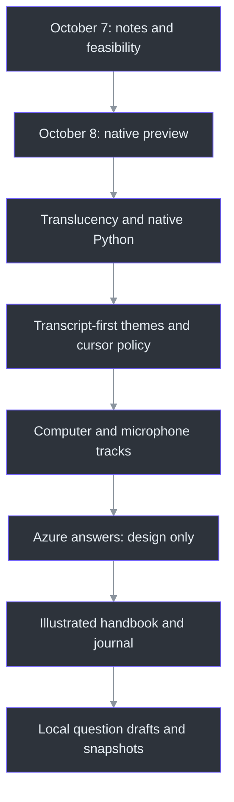
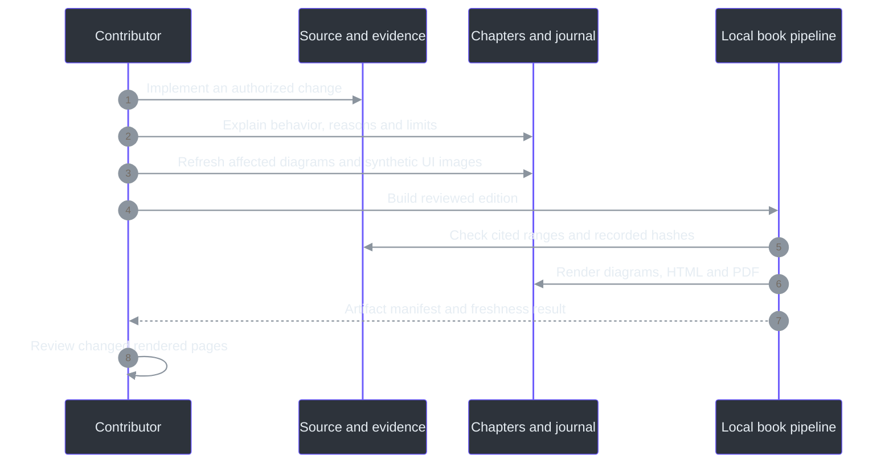

# Development Journal: The Journey of Phantom Fudge

This is the public engineering history of Phantom Fudge. It explains not only what changed, but
why the change mattered and what the evidence did **not** establish. It is not a transcript of
private conversations and contains no meeting content, personal notes or credentials.

Dates below are project-session dates in **Asia/Kolkata (UTC+05:30)**. Times identify recorded
requests or decisions, not invented release timestamps. The project moved quickly across one night
and the following day; that speed did not turn an experimental preview into a qualified release.
The [TODO ledger](TODO/16_DEVELOPMENT_LEDGER.todo) remains the concise operational history; this
journal is the narrative counterpart. The [handbook](docs/handbook/README.md) explains the system.

## The through-line

The original idea was a quiet place for presentation notes. The central challenge was not drawing
text: it was preserving useful interaction while making an honest, bounded request to the Windows
capture system. Speech then became the primary content source, and explicit AI assistance became
the next proposed extension. Throughout those changes, three decisions persisted: keep control with
the user, keep audio local by default, and never substitute a successful local test for a universal
privacy claim.

## 2026-10-07, 23:30 - An idea becomes a bounded product

The opening request was a draggable, notepad-like surface for speaker notes: absent from the normal
taskbar and omitted from screen sharing. The owner first asked for project continuity, a survey of
their existing TODO conventions, deep research and an implementation workflow rather than immediate
coding.

The repository began without an application. Planning adopted indexed, numbered `.todo` workstreams
with explicit status, dependencies, acceptance criteria, evidence and completion logs. The survey
found this useful recurring pattern, not a universal convention across every project or remote
tracker. Stable IDs made later changes possible without rewriting earlier work.

The most important early correction was conceptual. A tool window is still a real window owned by
a real process. Omitting a taskbar entry does not hide it from every application picker. Windows
display affinity can request exclusion on supported capture paths; it cannot promise that no
recorder, camera, privileged program or future OS change will reveal content. Cursor behavior is
another observable channel, not automatically solved by excluding window pixels.

Windows11 became the first platform, with Teams, Zoom, Google Meet and OBS treated as separate
qualification targets. The plan deliberately separated desk research, a local proof, usable
implementation and release acceptance. That separation would become increasingly important as
features arrived faster than real sharing environments could be qualified.

**Public record:** initial decisions and scope appear in `TODO/16_DEVELOPMENT_LEDGER.todo:75-85`;
the convention's bounded survey and evidence semantics are in `docs/TODO-CONVENTIONS.md:1-73`.
The current capture-claim limits are stated in `docs/OVERVIEW.md:49-71`.

## 2026-10-08, 00:32 onward - Implementation, and a new primary signal

The owner authorized implementation and requested eventual Docker support. Live transcription of
the **computer's meeting playback**, initially not the microphone, quickly became mandatory.
This changed the architecture from an editor with special window behavior into a small real-time
system.

C# and WPF took responsibility for the native surface, Windows interaction and WASAPI audio
capture. Python and Vosk handled local speech recognition. A narrow authenticated WebSocket
boundary connected the two. Notes and transcripts remained local; normal capture required an
explicit Start. A hidden service process being available was not permission to begin recording.

The first preview included plain-text editing, capture-affinity setup, recovery hotkeys, a
single-instance reveal path, Edit/Present modes, bounded in-memory transcripts and explicit export.
Several failure paths proved as important as the happy path: repeated close/save actions, malformed
endpoints, unfinished recognition at restart and restoring a minimized hidden utility. Those
corrections made the preview less likely to lose data or leave the user unable to recover it.

One explicitly approved synthetic playback test exercised actual default-output loopback through
the real recognizer. It did not use a microphone or establish performance on a real meeting.
Subsequent sleep instructions ruled out further speaker playback, questions, uploads and risky
system changes. Later testing therefore relied on generated PCM and isolated synthetic fixtures.
No public release or push followed from creating a local ZIP.

**Public record:** the historical implementation/evidence table and approved playback boundary are
in `docs/IMPLEMENTATION-STATUS.md:315-369`; the authorization and subsequent restrictions are preserved
in `TODO/16_DEVELOPMENT_LEDGER.todo:66-74`.

## 03:01 - A hidden window must still be recoverable

The first operational question was simple: after clicking Hide, how does the presenter get the
window back? The recovery path was already part of the product: `Ctrl+Alt+Space` reveals it, and
relaunching the executable signals the existing instance rather than creating competing surfaces.
The app also recenters on relaunch recovery.

This episode exposed a general design lesson. Removing an ordinary taskbar presence takes away a
familiar recovery mechanism. The product must replace that affordance deliberately. Hiding also
stops transcription; showing the surface again does not silently resume audio capture.

The UI should feel quiet without making the owner guess whether it is still listening or how to
reach it. The native recovery design is explained in
[the state-machine chapter](docs/handbook/11-state-machines-and-failure-containment.md).

## 03:04 - Remove repetitive acknowledgments, not technical safeguards

The owner explicitly stated that meeting permission and recipient preflight would be handled
outside the app, and asked for the associated checkboxes and repeat confirmations to disappear.
The change removed those gates from Start, Present and reset paths.

That instruction did not mean ignoring all failures. Explicit Start/Stop, token/input validation,
protection setup and unsaved-content safeguards remained. Nor did it turn an external responsibility
into recorded compatibility evidence. The lasting requirement is **not to reintroduce permission or
rehearsal prompts** under a different name during future feature work.

**Public record:** `docs/IMPLEMENTATION-STATUS.md:308-313` records the change and local artifact;
`docs/DEVELOPMENT-WORKFLOW.md:95-102` preserves the durable behavioral requirement.

## 03:12 - Seeing through the surface without washing out the text

The next request was practical: the opaque window blocked the material behind it. Instead of
reducing the opacity of the whole window, the implementation made the content background
translucent while preserving solid text. The Background slider spans10-100%, defaulting to55%.
Header and setup controls remain opaque; the surface does not become click-through.

This is more than a color change. Layered WPF rendering changes the conditions under which earlier
capture observations were made. Local affinity/readback, alpha, hit-region and synthetic GDI
observations were repeated for the changed rendering path. Their success remained bounded to that
machine and those samples. It did not qualify four meeting products or prove an uninterrupted
first-frame guarantee.

The lesson was to treat rendering changes as changes to the capture-evidence boundary, not just
visual polish.

**Public record:** `docs/IMPLEMENTATION-STATUS.md:297-306` identifies the layered result and limitations;
the implementation is explored in [chapter05](docs/handbook/05-desktop-ui-and-themes.md).

## 03:25 - Correcting Docker's place in the architecture

The owner clarified an important mismatch: Docker should come at the **absolute end**, as a future
packaging option, not as the architecture's normal operating prerequisite. The implementation was
corrected around native Python setup, startup, ownership and shutdown.

This was not a late discovery that Python might help C#. The system already used C# for Windows
integration and Python for recognition. The correction was about deployment responsibility.
Normal launch now starts or reuses an authenticated local Python service. It will not kill an
unrelated process merely because that process holds the expected port. Model/interpreter/token
setup remains explicit, and an idle running service still does not capture audio.

Docker recipes could remain useful as a future adapter around the headless boundary, but workstream20
was moved after native release17. Runtime22 became the required operational path. This distinction
prevented infrastructure work from blocking the thing the owner actually wanted to run.

**Public record:** native operation and the Docker correction are recorded in
`docs/IMPLEMENTATION-STATUS.md:276-295`; the current dependency graph is in `TODO/00_INDEX.todo`.

## The muted-laptop experiment - Compare engines, not language stereotypes

The owner also questioned whether C# transcription would be good enough and asked for a real
comparison, while planning to mute the laptop. A mute-independent experiment sent the same
generated PCM to Windows SAPI, Python Vosk and Python faster-whisper. No speakers, microphone or
cloud ASR were needed.

The corpus contained32 cases,164.07seconds of audio and292 reference words. Across two serial warm
passes, the recorded comparison was:

| Engine | Word error rate | Warm decode time |
| --- | --- | --- |
| Windows SAPI | 45.89% | 10.139seconds |
| Python Vosk | 8.22% | 41.754seconds |
| faster-whisper base.en, CPU int8 | 4.79% | 25.745seconds |

These measurements challenged an easy answer. SAPI was quickest on this batch but substantially
less accurate. Whisper looked promising on quality and warm throughput. Neither result proved
that one programming language was inherently better at speech, or that batch completion predicted
the first useful live partial. Vosk remained the production streaming recognizer; swapping it out
requires a real streaming contract and suitable latency/quality evidence.

Generated English speech also does not represent every accent, interruption, name or noisy meeting.
The historical receipt must be read with its exact harness/model provenance; the handbook notes
that today's harness hash differs from the historical receipt rather than rewriting that receipt.

**Public record:** [the full benchmark report](docs/SPEECH-BENCHMARK.md) and
[chapter12](docs/handbook/12-performance-and-benchmarks.md). Summary measurements and their limit
are recorded in `docs/IMPLEMENTATION-STATUS.md:282-285`.

## 11:31 - Transcription moves to the foreground

The owner reported two interaction cues: the recipient-side cursor could disappear when clicking
the app, and the local pointer became an I-beam over text. They also asked for transcription to
become the main view, notes to collapse by default, and DeepSeaFoam/Harbor Daylight plus Plain B/W.

The response separated what the app controls from what the recorder controls. The app now defaults
to non-activating Present mode, requests a normal Arrow and handles its own native cursor messages.
Edit remains the deliberate route for keyboard input and accessibility. These changes reduce local
focus/cursor cues; they do not establish control over a recipient's capture pipeline.

Moving to passive interaction exposed a real WPF nuance: default ListBox row selection expects
focus to succeed. The device selector needed explicit passive selection rather than pretending
that a non-activating window could use the ordinary focus path unchanged.

The transcript became primary, notes collapsed, and canonical theme tokens were used instead of
approximate colors. Automatic unprotected protection-failure message boxes were replaced by bounded
generic local notices. The already-running owner app was preserved while new candidates were
packaged separately.

**Still unresolved:** recipient-side cursor disappearance needs qualification in the actual
recorder/sharing mode. No implementation change justified the requested absolute invisibility claim.

**Public record:** `docs/IMPLEMENTATION-STATUS.md:257-274`, [cursor/theme notes](docs/CURSOR-AND-THEMES.md)
and workstreams24/25.

## 13:47-14:01 - Small UI questions clarify the evidence

The owner asked where the theme toggle was and later confirmed that themes worked. They also
asked about the footer reading "Capture exclusion requested. UNQUALIFIED PREVIEW: compatibility
varies by capture method." That text was an informational boundary, not a failed setup error.

The owner reported that Snipping Tool omitted the window. That is useful **owner observation**,
not independent proof of every recorder or sharing path. Documentation retains the distinction.
This episode also explains why this book's UI images use internal synthetic visual-tree rendering:
they can illustrate the actual controls without claiming that a desktop screenshot should succeed
or asking the owner to expose private content.

## 14:01 - Dictated questions require a microphone track

The owner wanted to read a chat question aloud and have it transcribed, while explicitly avoiding
chat-reading integration. The new requirement was to listen to both computer output and microphone
dictation. It superseded the original no-microphone product scope; it did not authorize development
tests to record a real microphone.

Computer, Mic and Both modes were added. Both is the default selection, but capture remains stopped
until Start. The sources use separate selected WASAPI inputs, bounded queues and independent Vosk
recognizers. A v2 protocol prefixes PCM with a source byte while preserving v1 compatibility.
Source labels identify inputs, not people; they do not provide diarization or guaranteed acoustic
echo cancellation.

Service management also learned to distinguish a stale, owned, idle service from an active or
foreign one. Only the first is eligible for the capability-aware restart path.

Review found a subtle stop/restart race: an audio component could report not-running before final
events and cleanup were finished. A new Start in that interval could reset transcript IDs and
mix the lifecycle of two sessions. A coalesced UI stopping gate now prevents Start/mode/clear
changes until final draining and cleanup settle.

The recorded evidence included41 Core tests,46 native synthetic groups,71 backend tests and four
manager-upgrade guards, plus real generated dual PCM and C#-to-Python v2 recognition. No actual
microphone/render endpoint or chat content was opened for this work. Hardware permissions, echo,
OS microphone indicators and recipient behavior remain to be qualified.

**Public record:** `docs/IMPLEMENTATION-STATUS.md:233-255`,
`docs/DUAL-SOURCE-AUDIO.md:1-30` and [chapters07-11](docs/handbook/07-dual-input-capture.md).

## 15:05 - An answer feature is researched before it is built

The next idea was to turn a chosen transcript question into a prompt and display the model's
answer. The owner requested deep architecture research, Azure where useful, and low latency.
The requested deliverable was design and backlog, not immediate cloud execution.

The proposed path is deliberately narrow: local ASR, an editable source-scoped question draft,
an immutable snapshot on explicit Ask, direct C# streaming from Azure OpenAI v1 Responses, then
rendering inside the same protected native surface. Audio stays local by default. The selected
question text crosses a new, deliberate cloud boundary; the entire meeting does not automatically
become prompt context.

A proposed Mic-only commit/ack avoids stopping Computer transcription to finalize a dictated
question. It needs protocol evolution; current v2 stop-all is not that feature. Planned public-client
Entra/WAM authentication must avoid embedded secrets and surprise sign-in windows during presenting.
Request cancellation must prevent stale tokens from updating a newer answer.

Research considered current model lifecycle and capabilities rather than choosing a familiar but
retiring default. No candidate was declared fastest without measuring it in the intended region
and configuration. Likewise, `store:false` is not a universal zero-retention promise.

Four design documents, workstreams27-37 and workflows04/05 capture the plan. Only research27 is
DONE. There is no implemented Ask button, composer, Azure client, source commit or answer pane.
No Azure account/resource discovery, sign-in, inference or upload was performed.

**Public record:** `docs/IMPLEMENTATION-STATUS.md:227-231`,
`docs/AI-ANSWER-ARCHITECTURE.md:82-200` and the four linked [AI design documents](docs/README.md).

## 16:11 - Turn the implementation into a teachable engineering record

The owner requested documentation detailed enough to become a book, using another project's
documentation as a depth/style reference, and asked that screenshots, diagrams and a proper
journey journal remain current thereafter.

The resulting handbook is organized into22 chapters plus this journal appendix: first-principles
onboarding, a principal engineer's guide, native Windows behavior, storage, the complete audio
pipeline, state machines, measured performance, planned Azure architecture, development/operations
and grounded reference material. The other project's prose and artwork were not copied.

Illustrations have a defined provenance. Nine images render the actual WPF visual tree with
synthetic text and device labels. They do not record audio, read chats, expose notes or capture
the desktop. They illustrate appearance, not capture exclusion. Mermaid diagrams are rendered
locally into SVG while retaining their editable sources.

The book pipeline produces offline HTML and a printable PDF with a generated manifest. It checks
source ranges, local links/images, diagram rendering, recorded source freshness and printable layout.
Those mechanical gates cannot prove a paragraph's interpretation; chapters still require source
review. Exact generated counts and artifact hashes belong in the
[edition manifest](docs/handbook/manifest.json), not a hand-maintained competing receipt.

This milestone adds a durable workflow obligation, not merely more files. Any later behavior change
must update relevant chapters and diagrams; visible UI changes must refresh synthetic images; and
significant decisions/evidence must extend this journal. Workstream38 establishes the first edition.
Workflow06 and the repository working contract carry the requirement forward.

The initial edition was completed locally. Print review exposed undersized diagrams, so their
layout was enlarged and sequence labels wrapped; narrow-screen review exposed long source paths,
so the reader gained responsive wrapping. Those corrections improved the actual artifacts rather
than treating a successful export as sufficient. Nothing was uploaded or published.

The documentation-only fixture does not replace the most recent user preview ZIP. That preview
remains the145231 dual-source bundle identified in `docs/IMPLEMENTATION-STATUS.md:249-255`.
The book does not implement Azure Ask, qualify remote cursors, or move Docker earlier.

## 2026-10-08, 17:37 - Offload the book, then implement the next safe slice

The owner asked for context-offload after the detailed documentation, followed by the next
dependency-ready implementation. The completed book was saved before code work resumed.
Research27 made local question state28 the next ready step; cloud connection30 still required
an approved destination and data/identity policy.

The implementation deliberately stopped short of pretending that an answer service existed.
It added structured transcript entries with capture-session GUID, source, utterance identity,
revision and qualified timing. The native adapter stamps session identity before queuing UI
callbacks, so delayed old-session text cannot enter a new capture. Existing display/export
formatting remains in its original buffer.

The new Question panel copies only explicitly selected segments or typed text. Mic is the initial
filter, but Computer/All sources can be selected deliberately. A chosen partial can evolve into a
final until the owner edits it; a frozen snapshot never changes. The8K-character draft limit rejects
oversized input atomically rather than silently cutting off the end of a question. Eviction from
the bounded history does not erase the copied draft's provenance.

Question typing needed a separate focus transition. Reusing global Notes Edit would have stopped
Computer audio, defeating dictation during a conversation. The new Type / edit action deliberately
takes keyboard focus in the same protected HWND while leaving transcription running and notes
read-only. Done typing/Escape returns to passive behavior. Ordinary global mode changes and Hide
retain their earlier stop policy.

**Ask as shown currently freezes locally only. Nothing is sent to Azure.** No fake answer is shown
to suggest otherwise. Accurate armed-Mic start/end boundaries remain workstream29: current v2
partials cannot reconstruct a sample-exact cut around speech already in a device or decoder buffer.
That boundary was deferred explicitly rather than guessed from display text.

The recorded local evidence is137Core tests (96new,41existing),46native synthetic groups, and
source/exact-package synthetic UI checks including CR/LF fidelity and the470x560minimum window.
The first source UI run failed its existing foreground-preservation assertion; an identical-source
repeat and subsequent runs passed. The cause was not established, so no invented focus fix or
recipient guarantee was recorded. No real audio endpoint, chat content or cloud model was accessed.

The local183107preview contains486files and76,205,175bytes, with SHA256
`C5062B6B94F3ABC63901960F1572F1A9141EA128C2CA513E6D26C4C5C3FAB27A`.
It was packaged and exercised locally without interrupting the owner's running app. The handbook
and screenshots were updated alongside the implementation, putting the new maintenance contract
into practice immediately.

**Public record:** [local question operation](docs/LOCAL-QUESTIONS.md),
[workstream28](TODO/28_QUESTION_DRAFTS.todo), [current evidence](docs/IMPLEMENTATION-STATUS.md)
and the [remaining answer architecture](docs/AI-ANSWER-ARCHITECTURE.md).

## 2026-10-08, 19:43 - A visual front door, detailed documentation behind it

The owner asked for more images and less text on the front README. The front page now emphasizes
the actual synthetic UI, local questions and three themes, with a compact status note and links.
Its setup, product explanation and capture limits moved into the product overview and expanded
documentation index rather than disappearing.

Transparent WPF renders were composited onto matching palette backgrounds for README legibility
on both light and dark GitHub pages. The derivatives retain source/output hashes and are explicitly
labelled as synthetic UI illustrations, not desktop captures. No new app capture, model request,
runtime change or upload was needed. Future README changes must keep this image-first structure.

See [the visual front page](README.md), [product overview](docs/OVERVIEW.md) and
[documentation index](docs/README.md).

## 2026-10-08, 21:24 - Installed model tools, and a simpler Agency path

The owner wanted answers through software already installed on the machine, while retaining
future Azure integration. The design gained a narrow `IAnswerProvider`: a request contains only
the exact frozen question, never its original source references or the rest of a meeting. The
window gained streamed plain-text answers, bounded rendering, Cancel and explicit Copy.

The initial implementation investigated standalone Copilot plus its documented offline
OpenAI-compatible mode. Local installation and local inference were kept separate: ordinary Copilot
uses cloud models, while an offline model requires a separately running local server. Synthetic
loopback tests established tool-free requests, literal input and bounded error/cancellation behavior;
they did not install or benchmark a real local model.

One authorized direct-Copilot cloud attempt failed at its customization/tool gate. A requested
dedicated sign-in then produced an organization-authentication popup. The owner corrected the path:
no organization-data access or new sign-in; simply run their existing Agency with a prompt in the
background. The owned login was stopped and app settings returned to SnapshotOnly. The failure was
not relabelled a success, and its model-call allowance was not silently reused.

Agency exposes `agency copilot` with profile-only configuration and controls for excluding default
MCPs/plugins. A separately authorized synthetic Agency request returned `PHANTOM_OK` using existing
authentication, with no new login flow. The recorded model surface had zero tools and no assistant
tool requests; both builtin GitHub MCP descriptors were disabled. The selected model was
`claude-sonnet-5`. No notes, meeting audio, repository files or organization-data tools were submitted.

The run took69.881seconds end to end. That proves a functional route, not a low-latency experience
or a guarantee that cached authentication will always be available. Agency remains a local process
using a remote model service; it is not an offline model. Its session/log retention also remains
separate from the application's in-memory draft policy.

The direct Azure adapter stays a future option behind the same interface. Accurate Mic-only
finalization remains workstream29; it is not required to explicitly send an already-reviewed draft.
See [provider setup](docs/ANSWER-PROVIDERS.md) and the [sanitized smoke receipt](docs/answer-provider-smoke.json).

The final adapter replays that successful protocol and uses the same restricted profile/launch.
Core268tests and the exact packaged synthetic UI passed, including cancellation, early text,
invalid settings and minimum-size layout. New preview235421contains489files and76,252,854bytes,
SHA256 `88D98E7CAFA56B067A521571778D0F661A879DDCBF5EBBE9D412987D2BFA5A69`.
No additional real model call was made for packaging. The existing app was not force-closed.

## Remaining qualification

The application is still a local unqualified preview. Full Teams/Zoom/Meet/OBS qualification,
recipient cursor behavior, hardware microphone/echo/privacy-indicator observations, long-session
quality, accessibility and owner acceptance have not been replaced by this book.

Local drafts and installed Agency answers are implemented; direct Azure still needs its approved
integration, and all provider paths need broader quality/latency and release qualification. Optional cloud ASR
and a broker are separate decisions. Docker remains a final-stage packaging option after native
release, not a prerequisite for transcription.

The next journal entry should say what actually happened, identify its public evidence and preserve
these boundaries until new evidence changes them. A useful engineering history is allowed to say
"not yet," "the earlier approach was wrong," and "this result covers only this case."

## 2026-10-09, 01:19 and 03:11 - Correcting the actual-use experience

The owner rejected the small, scroll-heavy window, low-contrast text, inaccurate technical
dictation and slow Agency responses that described workspace inspection instead of solving the
question. The later request explicitly included transparency for the answer area. A printed
command was not proof that a tool executed, but the response was still a failed answer.

The requested window is now 1240 x 1520, twice the previous dimensions, clamped to the monitor:
the observed 1920 x 1200 work area fits 1240 x 1176. Wide views put transcript and Q/A beside one
another. Main actions do not sit inside nested outer scrolling panels; long text still scrolls
within its own control. Reading text is opaque white in the dark theme and black in light/plain
themes. The answer shares the 10–100% Background slider. A quiet requested-state footer plus inline
Details replaces persistent warning clutter without claiming capture certification.

The local speech pipeline now separates fast Vosk partials from Whisper small.en CPU-int8 finals.
Verified models, four CPU threads, disclosed general technical vocabulary, independent bounded
source workers and a separate finalizer preserve strict v1/v2 messages. Finalization owns disjoint
PCM spans, targets 15 seconds, and fails visibly under sustained backlog rather than silently
dropping audio. Earlier long-window repetition, deadline and shared-queue failures are retained.

On the new two-voice synthetic/noise corpus, raw WER moved from 12.04% to 4.40%, CER from 6.37% to
0.263%, and speech-end-to-final median/p95 were 2.736/3.017 seconds. Normal Stop median/p95 were
0.480/0.746 seconds; the 90-second client cap covers a conservative 85-second backend failure/
cleanup envelope, not typical latency. Compound-token spelling and homophones remain imperfect.
No original microphone recording exists here, and these results do not qualify the owner's voice,
room or device. The earlier October 8 benchmark remains a different experiment.

Agency now uses a fixed answer-only system role over official persistent ACP, with one exact JSON
question per fresh session and no tool/permission surface. Ambiguous wording should receive a
brief stated assumption and a concrete answer, not a request for another input. The app prepares
one empty isolated session on startup/reveal/reload without submitting a model prompt, then keeps
the provider rather than paying the full cold launcher cost for every Ask. Question history does
not carry into the next session. Hide/Clear/protection failure/reload/close tear down owned state.

The final H batch used the owner's exact intended question and reported ASR string without
rewriting either. GPT-5.6 Sol Fast / low returned three complete answers in 4066, 4176 and 2992 ms;
the malformed case explicitly assumed LeetCode Two Sum. All three C# implementations compiled and
passed 33 ordinary/full-integer-boundary checks. The selected default changed accordingly. Forty-
eight client question submissions are accounted for across the authorized study; no extra model
calls were made for documentation or packaging.

This is not a universal five-second SLO: initial empty-session preparation took roughly 20–31
seconds. Earlier Haiku E success used different synthetic wording; F exact text exposed wrong-
problem/follow-up failures, and G mini exposed overflow failures. Those results remain visible.
The final three prepared-session examples are not a broad quality distribution or measured WPF
paint latency. They test interpretation of text supplied by the owner, not recognition of audio.

New rotating local diagnostics record safe stage/error/count/level metadata and request/capture
correlation. App logs are bounded to 2 MiB per file, ten files and a 1024-record queue. Backend
metadata rotates separately at 1 MiB with three backups and no transcript text. Text is an explicit
app opt-in; notes, raw audio and tokens remain excluded. Metadata export removes Text by default,
includes only allowlisted speech logs and never uploads. Old empty/deleted logs cannot reconstruct
the reported interaction retroactively.

The updated guides, source-linked book and synthetic UI illustrations follow these changes.
The current local candidate and final validation identities are recorded in
[implementation status](docs/IMPLEMENTATION-STATUS.md), not substituted for clean-machine,
recipient/cursor, actual-microphone, accessibility or owner acceptance. Save/copy needed content
and close the old app before updating; no user's running instance was force-closed.

**Public evidence:** [quality correction](docs/QUALITY-UPDATE.md),
[diagnostics](docs/DIAGNOSTICS.md), [answer results](tools/AgencyProbe/results/summary-final.json),
[speech results](tools/SpeechBench/results/synthetic-quality-20261009.json) and workstreams
[40](TODO/40_EXPANDED_READABLE_WORKSPACE.todo), [41](TODO/41_LOCAL_SPEECH_QUALITY.todo),
[42](TODO/42_DIRECT_FAST_ANSWERS.todo), [43](TODO/43_LOCAL_DIAGNOSTICS.todo).

Final review corrected three concrete failure paths: shutdown now initiates capture Stop before
awaiting provider cleanup; a failed diagnostic write remains observable even if fallback stderr also
fails; and follow-up detection anchors invitations to line starts rather than rejecting quoted
phrases inside otherwise valid answers. The parent reports final Core345, service106, native46 and
benchmark18 passes, plus the synthetic source UI including capture-before-cleanup and answer alpha.
No additional model request or real audio was needed. The runtime was then frozen for local packaging;
these bounded checks do not close owner, microphone or recipient-side qualification.

The authorized local candidate is `phantom-fudge-0.1.0-preview-win-x64-20261009-045022.zip`:
76,383,294 bytes and 508 files, SHA256
`D24E8D2C5A1AF30E3F72FDA07F535B43D730420A81CE67115645605B7667D553`.
Its exact extracted executable passed synthetic UI/question/answer checks, including capture Stop
before provider cleanup and answer-background alpha. The fixture reported zero model/cloud requests
and no recording/audio. The archive includes the required service helpers, diagnostic script pairs
and five allowlisted public quality receipts, not weights, tokens, private profiles, PCM, logs,
context stores or debug symbols. It is unsigned, not uploaded, and not a qualified release.

## 2026-10-09, 10:07 request - Click several transcript lines to compose a question

The owner wanted to click a Mic or Computer line directly in the main transcript and have it
populate the question editor, then explicitly expanded the request to **multiple lines**. The
manual source chooser alone made this unnecessarily indirect. The updated source now lets ordinary
clicks toggle whole recognition segments without Ctrl and combines their raw text in displayed
history order, not click order. A wrapped/multiline segment stays one selection; generated
timestamps/source labels are not copied into the question.

The implementation pairs immutable display rows with structured segment identity rather than
parsing rendered text. Main visible history remains selectable after the smaller256-entry/
64000-character chooser evicts records, while the unchanged display/export buffer still bounds
accumulated history. Archived unfinished partials retain identity and provisional status;
session separators cannot be selected. Selected partials follow revisions and finalization until
the user edits. New finals follow the scrollbar only when already at the end, so choosing older
history does not continually jump to new speech.

A click opens Q/A, closes source/setup/Notes and enters independent question editing. This is a
deliberate focus action, not passive no-activation. It does not stop transcription, enable Notes
editing, freeze a snapshot or send anything. Once the user edits the question, direct selection
changes retain that draft and its highlights with inline status until **Clear question**.
No popup or repeated rehearsal/permission confirmation replaces the guard. The manual **Choose
source → Mic / Computer / All → Use selected** replacement path remains available.

Both paths use `QuestionDraft.ReplaceSelection`: one capture session, at most256entries and
8192UTF-16 units including inserted newlines. Rejection is atomic, not truncation. Existing
snapshots remain immutable. The selected outline keeps shared transparency and solid white/black
reading text instead of covering the row with an opaque highlight.

**Evidence and limits:** the runtime implementer reports the first full synthetic screenshot/UI
run passed. The supplied actual WPF [multi-selection image](docs/handbook/assets/screenshots/transcript-multiselect.png)
is now linked from the guide and UI chapter. It uses synthetic content, no real audio input and no
model request; it is not recorder or owner-acceptance evidence. Final test evidence, image
re-export/provenance, baseline-citation migration and handbook build/review remain the parent's
handoff work. Workstream44 stays **IN_PROGRESS**.

This is an **updated-source** delivery through `scripts\Run-PhantomFudge.ps1`, with no new ZIP planned.
The045022ZIP above is preserved as the historical quality candidate and does not include click
selection. Save/copy needed content and close the old app before launching updated source.
No real microphone/model/org access, service operation or new login was part of this selection
documentation work; no running owner instance was force-closed.

**Public sources:** [direct selection](src/PhantomFudge.App/MainWindow.TranscriptSelection.cs),
[synthetic diagnostic](src/PhantomFudge.App/MainWindow.TranscriptSelectionDiagnostics.cs),
[draft rules](src/PhantomFudge.Core/QuestionDraft.cs),
[local workflow](docs/LOCAL-QUESTIONS.md) and [workstream44](TODO/44_TRANSCRIPT_CLICK_SELECTION.todo).

### 10:30 evidence handoff - Source validation complete, book stage pending

The final source/UI receipts in `.local\handbook-capture-20261009-101632` report PASS for all20
direct-selection checks and the existing question/answer, minimum/responsive layout, alpha,
cursor and style guards. They report zero model/cloud requests and no recording/audio capture.
The parent also reports118passing targeted Core question/transcript tests and an exporter refresh
of16synthetic WPF images plus5READMEderivatives.

After the first smoke, the final changes made the retained-edit status visible when Q/A had been
hidden, added the twentieth check that clearing the transcript retains the copied question, and
reset the synthetic fixture for readable answer images. Runtime is now frozen. Implementation
and synthetic validation are complete; citation migration, full handbook/illustration review,
freshness and final handoff remain with the parent. Workstream44 stays IN_PROGRESS for that stage,
not because the source/UI checks failed. No new ZIP, live model/audio run or capture qualification
is implied by these results.

## 10:33 - Optional interpretation before a solution

The owner requested a toggle for questions whose general meaning survived transcription but whose
wording would be cumbersome to edit. With **Clarify first** enabled, the provider should restate the
intended question; the owner can then type Yes or a correction before asking for the solution.
This explicitly supersedes the no-follow-up requirement only for this opt-in mode. Normal Ask
remains direct and history-free.

The design keeps the original draft separate from a reply field and attaches only a fixed task
instruction plus this clarification conversation. It is not permission to add device information,
logs, notes, organization data or unselected transcript. Every interpretation, correction and final
confirmation is a separate explicit request; no agent waits for interactive permission and the app
never automatically submits a reply. Cancelled or incomplete interpretations cannot enter history.

Implementation uses typed, bounded metadata behind the existing provider interface and same-HWND
controls. The toggle is off on launch; changing destination or turning it off resets the clarification
thread. Original question text remains available. Four interpretation rounds and a character budget
bound retention; model guesses still require the owner's review.

The earlier under-five-second measurements describe direct answers, not this multi-request loop.
No new live model, authentication, audio or organization-data operation is authorized merely by
implementing it. Current implementation/evidence and usage are recorded in
[workstream45](TODO/45_OPT_IN_QUESTION_CLARIFICATION.todo) and
[the clarification chapter](docs/QUESTION-CLARIFICATION.md).

### Combined source delivery

Both selection44 and clarification45 are complete locally. The combined affected Core run passed270
tests, after227provider-focused cases; the final105245synthetic UI fixture passed20selection and
16clarification cases plus the existing layout, alpha, cursor and answer lifecycle guards.
The first clarification layout was too short at470x560. Reusing the narrow transcript area while
replying made both the interpretation and reply readable without adding an outer scrollbar.

The updated edition includes17synthetic WPF images,5READMEderivatives,51diagrams and a dedicated
Clarify first chapter. Source citations were migrated once from the preserved pre-selection baseline.
The first book attempt caught an invalid SVG generated from a line-break label; shortening that
diagram label corrected it. The HTML/PDF and representative pages were then rebuilt and reviewed.
The edition manifest remains authoritative for final counts and hashes.

This remains a source-only handoff. The old045022ZIP was not modified; save/copy needed content,
close the old app with X and use the source launcher. No live model, audio, service, authentication
or organization-data operation was performed, and no commit or push was issued.

## 11:07 - From a handbook to an annotated source reference

The owner asked for deeper documentation covering every interesting line of code. The existing
conceptual handbook explained the system, but a chapter list could not demonstrate whether a
helper, diagnostic branch, test or operational script had been overlooked.

The new approach separates explanation from measurable coverage. Seven source walkthroughs trace
desktop interaction, domain state/storage, providers, native audio, Python recognition, operational
scripts and the documentation compiler. A separate annotated source atlas pairs each first-party
file with authored contiguous explanation blocks, important statement excerpts and complete
line-numbered source. The HTML is searchable; its PDF emphasizes explanations rather than printing
the entire repository twice.

The compiler checks the live local Git inventory, exact source hashes, complete non-overlapping
physical-line partitions, bounded excerpts and byte-identical PowerShell text mirrors. Generated
evidence receipts and dependency lockfiles remain explicitly classified rather than counted as
new authored code explanations. External package internals, private runtime data, model weights
and actual device/provider behavior are outside this source-reading claim.

This distinction matters: complete line assignment is not proof that every nuance is understood.
The prose still explains actual guards, counter units, mutation order, failure preservation,
ownership and test negative controls, with uncertainty stated. Tests and diagram freshness cannot
substitute for that reading. Runtime source was held unchanged; this work does not run a meeting,
an audio endpoint, a model or a capture proof.

The existing Node documentation runner now also checks the atlas compiler's path/scope, line
splitting, escaping, stale-source, gap/overlap and incomplete-output behavior. The main handbook
requires a complete current atlas before it can declare its edition current. See
[workstream46](TODO/46_ANNOTATED_SOURCE_REFERENCE.todo), the
[source reader](docs/source-atlas/index.html) and the
[documentation walkthrough](docs/handbook/28-documentation-source-walkthrough.md).

### Source-reference delivery

The finished atlas covers163first-party files and23686physical lines through956authored blocks
across seven source groups.33generated evidence files and8dependency lockfiles are indexed separately;
18PowerShell text mirrors match their canonical scripts. No runtime or non-documentation-tool
source changed during this work.

The searchable HTML contains complete escaped source, stable line links and local search across
code and explanations. Its476-page PDF carries explanations and focused excerpts. The expanded
conceptual handbook adds seven source walkthroughs and14diagrams, bringing the illustrated edition
to65diagrams. Edition manifests, rather than these rounded narrative descriptions, own final
hashes and counts.

The existing Node test runner passed18documentation tests. The rendered reader contains all163file
sections,956annotation blocks and23686source-line anchors; internal links, identifier search,
filtered deep links and print-filter restoration behaved as intended. Reader widths1440/768/390
fit without horizontal document overflow. Representative atlas/PDF pages and all seven new
handbook chapters' code/diagram views were inspected.

These are documentation and tooling results, not new microphone, model, container or recipient
capture evidence. The owner-facing app was not restarted; no credentials, local service, runtime
models or historical result receipts were changed. No commit, push or publication was performed.

## 11:55 - Reduce only the answer typography

The owner requested a50%smaller font in the answer field. Its normal size is now10WPF units rather
than20; its compact size is9rather than18. Both the XAML default and responsive layout assignment
changed, so resizing does not restore the larger text. Transcript and question text are unchanged.
Clarification interpretations use the same answer reader and inherit the smaller type.

The existing synthetic fixture now checks those exact sizes alongside layout/alpha/lifecycle
behavior. Updated images, source annotations and the two documentation editions accompany this
source-only adjustment. No model/audio/service operation, app force-close or new ZIP was involved.

## 12:04 - Make Ask unmistakably the primary action

The owner wanted Ask alone on the right, larger and with a colored background. The question action
row now separates Type/edit, Copy and Clear on the left from a148-unit-wide, minimum44-high Ask
target on the right. Its15-unit semibold label sits on the current theme's accent color with the
matching action-text color. Hover/focus/press use the border; disabled state remains visibly dimmed.

The same control still switches between Ask provider, Freeze locally, Interpret question and Reply
below. Existing readiness and explicit-send guards are unchanged. The synthetic UI fixture checks
the actual template colors, larger dimensions, right edge and separation from every secondary
action across themes and representative layouts. The smaller answer font from11:55 remains intact.
Updated images, source explanations/citations and both documentation editions accompany this
source-only change; no live model/audio/service operation or user-app interruption was performed.

## 12:15 - Put Clear after Ask, with a red border

The owner refined the action order: Clear belongs immediately to Ask's right, outlined in red.
The large accent-filled Ask is preserved, while Clear receives the final action column, a98-unit
width,44-unit minimum height and two-unit theme-error border. Hover/focus/press change its face
without replacing that red outline. Edit and Copy remain on the left.

The first compact clarification layout wrapped the longer left-side labels and reduced reply
height. Narrower horizontal padding on those two secondary controls fixed the actual layout.
The synthetic fixture now checks both reading and typing a clarification reply, as well as
right-side ordering, red border, existing lifecycle guards and the earlier half-size answer text.
Source annotations, images and the two documentation editions follow the same change. The clear
handler and provider behavior are unchanged; no real model/audio/service or owner-app operation ran.

## 12:30 - Make active transcription visible

The owner requested a red recording icon once transcription starts. A12-unit red dot now appears
beside the transcript heading and Start control while the transcriber reports Running. Selecting
Computer/Mic/Both or waiting for startup does not light it. Stop/fault status hides it through the
existing control-refresh path, while reserved hidden space prevents the toolbar from shifting.

The dot has a solid contrast outline and an accessible recording-state name. It means active
transcription, not that the application is saving raw audio. The synthetic UI fixture checks
stopped, starting, active and stopped-again presentation across themes and produces an explicitly
labelled example without opening an audio endpoint. Source explanations, screenshots and both
documentation editions are updated; no live model, service or owner-app operation was performed.

## 12:42 - Replace scrolling device lists with cards

The owner again emphasized no scrolling, this time for audio setup. The old64-unit-high device
lists are replaced by selectable cards with wrapped names, accent outlines and radio dots.
Setup temporarily uses the reading area, giving both sources enough room for normal catalogues
without moving the app's recovery controls off-screen.

Large catalogues and small windows need a finite navigation boundary. Measured card capacity now
uses Previous/Next pages rather than scrollbars. Paging collapses off-page containers but preserves
the full collections and selected endpoint objects; a page label identifies the chosen card's page.
Only an explicit card click changes selection. Starting/running/stopping capture still locks it.

The existing token field and guidance moved under Service setup, with automatic expansion when
Start finds a missing token. Empty catalogues have explicit messages. Extremely long names may
ellipsize in constrained cards without changing the actual name or endpoint ID.

Synthetic23-output/17-microphone checks exercise card bounds, no-scroll templates, selection
preservation, passive foreground, themes, lifecycle locks, source modes, service controls and empty
states. Updated images and detailed source/book explanations accompany the change. No real input,
model, service, owner-app restart, package release or push was involved.

## 13:15 - Reduce transcription text by one quarter

The owner requested25%smaller transcription text. Final Computer/Mic rows now use15WPF font units
rather than20. Live partials use13.5rather than18, and compact partials use10.5rather than14.
The responsive assignment and XAML defaults agree; question, answer and device-card text are unchanged.

The existing synthetic layout fixture asserts those exact sizes while retaining its selection,
focus, theme and lifecycle checks. Images, authored source explanations and the full documentation
editions follow the change. No real audio/model/service operation or owner-app restart was performed.

## 13:23 - A book cover, not an invisibility promise

The owner requested a top-bar toggle that replaces the workspace with **NOTEPAD IS READY**.
When asked about ongoing work, they explicitly chose to keep transcription and answers running.
They then asked for broader screen-reader/process/capture hiding. The premise was corrected:
Windows capture affinity is limited, and a visible app is not universally undetectable.

The implementation swaps two hosts on the same protected HWND. It detaches and disables the
workspace, retaining its objects and async activity, and exposes only the message and Uncover.
Normal Hide/Exit behavior remains distinct. Pending file/confirmation operations prevent cover
activation; hidden workspace shortcuts are blocked; Uncover restores current content and editing.
Answers completed while covered do not acquire a false first-visible timestamp.

An initial synthetic accessibility check showed that detachment alone left cached window-peer
children. The supported ResetChildrenCache/InvalidatePeer sequence fixed fresh root traversal.
However, a separately retained in-process value provider could still read the old question.
That result is documented, not hidden: the cover reduces current-tree exposure but cannot retract
cached data or erase retained memory.

The134234fixture passed same-HWND/style, cover-pixel, compact-layout, background transcript/fake
answer, editing and setup restoration checks with no real audio/model calls. The feasibility guide
separates this evidence from external UIA clients, remote recipient capture, process inspection,
OS microphone indicators, files, clipboard copies and provider retention.

The supported native `DWMWA_DISALLOW_PEEK` request was then added for taskbar-hover previews.
Its setter succeeded in the local fixture alongside affinity readback17, and failures follow the
existing protection-setup path. This is not a captured hover/recipient observation. Process disguise,
global accessibility suppression, drivers/injection and recorder/security-tool interference were
not implemented. The completed guide ranks practical controls and deferred qualification honestly.

## 14:18 - Put the updated workflow on the front page

The owner requested new README images for the current workflow. The front page now walks through
device cards, the red transcription indicator, multi-line question selection, optional clarification,
the prominent Ask/red-bordered Clear controls and the notepad cover. Three paired image rows keep
the page visual; setup and deeper explanations remain links rather than a front-page wall of text.

Five new palette-backed derivatives reuse the verified synthetic WPF images, bringing the README
set to ten. They preserve source pixels and dimensions and record source/output hashes. The frames
are labelled as separate synthetic examples, not one real meeting or continuous model interaction.
Cover's continuing-work behavior and the lack of universal invisibility remain explicit.

Only documentation and its image allowlist changed. No app, capture endpoint, service, model,
authentication flow, upload, commit or push was run for this update.

## 14:36 - Consolidate the complete current experience

The owner requested all documentation brought up to date with the recent features and images.
Individual milestones were documented, but the overview and implementation-status entry points
still emphasized older snapshots. A new illustrated current-workflow guide now provides one
continuous reading path through device cards, recording state, multi-line selection, optional
clarification, answers, typography/actions, the cover and operational recovery.

The guide reuses current synthetic imagery and explicitly distinguishes Cover from Hide, Stop,
Cancel answer, global Edit and closing Q/A. It retains privacy, retention, source-only delivery
and bounded benchmark caveats. Overview, setup, product, appearance, status and handbook navigation
are reconciled; older package/test milestones remain historical instead of being rewritten as
current-runtime evidence. No runtime, model, audio or service work is required for this documentation.

The completed guide includes seven current UI images and two source-grounded diagrams. It is now
near the front of the HTML/PDF handbook. Seven affected guides' local links and image references
were reviewed, as were the workflow's key rendered sections and PDF pages. The overview's updated
diagrams also render. Runtime, service, provider and tooling source hashes remained unchanged;
current edition counts and artifacts remain authoritative in the manifests.

## 16:09 - Make the mask control icon-only

The owner requested a small icon at the top left instead of visible Cover/Uncover text. The
always-mounted toggle now uses an original vector book glyph in a32x32target, with title spacing
adjusted around it. Meaningful accessibility names remain; a thicker border indicates masked state.
The same icon restores the workspace while ongoing transcription/answer behavior remains unchanged.

The synthetic fixture checks the actual icon content and top-left client hit region in both states.
The separate caption-drag probe moved to an unobstructed header point. Images, source explanations
and current user guides follow the change. No cursor-freezing strategy or answer-font slider was
implemented here; those remain pending the separate discussion/selection.

## 19:36 - Approve keyboard-first controls and a session answer-size choice

The owner approved a keyboard-first path rather than freezing, hiding or warping the system pointer.
Ctrl+Alt+K (or Keys) deliberately arms local Control mode; bare letters are not registered globally.
The beginner path separates intent: `v`, move with `j`/`k`, Space to toggle whole transcript
segments, Enter to review, and only then Ctrl+Enter to submit. Edit stays literal, with Enter
newlines. Search/source filters and first/latest navigation help find text without silently
selecting it. Escape backs out through Control, with only a best-effort return to the previous app.

The implementation adds a finite command parser instead of shell/model command interpretation,
keyboard navigation over existing device cards, and an 8–24 answer/interpretation Size choice.
Automatic 9 compact/10 normal remains until chosen; resizing retains the choice, restarting does not.
The shortcut configuration accepts A–Z except E and F1–F11; F12 is reserved/rejected and
Ctrl+Alt+NoRepeat stays fixed. Invalid settings or a shortcut conflict leave the Keys button usable;
changing the JSON requires restart.

The key lifecycle distinction is preservation versus an explicit action. Ordinary keyboard modes
and masking retain capture/provider work. Mask also disarms keyboard control. `:devices` refuses
busy audio/answers and otherwise opens setup, which closes Q/A and its provider activity. `:start`
still explicitly authorizes capture, `:stop` stops audio, `:cancel` affects answer/preparation only,
and Clear keeps its existing answer-cancellation behavior. None is a universal pause or privacy
guarantee, and none controls a sharing product's captured cursor.

The canonical public keyboard guide now records those boundaries, exact JSON, accessible diagrams
and three reserved synthetic image references; workflow/setup/status, handbook navigation and
scoped source chapters follow it. **Workstream57 remains IN_PROGRESS.** The integrated build and
keyboard fixture have not yet passed for this increment; image export/review, source-citation
integration and full handbook validation are pending. Source and diagnostic definitions are not
passing receipts, and runtime refinements may still alter the final implementation.

Documentation work did not launch the app, use real audio or a model, regenerate editions, change
source/tests/scripts/annotations, or commit/push anything. Real foreground return, shortcut
collisions, keyboard layouts, accessibility, owner UX and recipient capture/cursor qualification
remain separate observations, not assumptions carried over from the earlier mask fixture.

## 20:28 - Give compact keyboard tasks enough reading space

The implementation owner reports 297 Core tests passed, including the corrected F1–F11 shortcut
range, and an earlier synthetic UI pass for lifecycle, selection, clarification and device checks.
That is bounded progress, not completion: a size 24 answer at 470 × 560 needed a further layout correction.

The compact view now gives Select/Search the transcript reading area while temporarily hiding Q/A.
The desired Q/A-expanded state remains separate, so leaving selection restores it without invoking
close/cancel. Other compact keyboard modes prioritize Q/A; a chosen answer size 14 or larger with an
answer visible does the same even outside keyboard control. Wide columns are unchanged. Panel
visibility is not content deletion and does not stop audio or provider work.

The guide and current workflow now explain why content may temporarily leave view and how it
returns. The updated compact-font fixture still needs its rerun; final image/citation/book handoff
also remains pending. Workstream57 is still IN_PROGRESS, with no new runtime execution or validation
claim from the documentation work.

## 20:32 - Record the first integrated keyboard pass, not final completion

The implementation owner reports the202234first integrated pass completed: all33keyboard checks
and the existing UI fixture passed, along with297Core and18existing docs-tool tests. The compact
layout correction is included. The imported image set now contains23synthetic WPF images and
10README derivatives. Documentation review inspected the three new examples: selected rows versus
the independent cursor, a font command before execution, and Read mode with the chosen size.

Subsequent code review found that shortcut configuration could throw an uncaught
`InvalidDataException`. The owner will correct and rerun that path before final handoff; the
first pass does not retroactively validate the fix. Current guide/status notes now distinguish
this actual first-pass evidence from the remaining correction, migration and atlas/book work.

Citation migration has been analyzed but not applied. The authored documentation writer leaves
existing citation values unchanged and releases its files for the implementation owner's final
integration. Workstream57remains IN_PROGRESS until the correction/rerun and full illustrated
atlas/book handoff are complete. No real audio/model call or recipient qualification is implied.

## 20:36 - Freeze runtime after the corrected full UI pass

The implementation owner reports the final exporter/full UI fixture passed, including the new
invalid-config fallback, async Edit reply/original targets, compact Select reading-space borrowing
and passive size24fit. The23WPF images and10READMEderivatives are current. Runtime is now frozen;
the remaining handoff is the one-shot citation migration and full source-atlas/book completion.

Edit remains armed after submission. When an asynchronous interpretation changes which field is
editable, the mode label and target follow the visible, enabled, focusable, writable reply or
original-question field. Focus recovery is limited to the already-foreground, visible, uncovered,
protected app. The synthetic checks allow the normal dispatcher turn rather than forcing another
SetMode call. They establish local routing behavior, not real cross-application comfort or a
guaranteed foreground return.

The public guide now documents that lifecycle and the corrected LoadKeyboardShortcut fallback.
Citations to the new Keyboard/KeyboardDiagnostics files were reviewed against the frozen source;
they have no old-source baseline for the mapper. Preexisting-source citation values remain
untouched. The documentation writer releases ownership so the implementation owner can migrate
once and complete atlas/book review. Workstream57remains IN_PROGRESS until that final handoff.
No model/audio call, source launch or new generated edition was performed by this documentation work.

## Keyboard increment complete - Source, examples and reference editions

The final203556synthetic fixture passed38keyboard assertions and the existing UI regressions.
The297Core parser/configuration cases and18documentation-tool cases passed separately. These
results use synthetic text/devices and fake providers; no real microphone, playback capture or
model request was started. Review corrected the uncaught schema exception and asynchronous
clarification editor-target recovery before freezing runtime.

The three keyboard illustrations join the23WPF-image set and10READMEderivatives. A reviewed,
one-shot migration aligned359citation ranges across32documents. The source atlas covers177files,
26576physical lines and1072authored blocks. Full atlas and handbook HTML/PDF editions were built
and inspected, including the new illustrated guide, source search and compact browser layouts.
Their manifests remain authoritative for exact edition counts and hashes.

Workstream57 is complete for source and documentation. The owner can save/copy required content,
close an older instance with X, relaunch from source and try Ctrl+Alt+K. The old ZIP is unchanged.
Actual shortcut conflicts, cross-application focus return, keyboard layouts, accessibility,
comfort and recorder behavior are still qualification work. No cursor hook, new package,
commit, push or publication was introduced.

## 21:52 - Request an installable preview without changing its trust boundaries

The owner requested unattended README/TODO/book maintenance, releases and an installer that can
install, update and remove the app. The new workstream58 targets `v0.2.0-preview.1`, with Windows
file version `0.2.0.1`. It is an unsigned **Windows11 x64 prerelease**, not a qualified release or
an “any OS/any hardware” promise. The repository was verified private; releases inherit that
visibility and no visibility change is part of the request. No project license was selected.

The design removes developer-tool prerequisites from ordinary installation: per-user Inno Setup
places a self-contained desktop app, native launcher, private Python runtime, speech service and
verified English models. Opening the Start-menu shortcut may prepare an idle local service;
recording still requires explicit Start. Existing answer and keyboard configuration remain in
the same user-profile locations. A new profile stays snapshot-only, and no provider CLI, provider
model, account login or Docker installation is bundled.

Updating must not destroy unsaved work or adopt another workspace's service. A stable AppId keeps
installation identity; downgrade and unknown nonempty destinations are rejected. Maintenance
requires saving/exporting, stopping capture and closing with X, then permits only authenticated
owned idle-runtime shutdown. No forced app close or process-name kill is allowed. Program
directories are managed software, while external settings, diagnostics, runtime ownership data
and saved notes/exports survive uninstall for reinstall. Removing retained data is a separate,
deliberate choice, not a blanket purge hidden inside uninstall.

The new installation chapter now separates the actual user procedure from this evidence log.
The image-first README links to a **planned**, not yet verified or published, versioned release.
Book registration, lifecycle/distribution/configuration chapters, source-versus-legacy setup,
dependency notices and TODO tracking follow that contract. Existing synthetic desktop images
remain current because packaging does not change the main UI; no installer screenshots were
invented.

Implementation is still in progress. Runtime/launcher integration, exact artifact inventory and
checksums, install/update/uninstall tests, source citation refresh, generated reference editions
and publication remain separate gates. Authored instructions and inspected source are not passing
receipts. This documentation work did not build, launch audio/models/services, authenticate, alter
source/tests/scripts/annotations, regenerate outputs or publish anything.

## 22:30 - Separate startup metadata from release inventory and repair from damaged code

Packaging review identified two different consumers of release information. The launcher needs
small bounded version metadata, not a complete runtime file list. The build now writes compact
`install-manifest.json` separately from `payload-files.json`, whose full path/size/SHA-256 inventory
includes the compact manifest but deliberately excludes its own self-hash. Hidden entries,
reparse points and private payload paths are checked, and the fixture compares exact file coverage
as well as installed hashes.

Repair also must not depend on the very launcher it needs to replace. Update/repair is being
integrated with a fresh maintenance helper extracted from Setup. A second numeric Windows-version
record in the uninstall registry supports a damaged version-file repair; ambiguous version data
must still refuse a downgrade rather than guess. Native helper integration and a passing repair
run remain pending.

The lifecycle fixture is deliberately isolated with a random AppId and separate path, without
Start-menu shortcuts or automatic app launch. Its upgrade case changes a numeric version record
in the current fixture; it does not run a genuine old binary or a clean Windows VM. Those limits
remain explicit in the public evidence. A test definition is not a successful run, and workstream58
remains in progress.

## 22:36 - Disclose the bundled runtime changes before claiming package performance

The launcher owner reports23targeted tests and nine published-launcher self-test booleans passing.
The runtime owner reports57manager/path/hybrid mock tests passing. These establish bounded component
behavior, not installed-copy startup, real recognition or successful fresh-helper repair.

The installer runtime is newly assembled from pinned embedded CPython3.13.14 and public dependencies,
not copied from a developer environment. Its application-private faster-whisper variant removes
encoded-file decoding/PyAV while retaining the service's in-memory PCM array path. CTranslate2 uses
a same-version4.6.0CPU-only Ruy rebuild, without CUDA/cuDNN/Intel binaries; both changes carry
`+phantomfudge1` variant identifiers and retained third-party notices. This addresses redistribution
and footprint concerns, but changes the binary set: historical development speech timings and
accuracy are not installer measurements.

Shared paths separate shipped weights from mutable installed-user data. Process-identity checks
allow cleanup of confirmed-dead or recycled-PID receipts, never a kill based on a stale PID.
Live/unknown ownership remains a refusal. Native maintenance uses authenticated loopback requests;
the Python manager's verbs remain start/stop/status. User data remain preserved.

The payload build, native ABI/import qualification, fresh-helper integration and final installer
lifecycle remain pending. No service, audio or inference run is implied by these reported mock
tests or the documentation update, and no clean-VM or published-release claim is added.

## 22:43 - Keep build-tool authenticity separate from installer signing

The packager reports that the official Inno Setup6.7.3 download matches the pinned checksum and
has a valid Pyrsys B.V. Authenticode signature. That result identifies the compiler download,
not the Phantom Fudge installer it will produce. No application signing identity has been
provided; Setup remains unsigned and private repository/release access remains restricted.

The runtime source/lock still proposes the disclosed PCM-only package changes, pending final
output and licensing review. Fresh-helper same-version repair with registry-version fallback
is also still untested. The isolated fixture excludes ordinary shortcuts/post-install launch
and simulates an older version record rather than installing an older binary. Those limits
stay in the evidence record; they do not turn into extra steps for ordinary users.

## 22:45 - Freeze the native maintenance helper without promoting it to installer acceptance

The launcher owner reports46targeted helper/transport tests passing, a successful self-contained
publish and an exact-EXE self-test pass. Headless layout validation returns0for a synthetic valid
layout and65for oversized or corrupted compact metadata. These checks start no app, speech service,
audio or model; placeholder layout validation does not prove executable or model readiness.

The native `--maintenance [root]` path now works independently of old Python binaries and compact
metadata, while requiring the owned installation marker and the fixed current-user runtime
workspace. It uses the shared byte lock and authenticated instance/PID/idle checks, with creation
FILETIME evidence for stale-receipt cleanup. Nothing is force-killed. Setup extracts the complete
self-contained helper directory, not just its EXE.

The new launcher citations were reviewed against this freeze. Full Setup same-version repair,
bundled-runtime ABI/import and licensing, isolated installer lifecycle, reference editions and
publication remain pending. Existing-source citation values remain reserved for the parent's
one-shot migration; a helper-test pass is not a successful install/update/uninstall handoff.

At 22:52, the launcher owner confirmed the final contract-aligned rerun: 46 tests, self-contained
publish and all nine exact-EXE self-test booleans passed again. The fixed isolated Python prefix,
32-byte/lowercase-hex fresh tokens and a 180-second deadline now match the runtime contract; existing
valid Base64URL tokens are explicitly preserved. The reference constants/citations were rechecked.
This is still component evidence, not an additional installer lifecycle or speech-quality result.

## 22:54 - Validate an intermediate runtime, then preserve user model provisioning

The runtime owner reports an intermediate v3 payload with 2,799 files and 749,352,236 bytes. Embedded
Python imports, dependency closure, CPU-int8 support and pinned model hashes pass without starting
a service or inference. This is **not the payload to package**: a final source-path amendment and
offline rebuild are still pending.

The amended contract prefers an existing pinned-name model in the user's InstalledRuntime
`.local\models` directory, verifies it with the same manifest, and otherwise uses bundled weights.
Explicit provisioning writes only user models. This separates replaceable software from deliberate
model data that must survive update/uninstall.

The official PyPI file CDN failed TLS; the runtime owner reports obtaining exactly hash-locked
public wheels from the Tsinghua mirror, with provenance disclosed in the runtime manifest.
Supplemental Vosk native-dependency notices were added. These import/hash results neither validate
speech quality/performance nor finish redistribution review, installer lifecycle or clean-VM testing.

## 23:00 - Freeze an offline runtime without claiming inference qualification

The final runtime handoff replaces the intermediate candidates with
`.local\installer-runtime-stage`: 2,801 files and 749,919,714 bytes including its manifest.
The runtime owner reports 70 regression tests, a fully offline rebuild, embedded imports,
dependency closure, CPU-int8 support, pinned model hashes and independent inventory verification
passing. Moving the payload to a path with spaces and U+00E9 also passed the complete
import/dependency/hash probe. The preserved-user-model amendment is now included.

Documentation independently checked the manifest identity and recorded totals/results, not the
build or test suite. Its SHA-256 is
`1f8d8396f4b2538138632f1b72251bda0ec46073a937a9d0ff99f4a60c8012f7`.
Runtime and launcher references were refreshed against frozen source; preexisting-source citation
migration and generated editions remain separate parent-owned work.

This is a useful packaging boundary, not recognition qualification. The handoff started no real
service or audio endpoint, loaded no speech model and ran no inference. It did not build .NET,
install/uninstall Setup or test a clean Windows VM. The CPU-Ruy variant cannot inherit older
development-backend timing or accuracy results. Dependency notices and patch provenance are
engineering evidence, not legal certification or a project-license decision. Installer lifecycle,
exact release-asset identity and private publication remain open.

## 23:15 - Preserve recovery evidence before inspecting the new process

The manager now writes a newly launched child PID before querying its creation time. Otherwise an
inspection failure could leave an incomplete receipt even though the child PID was already known.
Recovery remains evidence-based: a PID-only receipt needs proven process absence; a saved creation
identity can also prove PID reuse. Confirmed stale ownership advances normal startup automatically,
so a reboot is not itself a reason to reinstall or manually discard runtime data.

The runtime owner reports 72 tests and a rebuilt, hash-verified payload with successful
spaces/Unicode relocation. The new `.local\installer-runtime-stage-recovery` supersedes the prior
stage: 2,801 files, 749,919,744 bytes and manifest SHA-256
`da6ea2fb1d16eac97bddc1b4e9bba4c16841a3560bebc4162c7ee47896e70d3d`.
The added startup/recovery tests use mocked process and port observations; no real reboot,
service, speech model load or inference was performed.

Separately, launcher partial token/receipt handling is being tightened and its final verification
freeze is temporarily held. The native fresh-root HTTP maintenance path remains implemented;
it is not being replaced with a dependency on old Python. Installer acceptance and publication
are still separate unfinished work.

## 23:25 - Distinguish an intentionally retained token from missing ownership

The final native recovery checkpoint reports 50 targeted tests, self-contained publish and all
nine exact-EXE self-test checks passing. A normal service stop keeps the user's token, so token-only
state cannot simply be called corruption. Maintenance now validates that token locally and probes
only TCP presence, without credentials: confirmed connection refusal permits maintenance; an
occupied or uncertain port does not. Receipt-only state refuses. With neither file, an untouched
installation does not probe another workspace's listener.

PID-only stale receipts can be cleared when Windows proves the process absent. Inspectable live
legacy state still needs authenticated service identity; uninspectable state remains protected.
This preserves recovery without changing native fresh-root HTTP maintenance into a dependency
on old application or Python files.

Documentation read the refreshed handoff/self-test receipts and matched all 14 source hashes
against the updated atlas: 1,728 lines and 54 authored blocks. That is not a rerun of the tests or
full atlas/book compilation. Frozen launcher/runtime references were refreshed, while the
release-version rebuild, complete installer lifecycle, old-source citation migration, generated
editions and private publication remain separate parent-owned gates. No real app, service,
audio, model load or inference was started for these checks.

## 23:40 - Stop publication when computation succeeds but the process does not exit

The runtime owner reports an authorized synthetic-PCM probe that completed real Vosk recognition,
the production Whisper final/VAD path and forced CTranslate2 encoder/decoder computation locally.
The Ruy-backed child then hung during process exit, exceeding 120- and 240-second deadlines after
printing success. No capture device, service or external audio/model API was used.

This exposes a gap in the earlier import-only qualification: loading bindings and verifying model
bytes did not exercise inference cleanup. Workstream58 is now **BLOCKED**. Neither
`.local\installer-runtime-stage` nor `.local\installer-runtime-stage-recovery` may be packaged or
shipped. Their earlier manifests and passing checks remain historical evidence, not current
assembly approval. The runtime owner is investigating cleanup/backend behavior; the next handoff
must bind a rebuilt payload to repeatable computation **and clean process exit**.

Separately, the launcher owner held its freeze at23:39 to add an installer-maintenance mutex gate
before ordinary/notes-only reveal or startup. Maintenance and validation bypass that gate; native
HTTP maintenance is unchanged. Program citations await the new test/publish/annotation freeze.
Documentation records these reports without rerunning probes, inventing a fix, or publishing assets.

## 23:54 - Prevent ordinary startup from overlapping installer maintenance

The launcher owner reports51targeted tests and self-contained publish passing, with production source
frozen. Ordinary and notes-only launch check the named installer gate before coordination or reveal;
a second check after acquiring the startup mutex covers a gate appearing during acquisition. A
detected gate records generic “operation busy” status and exits70, without WPF UI or a child.
Maintenance and layout validation bypass this gate so installer checks remain usable.
(src/PhantomFudge.Launcher/Program.cs:25-78,209-212)
(src/PhantomFudge.Launcher/LauncherContract.cs:152-165)
(src/PhantomFudge.Launcher/LauncherStatus.cs:15,33)

The new test uses a random mutex rather than the real installer gate; it checks presence, disposal
and affected modes, not Setup concurrency. Documentation reviewed the implementation and refreshed
the launcher behavior, installation diagram and new-file citations. The exact published-EXE
self-test, annotations and final handoff are still pending. This source checkpoint does not resolve
the runtime process-exit blocker or authorize shipping either held payload.
(tests/PhantomFudge.Core.Tests/InstalledLauncherTests.cs:176-195)

## October10 00:05 - Verify the final launcher receipts without lifting the runtime hold

The refreshed launcher handoff records51targeted tests and self-contained publish passing.
Its exact published-EXE self-test receipt records exit0 and all nine checks true at
`2026-10-09T18:07:25.8502546Z` (October9 23:37:25IST), earlier than this receipt-review time.
Documentation independently matched published EXE/DLL hashes and all14source annotation hashes.
Per-file coverage is1,768physical lines and56contiguous blocks, maximum block/focus62/12, with no
duplicate ownership. No test/build was rerun and no full atlas or handbook compilation is claimed.

This closes the launcher-receipt item, not integrated installer acceptance. Setup/Uninstall must
hold the exact installer gate through all replacement/deletion until exit; the random-mutex
component test cannot establish that lifecycle. The runtime process-exit blocker remains, and
neither existing runtime stage is approved for packaging or publication.
(src/PhantomFudge.Launcher/LauncherContract.cs:152-165)
(src/PhantomFudge.Launcher/Program.cs:47-78)
(tests/PhantomFudge.Core.Tests/InstalledLauncherTests.cs:176-195)

## October10 00:09 - Separate packaged UI success from two speech-runtime blockers

The packaged self-contained desktop UI-smoke receipts pass the existing regression groups and
all38keyboard checks, without audio capture or model requests. Setup/Uninstall now creates the
native launcher's maintenance gate; the parent confirms full-process lifetime, while the isolated
installer lifecycle run still awaits its completed receipt.
(tools/Installer/PhantomFudge.iss:72-76,150-160)
(src/PhantomFudge.Launcher/Program.cs:47-78)

Publication remains blocked. The parent's real PCM child timed out120seconds after success JSON,
and a second review found a Vosk Unicode/narrow-native-path problem under ACP1252. The runtime
owner is addressing both; the replacement must pass actual hybrid model loading/inference from
a Unicode path and natural process exit. UI, import and launcher checks cannot replace that
evidence. The installation guide keeps a concise evidence table separate from user procedures.
(services/transcription/accurate.py:121-129)

Final verification also found new native startup-handoff edits in four files after the inspected
launcher checkpoint. Their atlas hashes are stale, so the51-test/nine-self-check evidence remains
historical; fresh verification and affected citations await the next owner freeze. The launcher
owner was notified, and authored files are released for coordinated completion rather than
describing the changed bytes as already qualified.
(src/PhantomFudge.Launcher/ChildProcesses.cs:12-42)
(src/PhantomFudge.Launcher/Program.cs:179-228)

## October10 00:37 - Replace the rejected speech backend and close the native handoff gap

The final runtime handoff reports78focused tests and actual `HybridFactory` model loading,
generated-PCM processing, production Whisper finalization/VAD and a forced native encoder/decoder
pass, followed by natural process exit. The same final payload passed after relocation to a spaced
Unicode `é` path. This resolves the earlier exit/path blockers for the replacement, not for the
rejected Ruy stages. The approved component delivery has2,808files/765,369,480bytes; its speech
manifest SHA-256 is `a2b9cfefb0e3b7e3961fdc473b4f23ace4ed2ad78d35e9b0aa65ddd97c262de4`.
It is not an installer hash. Documentation read the handoff and source, without rerunning tests.
(services/transcription/tests/test_packaged_pcm_runtime.py:35-97,126-138)

The replacement is `CTranslate2 4.6.0+phantomfudge2`, oneDNN3.1.1 with Microsoft compiler OpenMP
and app-local `vcomp140`. The PCM-only `faster-whisper 1.2.1+phantomfudge1` variant remains;
its patch and unchanged ndarray-path sources are hash-bound. Modified metadata closure is not
execution proof. Vosk's package is unmodified: a locked startup adapter temporarily uses the model
directory as the working directory, allowing Windows wide-path handling, then restores it.
The release build now requires `--verify-synthetic-pcm`; printed success before a hang cannot pass.
(tools/Installer/bundle_runtime.py:246-282,332-390,412-462,581-609)
(services/transcription/recognizer.py:44-63)
(scripts/Build-Installer.ps1:30-34)

The native final handoff reports55helper tests and10exact-EXE self-checks, superseding the older
51/nine checkpoint and its later source/annotation drift. Readiness now requires the main app
mutex or proven child exit, not a short survival timer. After30seconds, status76is pending rather
than success. Closing pending progress hides it while preserving the operation guard, including
early dispatcher shutdown. The delayed synthetic child/mutex lifecycle was tested; interactive
WPF Close was not driven.
(src/PhantomFudge.Launcher/ChildProcesses.cs:12-42)
(src/PhantomFudge.Launcher/Program.cs:108-118,186-227,321-354)
(src/PhantomFudge.Launcher/LauncherStatus.cs:20,39)

The parent reports lifecycle2passed11checks/3,670inventoriedfiles, **using the old runtime fixture**.
That is not final oneDNN candidate acceptance, genuine old-binary upgrade or clean-VM evidence.
Setup no longer has any launch action: finish/close it, then open the app from Start. Setup and
launcher status/error windows remain ordinary visible UI, not capture-excluded; launch before sharing.
(scripts/Test-Installer.ps1:38-84,96-104)
(tools/Installer/PhantomFudge.iss:14-76)
(src/PhantomFudge.Launcher/LauncherWindow.cs:18-57)

Workstream58returns to IN_PROGRESS. Authored public guides and current status are reconciled while
the earlier failure narrative stays intact. Final assembled payload review/lifecycle, baseline
citation migration, source annotations, generated editions and private publication remain with
the parent. No actual audio capture, service/provider request or clean VM was used for the reported
component qualification; old recognition/latency measurements do not qualify this new backend.

## October10 00:55 - Current installer candidate passes the bounded lifecycle fixture

The parent reports candidate2's full `Build-Installer` run passed with the current oneDNN runtime
and native launcher, including mandatory real generated-PCM inference and clean process exit.
The lifecycle3 receipt was inspected: all 11 checks pass against 3,682 inventoried files.
This is now current candidate evidence; the earlier old-runtime lifecycle2 result remains history.
(scripts/Build-Installer.ps1:30-44,76-114)
(scripts/Test-Installer.ps1:38-84,96-104)

The fixture covers installation/hash/layout/maintenance, same-version and damaged-launcher/version
repair, a simulated older-version record, downgrade refusal, uninstall, retained external data and
foreign-directory refusal. It uses the current host and a random AppId/path, omits shortcuts and
does not exercise real older binaries or a clean VM. Its zero model requests/no captured audio
must not be confused with the build's separate real synthetic-PCM inference gate.
(scripts/Test-Installer.ps1:15-18,31-84,96-104)

The latest scoped Unicode/startup/backend review reports no significant issues, not an independent
PCM execution. A clean committed release build with final provenance/checksums, refreshed editions
and private publication remains pending. Missing runtime annotations belong to the runtime-atlas
owner; domain/packaging/book annotations and the baseline citation migration remain with the parent.
Authored guides were reconciled without rerunning builds or touching source, annotations or generated
artifacts. No actual audio capture, provider request, clean-machine or new-performance qualification
is inferred from these results.

## October10 01:03 - Native dependency gate strengthened before the final build

The runtime builder now enforces declared PE import/delay-import/export-forwarder closure before
its import probe, records hashes and checks actual loaded CRT paths. The parent reports PASS for
92 speech PE files and five bundled CRT paths, plus a separate static closure PASS over 861
app/launcher PE files. Functional DLLs are reported unchanged from candidate2; the new
audit/license evidence still changes the manifest. The clean committed final build must execute
the stronger gate. Lifecycle3 remains the 11-check/3,682-file current-host fixture, not a clean VM.
(tools/Installer/bundle_runtime.py:677-694)
(tools/Installer/runtime_audit.py:126-166,169-234)

The official hash-locked Microsoft redistributables and license DOCX have explicit provenance;
publisher licensing compliance and app-local CRT servicing remain separate responsibilities.
New-source citations were refreshed from the frozen builder, auditor, lock and PCM test without
rerunning runtime tests or changing source/annotations/generated artifacts. Private publication
and final editions remain pending.
(tools/Installer/bundle_runtime.py:412-489)

## October10 01:11 - Final DLL-qualified runtime passes; release asset build remains

The parent's combined five-module Python run passes85tests, including seven new PE-auditor cases;
native55passes again. The runtime owner reports a successful full offline rebuild with the stronger
dependency/import/inference gates, followed by exact-payload Unicode relocation, real generated
PCM and natural process exit. The parent confirms92speech PE records match payload hashes and
all five observed CRT/OpenMP paths are bundled; the separate861app/launcher static audit passes.
(tools/Installer/bundle_runtime.py:677-694)
(tools/Installer/runtime_audit.py:126-166,169-234)

Use `.local\installer-runtime-dll-qualified`: **2,810files / 765,576,675bytes**, including manifest;
owner-reported manifest SHA-256
`c62093e8f8375471aacddff7656bfb69936aa8b6fc258865c92f5dd593355e16`.
It supersedes the earlier delivery; package/native/model/service bytes are reported unchanged,
with only notices/copied-lock/manifest differences. Candidate2 lifecycle3 remains11checks/3,682files,
not a new final installer identity. Current prose now reflects85tests and completed runtime gates;
historical78-test entries remain dated. The clean committed release asset build and private
publication remain pending. No clean Windows11 VM, actual capture or provider request is claimed.

## 2026-10-10, 01:31 - Release source and reference editions converge

The complete candidate3 installer build passed the now-enforced native dependency, loaded-DLL,
generated-PCM and natural-exit gates. Its functional speech files match the corrected candidate2
used by the passing 11-case installer lifecycle; the later differences are notices and provenance.
The packaged launcher again passed ten self-checks, and the packaged desktop passed its synthetic
UI groups and all 38 keyboard checks without recording or provider requests.

The source atlas now covers **203 first-party files, 30,897 physical lines and 1,232 authored
blocks**. The book contains **36 chapters and 73 diagrams**, including the installation procedure.
Its new diagrams were simplified after rendered review exposed overly small labels. Root-level
guide links now retain their real directory instead of inventing a handbook path; all 19 existing
documentation-tool cases pass, including the new regression case.

Existing citations were migrated once from the installer baseline: 120 ranges across 18 documents,
with seven changed endpoints explicitly reviewed. This completes source/reference preparation;
the clean committed asset build, immutable release tag and private publication are separate next steps.

## 2026-10-10, 01:52 - The first installer prerelease is published

[v0.2.0-preview.1](https://github.com/Zanark/phantom-fudge/releases/tag/v0.2.0-preview.1)
is now published in the unchanged private repository. Setup and Portable were built from clean
commit `e25c8d5624e5afd2f50cda80f964e2e32737fce1`. All five assets, including the 371-page
handbook, 645-page source atlas and checksums, were downloaded and matched before publication.
The [release record](docs/release-0.2.0-preview.1.json) preserves exact identities.

The final isolated installer lifecycle passed all 11 checks across 3,684 inventoried files;
the Portable archive's 3,685 entries were independently hashed. The exact launcher passed ten
self-checks and the desktop passed its UI groups and 38 keyboard checks serially. An earlier
concurrent fixture returned `InvalidOperationException`; the unchanged artifact later passed,
but the cause remains unestablished. Both outcomes are retained, not rewritten into a clean first run.

Installation, repair/update and Windows Settings uninstall are delivered. Saved external notes,
exports and per-user settings remain intact. Windows 11 x64, unsigned policy, separate optional
answer-provider setup and capture limits remain explicit. No real audio, external model call or
clean-VM qualification was added by publication. Release PDFs remain the immutable build-time
edition; the maintained repository book includes this follow-up. Workstream58 is complete.

## 2026-10-10, 14:41 - One visible answer becomes explicit follow-up context

The owner requested a toggle immediately left of Ask to include the answer currently displayed
with a follow-up question. This supersedes the earlier feasibility-only discussion, but does not
authorize a conversation archive, automatic transcript inclusion or a new release.

The implementation separates the reviewed question from nullable previous-answer data. The toggle
starts off and does not send. Explicit Ask snapshots only a completed displayed answer; later
successful answers can become the next sole context, without recursively attaching their requests.
Clear/provider changes reset the choice, and incomplete/cancelled output is ineligible. Narrow
panes shorten secondary captions and the context button while preserving the primary action row.
Edit/Copy can wrap within their existing left group.

Clarification needs a separate lifetime: capture before interpretation replaces the reader, then
retain the same snapshot through explicit corrections, confirmation and retry of the first
interpretation. Prior text is bounded background data, not a tool grant or instruction source.
Setup/details exposes the exact submitted copy; `context on/off` shares the guarded UI handler.

The focused Core suite passed396cases. A first UI run exposed a real compact-height regression
from adding a full action row; concise secondary captions and a narrower context toggle corrected it.
The final synthetic fixture passed21context checks,38keyboard checks and existing groups.24WPF
images and11README derivatives were refreshed; parent reviewed normal context, all24contact-sheet entries and full minimum question/clarification images. No model/audio call.
Reviewed source annotations cover205files/31766physical lines; current full reference editions are
identified by their manifests and [workstream59](TODO/59_PREVIOUS_ANSWER_CONTEXT.todo).
This is local source, not part of immutable v0.2.0-preview.1; no new publication, performance
measurement, owner comfort approval or recipient qualification is implied.

## 2026-10-10, 15:20 - Preserve the first layout failure while Core checks pass

The parent reports396targeted Core tests passing with zero skipped, covering provider,
prompt, previous-answer and keyboard behavior. The screenshot exporter built successfully,
but its first synthetic UI run failed the existing question minimum-layout check. Primary
action placement already passed. The failed receipt is retained locally and no images were
imported; compact-height correction and the App source freeze remain in progress.

Reviewed annotations for the frozen8Core/provider files and2exporters pass the existing
read-only validator:10files,2126physical lines and86authored blocks, with both script mirrors
matching. This is not a full atlas or handbook result. Workstream59 remains in progress,
without new model/audio execution or a change to the immutable published preview.

## 2026-10-10 - Final source review closes the citation boundary

The final synthetic receipt confirms21context and38keyboard checks, with no recording. All41
screenshot-source hashes match the frozen files. The documentation review read all22changed/new
canonical source/test/script files:6418physical lines and235authored annotation blocks validate,
and both PowerShell mirrors match. Focused excerpts now show the actual eligibility, request
snapshot, clarification and reset assertions rather than import boilerplate.

Review also caught guide-to-guide and TODO citations left behind by source-only line updates.
Manual corrections cover113citation expressions in20documents; the follow-up read-only audit
found no unresolved exact-mapping candidates. Changed method endpoints and the additional font
reference were reviewed against source. Historical failed-layout evidence and immutable release
limits remain intact.

These final annotation and citation changes require refreshed atlas/handbook editions. Authored
content is ready, but workstream59 stays in progress until the parent completes final rendered
review and freshness checks. Exact source/document inventories and receipt identities are in
[workstream59](TODO/59_PREVIOUS_ANSWER_CONTEXT.todo); no new model, audio or publication is implied.

## 2026-10-10, 19:11 - Follow-up reference editions completed

The requested retry reconciled the late documentation changes that had invalidated the previous
build. Full source-atlas and handbook HTML/PDF editions now pass freshness checks on stable inputs.
Review covered representative views of all27changed chapters/appendices, all6changed diagrams,
the24-image UI contact sheet, the new context illustration and its annotated source entry.

The workflow and provider diagrams were simplified, and clarification messages widened, to avoid
compressing the new context flow into a narrow column. An intermediate workflow SVG was rejected
by image validation; removing its raw line-break label corrected it before the completed build.
No source/citation migration was replayed and no runtime behavior changed during this retry.

Workstream59 is complete locally. The [handbook manifest](docs/handbook/manifest.json) and
[atlas manifest](docs/source-atlas/manifest.json) identify the exact editions, counts and hashes.
The atlas covers205files/31766physical lines/1261authored blocks; the book has36chapters/73diagrams.
The published installer and its attached PDFs remain unchanged. This completion adds no live-model,
audio, owner-comfort or recipient-capture qualification.
