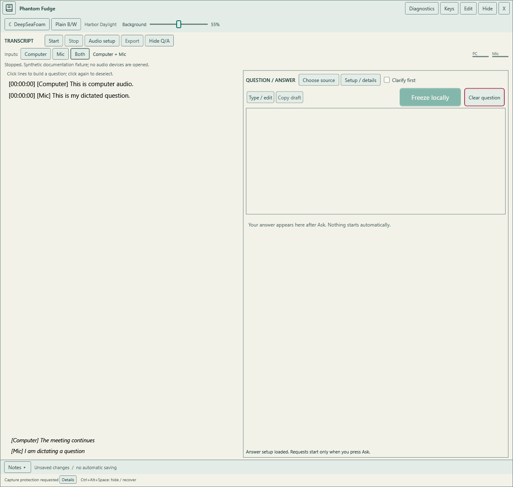
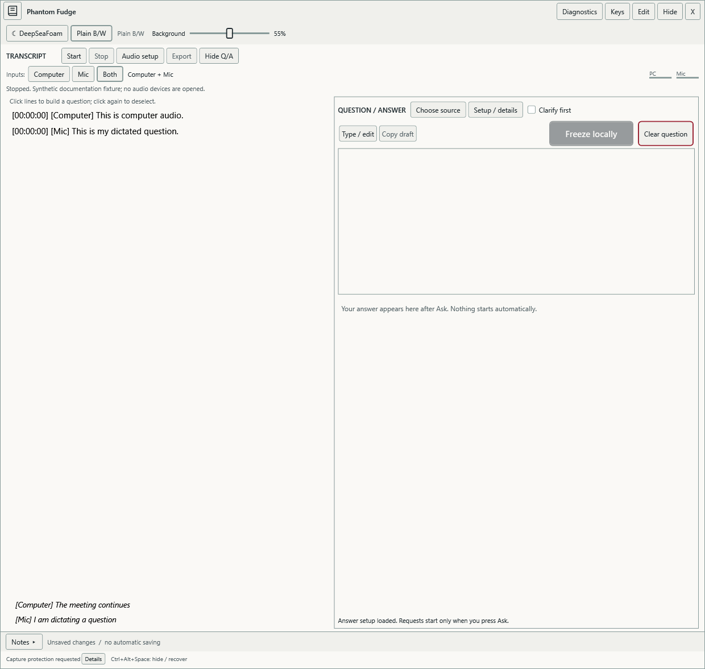
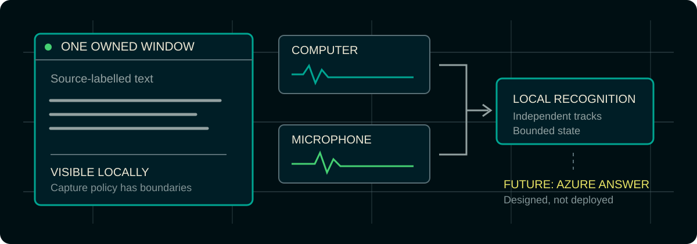

# Phantom Fudge

**Local transcription. Speaker notes. Questions under your control.**

[Windows download](https://github.com/Zanark/phantom-fudge/releases/tag/v0.2.0-preview.1) · [Install / update / remove](docs/INSTALLATION.md) · [Workflow](docs/CURRENT-WORKFLOW.md) · [Docs](docs/README.md) · [Roadmap](TODO/00_INDEX.todo)

> **Unsigned Windows 11 x64 preview.** Repository access required. [Evidence and limits](docs/IMPLEMENTATION-STATUS.md). Capture exclusion is not universal. Answers are snapshot-only until an external provider is configured.

## From meeting audio to an answer

**1. Choose device cards** · **2. Start transcription**

  
  

[Computer / Mic / Both](docs/DUAL-SOURCE-AUDIO.md) · [Setup and controls](docs/PREVIEW-GUIDE.md)

**3. Select several transcript lines** · **4. Clarify first, if needed**

  
  

[Compose your question](docs/LOCAL-QUESTIONS.md) · [Confirm or correct its meaning](docs/QUESTION-CLARIFICATION.md)

**5. Ask and read** · **6. Cover the workspace**

  
  

**Cover keeps transcription and answers running.** It does not make the app universally invisible.

[Provider setup](docs/ANSWER-PROVIDERS.md) · [Cover and privacy limits](docs/COVER-AND-PRIVACY.md)

[Keyboard controls and answer-size slider](docs/KEYBOARD-CONTROLS.md)

*Use the versioned Setup installer to install, repair or update; remove it through Windows Settings. [Source workflow](docs/PREVIEW-GUIDE.md).*

## Three looks. One workspace.

  
  
  

**DeepSeaFoam** · **Harbor Daylight** · **Plain B/W**

[Themes and translucency](docs/CURSOR-AND-THEMES.md)

## Under the hood

| Use it | Understand it | Build it |
| --- | --- | --- |
| [Installation and recovery](docs/INSTALLATION.md) | [Product overview](docs/OVERVIEW.md) | [Architecture](docs/ARCHITECTURE.md) |
| [Local questions](docs/LOCAL-QUESTIONS.md) | [Capture boundaries](docs/handbook/17-privacy-and-assurance.md) | [Implementation status](docs/IMPLEMENTATION-STATUS.md) |
| [Speech service](services/transcription/README.md) | [HTML handbook](docs/handbook/Phantom-Fudge-Engineering-Handbook.html) · [PDF](docs/handbook/Phantom-Fudge-Engineering-Handbook.pdf) | [Development JOURNAL](JOURNAL.md) |

[Explore the annotated source](docs/source-atlas/index.html) · [Source-atlas PDF](docs/source-atlas/Phantom-Fudge-Source-Atlas.pdf)

*Separate synthetic WPF examples, composited for readability—not meeting captures. Click to enlarge. [Image provenance](docs/assets/readme/manifest.json).*
