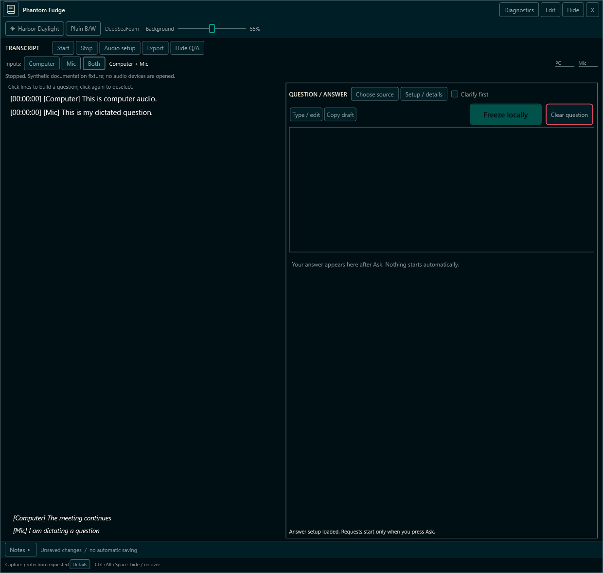

# Phantom Fudge

**Local transcription. Speaker notes. Questions under your control.**

[Get started](docs/PREVIEW-GUIDE.md) · [Overview](docs/OVERVIEW.md) · [Docs](docs/README.md) · [Roadmap](TODO/00_INDEX.todo)

> Windows 11 preview. Capture exclusion is not universal. **Installed Agency / local-model options; direct Azure is future work.**

## Your conversation workspace

  
  

**Computer + Mic** → **choose your text** → **Ask your selected provider**

[Transcription](docs/DUAL-SOURCE-AUDIO.md) · [Question composer](docs/LOCAL-QUESTIONS.md) · [Provider setup](docs/ANSWER-PROVIDERS.md)

## Three looks. One workspace.

  
  
  

**DeepSeaFoam** · **Harbor Daylight** · **Plain B/W**

[Themes and translucency](docs/CURSOR-AND-THEMES.md)

## Under the hood

| Use it | Understand it | Build it |
| --- | --- | --- |
| [Setup and recovery](docs/PREVIEW-GUIDE.md) | [Product overview](docs/OVERVIEW.md) | [Architecture](docs/ARCHITECTURE.md) |
| [Local questions](docs/LOCAL-QUESTIONS.md) | [Capture boundaries](docs/handbook/17-privacy-and-assurance.md) | [Implementation status](docs/IMPLEMENTATION-STATUS.md) |
| [Speech service](services/transcription/README.md) | [HTML handbook](docs/handbook/Phantom-Fudge-Engineering-Handbook.html) · [PDF](docs/handbook/Phantom-Fudge-Engineering-Handbook.pdf) | [Development JOURNAL](JOURNAL.md) |

*Synthetic WPF renders, composited for readability—not meeting captures. Click to enlarge. [Image provenance](docs/assets/readme/manifest.json).*
