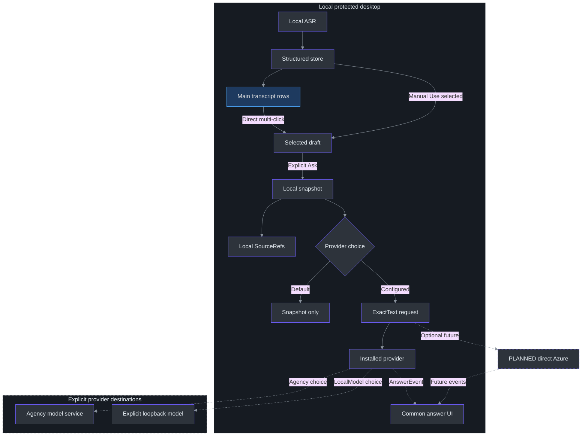
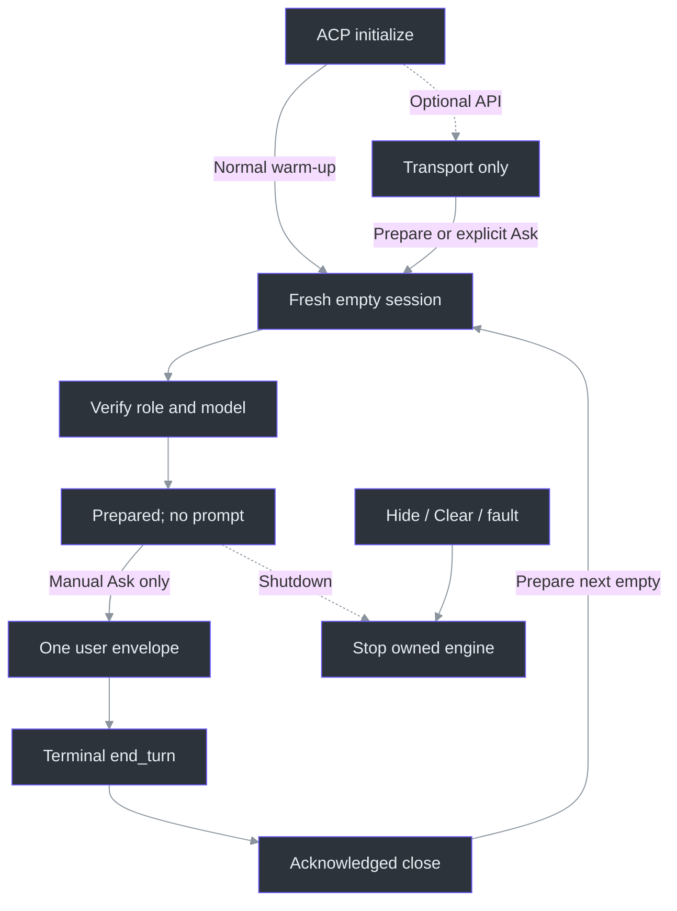

# Architecture: choose locally, freeze exactly, select the answer destination

**Status: persistent ACP and controlled direct Q&A are implemented. The selected `gpt-5.6-sol-fast` / low profile passed H's three exact-text prepared trials and 33 compiled checks—not a universal five-second or WPF acceptance result.**
The completed TODO28 slice supplied structured selection, editing and immutable Freeze, not an
answer service. That boundary remains: freezing text is distinct from invoking a configured provider.
TODO44 now adds direct multi-click transcript selection in updated source, not a new ZIP.
It opens independent question editing without sending; the historical045022ZIP remains unchanged.
(src/PhantomFudge.App/MainWindow.TranscriptSelection.cs:84-141; [current status](IMPLEMENTATION-STATUS.md).)
**SnapshotOnly is the unconfigured default, not a promise that configured Ask never sends data.**
(src\PhantomFudge.App\MainWindow.Questions.cs:258-297, `QuestionAsk_Click`.)

The common answer contracts and coordinator are written. Following an organization-authentication
popup, the owner rejected new login and organization-data access, requesting the existing installed
Agency background-prompt path instead. The parent stopped the owned login and reset the app to
**SnapshotOnly**. A separately authorized Agency probe has now succeeded using existing authentication,
without an observed new login flow. Agency uses a remote model service: local installation is not offline inference.
The explicit LocalModel OFFLINE/BYOK alternative remains separate from Agency.
(src\PhantomFudge.Core\Answers\AnswerContracts.cs:3-20, provider contract/settings;
src\PhantomFudge.Core\Answers\AnswerConfiguration.cs:13-29, `Load`.)

Accurate armed live-Mic boundaries/source commit remain TODO29; an approved Azure profile remains
unknown under TODO30. TODO30/31 retain optional direct Azure work rather than blocking CLI answers.
Commit is not required to ask explicitly selected or typed text. The previously authorized
**single Copilot cloud smoke failed at the customization/tool gate**. Its allowance is consumed:
a model call cannot be ruled out, and that Copilot attempt has no successful-answer receipt. Do not retry it or
reinterpret that authorization as an unused test. See [provider setup and boundaries](ANSWER-PROVIDERS.md),
[workstream39](../TODO/39_INSTALLED_CLI_ANSWERS.todo), [local usage](LOCAL-QUESTIONS.md), [research](AI-ANSWER-RESEARCH.md),
[privacy/identity](AI-ANSWER-PRIVACY.md) and [evaluation](AI-ANSWER-EVALUATION.md).

The older [69.881-second Sonnet marker smoke](answer-provider-smoke.json) established connectivity,
not useful-answer performance. The final authorized iteration ledger records **48 client question
submissions**, including failed and superseded trials, without audio, organization data or new login.
ACP does not expose opaque upstream retry counts. Agency is pinned to **2026.10.7.4 / bcff2c0f**,
with **Copilot 1.0.92**. The new default is **`gpt-5.6-sol-fast` / low**, catalog-advertised and
actually exercised in H; explicit overrides remain explicit, with no silent fallback. No further
model-question calls are planned. This is measured selection, not a name-based “fastest” claim.
(tools\AgencyProbe\results\summary-final.json:2-31, scope, selection and accounting;
tools\AgencyProbe\results\summary-final.json:197-224, catalog, policy and isolation.)

**Final exact-text batch H:** three fresh prepared sessions completed usefully, including acknowledged
close, in **4.066, 4.176 and 2.992 s**. Two requests used the owner's intended text; one preserved
“okay so right mean the solution for the lead good problem to some”. All answered Two Sum;
the ASR-text answer explicitly labelled its assumption. The three C# implementations compiled and
passed **33/33** normal and boundary checks, with no follow-up requests. This tests interpretation of
supplied text, not microphone or ASR accuracy. H's initial **19.987 s** preparation is separate.
(tools\AgencyProbe\results\latency-suite-20261009-h-exact-fast.json:2-56, exact questions, answers and timing;
tools\AgencyProbe\results\latency-suite-20261009-h-quality.json:2-186, reviewed sources and compiled checks.)

The [provider's public `DefaultModel`](../src/PhantomFudge.Core/Answers/AgencyCliAnswerProvider.cs)
and the [UI's `ProviderLabel`](../src/PhantomFudge.App/MainWindow.Answers.cs) share that default;
an explicit configured model wins. Recompilation picks up the new label without a second hard-coded
UI model name. H explicitly selected the model before its promotion to default; its assembly receipt
is not a measurement of a subsequently rebuilt WPF package.
(tools\AgencyProbe\results\summary-final.json:234-258, measurement/default distinction and public properties.)

**Historical Haiku batch E:** its cold answer took **24.874 s**; five prepared sessions completed, including
session close, in **2.928–3.748 s**. All six generated C# implementations compiled and passed
**66/66** normal and overflow checks. Its questions were named Two Sum and the **original synthetic**
“Explain to some problem and give optimal solution.”—not a verified copy of the owner's bad ASR.
The ambiguous answers labelled their interpretation as an assumption. These provider-API results
do not establish GUI latency, other-prompt quality, live-voice accuracy or an SLO.
(tools\AgencyProbe\results\latency-suite-20261009-e-haiku.json:9-95, trial states/text/timings;
tools\AgencyProbe\results\latency-suite-20261009-e-quality.json:28-364, compiled checks;
tools\AgencyProbe\results\summary-final.json:86-106, question provenance.)

**Retain the unsuccessful exact-text batches.** Haiku F added six requests using
owner-supplied intended/ASR strings: two ASR answers chose the wrong problem, one also invited a
follow-up, and three of six completions exceeded five seconds. Its first transport-ready Ask took
5.041 s. Mini G interpreted all six questions correctly but failed **10** boundary checks
through missing overflow safeguards; its first transport-only Ask took **6.470 s**.
H's success neither erases these failures nor turns E's original variation into owner-ASR evidence.
(tools\AgencyProbe\results\latency-suite-20261009-f-exact.json:2-98, retained Haiku failures;
tools\AgencyProbe\results\summary-final.json:151-180, F/G/H outcomes;
tools\AgencyProbe\results\latency-suite-20261009-g-quality.json:361-364, boundary-check totals.)

## 1. The recommended baseline

**October9 opt-in extension:** [Clarify first](QUESTION-CLARIFICATION.md) can request an interpretation
before an answer and attach this question's bounded exchanges to each explicitly sent reply.
Normal Ask still excludes history. Fresh ACP sessions, terminal requests, no tools and no automatic
submissions remain unchanged. This is fixed task metadata, never machine diagnostics.



Solid arrows describe local dataflow; dashed edges mark provider boundaries or optional future Azure.
The draft copies selected records, and `Freeze` captures text and provenance independently.
`SourceRefs` is **local metadata**, not permission to transmit the selected source records.
Every adapter must consume `AnswerRequest`, **not serialize the whole `QuestionSnapshot`**.
Additional bounded context would require its own explicit policy; none is implicitly added now.
(src\PhantomFudge.Core\QuestionDraft.cs:18-45, `ReplaceSelection`;
src\PhantomFudge.Core\QuestionSnapshot.cs:5-23, `QuestionSnapshot`;
docs\AI-ANSWER-PRIVACY.md:11-25, proposed text boundary.)

The main row path retains immutable segment references separately from the smaller chooser.
`TranscriptRows_SelectionChanged` composes the explicit selection locally and never calls Freeze
or the answer coordinator. (src/PhantomFudge.App/MainWindow.TranscriptSelection.cs:13-20,93-141.)

Python remains the local speech specialist; C# owns question and answer orchestration. The CLI owns
its own authentication/session behavior, while a future direct Azure adapter would own that path.
Do not add a local HTTP hop through Python solely because it already hosts Vosk. Do not put model
network work in the native capture callback or ASR CPU worker. The question handler establishes
the exact snapshot boundary; provider execution belongs to a separate asynchronous coordinator.
(src\PhantomFudge.App\MainWindow.Questions.cs:258-297, `QuestionAsk_Click`.)

| Choice | Execution and evidence boundary |
| --- | --- |
| `SnapshotOnly` | Missing-settings default and deliberate no-send choice; Freeze remains local. |
| `Agency` | Persistent official ACP; `gpt-5.6-sol-fast` / low by default, one fresh controlled session per question, no tools/follow-up waits or automatic question submission. |
| `Copilot` | Earlier direct-login route, not the owner's selected path; smoke failed and no further login/retry is authorized by that consumed allowance. |
| `LocalModel` | Separate OFFLINE/BYOK option against literal loopback; offline mocks only, no actual local model installed or exercised. |
| Direct Azure | Optional future adapter; not a current `AnswerProviderMode` value or configured resource. |

`AnswerSettings.AgencyPath` identifies the installed Agency executable; see the
[Agency setup entry point](ANSWER-PROVIDERS.md). The enum describes selectable contracts, not verified
machine readiness. `AnswerSettings.Validate`
requires a local model identifier and accepts only HTTP literal `127.0.0.1` or `[::1]` endpoints with
`/v1` or `/v1/`, no credentials/query/fragment. An optional CLI path must be a fully qualified `.exe`
path, not a shell command; that syntax check does not authenticate the executable. A reachable
loopback server can itself proxy elsewhere, so locality also requires control of that server.
(src\PhantomFudge.Core\Answers\AnswerContracts.cs:14-55, `AnswerSettings.Validate`, `ValidateLocalEndpoint`.)

**PLANNED Azure footprint:** an approved Azure OpenAI/Foundry model resource and deployment,
public-client registration/user RBAC, and optional metadata-only monitoring/budget controls.
Prefer reusing approved existing resources. No hosted agent, database, queue, RAG index, AKS,
container runtime or mandatory gateway is needed for ordinary technical Q&A.

Recommended evaluation candidates are 5.4-mini, 5.4-nano and 5-mini with their exact versions/lifecycle
from the research. No model is selected as "fastest" without the actual approved deployment test.
Use a pay-per-token deployment type whose processing geography is explicitly acceptable.
(docs\AI-ANSWER-RESEARCH.md:139-161, model/deployment shortlist.)

## 2. User experience: no accidental whole-meeting prompts

Example:

1. A chat participant asks "Explain Service Fabric like I'm five."
2. The owner reads it aloud. The Mic transcript updates locally, independently of Computer audio.
3. The owner clicks the intended Mic rows directly in the main transcript, optionally clicking
   Computer rows to add explicit context. Ordinary clicks toggle multiple whole segments without
   Ctrl. They compose in displayed history order and open question editing. **Type / edit** also
   permits typing without selecting any transcript.
4. **Freeze locally** in SnapshotOnly creates the snapshot without a request. In the
   configured path, **Ask provider** freezes the same draft and starts one exact-text answer request.
5. The common answer view identifies the chosen provider and submitted question. It must distinguish
   completed output from cancelled/failed partial output; a local CLI process is not an offline badge.

The app never reads the chat to obtain that question. It does not auto-answer when it hears a
question mark, forward all Mic text, or include unrelated Computer text as hidden context.
The manual **Choose source → Mic / Computer / All → Use selected** path remains available.
**All** broadens that chooser without selecting anything. An empty manual chooser selection retains
the draft; by contrast, deselecting the last direct row empties an unedited draft. **Use selected**
is an explicit replacement action, not subject to the direct-click edit guard.
(src\PhantomFudge.App\MainWindow.Questions.cs:68-126, filters and `UseQuestionSelection_Click`;
src\PhantomFudge.App\MainWindow.Questions.cs:258-283, explicit local `QuestionAsk_Click`.)

Direct selection uses each structured segment's raw `Text`, not its timestamp/source display
prefix. A wrapped or multiline segment is selected whole. After editing, further direct selection
changes are rejected with inline “Edited question retained” status until **Clear question**;
the previous draft and highlights are retained, without a popup. The shared ListBox
`SelectionChanged` handler also handles native keyboard/automation changes.
(src/PhantomFudge.App/MainWindow.TranscriptSelection.cs:84-141;
[`QuestionDraft.Compose`](../src/PhantomFudge.Core/QuestionDraft.cs).)

### Implemented Freeze versus planned Finish dictation

- **Ask as shown:** freeze the current editable/selected draft immediately. A provisional draft
  is visibly labelled as such; the snapshot is taken without waiting for ASR. SnapshotOnly ends
  there; configured provider mode explicitly requests an answer. Recognition never triggers a send.
- **PLANNED Finish dictation:** commit the armed Mic span and update the draft from its acknowledged final
  segments. The owner then presses Ask. A later optional Finish-and-Ask shortcut may compose these
  two explicit actions, with the same source/watermark/cancellation guarantees.

The implemented revision/provisional indicators and Freeze operation establish the manual boundary
without repurposing global Stop. The future commit timeout must retain the draft and show failure,
not silently submit an alternative. Armed start/end spans are not implemented by selecting v2 text.
(src\PhantomFudge.App\MainWindow.Questions.cs:239-297, rendering and Ask;
src\PhantomFudge.Core\QuestionDraft.cs:90-95, `Freeze`.)

### Layout and focus

Transcript stays primary, with **QUESTION / ANSWER** expanded by default and **Hide Q/A** /
**Show Q/A** controlling it. [`InitializeQuestionView`](../src/PhantomFudge.App/MainWindow.Questions.cs)
sets that default. The implemented inline Question pane lives in the same protected HWND,
with explicit selection, typing, Copy, Clear and a local snapshot display. Expansion rearranges
existing panels; it does not create a second window. The common answer coordinator now adds provider
choice, a plain-text answer, Cancel and explicit Copy within that same HWND, under TODO39 review.
(src\PhantomFudge.App\MainWindow.Questions.cs:36-65, `SetQuestionExpanded`, `ResizeQuestionPanel`;
src\PhantomFudge.App\MainWindow.Questions.cs:258-330, Ask/Copy/Clear handlers.)

The legacy chooser can remain passive; **direct main-transcript selection deliberately enters
question editing**, closes source/setup/Notes panels and takes keyboard focus. **Type / edit**
uses the same independent transition without stopping transcription or enabling Notes editing.
`SetQuestionEditing` changes the
question-editing flag, refreshes interaction/protection through hide/reveal and focuses the editor.
It does not call the global Notes Edit/Present transition. Existing global Edit/Present/Hide audio
semantics are unchanged. Preserve independent Notes state and audio-start cancellation when
extending this question-only focus path.
(src\PhantomFudge.App\MainWindow.Questions.cs:94-100, passive selection;
src\PhantomFudge.App\MainWindow.Questions.cs:154-201, question focus.)

This deliberate focus is not the passive no-activation promise for scrolling. Clicking lines
creates no Ask, snapshot or model question. Selected row outlines preserve transparent backgrounds
and white/black reading text instead of adding an opaque highlight block.
(src/PhantomFudge.App/MainWindow.TranscriptSelection.cs:93-141;
[`TranscriptRowStyle`](../src/PhantomFudge.App/MainWindow.xaml);
[`EnsureQuestionReadingVisible`](../src/PhantomFudge.App/MainWindow.Layout.cs).)

No generated speech/TTS initially: it adds latency and can feed back into Computer transcription.
No automatic clipboard copy, link opening, code execution or reply-posting to a meeting/chat.
Copy draft is explicit and copies only draft text; the Windows clipboard is outside window-capture
protection. Clear question discards the current draft and last snapshot, not notes/transcription.
(src\PhantomFudge.App\MainWindow.Questions.cs:300-330, Copy/Clear;
docs\AI-ANSWER-PRIVACY.md:117-134, proposed output safeguards.)

## 3. Local data model

The flattened `TranscriptBuffer` remains the unchanged display/export model. Selection uses
structured identities, never parsed presentation prefixes. The smaller chooser store is bounded to
**256 segments and 64,000 text characters**; the draft permits **256 selected entries from one
capture session and8,192UTF-16 code units including newlines**, not tokens or UTF-8 bytes.
(src\PhantomFudge.Core\TranscriptBuffer.cs:6-19, display storage;
src\PhantomFudge.Core\StructuredTranscriptStore.cs:13-18, capacity defaults;
src\PhantomFudge.Core\QuestionDraft.cs:8-9, bounds;
src\PhantomFudge.App\MainWindow.Questions.cs:103-118, key-based selection.)

Main-history and partial ListBoxes bind immutable `TranscriptRow` objects containing `DisplayText`
and a `TranscriptSegment`. Main history retains these references after chooser eviction, so older
visible rows remain selectable within the unchanged250000-unit final/session display-buffer bound.
Live partials are separately bounded. Archived unfinished partials retain identity and provisional
status; separator rows have no segment and are not selectable. New finals scroll only when already
at the end. (src/PhantomFudge.App/MainWindow.TranscriptSelection.cs:13-82;
[`TranscriptBuffer`](../src/PhantomFudge.Core/TranscriptBuffer.cs).)

| Implemented record | Identity and ownership |
| --- | --- |
| `TranscriptRow` | Immutable displayed text plus optional segment reference; a null segment marks a nonselectable separator. |
| `TranscriptSegmentKey` | Capture GUID, source, local source epoch and stable local utterance ID. |
| `TranscriptSegment` | Immutable revision/text/finality, optional protocol final ID, qualified audio-relative seconds and active-partial state. |
| `QuestionDraft` | Question ID, revision, exact editable text, copied selected records, provisional and user-edited flags. |
| `QuestionSnapshot` | Question ID/revision, `ExactText`, copied local `SourceRefs`, provisional/edit flags and monotonic creation timestamp. |

Sources: (src\PhantomFudge.Core\TranscriptSegment.cs:3-65, identity and immutable record);
(src\PhantomFudge.Core\QuestionDraft.cs:8-16, draft fields);
(src\PhantomFudge.Core\QuestionSnapshot.cs:5-23, snapshot fields). Profile/version, context policy,
sample-exact start/end boundaries and answer-request IDs are **not** current snapshot fields.
The row type is defined in (src/PhantomFudge.App/MainWindow.TranscriptSelection.cs:13-20).

A new local capture GUID is established per Start and stamped before dispatcher delivery.
This is a desktop envelope, not new v2 wire metadata. The structured consumer accepts that GUID,
uses local epoch **0** through the current overload defaults, and rejects obsolete sessions/epochs.
The Core freshness guard rejects an obsolete session before changing structured history.
Current epochs do not constitute negotiated source commit.
(src\PhantomFudge.App\MainWindow.Questions.cs:132-140, `UpdateQuestionTranscript`;
src\PhantomFudge.Core\StructuredTranscriptStore.cs:24-40, `BeginSession`, `SetPartial`;
src\PhantomFudge.Core\StructuredTranscriptStore.cs:120-125, `IsCurrent`, `PrepareUpdate`.)

### Actual update and Freeze algorithm

1. Stage a store update. Repeated unchanged partial text preserves its revision; changed text
   replaces the immutable record. A final, including an empty final, settles the same active
   utterance key. Protocol final IDs are deduplicated using a session-global high-water mark.
2. Enforce store capacity before publishing. Evict oldest non-active records other than the
   just-updated record; if the live records/update cannot fit, reject rather than silently drop them.
3. On direct row changes, reject an edited draft or unavailable protection/file-operation state,
   then copy selected segment keys in displayed history order. The legacy **Use selected** path
   composes in chooser-store order. Both call `ReplaceSelection` to validate session, entry and text
   limits before replacing any draft state. Direct rejection restores highlights and reports inline.
4. On recognition refresh, replace only selected unfinished records with newer matching revisions.
   Evicted selections retain their copies. After any explicit edit, including reasserting identical
   text through `EditText`, automatic draft replacement stops; direct click changes also remain
   blocked until **Clear question**. Before editing, selected keys follow partials into revised/final rows.
5. On manual Ask, reject blank text, then copy the current draft into an immutable snapshot.
   Later finalization, selection, typing, Clear or eviction cannot mutate that snapshot object.

Sources: (src\PhantomFudge.Core\StructuredTranscriptStore.cs:36-100, updates/deduplication;
src\PhantomFudge.Core\StructuredTranscriptStore.cs:134-145, `ApplyUpdate`);
(src\PhantomFudge.Core\QuestionDraft.cs:18-79, selection/edit/refresh;
src\PhantomFudge.Core\QuestionDraft.cs:90-124, Freeze/validation/composition);
(src\PhantomFudge.Core\QuestionSnapshot.cs:5-14, copied provenance).
Direct order, guard and highlight synchronization:
(src/PhantomFudge.App/MainWindow.TranscriptSelection.cs:65-141).

### Persistent engine does not mean persistent conversation

The provider keeps one owned engine, serialized through its operation gate. ACP uses NDJSON
JSON-RPC on stdio: initialize once, create a fresh session, verify its configuration, send one
prompt, require `end_turn`, and acknowledge `session/close` before completing the request.
The engine can remain alive; OS-pipe EOF would instead be an unexpected transport failure.
Session IDs cannot be reused, and the engine rotates after at most 32 created sessions.
(src\PhantomFudge.Core\Answers\AgencyAcpConnection.cs:7-88, initialization/session identity and bounds;
src\PhantomFudge.Core\Answers\AgencyAcpConnection.cs:90-122, prompt and close;
src\PhantomFudge.Core\Answers\AgencyAcpConnection.cs:157-176, premature EOF.)

**Normal configured startup/reveal deliberately uses `WarmUpAsync`: one empty fresh session,
no model prompt.** The [app lifetime coordinator](../src/PhantomFudge.App/MainWindow.AnswerLifetime.cs)
waits for that preparation before showing ready. After success the provider closes the conversation
and prepares the next empty one. This is allowed readiness work, never an automatically inferred
question. The selected-default preparation receipt records **21.183 s**, zero submitted questions
and no answer; that cost must remain visible rather than disappearing into a warm-path claim.
(tools\AgencyProbe\results\agency-selected-fast-default-preparation.json:2-16, empty-session/no-prompt receipt.)

`WarmUpTransportAsync` remains a separate transport-only API, not the current app startup policy.
It creates no session, so first Ask still owes session creation and controlled-role validation.
Earlier transport-only integration advice is superseded by deliberate empty-session readiness.
H measured prepared sessions, not cold launch or first Ask after transport-only startup; that latter
boundary has not been timed on the selected fast model.
(tools\AgencyProbe\results\latency-suite-20261009-h-exact-fast.json:2-19, prepared boundary;
tools\AgencyProbe\results\summary-final.json:58-64, distinct transport-only limitation.)



The controlled agent is **explicitly selected through ACP**
`session/set_config_option`; `--agent` alone did not select it in the pinned engine. Configuration
must confirm the requested model, low reasoning, `allow_all=off` and the controlled agent before
question submission. The app-owned constant policy is installed in the **SYSTEM role**; the
single user text contains fixed policy text plus one JSON `userQuestion` envelope preserving
`ExactText`. JSON escaping, including `@`, keeps command-like text data rather than a launcher
argument. No `SourceRefs`, previous question or assistant history is added.
(src\PhantomFudge.Core\Answers\AgencyAcpConnection.cs:61-96, explicit agent selection/one prompt;
src\PhantomFudge.Core\Answers\AgencyAcpConnection.cs:296-319, configuration verification;
src\PhantomFudge.Core\Answers\AgencyAnswerPrompt.cs:8-97, policy and serialization;
tools\AgencyProbe\results\summary-final.json:197-219, observed SYSTEM-role and fresh-history evidence.)

The policy demands a short **complete useful answer**, not a repository plan or filler while work
continues. For ambiguous speech-like text it requires an explicitly labelled assumption and a concrete
solution, never a follow-up in normal answer mode or a claim to have heard the user.
Only opted-in interpretation mode permits a textual clarification. Tool/client/permission and protocol-plan
events fail closed. Following F, the heuristic scans the bounded answer's prose outside code fences
for obvious missing-input requests and selected follow-up invitations; it is not a correctness oracle.
The policy now distinguishes a corrupted coding-platform name from the requested problem title,
without rewriting the exact input. Earlier failures remain evidence, not retroactive passes.
(src\PhantomFudge.Core\Answers\AgencyAnswerPrompt.cs:9-43, direct-answer policy;
src\PhantomFudge.Core\Answers\AgencyAcpConnection.cs:101-109, terminal nonanswer guard;
src\PhantomFudge.Core\Answers\AgencyAcpConnection.cs:213-265, rejected capabilities/plans;
src\PhantomFudge.Core\Answers\AgencyAcpConnection.cs:330-354, bounded nonanswer heuristic;
tools\AgencyProbe\results\summary-final.json:109-180, retained batches.)

The UI and Core validate before committing question changes: oversized selection, paste, editing
or refresh preserves the previous draft instead of truncating. Blank text may exist while editing,
but cannot be frozen. Closing a capture/epoch marks unfinished partials inactive, not final.
Draft/snapshot storage itself remains in memory, not a durable question history. Opt-in diagnostic
body retention and external CLI/service artifacts are separate persistence boundaries.
(src\PhantomFudge.App\MainWindow.Questions.cs:207-236, edit/paste rejection;
src\PhantomFudge.Core\QuestionDraft.cs:90-124, blank/oversize checks;
src\PhantomFudge.Core\StructuredTranscriptStore.cs:127-129, `ClosePartial`;
src\PhantomFudge.App\MainWindow.Questions.cs:14-21, local state fields.)

### Implemented common answer contract

```csharp
AnswerRequest(Guid RequestId, string ExactText)
AnswerEvent(Guid RequestId, long Sequence, AnswerEventKind Kind, string Text = "")
IAnswerProvider.StreamAsync(AnswerRequest request, CancellationToken cancellationToken)
```

`AnswerRun` retains the snapshot locally but constructs a fresh request GUID and copies only
`snapshot.ExactText` into the provider request. Current events are `TextDelta` and `Completed`;
provider failures use a safe exception rather than pretending error prose is answer text.
The run already enforces a **32,768 UTF-16-code-unit** text cap. An overflowing delta is rejected
whole, leaving prior output available as incomplete. Model-specific token/context limits remain
separate work. (src\PhantomFudge.Core\Answers\AnswerContracts.cs:3-12, request/event interface;
src\PhantomFudge.Core\Answers\AnswerContracts.cs:59-62, `AnswerProviderException`;
src\PhantomFudge.Core\Answers\AnswerRun.cs:10-50, projection and output bound.)

This narrower request type makes accidental provenance disclosure harder; a generic serializer
over the richer local snapshot would undo that protection. Neither character cap establishes a
token budget or retention guarantee.
(src\PhantomFudge.Core\QuestionSnapshot.cs:17-23, local snapshot fields;
docs\AI-ANSWER-PRIVACY.md:88-112, retention and processing boundaries.)

## 4. PLANNED negotiated source-scoped commit, not stop-all

Introduce speech protocol **v3** (or another explicitly negotiated capability), preserving v1/v2.
The current strict v2 parser accepts only Stop and must not reinterpret a new control silently.
(services\transcription\server.py:306-316, `Session.receive`.)

Use the existing source-prefix PCM format if it remains sufficient; add typed controls and
session/epoch metadata rather than an unrelated second socket around the one-active-session rule.

Illustrative control:

```json
{
  "type": "commit_source",
  "requestId": "<unique commit ID>",
  "source": "microphone",
  "sourceEpoch": 7,
  "throughSample": 123456
}
```

The implementation must:

1. Under the same lock as audio enqueueing, freeze the Mic delivered-sample watermark and append
   a commit envelope to the **same ordered sender queue**. No concurrent control WebSocket send.
2. Send preceding PCM first. On the server, enqueue the control with the audio work; verify the
   source/epoch/watermark and drain through **processed** samples, not merely received bytes.
3. Finalize only the selected Mic decoder. Publish its remaining final text—even if empty—then
   acknowledge the source, old/new epoch, exact watermark and resulting final reference.
4. Recreate/reset that decoder safely with cumulative source offset preserved. Reuse the existing
   finalize-and-replace wrapper pattern; do not assume undocumented Reset timestamp semantics.
5. Leave Computer capture/decoder state intact and preserve session-global final IDs.
6. Make commit retries idempotent by capture session + source + requestId; replay the same ack,
   reject changed parameters for the same ID, and bound the deduplication cache.
7. Tag subsequent events with the new source epoch. Cancelled/old acknowledgments cannot rewrite
   a newer question; user edits during finalization remain a distinct revision.

For newly armed dictation, establish a start boundary as well as an end boundary. Prior Mic
conversation belongs in the transcript, not automatically in the question. Current partials
lack word timing, so arbitrary retrospective sample cuts cannot be reconstructed exactly from text.
(services\transcription\recognizer.py:64-67, `VoskRecognizer._new_decoder`.)

A click watermark covers **samples delivered by capture**, not necessarily the last acoustic
sample spoken before that click; some audio can still be in the device buffer. Specify and measure
a bounded last-packet drain/ready indication instead of inventing sample-exact human boundaries.

## 5. Local revision ownership and common answer states

Implemented local draft state consists of revisions and flags, not the enum below.
`Refresh` may advance a draft while an earlier frozen snapshot remains unchanged; `EditText`
prevents further automatic replacement. Provider submission belongs to `AnswerRun`, not to a new
draft enum; source Finalizing remains planned. (src\PhantomFudge.Core\QuestionDraft.cs:48-95, `EditText`, `Refresh`, `Freeze`.)

**PLANNED** question lifecycle with source commit and an authorized provider:

```text
Empty -> Drafting -> Finalizing -> Ready
             |                      |
             +--> SnapshotFrozen <--+
                       |
                    Submitted

Late transcript revision -> new Drafting revision, never mutation of Submitted.
Finalizing -> Failed/Cancelled retains visible draft.
```

**Implemented common answer state**, with installed-provider integration:

```text
Streaming -- Completed event, then request enumeration ends with nonblank text --> Completed
    |
    +------> Failed / Cancelled     (retained text is incomplete)

New Ask while active: wait for cancellation and cleanup, then explicitly ask again.
```

`Apply` ignores another request's events and events after the run leaves Streaming. For the current
request it requires a strictly increasing positive sequence, not necessarily contiguous numbers.
Completion must contain no text; it latches a terminal marker rather than declaring success.
Further events after that marker fail. `Complete`, called after enumeration ends, requires both
the marker and nonblank accumulated text. This is the end of the **per-request event enumeration**,
not EOF or exit of the persistent ACP process. A closed pipe, zero exit code, or terminal marker
followed by failure cannot justify a complete answer.
(src\PhantomFudge.Core\Answers\AnswerRun.cs:32-79, `Apply`, `Complete`, `Cancel`, `Fail`.)

**PLANNED direct Azure connection** (CLI setup is separate):

```text
Disabled -> Configured -> SignInRequired -> Ready
                                  ^          |
                                  +----------+  silent refresh cannot satisfy auth
```

These are separate from audio Stopped/Starting/Running/Stopping and capture-affinity setup.
Do not use `IsRunning=false` as proof that a source is fully drained; the existing stop-race
fix remains relevant. Answer cancellation must not corrupt transcription or reset the draft.

One answer request is active at a time. Every UI delta checks request ID and monotonic sequence;
ignore stale/cancelled streams without appending their text to the new question's answer.
No completion is inferred merely from HTTP200 or a closed connection. The common UI
uses a **120-second overall deadline** and **40-ms render timer**, not a per-token dispatcher queue.
These are code choices, not achieved latency or deadline-precision measurements.

Cancel, Hide, Clear, protection invalidation and close must propagate cancellation to the adapter
and its **owned process**, awaiting cleanup before another request. Common run cancellation retains
text as incomplete; Clear deliberately discards it. There is no automatic retry or resend on reveal.
The UI's Copy action is deliberate and labels non-completed text incomplete. The app lifetime owner
retains the provider across requests, warms it on configured startup/reveal and stops/disposes it
on Hide/Clear/protection invalidation/reload/close. Diagnostic-constructor mode suppresses actual
warm-up. These ownership actions are separate from `AnswerRun.Cancel`; inspect the
[lifetime coordinator](../src/PhantomFudge.App/MainWindow.AnswerLifetime.cs) and
[provider lifecycle](ANSWER-PROVIDERS.md), not a run-state flag alone.
(src\PhantomFudge.Core\Answers\AnswerRun.cs:65-79, terminal cancellation/failure behavior.)

### Agency setup without new login; profile and retention boundaries

`AnswerConfiguration` loads bounded `answers.json` metadata, rejects unknown properties and numeric
enum values, and supplies a dedicated `%LOCALAPPDATA%\PhantomFudge\copilot-profile` location for
the CLI path. That is not permission to import a personal coding profile or start authentication.
For the corrected Agency path, existing model-service authentication must suffice; otherwise fail
visibly without new login or account switching. A genuine compatible executable, not merely a path
ending in `.exe`, must be verified.
(src\PhantomFudge.Core\Answers\AnswerConfiguration.cs:8-29, configuration/profile paths and loading.)

Setup with `Initialize-Answers.ps1 -Provider Agency` resolves the executable without login.
The supported launcher is `agency copilot` with official persistent ACP and a validated app-owned
profile. The only permitted custom agent is the constant direct-Q&A policy, not a user's coding agent.
Offline native-engine wire evidence observed empty tool lists, one user message and no prior assistant
history per session; ACP itself does not expose the old one-shot usage-checkpoint count. Live
tool/plan/client requests are rejected, not granted. No organization-data connectors are added,
and existing model authentication is not permission to inspect organization data.
(tools\AgencyProbe\results\summary-final.json:197-224, offline wire evidence and live guard scope.)
The [provider guide](ANSWER-PROVIDERS.md) owns the evolving setup details.

Agency/engine artifacts may exist inside the owned workspace while the engine remains alive.
Sessions close after each answer; stop/dispose/failure/cancellation/rotation removes owned files,
and the engine is bounded to 32 sessions. This does not delete upstream service records or guarantee
that every external artifact disappears. LocalModel remains mock-tested only, not a zero-retention claim.
(tools\AgencyProbe\results\summary-final.json:210-224, lifecycle/retention bounds.)
“ExactText only” describes application content passed to the provider, not the CLI's system prompts,
service metadata or retention policy. Never describe the complete configured path as memory-only.

Local diagnostics now record bounded stage/process metadata by default, not transcript/question/answer
bodies. Text retention is a separate opt-in. `ModelStarted` identifies ACP prompt submission, not
the remote model's unavailable internal start; UI control assignment is not a measured pixel/recipient
frame. See [diagnostics](DIAGNOSTICS.md).
(src\PhantomFudge.Core\Diagnostics\LocalDiagnostics.cs:9-24, event/record fields;
src\PhantomFudge.Core\Diagnostics\LocalDiagnostics.cs:145-184, metadata and text opt-in;
tools\AgencyProbe\results\summary-final.json:259-271, stage/measurement semantics.)

## 6. PLANNED Azure request and authentication path

Reuse the now-written `IAnswerProvider`; the Azure credential and source-commit abstractions below
remain planned and independent of UI/speech:

```text
IAnswerProvider.StreamAsync(AnswerRequest, CancellationToken)
  -> asynchronous AnswerEvent sequence

IAzureCredentialSession
  -> explicit Connect + silent token access + SignInRequired state

IQuestionCommitter
  -> commit/ack independent of local Vosk versus a future approved cloud-ASR adapter
```

Implement an optional direct Azure provider with **v1 Responses**, `stream:true`,
`store:false`, `background:false`, no tools or server-side conversation. "Foreground" here is
the API execution mode; it does **not** mean bringing the desktop window to the foreground.
Keep Chat Completions as a separately tested fallback adapter, not automatic cross-provider routing.
(docs\AI-ANSWER-RESEARCH.md:163-204, proposed inference API.)

Use a configured Entra public-client/WAM identity, resource-level inference RBAC and silent token
cache in the Ask path. Never put managed-identity assumptions or distributed app secrets on the
laptop. Interactive sign-in is an explicit setup action outside the presentation; no surprise
browser/broker fallback from an in-flight Ask. Exact token audience follows the pinned adapter.
(docs\AI-ANSWER-PRIVACY.md:27-67, public-client identity and inference authorization.)

An Azure-hosted broker with managed identity is optional if organizational policy requires it.
Its extra hop, auth, quotas and streaming buffering must be measured. No mandatory Docker.
See AI-ANSWER-PRIVACY.md for the full identity/data boundary.

## 7. Additional PLANNED Azure streaming and evaluation details

- Start with a concise direct-answer instruction. Evaluate low supported reasoning effort and a
  total output budget that leaves room for hidden reasoning; do not confuse visible words with
  all billed/generated tokens.
- Begin rendering on the first text delta, not stream-open metadata. Coalesce tiny updates into
  bounded 16–50-ms UI batches; the current common coordinator's 40-ms timer is a starting point,
  not a measured rendering guarantee. Cap provider buffering separately.
- Support completed, incomplete, refused/filtered, stream-error and cancelled states. Handle
  Azure-specific filter metadata, including raw fields if the pinned SDK lacks typed support.
- Preserve an interrupted partial answer with its original question/profile. Do not silently
  retry after partial output, concatenate repeated generations, or claim a refund on cancellation.
- The installed-provider path has no automatic retry. Any future Azure pre-output retry policy
  requires explicit design, finite deadlines and no SDK+app retry multiplication.
  Do not fail over to an unapproved model/provider/geography.
- On Hide/lock/close/protection failure, cancel visible-answer streaming by default and retain
  bounded local draft/partial state. Reopening does not resend a question automatically.
- A local CPU backlog should be visible. Do not prioritize Mic commit by skipping/reordering
  earlier Mic samples or dropping Computer audio silently.
- Pre-create model/credential/client objects once enabled. Do not send dummy paid model requests
  merely to pretend the app is warm; document any separately authorized warm-up behavior.

Measure Ask-to-first-rendered-answer and first-useful-sentence time, not just Azure gateway TTFT.
The evaluation document defines targets, clocks, datasets, cold/warm stratification and failure cases.
The H receipts establish three narrow **provider-API** completion/correctness observations, not an
end-to-end application benchmark. Initial readiness remains roughly 20 seconds or more; H does
not certify cold use, a transport-only first Ask, real microphone accuracy or arbitrary question quality.

## 8. Delivery sequence

1. **Implemented, local slice complete:** structured local transcript, explicit selection/typing and
   immutable local Freeze. Its historical completion did not establish answer-provider readiness.
   **TODO44 IN_PROGRESS:** direct multi-click rows, edit guard and retained visible history are
   implemented in frozen source. Final synthetic UI passes all20direct-selection checks and existing
   guards; the parent reports targeted Core118PASS and16WPF/5READMEimage refreshes.
   Citation migration, handbook/illustration review and final handoff remain pending.
   [Implementation status](IMPLEMENTATION-STATUS.md) records the receipt location and limits.
   No new ZIP, microphone/model run or provider setup is required for this selection change.
2. **TODO39, persistent ACP implementation and bounded provider evidence:** controlled SYSTEM-role
   direct Q&A, fresh sessions and `gpt-5.6-sol-fast` / low follow H's 3/3 exact-text prepared
   successes and 33/33 compiled checks. All A–G failures remain visible; the authorized ledger
   stops at 48 questions. Startup intentionally prepares an empty session without a prompt.
   Earlier Copilot failure/login cancellation remain history. Package/UI, cold-start and broader
   prompt/voice qualification are separate from these three provider observations.
3. **TODO29, planned and nonblocking for explicit Ask:** Mic-only commit and armed
   start/end/source/epoch/tail tests; preserve continuous Computer capture.
4. **TODO30/31, optional future Azure:** approved connection/profile and keyless identity,
   with no real meeting data. Actual resource and identity settings remain unknown.
   Preserve future Azure filtering and lifecycle qualification rather than equating the generic UI
   with a deployed Azure client. Fake streams are tests, not pretend AI output presented as real.
5. Any further regional/model/API comparison requires new authorization; no more model calls are planned now.
6. Exact-package capture/privacy/accessibility and native release acceptance.
7. Optional cloud ASR, enterprise broker, richer grounding or Docker only when separately justified.

Cloud ASR may improve a measured requirement, but its raw-audio egress and preview commit support
are separate decisions. Local Whisper refinement is also an experiment, not a silent model switch.

### Review evidence is narrower than acceptance

Core snapshot tests check exact text and monotonic creation time, copied read-only provenance,
and survival across late ASR, edits, Clear, eviction and capture restart. These assertions define
model-level checks, not proof of UI focus, real devices or every environment.
(tests\PhantomFudge.Core.Tests\QuestionSnapshotTests.cs:10-99,
`FreezeCapturesExactDisplayedRevisionAndMonotonicCreationTime`,
`SnapshotSurvivesLateAsrEditsClearsEvictionAndCaptureRestart`,
`SourceRefsAreDeepCopiedReadOnlyAndCarryFullProvenance`.)

**Historical TODO28 handoff, not TODO39 acceptance or rerun evidence:** 137 Core tests (96 new) and 46 native
synthetic groups passed; the new question checks passed. The first whole-UI attempt nevertheless
had an unexplained foreground-check failure. An identical-source repeat passed all checks.
Do not erase that first failure or invent its cause. No real endpoint was opened in that local slice. TODO28 is
locally complete; these results do not establish owner acceptance, real-device qualification,
recipient capture behavior or Azure latency.

## 9. Decisions still needed before direct Azure execution

Approved tenant/subscription/resource or resource-creation owner; model/deployment alias/version;
permitted processing geography/deployment type; Entra registration/RBAC and network route;
data handling/retention policy; budget/quotas; and synthetic benchmark spend authorization.
Do not invent these from the user's employer, timezone, previous Azure work or local credentials.

These missing execution values do not prevent a complete architecture/backlog design. They do
prevent claiming a deployed integration, a measured fastest model, or a configured privacy posture.

## References

- [Local question usage and boundaries](LOCAL-QUESTIONS.md).
- [Installed-provider setup and retention](ANSWER-PROVIDERS.md) and
  [workstream39](../TODO/39_INSTALLED_CLI_ANSWERS.todo).
- [Final ACP evidence summary](../tools/AgencyProbe/results/summary-final.json),
  [H exact-text latency](../tools/AgencyProbe/results/latency-suite-20261009-h-exact-fast.json),
  [H compiled checks](../tools/AgencyProbe/results/latency-suite-20261009-h-quality.json) and
  [historical E variation](../tools/AgencyProbe/results/latency-suite-20261009-e-haiku.json).
- [ACP connection](../src/PhantomFudge.Core/Answers/AgencyAcpConnection.cs),
  [fixed policy/envelope](../src/PhantomFudge.Core/Answers/AgencyAnswerPrompt.cs) and [diagnostics](DIAGNOSTICS.md).
- [Common answer contracts](../src/PhantomFudge.Core/Answers/AnswerContracts.cs),
  [run state](../src/PhantomFudge.Core/Answers/AnswerRun.cs) and
  [configuration](../src/PhantomFudge.Core/Answers/AnswerConfiguration.cs).
- [Structured transcript store](../src/PhantomFudge.Core/StructuredTranscriptStore.cs) and
  [segment identity](../src/PhantomFudge.Core/TranscriptSegment.cs).
- [Draft ownership](../src/PhantomFudge.Core/QuestionDraft.cs) and
  [immutable local snapshot](../src/PhantomFudge.Core/QuestionSnapshot.cs).
- [Inline question controls](../src/PhantomFudge.App/MainWindow.Questions.cs) and
  [synthetic question diagnostics](../src/PhantomFudge.App/MainWindow.QuestionDiagnostics.cs).
- [Direct transcript selection](../src/PhantomFudge.App/MainWindow.TranscriptSelection.cs),
  [selection diagnostics](../src/PhantomFudge.App/MainWindow.TranscriptSelectionDiagnostics.cs) and
  [workstream44](../TODO/44_TRANSCRIPT_CLICK_SELECTION.todo).
- [Cloud research](AI-ANSWER-RESEARCH.md), [identity/privacy](AI-ANSWER-PRIVACY.md) and
  [proposed evaluation](AI-ANSWER-EVALUATION.md); these do not establish account entitlement or
  newly measured API performance.
