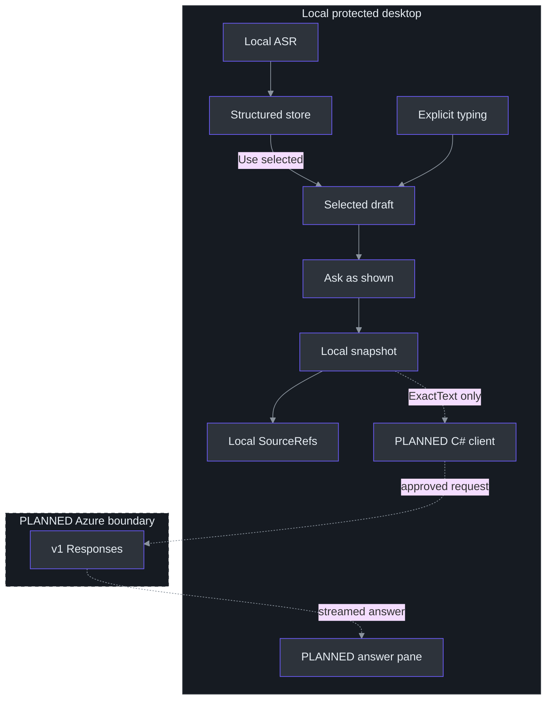
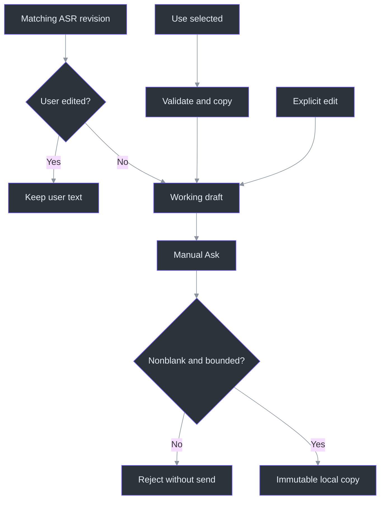

# Architecture: choose locally, freeze exactly, connect Azure later

**Status: the local TODO28 slice is implemented and locally complete; Azure answers are not connected.**
The structured store, explicit segment selection, question editor and immutable snapshot are real
code. **Ask as shown freezes locally; it does not send a request or generate a fake answer.**
The handler displays the snapshot and an explicit no-Azure/no-send status.
(src\PhantomFudge.App\MainWindow.Questions.cs:228-247, `QuestionAsk_Click`.)

Accurate armed live-Mic boundaries/source commit remain TODO29; an approved Azure profile remains
unknown under TODO30; the answer client and streamed-answer lifecycle remain TODO31/32. Local
completion is not owner acceptance, cloud authorization or a latency measurement.
See [local usage](LOCAL-QUESTIONS.md), [research](AI-ANSWER-RESEARCH.md),
[privacy/identity](AI-ANSWER-PRIVACY.md) and [evaluation](AI-ANSWER-EVALUATION.md).

## 1. The recommended baseline



Solid arrows describe the local implemented path; dashed arrows describe future connections.
The draft copies selected records, and `Freeze` captures text and provenance independently.
`SourceRefs` is **local metadata**, not permission to transmit the selected source records.
The future Azure adapter must project `ExactText`, **not serialize the whole `QuestionSnapshot`**.
Additional bounded context would require its own explicit policy; none is implicitly added now.
(src\PhantomFudge.Core\QuestionDraft.cs:18-45, `ReplaceSelection`;
src\PhantomFudge.Core\QuestionSnapshot.cs:5-23, `QuestionSnapshot`;
docs\AI-ANSWER-PRIVACY.md:6-20, proposed text boundary.)

In the proposed cloud design, Python remains the local speech specialist; C# owns UI, request
state, authentication and asynchronous inference.
Do not add a local HTTP hop through Python solely because it already hosts Vosk. Do not put model
network work in the native capture callback, ASR CPU worker, or WPF UI thread. No such provider,
connection profile or model request is implemented by the local Ask handler.
(src\PhantomFudge.App\MainWindow.Questions.cs:228-247, `QuestionAsk_Click`.)

**PLANNED Azure footprint:** an approved Azure OpenAI/Foundry model resource and deployment,
public-client registration/user RBAC, and optional metadata-only monitoring/budget controls.
Prefer reusing approved existing resources. No hosted agent, database, queue, RAG index, AKS,
container runtime or mandatory gateway is needed for ordinary technical Q&A.

Recommended evaluation candidates are 5.4-mini, 5.4-nano and 5-mini with their exact versions/lifecycle
from the research. No model is selected as "fastest" without the actual approved deployment test.
Use a pay-per-token deployment type whose processing geography is explicitly acceptable.
(docs\AI-ANSWER-RESEARCH.md:136-158, model/deployment shortlist.)

## 2. User experience: no accidental whole-meeting prompts

Example:

1. A chat participant asks "Explain Service Fabric like I'm five."
2. The owner reads it aloud. The Mic transcript updates locally, independently of Computer audio.
3. The owner selects the intended Mic rows and presses **Use selected**, or types/corrects the
   question using **Type / edit**. Computer and All sources are deliberate alternative filters.
4. **Ask as shown** freezes exactly the displayed draft into a local snapshot. Nothing is sent.
5. **PLANNED:** after profile approval and provider implementation, an explicit Ask could request
   an answer whose stream ends in an honest completed/partial/error state.

The app never reads the chat to obtain that question. It does not auto-answer when it hears a
question mark, forward all Mic text, or include unrelated Computer text as hidden context.
All sources broadens the chooser; it does not automatically select those rows. Selection is
key-based, and an empty selection retains the existing draft.
(src\PhantomFudge.App\MainWindow.Questions.cs:59-112, filters and `UseQuestionSelection_Click`;
src\PhantomFudge.App\MainWindow.Questions.cs:228-241, explicit local `QuestionAsk_Click`.)

### Implemented Freeze versus planned Finish dictation

- **Ask as shown:** freeze the current editable/selected draft immediately. A provisional draft
  is visibly labelled as such; the current action preserves that exact revision locally without
  waiting for ASR. There is no implicit send.
- **PLANNED Finish dictation:** commit the armed Mic span and update the draft from its acknowledged final
  segments. The owner then presses Ask. A later optional Finish-and-Ask shortcut may compose these
  two explicit actions, with the same source/watermark/cancellation guarantees.

The implemented revision/provisional indicators and Freeze operation establish the manual boundary
without repurposing global Stop. The future commit timeout must retain the draft and show failure,
not silently submit an alternative. Armed start/end spans are not implemented by selecting v2 text.
(src\PhantomFudge.App\MainWindow.Questions.cs:210-247, rendering and Ask;
src\PhantomFudge.Core\QuestionDraft.cs:90-95, `Freeze`.)

### Layout and focus

Transcript stays primary. The implemented inline Question pane lives in the same protected HWND,
with explicit selection, typing, Copy, Clear and a local snapshot display. Expansion rearranges
existing panels; it does not create a second window. Provider/profile, answer Cancel and streamed
answer controls remain future UI.
(src\PhantomFudge.App\MainWindow.Questions.cs:33-56, `SetQuestionExpanded`, `ResizeQuestionPanel`;
src\PhantomFudge.App\MainWindow.Questions.cs:228-277, Ask/Copy/Clear handlers.)

Passive row selection avoids unnecessary activation. **Type / edit deliberately takes keyboard
focus without stopping transcription or enabling Notes editing.** `SetQuestionEditing` changes the
question-editing flag, refreshes interaction/protection through hide/reveal and focuses the editor.
It does not call the global Notes Edit/Present transition. Existing global Edit/Present/Hide audio
semantics are unchanged. Preserve independent Notes state and audio-start cancellation when
extending this question-only focus path.
(src\PhantomFudge.App\MainWindow.Questions.cs:85-91, passive selection;
src\PhantomFudge.App\MainWindow.Questions.cs:139-180, question focus.)

No generated speech/TTS initially: it adds latency and can feed back into Computer transcription.
No automatic clipboard copy, link opening, code execution or reply-posting to a meeting/chat.
Copy draft is explicit and copies only draft text; the Windows clipboard is outside window-capture
protection. Clear question discards the current draft and last snapshot, not notes/transcription.
(src\PhantomFudge.App\MainWindow.Questions.cs:250-277, Copy/Clear;
docs\AI-ANSWER-PRIVACY.md:112-129, proposed output safeguards.)

## 3. Local data model

The flattened `TranscriptBuffer` remains the unchanged display/export model. Question selection now
uses a separate structured store: presentation prefixes are never parsed as source identity.
The store is bounded to **256 segments and 64,000 text characters**; the draft is bounded to
**8,192 characters**, measured using .NET string length, not tokens or UTF-8 bytes.
(src\PhantomFudge.Core\TranscriptBuffer.cs:6-19, display storage;
src\PhantomFudge.Core\StructuredTranscriptStore.cs:13-18, capacity defaults;
src\PhantomFudge.Core\QuestionDraft.cs:8-9, bounds;
src\PhantomFudge.App\MainWindow.Questions.cs:94-104, key-based selection.)

| Implemented record | Identity and ownership |
| --- | --- |
| `TranscriptSegmentKey` | Capture GUID, source, local source epoch and stable local utterance ID. |
| `TranscriptSegment` | Immutable revision/text/finality, optional protocol final ID, qualified audio-relative seconds and active-partial state. |
| `QuestionDraft` | Question ID, revision, exact editable text, copied selected records, provisional and user-edited flags. |
| `QuestionSnapshot` | Question ID/revision, `ExactText`, copied local `SourceRefs`, provisional/edit flags and monotonic creation timestamp. |

Sources: (src\PhantomFudge.Core\TranscriptSegment.cs:3-65, identity and immutable record);
(src\PhantomFudge.Core\QuestionDraft.cs:8-16, draft fields);
(src\PhantomFudge.Core\QuestionSnapshot.cs:5-23, snapshot fields). Profile/version, context policy,
sample-exact start/end boundaries and answer-request IDs are **not** current snapshot fields.

A new local capture GUID is established per Start and stamped before dispatcher delivery.
This is a desktop envelope, not new v2 wire metadata. The structured consumer accepts that GUID,
uses local epoch **0** through the current overload defaults, and rejects obsolete sessions/epochs.
The Core freshness guard rejects an obsolete session before changing structured history.
Current epochs do not constitute negotiated source commit.
(src\PhantomFudge.App\MainWindow.Questions.cs:118-126, `UpdateQuestionTranscript`;
src\PhantomFudge.Core\StructuredTranscriptStore.cs:24-40, `BeginSession`, `SetPartial`;
src\PhantomFudge.Core\StructuredTranscriptStore.cs:120-125, `IsCurrent`, `PrepareUpdate`.)

### Actual update and Freeze algorithm

1. Stage a store update. Repeated unchanged partial text preserves its revision; changed text
   replaces the immutable record. A final, including an empty final, settles the same active
   utterance key. Protocol final IDs are deduplicated using a session-global high-water mark.
2. Enforce store capacity before publishing. Evict oldest non-active records other than the
   just-updated record; if the live records/update cannot fit, reject rather than silently drop them.
3. On Use selected, copy deduplicated keys from one capture session and compose nonempty text in
   store order. Validate the whole result before replacing draft state.
4. On recognition refresh, replace only selected unfinished records with newer matching revisions.
   Evicted selections retain their copies. After any explicit edit, including reasserting identical
   text through `EditText`, automatic draft replacement stops.
5. On manual Ask, reject blank text, then copy the current draft into an immutable snapshot.
   Later finalization, selection, typing, Clear or eviction cannot mutate that snapshot object.

Sources: (src\PhantomFudge.Core\StructuredTranscriptStore.cs:36-100, updates/deduplication;
src\PhantomFudge.Core\StructuredTranscriptStore.cs:134-145, `ApplyUpdate`);
(src\PhantomFudge.Core\QuestionDraft.cs:18-79, selection/edit/refresh;
src\PhantomFudge.Core\QuestionDraft.cs:90-124, Freeze/validation/composition);
(src\PhantomFudge.Core\QuestionSnapshot.cs:5-14, copied provenance).



The UI and Core validate before committing question changes: oversized selection, paste, editing
or refresh preserves the previous draft instead of truncating. Blank text may exist while editing,
but cannot be frozen. Closing a capture/epoch marks unfinished partials inactive, not final.
Everything remains memory-only; the UI retains a last snapshot, not a persistent question history.
(src\PhantomFudge.App\MainWindow.Questions.cs:184-207, edit/paste rejection;
src\PhantomFudge.Core\QuestionDraft.cs:90-124, blank/oversize checks;
src\PhantomFudge.Core\StructuredTranscriptStore.cs:127-129, `ClosePartial`;
src\PhantomFudge.App\MainWindow.Questions.cs:13-20, local state fields.)

**PLANNED additional records**, not implemented APIs:

```text
AnswerRequest:
  requestId, questionSnapshot, deploymentProfile, boundedExplicitContext,
  output/reasoning settings, deadline, cancellation

AnswerEvent:
  requestId, eventSequence, kind, textDelta?, terminalReason?, usage?, safeError?
```

Keep these future request records internal: the network serializer must construct a separate
allowlisted payload from `ExactText`. The proposed 32K-character answer display ceiling and any
context window still need implementation and model-specific token/output limits. The implemented
8K draft limit alone is not a token-budget or cloud-retention guarantee.
(src\PhantomFudge.Core\QuestionSnapshot.cs:17-23, local snapshot fields;
docs\AI-ANSWER-PRIVACY.md:83-107, retention and processing boundaries.)

## 4. PLANNED negotiated source-scoped commit, not stop-all

Introduce speech protocol **v3** (or another explicitly negotiated capability), preserving v1/v2.
The current strict v2 parser accepts only Stop and must not reinterpret a new control silently.
(services\transcription\server.py:247-252, `Session.receive`.)

Use the existing source-prefix PCM format if it remains sufficient; add typed controls and
session/epoch metadata rather than an unrelated second socket around the one-active-session rule.

Illustrative control:

```json
{
  "type": "commit_source",
  "requestId": "<unique commit ID>",
  "source": "microphone",
  "sourceEpoch": 7,
  "throughSample": 123456
}
```

The implementation must:

1. Under the same lock as audio enqueueing, freeze the Mic delivered-sample watermark and append
   a commit envelope to the **same ordered sender queue**. No concurrent control WebSocket send.
2. Send preceding PCM first. On the server, enqueue the control with the audio work; verify the
   source/epoch/watermark and drain through **processed** samples, not merely received bytes.
3. Finalize only the selected Mic decoder. Publish its remaining final text—even if empty—then
   acknowledge the source, old/new epoch, exact watermark and resulting final reference.
4. Recreate/reset that decoder safely with cumulative source offset preserved. Reuse the existing
   finalize-and-replace wrapper pattern; do not assume undocumented Reset timestamp semantics.
5. Leave Computer capture/decoder state intact and preserve session-global final IDs.
6. Make commit retries idempotent by capture session + source + requestId; replay the same ack,
   reject changed parameters for the same ID, and bound the deduplication cache.
7. Tag subsequent events with the new source epoch. Cancelled/old acknowledgments cannot rewrite
   a newer question; user edits during finalization remain a distinct revision.

For newly armed dictation, establish a start boundary as well as an end boundary. Prior Mic
conversation belongs in the transcript, not automatically in the question. Current partials
lack word timing, so arbitrary retrospective sample cuts cannot be reconstructed exactly from text.
(services\transcription\recognizer.py:64-67, `VoskRecognizer._new_decoder`.)

A click watermark covers **samples delivered by capture**, not necessarily the last acoustic
sample spoken before that click; some audio can still be in the device buffer. Specify and measure
a bounded last-packet drain/ready indication instead of inventing sample-exact human boundaries.

## 5. Local revision ownership and PLANNED connection/answer states

Implemented local draft state consists of revisions and flags, not the enum below.
`Refresh` may advance a draft while an earlier frozen snapshot remains unchanged; `EditText`
prevents further automatic replacement. No Submitted or Finalizing state is currently entered
by Ask. (src\PhantomFudge.Core\QuestionDraft.cs:48-95, `EditText`, `Refresh`, `Freeze`.)

**PLANNED** question lifecycle with source commit and an authorized provider:

```text
Empty -> Drafting -> Finalizing -> Ready
             |                      |
             +--> SnapshotFrozen <--+
                       |
                    Submitted

Late transcript revision -> new Drafting revision, never mutation of Submitted.
Finalizing -> Failed/Cancelled retains visible draft.
```

**PLANNED** answer:

```text
Idle -> Dispatching -> Streaming -> Completed
           |              |
           +------> Failed/Filtered/Incomplete/Cancelled

New Ask while active: explicit replacement/cancel, new request ID, retain old partial as incomplete.
```

**PLANNED** connection:

```text
Disabled -> Configured -> SignInRequired -> Ready
                                  ^          |
                                  +----------+  silent refresh cannot satisfy auth
```

These are separate from audio Stopped/Starting/Running/Stopping and capture-affinity setup.
Do not use `IsRunning=false` as proof that a source is fully drained; the existing stop-race
fix remains relevant. Answer cancellation must not corrupt transcription or reset the draft.

One answer request is active at a time. Every UI delta checks request ID and monotonic sequence;
ignore stale/cancelled streams without appending their text to the new question's answer.
No completion is inferred merely from HTTP200 or a closed connection.

## 6. PLANNED Azure request and authentication path

Use a reusable C# provider abstraction, independent of UI and speech:

```text
IAnswerProvider.StreamAsync(AnswerRequest, CancellationToken)
  -> asynchronous AnswerEvent sequence

IAzureCredentialSession
  -> explicit Connect + silent token access + SignInRequired state

IQuestionCommitter
  -> commit/ack independent of local Vosk versus a future approved cloud-ASR adapter
```

Implement the baseline provider with Azure OpenAI **v1 Responses**, `stream:true`,
`store:false`, `background:false`, no tools or server-side conversation. "Foreground" here is
the API execution mode; it does **not** mean bringing the desktop window to the foreground.
Keep Chat Completions as a separately tested fallback adapter, not automatic cross-provider routing.
(docs\AI-ANSWER-RESEARCH.md:160-201, proposed inference API.)

Use a configured Entra public-client/WAM identity, resource-level inference RBAC and silent token
cache in the Ask path. Never put managed-identity assumptions or distributed app secrets on the
laptop. Interactive sign-in is an explicit setup action outside the presentation; no surprise
browser/broker fallback from an in-flight Ask. Exact token audience follows the pinned adapter.
(docs\AI-ANSWER-PRIVACY.md:22-62, public-client identity and inference authorization.)

An Azure-hosted broker with managed identity is optional if organizational policy requires it.
Its extra hop, auth, quotas and streaming buffering must be measured. No mandatory Docker.
See AI-ANSWER-PRIVACY.md for the full identity/data boundary.

## 7. PLANNED streaming, latency and failure details

- Start with a concise direct-answer instruction. Evaluate low supported reasoning effort and a
  total output budget that leaves room for hidden reasoning; do not confuse visible words with
  all billed/generated tokens.
- Begin rendering on the first text delta, not stream-open metadata. Coalesce tiny updates into
  bounded16-50ms UI batches; cap buffered bytes and avoid a growing dispatcher queue.
- Support completed, incomplete, refused/filtered, stream-error and cancelled states. Handle
  Azure-specific filter metadata, including raw fields if the pinned SDK lacks typed support.
- Preserve an interrupted partial answer with its original question/profile. Do not silently
  retry after partial output, concatenate repeated generations, or claim a refund on cancellation.
- Bound pre-output retries and deadlines; honor retry guidance, avoid SDK+app retry multiplication.
  Do not fail over to an unapproved model/provider/geography.
- On Hide/lock/close/protection failure, cancel visible-answer streaming by default and retain
  bounded local draft/partial state. Reopening does not resend a question automatically.
- A local CPU backlog should be visible. Do not prioritize Mic commit by skipping/reordering
  earlier Mic samples or dropping Computer audio silently.
- Pre-create model/credential/client objects once enabled. Do not send dummy paid model requests
  merely to pretend the app is warm; document any separately authorized warm-up behavior.

Measure Ask-to-first-rendered-answer and first-useful-sentence time, not just Azure gateway TTFT.
The evaluation document defines targets, clocks, datasets, cold/warm stratification and failure cases.
No end-to-end cloud latency number has been established in this research.

## 8. Delivery sequence

1. **Implemented, local slice complete:** structured local transcript, explicit selection/typing and
   immutable local Freeze. No fake answer stream, network adapter, profile or inference was added.
2. **TODO29, planned:** Mic-only commit protocol and armed start/end/source/epoch/tail tests;
   preserve continuous Computer capture.
3. **TODO30, planned:** owner-approved Azure connection/deployment profile and keyless auth spike,
   with no real meeting data. Actual resource and identity settings remain unknown.
4. **TODO31/32, planned:** streamed answer adapter and same-window answer UI; cancellations,
   filters, stale events and local privacy tests. Fake provider streams belong in those future tests,
   not in the current UI as pretend AI output.
5. Authorized synthetic regional/model/API comparison and quality/latency tuning.
6. Exact-package capture/privacy/accessibility and native release acceptance.
7. Optional cloud ASR, enterprise broker, richer grounding or Docker only when separately justified.

Cloud ASR may improve a measured requirement, but its raw-audio egress and preview commit support
are separate decisions. Local Whisper refinement is also an experiment, not a silent model switch.

### Review evidence is narrower than acceptance

Core snapshot tests check exact text and monotonic creation time, copied read-only provenance,
and survival across late ASR, edits, Clear, eviction and capture restart. These assertions define
model-level checks, not proof of UI focus, real devices or every environment.
(tests\PhantomFudge.Core.Tests\QuestionSnapshotTests.cs:10-99,
`FreezeCapturesExactDisplayedRevisionAndMonotonicCreationTime`,
`SnapshotSurvivesLateAsrEditsClearsEvictionAndCaptureRestart`,
`SourceRefsAreDeepCopiedReadOnlyAndCarryFullProvenance`.)

**Implementation-handoff report, not rerun for this document:** 137 Core tests (96 new) and 46 native
synthetic groups passed; the new question checks passed. The first whole-UI attempt nevertheless
had an unexplained foreground-check failure. An identical-source repeat passed all checks.
Do not erase that first failure or invent its cause. No real endpoint was opened. TODO28 is
locally complete; these results do not establish owner acceptance, real-device qualification,
recipient capture behavior or Azure latency.

## 9. Decisions still needed before cloud execution

Approved tenant/subscription/resource or resource-creation owner; model/deployment alias/version;
permitted processing geography/deployment type; Entra registration/RBAC and network route;
data handling/retention policy; budget/quotas; and synthetic benchmark spend authorization.
Do not invent these from the user's employer, timezone, previous Azure work or local credentials.

These missing execution values do not prevent a complete architecture/backlog design. They do
prevent claiming a deployed integration, a measured fastest model, or a configured privacy posture.

## References

- [Local question usage and boundaries](LOCAL-QUESTIONS.md).
- [Structured transcript store](../src/PhantomFudge.Core/StructuredTranscriptStore.cs) and
  [segment identity](../src/PhantomFudge.Core/TranscriptSegment.cs).
- [Draft ownership](../src/PhantomFudge.Core/QuestionDraft.cs) and
  [immutable local snapshot](../src/PhantomFudge.Core/QuestionSnapshot.cs).
- [Inline question controls](../src/PhantomFudge.App/MainWindow.Questions.cs) and
  [synthetic question diagnostics](../src/PhantomFudge.App/MainWindow.QuestionDiagnostics.cs).
- [Cloud research](AI-ANSWER-RESEARCH.md), [identity/privacy](AI-ANSWER-PRIVACY.md) and
  [proposed evaluation](AI-ANSWER-EVALUATION.md); these do not establish account entitlement or
  newly measured API performance.
