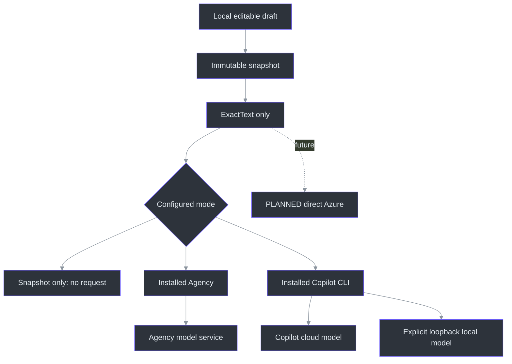
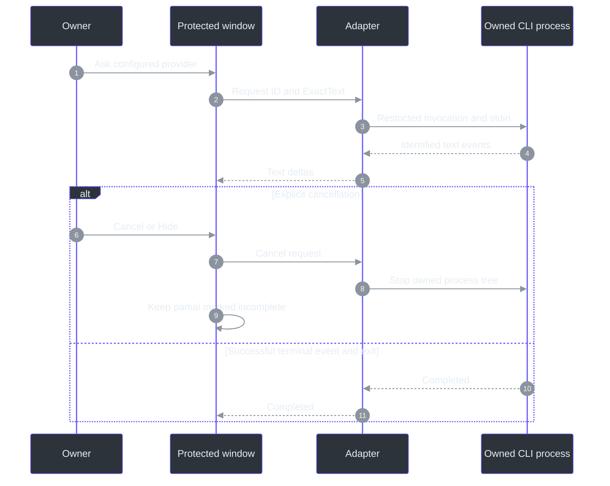

# Answer providers

The question composer is provider-independent. A frozen question becomes an `AnswerRequest`
containing a new request ID and **ExactText only**, not notes, original selected-source text,
transcript history or audio. `IAnswerProvider` streams text and an explicit terminal event.
Azure can be added through another adapter without replacing capture, draft editing or answer UI.
(`src/PhantomFudge.Core/Answers/AnswerContracts.cs:1-13`;
`src/PhantomFudge.Core/Answers/AnswerRun.cs:14-28`.)

## Local installation is not necessarily local inference

| Choice | Where the model runs | Requirements |
| --- | --- | --- |
| Snapshot only | No model call | Default until explicitly configured |
| Agency | Agency's existing model service; local background process | Installed Agency, existing model authentication and an isolated prompt-only profile |
| Copilot CLI / GitHub | GitHub-hosted model service; CLI process on your machine | Installed compatible CLI, eligible subscription/policy and explicit sign-in |
| Copilot CLI / local model | Your configured loopback model server | Installed compatible CLI plus an already-running OpenAI-compatible local model |
| Direct Azure | Future adapter, not currently configured | Future approved Azure resource, identity, deployment and data policy |

There is no automatic fallback between these destinations. Direct Copilot cloud operation remains
unvalidated after its failed smoke attempt; installed Agency is the successfully exercised hosted path. A missing local server must not send a
question to GitHub. A CLI installed on a laptop does **not** by itself mean offline inference.

## Setup and first use

**Current requested path: installed Agency, no new sign-in or organization-data access.**
The direct Copilot login experiment was cancelled at the owner's request after an organization
authentication prompt appeared. The app was returned to SnapshotOnly while the Agency path was
being integrated. No further login flow should be started automatically.

Agency's supported command is `agency copilot`: it launches its engine and accepts a prompt.
The integration uses a profile-only configuration with no organization-data MCPs,
plugins or available model tools. It is not an invocation of WorkIQ, Graph, ADO, mail or chats.
Model routing/authentication is separate from access to organization data: Agency may still use
a remote authenticated model service. If its existing authentication is unavailable, the answer
must fail visibly rather than selecting another account or initiating a new sign-in.

Install the CLI separately using the
[official installation guide](https://docs.github.com/en/copilot/how-tos/copilot-cli/set-up-copilot-cli/install-copilot-cli).
For Windows, the documented standalone installation is:

```powershell
winget install GitHub.Copilot
```

Phantom Fudge does not issue CLI installation/update commands, download model weights or sign in silently.
Agency itself may resolve its managed engine and service metadata as part of a normal launch;
the observed startup included an engine-resolution step. That is not organization-data retrieval. Configure
the desired answer provider with `scripts\Initialize-Answers.ps1`, then choose **Reload setup**
in the Question panel. Setup is not an inference request.

For the requested existing-Agency path, the setup entry point is:

```powershell
.\scripts\Initialize-Answers.ps1 -Provider Agency
```

This resolves the installed `agency.exe` and writes non-secret application settings. It does not
perform login. The answer launch is the supported `agency copilot` command in a separate
background process, with a new prompt-only profile rather than your personal coding-session
configuration. Use **Question → Reload setup** afterward. SnapshotOnly remains a deliberate no-send
mode:

```powershell
.\scripts\Initialize-Answers.ps1 -Provider SnapshotOnly
```

Optionally specify `-AgencyPath 'C:\Path\To\agency.exe'` and `-Model 'model-id'`. Paths must identify
an installed executable, never a shell command or a `.cmd`/`.ps1` wrapper. Without an explicit
Agency path, setup resolves the standard installed executable and then absolute PATH entries.

**Existing Agency authentication is used by Agency itself.** The app does not read/copy tokens,
run `agency login`, request organization-data connectors, or fall back to the cancelled direct
Copilot login. If Agency's model-service credentials expire, do not assume the app can suppress
every wrapper-managed auth surface: stop the request and resolve normal Agency access separately.
An observed no-new-login run is not a universal guarantee about future Agency versions.

The adapter pins the exercised Agency build **2026.10.7.4 / `bcff2c0f`**. Different versions fail
before prompt submission until qualified. It conservatively rejects `@` references and lines
starting with `/`, `!` or `&`, rather than risk interpreting question text as files or commands.
Rephrase those inputs as ordinary text instead of granting tools.

### Observed integration result

One separately authorized synthetic Agency prompt returned `PHANTOM_OK`, exit0, in69.881seconds.
Its receipt showed one model call, no model tools (`tool_count:0`), no tool requests and both built-in
GitHub MCP descriptors disabled. No new sign-in flow occurred in that run. No meeting text, notes,
audio, repository content, mail, chat or organization-data tool was submitted.

This was a functional smoke check, **not a speed benchmark**. It does not establish p50/p95,
real-question usefulness or cached-auth availability on another machine. No second Agency model
request was made just to obtain a faster number. The earlier direct-Copilot attempt failed at a
customization/tool gate and remains a failed result, not evidence of a working cloud adapter.

Settings are stored separately from questions under `%LOCALAPPDATA%\PhantomFudge\answers.json`.
They contain provider/model/endpoint metadata, not credentials or prompt text. Invalid settings
leave the provider disabled with an actionable status.
(`src/PhantomFudge.Core/Answers/AnswerConfiguration.cs:8-31`.)

### Local model servers

Install and operate a model server separately. Examples of the supported API shape are Ollama,
vLLM and Foundry Local **when configured to expose OpenAI-compatible chat completions**. Installing
Copilot does not install model weights or start these servers.

For an existing Ollama installation, a typical explicit setup is:

```powershell
# Separate model provisioning; downloads model weights.
ollama pull qwen3:8b

# Run only if your Ollama service is not already running.
ollama serve
```

Use the model identifier actually installed on your machine, and the server's actual port.
The usual Ollama compatibility base is `http://127.0.0.1:11434/v1`; another server may differ.
Model support, context length, CPU/GPU memory and answer quality must be verified for that model.
Phantom Fudge does not claim that any model is installed or fast enough merely because an endpoint
is configured.

Use a server restricted to loopback, not a LAN bind. A loopback endpoint can itself be a proxy:
the application cannot prove where a separately managed server ultimately processes data.
The supplied local mode has no GitHub fallback; it cannot certify the local server's own behavior.

```powershell
.\scripts\Initialize-Answers.ps1 -Provider LocalModel `
    -LocalEndpoint 'http://127.0.0.1:11434/v1' -Model 'qwen3:8b'
```

This uses the separately installed compatible Copilot engine in offline BYOK mode; no GitHub login
is required. It does not pull a model, start Ollama or invoke Agency's hosted model service.

The direct engine adapter is deliberately qualified against exact pinned binaries: standalone
`1.0.81-0` and native npm `1.0.91`. `--no-auto-update --version` can differ from ordinary
`copilot --version`, because the latter may select a newer cached build. Unknown versions fail;
the app never removes safety flags to make them run.

Offline mock endpoints exercised both supported binaries, including streamed text, redirects,
literal `@file`/slash-like questions, output bounds and cancellation. **No actual local model was
installed or benchmarked during this implementation.** Choose an installed model and confirm its
compatibility yourself; unsupported context lengths or model capabilities should surface as errors.

## What an Ask does

1. Freeze exactly the displayed draft.
2. Show its provider and immutable question beside the answer.
3. Start one bounded request. No natural final, question mark, editing event or reveal sends it.
4. Append provider text as plain text, batching UI refreshes.
5. Show completion only after the provider's terminal success; EOF alone is insufficient.

Cancel, Hide, Clear, close and protection invalidation cancel the active request. Later events cannot
append to a cancelled or different request. Partial text stays visibly incomplete unless explicitly
cleared. Another Ask requires the previous process to finish cleanup; there is no retry or
automatic continuation.

The answer is capped at32,768UTF-16 code units; the overall request has a120second deadline.
The8,192-unit question limit remains separate from model token/context limits. Copy is an explicit
Windows clipboard action, not automatic posting to a meeting or chat.
(`src/PhantomFudge.Core/Answers/AnswerRun.cs:10-79`;
`src/PhantomFudge.Core/QuestionDraft.cs:8-9,90-103`.)



The diagram shows available choices, not simultaneous or fallback calls. Source metadata remains
local even if a user edited away part of the original selection. A future Azure adapter must
likewise accept `AnswerRequest`, not serialize the richer `QuestionSnapshot`.
(`src/PhantomFudge.Core/QuestionSnapshot.cs:5-23`;
`src/PhantomFudge.Core/Answers/AnswerContracts.cs:3-13`.)

## CLI safety and retention

Copilot is a general-purpose agent, not simply a text completion executable. The integration must
not inherit a coding workspace's tools, personal instructions, hooks, MCP servers, plugins, provider
environment or resumed conversation. It uses a dedicated application profile and a new empty working
directory, with no shell interpolation of prompt text and no broad tool grants.

These controls constrain the supported CLI configuration; they are **not an OS sandbox or universal
guarantee about a modified executable**. Use the genuine CLI from a trusted installation. Unsupported
versions/configuration must fail rather than silently omitting required restrictions.

The engine's system prompt and service metadata still exist: "ExactText only" describes which
**application content** is supplied, not an assertion that the remote service receives no other
protocol/system information. `--log-level none` does not promise zero retention. The external CLI can
retain session data in its dedicated profile, and cloud data is subject to the selected service's
policies. Protect that profile like transcripts; do not commit it or copy it into preview packages.



## Future Azure and source commit

The installed CLI path is workstream39; it does not depend on an Azure subscription.
Workstreams30/31 retain the future direct Azure identity/provider integration. Workstream29 retains
accurate source-specific Mic finalization. Immediate **Ask as shown** does not claim to solve
the last acoustic sample still in a device buffer.

The local speech service stays native Python/Vosk. There is no new requirement for Docker,
cloud speech, chat scraping, generated speech, tool execution or automatic web browsing.

## Primary references

Implementation source: `AgencyCliAnswerProvider.StreamAsync` constructs an owned workspace and
streams only accepted records (`src/PhantomFudge.Core/Answers/AgencyCliAnswerProvider.cs:59-116`).
`AgencyAnswerProfile` defines the minimal profile and explicit engine arguments
(`src/PhantomFudge.Core/Answers/AgencyAnswerProfile.cs:9-25`).
`AgencyCliLaunch` preserves Agency's normal AppData cache access while isolating child homes and
excluding ambient tokens/provider settings (`src/PhantomFudge.Core/Answers/AgencyCliLaunch.cs:43-63`).
The literal-input/version checks and authentication-notice guard are constraints on the tested
wrapper, not a sandbox claim (`src/PhantomFudge.Core/Answers/AgencyCliAnswerProvider.cs:137-181`;
`src/PhantomFudge.Core/Answers/AgencyJsonProtocol.cs:50-68`).

- [CLI programmatic reference](https://docs.github.com/en/copilot/reference/copilot-cli-reference/cli-programmatic-reference)
- [CLI command reference](https://docs.github.com/en/copilot/reference/copilot-cli-reference/cli-command-reference)
- [CLI configuration directory and retention](https://docs.github.com/en/copilot/reference/copilot-cli-reference/cli-config-dir-reference)
- Installed `copilot help providers`, `copilot help environment`, `copilot --help` and pinned executable help.
- Installed `agency copilot --help`, `agency config check --help`, and the explicit no-tools
  synthetic Agency receipt. `--profile-only` ignores base and ambient MCP configuration; no
  plugins/MCPs are declared in the generated prompt-only profile.
- [Local draft contract](LOCAL-QUESTIONS.md), [Azure architecture](AI-ANSWER-ARCHITECTURE.md),
  [qualification](QUALIFICATION.md), [workstream39](../TODO/39_INSTALLED_CLI_ANSWERS.todo).
