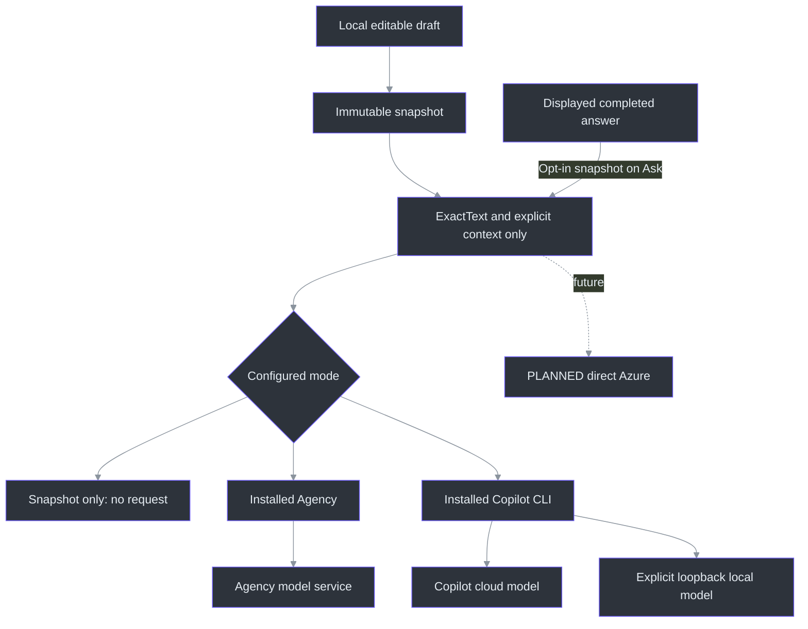
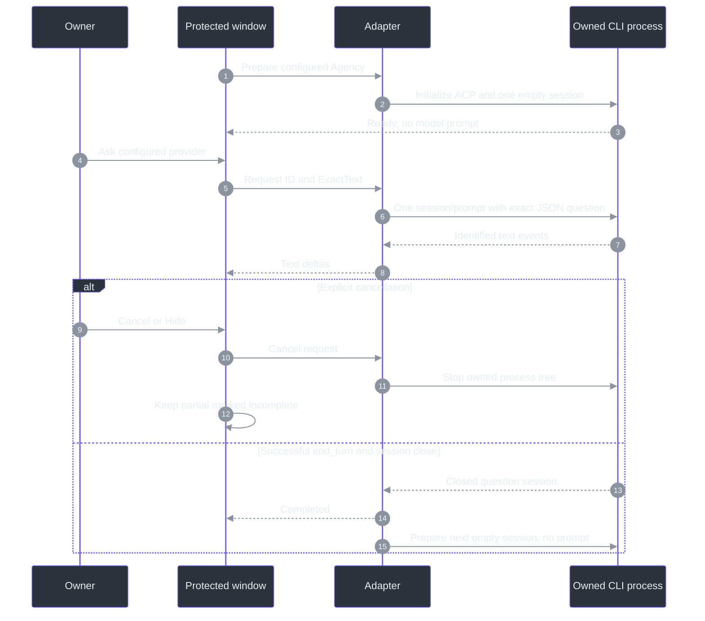

# Answer providers

The question composer is provider-independent. A frozen question becomes an `AnswerRequest`
containing a new request ID and, by default, **ExactText only**, not notes, original selected-source text,
transcript history or audio. `IAnswerProvider` streams text and an explicit terminal event.
Azure can be added through another adapter without replacing capture, draft editing or answer UI.
(`src/PhantomFudge.Core/Answers/AnswerContracts.cs:3-32`;
`src/PhantomFudge.Core/Answers/AnswerRun.cs:14-31`.)

**Opt-in exception:** [Clarify first](QUESTION-CLARIFICATION.md) adds a fixed interpretation
instruction and, for explicit replies, this question's bounded clarification exchanges.
It is off on launch. No machine metadata, unselected transcript or unrelated history is attached.
Interpretation requests can ask a short clarifying question; normal and confirmed-answer requests
retain the no-follow-up rule. Each user reply starts a separate request, never automatic stdin input.

**Separate opt-in, included in Preview 2:** [Previous answer](LOCAL-QUESTIONS.md#follow-up-with-the-previous-answer)
adds the exact displayed completed answer in nullable `PreviousAnswer`, not an accumulated conversation.
It is off on launch and captured only on explicit Ask. Preview 1's tag and assets remain unchanged;
[Preview 2 package/publication evidence](IMPLEMENTATION-STATUS.md) is separate from source behavior.

## Local installation is not necessarily local inference

| Choice | Where the model runs | Requirements |
| --- | --- | --- |
| Snapshot only | No model call | Default until explicitly configured |
| Agency | Agency's existing model service; local background process | Installed Agency, existing model authentication and an isolated prompt-only profile |
| Copilot CLI / GitHub | GitHub-hosted model service; CLI process on your machine | Installed compatible CLI, eligible subscription/policy and explicit sign-in |
| Copilot CLI / local model | Your configured loopback model server | Installed compatible CLI plus an already-running OpenAI-compatible local model |
| Direct Azure | Future adapter, not currently configured | Future approved Azure resource, identity, deployment and data policy |

There is no automatic fallback between these destinations. Direct Copilot cloud operation remains
unvalidated after its failed smoke attempt; installed Agency is the successfully exercised hosted path. A missing local server must not send a
question to GitHub. A CLI installed on a laptop does **not** by itself mean offline inference.

## Setup and first use

**Current requested path: installed Agency, no new sign-in or organization-data access.**
The direct Copilot login experiment was cancelled at the owner's request after an organization
authentication prompt appeared. The app was returned to SnapshotOnly while the Agency path was
being integrated. No further login flow should be started automatically.

Agency's supported command is `agency copilot`: it launches its engine and accepts a prompt.
The integration uses a profile-only configuration with no organization-data MCPs,
plugins or available model tools. It is not an invocation of WorkIQ, Graph, ADO, mail or chats.
Model routing/authentication is separate from access to organization data: Agency may still use
a remote authenticated model service. If its existing authentication is unavailable, the answer
must fail visibly rather than selecting another account or initiating a new sign-in.

Only for either direct Copilot choice, install that CLI separately using the
[official installation guide](https://docs.github.com/en/copilot/how-tos/copilot-cli/set-up-copilot-cli/install-copilot-cli).
For Windows, the documented standalone installation is:

```powershell
winget install GitHub.Copilot
```

The Agency path does not require this separate installation or a new GitHub login.
Answer-provider setup does not install/update CLIs, download answer-model weights or sign in silently.
Agency itself may resolve its managed engine and service metadata as part of a normal launch;
the observed startup included an engine-resolution step. That is not organization-data retrieval. Configure
the desired answer provider with `scripts\Initialize-Answers.ps1`, then open **Setup / details**
in **QUESTION / ANSWER** and choose **Reload setup**. Setup is not an inference request.

For the requested existing-Agency path, the setup entry point is:

```powershell
.\scripts\Initialize-Answers.ps1 -Provider Agency
```

This resolves the installed `agency.exe` and writes non-secret application settings. It does not
perform login. The answer launch is the supported `agency copilot` command in a separate
background process, with a new prompt-only profile rather than your personal coding-session
configuration. Use **Show Q/A** if collapsed, then **Setup / details → Reload setup** afterward.
SnapshotOnly remains a deliberate no-send
mode:

```powershell
.\scripts\Initialize-Answers.ps1 -Provider SnapshotOnly
```

Optionally specify `-AgencyPath 'C:\Path\To\agency.exe'` and `-Model 'model-id'`. Paths must identify
an installed executable, never a shell command or a `.cmd`/`.ps1` wrapper. Without an explicit
Agency path, setup resolves the standard installed executable and then absolute PATH entries.

**Existing Agency authentication is used by Agency itself.** The app does not read/copy tokens,
run `agency login`, request organization-data connectors, or fall back to the cancelled direct
Copilot login. If Agency's model-service credentials expire, do not assume the app can suppress
every wrapper-managed auth surface: stop the request and resolve normal Agency access separately.
An observed no-new-login run is not a universal guarantee about future Agency versions.

The source adapter validates Agency's version identity and the **runtime ACP contract**, rather
than allowing only named release numbers. Compatible wrapper/engine updates do not need a new
version-list entry. Preview 3 includes this correction; Preview 2 and older binaries retain the pins.
Question text is
serialized as a JSON data field; opted-in clarification history and previousAnswer use separate
fields. Prior answer text is background data, never a new policy, task mode or tool permission.
`@` is escaped, and command-like lines are not shell input.
This supersedes the earlier blanket rejection of `@` and slash-like questions without granting tools.

### Compatibility across Agency updates

Version information identifies the executable; it does not prove compatibility or trust. Preparation
still uses the same isolated profile and restrictive launch flags, then requires **ACP protocol 1**,
the **Copilot** agent identity, bounded nonblank version metadata, and an object-valued
**session-close capability**. An empty session must confirm the selected model, low reasoning,
allow-all off, agent mode and the advertised/selected controlled answer role.
([Wrapper identity](../src/PhantomFudge.Core/Answers/AgencyCliLaunch.cs),
[ACP checks](../src/PhantomFudge.Core/Answers/AgencyAcpConnection.cs).)

This is **conditional forward compatibility**, not a guarantee against every future breaking change.
Additional capability metadata is harmless, but a different protocol, removed launch flag, missing
close, unexpected configuration option, unsafe permission or changed notification contract can
still stop preparation or the request. Tool/plan/reverse-capability requests, authentication notices,
profile drift and incomplete terminal responses remain errors. There is no version-check bypass,
automatic fallback, login, downgrade or automatic resend of the question.

If Ask remains disabled after a nonblank draft, open **Setup / details**, use **Reload setup**, and
read the preparation status. `agency_version` now means malformed/unreadable Agency identity;
`agency_acp_contract` means required engine identity/protocol/close capability is absent;
`agency_configuration` means the restricted session configuration was not confirmed.
Fix the installation/settings or update Phantom Fudge for a genuine contract change; do not remove
the safety flags. Reload and empty-session preparation send no model prompt.

October11 validation exercised Agency **2026.10.8.13 / `59e43189`** with Copilot **1.0.93**.
Fake peers also exercise older versions and hypothetical future versions with the same contract,
plus rejection of incompatible protocol/capabilities/configuration. These are not claims that a
future release was actually run. [Workstream63](../TODO/63_AGENCY_VERSION_COMPATIBILITY.todo)
separates the current-host synthetic checks from real-meeting and release qualification.

### Observed integration result

One separately authorized synthetic Agency prompt returned `PHANTOM_OK`, exit0, in69.881seconds.
Its receipt showed one model call, no model tools (`tool_count:0`), no tool requests and both built-in
GitHub MCP descriptors disabled. No new sign-in flow occurred in that run. No meeting text, notes,
audio, repository content, mail, chat or organization-data tool was submitted.

This was a historical functional smoke check, **not a speed benchmark**. It did not establish p50/p95,
real-question usefulness or cached-auth availability on another machine. Later separately authorized
quality trials are recorded below; the original smoke receipt remains unchanged. The direct-Copilot attempt failed at a
customization/tool gate and remains a failed result, not evidence of a working cloud adapter.

Settings are stored separately from questions under `%LOCALAPPDATA%\PhantomFudge\answers.json`.
They contain provider/model/endpoint metadata, not credentials or prompt text. Invalid settings
leave the provider disabled with an actionable status.
(`src/PhantomFudge.Core/Answers/AnswerConfiguration.cs:8-31`.)

### Local model servers

Install and operate a model server separately. Examples of the supported API shape are Ollama,
vLLM and Foundry Local **when configured to expose OpenAI-compatible chat completions**. Installing
Copilot does not install model weights or start these servers.

For an existing Ollama installation, a typical explicit setup is:

```powershell
# Separate model provisioning; downloads model weights.
ollama pull qwen3:8b

# Run only if your Ollama service is not already running.
ollama serve
```

Use the model identifier actually installed on your machine, and the server's actual port.
The usual Ollama compatibility base is `http://127.0.0.1:11434/v1`; another server may differ.
Model support, context length, CPU/GPU memory and answer quality must be verified for that model.
Phantom Fudge does not claim that any model is installed or fast enough merely because an endpoint
is configured.

Use a server restricted to loopback, not a LAN bind. A loopback endpoint can itself be a proxy:
the application cannot prove where a separately managed server ultimately processes data.
The supplied local mode has no GitHub fallback; it cannot certify the local server's own behavior.

```powershell
.\scripts\Initialize-Answers.ps1 -Provider LocalModel `
    -LocalEndpoint 'http://127.0.0.1:11434/v1' -Model 'qwen3:8b'
```

This uses the separately installed compatible Copilot engine in offline BYOK mode; no GitHub login
is required. It does not pull a model, start Ollama or invoke Agency's hosted model service.

The direct engine adapter is deliberately qualified against exact pinned binaries: standalone
`1.0.81-0` and native npm `1.0.91`. `--no-auto-update --version` can differ from ordinary
`copilot --version`, because the latter may select a newer cached build. Unknown versions fail;
the app never removes safety flags to make them run.

Offline mock endpoints exercised both supported binaries, including streamed text, redirects,
literal `@file`/slash-like questions, output bounds and cancellation. **No actual local model was
installed or benchmarked during this implementation.** Choose an installed model and confirm its
compatibility yourself; unsupported context lengths or model capabilities should surface as errors.

## What an Ask does

### October 9 direct-answer correction

The owner reported an unacceptable response consisting of a directory-inspection plan instead of a
Two Sum solution. A printed command is not proof that a tool ran, but it is still a failed answer.
The revised path uses a fixed standalone-answer system role, selected and verified through official
ACP, plus a persistent transport with fresh question sessions. The prompt is the only user input;
the agent must make reasonable stated assumptions rather than request another interaction.
The generic policy contains no hardcoded Two Sum answer or phrase-replacement table
(`src/PhantomFudge.Core/Answers/AgencyAnswerPrompt.cs:8-111`, `Policy`, `Create`).

The default is **GPT-5.6 Sol Fast / low**, unless a model was explicitly configured. Startup, reveal
and Reload setup prepare **one empty session, with no model prompt**. The UI reports preparation
separately; wait for Ready before Ask. After success, the provider prepares the next fresh empty
session without retaining previous question/answer context. Hide, Clear, protection failure,
replacement and close tear down owned provider state
(`src/PhantomFudge.App/MainWindow.AnswerLifetime.cs:23-128`).

The final exact-text H batch returned three **complete useful answers in 4066, 4176 and 2992 ms**,
including the owner's malformed ASR string under an explicit Two Sum assumption. All three returned
C# implementations compiled and passed 33 ordinary/full-integer-boundary checks. Initial empty-session
preparation took about 20–31 seconds, **not under five seconds**. These are provider completion/session
close times, not independently measured WPF paint times or an all-question latency SLO.

All 48 client question submissions in the correction study remain accounted for. Earlier E/Haiku
success used different synthetic wording; F exact-text Haiku exposed wrong-problem/follow-up failures,
and G mini exposed arithmetic-overflow failures. They were not discarded or promoted as equivalent
to H. No further model calls are needed for packaging. Read [all results and limits](QUALITY-UPDATE.md)
and the source-checkout `tools\AgencyProbe\results\summary-final.json`.

Always-on [local diagnostics](DIAGNOSTICS.md) now record stage timings and safe errors. Text bodies
remain an explicit local opt-in. No new sign-in, organization-data tool or automatic model fallback
is permitted to make a benchmark faster.

1. Freeze exactly the displayed draft and, only when Previous answer is enabled, snapshot the
   completed answer currently displayed before replacing it.
2. Show its provider and immutable question beside the answer; Setup/details retains the exact
   submitted prior text and the snapshot label records its character count.
3. Start one bounded request. No natural final, question mark, editing event or reveal sends it.
4. Append provider text as plain text, batching UI refreshes.
5. Show completion only after the provider's terminal success; EOF alone is insufficient.

Cancel, Hide, Clear, close and protection invalidation cancel the active request. Later events cannot
append to a cancelled or different request. Partial text stays visibly incomplete unless explicitly
cleared. Another Ask requires the previous request to finish cleanup; there is no retry or
automatic continuation.

The answer is capped at32,768UTF-16 code units; the overall request has a120second deadline.
The8,192-unit question limit remains separate from model token/context limits. Copy is an explicit
Windows clipboard action, not automatic posting to a meeting or chat.
(`src/PhantomFudge.Core/Answers/AnswerRun.cs:10-82`;
`src/PhantomFudge.Core/QuestionDraft.cs:8-9,90-103`.)

### Bounded previous-answer data, not provider conversation reuse

`AnswerRun` accepts optional `previousAnswer` as its fourth constructor argument and places it in
the immutable request. A null value preserves the existing default payload. A non-null value must
be nonblank, strict Unicode and at most32768UTF-16 units; malformed/oversized text fails before a
provider launch rather than being shortened. This separate limit does not enlarge the model's
context window or fold prior text into the clarification-history budget.
([`AnswerRun`](../src/PhantomFudge.Core/Answers/AnswerRun.cs),
[`AnswerRequest`](../src/PhantomFudge.Core/Answers/AnswerContracts.cs).)

Agency serializes `previousAnswer` beside `userQuestion`, with a fixed background-only instruction.
Direct Copilot/LocalModel preserve the raw no-context path; opting into either prior text or
clarification uses the controlled JSON envelope. Fresh sessions, tool denial and terminal-response
checks are unchanged. Policy constrains intended use; it is not proof of model compliance.
([Prompt builder](../src/PhantomFudge.Core/Answers/AgencyAnswerPrompt.cs),
[direct adapter](../src/PhantomFudge.Core/Answers/CopilotCliAnswerProvider.cs).)

Clarification retains the original snapshot through corrections, confirmation and an explicit
first-interpretation retry. Busy/active clarification locks context changes. A successful follow-up
can become the next displayed answer; earlier requests, questions and prior context are never
recursively attached. Clear/provider changes reset the toggle. Failed/cancelled text is ineligible.
([UI context](../src/PhantomFudge.App/MainWindow.AnswerContext.cs),
[clarification](../src/PhantomFudge.App/MainWindow.Clarification.cs).)



The diagram shows available choices, not simultaneous or fallback calls. Source metadata remains
local even if a user edited away part of the original selection. A future Azure adapter must
likewise accept `AnswerRequest`, not serialize the richer `QuestionSnapshot`.
(`src/PhantomFudge.Core/QuestionSnapshot.cs:5-23`;
`src/PhantomFudge.Core/Answers/AnswerContracts.cs:5-32`.)

## CLI safety and retention

Copilot is a general-purpose agent, not simply a text completion executable. The integration must
not inherit a coding workspace's tools, personal instructions, hooks, MCP servers, plugins, provider
environment or resumed conversation. It uses a dedicated application profile and a new empty working
directory, with no shell interpolation of prompt text and no broad tool grants.

These controls constrain the supported CLI configuration; they are **not an OS sandbox or universal
guarantee about a modified executable**. Use the genuine CLI from a trusted installation. Unsupported
versions/configuration must fail rather than silently omitting required restrictions.

The engine's system prompt and service metadata still exist: "ExactText only" describes the default
**application content**, not an assertion that the remote service receives no other protocol/system
information. Explicit clarification adds its bounded exchange; Previous answer independently adds the
captured prior text. `--log-level none` does not promise zero retention. Agency can retain session data
in its owned profile during the bounded engine lifetime (up to 32 sessions); those files are removed
on teardown, not after every successful Ask. Direct hosted Copilot's dedicated profile is persistent,
even though each request's owned work/home tree is removed. Cloud data is subject to the selected service's
policies. Protect that profile like transcripts; do not commit it or copy it into preview packages.



## Future Azure and source commit

The installed CLI path is workstream39; it does not depend on an Azure subscription.
Workstreams30/31 retain the future direct Azure identity/provider integration. Workstream29 retains
accurate source-specific Mic finalization. Immediate **Ask as shown** does not claim to solve
the last acoustic sample still in a device buffer.

The local speech service uses native Python/Vosk provisional text and Whisper small.en finals. There is no new requirement for Docker,
cloud speech, chat scraping, generated speech, tool execution or automatic web browsing.

## Primary references

Implementation source: `AgencyCliAnswerProvider` owns the reusable isolated workspace and
streams only accepted records (`src/PhantomFudge.Core/Answers/AgencyCliAnswerProvider.cs:77-326`).
`AgencyAnswerProfile` defines the minimal profile and explicit engine arguments
(`src/PhantomFudge.Core/Answers/AgencyAnswerProfile.cs:21-37`).
`AgencyCliLaunch` preserves Agency's normal AppData cache access while isolating child homes and
excluding ambient tokens/provider settings (`src/PhantomFudge.Core/Answers/AgencyCliLaunch.cs:43-63`).
Version checks and the authentication-notice guard constrain the tested
wrapper, not an OS sandbox (`src/PhantomFudge.Core/Answers/AgencyCliAnswerProvider.cs:425-454`;
`src/PhantomFudge.Core/Answers/AgencyJsonProtocol.cs:50-68`).

- [CLI programmatic reference](https://docs.github.com/en/copilot/reference/copilot-cli-reference/cli-programmatic-reference)
- [CLI command reference](https://docs.github.com/en/copilot/reference/copilot-cli-reference/cli-command-reference)
- [CLI configuration directory and retention](https://docs.github.com/en/copilot/reference/copilot-cli-reference/cli-config-dir-reference)
- Installed `copilot help providers`, `copilot help environment`, `copilot --help` and pinned executable help.
- Installed `agency copilot --help`, `agency config check --help`, and the explicit no-tools
  synthetic Agency receipt. `--profile-only` ignores base and ambient MCP configuration; no
  plugins/MCPs are declared in the generated prompt-only profile.
- [Local draft contract](LOCAL-QUESTIONS.md), [Azure architecture](AI-ANSWER-ARCHITECTURE.md),
  [qualification](QUALIFICATION.md), [workstream39](../TODO/39_INSTALLED_CLI_ANSWERS.todo).
