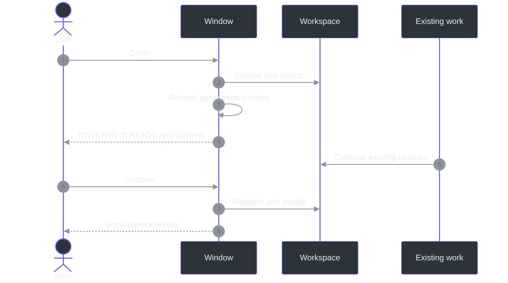
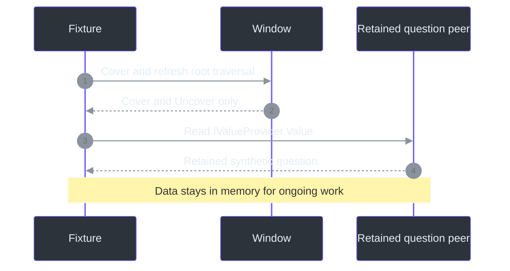

# Cover mode and privacy boundaries

**Research date: 2026-10-09.** This guide uses official public documentation and current source.
The cover is implemented. It does **not** make the application universally undetectable.

## Use the cover

Click **Cover** in the top bar. The workspace is replaced by **NOTEPAD IS READY** and one
**Uncover** button. Click that same button to restore the transcript, question, answer, notes
and setup state. The existing protected HWND is reused; the app remains Phantom Fudge, not a
process pretending to be Windows Notepad.

**Transcription and answers keep running behind the cover**, as explicitly requested.
The recording dot is in the covered workspace, so its absence on the cover does not mean capture
stopped. Windows microphone indicators and provider traffic may continue. Cover starts no new
capture or request. Hide, Exit, session/power invalidation and their normal stop/cancel behavior
remain separate. ([Cover](../src/PhantomFudge.App/MainWindow.Cover.cs);
src/PhantomFudge.App/MainWindow.AnswerLifetime.cs:10-17.)

The picture is an internal WPF render with synthetic content, not a screen-sharing result.

## Feasible measures, in practical order

This inventories exposure categories, not every possible inspection program.

| Order | Surface and measure | Current implementation and limit |
| --- | --- | --- |
| 1 | Ordinary visual contents | Cover disables and detaches the workspace; the message and return button remain |
| 2 | Fresh accessibility traversal | Window-peer child cache is rebuilt; the covered workspace is absent from fresh in-process traversal |
| 3 | Supported OS capture APIs | Existing `WDA_EXCLUDEFROMCAPTURE` remains; recipient/product compatibility still needs qualification |
| 4 | Shell/taskbar surfaces | Existing tool-window/taskbar omission remains; a new `DWMWA_DISALLOW_PEEK` request suppresses taskbar-hover Peek where honored |
| 5 | Other shell previews | Custom nonsensitive iconic thumbnails require more lifecycle/bitmap integration and are deferred |
| Not a supported guarantee | Cached accessibility data, process enumeration, memory inspection | Cover cannot retract copied data, conceal the process or erase state retained for ongoing work |
| Outside this mechanism | Privileged/driver inspection, physical camera/HDMI, arbitrary remote capture | No universal exclusion is available from these window APIs |

No recorder autodetection, process disguise, executable renaming, global accessibility disabling,
driver/injection work, or interference with recorders/security tools is included.

## Accessibility: current-tree minimization is not secrecy

Microsoft defines [raw, control and content UI Automation views](https://learn.microsoft.com/en-us/windows/win32/winauto/uiauto-treeoverview).
Filtering control/content elements does not prove that they are absent from raw traversal.
Likewise, [offscreen state](https://learn.microsoft.com/en-us/windows/win32/winauto/uiauto-automation-element-propids)
does not mean a client cannot retrieve an element's value. Painting an opaque rectangle over a
TextBox would therefore be an inadequate accessibility-privacy implementation.

`SetCover` instead disables and removes `WorkspaceRoot` from its visual and logical host.
It calls the documented
[`ResetChildrenCache`](https://learn.microsoft.com/en-us/dotnet/api/system.windows.automation.peers.automationpeer.resetchildrencache?view=windowsdesktop-10.0)
and [`InvalidatePeer`](https://learn.microsoft.com/en-us/dotnet/api/system.windows.automation.peers.automationpeer.invalidatepeer?view=windowsdesktop-10.0)
methods on the window peer. The first rebuilds child relationships through `GetChildrenCore`;
the second refreshes peer state. An initial synthetic run showed that detachment without the
explicit cache reset left the old window children in traversal. (src/PhantomFudge.App/MainWindow.Cover.cs:34-65.)

**Observed:** fresh in-process root traversal excludes the original question/note/answer peers
and includes the cover message and return button. **Also observed: `cachedPeerValueReadable=true`.**
An already-retained in-process `IValueProvider` still returned the synthetic question while covered.
That is a demonstrated limitation, not a pending invisibility claim.
(src/PhantomFudge.App/MainWindow.CoverDiagnostics.cs:68-88.)

Microsoft also documents [client-side UIA caching](https://learn.microsoft.com/en-us/windows/win32/winauto/uiauto-cachingforclients).
No tree change can retract text already read or copied. External screen readers, cached remote
providers, events and raw/control/content client behavior still need their own observations.
Normal accessibility returns on Uncover, and the return action remains accessible while covered.
[WPF custom peers](https://learn.microsoft.com/en-us/dotnet/desktop/wpf/controls/ui-automation-of-a-wpf-custom-control)
are extensibility mechanisms, not a security boundary.

## Capture affinity and Peek: supported requests, bounded evidence

[`SetWindowDisplayAffinity`](https://learn.microsoft.com/en-us/windows/win32/api/winuser/nf-winuser-setwindowdisplayaffinity)
accepts the current process's top-level HWND and requires DWM composition. The application already
requests `WDA_EXCLUDEFROMCAPTURE` (`0x11`), checks available readback and flushes composition before
reveal. Microsoft explicitly limits this to a **specific set of public OS features and APIs**:
it is not DRM and cannot guarantee protection against every capture mechanism.
([Native implementation](../src/PhantomFudge.App/Native/WindowProtection.cs).)

This update also requests
[`DWMWA_DISALLOW_PEEK`](https://learn.microsoft.com/en-us/windows/win32/api/dwmapi/ne-dwmapi-dwmwindowattribute)
with a32-bit Boolean true on the same HWND. It targets the full-sized taskbar-hover Peek preview,
not arbitrary recorder previews. Failure is surfaced through the existing protection-setup path,
not silently ignored. The local fixture records `PeekPreventionRequested=true`, meaning the setter
returned success; it is **not** a recorded observation of a taskbar hover or recipient frame.
The existing tool-window style already makes the incremental benefit narrow.

Do not confuse this with `DWMWA_EXCLUDED_FROM_PEEK`, which prevents fading during another window's
Peek and can preserve visibility. `DWMWA_FREEZE_REPRESENTATION` can freeze an existing sensitive
thumbnail; it is not applied. Nonsensitive
[iconic thumbnails](https://learn.microsoft.com/en-us/windows/win32/api/dwmapi/nf-dwmapi-dwmseticonicthumbnail)
and [live-preview bitmaps](https://learn.microsoft.com/en-us/windows/win32/api/dwmapi/nf-dwmapi-dwmseticoniclivepreviewbitmap)
are deferred because they need flags, message handling, bitmap ownership and preview qualification.

## Capture methods still requiring qualification

These rows are **NOT_TESTED for this cover revision**, not assertions that each method bypasses or
honors the request.

| Method/product | What must be distinguished |
| --- | --- |
| [Windows Graphics Capture](https://learn.microsoft.com/en-us/windows/apps/develop/media-authoring-processing/screen-capture) | Display versus directly selected window |
| [DXGI duplication](https://learn.microsoft.com/en-us/windows/win32/direct3ddxgi/desktop-dup-api) | Output, GPU/driver, transitions and desktop composition |
| [GDI BitBlt](https://learn.microsoft.com/en-us/windows/win32/api/wingdi/nf-wingdi-bitblt) | Source DC, flags and layered-window behavior |
| [PrintWindow](https://learn.microsoft.com/en-us/windows/win32/api/winuser/nf-winuser-printwindow) | Owner-rendered window/client path |
| [Teams](https://support.microsoft.com/en-us/teams/meetings/present-content-in-microsoft-teams-meetings) | Desktop/web, screen/window, recipient and recording |
| [Zoom](https://support.zoom.com/hc/en/article?id=zm_kb&sysparm_article=KB0060596) | Installed version and capture modes actually offered |
| [Meet](https://support.google.com/meet/answer/9308856?hl=en) | Browser/version, screen/window/tab |
| [OBS](https://obsproject.com/kb/window-capture-sources) | Display/window, Automatic and explicit backends |

Product names or “Automatic” are not fixed backends. Zoom's public support fetch exposed headings
only, so no detailed backend conclusion is inferred. API acceptance, picker listing, local preview,
remote frames and recordings are separate observations in the [qualification plan](QUALIFICATION.md).

## Process, remote, physical and retained-copy boundaries

[`WS_EX_TOOLWINDOW`](https://learn.microsoft.com/en-us/windows/win32/winmsg/extended-window-styles)
omits taskbar/Alt+Tab presence; it does not promise absence from
[`EnumWindows`](https://learn.microsoft.com/en-us/windows/win32/api/winuser/nf-winuser-enumwindows)
or custom pickers. [`EnumProcesses`](https://learn.microsoft.com/en-us/windows/win32/api/psapi/nf-psapi-enumprocesses)
does not depend on the visible workspace. PhantomFudge's process and single-instance identities
remain. (src/PhantomFudge.App/Native/SingleInstance.cs:18-35.)

[Process access rights](https://learn.microsoft.com/en-us/windows/win32/procthread/process-security-and-access-rights)
govern memory inspection separately. Physical cameras are explicitly outside display-affinity
assurance; HDMI protection cannot be inferred from it. RDP/VDI has separate
[client/server protection policies](https://learn.microsoft.com/en-us/azure/virtual-desktop/screen-capture-protection),
not a universal switch this desktop app can impose.

Windows' [microphone-in-use indicator](https://support.microsoft.com/en-us/windows/privacy/windows-camera-microphone-and-privacy)
is not hidden. [WASAPI loopback](https://learn.microsoft.com/en-us/windows/win32/coreaudio/loopback-recording)
can capture output without a microphone icon, so no icon is not proof of stopped capture.
(src/PhantomFudge.App/Audio/LoopbackTranscriber.cs:95-128.)

Cover cannot recall [clipboard copies](https://learn.microsoft.com/en-us/windows/win32/dataxchg/about-the-clipboard),
delete saved notes/exports, retract provider requests or change upstream retention. Exact question
and optional clarification remain independent of presentation.
(src/PhantomFudge.Core/Answers/AnswerContracts.cs:5-14.)
Diagnostic text is opt-in but can persist when enabled; Cover does not erase it.
(src/PhantomFudge.Core/Diagnostics/LocalDiagnostics.cs:145-184.)

## Local evidence and remaining limits

Fixture **20261009-140313** passed15cover assertions: normal/fresh peer traversal, detachment,
shortcut blocking, synthetic transcript and fake-answer continuation, correct visible timing,
appearance, message pixels, compact layout, same HWND/styles, restoration, editing/setup retention,
busy-operation refusal and accepted Peek request. It also recorded `cachedPeerValueReadable=true`,
`modelRequests=0` and `audioCaptured=false`.
([Fixture](../src/PhantomFudge.App/MainWindow.CoverDiagnostics.cs),
[image provenance](handbook/assets/screenshots/manifest.json).)

This is not live-device continuity, external screen-reader certification or recipient-capture
qualification. Pin actual OS/product/backend/GPU/DPI versions and observe those paths separately
before making broader claims. The supported controls reduce particular exposure surfaces;
**global invisibility remains unavailable.**
