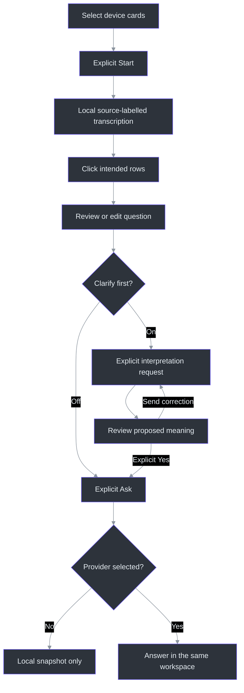
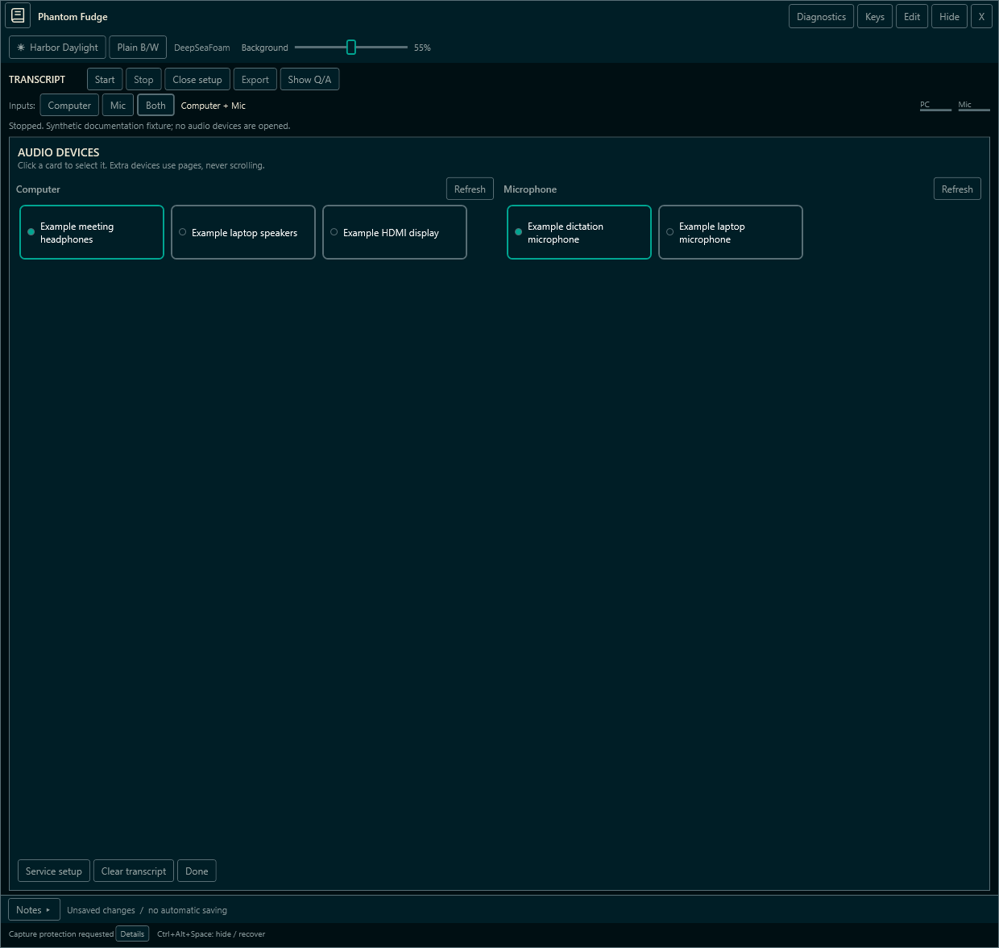
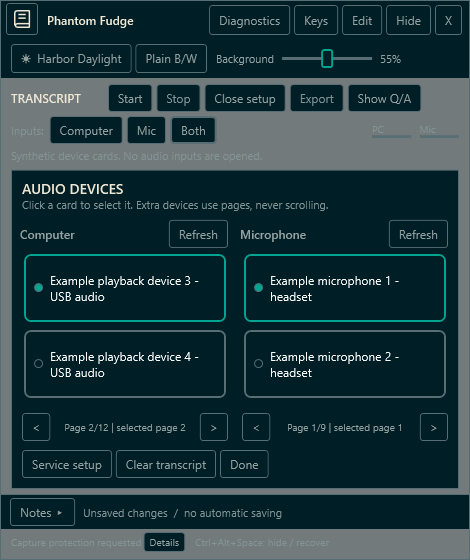
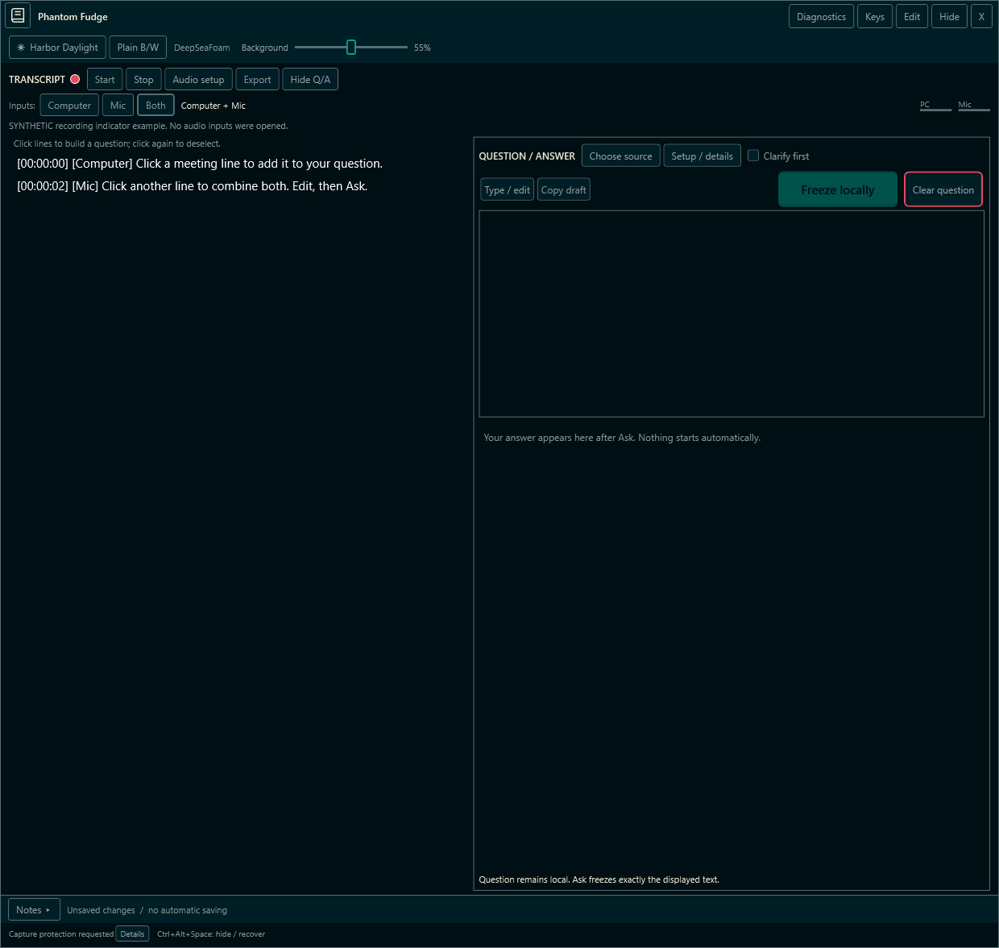
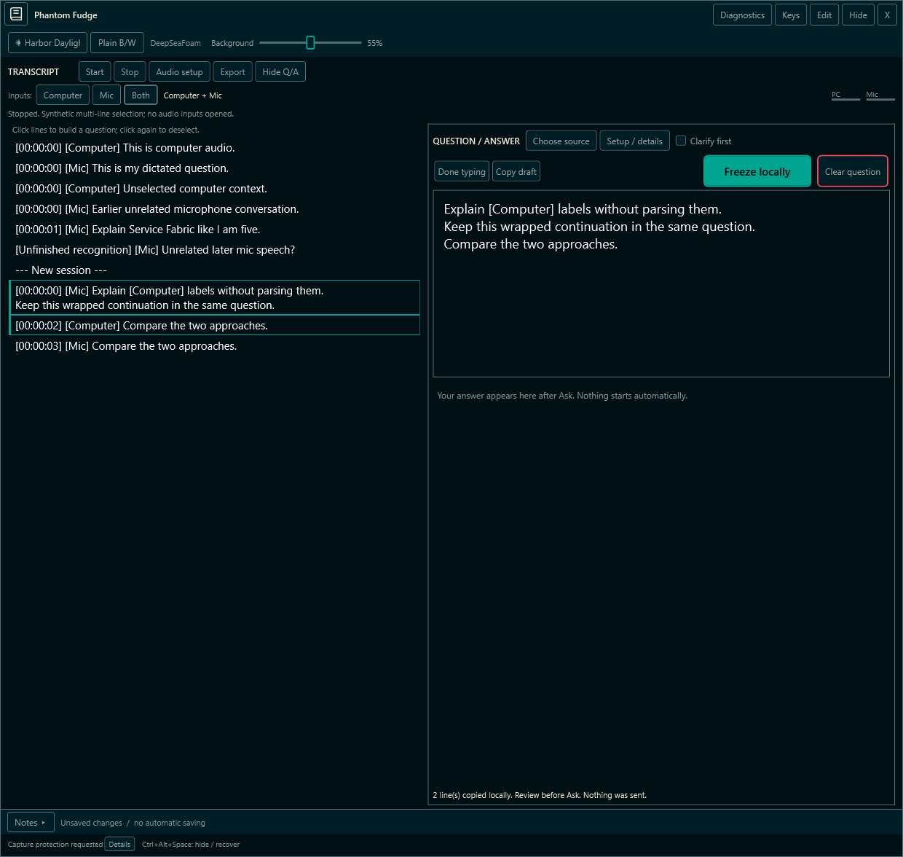
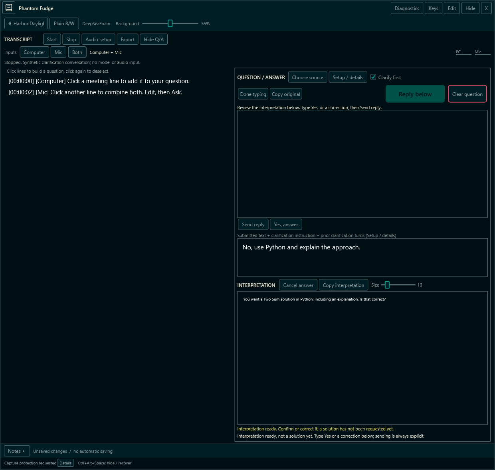
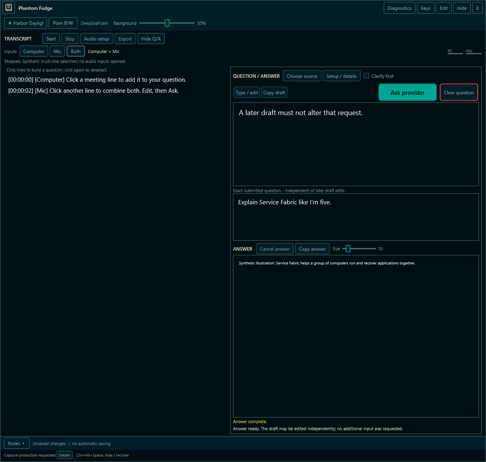
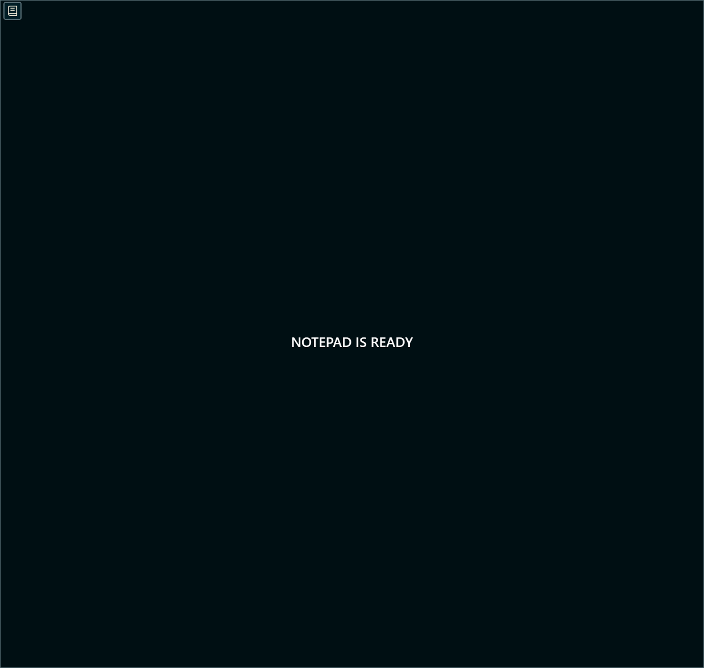
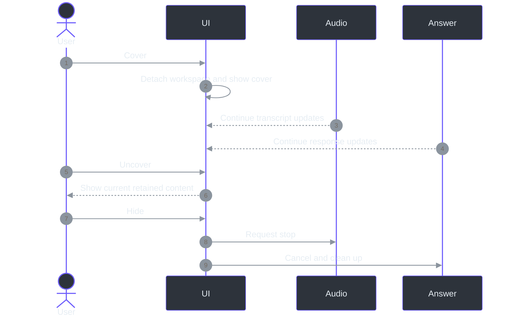

# Current workflow: an illustrated guide

## Overview: one workspace, separate deliberate actions

Phantom Fudge combines local transcription, an editable question and explicit provider answers.
Choosing an input does not record it; selecting words does not send them; covering the workspace
does not stop work. This guide brings the current controls and images together so those boundaries
are visible before a meeting. It describes **current source**, not the older045022preview ZIP.

All pictures below are **separate synthetic WPF examples**. They show actual controls with generated
text/device labels, not a real conversation, live model result or screen-sharing qualification.
The [source-image manifest](handbook/assets/screenshots/manifest.json) and
[README-image manifest](assets/readme/manifest.json) record their provenance.
Current rendering and behavior are defined by the window and its partial classes, not by the
historical package. (src/PhantomFudge.App/MainWindow.xaml:1-10;
src/PhantomFudge.App/MainWindow.Questions.cs:27-61;
src/PhantomFudge.App/MainWindow.Cover.cs:22-77.)

Configure an [answer provider](ANSWER-PROVIDERS.md) before the AI steps. Without one, **Freeze
locally** only captures a local question snapshot; transcription and notes remain usable.

### Keyboard-first route

Keyboard controls and the answer-size slider are implemented in current source. The guide,
source atlas and handbook include the updated workflow and synthetic illustrations.
The canonical [keyboard guide](KEYBOARD-CONTROLS.md) covers:
**Ctrl+Alt+K → `v` → `j`/`k` → Space → Enter to review → Ctrl+Enter to submit**.
Edit is literal typing: Enter makes a newline. Escape backs out through Control before a
best-effort return to the previous app; `m` in Control masks and disarms without stopping work.
There is no cursor locking/hiding/warping or global letter-key capture.
(src/PhantomFudge.App/MainWindow.Keyboard.cs:67-85,141-175,218-306,364-368;
src/PhantomFudge.App/MainWindow.KeyboardSelection.cs:110-159.)
Edit remains armed after submission. Async interpretation retargets the visible editable reply/
original field only while this app is already foreground; it does not steal focus from another app.
(src/PhantomFudge.App/MainWindow.Keyboard.cs:127-139,301-306.)

## Architecture: what happens after each click



The normal speech path is selected native WASAPI inputs, authenticated local transport, fast Vosk
partial text and local Whisper small.en finals. Normal Ask sends the frozen question through the
configured provider. Clarification deliberately adds only its fixed task instruction and bounded
question-specific history; no notes or unselected meeting transcript are appended.
(src/PhantomFudge.App/Audio/LoopbackTranscriber.cs:65-128;
services/transcription/accurate.py:33-129;
src/PhantomFudge.Core/Answers/AnswerRun.cs:15-27;
src/PhantomFudge.Core/Answers/AnswerClarification.cs:13-69.)

## Components: know the controls before sending

| Control | Meaning |
| --- | --- |
| Computer / Mic / Both | Select input types; these labels do not identify speakers |
| Audio setup | Open source-specific device cards; Service setup contains the token field |
| Start / Stop | Explicit audio capture and final-text draining |
| Red dot | The transcriber reports Running; hidden while starting/stopped and behind Cover |
| Transcript rows | Ordinary clicks toggle whole segments into the question |
| Type / edit | Deliberate question focus without global Notes Edit |
| Large accent button | Ask provider, Freeze locally, Interpret question or Reply below, according to mode |
| Red-bordered Clear question | Clear the question/snapshot/answer, not the transcript or notes |
| Clarify first | Default-off interpretation and explicit correction/confirmation workflow |
| Book icon, top left | Toggle the visual mask; already-started work continues |
| Keys / Ctrl+Alt+K | Enter modal keyboard control; local selection, review, commands and reading |
| Answer Size | Choose 8–24 for this session; resizing retains a choice, restarting does not |
| Diagnostics | Open local diagnostics and reload its settings |

These are distinct handlers and state checks, not alternate names for one global pause action.
(src/PhantomFudge.App/MainWindow.Questions.cs:158-212,265-337;
src/PhantomFudge.App/MainWindow.RecordingIndicator.cs:7-10;
src/PhantomFudge.App/MainWindow.Cover.cs:20-77.)
Keyboard routing and answer size are separate additions.
(src/PhantomFudge.App/MainWindow.Keyboard.cs:177-196;
src/PhantomFudge.App/MainWindow.AnswerFont.cs:9-43.)

## 1. Choose audio device cards



Choose the input mode, open **Audio setup**, then click the intended cards. The accent outline and
filled dot identify the selected item. Computer should match the output carrying the meeting;
Mic is the input used for your own dictation. **Done** or **Close setup** returns to the reading view.

There are **no device-list scrollbars**. Setup temporarily uses the reading area, with cards wrapping
into rows. If a large catalogue or small window cannot show everything, Previous/Next buttons show
another page without changing the selected endpoint. The page label identifies the selected card's
page. Selection/paging are locked while capture is starting, running or stopping.
(src/PhantomFudge.App/MainWindow.AudioDeviceCards.cs:39-65,96-159.)



The compact image intentionally uses23synthetic outputs and17microphones. It illustrates overflow,
not the number of devices on your machine. Friendly names wrap; extremely constrained cards may
ellipsize only the displayed name, not the stored name or endpoint ID. Empty lists have an explicit
message. **Service setup** reveals the session-only token and existing guidance; missing-token
Start opens it automatically. The normal launcher supplies the token, so manual entry is usually
unnecessary. (src/PhantomFudge.App/MainWindow.AudioDeviceCards.cs:80-140;
src/PhantomFudge.App/MainWindow.AudioDeviceCardsDiagnostics.cs:39-53,104-131;
scripts/Run-PhantomFudge.ps1:43-57.)

## 2. Start transcription and watch the red dot



Press **Start** only when ready to capture the selected inputs. **Both** is merely the initial
mode selection; it is not automatic recording. A red dot beside **TRANSCRIPT** appears when the
transcriber reports Running, not merely when the service is connecting or words happen to be visible.
It indicates transcription, **not an audio file being saved**.
(src/PhantomFudge.App/MainWindow.RecordingIndicator.cs:7-10;
src/PhantomFudge.App/Audio/LoopbackTranscriber.cs:30-36,117-128.)

Computer and Mic keep separate labels, meters, partials and identities. Computer output can include
other applications or sidetone; this is not meeting-process isolation or speaker diarization.
Whisper finals can replace provisional guesses. Stop ends capture and drains accepted work, so a
last final line can arrive after active capture has ended. The normal UI remains honest about
recognition errors and failures. (src/PhantomFudge.Core/AudioSource.cs:3-30;
src/PhantomFudge.Core/StructuredTranscriptStore.cs:37-100;
src/PhantomFudge.App/Audio/LoopbackTranscriber.cs:387-445.)

## 3. Select several transcript lines and review the question



Click one or more intended rows. Each click toggles a whole recognition segment; Ctrl is not
required. The draft follows displayed history order rather than click order. A wrapped segment
remains one selectable unit. Generated timestamps/source prefixes do not enter the question.
Selecting rows opens the question editor and deliberately takes editing focus without stopping
transcription or sending a request.
(src/PhantomFudge.App/MainWindow.TranscriptSelection.cs:85-147.)

After you manually edit the draft, further direct row changes are refused so a click cannot
destroy your corrections. Copy anything needed, then use **Clear question** before starting a
different direct selection. The manual **Choose source → Mic / Computer / All → Use selected**
route remains an explicit replacement alternative, except while a clarification locks the original.
One draft is limited to256selected entries from one capture session and8192UTF-16 units including
inserted newlines. Invalid changes retain the existing text rather than truncating it.
(src/PhantomFudge.Core/QuestionDraft.cs:8-45,48-79,105-125;
src/PhantomFudge.App/MainWindow.Questions.cs:105-131.)

## 4. Optionally ask the model to clarify your intended question



**Clarify first is off on launch.** With a provider configured, enable it and press **Interpret question** when the transcript
captures the general subject but is cumbersome to correct. The model should restate the intended
question rather than solve it yet. Your original draft stays separate from the reply field.

Type **Yes** and press **Send reply**, or click **Yes, answer**. To correct the proposed meaning,
type that correction and press **Send reply** instead. `Yes, but use Python` is a correction, not
automatic confirmation. Merely typing or receiving an interpretation never submits the next turn.
The confirmation button does not discard a written correction.
(src/PhantomFudge.App/MainWindow.Clarification.cs:11-44,85-155.)

Only completed interpretation exchanges enter history. There are at most four interpretations,
8192UTF-16 units per input/interpretation and32768total including the current reply. Turning the
option off, clearing the question or changing provider resets the thread; a same-settings reload
can retain it for explicit retry. Normal Ask remains history-free.
(src/PhantomFudge.Core/Answers/AnswerClarification.cs:7-69;
src/PhantomFudge.App/MainWindow.Clarification.cs:46-83,157-184.)

## 5. Ask, read, cancel or clear deliberately



The large accent-filled button is in the right-hand action group, followed by red-bordered
**Clear question**. Type/edit and Copy stay on the left. In **Snapshot only**, the button says
**Freeze locally** and sends nothing. With a configured provider, **Ask provider** freezes the
exact reviewed text and starts that request. Only one answer runs at a time.

**Cancel answer** retains visible partial text as incomplete. **Clear question** clears the
question, last displayed snapshot and answer, but does not erase notes or the transcript.
It does not erase previously exported files or diagnostic/provider history.
(src/PhantomFudge.App/MainWindow.Questions.cs:265-337;
src/PhantomFudge.Core/Answers/AnswerRun.cs:32-79.)

Installed Agency uses its existing model service; it is not inherently offline inference.
A configured local-model endpoint is a separate option, and direct Azure remains future work.
Preparation makes no question request. Older prepared-response timings are bounded historical
measurements, not a promise for every question, cold start or clarification conversation.
See [provider setup](ANSWER-PROVIDERS.md) and [measured limits](QUALITY-UPDATE.md).

## 6. Cover the workspace without pausing it



Click the **top-left book icon**. Only **NOTEPAD IS READY** and the same icon remain. Transcription and answers already
running continue behind it; no new capture or request is created. Uncover restores current results
and the retained workspace. The recording dot is behind the cover, so its absence is not a stopped
indicator. File/confirmation operations block covering rather than hiding a required decision.
(src/PhantomFudge.App/MainWindow.Cover.cs:22-77.)

The cover disables/detaches the workspace and refreshes the window peer's current children.
Fresh in-process accessibility traversal excludes the covered fields, but an already-retained
typed value provider **still read the synthetic question**. Process identity, memory, OS microphone
indicators, cached data, saved files and provider retention remain independent. Existing display
affinity and the Peek-prevention request are limited Windows mechanisms, not global invisibility.
(src/PhantomFudge.App/MainWindow.CoverDiagnostics.cs:68-88;
[complete privacy matrix](COVER-AND-PRIVACY.md).)

## State changes: Cover is not Hide

| Action | Transcription | Current answer |
| --- | --- | --- |
| Cover / Uncover | Continues | Continues; hidden text is not logged as visibly presented |
| Stop | Stops and drains accepted audio | Separate request continues |
| Cancel answer | Unchanged | Cancels; partial result remains incomplete |
| Hide or global Edit/Present | Stops | Cancels/cleans up |
| Hide Q/A, open Audio setup, or expand Notes | Audio is unchanged | Closing Q/A cancels its answer/provider activity |
| Type/edit the question | Continues | Existing frozen request stays independent |
| Ordinary keyboard modes / Escape | Continues | Continues; no implicit cancellation |
| Compact selection/reading layout | Continues | Temporary panel hiding preserves state; not Hide Q/A or cancellation |
| `:devices` | Refused while starting/running/stopping | Refused while answer busy; when allowed, setup closes Q/A/provider activity |
| Clear question | Unchanged | Cancels/clears question and answer state |
| Exit | Stops before preservation checks | Cancels/cleans up; unsaved content still requires a decision |

These differences follow the actual separate handlers. In particular, opening setup is not the
same continuation path as Cover.
(src/PhantomFudge.App/MainWindow.Questions.cs:40-61,158-208,327-337;
src/PhantomFudge.App/MainWindow.AudioDeviceCards.cs:39-49;
src/PhantomFudge.App/MainWindow.AnswerLifetime.cs:10-17;
[`StopTranscriptionAsync`, `ToggleVisibility`, `RequestActionAsync`](../src/PhantomFudge.App/MainWindow.xaml.cs).)
The keyboard setup command adds an explicit busy guard before the same setup path; it is not an
ordinary mode switch. `:start` is explicit capture, `:stop` is audio-only, and `:cancel` is
answer/preparation-only. (src/PhantomFudge.App/MainWindow.Keyboard.cs:87-125,320-358.)



## Current sizes, themes and visible status

| Reading surface | Current WPF font size | Change |
| --- | ---: | --- |
| Final transcript | 15 |25%smaller than20 |
| Live partial |13.5normal /10.5compact |25%smaller than18/14 |
| Answer and interpretation |10 normal /9 compact until chosen;8–24 choice | Size slider / `:font` / Read `+`/`-`; session-only |
| Question and clarification reply |18 |Unchanged by those reductions |
| Device card name |12 |Independent of transcript/answer typography |

These are WPF logical units, not a guarantee of exact rasterized pixel height at every DPI.
Reading text stays opaque white in DeepSeaFoam and black in light/plain themes. The Background
slider affects the reading backdrop, not whole-window text opacity; its default is55%, range10–100%.
Long text retains its own scrollbar, while the main panels and device choices avoid nested scrolling.
([Current declarations](../src/PhantomFudge.App/MainWindow.xaml);
src/PhantomFudge.App/MainWindow.Layout.cs:58-110;
src/PhantomFudge.Core/ThemePalette.cs:11-29.)
The answer-size choice takes precedence over those responsive defaults across resize, but is not
written to disk. See [answer size](KEYBOARD-CONTROLS.md#answer-size-session-choice-not-a-saved-preference).
(src/PhantomFudge.App/MainWindow.AnswerFont.cs:9-43.)
At narrow, short sizes, Select/Search temporarily give the reading area to the transcript and
restore Q/A when selection ends. Other keyboard modes prioritize expanded Q/A; a chosen size 14+
with a visible answer does so even outside keyboard control. This is reversible panel visibility,
not data loss or audio/provider shutdown; wide columns remain unchanged. See
[compact-window behavior](KEYBOARD-CONTROLS.md#compact-windows-the-active-task-gets-the-reading-space).

## Launch, diagnostics and preservation

On an already-provisioned source checkout, save/copy needed content, close an older instance with
**X**, then run:

```powershell
.\scripts\Run-PhantomFudge.ps1
```

Relaunch normally reveals an existing instance instead of replacing its loaded code. A fresh machine
or extracted bundle needs its own prerequisites/model setup; do not reuse another workspace's token
or kill its service. Follow the [setup guide](PREVIEW-GUIDE.md). The older045022ZIP does not contain
these later source changes. (scripts/Run-PhantomFudge.ps1:17-57.)

There is no note/transcript autosave or crash recovery. Save notes and export transcripts explicitly.
Default diagnostics contain metadata, not conversation bodies; Text mode is a separate local opt-in.
Clear and Cover do not erase existing logs. Use **Diagnostics**, `Show-Diagnostics.ps1` or
`Export-Diagnostics.ps1` for local investigation, with no automatic upload.
(src/PhantomFudge.Core/Diagnostics/LocalDiagnostics.cs:145-184;
[diagnostic guide](DIAGNOSTICS.md).)

## References

[Setup](PREVIEW-GUIDE.md) · [Question selection](LOCAL-QUESTIONS.md) ·
[Keyboard controls and answer size](KEYBOARD-CONTROLS.md) ·
[Clarification](QUESTION-CLARIFICATION.md) · [Providers](ANSWER-PROVIDERS.md) ·
[Cover/privacy](COVER-AND-PRIVACY.md) · [Current evidence](IMPLEMENTATION-STATUS.md) ·
[Annotated source](source-atlas/README.md)
