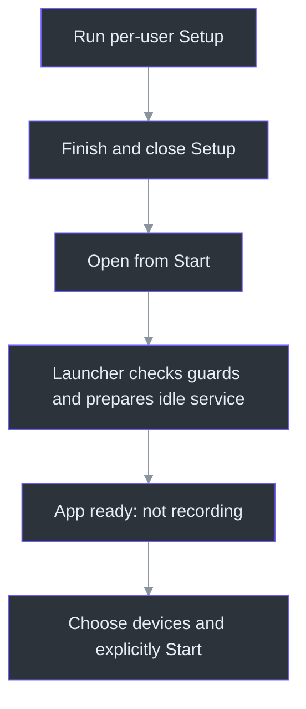
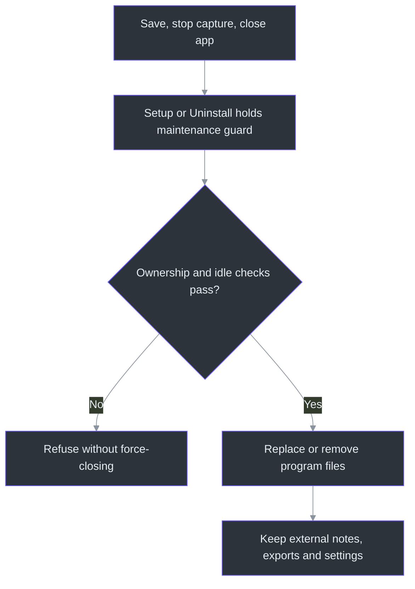

# Install, update and remove Phantom Fudge

**Installer edition: public, unsigned Windows 11 x64 prerelease.** Download
[v0.2.0-preview.2](https://github.com/Zanark/phantom-fudge/releases/tag/v0.2.0-preview.2).
Preview 2 includes previous-answer context; all five downloaded release assets matched.
Current-host synthetic package checks and a live website do not establish clean-VM or universal compatibility.
Tutorial installer labels remain Preview 1; they do not identify the new package.
See the [exact public receipt](release-0.2.0-preview.2.json), [release evidence](IMPLEMENTATION-STATUS.md) and completed [workstream62](../TODO/62_PUBLIC_PREVIEW_RELEASE.todo).

**Published October11 at01:19:15UTC**, from clean source `2ad0fa03a8c699619bda24c33ef6aa0250d6ef38`.
Setup and Portable contain the committed391-page handbook, not later maintained documentation.
The released709-page atlas is a separate attachment; exact PDF hashes are in the public receipt.
Historical Preview 1's85runtime/55native tests and candidate-stage failures remain [dated evidence](IMPLEMENTATION-STATUS.md).
They are not reused as Preview 2 test runs. Tutorial instructions and the24WPF/11READMEimage
fixtures are unchanged, not recordings of installation. (docs/release-0.2.0-preview.2.json:3-29,90-100)

| Published Preview 2 evidence | Qualification boundary |
| --- | --- |
| **Startup:** 10 exact-launcher self-checks pass | Guarded handoff checks, not actual installed speech or interactive Close qualification |
| **Desktop:** all packaged UI groups pass, including 21 context and 38 keyboard checks | Synthetic UI only; no audio capture or external-provider request |
| **Setup:** 11 checks against 3,684 inventoried files | Current host, isolated identity/path, no shortcuts, simulated older metadata; no genuine old-binary/clean-VM claim |
| **Speech:** offline Unicode-path build; real Vosk/VAD/encoder/decoder execution, model hashes and natural exit pass | One second of generated PCM, not actual capture, installed service or recognition-quality evidence |
| **DLLs:** 92 speech PE files and actual bundled CRT paths; 861 App/Launcher PE files inspected separately | Static closure/selected loaded paths, not a clean VM or universal dynamic-loading test |
| **Assets:** five downloaded assets byte-matched; all 3,685 Portable entries verified | Checksums identify exact bytes, not signer trust or broad compatibility |

The recipe creates the same gate in both Setup and Uninstall initialization; the native launcher
checks it before ordinary/notes-only startup. Detailed receipts and remaining acceptance gates are
kept in [release evidence](IMPLEMENTATION-STATUS.md), not in the installation procedure.
(tools/Installer/PhantomFudge.iss:72-76,150-160)
(src/PhantomFudge.Launcher/Program.cs:47-78)
(src/PhantomFudge.Launcher/LauncherContract.cs:152-165)
(scripts/Build-Installer.ps1:30-44,76-114)
(scripts/Test-Installer.ps1:15-18,31-84,96-104)

## Before downloading

The installer removes the developer-tool setup burden, not the preview's qualification limits.
It targets **Windows 11 x64** only. Windows 10, Windows on ARM, macOS and Linux are unsupported
for this package. A compatible OS does not establish performance or device compatibility on every
computer; no universal CPU, memory, microphone or capture guarantee is claimed. The release
configuration pins `win-x64`, minimum Windows build22000, version `0.2.0-preview.2` and Windows
file version `0.2.0.2`. (tools/Installer/release.json:1-8)

| Included by the installer | Not installed or configured for you |
| --- | --- |
| Self-contained .NET desktop app and native Start-menu launcher | .NET SDK, PowerShell7 or a system Python prerequisite |
| Private Python3.13.14 runtime, speech-service files and verified English Vosk/Whisper small.en models | Docker, GPU drivers or universal hardware support |
| Bundled dependency notices and model provenance | An answer-provider CLI, provider model, account, sign-in or a project license |

Both executables are published self-contained; speech preparation belongs to the release build,
not a first-launch package restore. The launcher uses fixed installed paths and offline model
environment settings. No Python/PowerShell installation step belongs in the installed-user
procedure. The release build requires a separate generated-PCM inference/clean-exit gate; import
and metadata checks alone are insufficient. (scripts/Build-Installer.ps1:30-44)
(src/PhantomFudge.Launcher/LauncherContract.cs:56-105)
(src/PhantomFudge.Launcher/ChildProcesses.cs:48-105)
(tools/Installer/runtime-lock.json:1-11)

This is an **unsigned prerelease**, not a qualified release. Windows SmartScreen or organizational
policy may warn or block it. Check the origin and checksum; **do not disable security controls or
bypass your organization's policy**. A checksum identifies bytes; it is not a signing identity
or evidence of capture exclusion. (scripts/Build-Installer.ps1:79-114)

## Install and open

The versioned public release and checksum file identify the downloadable assets:

1. Open the public versioned release above. Download
   `PhantomFudge-0.2.0-preview.2-win-x64-Setup.exe` and `SHA256SUMS.txt`.
2. Compare the EXE's SHA-256 with its exact filename in the checksum file. Windows PowerShell can
   perform this optional check; **PowerShell7 is not required to install or run the app**:

   ```powershell
   Get-FileHash .\PhantomFudge-0.2.0-preview.2-win-x64-Setup.exe -Algorithm SHA256
   ```

3. Run Setup as your normal Windows user. The default location is
   `%LOCALAPPDATA%\Programs\PhantomFudge`. Setup is per-user and requests no administrator rights.
   A Start-menu shortcut is created; the desktop shortcut is optional.
4. Finish and close Setup, then open **Phantom Fudge** from Start. Setup never launches the app.
   There is no automatic startup registration or scheduled task.
5. Wait for the local service to become ready, choose the intended Computer/Mic/Both devices, then
   press **Start** inside the app when you actually want transcription.

The file names/checksum are build outputs; the installation location, shortcuts and absence of
post-install launch come from the Inno recipe. Inno Setup6.7.3 is a build tool, not an end-user
prerequisite. The installer does not add process concealment or change the app's taskbar behavior.
(scripts/Build-Installer.ps1:100-114)
(tools/Installer/PhantomFudge.iss:14-76)
(tools/Installer/release.json:6-7)

**Setup and launcher status/error windows are ordinary visible Windows UI.** They do not inherit
the notes window's capture-exclusion request. Install, update and launch before sharing if that
status UI should not appear to an audience. They contain generic startup messages, not your notes
or transcripts. (src/PhantomFudge.Launcher/LauncherWindow.cs:18-57)

### Opening the app is not starting capture

Normal and notes-only launch first check the installer-maintenance gate. If present, the launcher
records “operation busy” and exits70 without opening a window or starting a child; wait for Setup
to finish, then retry. Otherwise it reveals an existing same-user app before touching the speech
runtime. A fresh launch acquires its startup guard and checks the installer gate again, so a gate
appearing during guard acquisition is not missed. Normal launch then validates files, reads or
creates the private token, prepares the service and opens the app; no audio-start command is sent.
(src/PhantomFudge.Launcher/Program.cs:47-78,127-213)
(src/PhantomFudge.Launcher/LauncherContract.cs:152-165)
(src/PhantomFudge.Launcher/LauncherStatus.cs:15,34,43-61)
(src/PhantomFudge.Launcher/InstanceCoordination.cs:12-57)
(src/PhantomFudge.Launcher/LocalToken.cs:12-39)

The launcher keeps its startup mutex until the app's main-instance mutex appears or the exact
child is proven to have exited. After30 seconds it reports **AppStartPending (76)**, not success,
and continues watching. Closing that pending progress window hides it; it does not cancel the
child or release the update guard. Even early dispatcher shutdown retains the guard while
ownership is uncertain. No timeout force-kills the app.
(src/PhantomFudge.Launcher/ChildProcesses.cs:12-42)
(src/PhantomFudge.Launcher/Program.cs:108-118,186-227)
(src/PhantomFudge.Launcher/LauncherStatus.cs:39)



For notes without service startup, use the installed launcher's `--notes-only` argument:

```text
"%LOCALAPPDATA%\Programs\PhantomFudge\launcher\PhantomFudge.Launcher.exe" --notes-only
```

This command is suitable for a shortcut's Target; it is not a command to paste into PowerShell
unchanged. A speech-start failure also offers **Open notes without transcription**. Notes-only
does not stop an already-running service, remove the audio controls or disable configured answer
providers. It is not a privacy sandbox.
(src/PhantomFudge.Launcher/LauncherContract.cs:14-23)
(src/PhantomFudge.Launcher/Program.cs:153-213)
(src/PhantomFudge.Launcher/LauncherWindow.cs:37-48,70-77)

On a new profile, answers remain **Snapshot only** until you explicitly configure an external
provider. Existing `%LOCALAPPDATA%\PhantomFudge\answers.json` and `keyboard.json` remain in use;
an upgrade does not reset your previous provider choice or keyboard setting. The installer
does not bundle a provider or perform login. Read [provider boundaries](ANSWER-PROVIDERS.md)
before enabling one; installed Agency/Copilot can use cloud-hosted models.
(src/PhantomFudge.Core/Answers/AnswerConfiguration.cs:8-21)
(src/PhantomFudge.Core/KeyboardShortcutConfiguration.cs:31-39)
(scripts/Build-Installer.ps1:30-54,56-74)

## Update or repair

1. Save notes, export required transcripts, and copy any question/answer text you need.
2. Stop transcription and close the app with **X**. **Hide and Cover are not Exit.**
3. Run the same installer to repair, or a newer preview installer to update the same per-user
   installation. The stable AppId keeps the installation identity.
4. Reopen from Start after Setup completes. Select devices and press Start deliberately again.

Setup rejects a downgrade and refuses an unrecognized, nonempty destination. The repair/update
recipe uses a **fresh maintenance helper extracted from Setup**, rather than depending on a
potentially damaged installed launcher. A numeric version fallback is stored under the per-user
`HKCU\Software\PhantomFudge\Installer\<AppId>` key as `WindowsVersion`; if neither that nor
`app-version.txt` is valid, Setup refuses. Preview 2's11-check isolated lifecycle passed same-version and damaged-launcher/version
repair; its upgrade case changes older metadata, not a genuine older binary. (docs/release-0.2.0-preview.2.json:19-20,68-70)
(tools/Installer/PhantomFudge.iss:51-52,107-148)
(src/PhantomFudge.Launcher/Program.cs:50-58,94-100)
(scripts/Test-Installer.ps1:61-74)

An open app or another launcher operation blocks maintenance instead of being force-closed.
For an installation with runtime ownership data, the native maintenance operation takes the shared
lifecycle lock and checks the saved receipt before an authenticated loopback shutdown. Only the
**owned idle** instance may be stopped. A recorded process confirmed dead or replaced by a reused
PID can have its unchanged receipt removed; live or uncertain ownership is not permission to kill.
This native operation does not depend on old Python binaries or a valid compact manifest, so
repair can replace them. The installation marker is still required. The passing lifecycle fixture
does not start the app or speech service; installed speech startup is a separate qualification scope.
(src/PhantomFudge.Launcher/Program.cs:94-100)
(src/PhantomFudge.Launcher/LauncherContract.cs:87-105)
(src/PhantomFudge.Launcher/MaintenanceOperation.cs:48-118)
(src/PhantomFudge.Launcher/OwnedServiceClient.cs:20-58)

A retained token without a receipt is normal after a successful stop. Maintenance validates it
locally and checks that the loopback port is unused without sending credentials. An occupied or
uncertain port, or a receipt missing its token, blocks maintenance; deleting ownership files to
bypass that refusal is not a repair procedure. An untouched installation with neither file does
not probe another workspace's listener.
(src/PhantomFudge.Launcher/MaintenanceOperation.cs:52-75,121-134)
(tests/PhantomFudge.Core.Tests/InstalledMaintenanceTests.cs:31-74)

Program directories are installer-managed, not a place to save notes, exports, personal scripts
or custom models. Update replaces managed application/runtime directories; reinstalling is not
a user-data backup strategy. Keep saved content outside the install folder.
(tools/Installer/PhantomFudge.iss:47-60)

## Remove the application

After saving/exporting, stopping transcription and closing with X, open **Windows Settings →
Apps → Installed apps → Phantom Fudge → Uninstall**. Uninstall invokes the installed launcher's
maintenance guard.
If ownership or shutdown is uncertain, it stops with an error rather than killing a process.
Missing launcher files may require repair using the same installer first.
(tools/Installer/PhantomFudge.iss:39-40,150-161)
(src/PhantomFudge.Launcher/LauncherStatus.cs:29-39)

| Location | Ownership | Normal update/uninstall policy |
| --- | --- | --- |
| `%LOCALAPPDATA%\Programs\PhantomFudge\app`, `launcher`, `runtime\python`, `services\transcription`, `models`, `licenses`, `docs` | Installed binaries, speech weights and shipped documentation | Update maintains program files; uninstall removes the installed payload and shortcuts |
| `%LOCALAPPDATA%\PhantomFudge\InstalledRuntime\.local` | Installed speech token, ownership/configuration data and local runtime diagnostics | Outside the install tree; retained for reinstall |
| `%LOCALAPPDATA%\PhantomFudge\InstalledRuntime\.local\models` | Explicitly provisioned per-user model files | Retained; separate from installer-managed bundled weights |
| `%LOCALAPPDATA%\PhantomFudge` settings and diagnostics | Existing app answer/keyboard settings, diagnostics and launcher status | Retained; not reset or silently purged |
| Notes and exports saved outside the install folder | Files you selected | Retained |

The separation is intentional: removing software must not silently erase the work or preferences
you may want on reinstall. It also means **uninstall is not a privacy wipe**. If you want a full
data reset, first understand each retained folder, preserve required files, stop its owned runtime
and remove only the specific data you intend to discard. Do not recursively delete the whole
profile or unrelated provider profiles. No blanket data-purge command is provided.
(src/PhantomFudge.Launcher/LauncherContract.cs:56-84)
(src/PhantomFudge.Launcher/LauncherStatus.cs:43-61)
(tools/Installer/PhantomFudge.iss:47-65,150-161)

The runtime checks for a per-user model with the pinned directory name first,
then uses the bundled model only when that user path is absent. The selected files must pass the
same pinned manifest checks; a user override is not permission to load arbitrary weights.
Explicit provisioning writes only to the user model directory, not the installation. This keeps
deliberately provisioned models outside directories that Setup replaces.
(tools/Installer/runtime-contract.json:7-12)
(services/transcription/tests/test_installed_runtime.py:74-91)



## If startup or maintenance fails

| Symptom | Next safe action |
| --- | --- |
| Release link is unavailable | Confirm the exact versioned release URL and listed asset availability; do not substitute an old ZIP |
| Windows blocks the unsigned EXE | Follow your organization's review process; do not disable SmartScreen or other controls |
| Existing window is hidden | Relaunch from Start or use Ctrl+Alt+Space; save and close it before an update |
| Local speech cannot start | Use the notes-only option if offered; inspect local status, not a real-audio test |
| AppStartPending (76) after30seconds | The launcher is still watching the child; Close hides progress and updates remain guarded. It is not a success or permission to force-close a process |
| Busy or uncertain runtime ownership | Stop capture in its owning app and retry after closing it; do not kill Python by name or delete a receipt just to bypass the guard |
| Installed files are missing | Repair with the same-version installer; retain user data and report a repair that cannot pass maintenance |
| Another workspace uses port8765 | Stop that service through its own normal workflow, or use notes-only; the installer must not adopt or kill it |

After a reboot, try a normal launch first. The manager automatically clears a stale ownership
receipt when it can prove the old process is gone, then resumes normal startup checks. A retained
PID without a creation timestamp can be cleared only when that PID is confirmed absent. Live or
uninspectable processes remain protected; reboot alone does not require reinstalling or manually
deleting a token/receipt.
(services/transcription/tests/test_installed_runtime.py:129-198)

The launcher's bounded status is `%LOCALAPPDATA%\PhantomFudge\launcher-status.json`. It contains a
status code, generic message and time, not token values or captured text. Startup timeouts preserve
uncertain process ownership rather than force-killing the child.
(src/PhantomFudge.Launcher/LauncherStatus.cs:25-61)
(src/PhantomFudge.Launcher/ChildProcesses.cs:107-123)

## Source, portable and licensing boundaries

The existing [source-development workflow](PREVIEW-GUIDE.md) still uses its own SDK, PowerShell,
Python environment and explicit model provisioning. The older timestamped ZIPs are historical
and lack later UI features. The published `win-x64-Portable.zip` from this build is a different,
self-contained payload: keep all its directories together and use `launcher\PhantomFudge.Launcher.exe`;
it does not register a Windows Apps uninstall entry. Do not mix files from these workflows.
(scripts/Build-Installer.ps1:30-44,105-108)
(src/PhantomFudge.Launcher/LauncherContract.cs:69-84)

Third-party licenses/notices travel with the exact runtime payload. They do **not** choose a
license for Phantom Fudge; the owner has not selected one. Preserve the included license files.
See [third-party notices](THIRD-PARTY-NOTICES.md) and the model provenance manifests.
(services/transcription/model.json:2-10)
(services/transcription/whisper-models.json:1-5,17-26)

The final runtime is a distinct CPU-only build, not the unchanged development stack.
Its application-private `faster-whisper 1.2.1+phantomfudge1` removes encoded-file
decoding/PyAV while retaining the in-memory PCM array path in source.
`CTranslate2 4.6.0+phantomfudge2` uses oneDNN3.1.1 and Microsoft compiler OpenMP (`vcomp140`),
without CUDA/cuDNN or proprietary Intel OpenMP. Vosk's package is unmodified: the service adapter
loads a non-ASCII Windows model path through a locked, temporary wide-API working-directory change.
The public receipt records real generated-PCM inference and natural exit in the Unicode build path.
No clean-VM qualification is claimed.
Earlier development-build speech timings/accuracy do **not** qualify these binaries; this guide
makes no recognition-performance claim. The published inventory identifies the shipped files;
engineering provenance does not establish publisher licensing entitlement or legal certification.
(tools/Installer/bundle_runtime.py:246-282,332-376,412-462,597-609)
(services/transcription/recognizer.py:44-63)
(services/transcription/tests/test_packaged_pcm_runtime.py:35-97,126-138)

The [current workflow](CURRENT-WORKFLOW.md) and [keyboard guide](KEYBOARD-CONTROLS.md) explain the
unchanged desktop UI. Their existing24synthetic WPF images and11README derivatives are UI
examples, not installer screenshots or evidence that installation succeeded. No installer
screenshots are presented here. Docker remains a separate optional final-stage task, not part of
installation. Capture qualification remains [NOT_TESTED for the product matrix](QUALIFICATION.md).

## Implementation map

`install-manifest.json` is compact build/version metadata, bounded to16KiB by the launcher.
`payload-files.json` is the separate full path/size/SHA-256 inventory; it deliberately omits its
own self-hash. The build inspects hidden entries and rejects reparse points/private payload
paths. These controls identify the assembled bytes, not a successful installation or a signing
identity. Lifecycle tests and publication evidence remain in [implementation status](IMPLEMENTATION-STATUS.md).
(src/PhantomFudge.Launcher/LauncherContract.cs:38-52,94-105)
(scripts/Build-Installer.ps1:56-98)

The engineering-only `--validate-install` command checks the installation marker, compact
manifest and required layout without starting the app or service. It does not run inference,
verify every model byte or replace the full inventory/lifecycle checks. Maintenance uses the
whole self-contained launcher directory extracted by Setup, not a standalone copied EXE.
(src/PhantomFudge.Launcher/Program.cs:25-43)
(src/PhantomFudge.Launcher/LauncherContract.cs:87-105)
(tools/Installer/PhantomFudge.iss:47-49,143-147)

| Source | Responsibility |
| --- | --- |
| (tools/Installer/release.json:1-8) | Preview/Windows versions, runtime target and compiler pin |
| (tools/Installer/PhantomFudge.iss:14-76,107-161) | Per-user files, shortcuts, version fallback and maintenance hooks; no post-install launch |
| (scripts/Build-Installer.ps1:30-54,56-114) | Required PCM gate, payload assembly, compact metadata, full inventory and output identity |
| (src/PhantomFudge.Launcher/Program.cs:25-100,103-227) | Headless validation, installer gate, maintenance and guarded normal/notes-only handoff |
| (src/PhantomFudge.Launcher/MaintenanceOperation.cs:48-134) | Partial-state refusal, locked receipt checks, owned idle shutdown and safe stale-receipt cleanup |
| (tools/Installer/bundle_runtime.py:332-376,465-535,538-609,668-694) | Disclosed variants/notices, mandatory native-dependency audit, import checks and separate synthetic execution |
| (tools/Installer/runtime_audit.py:32-166,169-234) | Declared PE dependency names and observed bundled CRT paths; not clean-VM qualification |
| (src/PhantomFudge.Launcher/LauncherContract.cs:56-105) | Fixed paths, ownership marker, compact metadata and layout validation |
| (src/PhantomFudge.Launcher/ChildProcesses.cs:12-42,48-105) | Child readiness proof, fixed arguments and offline installed environment |
| (src/PhantomFudge.Launcher/LocalToken.cs:12-85) | Private token creation and validation |
| (src/PhantomFudge.Launcher/LauncherStatus.cs:25-61) | Generic recovery guidance, non-success pending state and local status |
