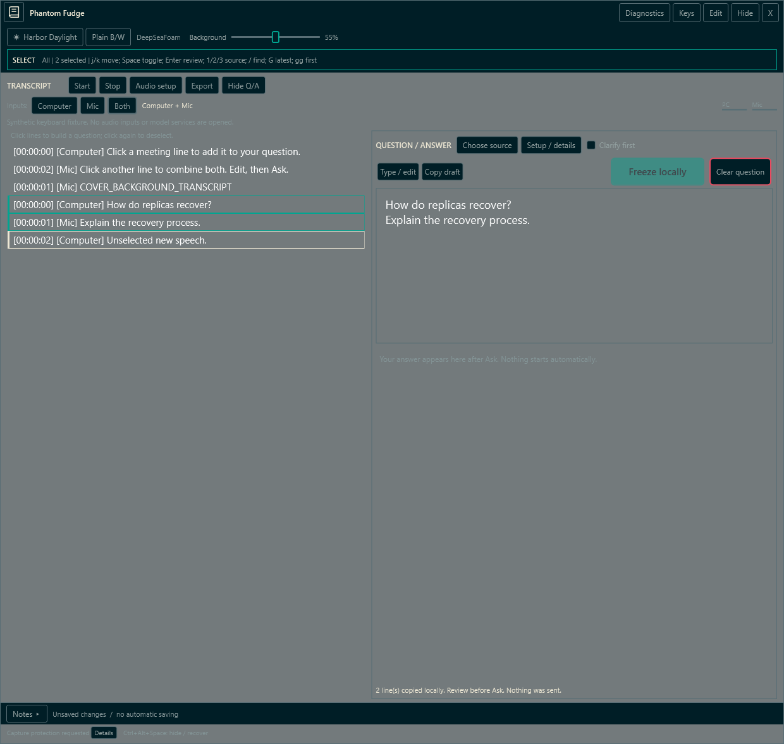
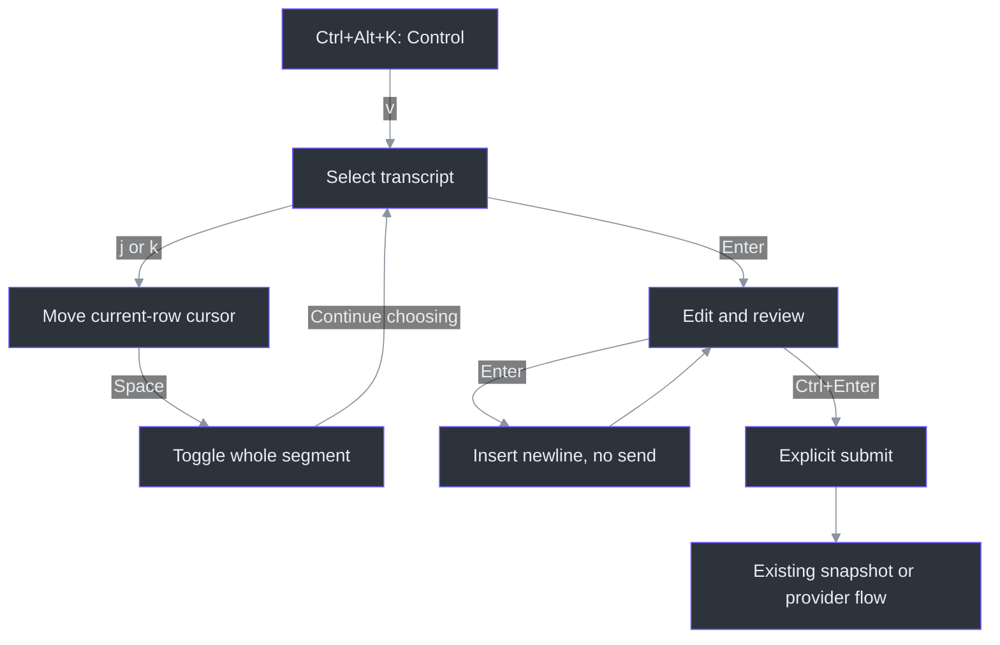
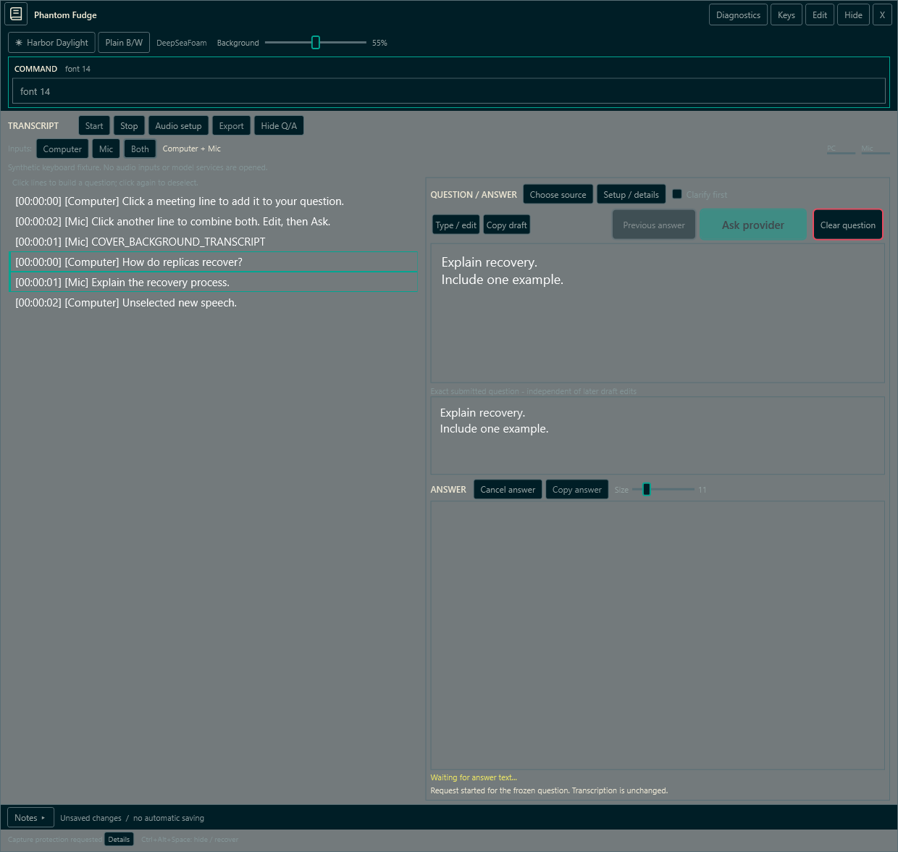
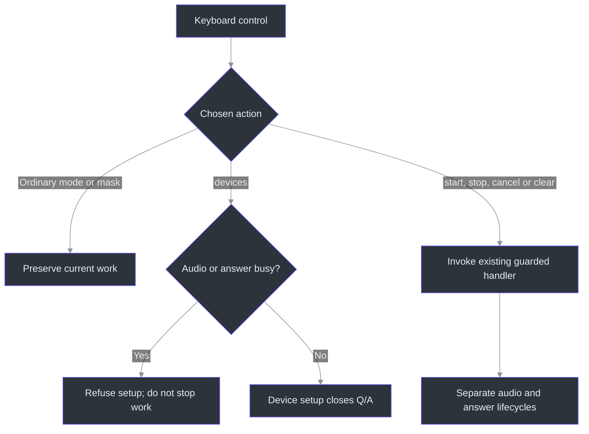
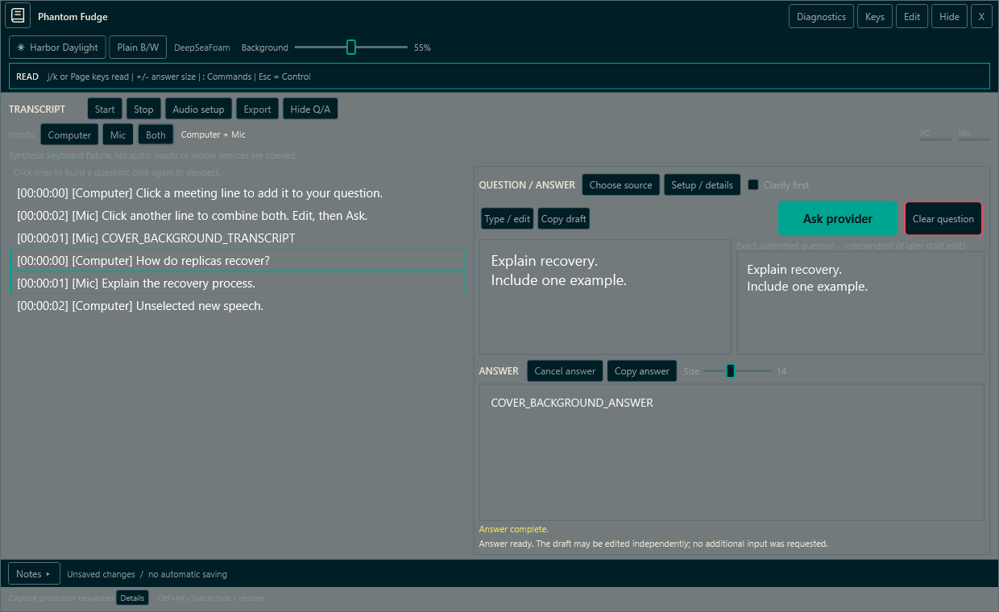

# Keyboard controls and answer size

## Start here: control the workspace, not the system pointer

Keyboard control lets you compose a question without moving the mouse across the workspace.
**Ctrl+Alt+K** deliberately brings Phantom Fudge into **Control** mode; the **Keys** button is
the pointer fallback. Letters such as `v`, `j` and `m` are local mode keys, not global shortcuts.
This feature does **not** lock, hide or warp the cursor, and it cannot repair a recorder's
captured-cursor behavior. Activation uncovers the workspace but does not start audio or send a
question. (`ToggleKeyboardControl`, `HandleKeyboardKey`;
src/PhantomFudge.App/MainWindow.Keyboard.cs:65-85,218-266.)

**Preview 2 includes keyboard controls and `context on/off`.** Preview 1 lacks the context commands.
Save/copy needed text, stop transcription and close an older instance with X before updating.
Check [installer availability and release evidence](INSTALLATION.md), or run `.\scripts\Run-PhantomFudge.ps1` from source.
The historical keyboard fixture passed 38 keyboard assertions plus existing regressions; 297 Core
and 18 documentation-tool tests passed. The source atlas and illustrated handbook are refreshed.
The three images below are synthetic WPF examples, not personal captures or real audio/model
results. See [workstream57](../TODO/57_KEYBOARD_CONTROLS.todo) and
[implementation status](IMPLEMENTATION-STATUS.md) for evidence and qualification boundaries.

## Beginner workflow: select, review, then submit

Start with transcript text already available. If you need new transcription, choose inputs first
and explicitly use Start or `:start`; keyboard activation alone never records. Configure an
[answer provider](ANSWER-PROVIDERS.md) before expecting an answer; Snapshot only freezes locally.
The keyboard dispatcher reuses the existing Start and Ask handlers rather than introducing an
automatic capture or send path. (src/PhantomFudge.App/MainWindow.Keyboard.cs:301-306,330-360.)

1. **Ctrl+Alt+K** → **Control**. Check the visible mode label.
2. **`v`** → **Select**. The navigation cursor starts at the latest matching row.
3. **`j` / `k`** move down/up. Movement alone does not select text.
4. **Space** toggles the current whole transcript segment. Repeat movement and Space for more lines.
5. **Enter** → **Edit question** to review. This does **not** submit.
6. Correct the wording if needed. **Enter inserts a newline** in Edit.
7. **Ctrl+Enter** explicitly submits the reviewed question, or the current clarification reply.
   In Snapshot only this remains local; with a ready provider it uses the existing Ask flow.

The essential sequence is **Ctrl+Alt+K → `v` → `j`/`k` → Space → Enter review → Ctrl+Enter submit**.
Ctrl+Enter in Select is refused with a review reminder. That separation keeps navigating a moving
transcript from accidentally sending it. (`BeginKeyboardSelection`, `HandleKeyboardSelectionKey`,
`SubmitKeyboardQuestion`; src/PhantomFudge.App/MainWindow.KeyboardSelection.cs:15-28,110-159;
src/PhantomFudge.App/MainWindow.Keyboard.cs:257-266,301-306.)



*Wide-layout synthetic example: two accent-outlined selected rows compose the draft; the pale
current-row outline is on a different, unselected row. Moving the cursor is not selecting or sending.*



## Modes, literal editing and leaving safely

| Mode | Keys and behavior |
| --- | --- |
| Control | `v` Select, `i` Edit question/reply, `a` Read answer, `m` Mask, `:`/F2 Commands, `?`/F1 Help |
| Select | `j`/`k` or Down/Up move; Space toggles; Enter reviews; source filters and search below |
| Edit question / Edit reply | Type normally, including `j`, `k`, `v`, `:`, `/` and `?`; Enter is a newline; Ctrl+Enter submits |
| Read | `j`/`k` or Down/Up scroll the answer; PageUp/PageDown page; Home/End jump; `+`/`-` adjust answer size |
| Command | Type a built-in command; Tab completes the first matching example; Enter validates/executes |
| Search | Type a local transcript substring; Enter applies it; Escape returns to Select |
| Devices | Arrows move, Space selects, Tab changes source in Both, bracket/page keys change page |
| Help | Shows the local key and command summary; Escape returns to Control |

**Modal means the label matters.** Edit passes ordinary typing to the question/reply editor; it is
not global Notes Edit. To run a command while typing, press Escape first, then F2. Function-key
alternatives are **F2 for `:`**, **F3 for `/` in Select only**, and **F1 for `?`** outside literal
Edit/prompts. The punctuation shortcuts use US OEM key positions; other layouts should prefer
these alternatives. They are not universal character-layout mappings.
(`UpdateKeyboardBar`, `HandleKeyboardKey`; src/PhantomFudge.App/MainWindow.Keyboard.cs:177-299;
src/PhantomFudge.App/MainWindow.KeyboardSelection.cs:110-125.)

**Edit stays armed after Ctrl+Enter submission.** A completed asynchronous interpretation changes
the mode label to **EDIT REPLY** and targets the reply editor; returning to the original-question
state changes it back to **EDIT QUESTION**. You do not need to leave and re-enter Edit between
these states. The target must be visible, enabled, focusable and editable. Async focus retargeting
occurs only while Phantom Fudge is already the active foreground window, visible, uncovered and
protection-ready; it does not activate another window or pull you back from another app. Typing
and model completion still do not submit a new turn. To read with `j`/`k` after submitting, use
Escape → `a`, rather than typing those letters into Edit.
(`RefreshKeyboardEditorTarget`, `SubmitKeyboardQuestion`;
src/PhantomFudge.App/MainWindow.Keyboard.cs:127-139,257-266,301-306.)

**Escape backs out rather than cancelling work:** ordinary submode → Control → leave keyboard
control. Search first returns to Select; Command returns to the mode from which it was opened.
Devices also closes setup. Leaving attempts to return foreground focus to the previously active
application, after checking its window/process identity. Windows may refuse, or that window may
have closed: switch back manually if the status says so. This is **best effort**, not a focus
guarantee. Pressing Ctrl+Alt+K again also leaves; switching to another application disarms without
pulling focus back. (src/PhantomFudge.App/MainWindow.Keyboard.cs:141-175,198-204,222-232.)

From Control, **`m`** leaves keyboard control and masks the workspace. From other modes, return
to Control first or use `:mask` through Command. Already-running transcription and answers
continue behind the mask. Ctrl+Alt+K uncovers and enters Control again. Neither masking nor Escape
is an audio Stop or answer Cancel. Read the separate [cover/privacy limits](COVER-AND-PRIVACY.md);
the mask is not process hiding or universal capture protection.
(src/PhantomFudge.App/MainWindow.Keyboard.cs:67-85,290-296,366-370.)

## Select: source filters, search and stable intent

| Key in Select | Meaning |
| --- | --- |
| `1` / `2` / `3` | Show Mic / Computer / all sources; this is a view filter, not an audio-input change |
| `/` or F3 | Open case-insensitive substring search over raw segment text |
| Enter in Search | Apply the filter locally; an empty search clears it |
| `G` (Shift+G) / End | Move to the last matching row |
| `gg` (two lowercase presses) / Home | Move to the first matching row |
| PageDown / PageUp | Move five matching rows down/up |
| Space | Toggle the current segment; holding Space does not repeatedly toggle |

Filters do **not** deselect previously chosen rows. Check the selected count and review the whole
draft, including selections currently outside the filter. Leaving Select removes its view filters.
The cursor follows structured segment identity rather than parsing a displayed timestamp.
After a manual draft edit, `v`/Space refuse new selection until you deliberately clear the question;
copy needed corrections before `:clear question`. Clarification can also lock selection.
(`CanKeyboardSelect`, `MatchesKeyboardTranscript`, `ResetKeyboardSelectionView`;
src/PhantomFudge.App/MainWindow.KeyboardSelection.cs:30-79,98-159.)

## Built-in commands: deterministic, not a shell or model

Press **F2** (or `:` outside Edit), type a command, then Enter. The prompt accepts an optional
leading colon, ignores case and normalizes whitespace. It recognizes only the finite list below;
it does not run shell text or ask a model to interpret a command. Suggestions follow the fixed
example list in source, and Tab chooses its first prefix match—not a fuzzy or model-generated
guess. Unknown commands/arguments stay in the prompt with an error; input is bounded to 128 characters.
(`Parse`, `Suggest`, `Tokenize`; src/PhantomFudge.Core/KeyboardCommands.cs:15-80;
src/PhantomFudge.App/MainWindow.Keyboard.cs:206-256,308-318.)



*The prompt shows `font 14` before execution, while Size still reads11. Enter applies the command;
typing it alone does not change the answer.*

| Command | Effect and boundary |
| --- | --- |
| `:start` / `:record start` | Explicitly request capture using the selected sources and existing readiness checks |
| `:stop` / `:record stop` | Stop/drain audio; do not cancel the separate answer |
| `:source mic`, `:source computer`, `:source both` | Choose input mode while audio is idle; never start capture |
| `:devices` | Refuse while audio is starting/running/stopping or an answer is busy; otherwise open device setup and close Q/A |
| `:clarify on`, `:clarify off` | Change optional clarification while no answer is busy; retain existing clarification guards |
| `:context on`, `:context off` | Use the same Previous answer toggle handler; needs a completed answer to enable, locks during busy work/active clarification, and never sends |
| `:confirm` | Invoke the existing explicit clarification confirmation action; not an automatic Yes |
| `:font 8` through `:font 24` | Choose a whole-number answer/interpretation size for this session |
| `:copy question`, `:copy answer` | Use the existing explicit clipboard actions; these are not a send |
| `:clear question` | Clear question/snapshot/answer through the existing handler; it can cancel an active answer, but does not stop audio |
| `:cancel` | Cancel answer/provider preparation only; never an audio Stop |
| `:theme dark`, `:theme light`, `:theme plain` | Select DeepSeaFoam, Harbor Daylight or Plain |
| `:opacity 10` through `:opacity 100` | Choose whole-percent background opacity, not whole-window text opacity |
| `:ask` | Explicitly submit the current question or clarification reply through the same guarded handler |
| `:mask` | Disarm keyboard control and cover the workspace without stopping current work |
| `:help` | Show the local keyboard help |

File/confirmation activity, missing protection or another executing command can reject a command.
The dispatcher delegates to existing actions: success is governed by their status, not merely by
valid syntax. Opening Command from Select and explicitly issuing `:ask` is still an explicit
submission; the beginner Enter-review path is the recommended way to inspect the draft first.
(`ExecuteKeyboardCommandAsync`; src/PhantomFudge.App/MainWindow.Keyboard.cs:320-364;
src/PhantomFudge.Core/KeyboardCommands.cs:26-56.)

For “explain that answer” follow-ups, finish the first answer, use **`:context on`**, then edit
and explicitly submit. Do not use `:clear question` between those steps: it clears the answer and
resets context. The choice is session-only; it remains on across successful follow-ups and sends
only the latest displayed completed answer, not accumulated history. With Clarify first, corrections
and confirmation retain the snapshot captured before interpretation. Setup/details shows the exact
submitted prior text. [Full boundaries](LOCAL-QUESTIONS.md#follow-up-with-the-previous-answer).
([`SetUsePreviousAnswer`](../src/PhantomFudge.App/MainWindow.AnswerContext.cs).)

## Devices: browse before choosing

Use `:source both` (or a single source), then `:devices` **while idle**. Left/Right move one card;
Up/Down or `k`/`j` move by the displayed column count. **Space** chooses the highlighted device.
**Tab** switches Computer/Mic only in Both mode. **`[` / `]` or PageUp/PageDown** move a page;
merely browsing never changes the chosen endpoint or starts recording. Escape closes setup and
returns to Control. Use explicit `:start` only after checking the selection.
(`BeginKeyboardDevices`, `HandleKeyboardDeviceKey`;
src/PhantomFudge.App/MainWindow.KeyboardDevices.cs:12-17,27-71.)

**Setup is the exception to ordinary mode preservation.** `:devices` refuses busy audio/answers
instead of silently stopping them. When allowed, opening Audio setup closes Q/A and follows its
existing provider-cleanup behavior; it can therefore end idle provider preparation. Ordinary
Control/Select/Edit/Read/Command/Help transitions do not invoke Q/A close/cancel or intentionally
cancel capture/provider work. A compact layout may temporarily hide a panel to make room; that is
not closing it. Start/Stop/Cancel/Clear remain separate explicit actions.
(`SetKeyboardMode`, `ExecuteKeyboardCommandAsync`;
src/PhantomFudge.App/MainWindow.Keyboard.cs:87-125,330-360;
[integrated lifecycle table](CURRENT-WORKFLOW.md#state-changes-cover-is-not-hide).)



## Answer size: session choice, not a saved preference

Use the answer's **Size** slider, `:font 14`, or **`+` / `-` in Read mode**. Whole-number sizes
range from **8–24 WPF logical units**, applying to answers and interpretations, not transcript,
question or Notes fonts. Until you choose, the responsive defaults remain **10 normal / 9 compact**.
Once chosen, that value survives resizing in this running instance. It is **not saved across
restart** and is not a property in `keyboard.json`. `chosenAnswerFontSize ?? automaticSize` is why
a resize no longer overwrites an explicit choice.
(`SetAnswerFontSize`, `ApplyAnswerFontSize`, `AdjustAnswerFont`;
src/PhantomFudge.App/MainWindow.AnswerFont.cs:9-43;
src/PhantomFudge.Core/KeyboardCommands.cs:15-16;
src/PhantomFudge.App/MainWindow.Keyboard.cs:274-286.)

### Compact windows: the active task gets the reading space

At narrow, short sizes such as **470 × 560**, keeping a size 24 answer and every panel visible can
leave too little usable reading space. The responsive layout therefore changes which panel is
visible, not its content or lifetime:

| Compact situation | What you see |
| --- | --- |
| Select or Search | Q/A is temporarily hidden; transcript selection uses the reading area |
| Leaving Select/Search | The intended Q/A-expanded state is restored without calling close/cancel |
| Other keyboard modes, with Q/A expanded | Q/A takes priority and the transcript is temporarily hidden |
| A chosen size of 14 or larger with an answer visible and Q/A expanded | Q/A takes priority even outside keyboard control |
| Wide reading columns | The existing side-by-side layout remains unchanged |

The layout remembers the desired Q/A expansion separately from temporary visibility. No question,
answer or transcript is discarded, and these layout changes do not stop audio or provider work.
**Enter to review** therefore brings Q/A back after compact selection; it does not reopen a
cancelled request. Explicit **Hide Q/A** and `:devices` retain their distinct close/cleanup behavior.
Mode changes and font choices both request a responsive layout update.
(`SetKeyboardMode`, `SetAnswerFontSize`;
src/PhantomFudge.App/MainWindow.Keyboard.cs:87-125;
src/PhantomFudge.App/MainWindow.AnswerFont.cs:19-26.)

This refinement addresses size 24 at the minimum window. The final exporter reports the compact
selection and passive size 24 fit assertions passed; it does not establish comfort at every DPI or
replace owner review.



*Read mode with Size14. `COVER_BACKGROUND_ANSWER` is synthetic fixture text, not a real model result.*

## Shortcut configuration and recovery

The optional file is **`%LOCALAPPDATA%\PhantomFudge\keyboard.json`**. Save valid UTF-8 containing
exactly these three case-sensitive properties:

```json
{
  "schemaVersion": 1,
  "enabled": true,
  "activationKey": "K"
}
```

- Missing file/directory uses the default **Ctrl+Alt+K**.
- `activationKey` accepts **A–Z except E**, or **F1–F11** (case-insensitive key names).
  **E is reserved for Notes Edit; F12 is reserved/rejected.**
- **Ctrl+Alt+NoRepeat is fixed**, not configurable. No bare-letter or Windows-key global binding
  is offered. The setting changes only keyboard-control activation, not existing Hide/Notes keys.
- Set `enabled` to `false` to disable this global shortcut; keep the other valid fields.
- **Restart the app** after editing this file. It is loaded during initialization, not live-reloaded.
- Unknown/duplicate/missing properties, wrong types/schema, invalid keys, malformed UTF-8/JSON or
  files exceeding 1024 bytes are rejected. An invalid/unreadable file disables the global shortcut
  and reports a notice; it does not silently replace your request with another binding.
- A Windows registration conflict also reports a notice. **The Keys button still works** in
  both failure cases. If the workspace is masked, uncover with the book icon first. Existing
  reveal/second-launch recovery remains described in the [preview guide](PREVIEW-GUIDE.md).

The strict schema prevents a typo from silently changing input behavior. The loader validates the
key even when disabled; the UI separately handles file errors and native registration conflicts.
(`ResolveVirtualKey`, `Load`, `LoadKeyboardShortcut`, `RegisterKeyboardControlHotkey`;
src/PhantomFudge.Core/KeyboardShortcutConfiguration.cs:7-28,31-114;
src/PhantomFudge.App/MainWindow.Keyboard.cs:30-63.)

**Review correction:** `LoadKeyboardShortcut` now catches `InvalidDataException` as well as the
other listed file/JSON/argument errors, disabling only the global shortcut. The final synthetic
fixture covers this fallback; real Windows shortcut collisions still need separate observation.
(src/PhantomFudge.App/MainWindow.Keyboard.cs:38-63;
src/PhantomFudge.App/MainWindow.KeyboardDiagnostics.cs:21-28.)

## Source map and validation boundary

These are implementation entry points, **not passing-test receipts**. Real shortcut conflicts,
cross-application foreground return, non-US layouts, accessibility and recipient cursor/capture
behavior still need their own observations. The new synthetic diagnostic declares a narrower
routing/style boundary; defining those checks does not mean they ran successfully.
(src/PhantomFudge.App/MainWindow.KeyboardDiagnostics.cs:16-18,209-214.)

The final async Edit checks allow the normal dispatcher turn after answer completion before checking
the target; they do not force a mode reset to make the reply/original transition work. This verifies
the synthetic target/label behavior, not cross-application focus comfort or external hotkey return.
(src/PhantomFudge.App/MainWindow.KeyboardDiagnostics.cs:170-193.)

| Source | Read for |
| --- | --- |
| [MainWindow.Keyboard.cs](../src/PhantomFudge.App/MainWindow.Keyboard.cs) | Activation, focus return, modal routing and command dispatch |
| [MainWindow.KeyboardSelection.cs](../src/PhantomFudge.App/MainWindow.KeyboardSelection.cs) | Cursor versus selection, filters/search, review and edited-draft guards |
| [MainWindow.KeyboardDevices.cs](../src/PhantomFudge.App/MainWindow.KeyboardDevices.cs) | Card movement, explicit selection and paging |
| [MainWindow.AnswerFont.cs](../src/PhantomFudge.App/MainWindow.AnswerFont.cs) | Chosen session size versus automatic responsive size |
| [KeyboardCommands.cs](../src/PhantomFudge.Core/KeyboardCommands.cs) | Complete typed grammar, argument bounds and deterministic suggestions |
| [KeyboardShortcutConfiguration.cs](../src/PhantomFudge.Core/KeyboardShortcutConfiguration.cs) | Exact JSON schema, UTF-8/size checks and supported activation keys |
| [MainWindow.KeyboardDiagnostics.cs](../src/PhantomFudge.App/MainWindow.KeyboardDiagnostics.cs) | Synthetic assertions and the three illustration outputs |

[Full illustrated workflow](CURRENT-WORKFLOW.md) · [Setup/recovery](PREVIEW-GUIDE.md) ·
[Clarification](QUESTION-CLARIFICATION.md) · [Cover/privacy](COVER-AND-PRIVACY.md)
