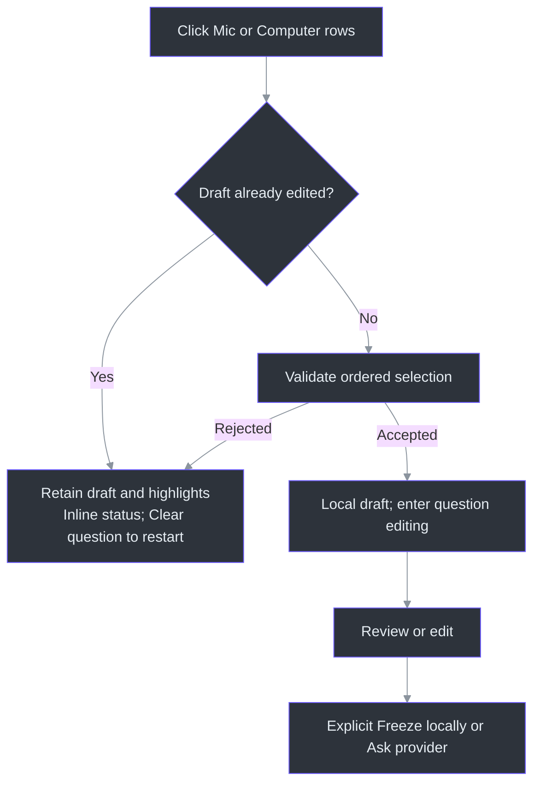
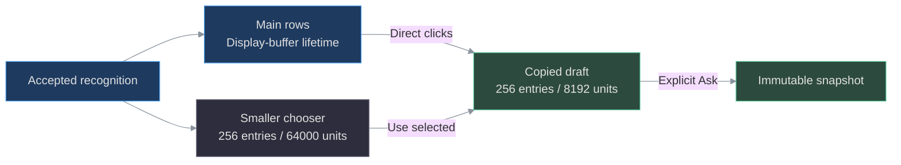

# Local question drafts and exact snapshots

**Local drafts are independent of answer providers.** Snapshot-only mode sends nothing.
An explicitly configured installed Agency, Copilot CLI or local-model provider can receive the question on Ask.
Direct Azure answers remain future work. The app does not read chats or send meeting audio.
See [answer provider setup](ANSWER-PROVIDERS.md) before enabling requests.

For noisy or unwieldy wording, the **off-by-default Clarify first toggle** requests an
interpretation before a solution. A separate reply field accepts an explicit Yes or correction;
only this opted-in conversation is included as history. See [Clarify first](QUESTION-CLARIFICATION.md).

## Click several lines to build a question

**Ask is the larger, colored button in the right-hand group; Clear question sits immediately
to its right with a red border.** Type/edit and Copy stay on the left. Ask's label changes with mode:
**Ask provider**, **Freeze locally**, **Interpret question**
or **Reply below**. The accent fill follows the selected theme; a dimmed button remains unavailable
until its existing question/provider guards allow the action.

1. **QUESTION / ANSWER** is expanded by default. **Hide Q/A** collapses it; **Show Q/A** restores it.
2. Click an intended **Mic** or **Computer** row directly in the main transcript. Click more rows
   to combine them—ordinary clicks toggle selection; **Ctrl is not required**. Click a selected
   row again to remove it. The draft follows displayed history order, not click order.
3. A wrapped or multiline recognition segment is one selectable row: clicking any part selects
   the whole segment, not a visual fragment. Only its raw text enters the draft, with newline
   separators between selected segments, not generated timestamps/source prefixes.
4. Selection opens Q/A, closes source/setup panels and Notes, and enters question editing.
   This is **deliberate keyboard focus**, not passive reading. It does not stop transcription,
   enable Notes editing, create a snapshot or send a model request.
5. Review or correct the combined text. **Done typing** or Escape returns to passive interaction.
   To write without selecting any transcript, use **Type / edit**. **Setup / details** exposes
   the provider notice and draft revision/provisional/user-edited indicators.
6. In **Snapshot only**, **Freeze locally** creates an immutable local snapshot without sending.
   With a configured provider selected, **Ask provider** freezes and sends that exact question.
   Neither action is triggered by selecting lines.

The shared `TranscriptRows_SelectionChanged` path also handles native ListBox keyboard/automation
selection. It validates the selection before replacing the draft, so a failed addition does not
discard the existing question. (src/PhantomFudge.App/MainWindow.TranscriptSelection.cs:85-147.)
Control labels and independent focus are defined by
[`InitializeQuestionView` / `SetQuestionEditing`](../src/PhantomFudge.App/MainWindow.Questions.cs),
[`UpdateAnswerControls`](../src/PhantomFudge.App/MainWindow.Answers.cs) and
[`EnsureQuestionReadingVisible`](../src/PhantomFudge.App/MainWindow.Layout.cs).

*Actual synthetic WPF render, not a meeting or desktop capture.* The outlined Mic row contains
a wrapped continuation; the selected Computer row follows it in the draft. The unselected row
with identical wording is not included. Literal `[Computer]` inside the Mic sentence remains
ordinary question text, not a source label to parse. The fixture opens no audio input and makes
no model request. (src/PhantomFudge.App/MainWindow.TranscriptSelectionDiagnostics.cs:21-53.)

### Keep edits safe; use the chooser when needed

Once you edit the draft, further **direct transcript-selection changes are rejected**, including
deselection. The inline status says: **“Edited question retained. Clear question before choosing a
different set of lines.”** Existing highlights are restored. This prevents a later click from
destroying corrections; it is not a popup or rehearsal prompt. Copy anything you need, then use
**Clear question** to start a different selection. Merely entering editing mode does not lock
selection—changing the text does. (src/PhantomFudge.App/MainWindow.TranscriptSelection.cs:94-112;
[`QuestionDraft.EditText`](../src/PhantomFudge.Core/QuestionDraft.cs).)

The manual alternative remains **Choose source → Mic / Computer / All → Use selected**. Mic is
the initial filter; **All** only broadens the chooser, never selects or sends every row. Unlike
direct clicks, **Use selected** is an explicit draft replacement, including after editing; with
no chooser rows selected it retains the draft. In passive Present mode the chooser does not itself
enter typing mode. Use **Type / edit** when ready to correct that result.
([`UseQuestionSelection_Click`](../src/PhantomFudge.App/MainWindow.Questions.cs).)

No repeated permission or recipient-rehearsal confirmation has been added. Start/Stop still controls
audio separately. Question selection, typing and Ask never start audio.
During an active clarification, both direct selection and **Use selected** retain the original
question instead of replacing it. Finish the clarification, toggle it off, or Clear question first.

## What can and cannot enter the question

The structured store keeps capture-session identity, source, utterance identity, revisions and
qualified audio-relative final bounds. A local session GUID is stamped onto events before they enter
the dispatcher; a late callback from a previous capture cannot enter the next session.

Display labels are for reading, never parsed to choose content. Selecting only Mic rows does not
include Computer text, earlier unselected Mic segments, notes, clipboard history or chats.
Explicitly selecting rows from both sources combines only those rows.
(src/PhantomFudge.App/MainWindow.TranscriptSelection.cs:118-131;
[`TranscriptSegment`](../src/PhantomFudge.Core/TranscriptSegment.cs).)

Selected partials keep their identity/highlight through revisions and finalization until you edit
the draft. Manual edits detach that text
from automatic recognition replacement. A frozen snapshot is never changed by later recognition,
typing, clearing, eviction or a new capture. Another explicit Ask creates another local snapshot;
question marks and natural finals never do so. One provider request may be active at a time;
Cancel it and wait for cleanup before submitting another. Cancel/Hide never automatically retries.

Selecting across capture sessions is rejected rather than silently combining histories. The draft
keeps immutable copies when the smaller chooser evicts its entries. **Older rows still visible in
the main transcript remain selectable**: that view retains structured row identities independently
of chooser eviction. Archived unfinished partials are selectable and still provisional; session
separator rows are not selectable. New finals follow the scrollbar only when it was already at
the end, so reading older history does not continually jump to the newest speech.
(src/PhantomFudge.App/MainWindow.TranscriptSelection.cs:13-83,125-147.)

Clearing an exported, stopped transcript removes its rows but does not silently erase the separately
copied draft. **Clear question** is the separate reset for the draft/highlights and last displayed
snapshot; clearing UI state cannot mutate an already frozen snapshot object.
([`ClearTranscript_Click`](../src/PhantomFudge.App/MainWindow.xaml.cs);
[`QuestionClear_Click`](../src/PhantomFudge.App/MainWindow.Questions.cs);
[`QuestionSnapshot`](../src/PhantomFudge.Core/QuestionSnapshot.cs).)

## Bounds and deliberate actions

- All selection composition uses `QuestionDraft.ReplaceSelection`: **one capture session, at most
  256 selected entries and 8192 UTF-16 code units including inserted newlines** (`string.Length`
  in .NET), not model tokens or visual grapheme clusters. Empty/whitespace-only Ask is rejected. Oversized selection,
  typing, paste or automatic revision is rejected atomically; the app does not silently truncate.
- The smaller structured chooser retains at most256segments/64000characters. The main visible
  history instead follows the unchanged `TranscriptBuffer` 250000-character final/session limit;
  live partials/export markers are separately bounded, so this is not a total-memory budget.
  Source epochs are locally labelled0 for current v2; this is not
  evidence of a negotiated source-commit feature.
- **Copy draft** copies only the currently displayed question to the Windows clipboard, explicitly.
  Clipboard data is outside the window's capture policy. Nothing is copied automatically.
- **Clear question** explicitly discards the local draft and last displayed frozen snapshot and
  resets transcript highlights, without clearing
  notes or transcription. Closing with question content uses the existing unsaved-data safeguard;
  saving notes/exporting transcripts does not pretend to save a question.
- The app's draft and answer state is in memory, but explicit diagnostic Text mode can retain
  submitted questions/answers locally. The external CLI may retain session data in its dedicated
  profile; do not confuse in-memory state with provider zero retention. See [diagnostics](DIAGNOSTICS.md).

The separate limits are implemented by [`QuestionDraft`](../src/PhantomFudge.Core/QuestionDraft.cs),
[`StructuredTranscriptStore`](../src/PhantomFudge.Core/StructuredTranscriptStore.cs) and
[`TranscriptBuffer`](../src/PhantomFudge.Core/TranscriptBuffer.cs); direct rows retain their own
segment reference rather than parsing the export string.
(src/PhantomFudge.App/MainWindow.TranscriptSelection.cs:13-64.)

## Deferred boundaries

**Finish dictation / armed live-Mic spans** need TODO29's negotiated source-specific commit and
start/end boundaries. Current v2 partial text cannot support a sample-exact cut of speech already in
the decoder/device buffer. Use explicit known segments or typed text in this slice. Global Stop has
not been repurposed into a question boundary.

TODO30/31 retain an approved direct Azure profile/adapter as future work. Installed-provider
workstream39 and the shared answer UI32 do not depend on Azure. No model/resource/credential is
guessed or installed automatically. Docker remains optional and last.

## Source map

`StructuredTranscriptStore`, `TranscriptSegment`, `QuestionDraft` and `QuestionSnapshot` live in
`src\PhantomFudge.Core`. [`MainWindow.TranscriptSelection.cs`](../src/PhantomFudge.App/MainWindow.TranscriptSelection.cs)
owns immutable display rows and direct selection; `MainWindow.Questions.cs` owns the composer.
The export format remains unchanged. `MainWindow.QuestionDiagnostics.cs` and
[`MainWindow.TranscriptSelectionDiagnostics.cs`](../src/PhantomFudge.App/MainWindow.TranscriptSelectionDiagnostics.cs)
exercise the UI with synthetic data only. The native adapter stamps local session identity without changing v1/v2 wire
schemas. The handbook and public JOURNAL describe this implemented slice separately from the
remaining Azure design. The click-selection update is **source-only** via
`scripts\Run-PhantomFudge.ps1`; the immutable historical045022ZIP does not contain it.
See [current implementation status](IMPLEMENTATION-STATUS.md).
