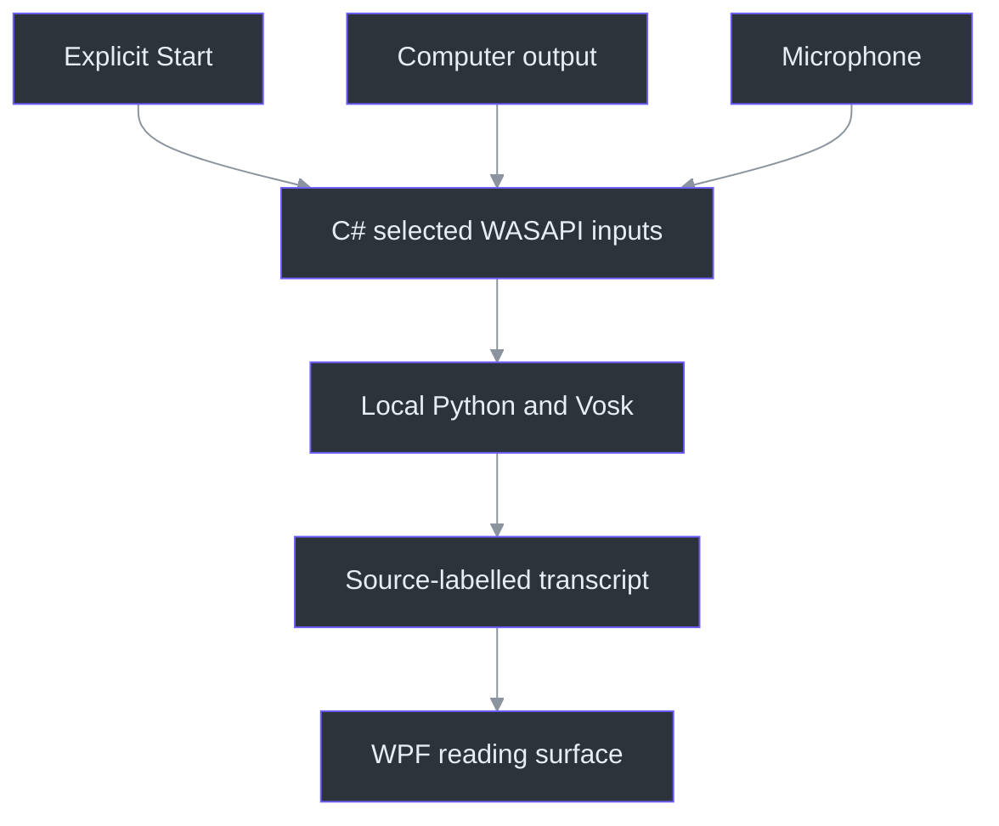
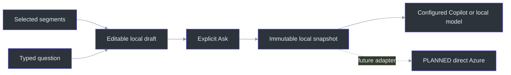

# Product overview

Phantom Fudge keeps meeting text and optional speaker notes on a movable Windows surface.
Transcription is the main view; notes stay collapsed until needed. It is a native Windows 11
development preview, **not a qualified, universally invisible application**.

This page carries the product explanation and setup context formerly on the repository front page.
Use the [visual README](../README.md) to see the interface and the [documentation index](README.md)
to choose a detailed guide.

## What works today

| Capability | Current behavior | Read more |
| --- | --- | --- |
| Computer / Mic / Both | Explicitly chosen inputs, separate labelled tracks, no recording before Start | [Dual-source audio](DUAL-SOURCE-AUDIO.md) |
| Live transcript and notes | Transcript-first interface with optional plain-text notes and explicit save/export | [Preview guide](PREVIEW-GUIDE.md) |
| Questions and answers | Select/compose exact text; freeze locally or Ask an explicitly configured provider | [Question composer](LOCAL-QUESTIONS.md), [provider setup](ANSWER-PROVIDERS.md) |
| Appearance | DeepSeaFoam, Harbor Daylight and Plain B/W; adjustable background-only translucency | [Themes and cursor behavior](CURSOR-AND-THEMES.md) |
| Recovery | Hide/reveal shortcut and second-launch recovery without an ordinary taskbar entry | [Controls and recovery](PREVIEW-GUIDE.md) |
| Recognition | Native C# capture/UI with local Python/Vosk, not a mandatory Docker deployment | [Speech service](../services/transcription/README.md) |

The input identities are `Computer` and `Microphone`, not identified speakers
(`src/PhantomFudge.Core/AudioSource.cs:3-30`, `AudioSourceNames`). Native startup connects the
local transport before constructing the selected capture inputs
(`src/PhantomFudge.App/Audio/LoopbackTranscriber.cs:67-127`, `StartCoreAsync`).
The Python recognizer loads an explicit local model path and produces partial/final text
(`services/transcription/recognizer.py:41-96`, `VoskFactory`, `VoskRecognizer`).

## Capture exclusion has limits

Windows capture exclusion is **requested**, not guaranteed against every recorder. It does not
hide the process, make the surface cease to be a real window, guarantee sharing-picker omission,
or protect against cameras and hardware recorders. Do not treat it as a security boundary.

`WindowProtection.Configure` requests `WDA_EXCLUDEFROMCAPTURE` on the owned HWND, applies
tool-window/nonactivation styles and checks available readback. Its composition flush is not
recipient-side observation (`src/PhantomFudge.App/Native/WindowProtection.cs:18-45`).

The target is Windows 11 first, with Teams, Zoom, Google Meet and OBS qualified separately.
The actual product/backend matrix remains unqualified. Local synthetic capture observations and
an earlier approved output-loopback experiment do not substitute for those results. The reported
recipient cursor disappearance also remains unresolved in its actual sharing mode.
See [current evidence](IMPLEMENTATION-STATUS.md), [qualification](QUALIFICATION.md) and
[privacy/assurance](handbook/17-privacy-and-assurance.md).

If a required capture path fails, narrow the supported claim or share only a presentation window/tab,
or use a separate unshared display/device. Do not replace missing evidence with an invisibility promise.

## How the local components fit



C# owns the Windows surface, input lifecycle and local transport. Python owns recognition.
That process boundary also permits later packaging of the headless service without making a
container part of normal use. It does not mean that Python itself is inherently more accurate
than C#: [the engine comparison](SPEECH-BENCHMARK.md) measures specific engines/models and
distinguishes batch throughput from live latency.

No chat reader or cloud speech fallback is used. An idle local service is not permission to
record; the user still chooses Start in the app.

## Start the native preview

From the repository root in PowerShell 7, follow the [preview guide](PREVIEW-GUIDE.md):

```powershell
.\scripts\Initialize-Transcription.ps1 -DownloadModel
.\scripts\Run-PhantomFudge.ps1
```

Setup creates a service-local Python environment and explicitly downloads the public model when
needed. The launcher starts or reuses native Python; it does not start audio capture. `-NotesOnly`
skips service startup. Stop this workspace's idle service with:

```powershell
.\scripts\Stop-Transcription.ps1
```

`Run-PhantomFudge.ps1` recovers an existing instance before building or starting a service, chooses
source versus packaged execution, and uses a loopback endpoint
(`scripts/Run-PhantomFudge.ps1:17-57`). Save/close an older running instance before trying a newer
preview. Never terminate it to force an update while unsaved notes may exist.

**Docker is optional and last.** It is not on the normal transcription path or the native-release
critical path. A cloud account is not needed for current local operation. Public dependency/model
downloads during setup are distinct from uploading meeting audio.

## Appearance and interaction

The Background slider changes the content tint from 10% to 100%, defaulting to 55%, while keeping
text solid. Lower opacity reveals the actual content behind the surface; it does not create
click-through or guarantee readability over every slide.

The sun/moon control switches DeepSeaFoam and Harbor Daylight; Plain B/W restores the neutral
palette. The theme values and two-theme transition are explicit in `ThemePalette.For` and
`NextThemed` (`src/PhantomFudge.Core/ThemePalette.cs:10-28`).

The default Present view is non-activating and uses an arrow cursor. Global Edit enables note
typing and stops transcription. Question **Type / edit** is deliberately separate: it permits
keyboard focus without stopping audio or enabling note editing. Done typing/Escape returns to
passive interaction (`src/PhantomFudge.App/MainWindow.Questions.cs:143-182`).

## Local questions, selectable providers and future Azure



Only intended segments enter the draft. Manual edits prevent later ASR from overwriting its text;
`Freeze` validates and copies the exact local question
(`src/PhantomFudge.Core/QuestionDraft.cs:48-95`). The current Ask handler displays that snapshot
or sends only its exact question through an explicitly configured provider
(`src/PhantomFudge.App/MainWindow.Questions.cs:231-250`).

Accurate armed-Mic finalization and approved direct Azure identity/provider integration remain
separate TODOs. Copilot CLI runs on the machine but normally uses GitHub cloud inference; offline
inference requires a separately installed local model endpoint. See [provider setup](ANSWER-PROVIDERS.md). Read the [implemented local workflow](LOCAL-QUESTIONS.md), then the
[remaining Azure architecture](AI-ANSWER-ARCHITECTURE.md), [identity/data boundaries](AI-ANSWER-PRIVACY.md)
and [latency evaluation plan](AI-ANSWER-EVALUATION.md). No model is claimed fastest without measurement.

## Engineering and deeper reading

The stack is C#/WPF on .NET 10, NAudio and local Python/Vosk. Keep private notes, transcripts,
model files and local tokens out of Git. Save/export deliberately; the preview does not promise
automatic recovery of unsaved text.

The [engineering handbook](handbook/README.md) explains the system from first principles through
capture, audio, storage, state machines and planned cloud integration. Read it as
[offline HTML](handbook/Phantom-Fudge-Engineering-Handbook.html) or [PDF](handbook/Phantom-Fudge-Engineering-Handbook.pdf).
The [public JOURNAL](../JOURNAL.md) records decisions, corrections and remaining uncertainty.

For contributions, start with the [TODO index](../TODO/00_INDEX.todo),
[development workflow](DEVELOPMENT-WORKFLOW.md) and [documentation maintenance contract](DOCUMENTATION-MAINTENANCE.md).
The [full docs index](README.md) links the product contract, feasibility research, protocols,
benchmarks and operational guides. The root README stays visual; deeper text belongs here or in
the relevant guide.
