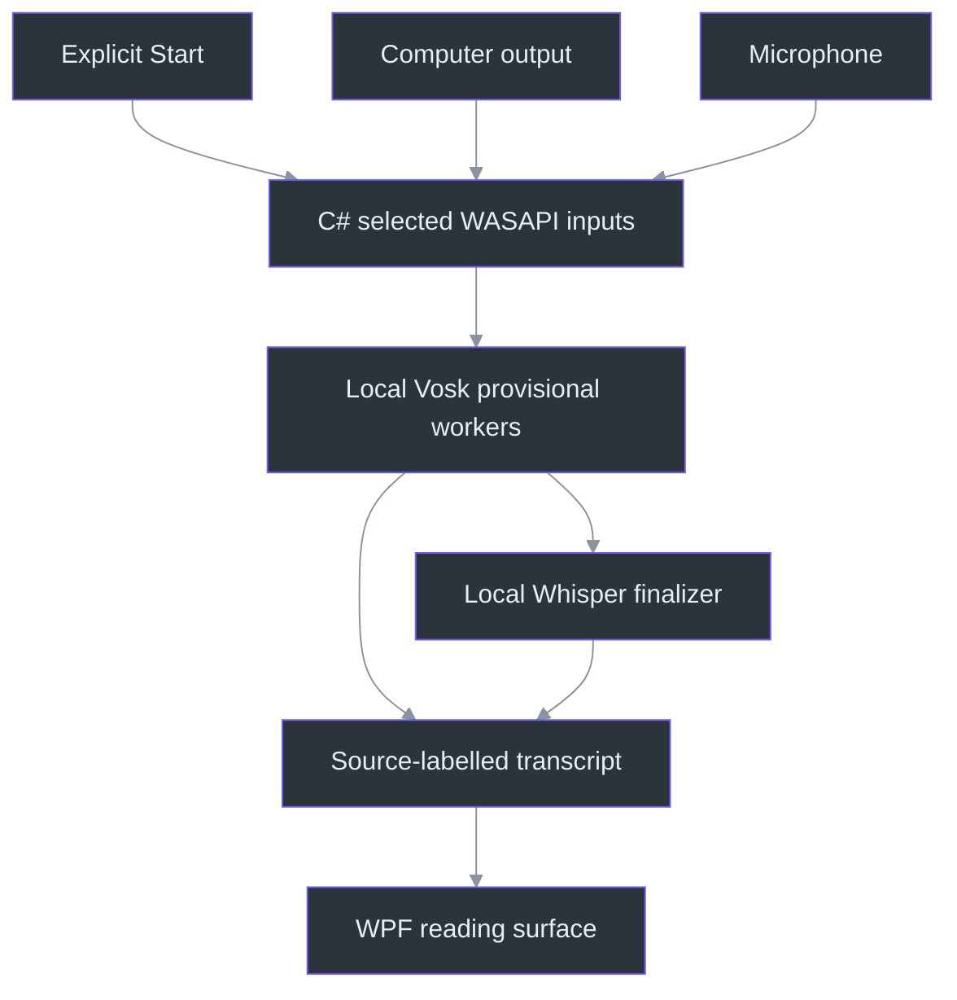

# Product overview

Phantom Fudge keeps meeting text and optional speaker notes on a movable Windows surface.
Transcription is the main view; notes stay collapsed until needed. It is a native Windows 11
development preview, **not a qualified, universally invisible application**.

This page carries the product explanation and setup context formerly on the repository front page.
Use the [visual README](../README.md) to see the interface and the [documentation index](README.md)
to choose a detailed guide.
The [illustrated current workflow](CURRENT-WORKFLOW.md) collects every recent control, image and
state transition in one place, including what keeps running under Cover.

## What works today

| Capability | Current behavior | Read more |
| --- | --- | --- |
| Computer / Mic / Both | Explicitly chosen inputs, separate labelled tracks, no recording before Start | [Dual-source audio](DUAL-SOURCE-AUDIO.md) |
| Audio device cards | Directly selectable wrapping cards; overflow pages preserve the selected endpoint, with no device-list scrollbars | [Illustrated setup](CURRENT-WORKFLOW.md#1-choose-audio-device-cards) |
| Recording status | Red dot follows active transcription, not startup or input selection | [Recording state](CURRENT-WORKFLOW.md#2-start-transcription-and-watch-the-red-dot) |
| Live transcript and notes | Transcript-first interface with optional plain-text notes and explicit save/export | [Preview guide](PREVIEW-GUIDE.md) |
| Questions and answers | Click several Mic/Computer lines, review one draft, then freeze locally or Ask an explicitly configured provider | [Question composer](LOCAL-QUESTIONS.md), [provider setup](ANSWER-PROVIDERS.md) |
| Question clarification | Off by default; request an interpretation, then explicitly send Yes or a correction | [Clarify first](QUESTION-CLARIFICATION.md) |
| Previous answer | Included in Preview 2: default-off toggle left of Ask includes one displayed completed answer, never accumulated history | [Follow-up context](LOCAL-QUESTIONS.md#follow-up-with-the-previous-answer) |
| Appearance | Larger responsive reading columns; white/black reading text; all reading surfaces share background translucency | [Themes and cursor behavior](CURSOR-AND-THEMES.md) |
| Action hierarchy and text density | Large accent Ask followed by red-bordered Clear; transcript25%smaller and answer50%smaller | [Current sizes and controls](CURRENT-WORKFLOW.md#current-sizes-themes-and-visible-status) |
| Notepad cover | NOTEPAD IS READY plus Uncover; already-started transcription and answers continue | [Cover and privacy limits](COVER-AND-PRIVACY.md) |
| Recovery | Hide/reveal shortcut and second-launch recovery without an ordinary taskbar entry | [Controls and recovery](PREVIEW-GUIDE.md) |
| Recognition | Native C# capture/UI; local Vosk provisional text plus Whisper small.en finals, no mandatory Docker | [Speech service](../services/transcription/README.md) |
| Diagnosis | Rotating local metadata, optional text retention and explicit metadata-only export | [Diagnostics](DIAGNOSTICS.md) |

The input identities are `Computer` and `Microphone`, not identified speakers
(`src/PhantomFudge.Core/AudioSource.cs:3-30`, `AudioSourceNames`). Native startup connects the
local transport before constructing the selected capture inputs
(`src/PhantomFudge.App/Audio/LoopbackTranscriber.cs:68-128`, `StartCoreAsync`).
The Python recognizer loads an explicit local model path and produces partial/final text
(`services/transcription/recognizer.py:44-110`, `VoskFactory`, `VoskRecognizer`).
The hybrid wrapper transfers disjoint PCM spans to the local Whisper finalizer; verified selected
models are required rather than silently falling back (`services/transcription/accurate.py:33-129`).


*Separate synthetic WPF example, not a real meeting or device inventory.*

## Capture exclusion has limits

Windows capture exclusion is **requested**, not guaranteed against every recorder. It does not
hide the process, make the surface cease to be a real window, guarantee sharing-picker omission,
or protect against cameras and hardware recorders. Do not treat it as a security boundary.

`WindowProtection.Configure` requests `WDA_EXCLUDEFROMCAPTURE` on the owned HWND, applies
tool-window/nonactivation styles and checks available readback. Its composition flush is not
recipient-side observation (`src/PhantomFudge.App/Native/WindowProtection.cs:19-48`).
It also requests the supported taskbar Peek-prevention flag. Cover minimizes fresh in-process
accessibility traversal, but a cached typed value provider still reads retained question text.
Process identity, memory and external/cached readers are not hidden. See the
[implemented measures and remaining exposure matrix](COVER-AND-PRIVACY.md).

The target is Windows 11 first, with Teams, Zoom, Google Meet and OBS qualified separately.
The actual product/backend matrix remains unqualified. Local synthetic capture observations and
an earlier approved output-loopback experiment do not substitute for those results. The reported
recipient cursor disappearance also remains unresolved in its actual sharing mode.
See [current evidence](IMPLEMENTATION-STATUS.md), [qualification](QUALIFICATION.md) and
[privacy/assurance](handbook/17-privacy-and-assurance.md).

If a required capture path fails, narrow the supported claim or share only a presentation window/tab,
or use a separate unshared display/device. Do not replace missing evidence with an invisibility promise.

## How the local components fit



C# owns the Windows surface, input lifecycle and local transport. Python owns recognition.
That process boundary also permits later packaging of the headless service without making a
container part of normal use. It does not mean that Python itself is inherently more accurate
than C#: [the engine comparison](SPEECH-BENCHMARK.md) measures specific engines/models and
distinguishes batch throughput from live latency.

No chat reader or cloud speech fallback is used. An idle local service is not permission to
record; the user still chooses Start in the app.

## Start the native preview

From the repository root in PowerShell 7, follow the [preview guide](PREVIEW-GUIDE.md):

```powershell
.\scripts\Initialize-Transcription.ps1 -DownloadModel
.\scripts\Run-PhantomFudge.ps1
```

Setup creates a service-local Python environment and explicitly downloads the verified public models when
needed. The launcher starts or reuses native Python; it does not start audio capture. `-NotesOnly`
skips service startup. Stop this workspace's idle service with:

```powershell
.\scripts\Stop-Transcription.ps1
```

`Run-PhantomFudge.ps1` recovers an existing instance before building or starting a service, chooses
source versus packaged execution, and uses a loopback endpoint
(`scripts/Run-PhantomFudge.ps1:17-57`). Save/close an older running instance before trying a newer
preview. Never terminate it to force an update while unsaved notes may exist.

Selection, clarification, typography/actions, recording indicator, device cards, cover and keyboard
controls are included in **v0.2.0-preview.2**, together with Previous answer; historical045022 is obsolete.
Preview 1 lacks Previous answer. Public Preview 2's five downloaded assets matched the [release receipt](release-0.2.0-preview.2.json); broader qualification remains open.
See [current status](IMPLEMENTATION-STATUS.md).

**Docker is optional and last.** It is not on the normal transcription path or the native-release
critical path. A cloud account is not needed for local notes/transcription; hosted answers still
use their configured provider's authentication. Public dependency/model
downloads during setup are distinct from uploading meeting audio.

## Appearance and interaction

The Background slider changes the content tint from 10% to 100%, defaulting to 55%, while keeping
text solid, including the answer pane. The default requested window is 1240 x 1520 clamped to the
monitor; wide layouts put transcript and Q/A side by side. Lower opacity reveals the actual content behind the surface; it does not create
click-through or guarantee readability over every slide.

The sun/moon control switches DeepSeaFoam and Harbor Daylight; Plain B/W restores the neutral
palette. The theme values and two-theme transition are explicit in `ThemePalette.For` and
`NextThemed` (`src/PhantomFudge.Core/ThemePalette.cs:11-29`).
The October 9 reading role deliberately overrides text to exact white in dark mode and black in
light/plain modes; it does not recolor the whole canonical palette.
Final transcript text is15WPF units, live partials13.5or10.5compact, and answers10or9compact.
Ask is large and accent-filled; Clear sits immediately to its right with a red border. Device names,
question editing and answer reading are separate typography roles.
([Current workflow](CURRENT-WORKFLOW.md#current-sizes-themes-and-visible-status).)

The default Present view is non-activating and uses an arrow cursor. Global Edit enables note
typing and stops transcription. Question **Type / edit** is deliberately separate: it permits
keyboard focus without stopping audio or enabling note editing. Done typing/Escape returns to
passive interaction (`src/PhantomFudge.App/MainWindow.Questions.cs:158-208`).
Main-transcript clicks now enter that same deliberate question-focus path, not passive scrolling.
Q/A is expanded initially; direct selection closes source/setup/Notes to expose the editor.
(src/PhantomFudge.App/MainWindow.TranscriptSelection.cs:131-147;
[`InitializeQuestionView`](../src/PhantomFudge.App/MainWindow.Questions.cs).)

## Local questions, selectable providers and future Azure

```mermaid
---
config:
  theme: base
  themeVariables:
    primaryColor: "#2d333b"
    primaryBorderColor: "#6d5dfc"
    primaryTextColor: "#e6edf3"
    lineColor: "#8b949e"
---
flowchart LR
    accTitle: Local question state and the unconnected Azure boundary
    accDescr: Direct multi-click selection or typing creates a local draft. Explicit Ask alone freezes exact text and may use the selected installed provider; direct Azure remains future work.
    Selected["Click several transcript rows"] --> Draft["Editable local draft"]
    Typed["Typed question"] --> Draft
    Draft --> Ask["Explicit Ask"]
    Ask --> Snapshot["Immutable local snapshot"]
    Snapshot --> Choice{"Chosen mode"}
    Choice --> Local["Snapshot only"]
    Choice --> Provider["Configured installed provider"]
    Choice --> Interpret["Optional interpretation"]
    Interpret --> Review["Explicit correction or Yes"]
    Review -->|Correction| Interpret
    Review -->|Yes| Provider
    Snapshot -. "future adapter" .-> Azure["PLANNED direct Azure"]
    style Selected fill:#2d333b,stroke:#6d5dfc,color:#e6edf3
    style Draft fill:#2d333b,stroke:#6d5dfc,color:#e6edf3
    style Typed fill:#2d333b,stroke:#6d5dfc,color:#e6edf3
    style Ask fill:#2d333b,stroke:#6d5dfc,color:#e6edf3
    style Snapshot fill:#2d333b,stroke:#6d5dfc,color:#e6edf3
    style Choice fill:#2d333b,stroke:#6d5dfc,color:#e6edf3
    style Local fill:#2d333b,stroke:#6d5dfc,color:#e6edf3
    style Provider fill:#2d333b,stroke:#6d5dfc,color:#e6edf3
    style Interpret fill:#2d333b,stroke:#6d5dfc,color:#e6edf3
    style Review fill:#2d333b,stroke:#6d5dfc,color:#e6edf3
    style Azure fill:#2d333b,stroke:#6d5dfc,color:#e6edf3
```



Only intended segments enter the draft. Manual edits prevent later ASR from overwriting its text;
`Freeze` validates and copies the exact local question
(`src/PhantomFudge.Core/QuestionDraft.cs:48-95`). The current Ask handler displays that snapshot
or sends its exact question through an explicitly configured provider
(`src/PhantomFudge.App/MainWindow.Questions.cs:265-292`).
The explicit, default-off clarification exception adds its fixed instruction and only this
question's bounded interpretation/reply history. Each correction or confirmation requires another
deliberate send; Cover does not auto-confirm anything.
Separately, **Previous answer** snapshots one completed displayed answer on Ask, before any
interpretation replaces it. Corrections and confirmation retain that same snapshot. It is
default-off/session-only and never appends a full conversation or transcript.
([Context controller](../src/PhantomFudge.App/MainWindow.AnswerContext.cs).)

Ordinary clicks toggle whole segments without Ctrl and compose raw text in displayed history
order, including older visible rows beyond chooser eviction. After editing, direct changes are
rejected with inline retained-draft status until **Clear question**; selection alone never freezes
or sends. The manual **Choose source → Mic / Computer / All → Use selected** path remains.
(src/PhantomFudge.App/MainWindow.TranscriptSelection.cs:13-83,85-147.)

Accurate armed-Mic finalization and approved direct Azure identity/provider integration remain
separate TODOs. Copilot CLI runs on the machine but normally uses GitHub cloud inference; offline
inference requires a separately installed local model endpoint. See [provider setup](ANSWER-PROVIDERS.md). Read the [implemented local workflow](LOCAL-QUESTIONS.md), then the
[remaining Azure architecture](AI-ANSWER-ARCHITECTURE.md), [identity/data boundaries](AI-ANSWER-PRIVACY.md)
and [latency evaluation plan](AI-ANSWER-EVALUATION.md). Agency now prepares an empty session without a
model prompt, then uses a fresh question context per Ask. Three prepared GPT-5.6 Sol Fast / low
answers completed in 2.992–4.176 seconds with 33 passing compiled checks; cold preparation remains
about 20–31 seconds. [The correction record](QUALITY-UPDATE.md) preserves failures and test limits.

## Engineering and deeper reading


Cover is a visual state, not Stop or Hide. See the
[control-transition table](CURRENT-WORKFLOW.md#state-changes-cover-is-not-hide) before relying on
any action to stop recording or cancel a request.

The stack is C#/WPF on .NET 10, NAudio and local Python/Vosk/Whisper. Keep private notes, transcripts,
model files and local tokens out of Git. Save/export deliberately; the preview does not promise
automatic recovery of unsaved text.

The [engineering handbook](handbook/README.md) explains the system from first principles through
capture, audio, storage, state machines and planned cloud integration. Read it as
[offline HTML](handbook/Phantom-Fudge-Engineering-Handbook.html) or [PDF](handbook/Phantom-Fudge-Engineering-Handbook.pdf).
The [public JOURNAL](../JOURNAL.md) records decisions, corrections and remaining uncertainty.

For contributions, start with the [TODO index](../TODO/00_INDEX.todo),
[development workflow](DEVELOPMENT-WORKFLOW.md) and [documentation maintenance contract](DOCUMENTATION-MAINTENANCE.md).
The [full docs index](README.md) links the product contract, feasibility research, protocols,
benchmarks and operational guides. The root README stays visual; deeper text belongs here or in
the relevant guide.
