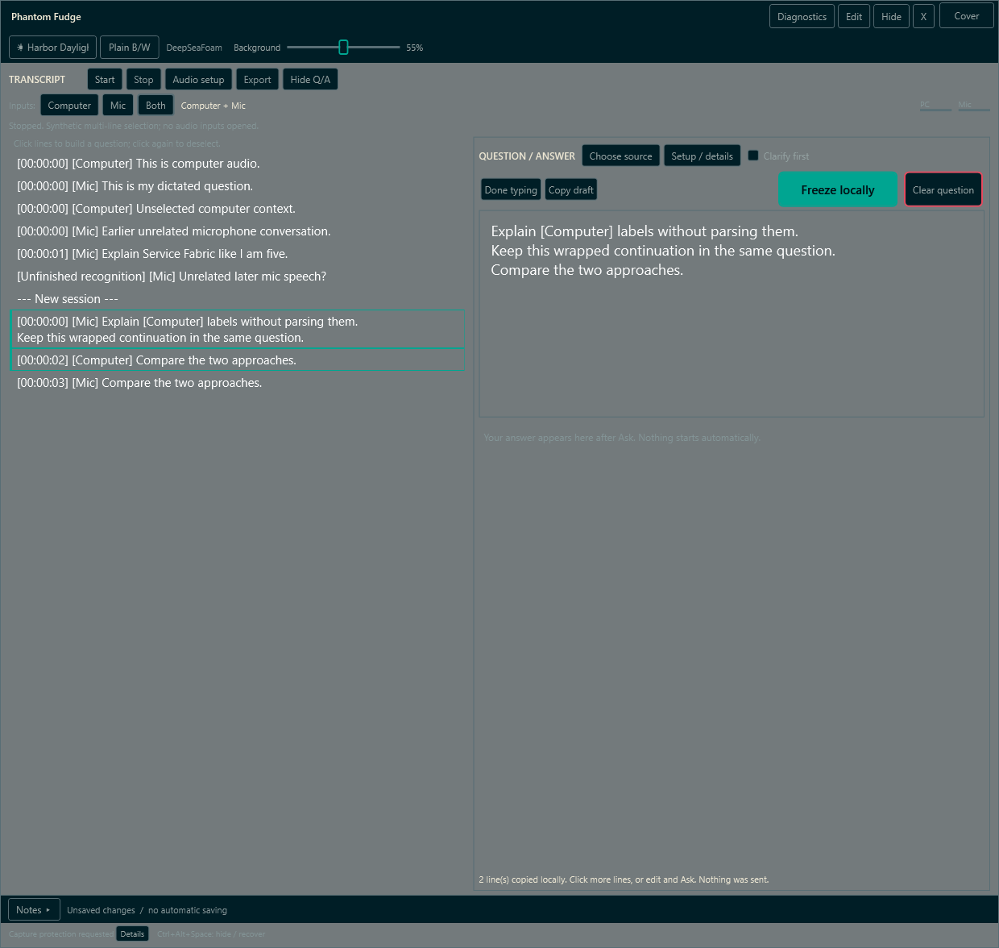

# Running the local development preview

This is an **unqualified Windows 11 x64 preview**, not a certified private meeting tool.
Rehearse with synthetic text and a separate recipient before using sensitive notes.
The app remains visible to normal OS/process/accessibility inspection.

For the **published v0.2.0-preview.2 installer**, use [Install, update and remove](INSTALLATION.md).
That path bundles its own runtime and models and uses a native Start-menu launcher; it does not
require the source-development tools below. The public release provides Setup, Portable ZIP,
reference PDFs and checksums; [the release receipt](release-0.2.0-preview.2.json) records matched assets and bounded package results.
[Preview 1 asset identities](release-0.2.0-preview.1.json) are historical, not evidence for Preview 2.
The repository is public. Windows10, ARM, macOS and Linux are unsupported installer targets.
Finish and close Setup before opening the app from Start; Setup never launches it. Setup and launcher
status/error windows are ordinary visible UI, not capture-excluded: install and launch before sharing.
(tools/Installer/PhantomFudge.iss:14-76)
(src/PhantomFudge.Launcher/LauncherWindow.cs:18-57)

## Native app from source or a legacy development ZIP

For a complete tour with the current images, use the [illustrated workflow](CURRENT-WORKFLOW.md).

From the repository in PowerShell 7, with the SDK selected by `global.json`:

```powershell
dotnet test .\tests\PhantomFudge.Core.Tests\PhantomFudge.Core.Tests.csproj -c Release
.\scripts\Run-PhantomFudge.ps1
```

First run `.\scripts\Initialize-Transcription.ps1 -DownloadModel` to prepare the local Python
environment, pinned dependencies and verified Vosk/Whisper models. The launcher builds WPF, starts/reuses native Python,
and passes the token from `.local\transcription.token` without printing it.
Use `.\scripts\Run-PhantomFudge.ps1 -NotesOnly` for notes without speech service startup.
Development builds need
the .NET 10 Desktop Runtime; an explicitly published self-contained ZIP includes its runtime.

For a legacy development ZIP, extract the WHOLE directory and use its supplied
`scripts\Run-PhantomFudge.ps1` after explicit Python/model setup. Running its root
`PhantomFudge.exe` alone does not start the speech service or pass the token.
Do not copy just its EXE away from its dependent files. An unsigned preview may be blocked
by Windows or organizational policy; do not disable security controls to bypass that.

**The older045022ZIP lacks the later October9 UI changes:** multi-line selection, Clarify first, smaller
transcript/answer text, prominent Ask/red Clear, recording dot, no-scroll device cards and Cover.
Keyboard workstream57 is complete locally: the final38keyboard checks,297Core and18docs-tool tests,
maintained images and source-atlas/handbook editions are recorded in the implementation status.
The installer workstream58 is separate and still in progress; this is not a qualified release.
Run `.\scripts\Run-PhantomFudge.ps1` from the updated checkout after saving and closing the old app.
See [the dated milestones](IMPLEMENTATION-STATUS.md).

## Transcript-first view, themes, and notes

The **book icon at the top left** toggles the mask: only **NOTEPAD IS READY** and that icon remain.
This is visual only: transcription and answers keep running, and the recording dot is behind the
cover. Uncover restores accumulated content. Hide/Exit still stop work normally. Cover is not
invisibility: process inspection, cached accessibility references and some capture methods remain
outside its protection. See [cover behavior and privacy feasibility](COVER-AND-PRIVACY.md).

**Audio setup uses selectable device cards, not scrolling lists.** It temporarily uses the reading
area so Computer and Microphone cards have room to wrap. Click a card; its accent border and filled
dot identify the selected device. Click **Done** or **Close setup** to return.

For many devices or a small window, Previous/Next buttons show another page without changing the
selected endpoint. The page label tells you where the selected card is. Device selection and paging
are locked while capture starts, runs or stops. **Service setup** reveals the token and advanced
guidance only when needed; a missing-token Start opens it automatically. No card click starts recording.

A **red dot beside TRANSCRIPT / Start** appears while the selected audio inputs are actively
being transcribed. It stays hidden during connection/startup and disappears when transcription
stops or faults. This indicates live capture, not that an audio file is being saved.

The right-hand action group is **large accent Ask, then red-bordered Clear question**. Type/edit
and Copy remain on the left. Current final transcript size is15WPF units; partials are13.5or10.5
compact; answers/interpretations are10or9compact. Question text remains18.
The new **Size** slider can choose 8–24 for answers/interpretations; that session choice overrides
the 10/9 responsive defaults across resize but is not retained after restart.
In a narrow, short window, Select/Search temporarily show the transcript instead of Q/A; reviewing
restores Q/A without cancelling it. Other keyboard modes prioritize Q/A, as does a chosen size 14+
with a visible answer even outside keyboard control. Nothing is discarded or stopped, and wide
columns are unchanged. See the [compact-layout explanation](KEYBOARD-CONTROLS.md#compact-windows-the-active-task-gets-the-reading-space).
See [current sizes and images](CURRENT-WORKFLOW.md#current-sizes-themes-and-visible-status).

- The live transcript is the main view, with **QUESTION / ANSWER** expanded by default. **Hide Q/A**
  and **Show Q/A** toggle it. Notes starts collapsed; click Notes to expand/collapse.
  Collapsing preserves text and unsaved status. Edit / Ctrl+Alt+E opens editable notes deliberately.
- The requested default is 1240 x 1520, clamped to the monitor work area. Wide layouts place
  transcript and Q/A side by side without a scrolling outer main panel. Long text retains its own
  scrollbar; small windows cannot display unlimited content at once.
- The default Present view does not request foreground activation and keeps the standard arrow
  over text. Clicking a transcript row deliberately enters question editing and takes focus;
  it is not passive scrolling. This does not guarantee another app's captured pointer visibility.
- Use the sun/moon button for DeepSeaFoam/Harbor Daylight, or Plain B/W for the neutral view.
  Themes are session-only and preserve opacity, content, HWND and transcription state.
- Drag the quiet header and resize at the edges. The pointer stays an arrow, including text areas;
  normal hit regions still work. Edit restores keyboard focus and text selection.
- Use **Background** to see through notes, transcript, question and answer areas: default55%, adjustable10-100%.
  Lower values reveal more of the actual window behind;100% restores an opaque background.
  Reading text stays solid white in DeepSeaFoam and black in light/plain themes. The slider also
  works in Present mode. Header and setup
  controls remain opaque for usability. This does not make the window click-through.
  The10% minimum preserves background hit testing; the value lasts for this app session.
- Use New/Open/Save/Save as; only UTF-8 `.txt` up to 1 MiB is supported in this preview.
- No note autosave or crash recovery is enabled. Save explicitly; an unexpected process crash
  can lose unsaved notes and transcripts.
- Ctrl+S/O/N/F provide save/open/new/find. A-/A+ adjust font size; Wrap changes wrapping.
- Ctrl+Alt+Space hides/reveals; Ctrl+Alt+E returns to Edit. A conflicting global shortcut is
  reported; relaunching the app asks the existing instance to reveal and recenter.
- The app deliberately has no ordinary taskbar/Alt-Tab entry. Hide is not Exit.
- Unsaved content is handled by an inline confirmation, not a note-bearing system popup.
- The quiet capture status describes a Windows request, not a certification. **Details** opens
  the full limitations inline; actual protection failures still hide content and report an error.

Present mode is the startup default, read-only/non-activating and without an acknowledgment.
Permission and recipient rehearsal are handled by the owner outside the app; neither is
reconfirmed with checkboxes, dialogs or repeat prompts. Global Edit/Present switching, hiding, lock/suspend
or protection invalidation stops transcription.
Start again deliberately after checking the new configuration. Normal dialogs/export are
disabled during Present. Hide and Notes Edit retain their fixed shortcuts; keyboard-control
activation has the separate configuration below.
Cover is the explicit exception to stopping: it retains ongoing work. Opening Audio setup,
expanding Notes or hiding Q/A closes the question pane and cancels its current answer/provider
activity while leaving audio unchanged. The [transition table](CURRENT-WORKFLOW.md#state-changes-cover-is-not-hide)
distinguishes these actions from Stop and Cancel answer.

## Keyboard control and answer size

Read the canonical [keyboard guide](KEYBOARD-CONTROLS.md) for the complete mode table, commands,
synthetic illustration references and exact JSON. The beginner path is **Ctrl+Alt+K → `v` →
`j`/`k` → Space → Enter review → Ctrl+Enter submit**. **Keys** is the on-window fallback.
Letters work only inside the armed local modes; in Edit they are ordinary text and Enter inserts
a newline. Escape backs out to Control, then attempts to return to the previous application.
`m` in Control masks/disarms while capture and answers continue; the system pointer is not locked,
hidden or moved. (src/PhantomFudge.App/MainWindow.Keyboard.cs:65-175,218-306,366-370.)
After Ctrl+Enter, Edit stays armed. Async clarification updates its reply/original target only if
the field is visible and editable; focus is retargeted only while the app is already foreground.
Use Escape → `a` for reading commands after submission.
(src/PhantomFudge.App/MainWindow.Keyboard.cs:127-139,257-266,301-306.)

Use F2/F3/F1 instead of US OEM `:`/`/`/`?` shortcuts where needed; **F3 is Select-only** and
literal Edit does not interpret these as mode commands. `:devices` refuses busy audio/answers
and, when allowed, closes Q/A for setup; ordinary modes preserve ongoing work. `:start` explicitly
starts capture, `:stop` stops audio only, `:cancel` cancels answer/preparation only, and Clear retains
its existing answer-cancellation behavior.
(src/PhantomFudge.App/MainWindow.Keyboard.cs:257-360;
src/PhantomFudge.App/MainWindow.KeyboardSelection.cs:110-125.)

The optional `%LOCALAPPDATA%\PhantomFudge\keyboard.json` accepts only `schemaVersion`, `enabled`
and `activationKey`; [copy the exact example](KEYBOARD-CONTROLS.md#shortcut-configuration-and-recovery).
Activation is fixed Ctrl+Alt+NoRepeat plus A–Z except E, or F1–F11; **F12 is reserved/rejected**.
Invalid configuration or a registration conflict leaves the **Keys** button available. Save needed
content and restart to apply configuration changes; relaunching an existing instance is not a reload.
Answer size is not a saved keyboard setting.
(src/PhantomFudge.Core/KeyboardShortcutConfiguration.cs:7-28,31-114;
src/PhantomFudge.App/MainWindow.Keyboard.cs:30-63;
src/PhantomFudge.App/MainWindow.AnswerFont.cs:9-43.)

## Local transcription: Computer, Mic, or Both

The provisioning and stop commands in this section are for the **source/legacy development
workflow**. Installed users use the [native launcher and maintenance procedure](INSTALLATION.md);
do not run workspace scripts against the installed runtime's ownership data.

Choose Computer for meeting/system playback, Mic to dictate a question, or Both to transcribe both
independently. Both is selected initially, but capture does not start automatically. Audio setup has
separate playback and microphone cards. Match the playback device to the meeting's headphones.
Computer audio includes other apps and audible sidetone; no meeting-process isolation is implied.
Headphones help prevent the microphone from picking up speaker audio twice.

Follow `services\transcription\README.md` for provisioning. `Initialize-Transcription.ps1`
creates the local Python environment, model and token. `Start-Transcription.ps1` starts native
Python; the main launcher does this automatically. Docker is not required.
C# handles GUI/audio transport. Native Python uses Vosk provisional text and Whisper small.en
CPU-int8 final text, with four threads and disclosed technical vocabulary. Missing accurate models
fail visibly, never silently reverting to Vosk-only or cloud speech. See [measured quality](QUALITY-UPDATE.md).

The idle Python service persists independently of the starter/app. After stopping audio in the
app, use `.\scripts\Stop-Transcription.ps1` to shut down this workspace's service gracefully.
It will not terminate unrelated services or interrupt active transcription.
Docker is optional final-stage packaging, invoked explicitly with `Start-Transcription.ps1 -Docker`;
do not use that path for normal local operation.

Use the repository launcher so the token is passed automatically, or enter the local token
under **Audio setup → Service setup** in the session-only token field. The endpoint is literal loopback
`ws://127.0.0.1:8765/v1/transcribe`; there is no cloud speech fallback.

Open Audio setup, click the required device cards, then Done and Start. No permission confirmation
is requested. Final lines are labelled Computer or Mic; independent unfinished lines can change.
Stop releases selected devices and drains accepted work for both sources. Normal synthetic stop
median/p95 were 0.480/0.746 seconds; the 90-second client bound accommodates worst-case backend
timeout/cleanup, not a typical wait. Separate meters show Computer/Mic levels.
Stop before changing mode or devices. Windows may display its own microphone privacy indicator;
this app does not suppress it. No chats, clipboard history or meeting APIs are read.
Audio setup works with the mouse in Present; choose Edit to type a token or export a transcript.

Audio is processed in memory and is not recorded to a file. Transcripts are retained in memory
unless explicitly exported or diagnostic Text mode is enabled. Clear requires export of unsaved transcript content; Exit has
an explicit discard choice. Recognition is machine-generated and can be wrong, particularly
names, technical terms, accents and overlapping speakers. No diarization is promised.

If a selected service/model/token/device is unavailable, the app reports failure instead of using
an unselected input or uploading audio. A full audio queue stops transcription rather than silently
dropping speech. An interrupted connection can lose the unfinished tail; that is reported.

## Synthetic diagnostics

These paths use generated fixture text, not personal notes or a live meeting:
The capture-proof command intentionally shows an unprotected synthetic positive control;
run it only outside a live presentation. It must not be mistaken for an invisible production window.

```powershell
dotnet run --project .\spikes\CaptureProof -c Release -- .\.local\capture-proof --transparent
.\src\PhantomFudge.App\bin\Release\net10.0-windows\PhantomFudge.exe --ui-smoke .\.local\ui-smoke
.\scripts\Test-NativeLifecycle.ps1
```

The first records cropped GDI capture samples of a synthetic overlay/backdrop. The second
renders its own synthetic WPF visual tree for layout/state inspection. The latter intentionally
does not test capture exclusion and starts no audio. Neither certifies any meeting application.
The lifecycle test starts only its own blank instance and exercises minimized/hidden recovery
and native close. It refuses to touch an already running PhantomFudge process.

## Current qualification boundary

Teams, Zoom, Meet, OBS, alternate GPUs/DPI/headsets, startup-frame completeness and actual meeting
transcription accuracy require their own recorded outcomes. Docker execution is a separate deferred
packaging test, not a native-app or transcription prerequisite.
Read `docs\QUALIFICATION.md` and the TODO index for the current evidence and remaining gates.

Screen affinity does not encrypt disk files, protect clipboard history, hide a running process,
stop cameras/hardware recorders, or control microphone/system audio sent by a meeting application.
Prefer sharing only a presentation window/tab or an unshared display/device when appropriate.

The reported remote cursor disappearance still needs the actual sharing product/mode checked.
Local nonactivation and Arrow policy do not control that recorder's cursor stream. See
[cursor and theme boundaries](CURSOR-AND-THEMES.md). Automatic protection failures no longer
show a captureable branded popup: content remains hidden and a generic local notice is written
to `%LOCALAPPDATA%\PhantomFudge\last-window-error.txt`. File dialogs explicitly opened in Edit
remain outside the main protected HWND.

## Local question composer

Click the intended **Mic** or **Computer** rows directly in the main transcript. Ordinary clicks
toggle multiple rows without Ctrl; click again to deselect. The question combines them in displayed
history order, not click order. A wrapped/multiline recognition segment is selected whole, and
generated timestamps/source prefixes are not copied. Older visible rows remain selectable after
the smaller chooser evicts them; new finals do not pull the scrollbar down while you read history.
(src/PhantomFudge.App/MainWindow.TranscriptSelection.cs:13-83,85-147.)

A click opens Q/A, hides source/setup/Notes panels and enters independent question editing without
stopping transcription or unlocking speaker notes. It takes deliberate keyboard focus; it creates
no snapshot and sends nothing. **Done typing** or Escape returns to passive interaction. Use
**Type / edit** for a typed-only question; global Edit/Present and Hide still stop audio.
([`SetQuestionEditing`](../src/PhantomFudge.App/MainWindow.Questions.cs).)

**After editing, direct line-selection changes are rejected** with an inline “Edited question
retained” status. Copy anything needed, then **Clear question** before choosing a new set; this
also resets highlights. There is no popup or repeated permission/rehearsal prompt. The manual
**Choose source → Mic / Computer / All → Use selected** route remains an explicit replacement
alternative; it does not automatically copy every visible row.
(src/PhantomFudge.App/MainWindow.TranscriptSelection.cs:94-147;
[`UseQuestionSelection_Click`](../src/PhantomFudge.App/MainWindow.Questions.cs).)



*Actual synthetic WPF render, not a desktop/meeting capture.* Two outlined rows compose one draft;
no audio input or model request was used. (src/PhantomFudge.App/MainWindow.TranscriptSelectionDiagnostics.cs:21-53.)

Under **Setup / details**, **Snapshot only** makes the action **Freeze locally**, which sends nothing.
An explicitly selected installed Agency or local-model provider changes it to **Ask provider** and
can answer the frozen question. [Set up an answer provider](ANSWER-PROVIDERS.md);
the app does not install a CLI/model or sign in automatically.
Configured Agency prepares one empty isolated session in the background on startup/reveal/reload;
no question or model prompt is sent by preparation. Wait for **Ready**, then Ask. The default
GPT-5.6 Sol Fast / low profile returned three complete exact-text test answers in 2.992–4.176 seconds
after preparation; initial preparation took roughly 20–31 seconds. This is not a universal latency
guarantee. Normal Ask has no tools or implicit previous-answer history. The off-by-default
**Clarify first** option instead requests an interpretation and allows explicit Yes/correction
replies with only this clarification conversation attached. See [the workflow](QUESTION-CLARIFICATION.md).
The newer **Previous answer** toggle immediately left of Ask explicitly adds the displayed
completed answer. It is off/session-only, never sends by itself, retains the same snapshot through
clarification and resets on Clear/provider change. `:context on/off` provides the keyboard route.
This is **included in Preview 2**, not the immutable Preview 1 installer.
See [follow-up usage](LOCAL-QUESTIONS.md#follow-up-with-the-previous-answer).
Selected partials keep identity/highlights through revisions and finalization until you edit;
previously frozen snapshots never change. One draft can select at most256entries from one capture
session and8192UTF-16 code units including inserted newlines. Invalid additions retain the previous
draft/highlights instead of truncating. Copy/Clear are deliberate actions,
and unsaved questions participate in the existing exit safeguard.

Both direct selection and the manual chooser use structured source identity, not parsed display labels. Neither reads chats
or automatically includes a whole meeting. Accurate armed-Mic finalization and direct Azure
integration remain separate TODOs. See [the local question guide](LOCAL-QUESTIONS.md).

## Local logs and applying this update

Metadata logging is automatic and bounded; conversation bodies are off by default. **Diagnostics**
opens the local log folder and reloads settings. Use `.\scripts\Show-Diagnostics.ps1 -Last 10`
or `.\scripts\Export-Diagnostics.ps1` for a local metadata-only summary/export. Nothing is uploaded.
Text recording is a separate explicit opt-in; see [diagnostic retention](DIAGNOSTICS.md).

Save/copy needed content and close the old app with **X**, not Hide, before launching an updated
source build or extracted preview. Relaunch normally recovers an existing instance; it cannot
replace its loaded code. No running user instance should be force-closed to apply this update.
For the installer, run the same/newer Setup only after closing; its maintenance guard, downgrade
refusal and retained-data policy are documented in [Installation](INSTALLATION.md#update-or-repair).
