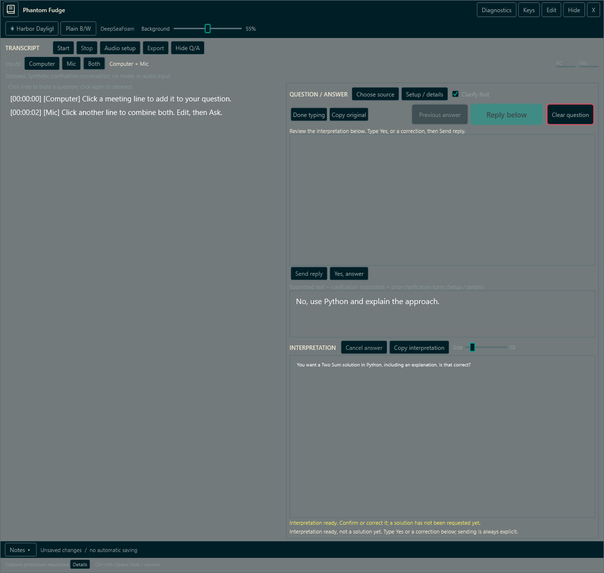
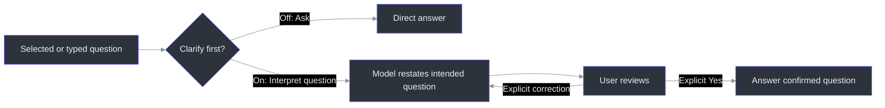
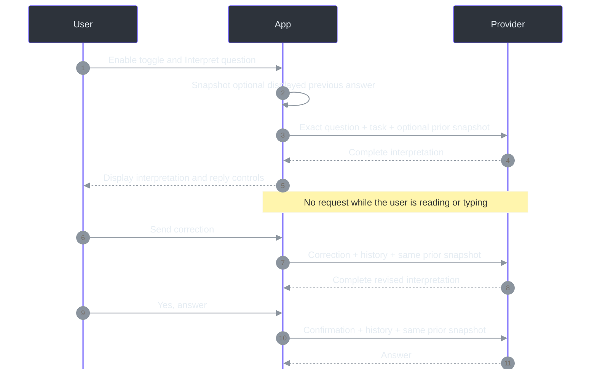

# Clarify first

## Why this exists

A long transcript can capture the subject of a question while getting its wording wrong.
**Clarify first** lets the model propose the intended question before attempting a solution.
It is **off on every app launch**. Ordinary Ask remains a direct answer; the separate
default-off **Previous answer** toggle may supply one displayed completed answer as background.
This is model-assisted interpretation, not a correction to the original audio or proof of what
someone actually said. The original draft remains in the app.
([UI state and toggle](../src/PhantomFudge.App/MainWindow.Clarification.cs),
[`QuestionDraft`](../src/PhantomFudge.Core/QuestionDraft.cs).)
(src/PhantomFudge.App/MainWindow.Clarification.cs:11-46;
src/PhantomFudge.Core/QuestionDraft.cs:18-59.)

## Use it

1. Select one or several transcript rows, or type a question.
2. Enable **Clarify first** beside **Setup / details**, then press **Interpret question**.
3. Read **INTERPRETATION**. It should restate the intended question, not solve it yet.
4. Use **Type reply** if needed. Type **Yes** and press **Send reply**, or click **Yes, answer**.
   To correct the interpretation, type the correction and press **Send reply** instead.
5. A correction requests another interpretation. An explicit Yes requests the answer.
   Nothing is submitted merely by typing, receiving a response, or toggling the option.

`Yes` is case-insensitive and ignores surrounding whitespace. `Yes, but use Python` is a
correction, not confirmation. The confirmation button refuses to discard a written correction.
The original question is separate from the reply field; **Copy original** copies that original,
not the reply. **Setup / details** displays the extra instruction and completed clarification
exchanges. ([Reply handlers](../src/PhantomFudge.App/MainWindow.Clarification.cs),
[question focus/copy](../src/PhantomFudge.App/MainWindow.Questions.cs).)
(src/PhantomFudge.App/MainWindow.Clarification.cs:88-158.)

*Actual WPF render using a fake provider and synthetic text; not a real model answer or desktop
capture.* The fixture exercises an interpretation, a Python correction and a separate confirmation.
([Synthetic flow](../src/PhantomFudge.App/MainWindow.ClarificationDiagnostics.cs).)
(src/PhantomFudge.App/MainWindow.ClarificationDiagnostics.cs:34-119.)

## Architecture: a narrowly scoped exception

The extra metadata is a **fixed task instruction**, not diagnostics or machine information.
Its meaning is: *My question may be poorly transcribed. Infer and restate what I mean; do not
answer yet. Ask a short clarification only if essential, then finish this response so I can
explicitly confirm or correct it.* A later request includes only that question's explicit
user/interpretation exchanges, plus the current reply. Ordinary requests carry no clarification
history. No unselected transcript, notes, audio, device names, files or organization data are added.
([Provider contract](../src/PhantomFudge.Core/Answers/AnswerContracts.cs),
[prompt construction](../src/PhantomFudge.Core/Answers/AgencyAnswerPrompt.cs).)

The app does not keep a provider process waiting for interactive permission or stdin replies.
Each explicit action is a new complete request; Agency still closes each fresh ACP session.
The model's textual clarification is allowed only in interpretation mode. Default and
confirmed-answer requests retain standalone-answer behavior and tool/permission isolation.
([Answer lifecycle](../src/PhantomFudge.App/MainWindow.Answers.cs),
[ACP transport](../src/PhantomFudge.Core/Answers/AgencyAcpConnection.cs).)

## State, limits and failures

### Previous answer is captured before interpretation

The interpretation replaces the answer reader. Therefore, when **Previous answer** is on, the
first explicit **Interpret question** captures the completed answer **before** that replacement.
The same string is carried by every correction and confirmation. It must not be recaptured from
the interpretation now on screen or recursively copied from an earlier request.
([`CapturePreviousAnswer`](../src/PhantomFudge.App/MainWindow.AnswerContext.cs),
[`BeginQuestionClarification`, `SubmitClarificationReply`](../src/PhantomFudge.App/MainWindow.Clarification.cs).)

If the first interpretation fails or is cancelled, explicitly retrying it keeps that original
snapshot. The active clarification locks context changes even when no provider call is running.
After a confirmed answer completes, the still-enabled option can use that new answer for a new
question. Clear or a provider change resets it. This is a **local-source addition, not in
v0.2.0-preview.1**. [Detailed usage](LOCAL-QUESTIONS.md#follow-up-with-the-previous-answer).

| Boundary | Behavior |
| --- | --- |
| Original draft | Retained separately; direct row changes, ASR replacement and original editing are blocked during an active clarification |
| Reply and interpretation text | At most 8192 UTF-16 units each; oversized input is rejected, not silently shortened |
| History | At most four completed interpretations and 32768 UTF-16 units including current input; then confirm or start over |
| Optional previous answer | Separately bounded to32768UTF-16 units; nonblank strict Unicode; SAME snapshot through this clarification |
| Incomplete/cancelled response | Not committed as a valid interpretation; no automatic reply or retry |
| Clear question / toggle off | Reset this clarification conversation; toggle off retains the original draft |
| Provider change | Reset conversation so a new destination cannot inherit it silently |
| Reload identical setup | Retains the current conversation for an explicit retry |
| Snapshot only | Never calls a model, even with the toggle on |
| Short window | Reply controls replace the draft area; the snapshot and narrow-window transcript are temporarily hidden to keep the interpretation and reply readable |

These limits are characters, not tokens. Exact typed text and immutable snapshots remain separate
from local source references. An interpretation is a proposal, not evidence that the model
recovered the correct meaning. Review it before confirming.
([State and bounds](../src/PhantomFudge.App/MainWindow.Clarification.cs),
[`QuestionSnapshot`](../src/PhantomFudge.Core/QuestionSnapshot.cs),
[layout](../src/PhantomFudge.App/MainWindow.Layout.cs).)
(src/PhantomFudge.Core/Answers/AnswerClarification.cs:7-69;
src/PhantomFudge.Core/QuestionSnapshot.cs:5-23.)

## Privacy and timing

This mode adds model requests: interpretation, each correction, and the final answer are separate
explicit submissions. It therefore has no end-to-end under-five-second promise. The earlier
prepared direct-answer measurements do not qualify this new loop or its updated policy.
No live-model quality or latency result is claimed by the synthetic UI fixture.

Default logs remain metadata-only. Explicit diagnostic Text mode can retain submitted input and
responses locally; the external provider may retain its own request/session data, including the
opted-in history and prior-answer text. Clear is not deletion of already-written logs or remote copies.
([Diagnostics](DIAGNOSTICS.md), [provider retention](ANSWER-PROVIDERS.md).)

## References

[Local questions](LOCAL-QUESTIONS.md) · [provider setup](ANSWER-PROVIDERS.md) ·
[workstream45](../TODO/45_OPT_IN_QUESTION_CLARIFICATION.todo) ·
[UI implementation](../src/PhantomFudge.App/MainWindow.Clarification.cs) ·
[synthetic regression](../src/PhantomFudge.App/MainWindow.ClarificationDiagnostics.cs)
