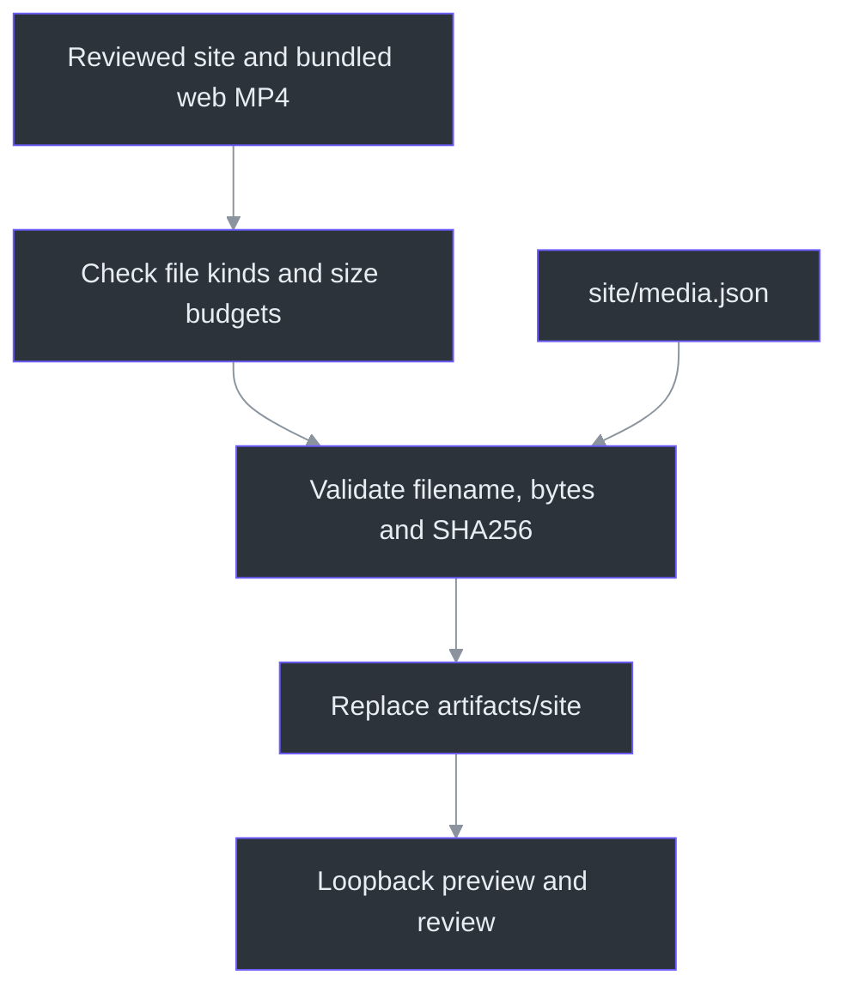
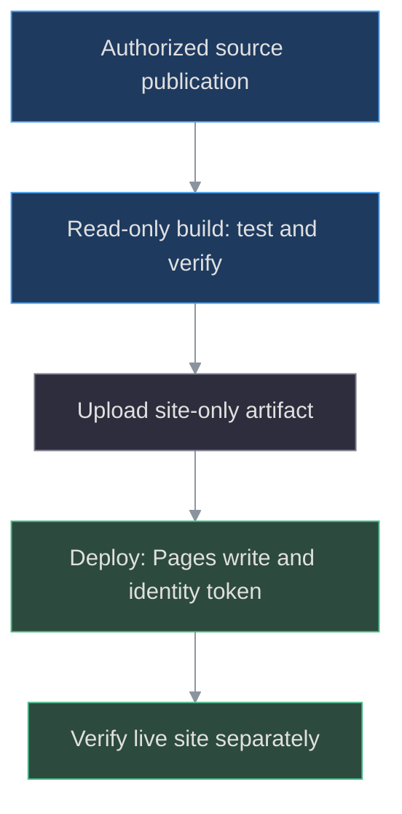

# Phantom Fudge Website and Tutorial Pipeline

The `site` directory is a standalone static landing page. It uses the canonical DeepSeaFoam
palette, original ghost artwork, motion controls, sample-data GIFs, and a full chaptered tutorial.
The native application and published installer are separate products; this website does not run
transcription, sign into a provider, collect notes or change Windows capture behavior.
The publication boundary is deliberately small: the assembler reads `site/media.json`, verifies
the web MP4 already bundled under `site/media`, and copies only `site`, not the repository.
Normal assembly needs no original production tutorial, release download, LFS or media secret.
(`tools/Site/build.mjs:28-52`; `tools/Site/test-site.mjs:103-135`)

**Published website media:** the bundled web video is86,168,722bytes with SHA256
`28cd9c871b96e6db6cc4f14d740942c388a6abd235d8ba4e4031cf50ec75fc71`.
It retains2297.767seconds,1920x1080,30fps and68,933frames. All eight GIF sets and the final
page/browser integration were reviewed locally; Pages is now live. See deployment evidence below. (`site/media.json:1-27`)

## Less visible text, not less visual design

The owner's clarification is **less visible text only**. Keep the DeepSeaFoam palette, original
ghosts, glow, mist, orbits and decorative motion. The short hero and eight one-line demo captions
replace repeated explanations; the transcript and **About this demo** use closed-by-default
disclosures. A compact privacy/capture-limit note stays visible below the tutorial rather than
being hidden with those details. Long feature/privacy sections are not duplicated on this page.
(`site/index.html:24-57,58-120,157-185`; `site/styles.css:1-6,55-65,131-145`)

The browser fixture counts the default rendered body's visible words and caps that state at350.
That is a regression guard for copy density, not a request to strip artwork, delete accessible
labels, truncate the complete transcript or claim human design approval.
(`tools/Site/review-browser.mjs:36-49,82-84`)

The previous served page measured616default-visible words; the reviewed website revision measured276, a
340-word reduction. The transcript and About text still exist behind their disclosures, and the
DeepSeaFoam ghosts, glow, mist, orbits and eight demonstrations remain visible.

## Watch and navigate

The video supports native controls plus Play/Pause, back/forward ten seconds, playback speed
and optional extra captions. Captions are also embedded in the MP4. Five chapters and six
transcript results appear per page, with explicit previous/next buttons instead of nested
scrolling. Open the collapsed transcript panel to search. Search is literal and case-insensitive;
selecting a result seeks without autoplay. Scope details also start collapsed.

The eight large GIF demonstrations use keyboard-accessible tabs rather than tiny previews.
**Pause motion** freezes ghosts and replaces animated GIFs with stills. Reduced-motion visitors
start with static artwork. No JavaScript means native video, static demo images and downloadable
chapter/caption files; enhanced search and chapter buttons require JavaScript.

| Demo ID | Tutorial chapter ID | Retained sample action |
| --- | --- | --- |
| `selection` | `questions` | Select useful lines, later Ask, then show the sample answer |
| `context` | `followups` | Enable the optional Previous answer snapshot |
| `cover` | `cover` | Cover, then later reveal the workspace |
| `inputs` | `audio` | Choose Mic, then later Both |
| `transcription` | `transcription` | Explicit Start, then later Stop |
| `answer-size` | `answers` | Adjust answer text from10 to17 |
| `keyboard` | `keyboard` | Enter Select with V, then later select with Space |
| `themes` | `workspace` | Harbor Daylight, Plain B/W, then DeepSeaFoam |

Each `assets/demo-<id>` has GIF, JPEG and MP4 derivatives at1000x720. The page uses the GIF/still
pair; its image link seeks the associated full-tutorial chapter without starting playback.
Retained spans run at1x; labelled jumps to later actions/results are not response-latency evidence.
The original selection/context/cover triplets remain protected, not silently re-encoded.
(`site/index.html:71-120`; `site/app.mjs:150-197`; `tools/Site/make-demo-media.py:26-159,430-477`)

These are scripted, sample-data demonstrations using actual WPF frames and synthetic narration.
Preview 2 includes Previous answer; frozen tutorial installer labels still show Preview 1. Native installation,
file-picker and provider steps in the tutorial are instructions, not recordings of those operations.

The live website points both download links to Preview3 and names its Agency update compatibility fix.
[Pages38161590671](https://github.com/Zanark/phantom-fudge/actions/runs/38161590671) succeeded on6732ba1; HTTP200 and both links/notices were checked.
This changes navigation only, not the frozen tutorial/captions/GIFs or playback behavior. The
[Preview3 receipt](release-0.2.0-preview.3.json) records this separately from the historical deployment below. (`site/index.html:44,156`)

The player behavior is implemented in [app.mjs](../site/app.mjs) and its
[pure timing/search helpers](../site/player-core.mjs). The existing browser fixture exercises
all chapter starts, search and caption controls; the Node tests check all 525 cue intervals.
Those checks do not establish live meeting, provider or capture compatibility.
The expanded fixtures require eight demo triplets and exercise their chapter jumps, Home/End and
arrow-key wrapping without autoplay. A failed video request must show a visible error while search
remains available. (`tools/Site/review-browser.mjs:51-148,178-193`; `tools/Site/test-site.mjs:22-50,85-116`)

The earlier website delivery passed14Node test cases and nine muted-browser review groups. A second build/test
from an isolated fresh public-only tree also passed without the private original tutorial. On October 11 at 06:20 IST the parent reported another `node --test tools\Site\test-site.mjs` pass (14/14), a 101,108,997-byte bundled website build and unchanged tutorial SHA256. These local checks are distinct from the later verified deployment below and native-package evidence in [workstream62](../TODO/62_PUBLIC_PREVIEW_RELEASE.todo).

## Assembly boundary

The bundled full video must be a reviewed input, not a generated side effect of the website build.
The source-tree walk rejects symlinks, non-file entries and any individual file at or above
100 MiB. Total source size must be below 1,000,000,000 bytes. The media filename must be a simple
MP4 basename; its declared size and streamed SHA256 must match the bundled payload.
All those checks precede deletion of the previous preview. Copying itself is not atomic and has
no rollback guarantee. (`tools/Site/build.mjs:8-44`)

These checks are not a general sanitizer for arbitrary files placed under `site`. Keep every
input public-safe and run the bounded text scan and asset-integration tests. The failure fixture
checks missing media, wrong bytes, same-size corruption, path traversal and the size boundary,
and confirms that rejected inputs leave the old output intact.
(`tools/Site/test-site.mjs:69-101,118-164`)



## Local preview

Node 22 or later is sufficient to assemble and serve the complete checked-out site. No package
installation, separate video argument or access to the original tutorial workspace is needed.

```powershell
node .\tools\Site\build.mjs
node .\tools\Site\serve.mjs 4173
```

Open `http://127.0.0.1:4173/phantom-fudge/`. The preview server binds only to loopback and supports
HTTP byte ranges for seeking. Assembly replaces only the generated `artifacts/site` directory.
The server accepts a single start-based range, including an open end, returns 416 for invalid ranges,
and handles HEAD without sending the body. It is a local review server, not the Pages deployment.
(`tools/Site/serve.mjs:10-45`)

The retained final review instance is `http://127.0.0.1:4187/phantom-fudge/`; it was not restarted
for documentation generation. Port4173 above remains the tool's default for a future independent run.

```powershell
# Keep test/browser scratch in the repository when required by local policy.
New-Item -ItemType Directory -Force .\.local\site-review-scratch | Out-Null
$env:TEMP = (Resolve-Path .\.local\site-review-scratch).Path
$env:TMP = $env:TEMP
node --test .\tools\Site\test-site.mjs
node .\tools\Site\review-browser.mjs http://127.0.0.1:4173/phantom-fudge/
```

The browser review uses the existing `tools/Docs` Puppeteer dependency and an isolated, muted Edge
profile. Set `EDGE_PATH` if needed. Review screenshots and receipts stay in ignored `.local/site-review`.
Both the browser profile and the assembly test fixture use Node's OS scratch-directory selection
and are removed in `finally`; the commands above redirect that selection for the current shell.
The browser fixture observes external
requests and fails if any occur; it is not a network-blocking browser sandbox.
(`tools/Site/review-browser.mjs:9-35,194-202`; `tools/Site/test-site.mjs:118-164`)

## GitHub Pages deployment

The repository's Pages source must be **GitHub Actions**. `.github/workflows/pages.yml` builds on
website-related pushes to `main` or manual dispatch. It tests and assembles the checked-out
website, including the bundled web video, then uploads only `artifacts/site`.
There is no dedicated tutorial-release prerequisite in the current workflow.
The original159,267,662-byte production MP4 remains separate from the Git-sized web derivative.
That preserved original, not the web copy, has SHA256 `388ee914e1ffdc0ac3911d2a2e8dc6c8f33d8aad047f1aeff02fbe41138e1fde`.
(`.github/workflows/pages.yml:3-37`; `tools/Site/build.mjs:28-52`; `tools/Site/prepare-web-video.py:21-28`)

Pinned Actions and job-scoped permissions separate artifact construction from Pages deployment.
No secrets, private source inventories, local paths, context stores or repository-wide archives
belong in the Pages artifact.
The [workflow source](../.github/workflows/pages.yml) gives the build job `contents: read` for
checkout and `pages: read` so `configure-pages` can read the Pages configuration. It runs Node 22
tests and the hash-verifying assembler. Only the dependent
deploy job receives `pages: write` and `id-token: write`, using the `github-pages` environment.
`cancel-in-progress: false` keeps a newer run from cancelling the current deployment.
(`.github/workflows/pages.yml:12-50`; `tools/Site/build.mjs:28-52`)

**Earlier deployment: Preview2 links.** [Pages run38101185167](https://github.com/Zanark/phantom-fudge/actions/runs/38101185167)
completed successfully on `2ad0fa03a8c699619bda24c33ef6aa0250d6ef38`; [the public URL](https://zanark.github.io/phantom-fudge/) returned HTTP200.
Exactly two Preview 2 release links and the context/tutorial-label notices were verified. (docs/release-0.2.0-preview.2.json:52-59)
Earlier successful run38092635522 on `77fca8a7cd1dd61dd5b1a09e72a898a73395cac1` remains historical. Failed38088016577 on `490e786` (three/eight demos and obsolete release metadata) is superseded.
The earlier read-only/deferred decision remains historical in [workstream61](../TODO/61_PUBLIC_PHANTOM_WEBSITE.todo); no media was regenerated for this release.
The separately published native prerelease and five matched downloads are recorded in the [public receipt](release-0.2.0-preview.2.json), not inferred from website HTTP200.



## Updating the tutorial

`node .\tools\Site\import-tutorial.mjs <completed-tutorial-directory>` imports allowlisted public
chapter/caption data from the tutorial identified by `site/media.json`. It does not import private
delivery inventories. The generated module projects chapter IDs/titles/times and cue times/text;
the five named chapter/caption files are copied intact and must themselves be public-safe.
The source manifest must match `media.original.sha256`, while chapter duration must agree with the
web video within 50 ms. Import compares metadata, not the MP4 payload.
The top-level `file`, `sha256`, `bytes`, duration and format fields identify the bundled web copy;
the nested `original` record identifies its preserved production source. They are not interchangeable:
the assembler hashes the top-level web payload, and the importer checks the nested original identity.
Changing the video requires a new reviewed asset identity;
do not silently overwrite a published video with different bytes.
(`site/media.json:1-27`; `tools/Site/build.mjs:31-39`; `tools/Site/import-tutorial.mjs:10-33`)

Full-video preparation is a separate local operation. `prepare-web-video.py` recompresses the
full uncropped video with H.264 and copies the original AAC stream; it supplies no cut, scale or
retiming filter. Its validator compares duration, frame count, dimensions, frame rate, start and
chapters, verifies AAC payload/timestamp and decoded-PCM hashes, checks faststart, and decodes all 68,933 video
frames plus audio. The hard limit is below 100 MiB; the 90 MiB target is recorded separately.
Lossy video recompression still requires inspection of decoded output, not just matching metadata.
(`tools/Site/prepare-web-video.py:44-56,89-139,172-218`)

The audio gate permits only the original final AAC duration of 832 samples or its normalization
to 800 samples. Nonfinal durations, payloads, PTS/DTS, decoded PCM and decoded frame timing must
match, as must audio-track/container duration. That possible 32-sample metadata adjustment is not
a claim of lost audio or a listening test. (`tools/Site/prepare-web-video.py:173-208`)

```powershell
# Reproduce the selected final CRF after inspecting representative samples.
python .\tools\Site\prepare-web-video.py --samples --crf 30
python .\tools\Site\prepare-web-video.py --encode --validate --crf 30
```

These commands require the original completed tutorial and the existing Python media dependencies.
They never overwrite that original. Validation writes local provenance and review frames with
visual review explicitly pending; it does not itself update `site/media.json` or import captions.
For this frozen revision, separate inspection covered17contact-sheet times and six native1080p
frames after the complete decode. The measured web/original identities were then registered in
public metadata and the import, assembly and browser gates passed. Pass the actual encoding CRF
when validating separately: the receipt records that argument, not a detected encoder setting.
(`tools/Site/prepare-web-video.py:198-248`; `tools/Site/import-tutorial.mjs:13-33`)

The public `assets/media-manifest.json` records source/media identity and demo limitations.
`assets/asset-provenance.json` records the GIF excerpts and artwork sources.
Theme credit lives in `site/THEME-NOTICE.txt`; no sibling showcase artwork or fonts are copied.

## Source-atlas coverage

Website source is not excluded just because it lives at the repository root. The atlas requires
reviewed, contiguous explanations for `site/index.html`, `styles.css`, `app.mjs`, `player-core.mjs`,
`media.json` and `404.html`, as well as every in-scope Site tool and the Pages workflow.
Future authored code/configuration under `site/assets` also remains in scope.
(`tools/Docs/source-atlas.mjs:11-17,36-46`; `tools/Docs/test-docs.mjs:96-110,139-150`)

| Deliberately generated input under `site/assets` | Producer and purpose |
| --- | --- |
| `tutorial-data.mjs` | Importer projection consumed by the browser player |
| `captions.srt`, `captions.vtt`, `chapters.txt`, `chapters.json`, `transcript.json` | Five intact public downloads copied by the importer |
| `media-manifest.json` | Importer-emitted web/original identity and sample-data limitations |
| `asset-provenance.json` | Artwork/demo provenance assembled from measured assets and supplied review records |

These eight named files remain hash-indexed as generated inputs, not passed off as authored
source explanations. There is no blanket generated exemption for the assets directory.
Binary media is outside line-by-line source annotation; its declared identities and the tools
that produce/validate it are covered. Classification and matching hashes do not prove pixel quality,
public safety or semantic accuracy. (`tools/Docs/source-atlas.mjs:36-78,125-163`;
`tools/Site/import-tutorial.mjs:21-32`; `tools/Site/make-demo-media.py:303-429`)

## Artwork, excerpts and source references

The website build consumes the delivered art and demo files; it does not run their generators.
Regeneration is a separate reviewed operation with the already-installed dependencies below.
The demo generator protects the original selection/context/cover files against the existing
provenance hashes. It skips complete triplets by default; replacement requires explicit new
`--demo` names plus `--replace`. New visual-review notes must name the exact GIF/JPEG/MP4 hashes
through `--review-record`. An optional `--web-record` attaches web-video provenance only when the
video hash and the separate visual-review record identify the same output bytes.
Neither a flag nor a hash comparison performs visual review.
(`tools/Site/make-demo-media.py:364-374,412-477`)

| Source and entry point | Responsibility and limit |
| --- | --- |
| `make-artwork.mjs` top-level renderer | Original SVG compositions and JPEG exports using existing Docs Puppeteer and installed Edge; `--browser` or `SITE_BROWSER` selects another installed executable. Page requests other than data URLs are blocked. (`tools/Site/make-artwork.mjs:11-37,151-185`) |
| `make-demo-media.py` / `source_frames`, `encode` | Hash-checked tutorial frame ranges, aspect-contained crops, silent 30fps MP4 and 10fps GIF derivatives, without accelerating retained spans. Labelled later excerpts omit gaps; they do not measure response latency. (`tools/Site/make-demo-media.py:26-157,204-269`) |
| `make-demo-media.py` / `review_outputs`, `provenance` | Decoded samples, exact edit maps and hash-bound review notes. Existing Pillow, PyAV and imageio-ffmpeg are required. Reused original-demo evidence is distinct from a new inspection. (`tools/Site/make-demo-media.py:284-374,395-427`) |
| `prepare-web-video.py` / `main`, `validate` | Separate full-video compression, packet/decoded-audio verification, complete decode and local review frames; no implicit publication or visual approval. (`tools/Site/prepare-web-video.py:172-248`) |
| `test-site.mjs` / nine top-level Node tests and five failure subtests | Controls, both release links matched to `release.json`, Preview 2 context and frozen Preview 1 tutorial notices, timing/cues, eight demo triplets and self-contained assembly. No native app/provider launch or proof of asset availability. (`tools/Site/test-site.mjs:1-164`) |
| `review-browser.mjs` / isolated browser | Muted playback, all chapter seeks, paginated search, eight demo tabs, collapsed details, a default visible-copy budget, responsive/reduced-motion/no-JavaScript checks and missing-video feedback. Automation is not human UX approval. (`tools/Site/review-browser.mjs:22-202`) |

For the per-line authored website, tooling and workflow explanations, use the
[source atlas](source-atlas/index.html). The website guide is also registered in the
[engineering handbook](handbook/README.md). Maintained editions do not replace PDFs attached to
the published installer release.
