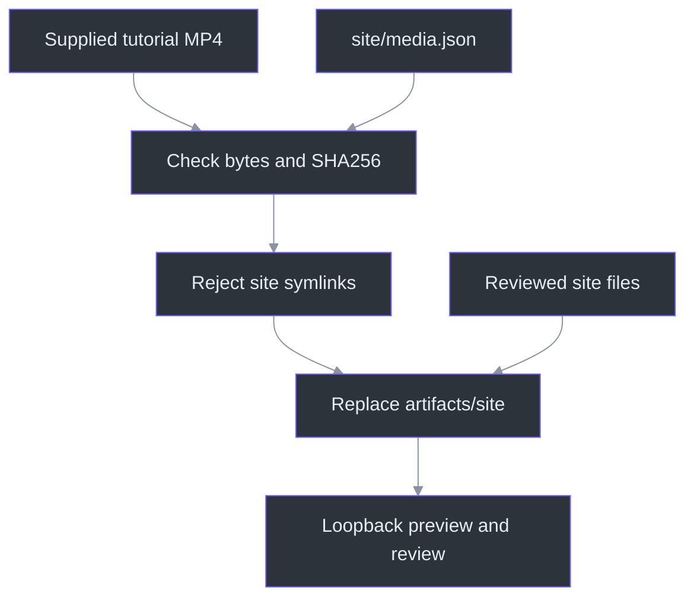
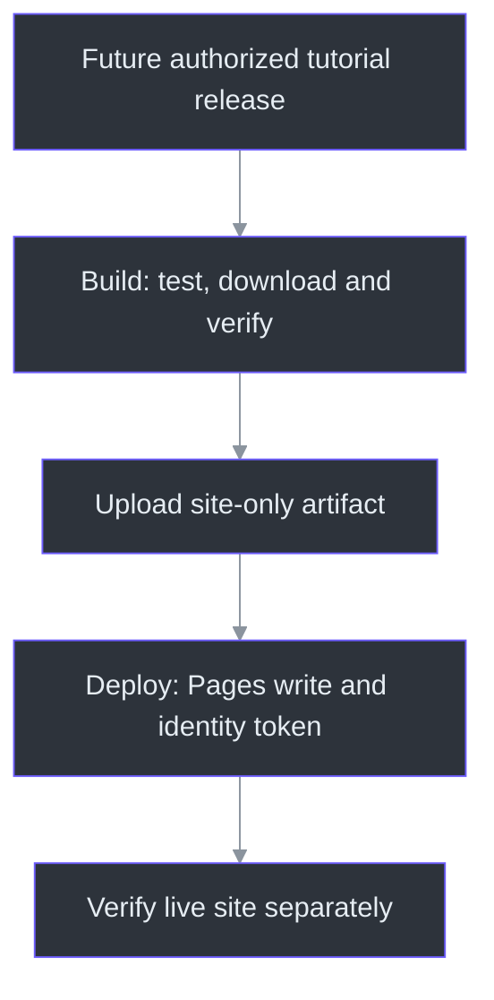

# Phantom Fudge Website and Tutorial Pipeline

The `site` directory is a standalone static landing page. It uses the canonical DeepSeaFoam
palette, original ghost artwork, motion controls, sample-data GIFs, and a full chaptered tutorial.
The native application and published installer are separate products; this website does not run
transcription, sign into a provider, collect notes or change Windows capture behavior.
The publication boundary is deliberately small: the assembler reads `site/media.json`, verifies
the supplied MP4, and copies `site` plus that file rather than the repository.
(`tools/Site/build.mjs:7-30`)

## Watch and navigate

The video supports native controls plus Play/Pause, back/forward ten seconds, playback speed
and optional extra captions. Captions are also embedded in the MP4. Five chapters and six
transcript results appear per page, with explicit previous/next buttons instead of nested
scrolling. Search is literal and case-insensitive; selecting a result seeks without autoplay.

The three large GIF demonstrations use keyboard-accessible tabs rather than tiny previews.
**Pause motion** freezes ghosts and replaces animated GIFs with stills. Reduced-motion visitors
start with static artwork. No JavaScript means native video, static demo images and downloadable
chapter/caption files; enhanced search and chapter buttons require JavaScript.

These are scripted, sample-data demonstrations using actual WPF frames and synthetic narration.
The current-source Previous answer feature is not in `v0.2.0-preview.1`. Native installation,
file-picker and provider steps in the tutorial are instructions, not recordings of those operations.

The player behavior is implemented in [app.mjs](../site/app.mjs) and its
[pure timing/search helpers](../site/player-core.mjs). The existing browser fixture exercises
all chapter starts, search and caption controls; the Node tests check all 525 cue intervals.
Those checks do not establish live meeting, provider or capture compatibility.
(`tools/Site/review-browser.mjs:48-96`; `tools/Site/test-site.mjs:19-47`)

## Assembly boundary

The full video is an immutable input, not a generated side effect of the website build. A wrong
length or SHA256 fails before the previous local preview is removed. The source-tree walk rejects
symlinks before copying; this is not a general sanitizer for arbitrary files placed under `site`.
Keep that directory public-safe and run its focused content checks.
(`tools/Site/build.mjs:10-29`; `tools/Site/test-site.mjs:58-72`)



## Local preview

Node 22 or later is sufficient to assemble and serve the site. No package installation is needed.
Obtain the exact MP4 identified in `site/media.json`, or use the completed local tutorial.

```powershell
node .\tools\Site\build.mjs --video .\artifacts\tutorial\20261010-221225\Phantom-Fudge-Full-Tutorial.mp4
node .\tools\Site\serve.mjs 4173
```

Open `http://127.0.0.1:4173/phantom-fudge/`. The preview server binds only to loopback and supports
HTTP byte ranges for seeking. Assembly replaces only the generated `artifacts/site` directory.
The server accepts a single start-based range, including an open end, returns 416 for invalid ranges,
and handles HEAD without sending the body. It is a local review server, not the Pages deployment.
(`tools/Site/serve.mjs:10-45`)

```powershell
node --test .\tools\Site\test-site.mjs
node .\tools\Site\review-browser.mjs http://127.0.0.1:4173/phantom-fudge/
```

The browser review uses the existing `tools/Docs` Puppeteer dependency and an isolated, muted Edge
profile. Set `EDGE_PATH` if needed. Review screenshots and receipts stay in ignored `.local/site-review`.
The profile uses Node's OS scratch-directory selection and is removed in `finally`; when local
policy requires repository-contained scratch space, set `TEMP` and `TMP` to an existing ignored
project directory in that shell before launching the review. The fixture observes external
requests and fails if any occur; it is not a network-blocking browser sandbox.
(`tools/Site/review-browser.mjs:9-34,142-150`)

## GitHub Pages deployment

The repository's Pages source must be **GitHub Actions**. `.github/workflows/pages.yml` builds on
website-related pushes to `main` or manual dispatch. It downloads the dedicated
`tutorial-2026-10-10` release asset, verifies its exact byte count and SHA256, then copies only
`site` plus that MP4 into a Pages artifact. The 159 MB MP4 is never checked into git.

The tutorial asset release is not an app update and must not replace or become the latest installer
release. Publish it only with repository-write approval and retain immutable media bytes.
Pinned Actions and job-scoped permissions separate artifact construction from Pages deployment.
No secrets, private source inventories, local paths, context stores or repository-wide archives
belong in the Pages artifact.
The [workflow source](../.github/workflows/pages.yml) runs Node 22 tests, downloads with a read-only
repository token with `contents: read` and `pages: read`, calls the hash-verifying assembler and
uploads `artifacts/site`. Only the dependent
deploy job receives `pages: write` and `id-token: write`, using the `github-pages` environment.
`cancel-in-progress: false` keeps a newer run from cancelling the current deployment.
(`.github/workflows/pages.yml:12-58`; `tools/Site/build.mjs:10-30`)

**Publication status:** pending. The active GitHub CLI account has read-only access; the owner
chose to finish locally rather than change authentication. No tutorial release or website push
was performed. An authorized maintainer must publish the media asset before the first workflow run.
This owner-deferred state is recorded in [workstream61](../TODO/61_PUBLIC_PHANTOM_WEBSITE.todo).
Neither a prepared workflow nor a local browser pass means the website URL is live.



## Updating the tutorial

`node .\tools\Site\import-tutorial.mjs <completed-tutorial-directory>` imports allowlisted public
chapter/caption data from the tutorial identified by `site/media.json`. It does not import private
delivery inventories. The generated module projects chapter IDs/titles/times and cue times/text;
the five named chapter/caption files are copied intact and must themselves be public-safe.
Changing the video requires a newly versioned asset identity and review;
do not silently overwrite a published video with different bytes.
(`tools/Site/import-tutorial.mjs:10-31`)

The public `assets/media-manifest.json` records source/media identity and demo limitations.
`assets/asset-provenance.json` records the GIF excerpts and artwork sources.
Theme credit lives in `site/THEME-NOTICE.txt`; no sibling showcase artwork or fonts are copied.

## Artwork, excerpts and source references

The website build consumes the delivered art and demo files; it does not run their generators.
Regeneration is a separate reviewed operation with the already-installed dependencies below.

| Source and entry point | Responsibility and limit |
| --- | --- |
| `make-artwork.mjs` top-level renderer | Original SVG compositions and JPEG exports using existing Docs Puppeteer and installed Edge; `--browser` or `SITE_BROWSER` selects another installed executable. Page requests other than data URLs are blocked. (`tools/Site/make-artwork.mjs:11-37,151-185`) |
| `make-demo-media.py` / `source_frames`, `encode` | Hash-checked tutorial frame ranges, aspect-contained crops, silent 30fps MP4 and 10fps GIF derivatives, without accelerating retained spans. Selection and cover concatenate explicitly labelled later excerpts, not continuous response latency. (`tools/Site/make-demo-media.py:19-66,113-178`) |
| `make-demo-media.py` / `review_outputs`, `provenance` | Decoded sample/contact sheets and exact asset/edit maps. `--record-reviewed` asserts a separate visual inspection; it performs no review. Existing Pillow, PyAV and imageio-ffmpeg are required. (`tools/Site/make-demo-media.py:193-208,246-336`) |
| `test-site.mjs` / six Node tests | Timing, chapter boundaries, all cues, literal search, controls and a bounded public-input scan. No native application or provider is launched. (`tools/Site/test-site.mjs:1-72`) |
| `review-browser.mjs` / isolated browser | Muted playback, all chapter seeks, paginated search, demo tabs, responsive/reduced-motion/no-JavaScript checks and local screenshots. Automation is not human UX approval. (`tools/Site/review-browser.mjs:21-150`) |

For the complete per-line tooling and workflow explanations, use the
[source atlas](source-atlas/index.html). The website guide is also registered in the
[engineering handbook](handbook/README.md). Maintained editions do not replace PDFs attached to
the published installer release.
