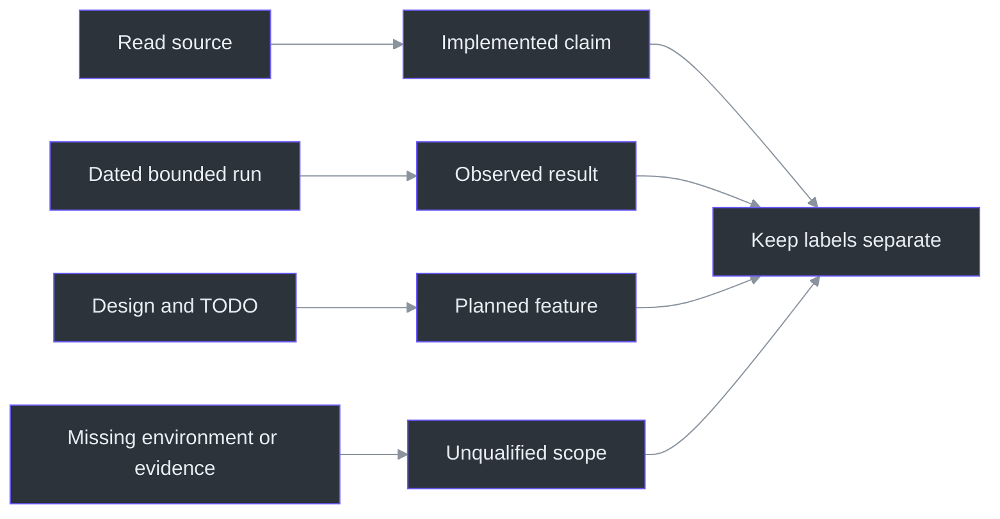
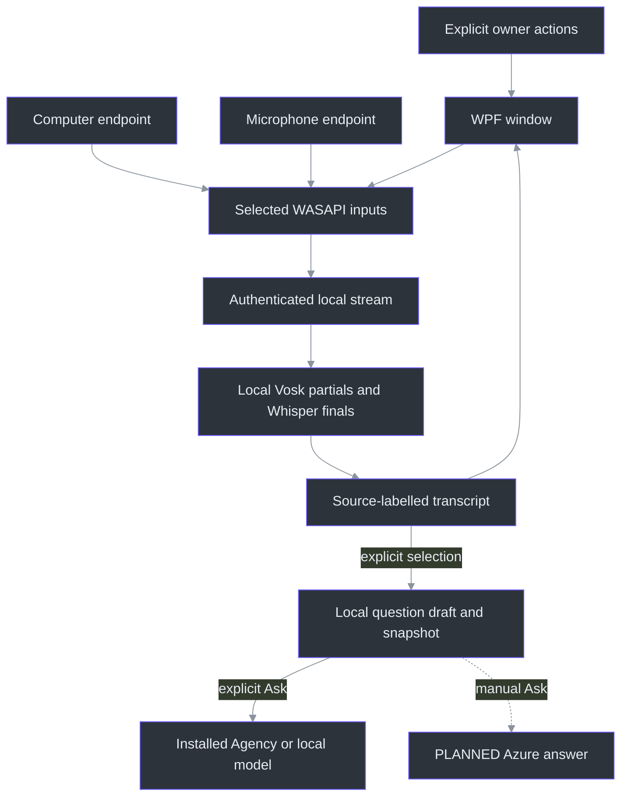

# Reading map and current reality

> **TL;DR:** Phantom Fudge is a Windows conversation companion with local speech recognition,
> not an invisible process and not yet an Azure question-answering product. Read this book as
> an explanation of boundaries: between presentation and capture, samples and text, a request
> and its completion, and a researched proposal and working software.

## Overview: what this book is for

**Use the current interface first:** the [illustrated workflow](../CURRENT-WORKFLOW.md) brings together
device cards, recording status, multi-line questions, optional clarification, current action/font
choices and the continuing-work cover. Older dated evidence elsewhere in the book remains historical;
it does not redefine the controls in the current source.

The original problem sounded like a small notepad: show private speaker notes while presenting.
That problem expanded into a local transcription-first interface, selectable Computer/Mic/Both
inputs, and a researched proposal for explicitly sending a question to an Azure model. The
important engineering work is not drawing a rectangle. It is keeping each promise narrow enough
to implement and each state transition strong enough to preserve data. The current product
contract records those distinct requirements rather than collapsing them into a claim of
universal invisibility (`docs\PRODUCT.md:6-37`).

This handbook is intended to support three activities. A new contributor should be able to
run and navigate the application without guessing. A senior engineer should be able to review
its invariants and tradeoffs. A future book editor should be able to assemble the chapters,
figures, screenshots, glossary and development journal into a coherent narrative. The source
chapters are Markdown; the generated HTML/PDF is an edition of those sources, not a separate
authoritative implementation.

## The four labels used throughout

| Label | What it means | What it does not mean |
| --- | --- | --- |
| Implemented | The cited source contains the behavior | The behavior works on every device/backend |
| Observed | A dated local run or owner report supports a bounded result | A universal guarantee or independent reproduction of an owner report |
| Planned | A design/TODO describes future behavior | The feature exists in the executable |
| Unqualified | Required evidence is missing or incomplete | The implementation is necessarily broken |

These distinctions are repository requirements, not editorial niceties. `AGENTS.md` explicitly
separates API configuration from captured pixels, technical passes from human acceptance, and
research from a qualified release (`AGENTS.md:14-21`). In particular, a successful
`SetWindowDisplayAffinity` call is not a recorder certification.

## The implemented system in one page

The WPF application owns its native window and starts without an ordinary taskbar/Alt-Tab
entry. Its startup path distinguishes synthetic diagnostics from normal single-instance
operation, creates `MainWindow`, installs recovery callbacks, and calls `ShowProtected`
(`src\PhantomFudge.App\App.xaml.cs:13-97`). The UI is not a browser or a remote webpage.

The speech path remains local. The native adapter selects explicit audio endpoints, while
the Python server accepts one authenticated session and uses separate decoder state for
declared sources. `AudioSource` names Computer and Microphone; those are input identities,
not detected people (`src\PhantomFudge.Core\AudioSource.cs:3-30`). `TranscriptBuffer` preserves
source-specific partials and labelled final lines (`src\PhantomFudge.Core\TranscriptBuffer.cs:6-97`).

The launch script can start/reuse the local Python service, but that is not permission to
start audio capture. `-NotesOnly` avoids service startup, and an existing app is revealed
without rebuilding it (`scripts\Run-PhantomFudge.ps1:17-41`). Docker recipes are a possible later
deployment of the headless service, not the normal runtime dependency.

The October 9 correction separates provisional speed from final quality: local Vosk partials
feed bounded disjoint-span Whisper small.en finals. The expanded UI uses responsive reading
columns and opaque white/black text. Configured Agency prepares one empty session without
prompting a model; each explicit Ask gets fresh question context. These are implemented changes,
not universal recognition/latency guarantees. See [measured corrections](../QUALITY-UPDATE.md)
and [local logging boundaries](../DIAGNOSTICS.md)
(`src/PhantomFudge.Core/WorkspaceLayout.cs:8-42`;
`src/PhantomFudge.App/MainWindow.AnswerLifetime.cs:23-78`;
`services/transcription/accurate.py:33-129`).

## Visual baseline

*Actual WPF visual-tree render with synthetic notes, transcript and device labels. It is not
a recording of a user's desktop or evidence that a meeting recorder excludes the window.*

The screenshot fixture is a separate application entry path. It invokes the same window and
its rendering diagnostics, but supplies documentation-safe examples; it does not start the
speech service or open a capture endpoint (`src\PhantomFudge.App\App.xaml.cs:47-59`).
The accompanying screenshot manifest identifies source and image hashes.

## Choose a reading path

| Reader | Suggested path | Outcome |
| --- | --- | --- |
| New to the stack | [Zero to Hero](02-zero-to-hero.md), then [Setup and Testing](15-development-and-testing.md) | Understand enough C#/Python/audio terminology to run and trace a path |
| Principal reviewer | [Principal Guide](01-principal-engineer-guide.md), [Failure States](11-state-machines-and-failure-containment.md), [Assurance](17-privacy-and-assurance.md) | Identify the invariants and unresolved acceptance gates |
| Desktop contributor | [Windows](04-windows-capture-and-cursors.md), [UI](05-desktop-ui-and-themes.md), [Storage](06-notes-transcripts-and-storage.md) | Change a window without losing data or weakening the stated policy |
| Audio contributor | [Capture](07-dual-input-capture.md), [Protocol](08-streaming-protocol.md), [Recognition](09-python-recognition.md) | Follow bytes from the selected device to labelled text |
| Operator | [Native Lifecycle](10-native-service-lifecycle.md), [Distribution](16-distribution-and-troubleshooting.md), [Reference](19-api-configuration-reference.md) | Start, recover, stop and diagnose the local system |
| AI-feature implementer | [Benchmark](12-performance-and-benchmarks.md), [Proposed Answer Flow](13-proposed-azure-answer-flow.md), [Latency and Identity](14-answer-latency-identity-and-privacy.md) | Preserve the boundary between current local ASR and future explicit Azure requests |

## What to keep beside the book

The [TODO index](../../TODO/00_INDEX.todo) is the living acceptance map. The [public journal](../../JOURNAL.md)
explains why direction changed. The [implementation status](../IMPLEMENTATION-STATUS.md) records
bounded receipts. The book explains mechanisms and reasoning; it should not become a second,
inconsistent task database.

The local draft and immutable snapshot now exist. Explicit selected segments or typed text feed
`QuestionDraft`; `Freeze` captures exact text and copied provenance without invoking any provider
(`src\PhantomFudge.Core\QuestionDraft.cs:18-95`, `src\PhantomFudge.Core\QuestionSnapshot.cs:5-23`).
Source commit and direct Azure identity remain future work. Installed-provider streaming and setup
are explained in the new [Agency/local-model chapter](../ANSWER-PROVIDERS.md), separately from Azure
(`docs\AI-ANSWER-ARCHITECTURE.md:82-188`). A local-only snapshot is not a model request; configured provider Ask crosses its labelled inference boundary.

## Reading source citations

A citation such as `src\PhantomFudge.Core\AudioSource.cs:3-14` names a repository file and the
line interval inspected for this edition. Prefer the named class/function when navigating a
later revision: line numbers move. The build checks path/range validity and source freshness;
it cannot prove that prose is semantically correct. Human source review remains necessary.

## Checkpoint

Before moving on, explain these differences in your own words:

1. A local ASR service being ready versus a microphone recording.
2. An excluded window versus an undiscoverable process.
3. A labelled Mic track versus speaker identification.
4. A rendered documentation screenshot versus a recipient-side capture test.
5. A researched Azure architecture versus an implemented Ask feature.

If any pair sounds equivalent, revisit the relevant boundary before changing the code.

## References

- `docs\OVERVIEW.md:8-70` — current product and qualification summary, moved from the visual front page.
- `docs\PRODUCT.md:6-37` — requirement and impossibility boundary.
- `AGENTS.md:14-43` — engineering distinctions and privacy rules.
- `src\PhantomFudge.App\App.xaml.cs:13-97` — real startup paths.
- `src\PhantomFudge.Core\AudioSource.cs:3-30` — source identity.
- `src\PhantomFudge.Core\TranscriptBuffer.cs:6-97` — partial/final text representation.
- `scripts\Run-PhantomFudge.ps1:17-41` — launch versus audio/service behavior.
- `docs\AI-ANSWER-ARCHITECTURE.md:82-188` — installed-provider architecture and separately planned Azure extension.
