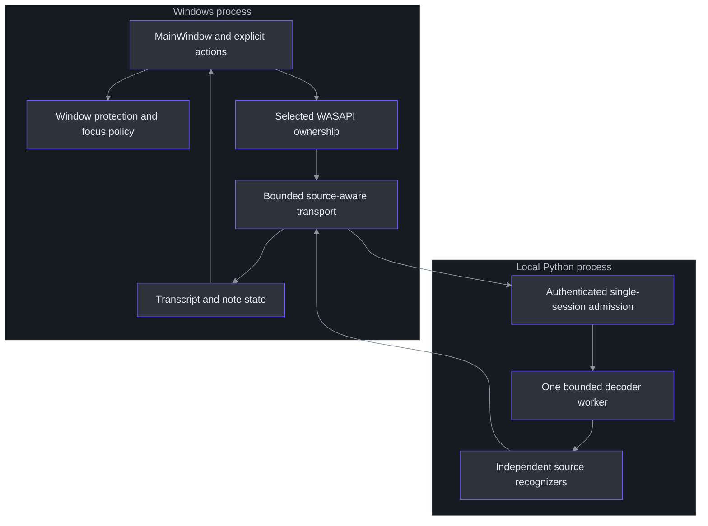
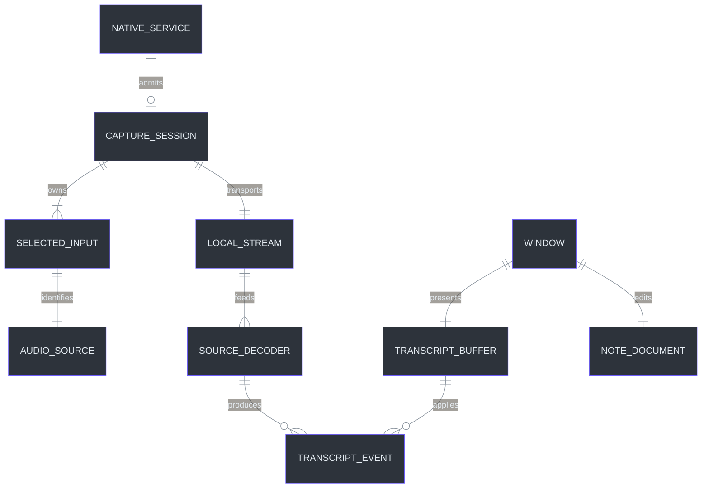

# Principal engineer guide

> **TL;DR:** The central insight is **identity and completion must survive every asynchronous
> boundary**. Source identity survives audio transport, request identity will survive future
> model streams, and completion means drained ownership rather than a convenient boolean.
> Presentation privacy is a separate, bounded contract; it cannot repair lifecycle mistakes.

## Overview: the one idea

It is tempting to describe the application as "audio in, text out, hidden window." That
description omits the information required to make it dependable. Computer and Mic can produce
interleaved packets; recognizers revise hypotheses; Stop clears visible running state before
all final text has drained; a hidden window still owns data; and an excluded HWND remains an
ordinary operating-system object. Each boundary needs explicit identity and completion semantics.

The source enum assigns different wire identities to Computer and Microphone
(`src\PhantomFudge.Core\AudioSource.cs:3-22`). The transcript store holds separate partials,
but final IDs are session-global (`src\PhantomFudge.Core\TranscriptBuffer.cs:9-18`,
`src\PhantomFudge.Core\TranscriptBuffer.cs:48-72`). The native adapter separately protects its lifecycle and invalidates queued starts
when Stop is requested (`src\PhantomFudge.App\Audio\LoopbackTranscriber.cs:71-152,182-189`).
These are concrete mechanisms, not an assumed generic event-driven architecture.

### The insight in a different language

This Python-like pseudocode explains the C# contract; it is not a production implementation:

```python
def on_packet(source, pcm):
    require(source in selected_sources)
    require(pcm_is_valid(pcm))
    if not queue.try_append(source, pcm):
        fault_entire_session("backpressure")  # do not silently lose a question

async def stop():
    state = STOPPING
    cancel_pending_start()
    await release_selected_inputs()
    await drain_accepted_audio_and_receive_source_finals()
    state = STOPPED

def begin_next_session():
    require(state == STOPPED)                 # not merely is_running == False
    preserve_unfinished_text()
    reset_session_global_final_id()
```

The application implements bounded queues and source-aware frames in `TranscriptionSocket`;
the server validates each track and finalizes each declared decoder before its stopped event
(`src\PhantomFudge.App\Audio\TranscriptionSocket.cs:11-71`,
`services\transcription\server.py:235-338`). The pseudocode's "drain" is therefore a chain
of ownership transitions, not a delay inserted to make a race less likely.

## Architecture at review depth



The separation is intentionally modest. C# is chosen for the native desktop and input
integration; Python hosts the recognizer and its protocol. The model does not become more
accurate because Python calls it, nor does C# imply Windows' built-in speech engine. The measured
engine comparison is explicit about that distinction (`docs\SPEECH-BENCHMARK.md:10-35`).

The local process boundary is useful for dependency isolation and future packaging, but it adds
protocol, authentication, backpressure and service-lifecycle work. The manager does not identify
ownership by a PID alone: it authenticates runtime metadata and checks the saved instance ID
before reuse or shutdown (`services\transcription\manage.py:112-144`).

## Domain model: implemented concepts, not a database



This ER diagram is a conceptual ownership map, not a claim that SQL tables exist. `Input`,
`Session`, `TranscriptEvent`, `SourceState` and `TranscriptBuffer` are the source concepts;
the note document's identity is currently maintained by `MainWindow` plus `NoteFileStore`
rather than a separate persistent entity class. No invented repository abstraction is needed
to discuss the boundary (`src\PhantomFudge.App\Audio\TranscriptEvent.cs:1-15`,
`src\PhantomFudge.Core\NoteFileStore.cs:6-15`).

## The strategic tradeoff table

| Decision | Benefit | Cost or boundary |
| --- | --- | --- |
| One layered WPF HWND | One main capture-policy surface and native controls | Auxiliary OS/auth/file surfaces still need separate reasoning |
| Non-activating Present default | Reduces unnecessary foreground changes | Editing deliberately requires a different interaction mode |
| Arrow cursor policy | Removes the app's I-beam shape cue | Cannot dictate another recorder's cursor stream |
| Separate Computer/Mic tracks | Source labels and independent recognizer state | More lifecycle/queue accounting; no automatic echo cancellation |
| Fail on sustained backlog | Avoids silently dropping words while claiming completeness | Session stops instead of degrading invisibly |
| One local decoder worker | Simple serialized mutable-engine access | Competing sources share CPU; it is not sample-synchronous inference |
| Explicit local saves | Owner controls persistence | Unsaved content can be lost on a crash; no vault or recovery guarantee |
| Native Python default | No container prerequisite for a desktop utility | Interpreter/venv/model setup remains an operational responsibility |
| Proposed direct Azure text call | Smallest initial cloud path for manual Q&A | Identity, data policy, latency and deployment remain unimplemented |

These decisions come from the implementation and current requirements, not a universal design
pattern checklist. `WindowProtection.Configure` requests affinity on an owned HWND and validates
readback when available (`src\PhantomFudge.App\Native\WindowProtection.cs:18-45`).
`NoteFileStore` bounds UTF-8 data and checks prior fingerprints around replacement; it is not a
filesystem transaction manager or protection against every race
(`src\PhantomFudge.Core\NoteFileStore.cs:16-91`).

## Review the dangerous boundaries first

### Running is not completion

The native adapter can cease reporting Running while cleanup/final delivery continues. The UI
must therefore block Start and destructive transcript actions during Stopping, not reset the
final-ID counter as soon as a boolean flips. Otherwise an old final can arrive with a large ID
after a new session starts, and a valid new final ID1 is rejected as a duplicate. The buffer's
global-ID rule is correct only when its session boundary is correct
(`src\PhantomFudge.Core\TranscriptBuffer.cs:23-38,48-57`).

### Input identity is not speaker identity

Mic may capture the owner's voice, room sound, or speaker echo. Computer may include all output
on a selected endpoint, not only the meeting. The correct labels are source names. Turning those
labels into verified people would be a new, unsupported claim. The public contract states this
boundary explicitly (`docs\DUAL-SOURCE-AUDIO.md:8-26`).

### Privacy is not one boolean

Window exclusion, source authorization, local token checks, no automatic cloud upload, and
unsaved-data behavior answer different questions. A protected window can still coexist with an
OS microphone indicator. A successful local GDI fixture does not establish every Teams/Zoom/Meet/
OBS path. The qualification matrix keeps these observations separate
(`docs\QUALIFICATION.md:1-26`).

### A plan is not a runtime component

Azure Ask currently exists in design documents and TODOs. A principal-level diagram should not
quietly insert an operational cloud box into the implemented path. The planned architecture
requires immutable question snapshots, source-scoped commit and request-bound streaming; none
is implied by the current text buffer (`docs\AI-ANSWER-ARCHITECTURE.md:1-37`).

## Where to go deep

Start with the native lifecycle and transport when reviewing concurrency. Read the server's
source state and worker loop when reviewing completeness. Read UI stop coordination and buffer
mutation together when reviewing user data preservation. Read the capture policy beside its
qualifications—not alone—when reviewing privacy language.

For a product decision, ask whether it changes data origin, lifetime, visibility, authority or
completion. A new color mostly changes presentation. A new input changes all five. An Azure
answer provider additionally crosses an egress and identity boundary.

## Review exercise

Consider a user who selects Both, starts capture, hides the window during a slow final decode,
then immediately asks to start again. Draw the ownership/state sequence. Identify where the
native capture, socket, decoder, UI and buffer can legitimately disagree about "running."
The correct design does not require those components to share one boolean; it requires that
the coordinator not start a new logical session until the old completion boundary is satisfied.

## References

- `src\PhantomFudge.Core\AudioSource.cs:3-30` — source identity.
- `src\PhantomFudge.Core\TranscriptBuffer.cs:6-97` — source partials and session-global IDs.
- `src\PhantomFudge.Core\NoteFileStore.cs:6-91` — bounded local file behavior.
- `src\PhantomFudge.App\Audio\LoopbackTranscriber.cs:71-189` — native lifecycle ownership.
- `src\PhantomFudge.App\Audio\TranscriptionSocket.cs:11-71` — transport state/bounds.
- `services\transcription\server.py:235-338` — source queue and completion.
- `services\transcription\manage.py:112-144` — authenticated process ownership.
- `docs\SPEECH-BENCHMARK.md:10-35` — engines versus host languages.
