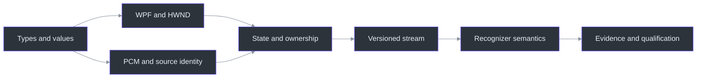
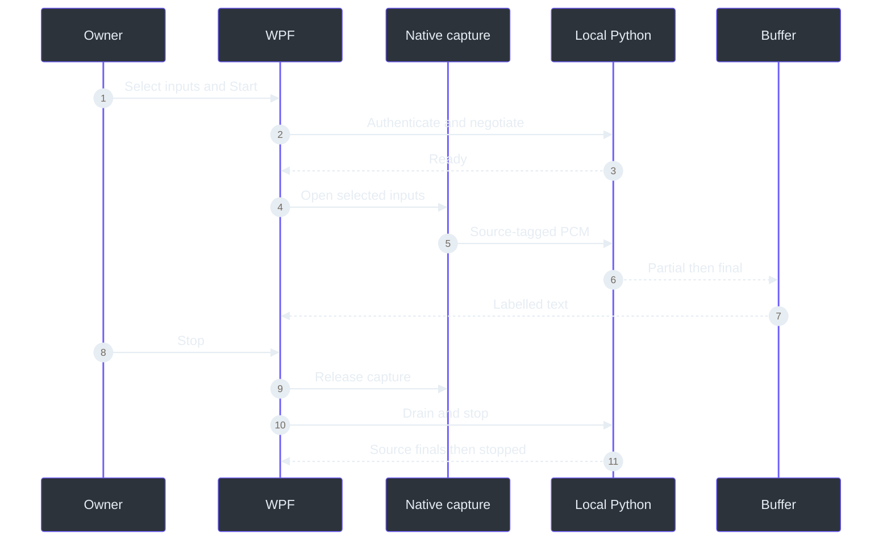

# Zero-to-hero learning path

> **TL;DR:** Learn enough of each technology to trace one real packet and one real user action.
> Do not try to master all of Windows, C#, Python, networking and machine learning before opening
> the project. The learning path is a sequence of explanations and bounded exercises.

## Overview: two languages, one product

The native project targets `net10.0-windows`, uses WPF and references the Core project plus
NAudio (`src\PhantomFudge.App\PhantomFudge.App.csproj:1-16`). The Core project has no WPF
dependency, which makes text/identity policies easier to test independently
(`src\PhantomFudge.Core\PhantomFudge.Core.csproj:1-5`). Python hosts the local recognition
service, with dependencies explicitly pinned (`services\transcription\requirements.txt:1-20`).

This is a technology boundary, not a competition between language quality. C# controls the
Windows integration; Vosk's native model does recognition through Python bindings. The
benchmark compares actual recognizers, not whether braces or indentation are better.

## Part I: foundations in a useful order

| Concept | Learn first | Project anchor |
| --- | --- | --- |
| C# types and records | Values, nullable references, enums, immutable messages | `AudioSource` and `TranscriptEvent` |
| WPF | XAML, dependency properties, visual tree, routed events, dispatcher | `App.xaml` and `MainWindow` |
| Native interop | HWND, P/Invoke, return values, last-error timing | `WindowProtection.Configure` |
| PCM audio | Sample rate, channels, bit depth, bytes, duration | v2 protocol |
| Asynchrony | Tasks, cancellation, queues, callbacks and ownership | native adapter and socket |
| Python asyncio | Event loop versus CPU worker; await versus blocking | server worker loop |
| Recognition | Partial versus final, endpoint versus explicit flush | Vosk wrapper |
| Verification | Unit, protocol, synthetic integration, hardware and recipient evidence | separate test/qualification layers |

`AudioSource` is a small, concrete introduction to strong types: Computer and Microphone have
stable byte values and separate wire/display names. An unknown enum value throws instead of
silently becoming a source (`src\PhantomFudge.Core\AudioSource.cs:3-30`).

```python
# Teaching pseudocode: an enum carries more meaning than an unexplained integer.
source = AudioSource.MICROPHONE
packet = AudioPacket(source=source, pcm=bytes_from_that_input)
```

In Python a dictionary can express the same idea, but the compiler cannot prove that every
caller supplied the right key or type. That is why the wire protocol validates fields even
when the C# side has strong types: a process boundary can receive malformed bytes.



## Part II: trace two paths

### Path A: opening the application

Follow `Run-PhantomFudge.ps1`. It chooses a source-build or packaged executable, detects an
existing instance, optionally builds, and starts the local service unless NotesOnly was chosen.
It passes the token through the child environment rather than printing it
(`scripts\Run-PhantomFudge.ps1:8-57`).

Then follow `App.OnStartup`: a normal launch establishes per-user ownership and either reveals
the existing process or constructs a new protected window
(`src\PhantomFudge.App\App.xaml.cs:62-82`). This explains why double-clicking an updated EXE
while an old instance is running does not necessarily replace the old UI.

### Path B: one utterance

An explicit Start selects inputs. PCM bytes are tagged with their source, sent over the
local socket, decoded independently, and returned as partial/final events. The buffer must
clear only the partial corresponding to a final's source. Do not read "partial" as a promise
that every character is settled (`src\PhantomFudge.Core\TranscriptBuffer.cs:14-19`,
`src\PhantomFudge.Core\TranscriptBuffer.cs:41-72`; `docs\DUAL-SOURCE-AUDIO.md:28-76`).



## Part III: learn the byte arithmetic

The wire format is16,000 samples per second, one channel,16 bits per sample. Divide bits by
eight to get bytes:16,000 x1 x2 =32,000 PCM bytes per second. A100ms payload is3,200 bytes.
V2 adds one source byte per WebSocket message, not per audio sample. Thus a3,200-byte PCM
payload becomes a3,201-byte message; it is not a WAV file and has no WAV header
(`docs\DUAL-SOURCE-AUDIO.md:37-53`).

This arithmetic helps diagnose errors. An odd-length PCM payload is invalid because a16-bit
sample needs two bytes. A source prefix belongs outside the PCM passed to the recognizer.
Counting that prefix as sound would shift every subsequent sample boundary.

The phrase "two channels" can be misleading here. The application uses two independent mono
source tracks, not one interleaved stereo stream. Each recognizer gets mono audio; the protocol
carries source identity separately.

## Part IV: asynchronous thinking

Compare a synchronous function with a lifecycle:

```python
result = recognize(audio)       # one call; ownership is simple
```

```python
start_requested = True
await service_ready()
open_inputs()
# callbacks and network events now arrive independently
await stop_requested()
await all_inputs_released()
await accepted_audio_drained()
await final_text_received()
```

An `await` does not mean "nothing else can happen." The WPF dispatcher can process another
user action while an operation awaits I/O. Conversely, doing CPU recognition on an event loop
can prevent other requests from being handled. The server therefore uses a bounded worker
for native recognition, while native startup is kept away from a blocked WPF dispatcher
(`services\transcription\server.py:109-142`,
`src\PhantomFudge.App\Audio\LoopbackTranscriber.cs:109-127`).

Three questions prevent many mistakes:

1. Who owns this resource while the operation is incomplete?
2. What identifies this result as belonging to the current source/session?
3. What event proves completion, rather than merely intent to stop?

## Part V: safe first exercises

### Exercise 1: source labels, no devices

Read `SourceTranscriptTests`. Explain why a Computer final must leave a Mic partial visible.
Then sketch a table of two partials, one Computer final, and one Mic final. This needs no
microphone or backend (`tests\PhantomFudge.Core.Tests\SourceTranscriptTests.cs:1-80`).

### Exercise 2: a rejected save

Read a test that changes a file outside the app, then attempts to save with an old fingerprint.
Identify which version should survive. Do not use a real note as the experiment; the test creates
an isolated directory (`tests\PhantomFudge.Core.Tests\NoteFileStoreTests.cs:1-110`).

### Exercise 3: protocol without hardware

Run the native synthetic harness only after reading its entry mode. It uses fake transport/input
objects for its normal test groups. The separate playback command is deliberately not part of
the default suite (`tests\PhantomFudge.Audio.Tests\Program.cs:18-71`).

### Exercise 4: a documentation-only screenshot

The documentation command renders actual WPF controls with synthetic text/device labels. It is
not a Snipping Tool workaround for capturing someone else's private window
(`src\PhantomFudge.App\App.xaml.cs:54-59`,
`scripts\Export-HandbookScreenshots.ps1:1-81`).

## How to avoid learning the wrong lesson

Do not conclude that a successful test suite proves hardware support, that the fastest batch
recognizer has the lowest live partial latency, or that a private window is a security boundary.
Those are different experiments. The repository deliberately leaves broader acceptance work open.

The [glossary](20-glossary-and-repository-map.md) provides more than forty terms. Use it when a
word becomes a blocker, then return to the code path. A good first contribution is a small
test/documentation improvement that follows one real invariant end to end.

## References

- `src\PhantomFudge.App\PhantomFudge.App.csproj:1-16` — native target and dependencies.
- `src\PhantomFudge.Core\PhantomFudge.Core.csproj:1-5` — platform-independent policy layer.
- `src\PhantomFudge.Core\AudioSource.cs:3-30` — typed input identity.
- `scripts\Run-PhantomFudge.ps1:8-57` — launch/reuse/token boundary.
- `src\PhantomFudge.App\App.xaml.cs:13-82` — entry paths.
- `services\transcription\requirements.txt:1-20` — Python dependency baseline.
- `tests\PhantomFudge.Audio.Tests\Program.cs:18-71` — synthetic test entry.
- `docs\DUAL-SOURCE-AUDIO.md:28-76` — byte contract.
