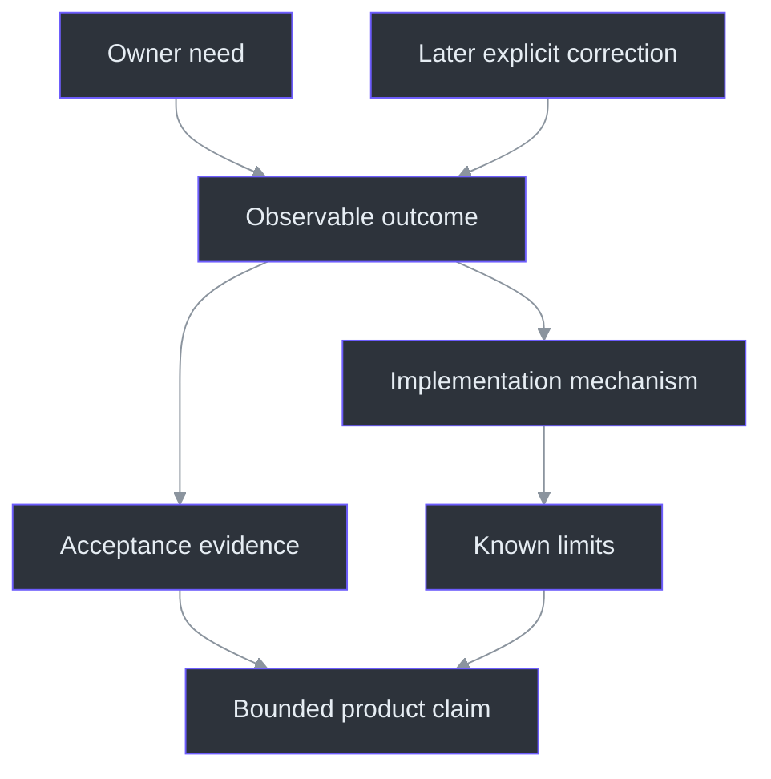
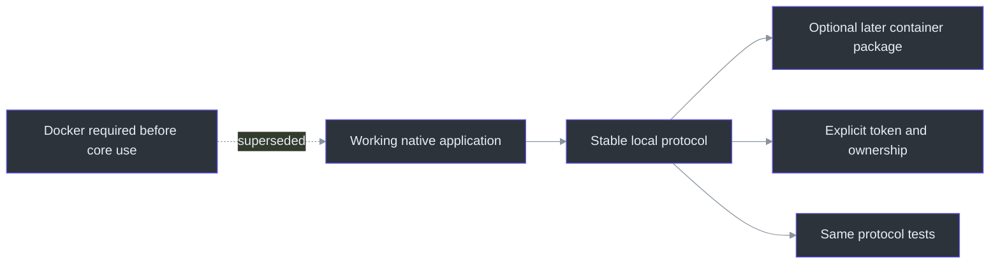

# Product boundaries and decisions

> **TL;DR:** Scope changes are not embarrassing historical debris; they are design inputs.
> The important discipline is to record what superseded what, update the affected contracts,
> and avoid treating an earlier assumption as a permanent requirement.

## Overview: from a private notepad to a conversation companion

The initial request was a draggable speaker-notes window that would not appear in a screen
share. The useful part of that request is implementable on supported Windows capture paths.
The absolute version—no software can ever detect or record the surface—is not. The product
contract therefore separates plain-text editing, movement, shell presentation, captured pixels,
platform support and actual product qualification (`docs\PRODUCT.md:6-38`).

That separation made later changes tractable. Transcription became the main view. Notes became
collapsible. The owner removed repetitive permission/rehearsal acknowledgments. Translucency
became a real rendering requirement, rather than a hypothetical visual effect. A microphone
track became explicitly requested after the original computer-only implementation. Finally,
Azure answering became a researched future extension, not an automatic cloud replacement.

The development ledger records these changes as dated decisions and evidence, not a fictional
linear plan that was correct from the beginning (`TODO\16_DEVELOPMENT_LEDGER.todo:1-90`).
The [public journal](../../JOURNAL.md) tells the fuller chronological story.

The October10 request deliberately widens the default single-question payload by one bounded,
explicitly selected item: the displayed completed answer. **Previous answer** sits left of Ask,
starts off and never sends on toggle. It is not approval for accumulated chat, transcript capture,
tools or implicit publication. Clarification keeps the same prior snapshot while its interpretation
replaces the screen. Preview 2 includes this feature; its separately authorized release is tracked in workstream62.
([Product requirement R24](../PRODUCT.md),
[`CapturePreviousAnswer`](../../src/PhantomFudge.App/MainWindow.AnswerContext.cs),
[workstream59](../../TODO/59_PREVIOUS_ANSWER_CONTEXT.todo).)

## Architecture of a requirement

A requirement should identify its observable outcome and the evidence needed to claim it.
For example, "no ordinary taskbar button" has a shell observation. "Computer audio becomes text"
requires audio/protocol/recognizer evidence. "The recipient never sees the notes" needs the
actual capture path; neither of the first two observations supplies it.

The native mechanism uses an owned HWND and display affinity. It does not make the process
cease to exist (`src\PhantomFudge.App\Native\WindowProtection.cs:19-48`). Similarly, the
source enum means "where samples came from", not "who was speaking"
(`src\PhantomFudge.Core\AudioSource.cs:3-30`). Precision in nouns prevents precision failures
in code and documentation.

## Decisions that shape the current product

| Decision | Current outcome | Important cost |
| --- | --- | --- |
| Windows11 first | Native WPF/Win32 behavior rather than a lowest-common-denominator overlay | Other operating systems need independent designs |
| Transcript first | Large reading area; notes collapsed until needed | Editing and reading modes must remain understandable |
| Explicit inputs | Computer, Mic or Both, followed by Start | Device selection/permissions can fail and must be visible |
| No repeated acknowledgments | Owner handles permission/recipient check outside the app | This does not create technical evidence that a recorder is safe |
| Background-only alpha | See through content while keeping text opaque | Underlying content can reduce contrast |
| Native Python by default | No Docker prerequisite for ordinary use | Local environment/model setup must be reproducible |
| Local Ask snapshot; future Azure sending | Owner chooses the exact displayed question | Structured identity is implemented; cloud configuration and actual egress are future work |

The requirements make the microphone change explicit: the later request supersedes the old
never-microphone product scope, while tests still must not open live inputs implicitly
(`docs\DUAL-SOURCE-AUDIO.md:1-26`). A repository that keeps both statements as current truth
would eventually produce either a broken feature or an unauthorized test.

## Why Docker moved to the end

Containerization and container dependence are different design decisions. A headless Python
service with environment-based configuration and a versioned protocol is straightforward to
package later. Requiring Docker before a Windows desktop tool can transcribe creates a larger
operational dependency without proving an inference benefit.

The current launcher starts native Python unless a separate option is chosen
(`scripts\Start-Transcription.ps1:1-24`). `Run-PhantomFudge` can also avoid service startup
entirely with NotesOnly (`scripts\Run-PhantomFudge.ps1:1-41`). The Docker TODO now explicitly
follows native release acceptance, rather than blocking it (`TODO\20_DOCKER_LOCAL_SERVICE.todo:1-42`).

The lesson is not "containers are bad." It is "portability should preserve an interface before
it imposes infrastructure." A service boundary is useful only when its responsibilities are
clear: Python recognizes framed PCM; C# controls Windows devices and presentation.

## Interaction choices are privacy choices

The owner observed an I-beam over text and a disappearing cursor in a shared view. The app
now uses Arrow and a non-activating default, but those local changes do not control every
recorder's cursor stream. The design deliberately records that remaining uncertainty rather
than renaming it success (`docs\CURSOR-AND-THEMES.md:1-69`).

At the same time, normal functionality must not be sacrificed to a privacy slogan. Notes must
still be editable after an explicit Edit action. Device rows must still be selectable without
unnecessarily activating the window. Unsaved-content warnings remain even though permission
checkboxes were removed. Those controls answer different questions.

## Defining done without freezing learning

The TODO vocabulary separates NOT_STARTED, IN_PROGRESS, BLOCKED and DONE. DONE applies to the
scope of a task: a research document can be complete while its architecture is not implemented.
An authored workflow can be complete while execution is not started
(`docs\TODO-CONVENTIONS.md:1-63`).

This is especially important for the Azure plan. The proposed path sends a frozen, explicit
question to a streamed model request. It does not authorize automatic meeting uploads, resource
creation or model calls simply because the diagram exists
(`docs\AI-ANSWER-ARCHITECTURE.md:82-200`).

## A worked change-impact exercise

Suppose a new request says, "Also transcribe my microphone." A superficial implementation adds
a second device object. A complete change asks:

1. Which device direction is valid, and when may it open?
2. Are samples mixed or kept distinct?
3. How do frame formats, source labels and time offsets change?
4. What happens if only one input starts or disconnects?
5. How does Stop prove both inputs are released and both tails finalized?
6. What does the UI show before recording and during faults?
7. Which old privacy statements are now historical?
8. Which tests can run without activating real hardware?

That checklist explains why the dual-input change involved native capture, protocol, Python
state, transcript storage, UI, tests and documentation rather than one checkbox. The contract
is written down before pretending that all those surfaces agree
(`docs\DUAL-SOURCE-AUDIO.md:28-116`).

## References

- `docs\PRODUCT.md:6-38` — distinct requirements and limits.
- `TODO\16_DEVELOPMENT_LEDGER.todo:1-90` — dated scope/evidence history.
- `src\PhantomFudge.App\Native\WindowProtection.cs:19-48` — actual window mechanism.
- `src\PhantomFudge.Core\AudioSource.cs:3-30` — input identities.
- `scripts\Start-Transcription.ps1:1-24` — native default.
- `scripts\Run-PhantomFudge.ps1:1-41` — launch options.
- `docs\DUAL-SOURCE-AUDIO.md:1-116` — microphone supersession and protocol.
- `docs\AI-ANSWER-ARCHITECTURE.md:82-200` — proposed answer boundary.
