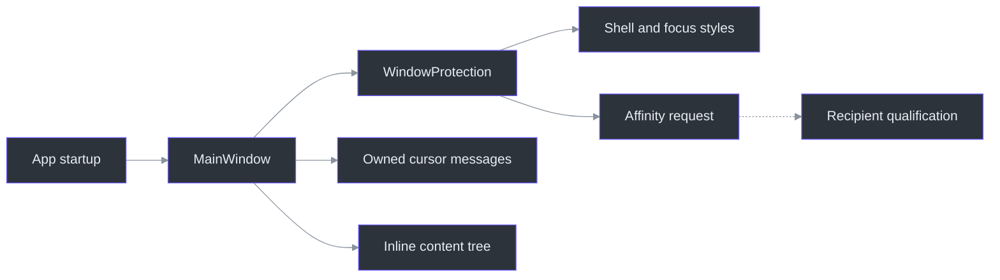
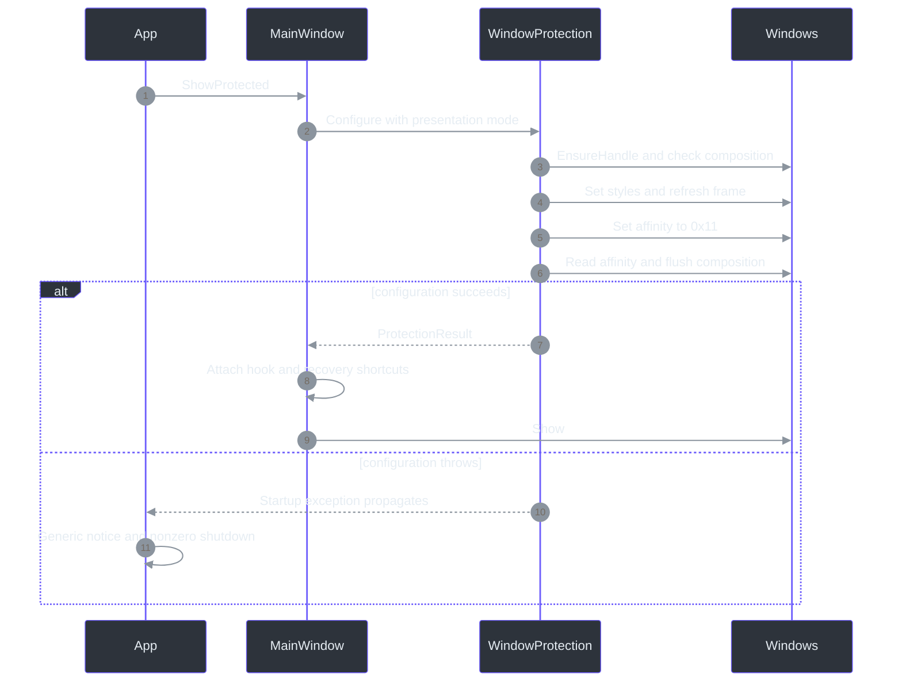

# 04 — Windows Capture, Cursors, and Focus

## Overview: four questions, not one invisibility switch

A presentation aid has two audiences: the person reading its local window and the people receiving a captured presentation. Those audiences do not necessarily receive the same pixels. Phantom Fudge asks Windows to exclude its window from supported capture paths; it does not make the process nonexistent, encrypt the desktop, or control another program's recording implementation. `WindowProtection.Configure` performs a native configuration operation, not a recipient-side test. This distinction is the foundation of the feature, rather than a disclaimer added after it. (src\PhantomFudge.App\Native\WindowProtection.cs:18-46)

Keep four observations separate:

| Question | Mechanism or evidence |
| --- | --- |
| Was capture exclusion requested successfully? | Setter result, optional getter readback, composition flush |
| Does the window appear in ordinary shell navigation? | WPF settings and native tool-window styles, followed by observation |
| Does a sharing picker list it? | The particular picker's behavior; not established by tool-window style |
| What does the audience actually receive? | Independent recipient frames and recordings for that exact configuration |

The qualification plan explicitly separates these dimensions. A successful API call cannot fill in the other three columns. Nor does a visible local Arrow establish that a recorder includes the pointer. (docs\QUALIFICATION.md:9-26; docs\CURSOR-AND-THEMES.md:21-37)

**Newcomer path:** follow startup, then read the cursor section. **Principal-engineer path:** inspect the native error semantics, invalidation ordering, and evidence limits. [Chapter 11](11-state-machines-and-failure-containment.md) connects this window lifecycle to asynchronous audio shutdown.

## Architecture: one content surface, several independent policies

The production surface is a topmost, layered WPF window with a generic title, no ordinary taskbar entry, transparent window background, and custom move/resize chrome. The root content is not click-through. Capture affinity belongs to the native window handle, whereas text controls and inline panels belong to its WPF visual tree. A panel inside that tree is not equivalent to a separate native dialog. (src\PhantomFudge.App\MainWindow.xaml:1-15,70-85,105-141)



The dotted edge means “requires separate evidence,” not “automatically proves.” The implementation behind the solid edges is `OnStartup`, `ShowProtected`, and `WindowMessage`. (src\PhantomFudge.App\App.xaml.cs:39-52; src\PhantomFudge.App\MainWindow.xaml.cs:79-107,157-187)

## Components and ownership

| Component | Responsibility and important boundary |
| --- | --- |
| `App.OnStartup` | Chooses the owning instance and calls `ShowProtected`; ordinary startup does not use `StartupUri`. (src\PhantomFudge.App\App.xaml.cs:39-59; src\PhantomFudge.App\App.xaml:1-4) |
| `WindowProtection` | Checks Windows 11/DWM, adjusts native styles, requests affinity, and interprets readback. (src\PhantomFudge.App\Native\WindowProtection.cs:18-46) |
| `CursorPolicy` | Loads the standard Windows Arrow and sets the current cursor shape. (src\PhantomFudge.App\Native\CursorPolicy.cs:6-24) |
| `WindowHotkeys` | Registers fixed Ctrl+Alt shortcuts with no-repeat behavior; does not hook arbitrary keystrokes. (src\PhantomFudge.App\Native\WindowHotkeys.cs:6-25) |
| `SingleInstance` | Uses per-user instance naming and a narrow current-user pipe command. (src\PhantomFudge.App\Native\SingleInstance.cs:18-59) |
| `LocalFailureNotice` | Writes a fixed generic failure message instead of opening a content-bearing error window. (src\PhantomFudge.App\LocalFailureNotice.cs:5-29) |

The architecture document names additional target abstractions, including a surface registry. They should not be mistaken for classes already implemented: current orchestration lives principally in `MainWindow`. (docs\ARCHITECTURE.md:35-75; src\PhantomFudge.App\MainWindow.xaml.cs:19-46)

## Data flow: configuring before first show

`App.OnStartup` constructs the window explicitly. `ShowProtected` marks protection unready, calls `Configure`, and only then marks it ready and invokes `Show`. The constructor prepares resources, handlers, and device enumeration; it does not start audio. Thus window creation, device discovery, visible presentation, and recording are distinct operations. (src\PhantomFudge.App\App.xaml.cs:47-52; src\PhantomFudge.App\MainWindow.xaml.cs:48-107,589-625)



`Configure` calls `EnsureHandle`, which obtains an HWND without requiring an already-visible content window. It checks Windows build 22000 or later and requires desktop composition. It preserves unrelated extended-style bits, adds `WS_EX_TOOLWINDOW`, removes `WS_EX_APPWINDOW`, and conditionally sets `WS_EX_NOACTIVATE`. `SetWindowPos` refreshes the frame without moving, resizing, reordering, or activating it. (src\PhantomFudge.App\Native\WindowProtection.cs:12-36)

The affinity setter requests `0x11`, `WDA_EXCLUDEFROMCAPTURE`. A failed setter throws. A successful getter returning anything else also throws. An unavailable getter is recorded in `ProtectionResult`; it is not treated identically to contradictory readback. Finally, `DwmFlush` checks submitted composition work. None of these calls creates an independently observed capture-frame barrier. (src\PhantomFudge.App\Native\WindowProtection.cs:35-45,70; docs\ARCHITECTURE.md:110-113)

### Why the native wrapper checks zero carefully

`GetWindowLong`/`SetWindowLong` can return zero without implying failure. The wrapper clears the last-error slot first, performs the appropriate 32- or 64-bit call, then throws only when a zero result accompanies a nonzero error. This preserves the distinction between a legitimate zero value and an API failure. C# `nint` represents a native-sized integer; it is not the HWND's logical identity across arbitrary future replacements. (src\PhantomFudge.App\Native\WindowProtection.cs:48-68)

## Implementation: focus policy is not pointer capture policy

Present starts with `presenting = true`. The window uses `ShowActivated=false`; native setup adds `WS_EX_NOACTIVATE`; `WM_MOUSEACTIVATE` returns `MA_NOACTIVATE` (`3`). These mechanisms reduce accidental foreground takeover while retaining deliberate pointer interaction. They do not forward clicks through the app. Edit reverses the interaction policy, enables note focus and input methods, and deliberately focuses the editor after successful reveal. (src\PhantomFudge.App\MainWindow.xaml.cs:31,177-181,223-257)

Cursor shape is handled at two levels:

1. WPF declares Arrow and `ForceCursor` on the window and text controls.
2. `WindowMessage` handles `WM_SETCURSOR` for the owned HWND by calling `CursorPolicy.SetArrow`.

The native policy loads resource `32512`, the standard Arrow. It does not replace system cursor resources or manipulate global visibility counters. Arrow is also used in Edit; editable text and an I-beam are not inseparable concepts. (src\PhantomFudge.App\MainWindow.xaml:6-9; src\PhantomFudge.App\App.xaml:48-76; src\PhantomFudge.App\MainWindow.xaml.cs:159-163; src\PhantomFudge.App\Native\CursorPolicy.cs:8-24)

A recorder may include, exclude, or separately composite cursor imagery. Consequently, the reported remote cursor disappearance remains unresolved until tested in the actual sharing product and mode. Local foreground preservation, native Arrow equality, and content-exclusion samples answer different questions. (docs\CURSOR-AND-THEMES.md:23-37)

### Invalidation hides before waiting

Display/DPI messages, selected session changes, and suspend/resume notifications dispatch `InvalidateAsync`. It clears `protectionReady`, hides immediately, then awaits audio Stop. That ordering avoids leaving content intentionally visible while cleanup drains. It cannot revoke frames already captured or make OS notifications instantaneous. Reveal deliberately re-runs `Configure`. (src\PhantomFudge.App\MainWindow.xaml.cs:182-209,131-143)

Ordinary Hide also stops transcription, but does not destroy the document or exit the process. Mode switching hides, stops audio, changes editability, and reconfigures before showing again. Theme, opacity, and Notes expansion are different operations: they update existing controls rather than changing this native policy. (src\PhantomFudge.App\MainWindow.xaml.cs:212-242,442-478)

If reveal setup fails, `TryReveal` starts invalidation and records a fixed failure notice. Unsaved text remains in the running process, not in an automatic recovery file. `LocalFailureNotice.Record` overwrites one timestamped generic notice under `%LOCALAPPDATA%\PhantomFudge\last-window-error.txt`; it does not serialize the exception, note, transcript, or filename. Failure to write that notice produces another fixed console message. (src\PhantomFudge.App\MainWindow.xaml.cs:139-143; src\PhantomFudge.App\LocalFailureNotice.cs:9-29)

### Recovery without a taskbar button

The shortcuts are Ctrl+Alt+Space for visibility and Ctrl+Alt+E for deliberate editing. Registration failures produce an inline status while preserving second-launch recovery. These are fixed defaults, not a currently implemented configurable-hotkey UI. (src\PhantomFudge.App\MainWindow.xaml.cs:94-118,165-175; src\PhantomFudge.App\Native\WindowHotkeys.cs:12-17)

`SingleInstance` derives a name from the current Windows SID, creates a session-local mutex, and exposes a `CurrentUserOnly` named pipe. A second launch sends six bytes, `REVEAL`, with a five-second connection deadline. The listener reads a six-byte command with a two-second request deadline; it does not deserialize notes, paths, scripts, or executable commands. This is narrow recovery IPC, not a general command server. (src\PhantomFudge.App\Native\SingleInstance.cs:18-75)

`RevealAndReset` sizes and centers against `SystemParameters.WorkArea`, then uses the protected reveal path. That is useful recovery, but not persisted, mixed-monitor placement restoration. Minimum window dimensions still constrain what fits on a small work area. (src\PhantomFudge.App\MainWindow.xaml.cs:121-128; docs\IMPLEMENTATION-STATUS.md:149-157)

### Why auxiliary surfaces change the problem

Capture policy is applied to the HWND passed to the native setter, not to an abstract application identity. Consequently, moving a find box from an inline panel into a separate popup would change the surface inventory even if it looked almost identical. The current find and unsaved-confirmation controls are elements of `MainWindow.xaml`; text-box context menus and spell checking are disabled in the application style. These choices reduce additional app-generated surfaces, but do not establish that every framework helper, input-method candidate, or accessibility window has been qualified. (src\PhantomFudge.App\Native\WindowProtection.cs:23-36; src\PhantomFudge.App\MainWindow.xaml:70-85,205-210; src\PhantomFudge.App\App.xaml:48-50; docs\QUALIFICATION.md:120-122,137-138)

Native Open/Save dialogs are a deliberate exception available through Edit. Their behavior must not be described as inheriting the main window's capture assurance merely because `ShowDialog(this)` supplies an owner. The current UI explicitly refuses saving/exporting in Present and reports the dialog boundary after Open. This is a concrete example of preferring a narrower, understandable workflow over an unsupported “everything this process draws is private” promise. (src\PhantomFudge.App\MainWindow.xaml.cs:270-275,333-350,359-365,733-739)

## Worked example: a display change during transcription

The following Python-shaped pseudocode explains ordering only; it is not production code, a Win32 binding, or a proposal to port the WPF application:

```python
async def invalidate():
    state.protection_ready = False
    window.hide()                  # Do not wait for recognizer drain first.
    await stop_transcription()
    status.set_generic_reason()

def reveal():
    try:
        configure_native_window(nonactivating=state.presenting)
        state.protection_ready = True
        window.show()
    except KnownProtectionFailure:
        schedule(invalidate())
        record_generic_local_notice()
```

In C#, `Task` represents eventual completion, while `Dispatcher.BeginInvoke` schedules work on the WPF UI thread. The code must arrange both: a native notification must not directly manipulate controls on an arbitrary thread, and waiting for Stop must not precede Hide. `Dispatch` and `InvalidateAsync` express those responsibilities separately. (src\PhantomFudge.App\MainWindow.xaml.cs:149-153,182-209)

## Tests, limitations, and review questions

`CaptureProof.RunAsync` establishes an unprotected synthetic positive control and an underlying baseline, then samples four show cycles with four protected frames each. Its outcome is deliberately named `PASS_LOCAL_GDI_SAMPLES_ONLY`; `Grab` uses cropped GDI `BitBlt`. This is not continuous first-frame coverage or qualification of Teams, Zoom, Meet, OBS, or their cursor streams. Do not run this visible positive-control fixture during an actual presentation merely to read the chapter. (src\PhantomFudge.App\Diagnostics\CaptureProof.cs:19-114,168-199)

`RunUiSmokeAsync` separately checks initial foreground preservation, passive styles, `MA_NOACTIVATE`, and the Arrow policy. Its rendered PNGs are visual-tree diagnostics, not independent capture evidence. All meeting-product qualification rows remain open in the maintained matrix. (src\PhantomFudge.App\MainWindow.xaml.cs:824-866,1085-1098; docs\QUALIFICATION.md:28-53)

**Question:** Does successful getter value `17` establish universal exclusion?  
**Answer:** No. It confirms a configuration readback; recorder behavior still needs independent evidence.

**Question:** Should a protection failure display the note inside an error dialog so it can be recovered?  
**Answer:** No. The implemented failure path hides and preserves memory, emitting only a generic notice.

**Question:** Can a local Arrow test close the remote-cursor issue?  
**Answer:** No. Record the sharing backend, source type, pointer-capture setting, and actual recipient frames. These answers follow the configuration, failure, and qualification contracts above. (src\PhantomFudge.App\Native\WindowProtection.cs:38-45; src\PhantomFudge.App\LocalFailureNotice.cs:11-24; docs\QUALIFICATION.md:132-138)

## References and maintenance checkpoints

- [Native configuration](../../src/PhantomFudge.App/Native/WindowProtection.cs): `Configure`, style wrappers, and `FlushComposition`.
- [Window lifecycle](../../src/PhantomFudge.App/MainWindow.xaml.cs): `ShowProtected`, `WindowMessage`, invalidation, and recovery.
- [Cursor policy](../../src/PhantomFudge.App/Native/CursorPolicy.cs), [hotkeys](../../src/PhantomFudge.App/Native/WindowHotkeys.cs), and [instance recovery](../../src/PhantomFudge.App/Native/SingleInstance.cs).
- [Failure notice](../../src/PhantomFudge.App/LocalFailureNotice.cs) and [synthetic capture proof](../../src/PhantomFudge.App/Diagnostics/CaptureProof.cs).
- [Qualification matrix](../QUALIFICATION.md) and [cursor investigation](../CURSOR-AND-THEMES.md).

Revisit this chapter whenever HWND construction, native styles, popups, focus behavior, or the rendering framework changes. Such changes require new evidence, not inheritance of an old compatibility claim. (docs\QUALIFICATION.md:24-26,113-130)
