# 05 — Desktop UI and Semantic Themes

## Overview: a reading surface before an editor

The most important UI decision is not a color. It is which activity receives space and focus by default. Phantom Fudge starts as a passive transcript-reading surface: the transcript occupies the growing central row, Notes is collapsed, and typing requires deliberate Edit. This separates “I need to see the meeting” from “I intend to take keyboard focus.” The initial fields and XAML implement that decision directly; it is not inferred from screenshots. (src\PhantomFudge.App\MainWindow.xaml.cs:31-33,48-77; src\PhantomFudge.App\MainWindow.xaml:165-242)

The UI is native C#/WPF. WASAPI capture begins only after explicit Start, for Computer, Mic, or Both. Both is the initial selection, not an instruction to record immediately. Labels describe input sources, not identified speakers. The planned Azure Ask experience is not an existing control or hidden mode. (src\PhantomFudge.App\MainWindow.xaml.cs:33,606-645; src\PhantomFudge.Core\AudioSource.cs:3-30; docs\IMPLEMENTATION-STATUS.md:5-21)

**Newcomer path:** read the visual-tree map, then the worked theme change. **Principal-engineer path:** inspect resource replacement, alpha compositing, passive selection, and the limits of the contrast tests. [Chapter 04](04-windows-capture-and-cursors.md) explains the native capture and cursor policy; [Chapter 06](06-notes-transcripts-and-storage.md) explains the content retained beneath the controls.

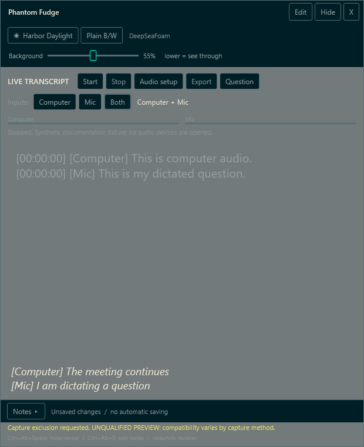

*Actual WPF visual-tree render with synthetic content, not a screen-sharing capture.* The fixture inserts source-labelled transcript examples without starting transcription. It demonstrates layout, not recognition accuracy, remote exclusion, or reader acceptance. (src\PhantomFudge.App\MainWindow.xaml.cs:845-886,1113-1126)

All documentation device labels are synthetic. Later fixture images may show "Wait until
transcription has fully stopped before clearing": the fixture deliberately exercises that guard
without opening audio inputs, then retains its status text while rendering opacity and Notes.
It is not a report of a live recording. (src\PhantomFudge.App\MainWindow.xaml.cs:978-1012)

## Architecture: one visual tree, explicit priorities

`MainWindow.xaml` uses an eight-row grid. The caption is fixed-height; controls and optional panels size to content; the transcript row takes the remaining space with a minimum height. Expanded Notes has a 140-unit editor row rather than displacing transcription as the primary model. The default window is 620 by 760 WPF units, with minimum dimensions 470 by 560. (src\PhantomFudge.App\MainWindow.xaml:5,17-26,242-271)

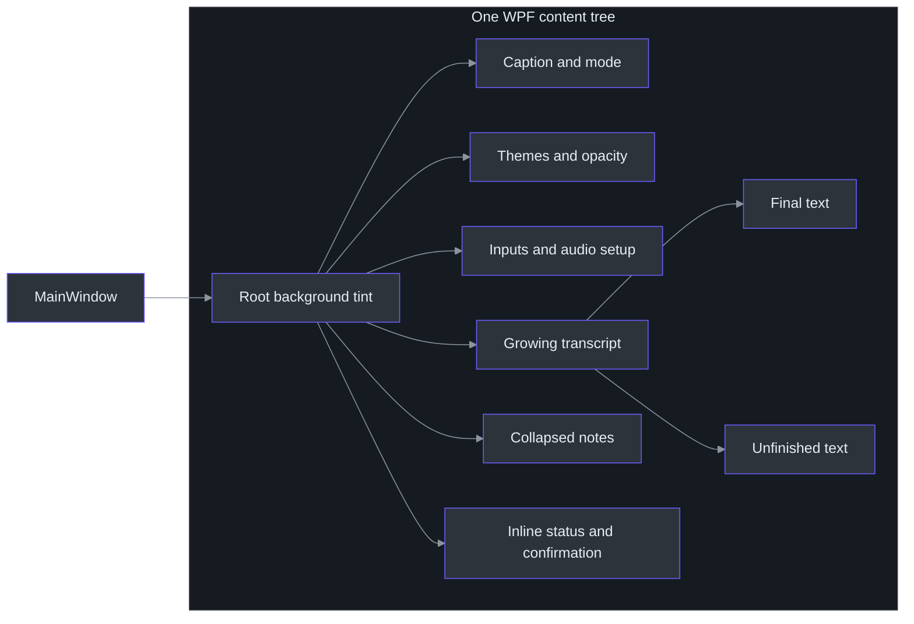

The caption uses `WindowChrome` with a 38-unit caption region and six-unit resize border. Its buttons opt into hit-testing inside chrome, while the title text does not intercept pointer input. The transcript and editor remain normal content hit regions; transparency is not an instruction to send clicks to another application. (src\PhantomFudge.App\MainWindow.xaml:11-40)

### Components: separate meaning from painting

| Layer | What it owns |
| --- | --- |
| `ThemePalette` | Immutable semantic color values and the three theme identities. (src\PhantomFudge.Core\ThemePalette.cs:3-28) |
| `ThemeBrushes` | Conversion to frozen WPF brushes and resource-key replacement. (src\PhantomFudge.App\ThemeBrushes.cs:9-40) |
| Application styles | Templates for button, text, list, scrollbar, slider, and progress states. (src\PhantomFudge.App\App.xaml:6-239) |
| `ApplyTheme` | Current selection, button labels, accessible name, and reapplication of root alpha. (src\PhantomFudge.App\MainWindow.xaml.cs:457-474) |
| `UpdateInteractionControls` | Read-only/focus/input-method policy and file-operation availability. (src\PhantomFudge.App\MainWindow.xaml.cs:248-262) |
| `RunUiSmokeAsync` | Synthetic layout, style, preservation, and interaction assertions. (src\PhantomFudge.App\MainWindow.xaml.cs:845-1103) |

A C# `record` is useful here because palette data is a value-shaped object rather than a control. Think of a frozen Python dataclass containing named color strings—not of a Python GUI implementation. The WPF-specific brush conversion stays in the App project, while Core tests can inspect the palette without constructing a window. (src\PhantomFudge.Core\ThemePalette.cs:5-25; src\PhantomFudge.App\ThemeBrushes.cs:9-40; tests\PhantomFudge.Core.Tests\ThemePaletteTests.cs:5-17)

## Data flow: what a theme click actually changes

The themed button calls `NextThemed`. DeepSeaFoam advances to Harbor Daylight; every other current value advances to DeepSeaFoam. Plain has a separate button, so the themed toggle is a two-theme companion switch with an exit from Plain, not a three-item carousel. (src\PhantomFudge.Core\ThemePalette.cs:27-28; src\PhantomFudge.App\MainWindow.xaml.cs:472-474)

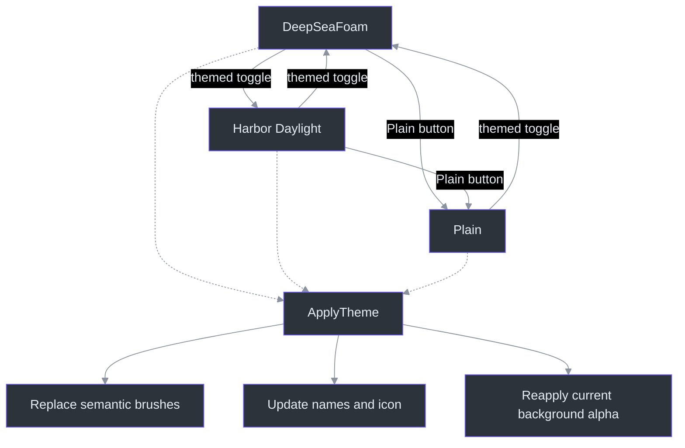

`ThemeBrushes.Apply` replaces semantic resources such as `ThemeText`, `ThemeSurface`, `ThemeSelection`, and `ThemeWarning`; it also maps selected WPF `SystemColors` resource keys. Controls reference these through `DynamicResource`, allowing replacement to update existing controls. Each new brush is frozen, so later changes replace a resource rather than mutating a shared brush in place. (src\PhantomFudge.App\ThemeBrushes.cs:12-40; src\PhantomFudge.App\App.xaml:9-11,53-58)

`ApplyTheme` updates the displayed current name, the *next* theme's button label, a sun/moon glyph, and the button's automation name. It emphasizes the Plain button when selected, then rebuilds the root background using the existing slider value. It does not assign note text, clear the transcript, start audio, or recreate the HWND. (src\PhantomFudge.App\MainWindow.xaml.cs:457-470)

## Implementation and tradeoffs

### Semantic palettes include interaction states

The following are selected roles, not the entire palette:

| Role | DeepSeaFoam | Harbor Daylight | Plain B/W |
| --- | --- | --- | --- |
| Background | `#000F13` | `#F3F2E9` | `#FAF9F6` |
| Surface | `#001E26` | `#E3ECE7` | `#F0F0EC` |
| Reading text | `#93A1A1` | `#355451` | `#202B30` |
| Accent | `#00A591` | `#006F63` | `#202B30` |
| Selection | `#003748` | `#C7DDD7` | `#D7E1DC` |

`ThemePalette.For` defines these values along with muted, heading, border, hover, selected text, action text, input, warning, and error roles. Plain B/W is a neutral interface name, not literally only two RGB values. The maintained provenance document records the canonical palette revision and composites; the WPF mapping is original to this app. (src\PhantomFudge.Core\ThemePalette.cs:5-24; docs\CURSOR-AND-THEMES.md:57-79)

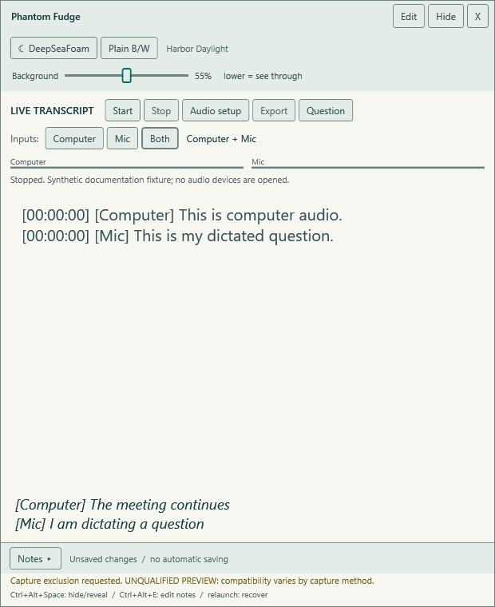

*Actual WPF visual-tree render with synthetic content, not a screen-sharing capture.* `RunUiSmokeAsync` applies every theme and checks key resource and foreground colors before rendering the examples. (src\PhantomFudge.App\MainWindow.xaml.cs:899-911)

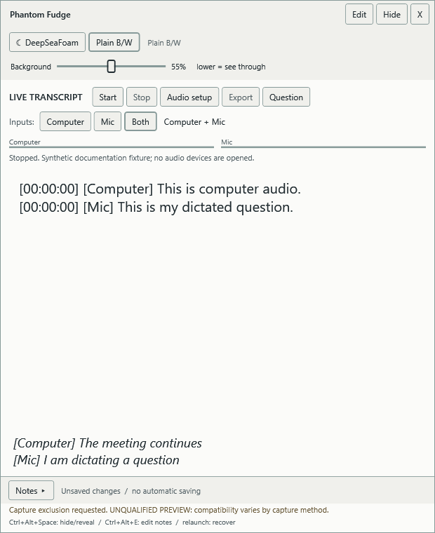

*Actual WPF visual-tree render with synthetic content/device labels.* Plain B/W is the neutral
reset, not a claim that every pixel is exactly black or white. The stopped fixture status makes
clear that choosing Both does not mean either source is recording. The corresponding
[DeepSeaFoam theme-only image](assets/screenshots/theme-DeepSeaFoam.png) is retained separately
from the opening transcript fixture in the provenance manifest.

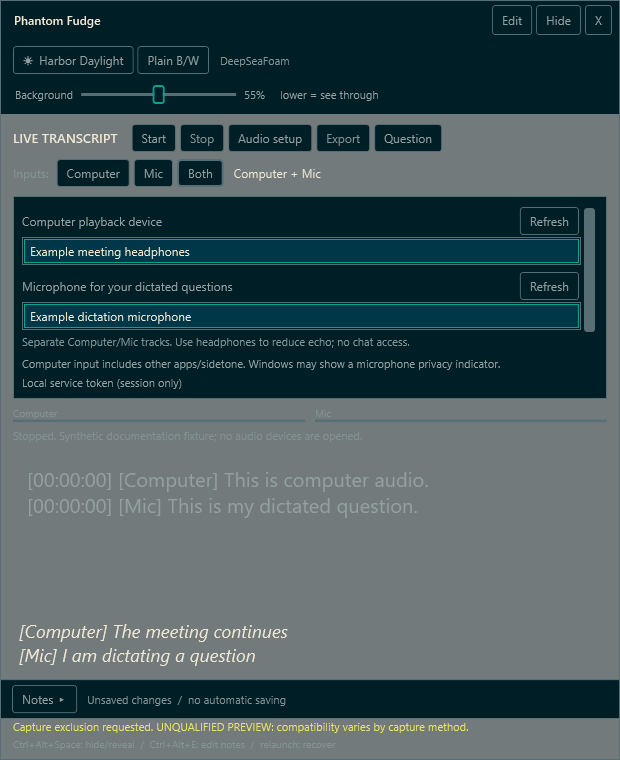

*Actual WPF visual-tree render with synthetic content/device labels, not a desktop capture.*
Computer and microphone selectors are separate; the setup panel scrolls rather than creating a
second window. The token is blank. No physical input was opened to produce this view.
(src\PhantomFudge.App\MainWindow.xaml.cs:860-876,918-920)

Button templates distinguish hover, pressed, keyboard-focused, and disabled states. List items have separate hover and selected presentations. Scrollbars and sliders use app brushes rather than leaving conspicuous system-default fragments. Text boxes suppress their context menu and spell checking, reducing app-generated auxiliary surfaces without removing ordinary deliberate editing. (src\PhantomFudge.App\App.xaml:25-58,84-109,146-225)

### Background alpha is not whole-window opacity

The root `WindowSurface` receives a new brush with:

```text
alpha = round(clamp(percent, 10, 100) × 255 / 100)
```

At 10%, 55%, and 100%, the byte alpha is respectively 26, 140, and 255. `MainWindow` remains transparent behind that tint; note and final-transcript control backgrounds are also transparent. Header, setup, and confirmation surfaces use opaque theme brushes. This avoids repeatedly applying translucent fills under the same text and avoids fading glyphs with the background. (src\PhantomFudge.App\MainWindow.xaml.cs:447-454; src\PhantomFudge.App\MainWindow.xaml:7,27,70-72,107-108,171-174,265-270)

The slider exposes 10–100%, defaults to 55%, and snaps to five-percent ticks. It remains available in Present. The implementation does not set `Window.Opacity`; the diagnostic explicitly checks window/editor/transcript opacity equals one and text brush alpha equals 255. (src\PhantomFudge.App\MainWindow.xaml:57-66; src\PhantomFudge.App\MainWindow.xaml.cs:1004-1008,1032-1035)

Why stop at 10% rather than zero? The maintained design calls out nonzero background alpha as avoiding entirely transparent mouse holes while keeping the surface usable. Why not promise readable text over every background? Composited contrast depends on the underlying desktop: approximately `alpha × tint + (1 − alpha) × background`. Solid glyphs alone cannot prevent visual interference from a busy slide. Increasing opacity or moving the window is a usability choice, not a capture-policy change. (docs\ARCHITECTURE.md:179-183; docs\CURSOR-AND-THEMES.md:51-55)

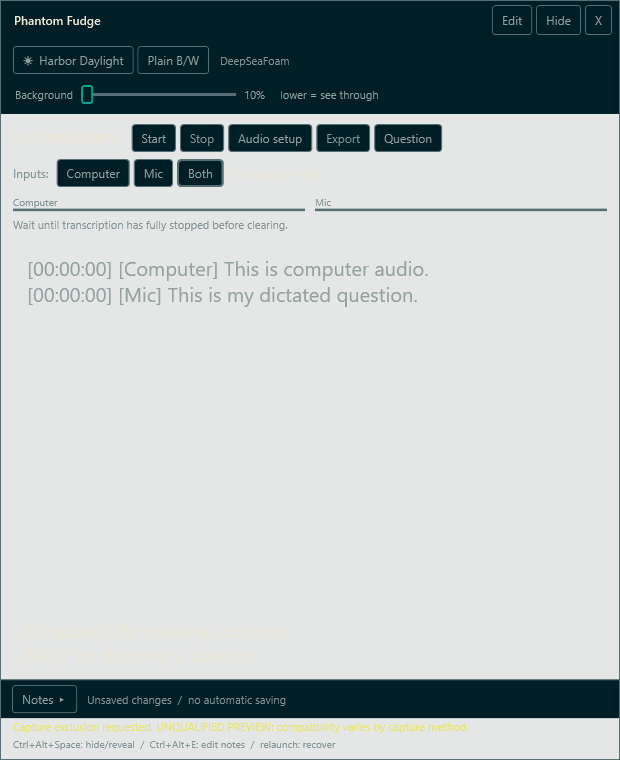

*Actual WPF visual-tree render with synthetic content at10% background alpha.* The reader's
checkerboard is an illustrative backing for transparent PNG pixels, not a captured desktop.
Header/control opacity stays unchanged.

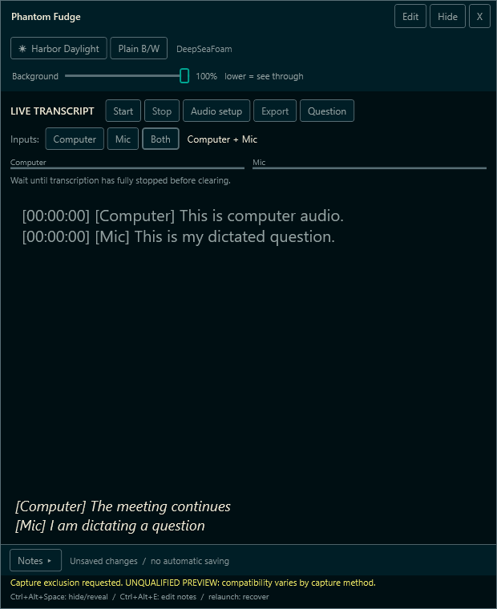

*The same synthetic fixture at100% background alpha.* Compare background coverage, not whether a
recorder can capture the window. Both images come from the diagnostic alpha/render assertions;
their retained stop-guard message is explained above. (src\PhantomFudge.App\MainWindow.xaml.cs:978-1008)

### Passive interaction requires more than read-only text

`UpdateInteractionControls` changes the shared `ControlsFocusable` resource, note editability, transcript focusability, and editor input-method availability. File operations and export require Edit; token entry additionally requires idle audio. Start is gated by technical readiness and explicit user action, not permission or rehearsal checkboxes. (src\PhantomFudge.App\MainWindow.xaml.cs:248-262,606-645,661-682)

The device selectors illustrate a subtle WPF issue: their ordinary click path requires focus. In Present, `OutputDevices_PreviewMouseLeftButtonDown` identifies the clicked `ListBoxItem`, assigns `SelectedItem` directly, and handles the event. Both playback and microphone lists use this handler. This preserves pointer selection without depending on keyboard focus transfer. (src\PhantomFudge.App\MainWindow.xaml.cs:582-592; src\PhantomFudge.App\MainWindow.xaml:116-127)

Opening Audio setup collapses Notes. Expanding Notes closes Audio setup; collapsing Notes also closes Find. These actions change visibility, not stored text. In contrast, switching Edit/Present hides and stops transcription before reconfiguring the native window. A theme click must not accidentally be implemented through that heavier mode-transition path. (src\PhantomFudge.App\MainWindow.xaml.cs:226-246,476-486,595-603)

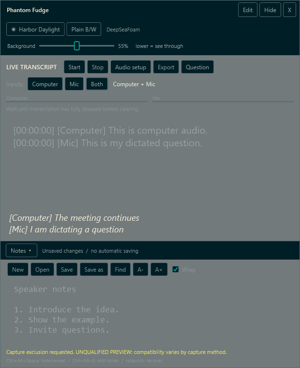

*Actual WPF visual-tree render with synthetic content, not a screen-sharing capture.* Expansion is shown while still presenting; it does not itself enable editing. (src\PhantomFudge.App\MainWindow.xaml.cs:1009-1012)

The separate [Present-after-mode-switch image](assets/screenshots/present.png) preserves the
same synthetic note/transcript content after the fixture explicitly enters Edit and returns to
Present. It illustrates the stable surface, not keyboard-focus or recipient behavior by itself.
(src\PhantomFudge.App\MainWindow.xaml.cs:1032-1036)

## Worked example: changing appearance without changing the session

Imagine a reader using DeepSeaFoam at 55% with Notes collapsed. They click the themed button, lower Background to 10%, then expand Notes. The theme becomes Harbor Daylight, the root tint becomes alpha 26 in the new background color, and the existing notes become visible but remain read-only. None of these handlers starts or stops capture; an already-running session is not intentionally restarted. (src\PhantomFudge.App\MainWindow.xaml.cs:447-490)

This Python-shaped sketch explains the separation of values and presentation; it is **not production code**:

```python
def apply_theme(theme):
    palette = palettes[theme]          # Like the C# record.
    resources.replace_colors(palette) # Like DynamicResource replacement.
    ui.current_name = palette.name
    ui.next_name = palettes[next_themed(theme)].name
    ui.root_brush = rgba(palette.background, opacity_percent)
    # No document assignment, audio command, or HWND reconstruction.
```

In the actual C# path, `ApplyTheme` calls `ThemeBrushes.Apply`, and brush construction calls `Freeze`. The slider handler only updates the root brush. That small separation makes it possible to test color selection independently of native capture, while still checking the integrated window for text preservation and stable handle identity. (src\PhantomFudge.App\ThemeBrushes.cs:9-40; src\PhantomFudge.App\MainWindow.xaml.cs:457-470,1003-1008,1037-1040)

## The local question panel

**Question** opens another inline region of the existing visual tree; it does not create an
answer window or cloud client. Mic is the initial chooser filter. Computer and All sources expose
additional rows only after an explicit filter action, and **Use selected** copies only explicitly
chosen structured entries. The row's session/source/partial label is display metadata, not a parser
used to decide provenance. (`src\PhantomFudge.Core\TranscriptSegment.cs:3-20,52-65`;
`src\PhantomFudge.Core\QuestionDraft.cs:18-46`.)

The live transcript remains visible above the expanded panel. Its scrollable height is bounded
relative to the available transcript area; Notes and Audio setup close when the composer expands.
Independent **Type / edit** deliberately permits keyboard focus for the question without calling
the old global Notes mode switch, which stops audio. Done typing/Escape restores passive behavior.
The selected rows remain usable through the same deliberate pointer-selection policy as devices.
See [the local question contract](../LOCAL-QUESTIONS.md).

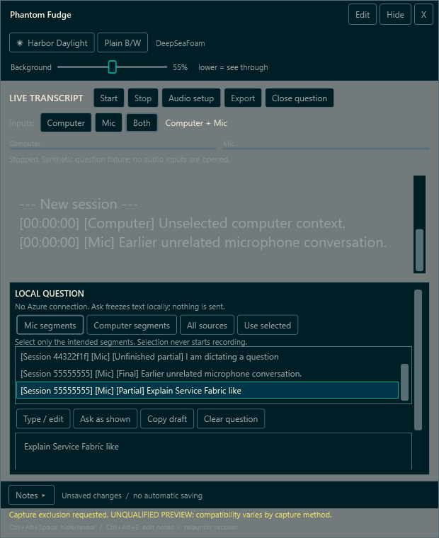

*Actual WPF visual-tree render with synthetic content/device labels.* The selected Mic partial is
identified structurally, while other displayed transcript text stays outside the draft.

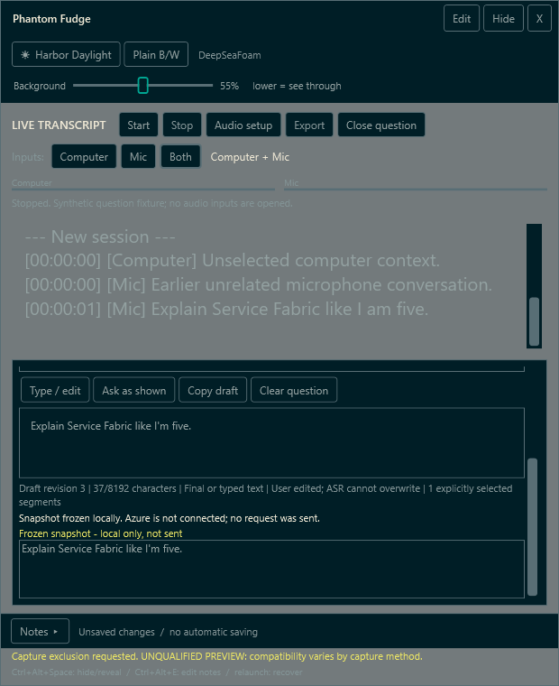

*Actual WPF visual-tree render using synthetic content and device labels.* The unrelated Computer
and earlier Mic lines remain in the transcript but are not in the question. The frozen text is
local only; no model was called and no audio endpoint was opened.

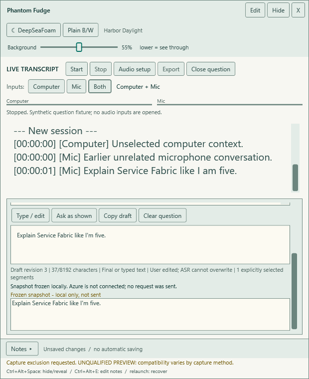

*The same synthetic state in Harbor Daylight.* Theme changes preserve the draft and frozen
snapshot. A frozen snapshot is a deep immutable copy of selected provenance and exact text; later
recognition or edits can change the draft but not that copy.
(`src\PhantomFudge.Core\QuestionSnapshot.cs:5-23`; `src\PhantomFudge.Core\QuestionDraft.cs:61-95`.)

The8192character limit rejects an oversized paste/selection/update rather than silently truncating.
User edits detach recognition replacement. Copy and Clear are explicit local actions, and closing
with question content uses the existing unsaved-content guard; note save/transcript export do not
pretend to persist it. A future Azure adapter must send `ExactText`, not serialize local `SourceRefs`
that retain pre-edit provenance. Accurate armed-Mic start/end boundaries and actual cloud answers
remain later workstreams. (`src\PhantomFudge.Core\QuestionDraft.cs:48-79,98-125`;
`src\PhantomFudge.Core\QuestionSnapshot.cs:17-23`.)

## Validation, exercises, and open questions

`ThemePaletteTests` checks canonical roles, toggle behavior, invalid theme rejection, and contrast of three opaque pairs: reading text/background, selection text/selection, and action text/accent. Its luminance calculation linearizes sRGB channels and requires a ratio of at least 4.5. It does not evaluate every control state, arbitrary backgrounds, or human comfort. (tests\PhantomFudge.Core.Tests\ThemePaletteTests.cs:5-58)

`RunUiSmokeAsync` checks passive device selection, theme resources, alpha samples, scrolling, caption/resize/editor hit tests, and preservation across visibility/mode operations. The documentation mode substitutes generic device names and synthetic text. PNGs use `RenderTargetBitmap` on the actual visual tree; they are not desktop screenshots with the underlying application composited behind them. No live capture is necessary to understand these fixtures. (src\PhantomFudge.App\MainWindow.xaml.cs:863-886,921-1035,1113-1126)

**Exercise:** Why not implement translucency as `Opacity = 0.1` on the window?  
**Answer:** That would fade text and controls as well as the background, violating the implemented solid-text invariant.

**Exercise:** After Plain, which theme does the companion button select?  
**Answer:** DeepSeaFoam; `NextThemed` has only one special case, DeepSeaFoam → Harbor Daylight.

**Review question:** What still needs people and hardware?  
**Answer:** Readability over real backgrounds, accessibility and mixed-DPI behavior, presentation-focus acceptance, and recipient-side content/cursor qualification. Local tests do not supply owner approval. (src\PhantomFudge.App\MainWindow.xaml.cs:1004-1008; src\PhantomFudge.Core\ThemePalette.cs:27-28; docs\IMPLEMENTATION-STATUS.md:149-157)

## References and maintenance checkpoints

- [Main window layout](../../src/PhantomFudge.App/MainWindow.xaml) and [interaction code](../../src/PhantomFudge.App/MainWindow.xaml.cs).
- [Application templates](../../src/PhantomFudge.App/App.xaml): state styling and dynamic resources.
- [Palette values](../../src/PhantomFudge.Core/ThemePalette.cs), [brush adapter](../../src/PhantomFudge.App/ThemeBrushes.cs), and [contrast tests](../../tests/PhantomFudge.Core.Tests/ThemePaletteTests.cs).
- [Source labels](../../src/PhantomFudge.Core/AudioSource.cs) and [palette provenance](../CURSOR-AND-THEMES.md).

Theme and opacity choices are session-only. Persisted preferences and broader accessibility acceptance must not be inferred from the current controls. Any future popup, template, or rendering change should revisit both local usability assertions and the capture qualification matrix. (docs\CURSOR-AND-THEMES.md:47-55; docs\QUALIFICATION.md:113-130)
