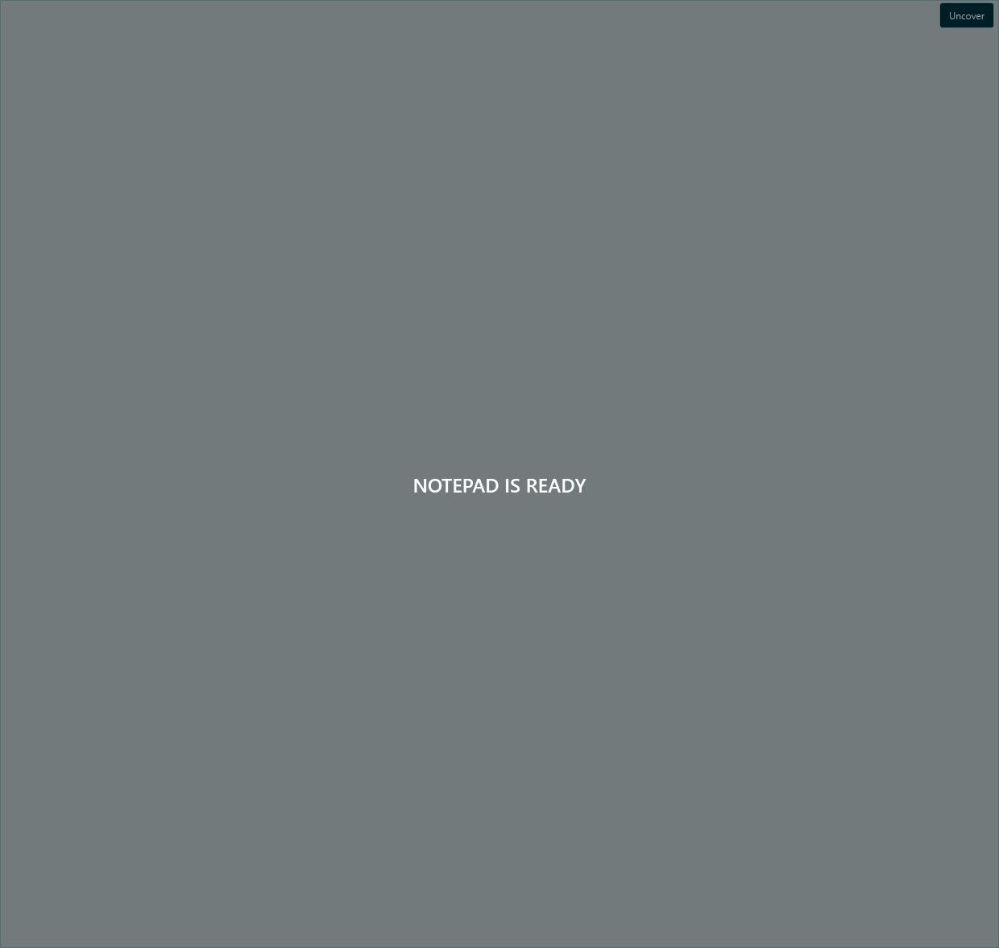
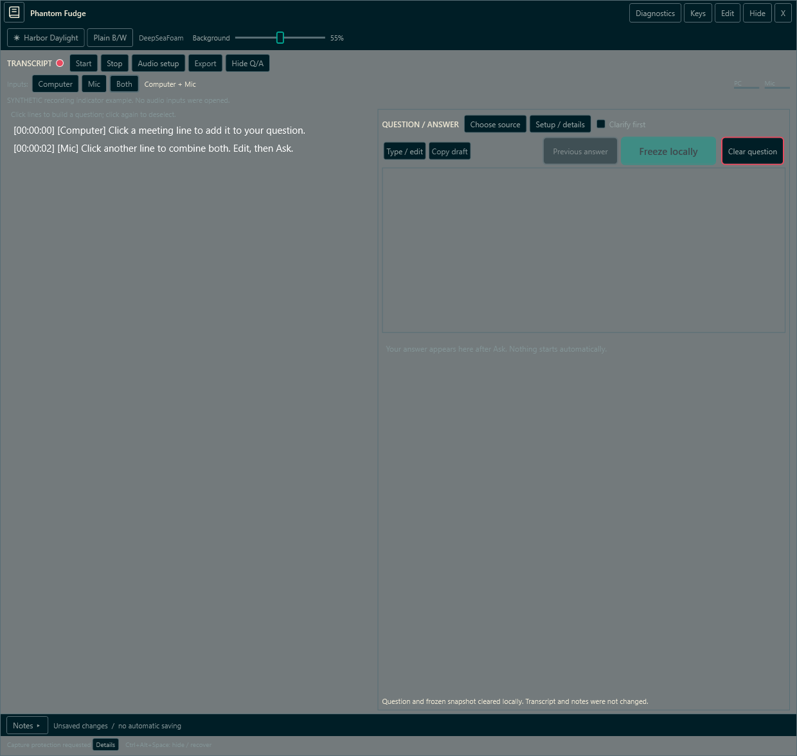
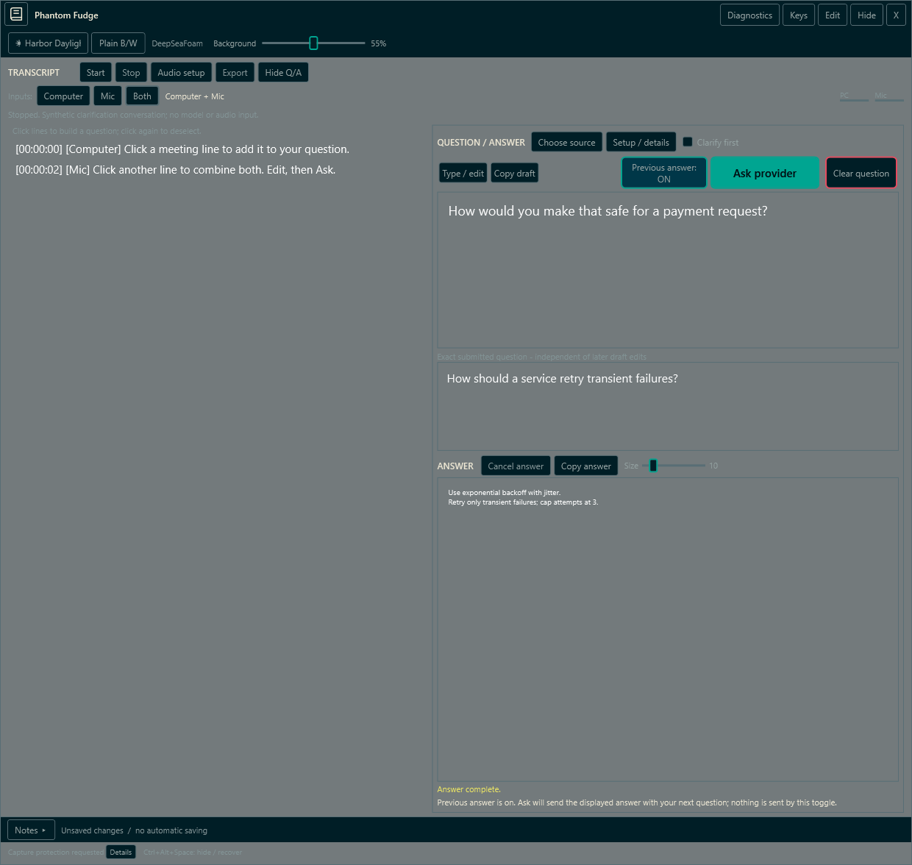
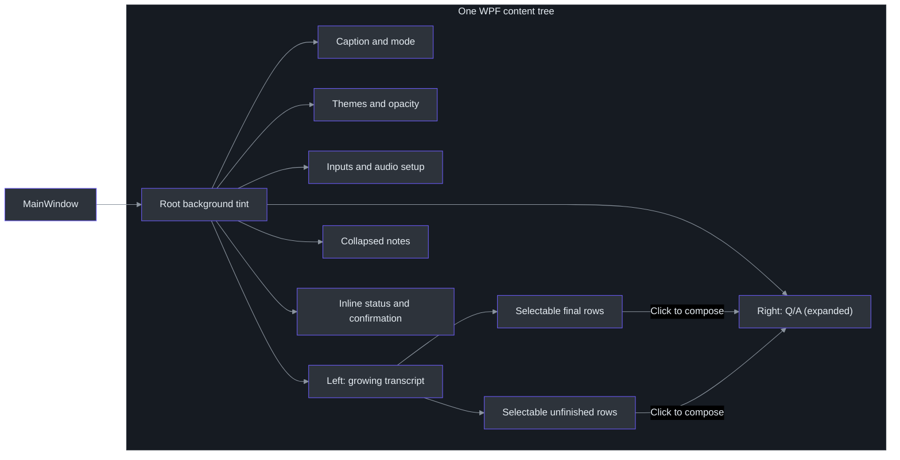
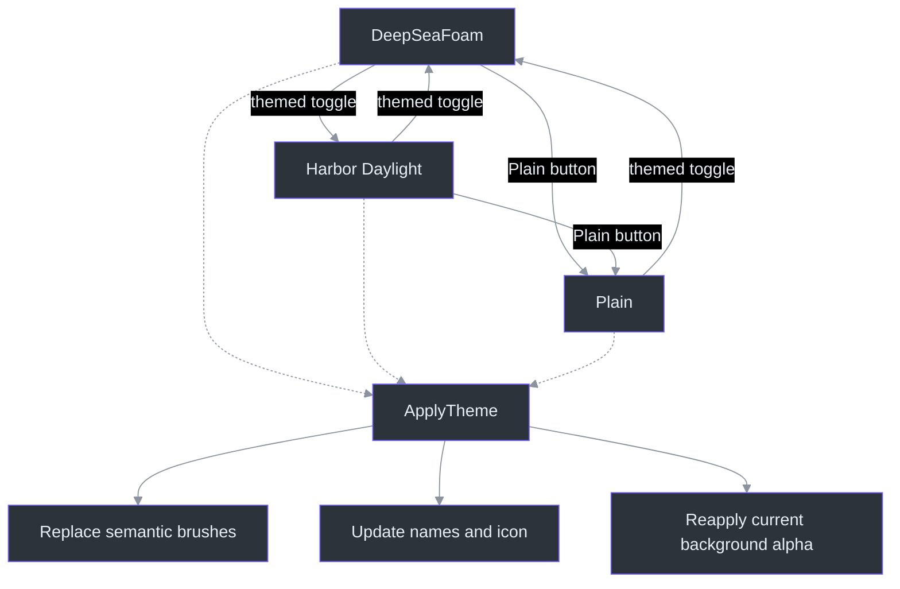
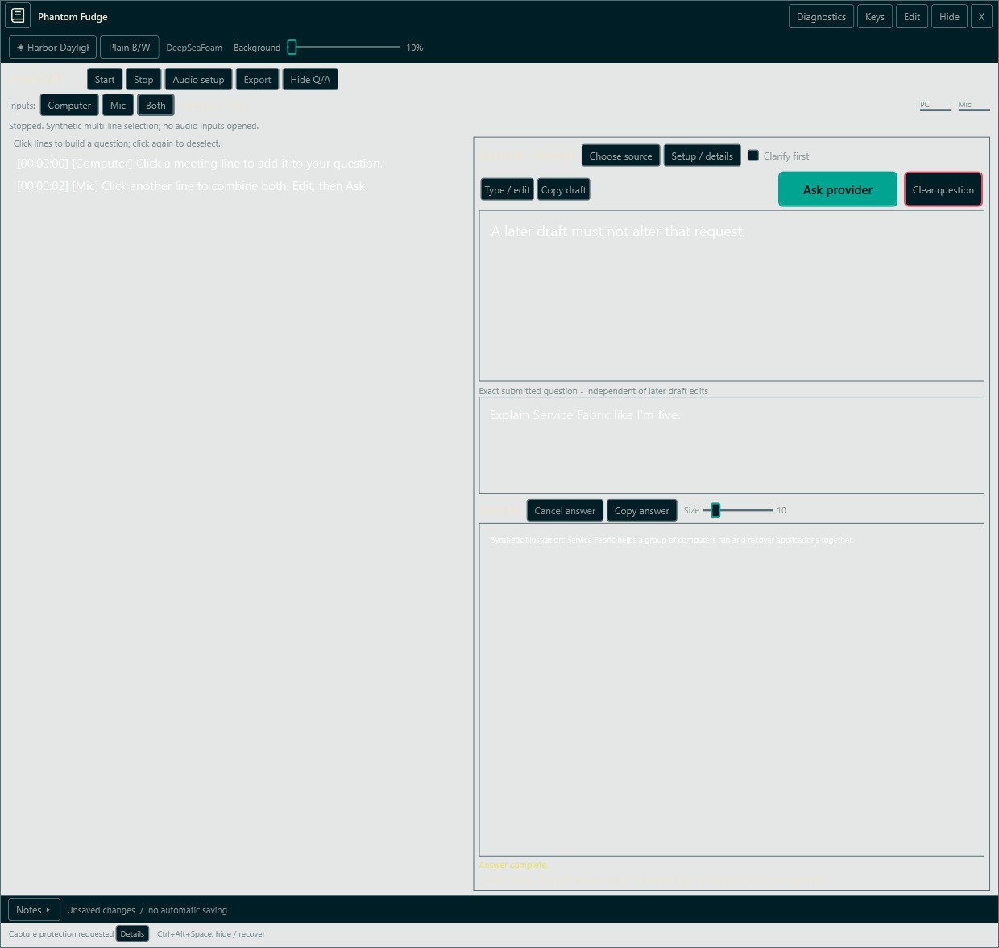
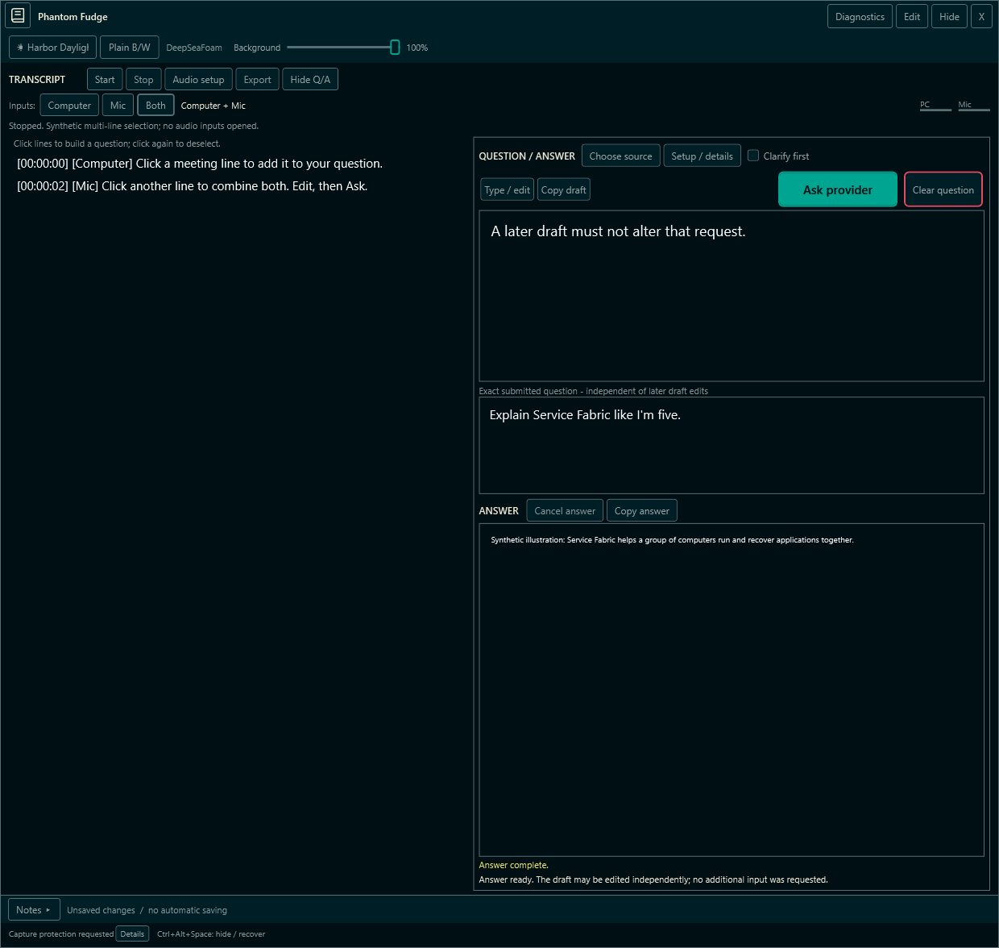
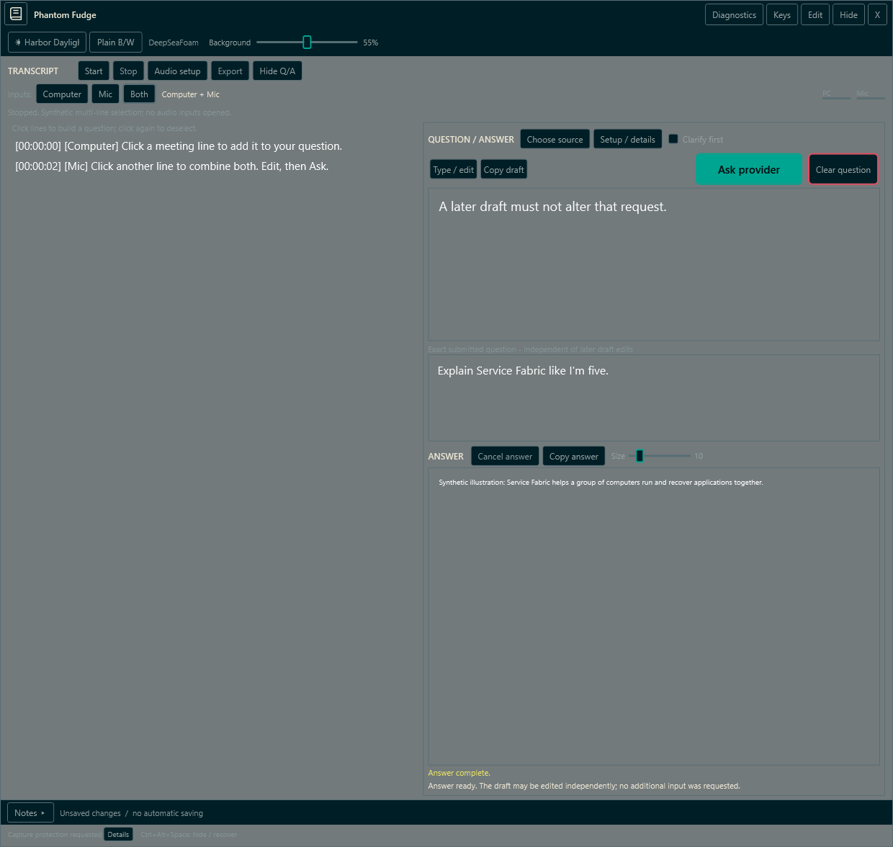

# 05 — Desktop UI and Semantic Themes

## Overview: a reading surface before an editor

The most important UI decision is not a color. It is which activity receives space and focus by default. Phantom Fudge starts with passive transcript reading, Q/A expanded and Notes collapsed. Question typing has its own deliberate transition: click a transcript row or choose **Type / edit**, rather than entering global Notes Edit. This separates “I need to see the meeting” from “I intend to compose a question.” The initial fields and XAML establish the reading surface. (src\PhantomFudge.App\MainWindow.xaml.cs:33-35,50-96; src\PhantomFudge.App\MainWindow.xaml:262-658.) Direct selection enters question editing through `TranscriptRows_SelectionChanged`; the default Q/A expansion is in [`InitializeQuestionView`](../../src/PhantomFudge.App/MainWindow.Questions.cs). (src/PhantomFudge.App/MainWindow.TranscriptSelection.cs:94-147.)

The UI is native C#/WPF. WASAPI capture begins only after explicit Start, for Computer, Mic, or Both. Both is the initial selection, not an instruction to record immediately. Labels describe input sources, not identified speakers. The planned Azure Ask experience is not an existing control or hidden mode. (src\PhantomFudge.App\MainWindow.xaml.cs:35,652-700; src\PhantomFudge.Core\AudioSource.cs:3-30; docs\IMPLEMENTATION-STATUS.md:227-243)

**Newcomer path:** read the visual-tree map, then the worked theme change. **Principal-engineer path:** inspect resource replacement, alpha compositing, passive selection, and the limits of the contrast tests. [Chapter 04](04-windows-capture-and-cursors.md) explains the native capture and cursor policy; [Chapter 06](06-notes-transcripts-and-storage.md) explains the content retained beneath the controls.


*Actual WPF visual-tree render with synthetic content, not a screen-sharing capture.* The fixture inserts source-labelled transcript examples without starting transcription. It demonstrates layout, not recognition accuracy, remote exclusion, or reader acceptance. (src\PhantomFudge.App\MainWindow.xaml.cs:920-968,1206-1219)

All documentation device labels are synthetic. Later fixture images may show "Wait until
transcription has fully stopped before clearing": the fixture deliberately exercises that guard
without opening audio inputs, then retains its status text while rendering opacity and Notes.
It is not a report of a live recording. (src\PhantomFudge.App\MainWindow.xaml.cs:1061-1095)

## Architecture: one visual tree, explicit priorities

The **top-left book icon** swaps the workspace for **NOTEPAD IS READY** and the same icon-only return action in the
same HWND. The disabled workspace is detached, not painted over; its controls/models still receive
transcript and answer updates. The user explicitly requested continuing work, so this path never
calls the normal Hide/Stop/Cancel lifecycle. Uncover restores layout and content. File/confirmation
operations block covering so their required decisions cannot disappear.
([Cover implementation](../../src/PhantomFudge.App/MainWindow.Cover.cs).)



Fresh in-process automation traversal sees the cover after the window peer's supported children-cache
refresh, but the fixture also demonstrates that an already-retained value provider can still read
question text. The application title/process identity remains Phantom Fudge. No claim of global
screen-reader, process or recorder invisibility follows; read the
[feasibility matrix](../COVER-AND-PRIVACY.md).

The red12-unit recording dot beside the transcript heading follows `transcriber.IsRunning`,
not input selection, microphone level or the presence of transcript text. `UpdateAudioControls`
refreshes it on start/status/stop/fault paths. Hidden state reserves the icon's place so the
controls do not jump. A solid outline and accessible recording-state name accompany the theme-red
fill. This is the app's active-transcription state, not an audio-file save or a replacement for the
Windows microphone indicator. ([Indicator](../../src/PhantomFudge.App/MainWindow.RecordingIndicator.cs),
[`UpdateAudioControls`](../../src/PhantomFudge.App/MainWindow.xaml.cs).)



*Synthetic WPF indicator example: the fixture drives only presentation state and opens no audio inputs.*

The primary action row contains **Previous answer**, then large accent-filled **Ask**, followed
immediately by **Clear question** with a two-unit red `ThemeError` border. Type/edit and Copy
remain in their left group. Below560WPF units, the context button narrows from118to80 and secondary
captions become Edit/Done/Reply and Copy, with full accessible names retained. Secondary buttons
may wrap vertically within their group (Reply above Copy); no added full-width row consumes the compact answer reader.
Ask stays148WPF units wide and at least44high with15-unit semibold text; Clear is98wide and at
least44high. Hover/focus do not replace Clear's red border. Existing mode labels and handlers remain
guarded: visual emphasis is not permission to send.
([Action row and local templates](../../src/PhantomFudge.App/MainWindow.xaml),
[`IsPrimaryAskAction`](../../src/PhantomFudge.App/MainWindow.QuestionDiagnostics.cs);
src/PhantomFudge.App/MainWindow.AnswerFont.cs:45-62.)

The owner later requested a50%reduction specifically in answer text. `AnswerText` defaults to10WPF
font units normally and9in narrow short layouts, replacing20and18. Question typography
is unchanged. The same reader displays clarification interpretations, so they use the smaller
answer type as well. (src/PhantomFudge.App/MainWindow.xaml:564-568;
src/PhantomFudge.App/MainWindow.Layout.cs:93-94.)

The 19:36 keyboard increment adds a **Size** slider and local reading controls: choose 8–24 via the
slider, `:font 14`, or `+`/`-` in Read. A chosen value takes precedence over responsive defaults
across resize, but is not saved for restart. Ctrl+Alt+K / Keys enters local modal control;
`v` → movement/Space → Enter reviews selected text, then Ctrl+Enter explicitly submits. Edit
remains literal text entry. Ordinary mode changes and masking preserve capture/provider work;
`:devices` instead refuses busy audio/answers and closes Q/A for setup. Read the canonical
[keyboard guide](../KEYBOARD-CONTROLS.md); final runtime-fixture evidence is recorded there, not a release claim.
(src/PhantomFudge.App/MainWindow.AnswerFont.cs:9-43;
src/PhantomFudge.App/MainWindow.Keyboard.cs:87-139,218-370;
src/PhantomFudge.App/MainWindow.KeyboardSelection.cs:110-159.)
The compact-font refinement temporarily gives Select/Search the transcript area and restores Q/A
on leaving selection, preserving its intended expansion and running work. Other compact keyboard
modes, or a chosen size 14+ with a visible answer, prioritize Q/A instead; wide columns are unchanged.
This is layout visibility, not the explicit Q/A close/cancel path.
See [compact reading space](../KEYBOARD-CONTROLS.md#compact-windows-the-active-task-gets-the-reading-space);
the final exporter/full UI fixture passed, including compact selection and passive size24fit.
The source atlas and handbook include this increment. Edit stays armed after submit; asynchronous
interpretation retargets the visible editable reply/original field only while the app is foreground.
(src/PhantomFudge.App/MainWindow.Keyboard.cs:127-139,301-306.)

The later13:15request reduces transcription text by25%: finalized Computer/Mic rows use15instead
of20, and live partials use13.5instead of18, or10.5instead of14in compact Q/A. Question, answer and
device-card text retain their existing sizes. The current viewport fixture checks the exact final
and partial sizes across compact and normal layouts.
([Transcript declarations](../../src/PhantomFudge.App/MainWindow.xaml),
[responsive assignment](../../src/PhantomFudge.App/MainWindow.Layout.cs),
[font/layout assertions](../../src/PhantomFudge.App/MainWindow.QuestionDiagnostics.cs).)

The default-off **Clarify first** control adds another deliberate path: interpret the selected
question, then type a separate Yes/correction reply. It retains the original draft and renders
interpretation/reply controls in the same window; typing or model completion never sends the next
turn. See [the complete clarification chapter](../QUESTION-CLARIFICATION.md) and
[`MainWindow.Clarification`](../../src/PhantomFudge.App/MainWindow.Clarification.cs).

The separate default-off **Previous answer** toggle snapshots only a completed displayed answer
on explicit Ask. It is session-only, locks during busy work/active clarification, and resets on
Clear/provider change. Setup/details reads prior text from the submitted request, not the new answer
currently replacing it. The same snapshot survives interpretation, corrections and confirmation.
This addition is **included in public Preview 2**, not the immutable Preview 1 installer.
([Context controller](../../src/PhantomFudge.App/MainWindow.AnswerContext.cs),
[full usage](../LOCAL-QUESTIONS.md#follow-up-with-the-previous-answer).)



*Fake-provider WPF illustration; not a model-quality or recorder-qualification result.*

The requested window is now **1240 by 1520 WPF units**, twice the former dimensions, with a
normal minimum of 470 by 560. `WorkspaceLayout.FitToWorkArea` clamps placement and size with a
12-unit inset rather than putting controls off-screen. The observed 1920 by 1200 work area fits
1240 by 1176. Smaller work areas can lower the minimum safely; this is not a demand for a
physically impossible 1520-pixel height. (`src/PhantomFudge.Core/WorkspaceLayout.cs:8-42`.)

At widths of at least 900, transcript and Q/A use reading columns. Narrow layouts stack them;
short-window source/setup tools can temporarily replace the transcript pane until closed.
There is no outer scrolling main/question panel, while long text retains its own scrollbar.
Primary controls remain outside those text scroll regions. (`src/PhantomFudge.App/MainWindow.Layout.cs:58-111`.)



The caption uses `WindowChrome` with a 38-unit caption region and six-unit resize border. Its buttons opt into hit-testing inside chrome, while the title text does not intercept pointer input. The transcript and editor remain normal content hit regions; transparency is not an instruction to send clicks to another application. (src\PhantomFudge.App\MainWindow.xaml:112-147)

### Components: separate meaning from painting

| Layer | What it owns |
| --- | --- |
| `ThemePalette` | Immutable semantic color values and the three theme identities. (src\PhantomFudge.Core\ThemePalette.cs:3-29) |
| `ThemeBrushes` | Conversion to frozen WPF brushes and resource-key replacement. (src\PhantomFudge.App\ThemeBrushes.cs:9-41) |
| Application styles | Templates for button, text, list, scrollbar, slider, and progress states. (src\PhantomFudge.App\App.xaml:6-239) |
| `ApplyTheme` | Current selection, button labels, accessible name, and reapplication of root alpha. (src\PhantomFudge.App\MainWindow.xaml.cs:492-509) |
| `UpdateInteractionControls` | Read-only/focus/input-method policy and file-operation availability. (src\PhantomFudge.App\MainWindow.xaml.cs:278-293) |
| `TranscriptRow` / `TranscriptRows_SelectionChanged` | Immutable display/segment pairing, whole-row toggles, draft guards and deliberate question focus. (src/PhantomFudge.App/MainWindow.TranscriptSelection.cs:13-20,85-147) |
| `RunUiSmokeAsync` | Synthetic layout, style, preservation, and interaction assertions. (src\PhantomFudge.App\MainWindow.xaml.cs:920-1196) |

A C# `record` is useful here because palette data is a value-shaped object rather than a control. Think of a frozen Python dataclass containing named color strings—not of a Python GUI implementation. The WPF-specific brush conversion stays in the App project, while Core tests can inspect the palette without constructing a window. (src\PhantomFudge.Core\ThemePalette.cs:5-26; src\PhantomFudge.App\ThemeBrushes.cs:9-41; tests\PhantomFudge.Core.Tests\ThemePaletteTests.cs:5-17)

## Data flow: what a theme click actually changes

The themed button calls `NextThemed`. DeepSeaFoam advances to Harbor Daylight; every other current value advances to DeepSeaFoam. Plain has a separate button, so the themed toggle is a two-theme companion switch with an exit from Plain, not a three-item carousel. (src\PhantomFudge.Core\ThemePalette.cs:28-29; src\PhantomFudge.App\MainWindow.xaml.cs:507-509)



`ThemeBrushes.Apply` replaces semantic resources such as `ThemeText`, `ThemeSurface`, `ThemeSelection`, and `ThemeWarning`; it also maps selected WPF `SystemColors` resource keys. Controls reference these through `DynamicResource`, allowing replacement to update existing controls. Each new brush is frozen, so later changes replace a resource rather than mutating a shared brush in place. (src\PhantomFudge.App\ThemeBrushes.cs:12-41; src\PhantomFudge.App\App.xaml:9-11,53-58)

`ApplyTheme` updates the displayed current name, the *next* theme's button label, a sun/moon glyph, and the button's automation name. It emphasizes the Plain button when selected, then rebuilds the root background using the existing slider value. It does not assign note text, clear the transcript, start audio, or recreate the HWND. (src\PhantomFudge.App\MainWindow.xaml.cs:492-505)

## Implementation and tradeoffs

### Semantic palettes include interaction states

The following are selected roles, not the entire palette:

| Role | DeepSeaFoam | Harbor Daylight | Plain B/W |
| --- | --- | --- | --- |
| Background | `#000F13` | `#F3F2E9` | `#FAF9F6` |
| Surface | `#001E26` | `#E3ECE7` | `#F0F0EC` |
| General UI text | `#93A1A1` | `#355451` | `#202B30` |
| High-contrast reading | `#FFFFFF` | `#000000` | `#000000` |
| Accent | `#00A591` | `#006F63` | `#202B30` |
| Selection | `#003748` | `#C7DDD7` | `#D7E1DC` |

`ThemePalette.For` defines these values along with muted, heading, border, hover, selected text, action text, input, warning, and error roles. Plain B/W is a neutral interface name, not literally only two RGB values. The white/black reading role is the owner's October 9 override, not an unchanged canonical color. The maintained provenance document records the canonical palette revision and composites; the WPF mapping is original to this app. (src\PhantomFudge.Core\ThemePalette.cs:5-25; docs\CURSOR-AND-THEMES.md:93-118)


*Actual WPF visual-tree render with synthetic content, not a screen-sharing capture.* `RunUiSmokeAsync` applies every theme and checks key resource and foreground colors before rendering the examples. (src\PhantomFudge.App\MainWindow.xaml.cs:982-994)


*Actual WPF visual-tree render with synthetic content/device labels.* Plain B/W is the neutral
reset, not a claim that every pixel is exactly black or white. The stopped fixture status makes
clear that choosing Both does not mean either source is recording. The corresponding
[DeepSeaFoam theme-only image](assets/screenshots/theme-DeepSeaFoam.png) is retained separately
from the opening transcript fixture in the provenance manifest.


Device selection now uses cards in the full inline reading area. Each source keeps its original
`ListBox` selection and endpoint record, but the template contains an `ItemsPresenter` and
`WrapPanel`, **not a ScrollViewer**. Width and wrapped friendly-name height determine how many cards
fit. When a large catalogue exceeds that space, explicit Previous/Next controls collapse off-page
containers without replacing the collection or selecting another endpoint. The selected-page label
keeps an off-page selection visible as state. Names can ellipsize only when the available card is
exceptionally constrained; the stored name and endpoint ID are unchanged.
([Card coordinator](../../src/PhantomFudge.App/MainWindow.AudioDeviceCards.cs),
[card templates](../../src/PhantomFudge.App/MainWindow.xaml).)


*Synthetic470x560fixture with23outputs and17microphones; no audio input was opened.* The fixture
checks actual card bounds, absence of a ScrollViewer, selection preservation across pages, passive
clicks, busy locks, single-source layouts, advanced service controls and empty-state notices.
([Card diagnostic](../../src/PhantomFudge.App/MainWindow.AudioDeviceCardsDiagnostics.cs).)

Setup replaces the transcript/Q&A reading view only while open. Its bottom **Service setup** toggle
reveals the existing session-only token and guidance; **Done** restores reading. Normal device
selection needs neither token-field scrolling nor a new popup. Capture remains explicit and the
existing source-change lock applies throughout starting/running/stopping.

*Actual WPF visual-tree render with synthetic content/device labels, not a desktop capture.*
Computer and microphone selectors are separate; the setup panel scrolls rather than creating a
second window. The token is blank. No physical input was opened to produce this view.
(src\PhantomFudge.App\MainWindow.xaml.cs:939-958,1001-1003)

Button templates distinguish hover, pressed, keyboard-focused, and disabled states. List items have separate hover and selected presentations. Scrollbars and sliders use app brushes rather than leaving conspicuous system-default fragments. Text boxes suppress their context menu and spell checking, reducing app-generated auxiliary surfaces without removing ordinary deliberate editing. (src\PhantomFudge.App\App.xaml:25-58,84-109,146-225)

### Background alpha is not whole-window opacity

The root `WindowSurface` receives a new brush with:

```text
alpha = round(clamp(percent, 10, 100) × 255 / 100)
```

At 10%, 55%, and 100%, the byte alpha is respectively 26, 140, and 255. `MainWindow` remains transparent behind that tint; note and final-transcript control backgrounds are also transparent. The answer-reading tint follows the same slider; its parent no longer blocks transparency with an opaque content container. Header, setup, and confirmation surfaces use opaque theme brushes. The application never fades the glyphs with the background. (src\PhantomFudge.App\MainWindow.xaml.cs:482-489; src\PhantomFudge.App\MainWindow.xaml:7,130,195-197,577-579,279-288,681-687)

The slider exposes 10–100%, defaults to 55%, and snaps to five-percent ticks. It remains available in Present. The implementation does not set `Window.Opacity`; the diagnostic explicitly checks window/editor/transcript opacity equals one and text brush alpha equals 255. (src\PhantomFudge.App\MainWindow.xaml:165-173; src\PhantomFudge.App\MainWindow.xaml.cs:1087-1091,1118-1121)

Why stop at 10% rather than zero? The maintained design calls out nonzero background alpha as avoiding entirely transparent mouse holes while keeping the surface usable. Why not promise readable text over every background? Composited contrast depends on the underlying desktop: approximately `alpha × tint + (1 − alpha) × background`. Solid glyphs alone cannot prevent visual interference from a busy slide. Increasing opacity or moving the window is a usability choice, not a capture-policy change. (docs\ARCHITECTURE.md:220-224; docs\CURSOR-AND-THEMES.md:81-86)


*Actual WPF visual-tree render with synthetic content at10% background alpha.* The reader's
checkerboard is an illustrative backing for transparent PNG pixels, not a captured desktop.
Header/control opacity stays unchanged.


*The same synthetic fixture at100% background alpha.* Compare background coverage, not whether a
recorder can capture the window. Both images come from the diagnostic alpha/render assertions;
their retained stop-guard message is explained above. (src\PhantomFudge.App\MainWindow.xaml.cs:1061-1091)

### Passive interaction requires more than read-only text

`UpdateInteractionControls` changes the shared `ControlsFocusable` resource, note editability, transcript focusability, and editor input-method availability. File operations and export require Edit; token entry additionally requires idle audio. Start is gated by technical readiness and explicit user action, not permission or rehearsal checkboxes. (src\PhantomFudge.App\MainWindow.xaml.cs:278-293,652-700,720-743)

The device selectors illustrate a subtle WPF issue: their ordinary click path requires focus. In Present, `OutputDevices_PreviewMouseLeftButtonDown` identifies the clicked `ListBoxItem`, assigns `SelectedItem` directly, and handles the event. Both playback and microphone lists use this handler. This preserves pointer selection without depending on keyboard focus transfer. (src\PhantomFudge.App\MainWindow.xaml.cs:628-638; src\PhantomFudge.App\MainWindow.xaml:591-631)

Opening Audio setup collapses Notes. Expanding Notes closes Audio setup; collapsing Notes also closes Find. These actions change visibility, not stored text. In contrast, switching Edit/Present hides and stops transcription before reconfiguring the native window. A theme click must not accidentally be implemented through that heavier mode-transition path. (src\PhantomFudge.App\MainWindow.xaml.cs:253-276,511-521,641-649)


*Actual WPF visual-tree render with synthetic content, not a screen-sharing capture.* Expansion is shown while still presenting; it does not itself enable editing. (src\PhantomFudge.App\MainWindow.xaml.cs:1092-1095)

The separate [Present-after-mode-switch image](assets/screenshots/present.png) preserves the
same synthetic note/transcript content after the fixture explicitly enters Edit and returns to
Present. It illustrates the stable surface, not keyboard-focus or recipient behavior by itself.
(src\PhantomFudge.App\MainWindow.xaml.cs:1118-1122)

## Worked example: changing appearance without changing the session

Imagine a reader using DeepSeaFoam at 55% with Notes collapsed. They click the themed button, lower Background to 10%, then expand Notes. The theme becomes Harbor Daylight, the root tint becomes alpha 26 in the new background color, and the existing notes become visible but remain read-only. None of these handlers starts or stops capture; an already-running session is not intentionally restarted. (src\PhantomFudge.App\MainWindow.xaml.cs:482-525)

This Python-shaped sketch explains the separation of values and presentation; it is **not production code**:

```python
def apply_theme(theme):
    palette = palettes[theme]          # Like the C# record.
    resources.replace_colors(palette) # Like DynamicResource replacement.
    ui.current_name = palette.name
    ui.next_name = palettes[next_themed(theme)].name
    ui.root_brush = rgba(palette.background, opacity_percent)
    # No document assignment, audio command, or HWND reconstruction.
```

In the actual C# path, `ApplyTheme` calls `ThemeBrushes.Apply`, and brush construction calls `Freeze`. The slider handler updates the shared root background brush, not text opacity. That small separation makes it possible to test color selection independently of native capture, while still checking the integrated window for text preservation and stable handle identity. (src\PhantomFudge.App\ThemeBrushes.cs:9-41; src\PhantomFudge.App\MainWindow.xaml.cs:492-505,1086-1091,1123-1126)

## The local question panel

**QUESTION / ANSWER** is expanded initially, with **Hide Q/A** / **Show Q/A** controlling visibility.
The first-class workflow is to click several Mic/Computer rows directly in the main transcript.
Each ordinary click toggles one whole segment without Ctrl, including all wrapped or embedded
newline text. `TranscriptRow` pairs the displayed string with its immutable `TranscriptSegment`;
composition uses raw `Text` in displayed history order, not click order or parsed labels.
(`src\PhantomFudge.Core\TranscriptSegment.cs:3-20,52-65`;
`src\PhantomFudge.Core\QuestionDraft.cs:18-46`;
src/PhantomFudge.App/MainWindow.TranscriptSelection.cs:13-20,85-147;
[`InitializeQuestionView`](../../src/PhantomFudge.App/MainWindow.Questions.cs).)

The live transcript is beside the composer at wide sizes and above it at narrow sizes. In a short,
narrow workspace, explicitly expanded source/setup tools temporarily replace the transcript;
closing those tools restores reading space. Notes and Audio setup close when the composer expands
(`src/PhantomFudge.App/MainWindow.Layout.cs:58-145`).
Direct selection opens Q/A and closes those tools, then calls `SetQuestionEditing(true)`.
Like **Type / edit**, this deliberately permits keyboard focus without the global Notes mode
switch that stops audio. **Done typing** / Escape restores passive behavior. Unlike passive device
selection, a main-transcript click is intentionally activating; it does not stop transcription,
enable Notes editing, freeze a snapshot or send a model question. Native ListBox keyboard/automation
`SelectionChanged` uses the same composition path.
(src/PhantomFudge.App/MainWindow.TranscriptSelection.cs:94-147;
[`SetQuestionEditing`](../../src/PhantomFudge.App/MainWindow.Questions.cs).)


*Actual synthetic WPF render, with no audio input or model request.* The outlined Mic and Computer
rows compose in displayed order even though the fixture clicks Computer first. The Mic row selects
its whole wrapped/multiline segment. The duplicate unselected sentence stays outside the draft.
(src/PhantomFudge.App/MainWindow.TranscriptSelectionDiagnostics.cs:21-53.)

After a user edit, further direct row changes are refused with an inline retained-draft status;
the previous highlights are restored. **Clear question** resets the draft and highlights so a new
set can be chosen. The guard avoids destroying corrections with an incidental click, without
adding a popup. Before editing, selected partials follow their stable keys into revised/final rows.
Main history survives smaller chooser eviction, including archived unfinished rows; separator
rows have no segment and cannot be selected. New finals scroll only if the reader was already
at the end. (src/PhantomFudge.App/MainWindow.TranscriptSelection.cs:13-83,94-147.)

The manual fallback is **Choose source → Mic / Computer / All → Use selected**. Mic is that
chooser's initial filter; **All** broadens visibility only. **Use selected** remains an explicit
replacement action, including for an edited draft, and can be used passively before **Type / edit**.
This differs from guarded direct clicks. See [`UseQuestionSelection_Click`](../../src/PhantomFudge.App/MainWindow.Questions.cs)
and [the local question contract](../LOCAL-QUESTIONS.md).

Selected main rows use a thin accent outline rather than an opaque selection fill. Their glyphs
remain white/black and their transparent backgrounds share the root alpha. Keyboard focus has a
separate outline state. See `TranscriptRowStyle` / `TranscriptRowTemplate` in
[the XAML](../../src/PhantomFudge.App/MainWindow.xaml); this is not universal readability or capture
qualification.


*Actual WPF visual-tree render of the manual chooser, with synthetic content/device labels.*
The selected Mic partial is identified structurally, while other transcript text stays outside the draft.


*Actual WPF visual-tree render using synthetic content and device labels.* The unrelated Computer
and earlier Mic lines remain in the transcript but are not in the question. The frozen text is
local only; no model was called and no audio endpoint was opened.


*The same synthetic state in Harbor Daylight.* Theme changes preserve the draft and frozen
snapshot. A frozen snapshot is a deep immutable copy of selected provenance and exact text; later
recognition or edits can change the draft but not that copy.
(`src\PhantomFudge.Core\QuestionSnapshot.cs:5-23`; `src\PhantomFudge.Core\QuestionDraft.cs:61-95`.)

Selection is limited to one capture session,256entries and8192UTF-16 code units including inserted
newlines. The limit rejects an oversized paste/selection/update rather than silently truncating.
User edits detach recognition replacement. Copy and Clear are explicit local actions, and closing
with question content uses the existing unsaved-content guard; note save/transcript export do not
pretend to persist it. A future Azure adapter must send `ExactText`, not serialize local `SourceRefs`
that retain pre-edit provenance. Accurate armed-Mic start/end boundaries and direct Azure answers
remain later workstreams; installed Agency answers are implemented separately. (`src\PhantomFudge.Core\QuestionDraft.cs:48-79,98-125`;
`src\PhantomFudge.Core\QuestionSnapshot.cs:17-23`.)

## Validation, exercises, and open questions

### Transparent answers and quiet status





*Two actual synthetic WPF renders; text remains opaque while answer-background coverage changes.*
No model prompt, audio device, desktop capture or real provider preparation produces these images.
The separate fixture constructor prevents background warming. Their hashes and dimensions are in
[the screenshot manifest](assets/screenshots/manifest.json); see [the operational correction](../QUALITY-UPDATE.md).

The footer now says **Capture protection requested**, not a long persistent yellow warning or a
success claim. **Details** expands the limitations inline. Error reporting and hide-on-failure
remain separate; reducing warning clutter is not weakening the capture boundary.
(`src/PhantomFudge.App/MainWindow.Layout.cs:36-39,148-153`.)

### Installed-provider answers

The question panel now distinguishes **Snapshot only** from an explicitly configured answer
provider. Its destination notice identifies installed Agency's remote model service versus
an offline loopback model. A plain-text answer stays paired with the frozen question, not the
draft being edited afterward. Cancel/Hide/clear/close invalidate the active request; partial output
is labelled incomplete rather than silently resumed.



*Actual WPF visual-tree render with a deterministic fake provider.* This image illustrates the
answer surface; it is **not** a screenshot of the actual Agency smoke response or evidence of
capture exclusion. The real synthetic Agency request is separately recorded in the
[provider smoke receipt](../answer-provider-smoke.json). See [provider setup and limits](../ANSWER-PROVIDERS.md).

`ThemePaletteTests` checks canonical roles, toggle behavior, invalid theme rejection, and contrast of three opaque pairs: reading text/background, selection text/selection, and action text/accent. Its luminance calculation linearizes sRGB channels and requires a ratio of at least 4.5. It does not evaluate every control state, arbitrary backgrounds, or human comfort. (tests\PhantomFudge.Core.Tests\ThemePaletteTests.cs:5-74)

`RunUiSmokeAsync` checks passive device selection, theme resources, alpha samples, scrolling, caption/resize/editor hit tests, and preservation across visibility/mode operations. The documentation mode substitutes generic device names and synthetic text. PNGs use `RenderTargetBitmap` on the actual visual tree; they are not desktop screenshots with the underlying application composited behind them. No live capture is necessary to understand these fixtures. (src\PhantomFudge.App\MainWindow.xaml.cs:942-968,1004-1121,1206-1219)

**Exercise:** Why not implement translucency as `Opacity = 0.1` on the window?  
**Answer:** That would fade text and controls as well as the background, violating the implemented solid-text invariant.

**Exercise:** After Plain, which theme does the companion button select?  
**Answer:** DeepSeaFoam; `NextThemed` has only one special case, DeepSeaFoam → Harbor Daylight.

**Review question:** What still needs people and hardware?  
**Answer:** Readability over real backgrounds, accessibility and mixed-DPI behavior, presentation-focus acceptance, and recipient-side content/cursor qualification. Local tests do not supply owner approval. (src\PhantomFudge.App\MainWindow.xaml.cs:1087-1091; src\PhantomFudge.Core\ThemePalette.cs:28-29; docs\IMPLEMENTATION-STATUS.md:371-379)

## References and maintenance checkpoints

- [Main window layout](../../src/PhantomFudge.App/MainWindow.xaml) and [interaction code](../../src/PhantomFudge.App/MainWindow.xaml.cs).
- [Direct transcript selection](../../src/PhantomFudge.App/MainWindow.TranscriptSelection.cs) and [synthetic selection diagnostics](../../src/PhantomFudge.App/MainWindow.TranscriptSelectionDiagnostics.cs).
- [Application templates](../../src/PhantomFudge.App/App.xaml): state styling and dynamic resources.
- [Palette values](../../src/PhantomFudge.Core/ThemePalette.cs), [brush adapter](../../src/PhantomFudge.App/ThemeBrushes.cs), and [contrast tests](../../tests/PhantomFudge.Core.Tests/ThemePaletteTests.cs).
- [Source labels](../../src/PhantomFudge.Core/AudioSource.cs) and [palette provenance](../CURSOR-AND-THEMES.md).

Theme and opacity choices are session-only. Persisted preferences and broader accessibility acceptance must not be inferred from the current controls. Any future popup, template, or rendering change should revisit both local usability assertions and the capture qualification matrix. (docs\CURSOR-AND-THEMES.md:77-86; docs\QUALIFICATION.md:113-130)
