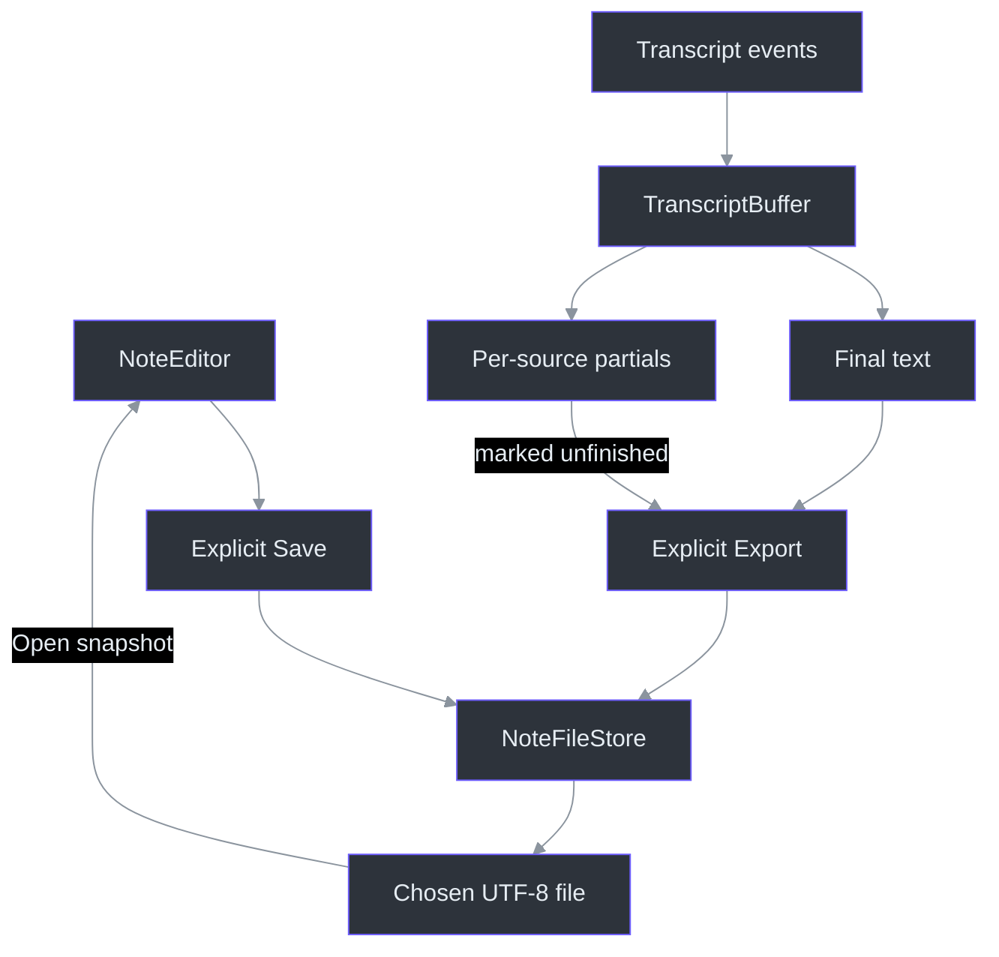
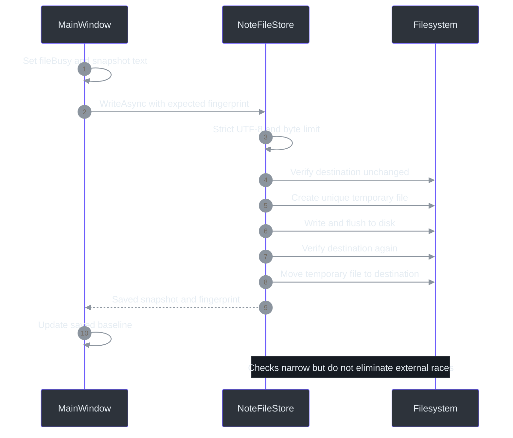

# 06 — Notes, Transcripts, and Explicit Storage

## Overview: persistence is a deliberate boundary

Seeing text, retaining it in memory, and saving it are three different events. Phantom Fudge keeps one editable note and an in-memory transcript; neither is automatically a file. The note tracks its last successful saved value. The transcript tracks its last explicitly exported value. These distinctions let the UI warn about unsaved work without silently persisting meeting content. They also mean a crash can lose unexported text: the preview does not implement automatic recovery. (src\PhantomFudge.App\MainWindow.xaml.cs:22-30,276-295,396-403,785-792; docs\IMPLEMENTATION-STATUS.md:117-122,178-179)

Capture exclusion does not extend to a `.txt` file, the clipboard, a native file dialog, or process memory. File storage is therefore designed for bounded input and accidental-overwrite resistance, not advertised as a secure vault. Saving to a user-selected location is an explicit act with the ordinary privacy properties of that location. (src\PhantomFudge.App\MainWindow.xaml.cs:362,403; docs\PRODUCT.md:130-145)

**Newcomer path:** start with the transcript example, then follow Save. **Principal-engineer path:** inspect session-local ID reset, snapshot comparisons, byte bounds, and the remaining check-to-replace race. [Chapter 11](11-state-machines-and-failure-containment.md) explains why session reset must wait for final draining.

## Architecture: two content models, one file primitive

Notes use the WPF text editor as their current text surface. `TranscriptBuffer` separately owns accumulated final text and source-specific unfinished text. Both explicit note saves and transcript exports use `NoteFileStore`; no recognizer callback writes a document file. (src\PhantomFudge.App\MainWindow.xaml.cs:276-277,371-416,739-800)



### Components and units

| Component or value | Contract |
| --- | --- |
| `NoteSnapshot` | Text, UTF-8 BOM presence, and SHA-256 fingerprint of original bytes. (src\PhantomFudge.Core\NoteFileStore.cs:6,41-44) |
| `NoteFileStore.MaximumBytes` | 1,048,576 encoded bytes, including a three-byte BOM when present. (src\PhantomFudge.Core\NoteFileStore.cs:12-19) |
| `TranscriptBuffer.MaximumCharacters` | 250,000 .NET character units for accumulated final/session text; partials are separately bounded. (src\PhantomFudge.Core\TranscriptBuffer.cs:8-10,23-45,63-66) |
| `TranscriptEvent` | Type, text, optional ID/timestamps/source; an event, not a speaker identity. (src\PhantomFudge.App\Audio\TranscriptEvent.cs:9-15) |
| `AudioSourceNames` | Wire names `computer`/`microphone`; display names `Computer`/`Mic`. (src\PhantomFudge.Core\AudioSource.cs:16-30) |
| `savedText` / `exportedTranscript` | Successful persistence baselines used for equality-based dirty checks. (src\PhantomFudge.App\MainWindow.xaml.cs:26-27,276-277) |

These units must not be conflated. A C# string length counts UTF-16 code units, not UTF-8 bytes or human-perceived characters. `Fits` asks the strict encoder for its actual byte count, including BOM allowance; unpaired surrogates fail rather than becoming replacement characters. The paste handler checks the *resulting note after selection replacement*, while saving checks again. This is not a universal keystroke-by-keystroke size limiter on the editor. (src\PhantomFudge.Core\NoteFileStore.cs:13-24; src\PhantomFudge.App\MainWindow.xaml.cs:440-448; src\PhantomFudge.App\MainWindow.xaml:284-290)

## Data flow: recognition becomes a readable history

Transport events are dispatched to the UI thread and handled by `ReceiveTranscript`. A partial calls `SetPartial`; a final calls `AddFinal`. The UI then refreshes final text, scrolls to the end, updates the partial line, and hides the placeholder when content exists. Invalid data or a full transcript stops transcription and preserves the existing buffer for export. (src\PhantomFudge.App\MainWindow.xaml.cs:57,151-155,739-761)

Partials replace a dictionary entry rather than append to history. Keys distinguish Computer and Mic; a legacy unspecified source has its own key. Display ordering is by source key, not arrival time. A final removes only its source's partial. This prevents a Computer sentence from erasing a simultaneously unfinished dictated question. (src\PhantomFudge.Core\TranscriptBuffer.cs:14-19,41-46,69-71,87-96)

Final IDs are globally increasing within a session, not independently increasing per source. `AddFinal` ignores an ID no greater than the last accepted ID *before* removing any partial. An empty valid final advances the ID and clears its source's partial without appending an empty transcript line. The socket is stricter at the protocol boundary: non-increasing received IDs are invalid messages, rather than harmless deduplication. (src\PhantomFudge.Core\TranscriptBuffer.cs:48-72; src\PhantomFudge.App\Audio\TranscriptionSocket.cs:437-457)

Timestamps are optional in the buffer and rendered as hours/minutes/seconds. Hours do not wrap at 24. Source timestamps may differ because they describe separate input timelines; the display appends received finals, not a globally time-sorted speaker conversation. (src\PhantomFudge.Core\TranscriptBuffer.cs:58-71; tests\PhantomFudge.Core.Tests\TranscriptBufferTests.cs:85-90; tests\PhantomFudge.Core.Tests\SourceTranscriptTests.cs:13-19)

### Session boundaries preserve unfinished work

`BeginSession` first calculates the space needed to preserve old partials as `[Unfinished recognition]` lines and append `--- New session ---` when appropriate. Only after the capacity check succeeds does it append, reset the last ID to zero, and clear partial entries. Failure leaves the previous content available for export. A new Start can therefore retain earlier transcript history without pretending unfinished words were finalized. (src\PhantomFudge.Core\TranscriptBuffer.cs:23-39; tests\PhantomFudge.Core.Tests\TranscriptBufferTests.cs:40-62)

Each partial/final text value is limited to 16,384 character units. Final/session accumulation is capped, but `ExportText` can additionally include the separately bounded partials and markers; 250,000 is not an exact total-memory budget. The buffer uses a `StringBuilder`, while properties materialize strings for the UI. This is bounded content management, not a zero-allocation streaming renderer. (src\PhantomFudge.Core\TranscriptBuffer.cs:8-19,41-66,75-77)

## File implementation: validate, stage, verify, rename

`ReadAsync` reads in 16,384-byte chunks and enforces the cap as data arrives rather than trusting a pre-read file length. It recognizes an optional UTF-8 BOM, decodes strictly, and fingerprints the complete original byte sequence. It does not normalize line endings or guess UTF-16. The file is opened with `FileShare.ReadWrite`, so this is not a locked snapshot against a concurrent external writer. (src\PhantomFudge.Core\NoteFileStore.cs:27-44)



`WriteAsync` stages bytes in `.phantom-<guid>.tmp` beside the destination, with exclusive sharing and `CreateNew`. It flushes asynchronously and then requests a disk flush. After a second fingerprint check and cancellation check, it calls `File.Move` with overwrite allowed only when an expected fingerprint was supplied. The `finally` block attempts to delete any remaining temporary file. This is a same-directory staged/atomic-rename pattern, not an in-place rewrite of the original. (src\PhantomFudge.Core\NoteFileStore.cs:47-80)

The expected fingerprint carries two meanings:

- **Null:** the caller expects a new path. An existing file is a conflict, and the move must not overwrite.
- **Non-null:** the caller expects particular existing bytes. Missing or changed bytes are a conflict.

For Save As over an existing file, the UI first obtains that file's current fingerprint after the user's dialog decision. A later conflict reports that edits remain in memory and recommends Save As, without silently choosing whose version wins. (src\PhantomFudge.Core\NoteFileStore.cs:83-95; src\PhantomFudge.App\MainWindow.xaml.cs:380-410)

The tradeoff is optimistic coordination. A writer can still change the destination between the final verification and move. The code provides no cross-process compare-and-swap primitive, secure erasure, encryption, directory durability guarantee, or universal network-filesystem atomicity. Temporary cleanup can itself fail. These limitations matter when interpreting “atomic save”: staged replacement avoids many partial-write failures but does not make every concurrent or catastrophic failure impossible. (src\PhantomFudge.Core\NoteFileStore.cs:60-95; TODO\08_LOCAL_STORAGE.todo:15-34)

### UI snapshots and unsaved decisions

`SetFileBusy` disables the note editor and confirmation panel and updates command availability. `SaveNoteAsync` captures `NoteEditor.Text` into `content`; only a successful write changes `savedText`, path, and fingerprint. Open updates the editor only after a successful read and resets undo history. Failures retain the current note. (src\PhantomFudge.App\MainWindow.xaml.cs:345-428)

Export similarly snapshots `transcript.ExportText()` and records that exact value after success. Unlike the note editor, recognition callbacks can continue while an export is awaiting I/O in Edit mode. If new transcript content arrives, it differs from `exportedTranscript`, so it remains dirty rather than being falsely marked saved. Exports are BOM-free and include unfinished-recognition labels; they do not save raw audio. (src\PhantomFudge.App\MainWindow.xaml.cs:276-277,739-756,765-800)

Exit awaits Stop before checking transcript dirtiness. New/Open concern note dirtiness; Exit considers both. The inline confirmation offers save, export, discard, or cancel. Saving notes alone cannot finish Exit while the transcript remains dirty, and exporting alone cannot proceed while notes remain dirty. In Present, save/export are refused until deliberate Edit. Clear is also refused while running, starting, or stopping, and while transcript content is unexported. (src\PhantomFudge.App\MainWindow.xaml.cs:279-343,371-377,765-771,803-821)

### Preserve content; reset the right metadata

New deliberately resets the note path, fingerprint, BOM flag, saved baseline, and editor text. It then toggles undo off and on so a new document does not inherit the previous document's undo history. Open performs an equivalent undo reset only after decoding succeeds. In contrast, collapse, theme, wrapping, and font-size changes do not represent document replacement. Keeping those categories separate prevents a visual operation from accidentally becoming a data-loss operation. (src\PhantomFudge.App\MainWindow.xaml.cs:313-322,353-361,452-453,464-499)

Dirty tracking is equality-based rather than a permanently latched “was edited” bit: returning the note to `savedText` makes it clean again. That answers whether the current in-memory text differs from the last successful save; it does **not** answer whether an external program has since edited the disk file. The fingerprint comparison answers that second question when a save is attempted. This separation explains why the UI can show a locally clean note while a later Save reports an external conflict. (src\PhantomFudge.App\MainWindow.xaml.cs:276,396-410,436-438; src\PhantomFudge.Core\NoteFileStore.cs:83-95)

## Worked examples and Python comparison

Consider this sequence, using conceptual timestamps:

```text
partial Computer: "remote words"
partial Mic:      "my question"
final #1 Computer at 1.0 seconds: "remote sentence"
final #2 Mic      at 0.5 seconds: "my question"
```

The first final removes only the Computer partial. The Mic partial remains until final #2. Output order follows accepted IDs, even though the Mic start time is lower. Replaying final #1 cannot erase newer unfinished Mic text. These exact properties are exercised in `SourceTranscriptTests`. (tests\PhantomFudge.Core.Tests\SourceTranscriptTests.cs:5-19,37-55)

The following **explanatory pseudocode is not production code**. It omits encoding, cancellation, filesystem semantics, and native UI behavior:

```python
def add_final(segment_id, source, words):
    if segment_id <= last_id:
        return False
    line = format_line(source, words) if words else ""
    check_capacity_before_mutation(line)
    last_id = segment_id
    partials.pop(source, None)
    history.append(line)

async def save_snapshot(text, expected_hash):
    verify_current_bytes(expected_hash)
    temporary = await write_and_flush_beside_destination(text)
    verify_current_bytes(expected_hash)
    rename_to_destination(temporary)
```

The C# `Dictionary` provides source-keyed replacement, `StringBuilder` accumulates history, and `await using` scopes asynchronous file disposal. Two fingerprint checks are an intentional narrowing of a race window, not proof that the window has vanished. (src\PhantomFudge.Core\TranscriptBuffer.cs:9-10,48-72; src\PhantomFudge.Core\NoteFileStore.cs:60-80)

## Tests, exercises, and remaining limits

`NoteFileStoreTests` covers Unicode and mixed-newline/BOM round trips, changed/deleted destinations, invalid UTF-8, oversized reads/writes, byte accounting, and pre-cancelled writes. Transcript tests cover deduplication, unfinished preservation, long timestamps, full-buffer behavior, and independent sources. These are deterministic policy checks, not exhaustive disk-full, permission, crash-recovery, or filesystem-race qualification. (tests\PhantomFudge.Core.Tests\NoteFileStoreTests.cs:13-109; tests\PhantomFudge.Core.Tests\TranscriptBufferTests.cs:5-115; tests\PhantomFudge.Core.Tests\SourceTranscriptTests.cs:5-87; TODO\08_LOCAL_STORAGE.todo:25-34)

**Exercise:** Why fingerprint bytes rather than only compare decoded text?  
**Answer:** The byte fingerprint also distinguishes representation changes such as a BOM. The snapshot returns text and BOM separately.

**Exercise:** Is `[Mic]` a person identifier?  
**Answer:** No; it is the selected microphone track's display label.

**Exercise:** Does collapsing Notes save or discard them?  
**Answer:** Neither. The handler changes visibility; persistence remains explicit.

The answers follow `ReadAsync`, `AudioSourceNames.DisplayName`, and `SetNotesExpanded`, respectively. (src\PhantomFudge.Core\NoteFileStore.cs:41-44; src\PhantomFudge.Core\AudioSource.cs:25-30; src\PhantomFudge.App\MainWindow.xaml.cs:483-493)

## A separate local question is not a saved transcript

The question composer adds a second, bounded structured view rather than changing `TranscriptBuffer`
export. `StructuredTranscriptStore` retains at most256entries/64000characters with source/session/
utterance/revision identity, preserving active partial identities or rejecting an update that cannot
fit. `QuestionDraft` keeps copies of explicitly selected entries, so rolling history eviction cannot
silently change the chosen prompt. A manual edit prevents later ASR from replacing its text.
(`src\PhantomFudge.Core\StructuredTranscriptStore.cs:13-34,134-145`;
`src\PhantomFudge.Core\QuestionDraft.cs:18-79`.)

`QuestionSnapshot` is memory-only and immutable. It is neither a note save nor a transcript export,
and its local provenance includes original selected text that a future model adapter must not
serialize as hidden context. Only `ExactText` is the intended future question payload. The local UI
extends unsaved-exit handling for questions; Copy/Clear are explicit. Azure submission remains absent.
(`src\PhantomFudge.Core\QuestionSnapshot.cs:5-23`;
`src\PhantomFudge.Core\QuestionDraft.cs:81-102`; [local question guide](../LOCAL-QUESTIONS.md).)

## References and maintenance checkpoints

- [File store](../../src/PhantomFudge.Core/NoteFileStore.cs) and [file tests](../../tests/PhantomFudge.Core.Tests/NoteFileStoreTests.cs).
- [Transcript buffer](../../src/PhantomFudge.Core/TranscriptBuffer.cs), [source definitions](../../src/PhantomFudge.Core/AudioSource.cs), and [event record](../../src/PhantomFudge.App/Audio/TranscriptEvent.cs).
- [UI commands](../../src/PhantomFudge.App/MainWindow.xaml.cs), [buffer tests](../../tests/PhantomFudge.Core.Tests/TranscriptBufferTests.cs), and [source-isolation tests](../../tests/PhantomFudge.Core.Tests/SourceTranscriptTests.cs).
- [Storage workstream](../../TODO/08_LOCAL_STORAGE.todo): open fault-injection and recovery gates.

Changing encoding, session IDs, export format, or automatic persistence would change the contracts in this chapter. In particular, planned recovery must remain labelled unimplemented until its retention, failure, and reveal behavior actually exists. (docs\ARCHITECTURE.md:227-241)
