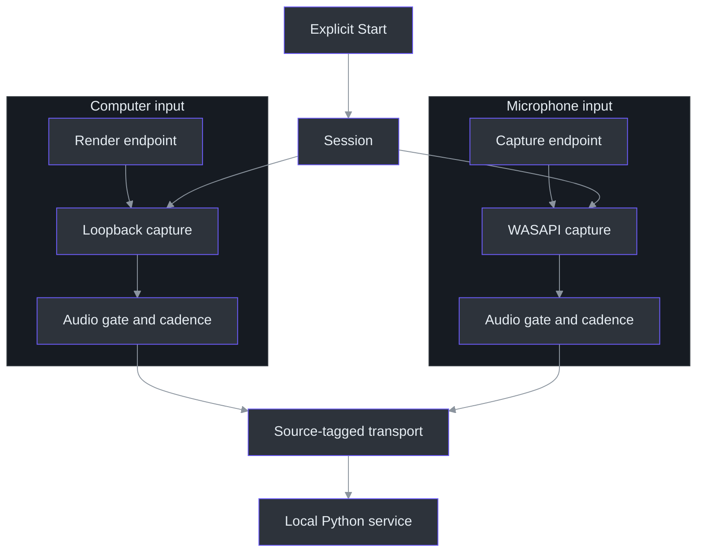
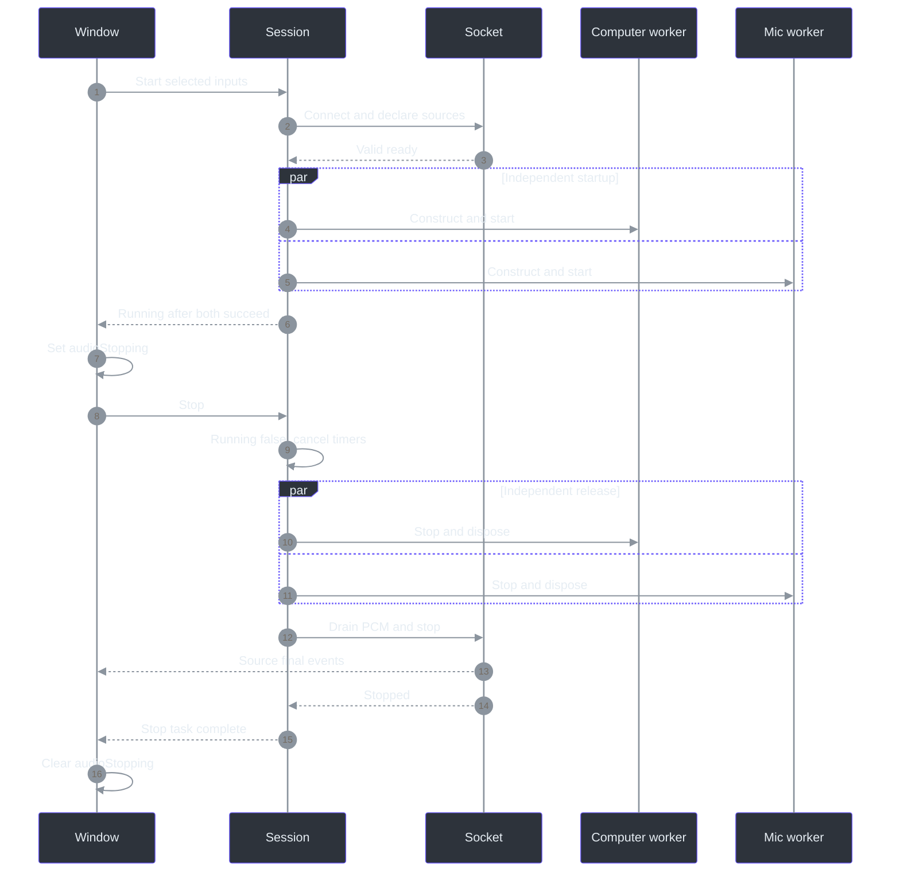

# 7. Dual-input capture: two sources, one owned session

## Why two inputs must not become one waveform

Imagine listening to computer playback while dictating a question into a microphone. Adding the samples together would discard the distinction the reader needs: which text came from playback, and which came from dictation? Phantom Fudge instead preserves two acquisition paths. `WasapiInput` selects render loopback for Computer and a capture endpoint for Microphone; each becomes a separate source-tagged stream. This is input attribution, **not speaker identification**. Several people can speak through Computer, and playback can acoustically reappear in Mic. The implementation contains no mixing or acoustic-echo-cancellation stage. (`src\PhantomFudge.App\Audio\WasapiInput.cs:20-55`, `WasapiInput`; `docs\DUAL-SOURCE-AUDIO.md:8-23`, “Design and boundaries”.)

The equally important distinction is **selection versus capture**. `MainWindow` defaults `captureMode` to `Both`, populates device lists, and subscribes to notifications; its constructor does not start recording. `Start_Click` checks the requested selections, protection readiness, and token before calling the transcriber. Merely launching the idle Python service is not permission to acquire audio. (`src\PhantomFudge.App\MainWindow.xaml.cs:33-77`, `MainWindow`; `src\PhantomFudge.App\MainWindow.xaml.cs:606-645`, `Start_Click`; `scripts\Run-PhantomFudge.ps1:39-55`, launcher.)

This chapter follows that boundary from a deliberate Start to the last endpoint release. [Chapter 8](08-streaming-protocol.md) continues at the socket; [chapter 9](09-python-recognition.md) follows the independent recognizers.

## The ownership map

The class name `LoopbackTranscriber` preserves its computer-only history, but its `Session` now owns an array of `Input` objects. Each input owns its endpoint ID, callback handlers, audio lock, silence cadence, startup task, recording-stopped completion, and latest level. The session owns one transport and shared cancellation/failure state. This divides mutable audio state without dividing the user's Start/Stop transaction. (`src\PhantomFudge.App\Audio\LoopbackTranscriber.cs:475-523`, `Input` and `Session`.)



The diagram describes ownership and data flow, not synchronized acoustic clocks. The endpoint branches are constructed independently after transport readiness. (`src\PhantomFudge.App\Audio\LoopbackTranscriber.cs:101-127`, `StartCoreAsync`.)

| API or type | Exact role and consequence |
| --- | --- |
| `AudioSource` | Byte values `Computer = 1`, `Microphone = 2`; wire/display names are centralized. (`src\PhantomFudge.Core\AudioSource.cs:3-30`, `AudioSourceNames`.) |
| `AudioInputSelection` | Nullable Computer/Microphone IDs represent the requested subset. (`src\PhantomFudge.App\Audio\TranscriptEvent.cs:5-7`, record declarations.) |
| `StartAsync(string, Uri, string, CancellationToken)` | Legacy Computer-only, protocol-v1 entry point. (`src\PhantomFudge.App\Audio\LoopbackTranscriber.cs:64-65`, `StartAsync`.) |
| `StartAsync(AudioInputSelection, …)` | Protocol v2, including either single-source mode. (`src\PhantomFudge.App\Audio\LoopbackTranscriber.cs:67-69`, `StartAsync`.) |
| `SourceLevelChanged` | Reports a source and its latest normalized RMS value. (`src\PhantomFudge.App\Audio\LoopbackTranscriber.cs:267-290`, `PublishLevel`, `CalculateLevel`.) |
| `LevelChanged` | Compatibility aggregate: maximum of latest input levels, not a mixed waveform's RMS. (`src\PhantomFudge.App\Audio\LoopbackTranscriber.cs:267-277`, `PublishLevel`.) |

## The Start journey: readiness before native acquisition

`ValidateSelection` rejects an empty subset, whitespace IDs, and identical IDs for both requested inputs. `WasapiInput.MatchesSelection` then requires exact ordinal ID equality, the correct direction, and `DeviceState.Active`. Enumeration does not silently choose the current Windows default at capture time. The UI may initially select the first enumerated device, but the actual start uses that explicit ID. (`src\PhantomFudge.App\Audio\LoopbackTranscriber.cs:141-156`, `ValidateSelection`; `src\PhantomFudge.App\Audio\WasapiInput.cs:64-74`, `MatchesSelection`; `src\PhantomFudge.App\MainWindow.xaml.cs:543-571`, `RefreshDevices`.)

Startup first reserves a session and connects its transport. Only after `ConnectAsync` accepts the service's `ready` response are input startup tasks scheduled. Native construction itself is inside `Task.Run`, not just `StartRecording`. The source comment identifies why: NAudio captures the construction-time synchronization context, so constructing on the WPF dispatcher could make a later native join depend on the very UI thread waiting for completion. (`src\PhantomFudge.App\Audio\LoopbackTranscriber.cs:86-114`, `StartCoreAsync`.)



`Running` becomes true only when every startup succeeded, no input already reported `RecordingStopped`, no fault exists, and Stop was not requested. This is not a promise that the two devices started at the same physical instant. Audio acceptance is enabled inside each worker before its `StartRecording` call, whereas the aggregate running state is established after all startup tasks complete. (`src\PhantomFudge.App\Audio\LoopbackTranscriber.cs:111-124`, `StartCoreAsync`; `src\PhantomFudge.App\Audio\LoopbackTranscriber.cs:194-218`, `StartCapture`.)

## A callback, measured in bytes rather than intuition

Both WASAPI wrappers request shared-mode **16,000 Hz, 16-bit, mono PCM**. Computer uses `WasapiLoopbackCapture`; Mic uses `WasapiCapture`. The wrapper documents NAudio's shared-capture conversion flags rather than implementing a custom application resampler. (`src\PhantomFudge.App\Audio\WasapiInput.cs:48-54`, constructor.)

The format yields:

- `16,000 samples/second × 2 bytes/sample = 32,000 bytes/second` per source.
- A 100 ms silence frame contains `1,600 samples = 3,200 bytes`.
- A 48,000-byte callback represents 1.5 seconds of this PCM. `OnAudio` splits it into 32,000 and 16,000 bytes; the v2 transport adds a source byte to each, producing 32,001- and 16,001-byte binary messages.
- Two live sources produce 64,000 PCM bytes/second before framing overhead—not a 32 kHz mixed track.

These are calculations from `WaveFormat`, the socket constants, and the callback chunking loop, not measured hardware callback sizes. (`src\PhantomFudge.App\Audio\WasapiInput.cs:53-54`, constructor; `src\PhantomFudge.App\Audio\TranscriptionSocket.cs:13-18`, constants; `src\PhantomFudge.App\Audio\LoopbackTranscriber.cs:233-257`, `OnAudio`; `src\PhantomFudge.App\Audio\TranscriptionSocket.cs:208-217`, `TryEnqueueAudio`.)

`OnAudio` rejects invalid lengths, records packet arrival under that input's `AudioGate`, and enqueues copied chunks. Copying matters because a capture callback's buffer is reusable: the sender must not later observe a buffer that the capture implementation or caller has overwritten. A full transport budget faults the session rather than pretending the missing chunk was silence. (`src\PhantomFudge.App\Audio\LoopbackTranscriber.cs:238-250`, `OnAudio`; `src\PhantomFudge.App\Audio\TranscriptionSocket.cs:182-229`, `TryEnqueueAudio`.)

Metering is throttled to approximately one update per 100 ms of callback time. Samples are read little-endian, divided by 32,768, squared, averaged, and square-rooted. Alternating `+16,384` and `−16,384` therefore yields RMS `0.5`, not zero; opposite signs cancel in an arithmetic mean but not in energy. `LevelAsync` tests that exact distinction. (`src\PhantomFudge.App\Audio\LoopbackTranscriber.cs:252-289`, `OnAudio`, `CalculateLevel`; `tests\PhantomFudge.Audio.Tests\Program.cs:202-209`, `LevelAsync`.)

## Silence cadence is transport continuity, not endpoint tuning

An idle track has its own 100 ms periodic timer. `SilenceCadence.TrySchedule` permits one silence frame only after at least 250 ms without a real packet and at least 100 ms since the previous synthetic frame. A real packet resets both timestamps. The shared per-input lock prevents a recent packet and silence decision from racing within that track. (`src\PhantomFudge.App\Audio\SilenceCadence.cs:5-19`, `SilenceCadence`; `src\PhantomFudge.App\Audio\LoopbackTranscriber.cs:292-317`, `SupplySilenceAsync`.)

For example, after a packet at 1,000 ms, a decision at 1,249 ms fails; one at 1,250 ms may succeed. A delayed decision at 10,000 ms still emits only one 3,200-byte frame—it does not manufacture every missing interval. Timer scheduling can place the actual decision later than the threshold. Computer activity does not reset Mic's cadence, and vice versa. The corresponding synthetic tests check both the threshold and cross-source independence. (`tests\PhantomFudge.Audio.Tests\Program.cs:212-225`, `SilenceCadenceAsync`; `tests\PhantomFudge.Audio.Tests\DualSourceTests.cs:502-523`, `DualInputPolicyAsync`.)

Consequently, these timestamps describe **callback arrival and supplied PCM**, not acoustic onset measurements. Cadence does not change Vosk endpoint settings; its implementation only creates zero PCM. Decoder-history rotation is a separate 30-second mechanism covered in chapter 9. (`src\PhantomFudge.App\Audio\LoopbackTranscriber.cs:14`, `SilenceFrame`; `src\PhantomFudge.App\Audio\LoopbackTranscriber.cs:304-312`, `SupplySilenceAsync`; `services\transcription\recognizer.py:82-93`, `VoskRecognizer.accept`.)

## Cancellation must invalidate tomorrow's queued Start

A semaphore alone would serialize requests but could allow a Start already queued behind another operation to run after the user's Stop. `_stopVersion` solves that ordering problem. Start snapshots it before waiting; Stop increments it before waiting for lifecycle ownership. A queued Start with an old version is rejected before allocating its session. (`src\PhantomFudge.App\Audio\LoopbackTranscriber.cs:71-93`, `StartCoreAsync`; `src\PhantomFudge.App\Audio\LoopbackTranscriber.cs:158-191`, `StopAsync`, `RequestStop`.)

The following Python-shaped pseudocode translates that C# algorithm; it is not another implementation:

```python
async def start(selection):
    observed_stop_version = atomic_read(stop_version)
    async with lifecycle:
        require_not_disposed()
        require_no_session_or_outstanding_release()
        inputs = validate(selection)
        with request_lock:
            if observed_stop_version != stop_version:
                raise StartupCanceled()
            session = reserve(inputs)
        await connect_and_validate_ready(session)
        await start_each_input_on_workers(session)

async def stop():
    with request_lock:
        increment_stop_version()
        request_current_session_stop()
    async with lifecycle:
        await finish_current_session()
```

`V2QueuedStartAsync` tests both Stop and Dispose against a pending handshake and a second queued Start. Its important assertion is not merely “eventually stopped”: only one handshake occurred, and no hardware seam was reached. (`tests\PhantomFudge.Audio.Tests\DualSourceTests.cs:475-500`, `V2QueuedStartAsync`.)

## Stop is a drain, while failure is an abort

| Boundary | Implemented behavior |
| --- | --- |
| Normal Stop | Clear `Running`, cancel startup/silence, release inputs, then dispose the transport through its drain path. (`src\PhantomFudge.App\Audio\LoopbackTranscriber.cs:366-426`, `StopSessionAsync`, `FinishSessionAsync`; `src\PhantomFudge.App\Audio\LoopbackTranscriber.cs:508-522`, `Session.RequestStop`.) |
| Startup wait | Ten-second capture-start wait, cancellable; this cannot forcibly terminate a native call. (`src\PhantomFudge.App\Audio\LoopbackTranscriber.cs:12-13`, constants; `src\PhantomFudge.App\Audio\LoopbackTranscriber.cs:111-114`, `StartCoreAsync`.) |
| Native release | Independent release workers; aggregate five-second wait. A hung input does not prevent the responsive input's worker from releasing it. (`src\PhantomFudge.App\Audio\LoopbackTranscriber.cs:387-405`, `FinishSessionAsync`.) |
| Late native return | Worker awaits its startup task, stops capture, waits for recording completion when applicable, disposes, and detaches handlers. (`src\PhantomFudge.App\Audio\LoopbackTranscriber.cs:428-472`, `ReleaseInputAsync`.) |
| Unsafe restart | Outstanding release blocks another Start; cleanup failure sets a sticky guard. (`src\PhantomFudge.App\Audio\LoopbackTranscriber.cs:81-84`, `StartCoreAsync`; `src\PhantomFudge.App\Audio\LoopbackTranscriber.cs:458-462`, `ReleaseInputAsync`.) |

Five seconds is **not an end-to-end Stop deadline**: transport final-drain has its own 15-second timeout. Nor does timing out prove the operating system released the endpoint. Ownership remains with the outstanding worker; the user-facing fault asks for app closure rather than silently opening another device. (`src\PhantomFudge.App\Audio\TranscriptionSocket.cs:20-21`, timeouts; `src\PhantomFudge.App\Audio\TranscriptionSocket.cs:255-280`, `StopAsync`; `src\PhantomFudge.App\Audio\LoopbackTranscriber.cs:387-413`, `FinishSessionAsync`.)

The UI therefore maintains `audioStopping` independently of `IsRunning`. It disables Start and input changes until the stop task finishes. Without that distinction, `transcript.BeginSession()` could reset final-ID and partial state while old-session finals were still arriving. (`src\PhantomFudge.App\MainWindow.xaml.cs:606-637`, `Start_Click`; `src\PhantomFudge.App\MainWindow.xaml.cs:661-729`, audio controls and stop methods; `src\PhantomFudge.Core\TranscriptBuffer.cs:23-39`, `BeginSession`.)

For faults, `SignalFault` publishes only the first failure, disables both inputs, aborts transport, and queues cleanup. It deliberately avoids acquiring the other input's audio lock from a callback: simultaneous failures would otherwise risk lock inversion. Normal final-drain guarantees do not apply to this abort path. (`src\PhantomFudge.App\Audio\LoopbackTranscriber.cs:341-364`, `SignalFault`.)

## Failure scenarios and evidence limits

Unplugging either selected endpoint stops the whole session; changing the Windows default does not switch it. `RenderEndpointNotification` filters by ID, invalidates once, and dispatches cleanup notification onto the thread pool so the Core Audio callback returns promptly. (`src\PhantomFudge.App\Audio\RenderEndpointNotification.cs:10-30`, notification methods.)

Synthetic tests exercise denied construction, failed startup, concurrent device loss, hung startup/stop, and failed disposal. `DualCaptureAsync` additionally checks readiness-before-opening, copied PCM, independent silence, and levels. These are executable descriptions of ownership guarantees—not evidence that every microphone driver behaves correctly. No tests were run for this documentation task. (`tests\PhantomFudge.Audio.Tests\DualSourceTests.cs:526-602`, `DualCaptureAsync`; `tests\PhantomFudge.Audio.Tests\DualSourceTests.cs:702-868`, failure scenarios.)

Actual microphone permission behavior, echo, recorder-visible OS privacy indicators, and hardware quality remain separate qualification questions. Source labels cannot remove echo, suppress Windows indicators, or establish who spoke. (`docs\DUAL-SOURCE-AUDIO.md:10-26`, boundaries; `docs\QUALIFICATION.md:1-7`, qualification status.)

### Reader checkpoints

1. Trace a Stop arriving while a second Start waits on `_lifecycle`. Which comparison prevents reopening?
2. Compute the two wire-message lengths for a 40,000-byte Computer callback. Which byte is excluded from PCM duration?
3. Explain why a Mic stop hang must not block Computer release, yet must block a fresh session.
4. At 300 ms of callback silence, what can be inferred about supplied PCM—and what cannot be inferred about acoustic timing?

### Source-reading route

Read [source identities](../../src/PhantomFudge.Core/AudioSource.cs), [endpoint ownership](../../src/PhantomFudge.App/Audio/WasapiInput.cs), [session orchestration](../../src/PhantomFudge.App/Audio/LoopbackTranscriber.cs), [silence decisions](../../src/PhantomFudge.App/Audio/SilenceCadence.cs), then [synthetic lifecycle cases](../../tests/PhantomFudge.Audio.Tests/DualSourceTests.cs). Following this order separates format, ownership, timing, and evidence before introducing the wire protocol.
