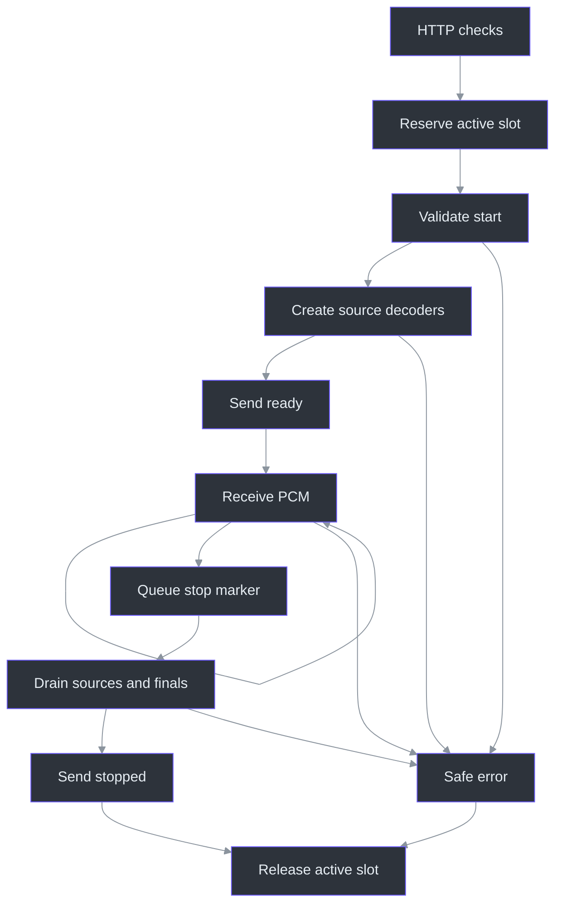
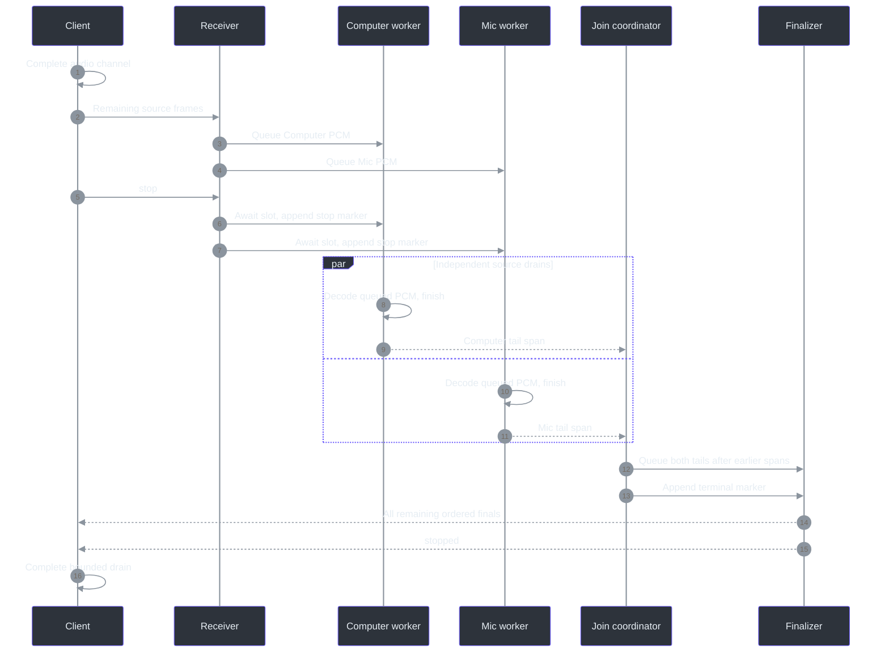

# 8. Streaming protocol: preserving identity under backpressure

## Why the protocol is more than a pipe

A socket that moves bytes successfully can still produce an incorrect transcript: it can mix sources, accumulate unbounded delay, accept replayed final IDs, or report completion before a decoder flushes. Phantom Fudge's protocol makes those boundaries explicit. The C# client owns admission and copied PCM; Python owns per-source decoding and publication; both reject invalid transitions rather than guessing how to recover. (`src\PhantomFudge.App\Audio\TranscriptionSocket.cs:194-238`, `TryEnqueueAudio`; `src\PhantomFudge.App\Audio\TranscriptionSocket.cs:398-477`, `ProcessMessage`; `services\transcription\server.py:280-536`, `Session`.)

Compatibility is deliberately additive. Both speech versions use `/v1/transcribe`; v1 has unprefixed Computer PCM, while v2 declares a source subset and prefixes each binary message. The URL's `v1` does not imply Computer-only operation. Management independently retains `protocolVersion: 1` and advertises `speechProtocolVersions: [1, 2]`. (`services\transcription\server.py:100-112`, `parse_start`; `services\transcription\server.py:218-244`, `runtime_info`; `services\transcription\server.py:319-326`, `Session.receive`; `services\transcription\server.py:649-652`, routes.)

The October 9 hybrid engine changes the work **behind** this contract, not the JSON schema or source byte. Vosk supplies provisional text; Whisper supplies final text from bounded, disjoint PCM spans. Neither an engine selector nor vocabulary belongs in a speech start message. The public validation receipt still records versions 1 and 2; pipeline version 2 is a runtime implementation identity, not speech v3. (`services\transcription\accurate.py:48-71`, `HybridRecognizer`; `services\transcription\configuration.py:11-15`, defaults and `PIPELINE_VERSION`; `tools\SpeechBench\results\quality-validation-20261009.json:7-10`, protocol versions.)

## Admission before audio

`TranscriptionSocket.ValidateEndpoint` accepts only literal IPv4 or IPv6 loopback WebSocket URLs with the exact path. It rejects hostname resolution, user information, queries, fragments, escaped paths, and alternate numeric IP spellings. Proxies and redirects are disabled. The production native launcher uses IPv4 `127.0.0.1`; accepting `[::1]` in the client does not mean the default server binds IPv6. (`src\PhantomFudge.App\Audio\TranscriptionSocket.cs:26-31`, HTTP handler; `src\PhantomFudge.App\Audio\TranscriptionSocket.cs:82-98`, `ValidateEndpoint`; `services\transcription\manage.py:188-193`, `start`.)

On the server, nonempty `Origin` headers are rejected, authentication requires exactly one Bearer header, and token comparison uses `hmac.compare_digest`. Query strings and request bodies are not accepted. Readiness and the single active-session gate are checked before upgrading. `runtime.active = True` occurs without an intervening `await`, so even a client stalled before its start message occupies the only admission slot. (`services\transcription\server.py:210-215`, `authorized`; `services\transcription\server.py:538-563`, `transcribe`.)



This state sketch includes the normal stop marker, not an automatic retry or reconnect. A `TranscriptionSocket` is single-use; a fresh transcription session creates a fresh transport. (`src\PhantomFudge.App\Audio\TranscriptionSocket.cs:128-142`, `ConnectCoreAsync`; `src\PhantomFudge.App\Audio\LoopbackTranscriber.cs:517-524`, `Session`.)

## The contract, field by field

These are complete start messages, with no token in JSON:

```json
{"type":"start","sampleRate":16000,"channels":1,"encoding":"pcm_s16le"}
```

```json
{"type":"start","protocolVersion":2,"sampleRate":16000,"channels":1,"encoding":"pcm_s16le","sources":["computer","microphone"]}
```

The server compares the parsed object against the exact expected shape. For v2, valid lists are `["computer"]`, `["microphone"]`, and `["computer","microphone"]`. Reversal, duplicates, unknown names, empty lists, extra fields, and noninteger format/version values fail. C# copies and sorts a caller's source list before sending, but the wire contract itself requires canonical order. (`services\transcription\server.py:100-112`, `parse_start`; `src\PhantomFudge.App\Audio\TranscriptionSocket.cs:104-114`, source-aware `ConnectAsync`; `services\transcription\tests\test_dual_protocol.py:57-92`, `StartSchemaTests`.)

| Message | Direction | Required content |
| --- | --- | --- |
| `start` | Client → server | Format fields above; v2 adds version and sources. |
| `ready` | Server → client | Accepted format; v2 echoes version and canonical sources. |
| Binary audio | Client → server | V1: PCM only. V2: one source byte followed by PCM. |
| `partial` | Server → client | `type`, `text`; v2 additionally requires `source`. |
| `final` | Server → client | `type`, `text`, `segmentId`, `startSeconds`, `endSeconds`; v2 adds `source`. |
| `stop` | Client → server | Exactly `{"type":"stop"}`; no source-specific stop exists. |
| `stopped` | Server → client | Exactly `{"type":"stopped"}`, after every source finalization. |
| `error` | Server → client | `type`, safe `code`, safe `message`; unchanged between versions. |

The table is implemented by `parse_start`, `Session.receive`, `Session.publish`, `Session.recognize`, and `error`. (`services\transcription\server.py:71-72`, `error`; `services\transcription\server.py:100-112`, `parse_start`; `services\transcription\server.py:296-498`, `Session`; `services\transcription\server.py:563-574`, ready construction.)

### A frame calculation

`AudioSource` assigns byte `1` to Computer and `2` to Microphone. For 100 ms of 16 kHz mono PCM16, the payload is `16,000 × 0.1 × 2 = 3,200` bytes. V2 sends `1 + 3,200 = 3,201` application-message bytes. The first byte is metadata, not a sample; duration, queue bytes, and byte-rate credit count only the remaining PCM. WebSocket/TCP overhead is additional and is not included in this calculation. (`src\PhantomFudge.Core\AudioSource.cs:3-7`, `AudioSource`; `src\PhantomFudge.App\Audio\TranscriptionSocket.cs:13-17`, constants; `src\PhantomFudge.App\Audio\TranscriptionSocket.cs:217-226`, `TryEnqueueAudio`; `services\transcription\server.py:319-357`, `Session.receive`.)

The smallest legal v2 message is three bytes: a source plus one two-byte sample. The largest is 32,001 bytes: a source plus one second of PCM. Legal message lengths are therefore odd, while legal PCM lengths are even. A prefix without PCM, an undeclared source, or 32,002 PCM bytes is invalid. (`services\transcription\server.py:321-327`, `Session.receive`; `tests\PhantomFudge.Audio.Tests\DualSourceTests.cs:75-88`, `DrainV2Async`.)

## Backpressure: bytes, objects, and source fairness

| Budget | Native client | Python service |
| --- | --- | --- |
| Maximum PCM per message | 32,000 bytes | 32,000 bytes |
| Pending PCM per source | 64,000 bytes | 64,000 queued bytes |
| Dual-source PCM maximum | 128,000 pending bytes | 128,000 queued bytes |
| Source frame slots | No separate 32-frame source cap | 32 queued frames per source |
| Aggregate queue slots | Channel capacity 64,000 frame objects | Hybrid: separate 32-slot source queues, at most 64 total |
| Pending lifetime | Released after send completes | Released when worker dequeues, before recognition |

These are different accounting boundaries. Native pending bytes include the frame currently sending; server queued bytes exclude the frame currently being decoded. The table is not a total-process-memory guarantee: message objects, socket buffers, copies, and decoder memory exist outside these PCM counters. (`src\PhantomFudge.App\Audio\TranscriptionSocket.cs:13-43`, constants/channel; `src\PhantomFudge.App\Audio\TranscriptionSocket.cs:207-230`, admission; `src\PhantomFudge.App\Audio\TranscriptionSocket.cs:322-336`, sender; `src\PhantomFudge.App\Audio\TranscriptionSocket.cs:552-559`, `ReleaseFrame`; `services\transcription\server.py:280-290`, `Session.__init__`; `services\transcription\server.py:342-357`, receive budgets; `services\transcription\server.py:418-451`, dequeue.)

At 3,200 bytes per frame, twenty queued frames consume a source's full 64,000-byte budget: two seconds of audio. At two bytes per frame, the server's 32-frame cap wins after just 64 queued PCM bytes. Both limits are necessary: a byte-only rule permits many tiny objects, while a frame-only rule permits too much audio latency. A busy Computer stream cannot borrow Mic's unused source quota. Hybrid intake now has an independent FIFO and one executor worker per source; explicit legacy Vosk retains shared intake. This removes shared-intake blocking, not CPU contention or every latency difference. (`services\transcription\server.py:287-288`, `Session.__init__`; `services\transcription\server.py:342-357`, `Session.receive`; `services\transcription\tests\test_dual_protocol.py:461-497`, source-budget tests; `tools\SpeechBench\results\synthetic-quality-20261009.json:12704`, retained shared-intake failure and replacement.)

There is a second bounded stage: at most two pending final spans per source, including work currently finalizing, and at most four across Both. Each span is at most `16 × 32,000 = 512,000` bytes, so the pending-span allowance is 1,024,000 bytes/source or 2,048,000 bytes for two sources. It is **additional to** the small PCM intake queues; current accumulation, temporary copies, float conversion, and model memory are outside that allowance. A shared single-worker finalizer consumes admitted spans in queue order. Per-source span order is preserved; there is no promise of alternating Computer/Mic finals. The adoption receipt records a maximum of two pending finals/source without faults or drops. (`services\transcription\accurate.py:12-30`, span bound and `FinalSpan`; `tools\SpeechBench\results\synthetic-quality-20261009.json:6597-6603`, adopted pending-work counters.)

Translated from the C# admission algorithm:

```python
def admit(source, pcm):
    validate_declared_source_and_even_nonempty_pcm(pcm)
    with queue_lock:
        if not accepting:
            return False
        if len(pcm) > 64000 - source_pending[source]:
            overflow = True
        elif len(pcm) > 128000 - total_pending:
            overflow = True
        else:
            frame = prefix_if_v2(source) + copy_bytes(pcm)
            reserve_pcm_budget(source, len(pcm))
            if try_write_channel(frame):
                submitted[source] += len(pcm)
                return True
            release_budget_and_clear_copy(frame)
            overflow = True
    if overflow:
        fault_entire_session()
    return False
```

Overflow is visible failure, not silent packet dropping or disk spill. The real method also handles closed/disposed state and per-version framing. (`src\PhantomFudge.App\Audio\TranscriptionSocket.cs:194-238`, `TryEnqueueAudio`.)

### Rate is not backlog

Each server source separately starts with 64,000 byte credits and 200 frame credits, replenished at 32,000 bytes/second and 100 frames/second using monotonic elapsed time. Credits are capped at their burst sizes. Thus a source can spend an initial two-second byte burst, but sending 32,000 additional bytes immediately needs replenishment even if the decoder has emptied its queue. Conversely, a slow decoder can trigger backlog at an otherwise valid live rate. (`services\transcription\server.py:45-59`, `Limits`; `services\transcription\server.py:263-273`, `SourceState`; `services\transcription\server.py:329-346`, `Session.receive`.)

Other defaults are a five-second start-message wait, fifteen-second receive-idle wait, five-second provisional-decoder operation wait, two-second send wait, and eight hours of **submitted PCM duration per source**. The five-second provisional deadline must not be applied to Whisper finalization: final work has a separate bounded wait. These are not advertised latency targets. (`services\transcription\server.py:46-59`, `Limits`; `services\transcription\server.py:340-341`, duration enforcement; `tools\SpeechBench\results\synthetic-quality-20261009.json:12704`, retained experiment exceeding the 20-second final native-call deadline.)

## Transcript clocks: global order, local time

Consider three emitted finals: Computer ID 1 at `0.0–0.2`, Mic ID 2 at `0.0–0.1`, then Computer ID 3 at `0.2–0.3`. This is legal. IDs order session publication; timestamps order only the corresponding source's PCM. Comparing Mic's `0.1` against Computer's previous `0.2` would falsely reject valid interleaving. `Session.publish` keeps one global counter and a `last_end` per source. (`services\transcription\server.py:263-290`, state; `services\transcription\server.py:361-392`, `publish`; `services\transcription\tests\test_dual_protocol.py:182-200`, interleaved-final test.)

The server requires finite, nonnegative, nonregressing source times bounded by that source's received duration. V2 has no pre-rounding duration tolerance. Millisecond rounding is then clipped to whole elapsed milliseconds: 18 bytes represent `18 / 32,000 = 0.0005625` seconds, but cannot become a `0.001`-second wire endpoint, so the result is `0.000`. The native client independently checks finite times, increasing global IDs, and v2 source monotonicity, but its submitted-duration bound allows one extra second. Do not describe the two validators as identical. (`services\transcription\server.py:371-385`, `publish`; `services\transcription\tests\test_dual_protocol.py:214-222`, rounding test; `src\PhantomFudge.App\Audio\TranscriptionSocket.cs:446-466`, final validation.)

Partials are also source-local. An unchanged Mic partial remains suppressed even after Computer finalizes. On the UI side, `TranscriptEvent.Source` carries the label, and `TranscriptBuffer.AddFinal` removes only that source's partial. A final can be empty while still advancing ordering and clearing pending text. (`services\transcription\server.py:378-392`, `publish`; `src\PhantomFudge.App\Audio\TranscriptEvent.cs:9-15`, `TranscriptEvent`; `src\PhantomFudge.Core\TranscriptBuffer.cs:41-72`, partial/final methods.)

Hybrid concurrency requires an additional ordering rule. While a source has outstanding finals, its latest provisional replacement is deferred. Publishing a final and assigning its global ID share a lock with partial publication; when that source's pending-final count reaches zero, its latest eligible partial can follow. Enqueuing another committed span clears the deferred text for the old span. This prevents a late Whisper final from clearing a newer visible provisional prematurely. The final timestamps themselves are owned-span boundaries, not word-aligned speech times. (`services\transcription\accurate.py:41-71`, disjoint span creation; `services\transcription\accurate.py:90-118`, final timestamps.) The publication and queue coordination belong to `Session`, within the server chain traced above.

## Why Stop joins the queue



The client's sender emits Stop only after its channel drains. The hybrid receiver awaits space for a `None` marker in every source queue instead of rejecting Stop because valid PCM occupies the slots. Each source worker drains its earlier PCM and returns a tail; the coordinator waits for all workers, enqueues tails in canonical source order, and finally places the finalizer's terminal marker. The finalizer—not the source worker—sends `stopped` after all earlier spans and tails have completed. An unused source still has an empty tail and final. During Stop, a full pending-final allowance is drained rather than rejecting an already accepted tail solely because two earlier spans remain outstanding. (`src\PhantomFudge.App\Audio\TranscriptionSocket.cs:322-340`, `SendAudioAsync`; `services\transcription\server.py:306-316`, `receive`; `services\transcription\server.py:394-498`, `recognize`; `services\transcription\accurate.py:65-71`, `finish`; `services\transcription\accurate.py:93-95`, empty final.)

The v2 client refuses `stopped` before Stop or without observing a final for every declared source after its stop-sent flag. Its **90-second maximum flush wait** accommodates the backend's conservative **85-second** pending-timeout envelope; failure warns that final text may be unavailable. Neither number is typical Stop latency: the adopted short-case receipt reports median/p95 **0.480/0.746 seconds**. This remains a completion barrier, not recovery after a broken connection or an unconditional final-delivery guarantee. (`src\PhantomFudge.App\Audio\TranscriptionSocket.cs:241-289`, `StopAsync`; `src\PhantomFudge.App\Audio\TranscriptionSocket.cs:463-474`, `ProcessMessage`; `tools\SpeechBench\results\synthetic-quality-20261009.json:12733-12742`, production maximum; `tools\SpeechBench\results\synthetic-quality-20261009.json:6614-6618`, observed stop distribution.)

## Defensive parsing and testable limits

Server control messages are capped at 1,024 UTF-8 bytes. Decoder text is capped at 8,192 Python characters before publication, whereas native transcript text validation allows 16,384 .NET string characters inside its separate message-byte limit. Character budgets and encoded-message budgets are not interchangeable, especially for escaped Unicode. (`services\transcription\server.py:46-48`, `Limits`; `services\transcription\server.py:88-90`, `parse_control`; `services\transcription\server.py:361-369`, `Session.publish`; `src\PhantomFudge.App\Audio\TranscriptionSocket.cs:439-449`, `ProcessMessage`.)

Native inbound JSON is limited to 32,768 bytes and depth eight; only text messages are accepted. Duplicate properties are rejected, v2 ready requires an exact source echo, and transcript properties are exact. However, legacy ready validation is less restrictive about extra properties. Python uses ordinary `json.loads`, so duplicate-key rejection is not a symmetric server guarantee. A precise specification must preserve those implementation distinctions. (`src\PhantomFudge.App\Audio\TranscriptionSocket.cs:352-432`, receive/ready parsing; `services\transcription\server.py:88-97`, `parse_control`.)

Server protocol failures normally attempt a fixed error envelope and close code 1008; grossly oversized messages can instead hit aiohttp's transport ceiling and close with 1009. Native code never displays a service-provided error string directly. (`services\transcription\server.py:29-42`, error catalogue; `services\transcription\server.py:194-198`, `close_with_error`; `services\transcription\tests\test_dual_protocol.py:257-264`, ceiling test; `src\PhantomFudge.App\Audio\TranscriptionSocket.cs:406-414`, error handling.)

Read `V2FramingAsync`, `V2BackpressureAsync`, and `V2MissingFinalAsync` for copied bytes, independent native budgets, and incomplete stop rejection. Python's full-queue stop test proves sentinel ordering, while `RunDualSyntheticServiceCheckAsync` streams two in-memory fixtures through the actual C# transport and checks source-specific phrases. None of these test definitions constitutes a new passing run here, acoustic isolation, or cloud integration. Protocol v3 and question commit are not accepted by the current start parser. (`tests\PhantomFudge.Audio.Tests\DualSourceTests.cs:96-140`, `V2FramingAsync`; `tests\PhantomFudge.Audio.Tests\DualSourceTests.cs:356-428`, stop/budget tests; `services\transcription\tests\test_dual_protocol.py:499-522`, full-queue stop test; `tests\PhantomFudge.Audio.Tests\DualSyntheticServiceCheck.cs:49-79`, synthetic runner; `services\transcription\server.py:100-112`, `parse_start`.)

### Reader checkpoints

1. Why can a two-byte PCM flood hit the server's frame cap before its byte cap?
2. Which counters include the source prefix? Explain why the correct answer is none of the PCM counters.
3. Why is Computer ID 9 ending at 12 seconds compatible with Mic ID 10 ending at 3 seconds?
4. What changes if a decoder throws while finalizing the second source? Distinguish a received first final from a successful stopped barrier.
5. Why do 128,000 bytes of dual-source intake capacity and 2,048,000 bytes of pending-final allowance describe different stages rather than contradictory limits?

### Source-reading route

Compare [native transport](../../src/PhantomFudge.App/Audio/TranscriptionSocket.cs) with [server session](../../services/transcription/server.py), then read [dual-protocol tests](../../services/transcription/tests/test_dual_protocol.py) and [transcript state](../../src/PhantomFudge.Core/TranscriptBuffer.cs). Continue to [recognition](09-python-recognition.md) for the timing values the protocol validates.
