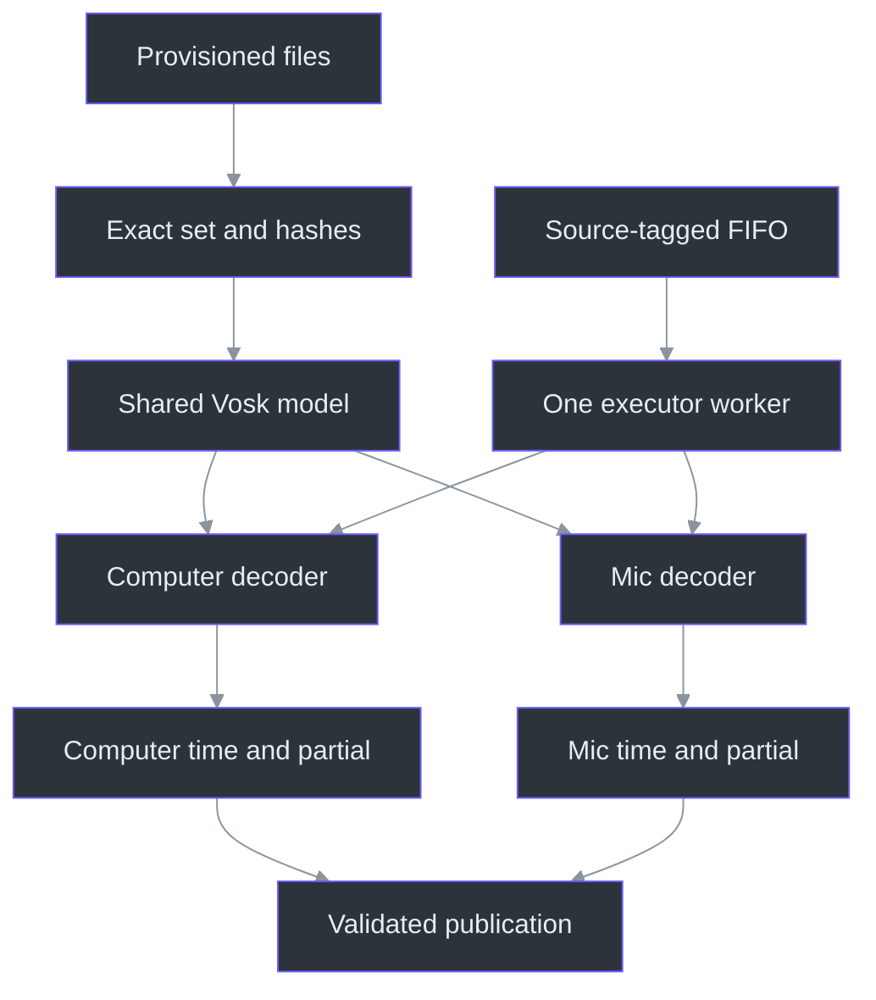
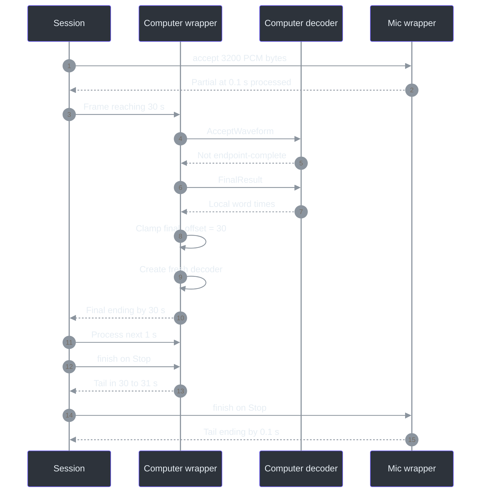

# 9. Python recognition: shared model, independent histories

## Why separate the model from its history?

Two sources need separate recognition histories, not two independently loaded copies of the same model. Computer playback must not become the acoustic context for a dictated Mic question. `VoskFactory` therefore retains one model and creates a new `VoskRecognizer` for each requested source. Each wrapper constructs its own `KaldiRecognizer` and maintains its own sample counter, offset, and last final endpoint. The shared model is treated as immutable by this application; mutable decoder state belongs to one source. (`services\transcription\recognizer.py:41-67`, `VoskFactory`, `VoskRecognizer`; `services\transcription\server.py:378-386`, `transcribe`.)

This distinction also explains the concurrency design. A single executor worker runs source-decoder operations away from aiohttp's event loop. The sources are logically independent but do not decode simultaneously on separate executor threads. That is a bounded-resource tradeoff, not a claim of equal per-source latency or proof that native libraries never use internal threads. The native manager additionally sets `OPENBLAS_NUM_THREADS` and `OMP_NUM_THREADS` to one. (`services\transcription\server.py:109-142`, `Runtime`; `services\transcription\manage.py:167-176`, `start`.)

## Provisioned identity, not a model chosen at request time

| Pinned item | Repository value | Meaning |
| --- | --- | --- |
| Engine package | `vosk==0.3.45` | Python dependency pin, not an accuracy guarantee. |
| HTTP/WebSocket package | `aiohttp==3.14.3` | Transport dependency pin. |
| Model | `vosk-model-small-en-us-0.15` | Specific English model directory and archive. |
| Model language/version | `en-US`, `0.15` | Manifest metadata; no automatic language selection. |
| Archive length | 41,205,931 bytes | Approximately 41.21 MB decimal or 39.30 MiB binary. |
| License metadata | `Apache-2.0` | Manifest's model-license declaration. |
| Checksum provenance | Observed official HTTPS download | Explicitly not a publisher-signed checksum. |

Package rows come from `requirements.txt`; model rows come from the maintained manifest. The “approximately 40 MB” setup description refers to archive size, not resident model memory. (`services\transcription\requirements.txt:1-20`, pinned dependencies; `services\transcription\model.json:2-10`, manifest metadata; `scripts\Initialize-Transcription.ps1:69-79`, model provisioning.)

`verify_model` requires a directory, rejects symlinks, enumerates the complete file set, compares it exactly with the manifest, and SHA-256-checks every expected file. Extra files are therefore a mismatch, not harmless metadata. Verification occurs before importing and constructing Vosk's model. The constructor explicitly supplies `model_path`; the source comment explains that language/name discovery could download a model, which is inappropriate in this request-serving path. (`services\transcription\recognizer.py:22-49`, `verify_model`, `VoskFactory.__init__`.)

The provisioning script is a separate consent and mutation boundary: it downloads only when the model/archive is absent and `-DownloadModel` is supplied, validates archive length and hash, refuses to overwrite an existing invalid model directory, and verifies extracted files. A cached archive can be reused without downloading. Neither the service's WebSocket handler nor the recognizer repairs or silently fetches missing weights. (`scripts\Initialize-Transcription.ps1:69-95`, provisioning; `services\transcription\recognizer.py:22-49`, verification and loading; `services\transcription\server.py:455-466`, `production_app`.)



The diagram combines `VoskFactory` ownership with `Session` source state. Loading the model does not start a decoder for an unrequested source, open a microphone, or create transcript text. (`services\transcription\recognizer.py:41-67`, model/decoder constructors; `services\transcription\server.py:212-235`, `SourceState`, `Session`; `services\transcription\server.py:380-385`, source-decoder construction.)

## Following one 100 ms frame

At 16,000 Hz and two bytes per mono sample, 3,200 bytes represent 1,600 samples and `0.1` seconds. `Session.recognize` dequeues a `(source, pcm)` pair, releases its queue accounting, and invokes only that source's `decoder.accept` through `Runtime.cpu`. This separates backpressure accounting from recognition progress: total received bytes can include queued work, while `VoskRecognizer._samples` advances only as frames reach the decoder. (`services\transcription\server.py:274-287`, `Session.receive`; `services\transcription\server.py:317-333`, `Session.recognize`; `services\transcription\recognizer.py:82-84`, `VoskRecognizer.accept`.)

`accept` increments `_samples` by `len(pcm) // 2`, calls `AcceptWaveform`, and branches on endpoint completion and the 30-second history boundary. A normal incomplete result uses `PartialResult()["partial"]`; an endpoint-complete result uses `Result()` and `_final`. Every new decoder enables word results with `SetWords(True)` and disables partial-word results with `SetPartialWords(False)`. The application needs final word times, but exposes partial text rather than partial word alignments. (`services\transcription\recognizer.py:64-96`, decoder methods.)

`Recognition` is a small immutable result carrier: text, final flag, start, and end. It does not carry source identity; the enclosing `Session` already knows which source's decoder ran and adds the label during publication. Keeping these responsibilities separate lets recognizer tests focus on timing without needing a WebSocket. (`services\transcription\recognizer.py:14-19`, `Recognition`; `services\transcription\server.py:289-315`, `Session.publish`; `services\transcription\tests\test_recognizer.py:37-75`, `RecognizerTests`.)

### Partials are replacements, not append-only sentences

The server stores `last_partial` independently for each source and sends only changed partial text. A final resets that source's partial memory to `None`; it does not reset the other track. An empty initial partial can be emitted because `""` differs from `None`. This is useful state information, not evidence of recognized speech. (`services\transcription\server.py:212-220`, `SourceState`; `services\transcription\server.py:301-315`, `Session.publish`.)

Final publication validates the result type, string type, 8,192-character service text limit, finite timestamps, and source-duration ordering before assigning the next global segment ID. These checks protect the wire contract even when a decoder adapter is replaced by a test double or returns invalid data. A final is committed recognition output, not a guarantee that the words are correct. (`services\transcription\server.py:289-315`, `Session.publish`; `services\transcription\tests\test_dual_protocol.py:349-377`, invalid-result and timestamp-regression tests.)

## Bounding continuous-speech history

A stream need not pause conveniently. The wrapper therefore finalizes and recreates its mutable decoder once supplied audio since `_offset` reaches at least 30 seconds. This is a processed-audio threshold, not a wall-clock timer and not a configurable silence detector. The rollover check follows `AcceptWaveform`, so a frame that crosses the boundary is entirely consumed before rotation. (`services\transcription\recognizer.py:82-93`, `VoskRecognizer.accept`.)

Thirty seconds contains `30 × 16,000 = 480,000` samples, or 960,000 PCM bytes per source. These are cumulative processed bytes, **not bytes retained in the server queue**. If the existing decoder ended an utterance, rotation uses `Result()`; otherwise it forces `FinalResult()`. The wrapper then sets `_offset` to cumulative elapsed audio and creates a fresh decoder against the same model. (`services\transcription\recognizer.py:83-90`, `accept`; `services\transcription\server.py:43-47`, queue limits.)

The following JavaScript-shaped pseudocode translates the Python recognition branch:

```javascript
function accept(pcm) {
  samples += Math.floor(pcm.length / 2);
  const complete = decoder.AcceptWaveform(pcm);
  const elapsed = samples / 16000;

  if (elapsed - offset >= 30) {
    const result = toFinal(
      complete ? decoder.Result() : decoder.FinalResult()
    );
    offset = elapsed;
    decoder = newDecoder(sharedModel, 16000);
    return result;
  }
  if (complete) return toFinal(decoder.Result());
  return { text: JSON.parse(decoder.PartialResult()).partial ?? "",
           final: false };
}
```

This is explanatory pseudocode, not an additional runtime or language port. `toFinal` represents the timestamp normalization performed by Python's `_final`. (`services\transcription\recognizer.py:69-96`, `VoskRecognizer` methods.)



`test_shared_model_has_independent_decoders_rotation_and_timing` verifies the essential property: rotating Computer creates one new decoder without replacing Mic's decoder or advancing Mic's clock. The diagram's timing is based on synthetic fixture behavior, not measured acoustic recognition latency. (`services\transcription\tests\test_recognizer.py:61-75`, shared-model test.)

### Worked absolute-time reconstruction

Suppose thirty one-second frames have reached Computer. The fixture produces a final ending at 30 seconds; `_offset` becomes 30. After one further second, a new decoder word starting locally at `0.05` becomes absolute `30.05`, and its one-second endpoint becomes `31`. The recognizer test asserts those exact values. No raw timestamp from the second decoder is allowed to send the source clock backwards to zero. (`services\transcription\tests\test_recognizer.py:38-51`, continuous-speech rotation test; `services\transcription\recognizer.py:69-89`, `_final`, `accept`.)

For a nonempty word list, `_final` takes the first word's start and last word's end, adding `_offset`. Without words, it uses `_last_end` and cumulative elapsed audio. It rejects nonfinite numbers, then clamps start to at least the previous endpoint and end to at least start, both no later than supplied audio. This bounds the timeline; it does not independently validate acoustic word alignment. (`services\transcription\recognizer.py:69-80`, `_final`.)

The 30-second policy bounds decoder history but introduces a tradeoff: forced finalization can divide continuous speech where the speaker did not pause. The code does not promise linguistically optimal boundaries. Nor should this reset be mistaken for the native 250 ms idle-silence threshold: one concerns decoder history; the other concerns callback-driven PCM supply. (`services\transcription\recognizer.py:85-90`, rotation branch; `src\PhantomFudge.App\Audio\SilenceCadence.cs:11-19`, cadence.)

## Failure containment around native work

`Runtime.cpu` submits work to the one-thread executor and awaits a **shielded** future with a five-second default operation timeout. Shielding matters because cancelling an asyncio waiter does not safely terminate the native decoder. On an operation exception or timeout, the runtime becomes failed, the error becomes generic `decoder_error`, and later work is not admitted as a healthy session. If the await itself is cancelled, the method waits again for the outstanding call, retaining admission while that attempt completes or times out. (`services\transcription\server.py:43-51`, limits; `services\transcription\server.py:126-142`, `Runtime.cpu`; `services\transcription\server.py:387-408`, handler cleanup.)

Model initialization is a distinct case: `production_app` submits `VoskFactory` directly to the executor, not through `Runtime.cpu`. Therefore the five-second per-operation rule must not be attributed to initial model loading. The native manager separately limits its readiness observation to 45 seconds; it retains the receipt if startup exceeds that wait. (`services\transcription\server.py:455-466`, `production_app`; `services\transcription\manage.py:184-200`, `start`.)

| Failure example | Observable policy |
| --- | --- |
| Missing or modified model | Factory cannot load; service readiness is unavailable, with no request-time download. (`services\transcription\recognizer.py:22-49`; `services\transcription\server.py:455-465`.) |
| Second decoder fails to initialize | No ready message for the partially constructed source set; runtime becomes unavailable. (`services\transcription\server.py:380-390`, `transcribe`; `services\transcription\tests\test_dual_protocol.py:282-294`, initialization test.) |
| Mic decoder raises or hangs | Entire session faults; Computer is not silently retained as the only source. (`services\transcription\tests\test_dual_protocol.py:296-305`, exception test; `services\transcription\tests\test_dual_protocol.py:325-347`, timeout test.) |
| Mic finish fails after Computer final | The Computer final may already have arrived, but there is no successful `stopped` barrier. (`services\transcription\tests\test_dual_protocol.py:308-315`, finish-failure test.) |
| Result timestamp is NaN | Rejected rather than serialized as plausible time. (`services\transcription\recognizer.py:75-76`, `_final`; `services\transcription\tests\test_recognizer.py:53-59`, nonfinite test.) |

The service disables logging, access logs, and native stderr retention in production because decoder diagnostics can contain model paths or content. This is a deliberate diagnostic tradeoff, not a universal secure-erasure claim. The client additionally replaces service error text with its own safe message. (`services\transcription\server.py:469-492`, `main`; `src\PhantomFudge.App\Audio\TranscriptionSocket.cs:397-405`, `ProcessMessage`.)

## What the tests can establish

`DecoderFixture` deterministically checks history rotation and time offsets without loading real weights. `RecordingRecognizer` checks source routing, duplicate-partial suppression, and one executor thread. Together they distinguish algorithmic invariants from model quality. Their existence does not mean this documentation task reran them. (`services\transcription\tests\test_recognizer.py:10-75`, fixture/tests; `services\transcription\tests\test_dual_protocol.py:30-54`, `RecordingRecognizer`; `services\transcription\tests\test_dual_protocol.py:150-180`, independence test.)

The real-model synthetic check requires an explicit cached model and in-memory source fixtures. It verifies shared model/distinct decoders, source-specific expected keywords, absence of the other source's fixture keywords, global IDs, bounded source times, and the final-final-stopped tail. The C# helper independently exercises native v2 transport with source-specific expected phrases. These are stronger integration checks than fake decoders, but still do not qualify real microphone permissions, acoustics, echo cancellation, accents, or arbitrary meeting accuracy. (`services\transcription\tests\real_dual_model_check.py:34-67`, fixture/model setup; `services\transcription\tests\real_dual_model_check.py:84-118`, assertions; `tests\PhantomFudge.Audio.Tests\DualSyntheticServiceCheck.cs:49-79`, native helper.)

The current engine is local English streaming recognition. Source identity is not diarization, and no code here commits a selected question to Azure or generates an answer. Those are design-only extensions, not latent behavior unlocked by starting Python. (`services\transcription\model.json:2-4`, language metadata; `docs\DUAL-SOURCE-AUDIO.md:10-17`, boundaries; `docs\ARCHITECTURE.md:7-11`, proposed answer extension.)

### Reader checkpoints

1. After 30 seconds of Computer PCM and 100 ms of Mic PCM, which state is shared and which counters differ?
2. Why is 960,000 processed bytes compatible with a 64,000-byte source queue?
3. Explain why `asyncio` cancellation cannot be treated as proof that a native decoder stopped executing.
4. Construct a final word timestamp after rotation and apply both `_offset` and `_last_end` clamping.

### Source-reading route

Start with [manifest identity](../../services/transcription/model.json) and [recognizer implementation](../../services/transcription/recognizer.py), then [server scheduling/publication](../../services/transcription/server.py), [deterministic recognizer tests](../../services/transcription/tests/test_recognizer.py), and [real synthetic integration](../../services/transcription/tests/real_dual_model_check.py). [Chapter 10](10-native-service-lifecycle.md) explains who provisions and owns the process around this engine.
