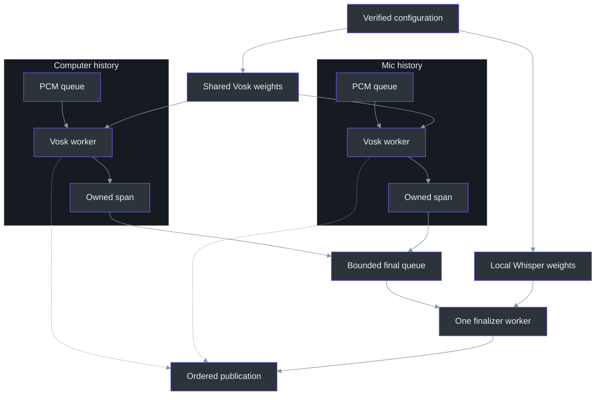
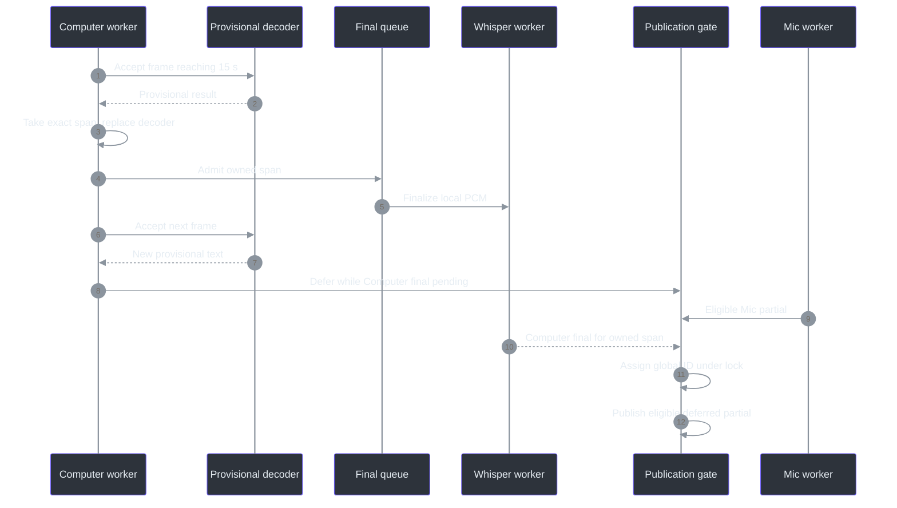

# 9. Python recognition: fast previews, bounded Whisper finals

## Why a preview and a final need different contracts

The October 9 default separates responsiveness from final recognition quality. Vosk still produces provisional replacements quickly, but its endpoint text is no longer promoted into the authoritative transcript. An endpoint or size boundary instead transfers exact PCM to local Whisper. A final means that this bounded span has completed final recognition—not that every word is correct. This separation is implemented by `HybridRecognizer.accept` returning either `Recognition` or `FinalSpan`, and by `finish` returning PCM rather than Vosk's final spelling. (`services\transcription\accurate.py:33-71`, `HybridRecognizer`.)

Two sources still need independent histories, not two loaded Vosk models. `VoskFactory` shares model weights while each source gets its own `KaldiRecognizer`; `HybridFactory` adds one shared Whisper finalizer and constructs a fresh hybrid wrapper per source. Neither Computer samples nor its provisional decoder state becomes Mic context. (`services\transcription\recognizer.py:44-81`, factories and decoder state; `services\transcription\server.py:563-576`, `transcribe`; `services\transcription\accurate.py:121-129`, `HybridFactory`.)

The old single-executor description is now correct only for explicit legacy Vosk. Hybrid uses independent bounded source queues and single-worker source executors, plus one finalizer executor. The event loop coordinates these stages without executing their native recognition calls inline. The manager's `OPENBLAS_NUM_THREADS=1` and `OMP_NUM_THREADS=1` do not mean Whisper is configured for one CPU thread: its explicit `cpu_threads` default is four, with `num_workers=1`. These limits constrain different layers; they do not guarantee equal source latency. (`services\transcription\server.py:115-181`, `Runtime`; `services\transcription\manage.py:229-242`, `start`; `services\transcription\accurate.py:75-81`, `WhisperFinalizer.__init__`.)

## The operational configuration—not an implicit fallback

| Setting | Operational default | Allowed alternative or boundary |
| --- | --- | --- |
| `engine` | `hybrid-whisper` | Explicit `vosk` selects legacy recognition. |
| `model` | `small.en` | `base.en` is supported, not silently substituted. |
| Compute | CPU `int8` | Finalizer constructor fixes device and compute type. |
| `threads` | `4` | Integer 1–8 in validated configuration. |
| `vocabulary` | `technical` | `none` disables disclosed general hotwords. |
| PCM span | 15-second target | 16-second hard maximum, including a crossing frame. |
| Speech protocol | v1 and v2 | Pipeline version 2 is not a new wire version. |

These defaults come from `load_config`, not the standalone finalizer constructor's `vocabulary="none"` argument; production passes the validated selection explicitly. Missing config uses defaults, missing vocabulary receives `technical`, and unknown keys or invalid values fail. An engine environment override is explicit configuration, not failure recovery. (`services\transcription\configuration.py:8-35`, defaults and `load_config`; `services\transcription\accurate.py:75-88`, constructor; `tools\SpeechBench\results\quality-validation-20261009.json:7-10`, speech versions.)

The provisional dependency remains Vosk 0.3.45 with the pinned English 0.15 model. Its 41,205,931-byte archive is approximately 40 MB, **not the entire hybrid model footprint**. The original observed hash is an integrity pin, not a publisher signature or an accuracy guarantee. (`services\transcription\requirements.txt:1-20`, dependency pins; `services\transcription\model.json:2-10`, Vosk metadata; `scripts\Initialize-Transcription.ps1:78-88`, original provisioning.)

Both model families are verified before use. Vosk checks an exact file set and SHA-256 identities; Whisper additionally checks declared byte lengths and rejects symlinked files/parents. Runtime supplies an explicit local path and `local_files_only=True`. The separate provisioning command may copy a verified cache or download a pinned revision only with explicit consent; invalid existing files require repair. Request handling never provisions weights, and failure does not switch to Vosk finals. (`services\transcription\recognizer.py:25-63`, `verify_model`, `VoskFactory`; `services\transcription\provision_whisper.py:28-90`, verification/provisioning; `services\transcription\configuration.py:60-69`, `verify_config`; `services\transcription\accurate.py:75-81`, local loading.)



Each `SourceState` owns its queue, credits, last partial, pending-final counters, and clock. One source can therefore advance provisional processing while the other is busy. Final work remains serialized and bounded; this is not unlimited parallel decoding. Loading weights alone opens no audio endpoint. (`services\transcription\server.py:263-290`, `SourceState`, `Session`; `services\transcription\server.py:565-574`, source construction; `services\transcription\accurate.py:121-129`, `HybridFactory`.)

## Following bytes into one exact span

At 16 kHz mono PCM16, a 3,200-byte frame contains 1,600 samples, or 100 ms. The source worker releases intake accounting when it dequeues the frame, then calls that source's hybrid recognizer. Received duration can include queued work; processed span duration advances only as PCM reaches `accept`. The old intake limits—64,000 bytes and 32 frames/source—therefore do not bound all recognition memory. (`services\transcription\server.py:339-357`, `Session.receive`; `services\transcription\server.py:394-498`, recognition chain; `services\transcription\recognizer.py:96-98`, processed samples; `services\transcription\accurate.py:48-63`, hybrid intake.)

`HybridRecognizer` appends each frame once. A provisional endpoint or accumulated 480,000 bytes triggers `_take`: immutable PCM bytes plus exact sample indices, followed by clearing the accumulator and constructing a fresh provisional decoder. No earlier PCM is replayed. `FinalSpan` requires `len(pcm) == 2 × (end_sample − start_sample)` and ordered nonnegative integer indices; malformed ownership is an error, not a best-effort timestamp. (`services\transcription\accurate.py:17-63`, `FinalSpan`, `_take`, `accept`.)

The target is checked after accepting a complete legal frame. For example, 14.9 seconds plus a one-second frame becomes one 15.9-second span; the frame is not split or replayed. The hard ceiling is `16 × 16,000 × 2 = 512,000` bytes. Two pending spans/source permit at most 1,024,000 pending PCM bytes/source, separate from current accumulation, intake, float arrays, and model memory. Stop waits for pending capacity rather than discarding its already accepted tail. (`services\transcription\accurate.py:12-30`, bounds; `services\transcription\accurate.py:48-71`, whole-frame ownership; `tools\SpeechBench\results\synthetic-quality-20261009.json:6597-6603`, observed pending-final limit.)

### The ownership algorithm in JavaScript-shaped pseudocode

This translates the Python wrapper; it is not another runtime implementation. The bounds use PCM bytes, never the v2 source prefix. (`services\transcription\accurate.py:33-71`, `HybridRecognizer`.)

```javascript
function accept(pcm) {
  requireLiveEvenFrame(pcm, 32000);
  if (retained.length + pcm.length > 512000) throw decoderError();
  retained.append(pcm);
  const preview = provisional.accept(pcm);
  requireRecognition(preview);
  const rotate = retained.length >= 480000;
  if (preview.final || rotate) {
    const end = startSample + retained.length / 2;
    const span = immutableSpan(retained, startSample, end,
                               rotate ? "rotation" : "endpoint");
    startSample = end;
    retained.clear();
    provisional = provisionalFactory();
    return span;             // Never promote preview.text to a final.
  }
  return preview;
}
```

The standalone Vosk wrapper still has its 30-second history rotation and word-time clamping. Hybrid normally replaces that provisional decoder earlier, at each owned-span boundary. Its 15-second policy is neither a wall-clock timer nor the native 250 ms callback-silence threshold. Changing these boundaries can split a sentence; byte-exact ownership does not promise linguistically optimal cuts. (`services\transcription\recognizer.py:96-107`, legacy rotation; `src\PhantomFudge.App\Audio\SilenceCadence.cs:11-19`, cadence; `services\transcription\accurate.py:57-61`, hybrid rotation.)

## Whisper finalization and the meaning of time

`WhisperFinalizer` converts little-endian signed 16-bit PCM into float32 by dividing by 32,768. Empty spans and near-digital silence with peak magnitude below `0.001` produce empty finals without inference. This does not use a Vosk spelling guess as proof that speech occurred: quiet/noisy speech classification remains imperfect. A peak magnitude of 32 is classified as near-digital silence; 33 proceeds to model processing. Neither value identifies a speaker. (`services\transcription\accurate.py:90-100`, `WhisperFinalizer.__call__`.)

| Decode control | Fixed policy and reason to distinguish it |
| --- | --- |
| Language/task | English transcription, not translation or language discovery. |
| Search | Beam 5, temperature 0; no adaptive temperature-retry loop. |
| Context | No initial prompt or previous-text conditioning; optional general hotwords only. |
| VAD | Enabled; 400 ms minimum silence and 200 ms speech padding, unrelated to WASAPI cadence. |
| Filtering | No-speech 0.6, log probability −1.0, compression ratio 2.4, hallucination-silence 1 second. |
| Timing | Word timestamps disabled; returned bounds come from owned sample indices. |

The table is the actual `transcribe` call, not recommended settings invented for this chapter. Technical vocabulary is a disclosed list of terms, not reference sentences, user notes, a postprocessing replacement table, or transcript adaptation. The finalizer consumes the segment generator, rejects nonfinite times/nonstring text, and bounds assembled text before returning. (`services\transcription\accurate.py:83-118`, hotwords, decoding, and result validation.)

Suppose Computer owns `[0, 240000)` samples and then a 100 ms tail `[240000, 241600)`. Their final ranges are `[0, 15]` and `[15, 15.1]` seconds—even if words occupy only part of either interval. Whisper's internal segment times do not replace these ledger boundaries. Mic's independent 1,600 samples still end at 0.1 seconds, not Computer's 15.1. (`services\transcription\accurate.py:41-46`, `_take`; `services\transcription\accurate.py:93-118`, returned times.)



`Session` serializes publication because source workers and finalization can now finish independently. `decode_frame` defers a pending source's newest partial, `queue_final` clears obsolete deferred text when committing another span, and `finalize` releases eligible deferred text when pending count reaches zero. Changed partials remain replacements, while `_publish` validates text and monotonic source times before assigning a session-global ID. Trace these named methods together in [the server](../../services/transcription/server.py); the illustrative diagram assumes Mic has no pending final and is not a latency measurement. (`services\transcription\server.py:361-392`, publication; `services\transcription\server.py:263-271`, source state; `services\transcription\accurate.py:48-71`, committed span boundaries.)

## Failure containment around native work

Native calls remain **shielded** futures: cancelling an asyncio waiter cannot safely kill a decoder. Provisional work has a five-second deadline; final work has its own longer deadline. An exception/timeout marks the runtime failed and produces generic `decoder_error`, not an automatic legacy fallback. Cancellation retains admission while outstanding work is awaited within its bounded cleanup policy. (`services\transcription\server.py:46-54`, provisional limits; `services\transcription\server.py:147-181`, CPU wait machinery; `services\transcription\server.py:578-606`, cleanup; `tools\SpeechBench\results\synthetic-quality-20261009.json:12704`, observed 20-second final-call timeout.)

Model initialization is separate: `production_app` loads the selected factory directly on an executor, outside those per-operation waits. The manager's 45-second readiness observation is not a model-inference deadline; it retains ownership evidence on failure. A healthy model selection requires both Vosk and Whisper verification for hybrid. (`services\transcription\server.py:658-683`, `production_app`; `services\transcription\manage.py:254-273`, `start`; `services\transcription\configuration.py:60-69`, `verify_config`.)

| Failure example | Observable policy |
| --- | --- |
| Missing or modified model | Factory cannot load; service readiness is unavailable, with no request-time download. (`services\transcription\recognizer.py:25-63`; `services\transcription\server.py:658-682`.) |
| Second decoder fails to initialize | No ready message for the partially constructed source set; runtime becomes unavailable. (`services\transcription\server.py:565-583`, `transcribe`; `services\transcription\tests\test_dual_protocol.py:282-294`, initialization test.) |
| Mic decoder raises or hangs | Entire session faults; Computer is not silently retained as the only source. (`services\transcription\tests\test_dual_protocol.py:296-305`, exception test; `services\transcription\tests\test_dual_protocol.py:325-347`, timeout test.) |
| Mic finish fails after Computer final | The Computer final may already have arrived, but there is no successful `stopped` barrier. (`services\transcription\tests\test_dual_protocol.py:308-315`, finish-failure test.) |
| Result timestamp is NaN | Rejected rather than serialized as plausible time. (`services\transcription\recognizer.py:89-90`, `_final`; `services\transcription\tests\test_recognizer.py:53-59`, nonfinite test.) |

### Metadata-only diagnostics, not retained speech

“No diagnostics are persisted” is now incorrect. Production retains allowlisted JSONL at `.local\diagnostics\transcription.jsonl`, rotating at 1 MiB with three backups. Events are model load, session start/stop, decode, finalize, fault, and disconnect. Each record carries schema/time, event/source, engine/model, a safe fault code, and numeric decode/audio duration, queue bytes/frames, pending finals, fault count, and drop count. There is no transcript, waveform, token, path, or arbitrary exception-message field. (`services\transcription\diagnostics.py:12-22`, schema; `services\transcription\diagnostics.py:45-77`, `emit`.)

Writes are locked, symlink destinations are refused, counters must be finite/nonnegative, and I/O failure marks logging unavailable with a generic notice. This does not guarantee secure memory erasure. Content-bearing native stderr/access logs remain suppressed, and native transport still replaces service error text with a safe client message. (`services\transcription\diagnostics.py:24-43`, failure state; `services\transcription\diagnostics.py:59-77`, rotation/I/O; `services\transcription\server.py:686-712`, `main`; `src\PhantomFudge.App\Audio\TranscriptionSocket.cs:406-414`, `ProcessMessage`.)

## What the tests can establish

Original `DecoderFixture` rotation tests and `RecordingRecognizer` routing tests remain useful for the provisional/legacy path; their single-executor assertion must not be generalized to hybrid scheduling. The October 9 receipt reports 104 service tests and 18 benchmark tests, but this documentation pass reran neither. (`services\transcription\tests\test_recognizer.py:10-75`, fixture/tests; `services\transcription\tests\test_dual_protocol.py:30-54`, `RecordingRecognizer`; `services\transcription\tests\test_dual_protocol.py:150-180`, legacy independence; `tools\SpeechBench\results\quality-validation-20261009.json:4-17`, validation scope.)

The adopted synthetic run recorded 19 word edits over 432 reference words (**4.40% WER**) and five character edits over 1,900 normalized characters (**0.263% CER**). Unhinted small.en had lower raw WER; the technical vocabulary's compound `LeetCode` spelling costs word edits against `leet code`. Residual `to`/`two` and `some`/`sum` errors remain. Long dual-source stress reached `stopped`, with global IDs 1–14 and zero faults/drops; that validates this run, not arbitrary microphone quality or zero-WER speech. [Chapter 12](12-performance-and-benchmarks.md) preserves the comparisons and failed experiments. (`tools\SpeechBench\results\synthetic-quality-20261009.json:6589-6603`, adopted WER; `tools\SpeechBench\results\synthetic-quality-20261009.json:7831-7835`, CER; `tools\SpeechBench\results\synthetic-quality-20261009.json:8693-8726`, stress; `tools\SpeechBench\results\synthetic-quality-20261009.json:12744-12753`, selection and residuals.)

The implementation described here is local English recognition with streaming provisional text and bounded-span finals. Source identity is not diarization, AEC, or a privacy-indicator bypass. Loading Whisper is not evidence of answer-provider readiness, answer latency, or a new speech protocol; the separate Ask/provider lifecycle is outside this chapter's recognition measurements. Actual user-voice and microphone quality remain unverified. (`services\transcription\model.json:2-4`, language metadata; `docs\DUAL-SOURCE-AUDIO.md:10-17`, boundaries; `tools\SpeechBench\results\synthetic-quality-20261009.json:6620-6627`, qualification limits.)

### Reader checkpoints

1. After 15 seconds of Computer PCM and 100 ms of Mic PCM, which weights are shared and which histories differ?
2. Why is a 512,000-byte owned span compatible with a 64,000-byte source intake queue?
3. Explain why `asyncio` cancellation cannot be treated as proof that a native decoder stopped executing.
4. Explain why an exact span endpoint is not a forced-aligned word endpoint, then calculate the bounds for a 3,200-byte tail.
5. Why can technical hotwords improve CER while worsening raw WER against a two-token reference?

### Source-reading route

Read [configuration identity](../../services/transcription/configuration.py), [provisional Vosk](../../services/transcription/recognizer.py), [span ownership and Whisper](../../services/transcription/accurate.py), [server scheduling](../../services/transcription/server.py), and [metadata diagnostics](../../services/transcription/diagnostics.py). Compare them with the [public quality receipt](../../tools/SpeechBench/results/synthetic-quality-20261009.json). [Chapter 10](10-native-service-lifecycle.md) explains provisioning and process ownership.
