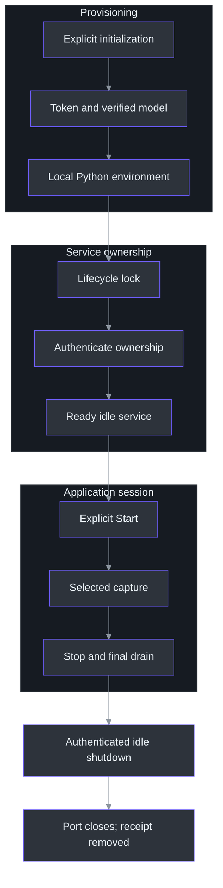
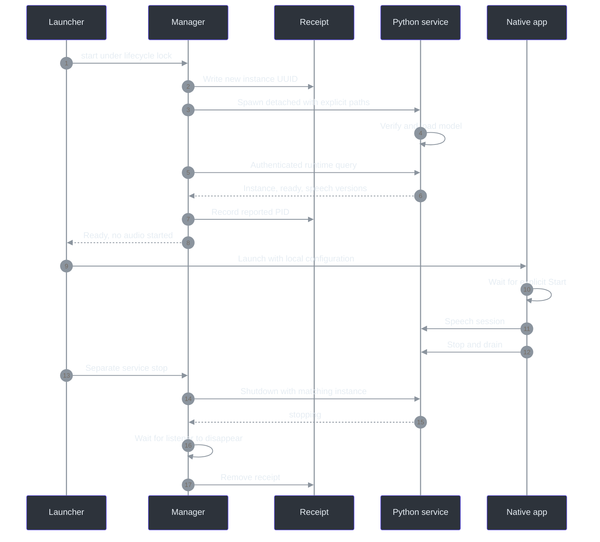

# 10. Native service lifecycle: readiness without accidental capture

## Why process ownership is a protocol problem

“Something is listening on port 8765” is insufficient evidence that Phantom Fudge may reuse or stop it. The listener could belong to another checkout, lack the installed client's speech version, or be transcribing an active session. `manage.py` treats a local service as owned only after combining a workspace receipt, authenticated runtime response, expected service identity, management version, and matching instance UUID. It does not convert a discovered PID into permission to terminate a process. (`services\transcription\manage.py:93-122`, `read_record`, `owned_info`; `services\transcription\manage.py:130-144`, `stop_owned`.)

The second boundary is **ready service versus recording application**. Initialization provisions dependencies and weights. Start makes an idle recognizer service available. The application still requires explicit Start before endpoint acquisition, and transport readiness precedes native capture. Keeping these operations distinct makes a launcher convenient without turning it into an automatic recorder. (`scripts\Initialize-Transcription.ps1:110-140`, Python setup; `scripts\Start-Transcription.ps1:8-15`, native start; `src\PhantomFudge.App\MainWindow.xaml.cs:589-625`, `Start_Click`; `src\PhantomFudge.App\Audio\LoopbackTranscriber.cs:98-111`, `StartCoreAsync`.)

## The reader's journey: provision, launch, select, stop

| Entry point | Supported switches | What it changes |
| --- | --- | --- |
| `Initialize-Transcription.ps1` | `-DownloadModel`, `-SkipPythonSetup` | Token, verified model, setup receipts, and normally the service-local Python environment; no service or capture start. |
| `Start-Transcription.ps1` | `-Docker` | Default: invoke native `manage.py start`; Docker is an explicit alternate branch. |
| `Run-PhantomFudge.ps1` | `-NoBuild`, `-NotesOnly`, `-PassThru` | Build when appropriate, start/reuse service unless notes-only, launch or reveal the app. |
| `Stop-Transcription.ps1` | `-Docker` | Default: authenticated native manager stop; optional Docker branch is separate. |
| `manage.py` | `start`, `stop`, `status` | Serialized native runtime lifecycle and status inspection. |

These are source-supported interfaces, not commands executed while writing this chapter. (`scripts\Initialize-Transcription.ps1:1-5`, parameters; `scripts\Start-Transcription.ps1:1-15`, native branch; `scripts\Run-PhantomFudge.ps1:1-55`, launcher; `scripts\Stop-Transcription.ps1:1-22`, stop branches; `services\transcription\manage.py:226-239`, `main`.)



The diagram's shutdown edge is deliberate: managed shutdown rejects an active speech session. Service readiness can also be reused without traversing provisioning again. (`services\transcription\server.py:196-209`, `managed_shutdown`; `services\transcription\manage.py:147-159`, `start`.)

## Provisioning without hidden repair

Initialization creates a token only if one is absent, using 32 cryptographically random bytes rendered as lowercase hexadecimal. That is 256 generated bits represented by 64 ASCII characters—not a hard-coded credential. Exclusive file creation prevents an existing token from being overwritten through this path. On Windows, the script replaces the token file's DACL with a current-user full-control rule and disables inherited permissions, without changing ownership/audit sections that could require elevation. (`scripts\Initialize-Transcription.ps1:33-67`, token generation and ACL setup.)

Existing token content must match the accepted 32–512-character URL-safe pattern. The setup script does not silently rotate invalid credentials; it requests explicit repair. The manager reads and validates the token, while the server prefers the configured token file over an environment token. These are source-defined storage operations; this chapter neither reads nor cites a user's generated token. (`scripts\Initialize-Transcription.ps1:65-67`, validation; `services\transcription\manage.py:33-40`, `token`; `services\transcription\server.py:69-79`, `load_token`.)

Model provisioning is similarly explicit. The manifest specifies a 41,205,931-byte English archive and observed SHA-256 identity. Setup checks byte count and checksum before extraction, rejects unexpected extracted content, and refuses to overwrite a failed existing model directory. Runtime performs its own manifest verification; a setup receipt is not a substitute for checking the bytes currently present. (`services\transcription\model.json:2-10`, model metadata; `scripts\Initialize-Transcription.ps1:17-30`, `Test-Model`; `scripts\Initialize-Transcription.ps1:69-109`, archive/receipt path; `services\transcription\recognizer.py:22-43`, `verify_model`, `VoskFactory`.)

Python setup creates a virtual environment if necessary, hashes the maintained requirements file, and decides whether restore is needed from that receipt and an import check. Restore runs pinned installation followed by `pip check`; successful setup does not itself start the service. A requirements hash receipt is a restore optimization, not a claim that every installed wheel is cryptographically attested on each launch. (`scripts\Initialize-Transcription.ps1:110-140`, environment provisioning; `services\transcription\requirements.txt:1-20`, dependency pins.)

## Serializing the launcher without trusting process names

`lifecycle_lock` is Windows-specific. It opens a workspace lock file, ensures at least one byte exists, and repeatedly attempts a nonblocking `msvcrt` lock on that byte. The acquisition deadline is 50 seconds with 100 ms polling. Start, Stop, and Status share this lock, so competing manager invocations cannot simultaneously rewrite the ownership receipt. This serializes cooperating managers for the workspace; it is not an operating-system-wide monopoly on the port. (`services\transcription\manage.py:65-90`, `lifecycle_lock`; `services\transcription\manage.py:147-150`, `start`; `services\transcription\manage.py:203-222`, `stop`, `status`.)

The receipt contains schema version 1, an instance UUID in canonical hexadecimal form, and a PID field. `write_record` writes a temporary sibling and replaces the receipt. `owned_info` authenticates the listener and compares service name, management version 1, and instance UUID. Crucially, it does **not** use the receipt PID as ownership proof or a kill target: process IDs can be reused, whereas the authenticated instance value participates in the shutdown contract. (`services\transcription\manage.py:93-122`, receipt/ownership methods; `services\transcription\manage.py:164-166`, initial receipt; `services\transcription\manage.py:189-191`, PID update.)

Management requests use literal `http://127.0.0.1:8765`, a two-second timeout, no proxy, and a redirect handler that fails rather than forwarding credentials. Reading 4,097 bytes detects whether a response exceeds the 4,096-byte allowed payload. Parsing also requires a JSON object. These are bounded control-plane responses, not transcript downloads. (`services\transcription\manage.py:21-30`, base URL and `NoRedirects`; `services\transcription\manage.py:43-56`, `request`.)

## Capability-aware reuse and stale-service replacement

| Existing listener state | `start()` decision |
| --- | --- |
| No matching receipt | Refuse adoption. |
| Wrong token, service identity, management version, or UUID | Refuse reuse/change. |
| Owned but `ready` is not exactly true | Fail; require explicit stop/setup repair. |
| Owned, ready, advertises speech v2 | Reuse; do not restart merely because it is active. |
| Owned, ready, lacks speech v2, explicitly idle | Request authenticated shutdown, then start updated service. |
| Owned, ready, lacks speech v2, active or ambiguous | Refuse restart; ask the user to stop transcription. |

Ownership and capability are separate tests. `supports_current_audio` looks for the integer `2` in a list; the manager does not mistake management `protocolVersion: 1` for a stale speech protocol. Requiring `active is False` is intentionally stricter than treating a missing or false-like field as idle. (`services\transcription\manage.py:112-159`, `owned_info`, `supports_current_audio`, `stop_owned`, `start`; `services\transcription\server.py:179-193`, `runtime_info`.)

The following JavaScript-shaped pseudocode translates the manager's Python decisions:

```javascript
function startNative() {
  const credential = readValidatedToken();
  withLifecycleLock(() => {
    const receipt = readValidatedReceipt();
    if (portInUse()) {
      const info = authenticateOwnedInstance(credential, receipt);
      if (info.ready !== true) throw new RepairRequired();
      if (supportsSpeechV2(info)) return; // Reuse, not capture.
      if (info.active !== false) throw new StopCaptureFirst();
      shutdownOwnedAndWaitForPort(credential, receipt);
    }
    requireProvisionedModel();
    const instance = newUuidHex();
    writeReceiptBeforeSpawn(instance);
    spawnDetachedService(instance);
    waitForAuthenticatedReadinessAndSpeechV2();
  });
}
```

The real manager keeps its receipt after a slow or failed startup instead of claiming success or killing a process by name. This favors conservative refusal over an aggressive “self-healing” action with uncertain ownership. (`services\transcription\manage.py:161-200`, `start`.)

## The cold-start chain

After checking the expected model file exists, `start` generates a fresh instance UUID and writes the receipt before spawning. It launches the current Python interpreter with `server.py`, a detached process/new process group, no stdin, closed inherited descriptors, and a generic local log. It then polls for up to 45 seconds: process exit fails immediately; a listening port triggers authenticated instance validation, PID receipt update, readiness validation, and speech-v2 capability validation. (`services\transcription\manage.py:161-200`, `start`.)



`production_app` loads the model on the executor before returning its aiohttp application. A model error leaves the factory unavailable rather than downloading a replacement. `/health` then reports 503 when unready; runtime management can still describe that unavailable service after it starts listening. (`services\transcription\server.py:162-168`, `health`; `services\transcription\server.py:455-466`, `production_app`.)

### Configuration is explicit, not discovered from a meeting

| Configuration | Consumer and behavior |
| --- | --- |
| `PHANTOM_TRANSCRIPTION_TOKEN_FILE` | Server token source; manager supplies it. |
| `PHANTOM_TRANSCRIPTION_TOKEN` | Server fallback token source; launcher also passes a token to the app. |
| `PHANTOM_TRANSCRIPTION_MODEL_PATH` | Required explicit model directory for the production server. |
| `PHANTOM_TRANSCRIPTION_HOST` | Manager fixes `127.0.0.1`; server allows `127.0.0.1` or `0.0.0.0`, not arbitrary names. |
| `PHANTOM_TRANSCRIPTION_INSTANCE` | Managed service instance UUID; enables matching-instance shutdown. |
| `PHANTOM_TRANSCRIPTION_URI` | Launcher supplies the app's literal-loopback speech URI. |
| `OPENBLAS_NUM_THREADS`, `OMP_NUM_THREADS` | Manager sets both to `1`. |

The server binds port 8765; there is no production port environment setting in `main`. Token values are intentionally omitted here. (`services\transcription\server.py:69-79`, `load_token`; `services\transcription\server.py:475-492`, `main`; `services\transcription\manage.py:167-176`, environment; `scripts\Run-PhantomFudge.ps1:43-55`, app environment.)

## Shutdown: authority and idleness are rechecked

The manager first requires explicit idle state, then posts `/v1/shutdown` with Bearer authentication and `X-Phantom-Instance`. The server independently rejects browser origins, bad auth, queries/bodies, missing management ownership, mismatched UUIDs, and active transcription. That second active check closes the gap between the manager's earlier runtime query and the actual shutdown request. (`services\transcription\manage.py:130-138`, `stop_owned`; `services\transcription\server.py:196-206`, `managed_shutdown`.)

On acceptance, the server marks itself stopping immediately, schedules managed exit after 0.2 seconds, and responds `{"status":"stopping"}`. The manager then waits up to 12 seconds for the port to become unused, removing the receipt only after that observation. If the port remains occupied, the receipt remains and the operation fails. No arbitrary OS termination is used as a timeout fallback. (`services\transcription\server.py:207-209`, `managed_shutdown`; `services\transcription\manage.py:137-144`, `stop_owned`.)

The timeouts are per phase, not one promised shutdown duration: management HTTP has a two-second timeout, listener disappearance has a twelve-second polling budget, and lock acquisition has its own fifty-second budget. Likewise, a receipt with no reachable listener is not silently erased by `stop`; the manager refuses to infer which process, if any, still owns outstanding startup work. (`services\transcription\manage.py:49-50`, `request`; `services\transcription\manage.py:76-85`, lock wait; `services\transcription\manage.py:139-144`, listener wait; `services\transcription\manage.py:203-214`, `stop`.)

## Application launch and deployment tradeoffs

`Run-PhantomFudge.ps1` first recognizes an existing app at the expected executable path and requests reveal without building or restarting the service. Otherwise it builds a source checkout unless `-NoBuild`, skips build for a packaged executable, optionally starts the service, and launches the app with token/URI environment configuration. `-NotesOnly` skips service startup; it is not a separate microphone implementation. (`scripts\Run-PhantomFudge.ps1:10-55`, launcher.)

Native Python is the normal path. `-Docker` must be selected explicitly and requires available recipes and an existing engine; the start script does not install Docker. This retains a portable headless service interface without making containers a prerequisite for the native application. Azure answers, source-scoped question commit, and speech v3 remain design-only; the server advertises and the manager checks speech v2, not those planned extensions. (`scripts\Start-Transcription.ps1:8-36`, native/Docker branches; `docs\AI-ANSWER-ARCHITECTURE.md:124-158`, proposed source commit; `services\transcription\server.py:179-193`, `runtime_info`; `services\transcription\manage.py:125-127`, `supports_current_audio`.)

## Evidence and operational checkpoints

Management tests cover unauthenticated queries, browser origins, wrong instance UUIDs, unmanaged shutdown, active-session refusal, and idle shutdown. A dual-source test confirms that two recognizers still occupy one active runtime and prevent management stop until final drain completes. Manager unit tests reject missing/mismatched receipts and redirects. These are maintained test definitions, not newly executed results. (`services\transcription\tests\test_management.py:38-90`, management cases; `services\transcription\tests\test_management.py:92-122`, dual/session controls; `services\transcription\tests\test_management.py:126-150`, `ManagerTests`.)

The native lifecycle script exercises blank-window reveal/minimize/hide/close and refuses to touch an existing app or service. It is a different evidence layer from service authentication, and neither layer qualifies live microphones, meeting capture exclusion, or acoustic quality. No lifecycle script, service, installation, or hardware probe was run for these chapters. (`scripts\Test-NativeLifecycle.ps1:16-22`, preconditions; `scripts\Test-NativeLifecycle.ps1:69-103`, lifecycle checks; `docs\QUALIFICATION.md:1-7`, qualification boundary.)

### Reader checkpoints

1. Why is a matching PID weaker evidence than the authenticated instance contract used here?
2. A ready listener advertises only speech v1 but is active. Trace every reason the launcher must refuse replacement.
3. What remains on disk when startup exceeds 45 seconds, and why is that not a successful ready result?
4. Distinguish stopping capture, finishing recognition, stopping the Python service, and closing the native window.

### Source-reading route

Follow [initialization](../../scripts/Initialize-Transcription.ps1), [native start wrapper](../../scripts/Start-Transcription.ps1), [manager ownership](../../services/transcription/manage.py), [server management endpoints](../../services/transcription/server.py), [application launcher](../../scripts/Run-PhantomFudge.ps1), and [management tests](../../services/transcription/tests/test_management.py). Together they describe a local, explicitly owned service—not an automatic recorder or an external process supervisor.
