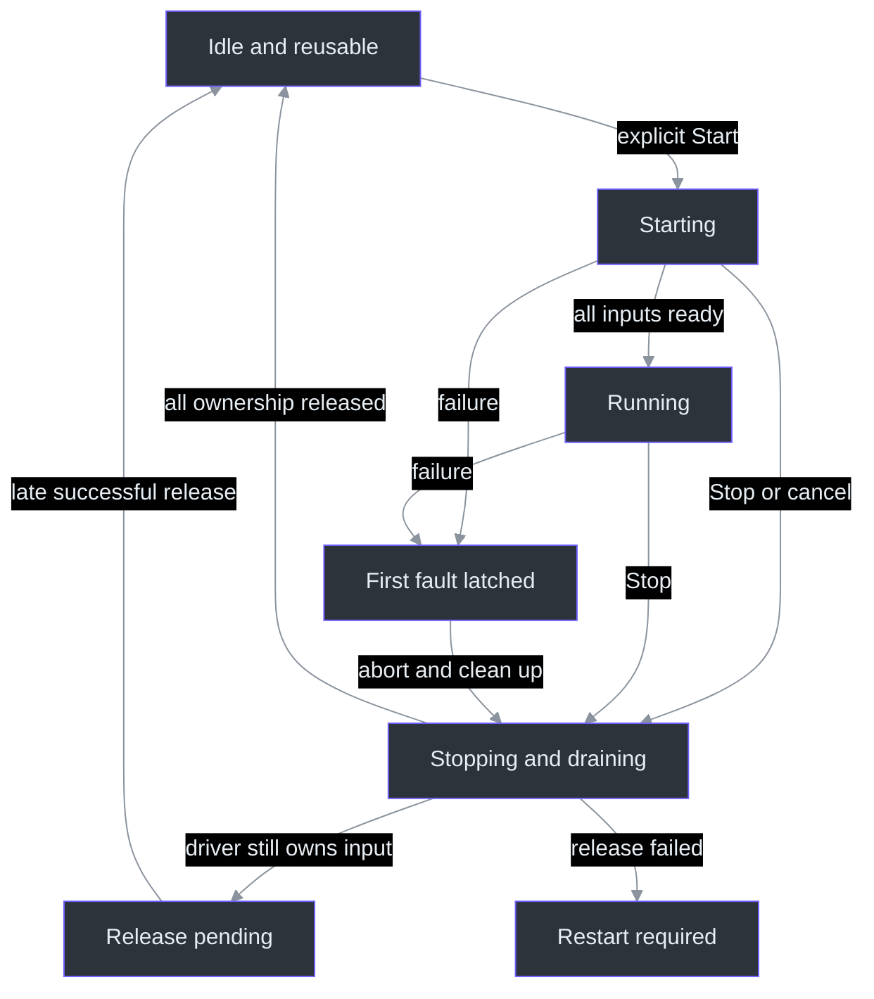
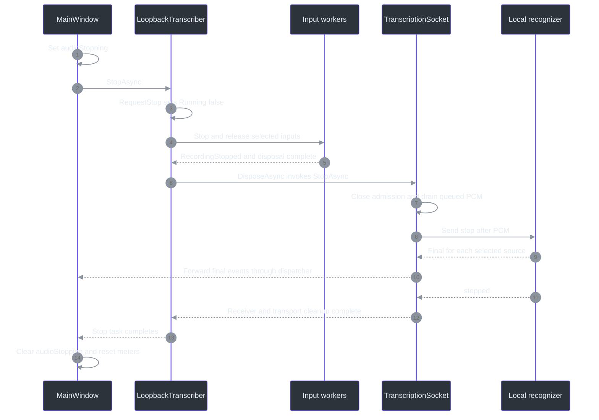

# 11 — State Machines and Failure Containment

## Overview: a Boolean cannot describe a shutdown

“Running” answers whether a session is currently considered active. It does not answer whether a device has released its capture thread, whether queued audio has reached the recognizer, whether final text has returned, or whether a new session may safely reuse the UI's transcript IDs. Phantom Fudge's most important lifecycle rule is therefore:

> **`IsRunning == false` does not mean fully stopped, drained, and reusable.**

`Session.RequestStop` immediately sets `Running=false`; `StopSessionAsync` and transport disposal still have substantial work afterward. The UI separately holds `audioStopping` through its awaited Stop path. A documented review found and fixed a stop/restart race by preserving this distinction. (src\PhantomFudge.App\Audio\LoopbackTranscriber.cs:30,387-447,532-546; src\PhantomFudge.App\MainWindow.xaml.cs:763-793; docs\IMPLEMENTATION-STATUS.md:245-247)

**Newcomer path:** follow the normal Stop sequence before reading the locks. **Principal-engineer path:** inspect queued-start invalidation, ownership after driver timeouts, and the difference between graceful drain and fault abort. The diagrams below name conceptual states; the production code implements them through fields, tasks, locks, and guards, not one central state enum.

## Architecture: several coordinated state dimensions

| Dimension | Actual representation | What it must not imply |
| --- | --- | --- |
| Interaction | `presenting`, WPF visibility, `fileBusy` | A visible window need not be editable or recording. |
| Capture setup | `protectionReady`, `lastProtection` | Successful setup is not remote capture qualification. |
| UI audio operation | `audioBusy`, `audioStopping`, `audioStopTask` | `IsRunning` alone is insufficient for enabling commands. |
| Audio ownership | `_session`, `_pendingCaptureRelease`, `_captureReleaseFailed` | No active session does not necessarily mean no worker owns a device. |
| Transport | ready/fault/stop flags, sender/receiver tasks | Closing admission does not mean queued audio has drained. |

These fields live at their relevant boundaries rather than in a generic workflow framework. (src\PhantomFudge.App\MainWindow.xaml.cs:33-48; src\PhantomFudge.App\Audio\LoopbackTranscriber.cs:16-23; src\PhantomFudge.App\Audio\TranscriptionSocket.cs:44-67)



The “release pending” distinction comes from a concrete Start guard: it rejects while the prior release task is incomplete or a release failure has been recorded. A timed-out operation can finish later; a recorded disposal failure remains a separate restart-blocking condition. (src\PhantomFudge.App\Audio\LoopbackTranscriber.cs:81-85,408-440,478-483)

## Components: who owns each decision?

`MainWindow` owns user intent and command availability. `LoopbackTranscriber` owns selected inputs and their lifecycle. `WasapiInput` owns an endpoint, capture object, and endpoint-notification registration. `TranscriptionSocket` owns one authenticated connection and bounded audio queue. `TranscriptBuffer` owns accumulated text and session-local ordering. No one layer can safely infer all the others' completion from a single flag. (src\PhantomFudge.App\MainWindow.xaml.cs:652-793; src\PhantomFudge.App\Audio\WasapiInput.cs:11-18,97-119; src\PhantomFudge.App\Audio\TranscriptionSocket.cs:10-47; src\PhantomFudge.Core\TranscriptBuffer.cs:8-11,23-39)

The UI invokes `BeginSession` only after its Start guards pass. It rejects Start during startup, stopping, or running; mode selection and transcript clearing apply equivalent busy/stopping restrictions. `UpdateAudioControls` mirrors these rules visually, but handlers also enforce them: disabling a button is not the only protection against reentrant or programmatic calls. (src\PhantomFudge.App\MainWindow.xaml.cs:652-700,720-750,866-871)

## Data flow: a normal Stop is a protocol

`StopTranscriptionAsync` returns an already-pending stop task when one exists. Otherwise it sets `audioStopping` *before* cancelling startup and starting cleanup. This gives Hide, Exit, the Stop button, and other callers a shared completion operation rather than independently resetting session state. (src\PhantomFudge.App\MainWindow.xaml.cs:763-793)



This is the no-fault path. Input shutdown precedes transport drain so normal final capture callbacks can still contribute queued PCM. The sender consumes its channel to completion, then sends `stop`. The receiver accepts `stopped` only after Stop was sent and, for protocol v2, after a post-Stop final from every selected source. An empty final still satisfies that protocol requirement. (src\PhantomFudge.App\Audio\LoopbackTranscriber.cs:401-442,449-492; src\PhantomFudge.App\Audio\TranscriptionSocket.cs:241-288,322-340,446-474)

The guarantee is conditional: a timeout, device failure, malformed response, or connection loss takes a fault path where final text can be unavailable. The status messages say so rather than reporting a clean complete transcript. (src\PhantomFudge.App\Audio\TranscriptionSocket.cs:280-289; src\PhantomFudge.App\MainWindow.xaml.cs:782-785)

## Implementation: concurrency tools serve different purposes

### Serialization does not cancel queued intent

`SemaphoreSlim _lifecycle` serializes asynchronous Start/Stop/Dispose bodies. But a semaphore alone would allow a Start already waiting behind another operation to run after Stop. The controller therefore captures `_stopVersion` before waiting, increments that version in `RequestStop`, and compares it under `_requestLock` before publishing a new session. A queued stale Start is rejected rather than resurrecting recording. (src\PhantomFudge.App\Audio\LoopbackTranscriber.cs:72-94,159-193)

After connection acceptance, each selected input starts on a worker task. Running becomes true only when every requested input started, no stop/failure is recorded, and no input already reported `RecordingStopped`. Thus Both is all-requested-inputs behavior, not “start whichever device happened to succeed.” (src\PhantomFudge.App\Audio\LoopbackTranscriber.cs:102-136)

### The first fault wins

`SignalFault` uses `Interlocked.CompareExchange` to store one safe failure message. Subsequent simultaneous faults return early. It disables audio admission flags, clears Running, requests cancellation, aborts transport, and schedules serialized cleanup. The cleanup checks that its session is still the controller's current session. (src\PhantomFudge.App\Audio\LoopbackTranscriber.cs:362-384)

The code explicitly avoids acquiring another input's `AudioGate` while processing a callback failure. Otherwise two failing sources could each hold one gate and wait for the other. Per-input volatile admission flags and transport admission close the path without cross-track lock acquisition. This is a concrete deadlock-avoidance choice, not a reason to remove all synchronization. (src\PhantomFudge.App\Audio\LoopbackTranscriber.cs:239-270,362-373)

### Timeouts bound waiting, not driver execution

| Deadline | Meaning in the implementation |
| --- | --- |
| Connection: 10 seconds | Deadline includes the service's ready response. |
| Capture startup: 10 seconds | Wait for selected input startup tasks. |
| Capture stop/release: 5 seconds | Bound waits around release and recording-stop completion. |
| Transport flush: 90 seconds | Bound sender drain, accurate finals, acknowledgement and receiver completion; not normal latency. |

These are operation-specific waits, not a promised sum or end-to-end latency SLO. (src\PhantomFudge.App\Audio\TranscriptionSocket.cs:20-79,147-161,264-277; src\PhantomFudge.App\Audio\LoopbackTranscriber.cs:13-14,112-115,419-426,461-468)

The accurate backend publishes a conservative 85-second maximum including its drain deadline,
in-flight native timeout and send/cleanup allowance. The 90-second client bound avoids discarding
accepted finalizations early. Recorded normal short-case Stop median/p95 were 0.480/0.746 seconds.
The timeout envelope is not a claim that every Stop waits 90 seconds
([measured quality and limits](../QUALITY-UPDATE.md)).

Answer preparation is a separate lifecycle: the window keeps one Agency provider, prepares one
empty session without a model prompt, and cancels/disposes it on Hide/Clear/protection/reload/close.
Preparation and shutdown block conflicting actions; late answer events cannot revive an old request.
(`src/PhantomFudge.App/MainWindow.AnswerLifetime.cs:18-128`.)

A hung driver is not forcibly made safe by cancelling a managed token. Release workers retain ownership and eventually finish startup/join/disposal if the driver returns. Inputs release independently, so a stuck microphone does not prevent the responsive Computer input from being released. The UI thread does not perform these joins. `WasapiInput.Dispose` also attempts notification and endpoint cleanup in nested `finally` blocks. (src\PhantomFudge.App\Audio\LoopbackTranscriber.cs:110-113,408-442,449-492; src\PhantomFudge.App\Audio\WasapiInput.cs:97-119)

### Fail closed without inventing a complete transcript

The socket budgets two seconds of PCM per source: 64,000 bytes at 16 kHz, mono, 16-bit; total pending PCM is capped at 128,000 bytes. A queue overflow faults the session rather than silently dropping frames and continuing a success-shaped transcript. Released frame arrays are cleared, but this is not a secure-erasure guarantee for every memory copy or crash dump. (src\PhantomFudge.App\Audio\TranscriptionSocket.cs:13-18,191-238,552-559; docs\QUALIFICATION.md:147-148)

Endpoint validation restricts the transport to literal loopback, and the HTTP handler disables proxies and redirects. Recognizer error bodies are schema-checked but replaced with fixed local messages rather than displayed verbatim. This limits accidental propagation of paths, secrets, or transcript text through an error surface. It is not a claim that every possible exception everywhere in the app is contained. (src\PhantomFudge.App\Audio\TranscriptionSocket.cs:26-31,82-98,398-414)

Device notifications invalidate only the explicitly selected endpoint, once, and dispatch work away from the notification callback. Default-device changes do not switch input identity. A lost selected source faults the entire session; the app does not quietly substitute a microphone or another playback device. (src\PhantomFudge.App\Audio\RenderEndpointNotification.cs:10-29; src\PhantomFudge.App\Audio\LoopbackTranscriber.cs:199-204,362-373)

## Worked example: the stop/reset race

Suppose session A has accepted final ID 20. Stop makes Running false, but final ID 21 is still returning. If the UI resets `TranscriptBuffer.lastSegmentId` for session B now, the late A final could advance B's ID baseline to 21. B's new final ID 1 would then be ignored by `AddFinal`. Text would disappear from the new session even though the user saw a plausible restart. This is an explanatory interleaving derived from the actual reset/deduplication logic and the recorded bug, not a claim of a newly executed reproduction. (src\PhantomFudge.Core\TranscriptBuffer.cs:23-38,48-56; docs\IMPLEMENTATION-STATUS.md:245-247)

The repaired UI keeps Start, source-mode changes, and Clear blocked through its awaited stop task. A synthetic regression explicitly sets `audioStopping`, attempts those actions, and verifies that the transcript/session selection remain unchanged. Controller-level ownership guards remain necessary underneath this UI protection. (src\PhantomFudge.App\MainWindow.xaml.cs:652-655,720-750,866-871,1061-1068; src\PhantomFudge.App\Audio\LoopbackTranscriber.cs:81-91)

The following **Python-shaped pseudocode is explanatory, not production code**:

```python
async def stop_from_ui():
    if stop_task_is_pending():
        await existing_stop_task()
        return
    state.stopping = True
    try:
        await controller.stop()  # Running may already be False here.
    finally:
        state.stopping = False

def may_start_or_reset():
    return not (state.starting or state.stopping or controller.running)
```

C# `Task` tracks completion; `CancellationToken` requests cooperation; `SemaphoreSlim` serializes async ownership transitions; `Interlocked` performs atomic state changes. They are complementary, not interchangeable spellings of “thread safe.” `Dispatcher.BeginInvoke` supplies the separate requirement that WPF control updates run on the UI thread. (src\PhantomFudge.App\Audio\LoopbackTranscriber.cs:77-94,159-192,362-384; src\PhantomFudge.App\MainWindow.xaml.cs:66-94,170-174)

## Window and document failures remain separate

### Previous-answer eligibility is separate from text visibility

Visible text is not sufficient to attach context. `CanUseDisplayedAnswer` requires a completed,
nonblank answer and excludes unconfirmed interpretations. The toggle is session-only; a busy task
or active clarification locks it. Clear/provider changes reset it, and failed/cancelled text cannot
become a future prior answer. This prevents a partial output from being silently promoted into
trusted conversation state.
([`CanUseDisplayedAnswer`, `UpdatePreviousAnswerControls`](../../src/PhantomFudge.App/MainWindow.AnswerContext.cs).)

Clarification introduces another lifetime: `clarificationPreviousAnswer` is captured before the
first interpretation replaces the reader and remains unchanged through explicit corrections,
confirmation and first-interpretation retry. It is not derived from whichever text is now displayed.
`AnswerRun.Request.PreviousAnswer` preserves the exact submitted value for Setup/details, while a
new successful answer can become the next request's sole context. No completion event sends again.
([`BeginQuestionClarification`, `SubmitClarificationReply`](../../src/PhantomFudge.App/MainWindow.Clarification.cs),
[`AnswerRun`](../../src/PhantomFudge.Core/Answers/AnswerRun.cs).)

Protection invalidation clears readiness and hides before awaiting Stop. It preserves note/transcript memory. Mode changes similarly hide and stop before changing native interaction policy. Exit waits for Stop, then evaluates unsaved work; it does not confuse stopped audio with permission to discard text. Saving has its own `fileBusy` guard and only updates the saved baseline after successful I/O. (src\PhantomFudge.App\MainWindow.xaml.cs:228-275,306-323,424-455)

Protection errors use a generic local notice rather than an unprotected automatic message box. This is an application containment policy for detected failures—not a universal capture boundary, nor crash recovery. (src\PhantomFudge.App\LocalFailureNotice.cs:9-29; src\PhantomFudge.App\MainWindow.xaml.cs:160-164)

## Tests, exercises, and qualification boundaries

Targeted synthetic tests verify:

- Missing Mic final before `stopped` is rejected: `V2MissingFinalAsync`. (tests\PhantomFudge.Audio.Tests\DualSourceTests.cs:356-371)
- Stop/Dispose invalidates a queued Start before opening hardware: `V2QueuedStartAsync`. (tests\PhantomFudge.Audio.Tests\DualSourceTests.cs:475-499)
- Repeated sessions detach callbacks; simultaneous source faults release both inputs. (tests\PhantomFudge.Audio.Tests\DualSourceTests.cs:658-758)
- Hung startup retains ownership, hung Stop releases the responsive input, and disposal failures prevent unsafe restart. (tests\PhantomFudge.Audio.Tests\DualSourceTests.cs:762-868)

The maintained evidence records 41 Core tests, 46 native synthetic groups, 71 backend tests, and four manager-upgrade guards. Those are existing results, not tests rerun for this chapter. They do not establish actual microphone permissions, hardware echo behavior, OS microphone-indicator visibility, or remote cursor inclusion. (docs\IMPLEMENTATION-STATUS.md:239-247; docs\QUALIFICATION.md:127-148)

**Exercise:** Why retain `_pendingCaptureRelease` after the visible session stops?  
**Answer:** A worker may still own a device; allowing another Start would obscure ownership.

**Exercise:** Why not silently drop PCM when the queue fills?  
**Answer:** Continuing would hide a gap in the audio-to-text history. The implemented policy faults instead.

**Exercise:** Does cancelling startup prove its driver worker has terminated?  
**Answer:** No. Cancellation is cooperative; ownership remains until release completes. These answers follow the guards and cleanup paths described above. (src\PhantomFudge.App\Audio\LoopbackTranscriber.cs:84-85,408-442; src\PhantomFudge.App\Audio\TranscriptionSocket.cs:236-238)

## References and maintenance checkpoints

- [UI lifecycle](../../src/PhantomFudge.App/MainWindow.xaml.cs) and [audio controller](../../src/PhantomFudge.App/Audio/LoopbackTranscriber.cs).
- [Transport state](../../src/PhantomFudge.App/Audio/TranscriptionSocket.cs), [endpoint owner](../../src/PhantomFudge.App/Audio/WasapiInput.cs), and [device notifications](../../src/PhantomFudge.App/Audio/RenderEndpointNotification.cs).
- [Transcript state](../../src/PhantomFudge.Core/TranscriptBuffer.cs), [failure notice](../../src/PhantomFudge.App/LocalFailureNotice.cs), and [synthetic lifecycle tests](../../tests/PhantomFudge.Audio.Tests/DualSourceTests.cs).
- [Recorded implementation evidence](../IMPLEMENTATION-STATUS.md) and [qualification gaps](../QUALIFICATION.md).

Per-source commit and Azure submission still need their own request/session rules. Current Stop drains
the complete selected-input session, not a "commit question and ask cloud model" operation. Local
question selection and immutable Freeze now exist separately; `Clear` changes question identity and
snapshots retain their own copied state. (`src\PhantomFudge.Core\QuestionDraft.cs:81-95`;
`src\PhantomFudge.Core\QuestionSnapshot.cs:5-23`; src\PhantomFudge.App\Audio\LoopbackTranscriber.cs:159-168)

Question typing introduces another interaction flag, not a new audio state. It temporarily allows
keyboard focus in the same protected HWND while keeping notes read-only and the audio lifecycle
unchanged. Done typing/Escape restores passive behavior. The existing global Notes Edit/Present,
Hide and invalidation paths retain their stop policy. This is why the new editor must not simply
call the old global mode switch. See [the implemented local interaction contract](../LOCAL-QUESTIONS.md).
