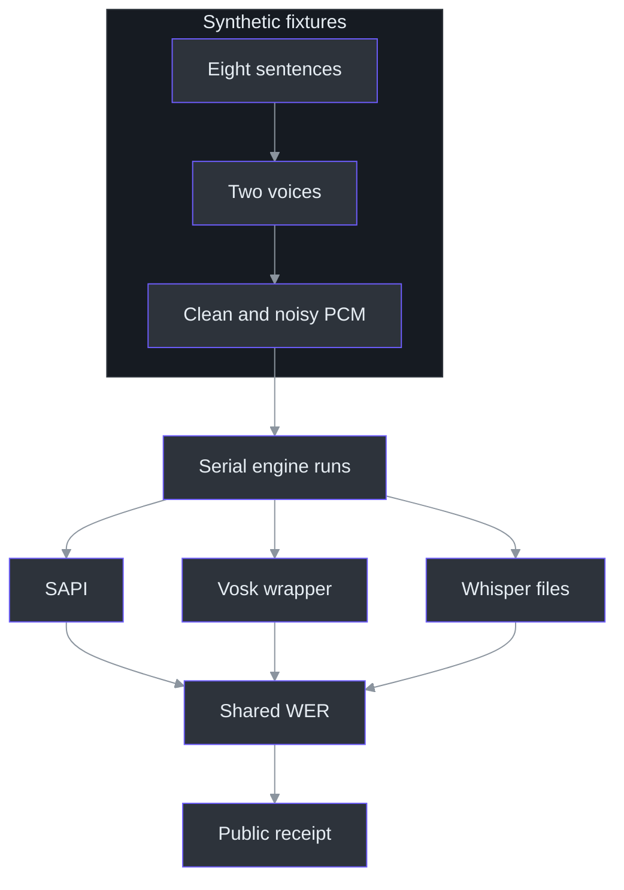
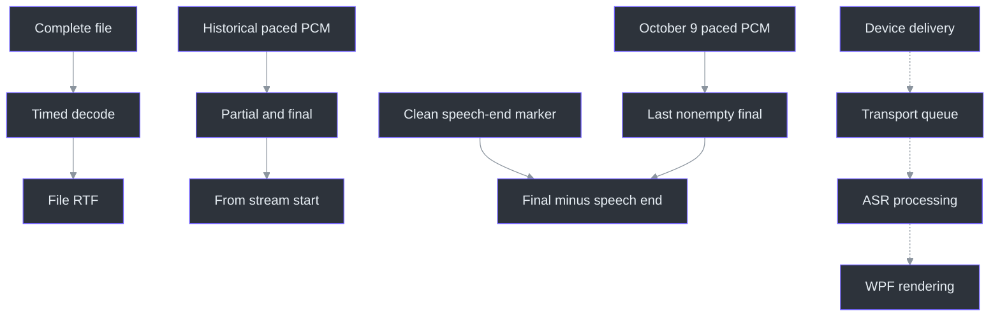

# 12. Performance and Benchmarks

## Why a fast decoder is not necessarily a responsive application

Performance starts with a question, not a stopwatch. “How quickly can this engine decode a complete recording?” differs from “When does the presenter see a useful partial?” An engine can process a finished file faster than its duration yet wait too long before showing live text. The repository deliberately separates unpaced file decoding from a small paced-delivery experiment; neither measures the complete capture-to-WPF path. (tools\SpeechBench\bench.py:207-230, `worker.decode`; docs\SPEECH-BENCHMARK.md:93-123, “Speed and live-update limits”.)

This chapter analyzes existing evidence, not a newly executed benchmark. The **October 8 historical** synthetic receipt records **32 cases, 164.070 seconds of audio, two serial warm passes, and 292 normalized reference words per pass**. Repeating a recording improves timing observations; it does not create another independent speaker or double the accuracy sample. The later October 9 quality receipt is a different experiment and does not rewrite these results. (tools\SpeechBench\results\synthetic-20261008.json:13-22, experiment metadata; tools\SpeechBench\results\synthetic-20261008.json:65-109, `summary`; tools\SpeechBench\bench.py:354-369, `run`.)

The comparison is also not C# versus Python. SAPI, Vosk, and Whisper are different recognition engines with different models and exposed APIs. C# hosts the installed Windows dictation engine; Python hosts Vosk and faster-whisper. Language-host differences are confounded with engine differences, so the experiment cannot isolate language overhead. (tools\SpeechBench\SapiBridge.cs:113-145, `Recognize`; tools\SpeechBench\bench.py:188-255, `worker`; docs\SPEECH-BENCHMARK.md:15-20, engine-versus-language distinction.)

## Architecture of the original file experiment

The harness gives each engine the same completed PCM fixtures, runs engines serially, and scores their materialized transcripts with one normalization function. The diagram describes that file-only path, not device capture. (tools\SpeechBench\bench.py:106-152, `make_fixtures`; tools\SpeechBench\bench.py:319-369, `run`.)



### Components and controlled inputs

| Component | Responsibility and experimental consequence |
| --- | --- |
| `corpus.json` | Eight original sentences cover ordinary speech, technical terms, and numbers; coverage is intentionally small. |
| `SapiBridge.Synthesize` | Writes synthesized PCM to a memory stream and then files, never a playback device. |
| `make_fixtures` | Adds identical endpoint padding and a reproducible noisy condition. |
| `worker` | Loads one model, excludes one warm-up decode, then times full passes. |
| `errors` / `aggregate` | Uses common tokenization and corpus-weighted edit counts. |
| `verify_results` | Checks hashes, row coverage, scores, and timing totals in a local run receipt. |

Sources: (tools\SpeechBench\corpus.json:1-10, corpus entries); (tools\SpeechBench\SapiBridge.cs:53-73, `Synthesize`); (tools\SpeechBench\bench.py:125-150, `make_fixtures`); (tools\SpeechBench\bench.py:257-279, `worker`); (tools\SpeechBench\metrics.py:28-62, `errors`, `aggregate`); (tools\SpeechBench\bench.py:282-316, `verify_results`).

Fixture construction matters because endpoint behavior can dominate short utterances. Every case receives 250 ms of leading silence and 1,000 ms of trailing silence. Noise uses a deterministic Gaussian generator and a target 15 dB ratio against active synthesized samples whose absolute amplitude is at least 100. Noise also covers padding. This is a precise laboratory transformation, **not recorded office noise** or a full-file SNR definition. (tools\SpeechBench\bench.py:125-150, `make_fixtures`.)

The two voices are Microsoft David Desktop and Microsoft Zira Desktop. Combined with clean/noisy variants, eight sentences become 32 cases, but the conditions remain correlated. Technical vocabulary examples include Kubernetes and authentication; they do not establish accent, overlap, distant-microphone, or real-meeting coverage. (tools\SpeechBench\corpus.json:2-9, sentence categories; docs\SPEECH-BENCHMARK.md:44-57, fixture description; docs\SPEECH-BENCHMARK.md:225-228, coverage limits.)

## The scoring algorithm

### Normalize before aligning

`normalize` applies Unicode NFKC, lowercases, expands `%`, converts numeric strings through English cardinal words, removes apostrophes, and extracts alphabetic tokens. It does not drop stop words or repair one engine's terminology after seeing its output. Consequently, the benchmark ignores capitalization and punctuation but retains many genuine lexical errors. (tools\SpeechBench\metrics.py:8-25, `NORMALIZATION`, `normalize`.)

Normalization is a measurement policy, not semantic interpretation. `9:30` becomes two cardinals, while `9.30` uses decimal “point” wording; these can describe a similar intended time but score differently. Conversely, “don't” and “dont” become identical tokens. The tests make several such choices executable rather than leaving readers to infer them. (tools\SpeechBench\test_metrics.py:7-17, `test_numbers_are_common`, `test_apostrophes`; docs\SPEECH-BENCHMARK.md:79-82, numeric-format limitation.)

### Levenshtein alignment and ties

For reference prefix length `i` and hypothesis prefix length `j`, the dynamic-programming table stores `(total edits, substitutions, deletions, insertions)`. Equal tokens inherit the diagonal cell. Unequal tokens compare substitution, deletion, and insertion candidates, each costing one additional edit. When totals tie, candidate order prefers substitution, then deletion, then insertion. This stabilizes the reported S/D/I breakdown without making the alignment a semantic explanation of the recognizer's mistake. (tools\SpeechBench\metrics.py:28-55, `errors`.)

The table contains `(reference length + 1) × (hypothesis length + 1)` cells; thus this implementation's time and storage grow with their product. That is acceptable for the short fixture sentences, but a future long-recording evaluator should account for the matrix explicitly rather than assuming a streaming metric. This complexity follows directly from the allocation and nested loops. (tools\SpeechBench\metrics.py:31-48, `errors`.)

Corpus WER is:

```text
WER = sum(substitutions + deletions + insertions)
      / sum(normalized reference words)
```

Do not average sentence percentages: one error in a one-word sentence should not outweigh one error in a much longer sentence simply because each sentence gets equal weight. An empty reference produces undefined WER; an empty hypothesis produces deletions. WER can exceed 100%, so `100 − WER` is not a general “accuracy percentage.” (tools\SpeechBench\metrics.py:49-62, `errors`, `aggregate`; tools\SpeechBench\test_metrics.py:24-37, empty-input and weighted-aggregation tests.)

## Reading the October 8 historical result

These are historical results on the synthetic corpus, rounded for readability:

| Engine/configuration | WER | S / D / I | Warm decode median | RTF |
| --- | ---: | ---: | ---: | ---: |
| Installed SAPI en-US dictation | 45.89% | 99 / 2 / 33 | 10.139 s | 0.062 |
| Vosk small-en-us-0.15 | 8.22% | 14 / 0 / 10 | 41.754 s | 0.254 |
| faster-whisper base.en, CPU int8, beam 5 | 4.79% | 9 / 0 / 5 | 25.745 s | 0.157 |

The receipt contains the unrounded numbers and the separate pass totals. Its `transcripts_changed_across_repeats` arrays are empty: the repeats did not change the scored text. SAPI's clean/noisy WER is 17.12%/74.66%; Vosk is 8.22%/8.22%; Whisper is 4.79%/4.79%. Equal percentages in two conditions are observations on these fixtures, not noise-invariance guarantees. (tools\SpeechBench\results\synthetic-20261008.json:65-173, `summary`; docs\SPEECH-BENCHMARK.md:22-32, configuration table.)

RTF divides median decoding seconds by audio seconds. A value below one says this completed corpus decoded faster than its playback duration. It says nothing by itself about the time required to collect an utterance, endpoint it, authenticate a service connection, or render a partial. (tools\SpeechBench\bench.py:355-369, `run`; docs\SPEECH-BENCHMARK.md:102-123, timing exclusions.)

### Which clock did the experiment actually observe?



Dashed edges identify application stages outside the file experiment. In the separate paced Vosk probe, first partials arrived at **0.976 and 0.960 seconds from stream start**, after 0.9 seconds of PCM had been supplied. Both natural finals arrived near **3.807 seconds from stream start**, not 3.807 seconds after speech ended. Without an annotated last spoken sample, those figures cannot be converted into end-of-speech lag. Two observations also cannot establish a p95 latency distribution. (tools\SpeechBench\results\synthetic-20261008.json:9027-9151, `paced_pcm`; docs\AI-ANSWER-EVALUATION.md:12-40, A1 and latency definitions.)

## October 9: measuring the actual hybrid pipeline

The new receipt evaluates **real local models with synthetic PCM**, including two TTS voices, clean/noisy speech, three nonspeech controls, and a longer dual-source run. It explicitly excludes the user's recording, real endpoint acquisition, playback, and cloud ASR. It retains the original WER normalization: no reference-sentence prompts, fixed text substitutions, or retrospective word repairs make the score look better. These boundaries matter more than calling an engine “accurate.” (`tools\SpeechBench\results\synthetic-quality-20261009.json:1-30`, safety and scoring.)

### Accuracy: keep the inconvenient comparison visible

| October 9 configuration | Word edits / reference words | Raw WER |
| --- | ---: | ---: |
| Vosk streaming baseline | 52 / 432 | 12.04% |
| Hybrid base.en comparison | 23 / 432 | 5.32% |
| Hybrid small.en, unhinted | 11 / 432 | **2.55%** |
| Adopted small.en, technical vocabulary, parallel 15-second path | 19 / 432 | **4.40%** |

These figures come from separate completed runs, not a pooled count across pipeline experiments. The new Vosk 12.04% is not a correction to the old 8.22%: the experiment and reference corpus differ. (`tools\SpeechBench\results\synthetic-quality-20261009.json:56-63`, Vosk totals; `tools\SpeechBench\results\synthetic-quality-20261009.json:1362-1369`, base.en; `tools\SpeechBench\results\synthetic-quality-20261009.json:2668-2675`, unhinted small.en; `tools\SpeechBench\results\synthetic-quality-20261009.json:6589-6596`, adopted totals.)

Why choose the technical-vocabulary variant when its raw WER is worse than unhinted small.en? A reference containing `leet code` has two normalized words, while `LeetCode` becomes one: that compound can cost one substitution plus one deletion even when the proper-name spelling improves. The report therefore preserves WER as primary and adds a disclosed character metric: concatenate normalized words without spaces, then count character edits. Adopted CER is `5 / 1900 = 0.263%`, versus unhinted small.en's `19 / 1900 = 1.00%`. This is an explanatory secondary view, not permission to silently replace the worse primary score. (`tools\SpeechBench\results\synthetic-quality-20261009.json:3910-3914`, unhinted CER; `tools\SpeechBench\results\synthetic-quality-20261009.json:7831-7835`, adopted CER; `tools\SpeechBench\results\synthetic-quality-20261009.json:12744-12753`, rationale.)

The vocabulary is general programming terminology, passed as hotwords—not the evaluated sentences or user content. Remaining `to`/`two` and `some`/`sum` errors are explicitly retained; longer speech has additional errors. The 4.40% aggregate must not be marketed as a guarantee about the user's target phrase, accent, microphone, or arbitrary technical question. (`services\transcription\accurate.py:83-108`, vocabulary/context controls; `tools\SpeechBench\results\quality-validation-20261009.json:18-27`, selection and remaining errors.)

### Latency: preserve the clock and the failure ceiling

| Adopted short-case measurement | Observed p50 | Observed p95 |
| --- | ---: | ---: |
| First provisional from stream start | 0.977 s | 1.114 s |
| End of speech to last nonempty final | 2.736 s | 3.017 s |
| Stop request to `stopped` | 0.480 s | 0.746 s |

Unlike the old two-observation probe, the new harness defines speech end: the last clean synthesized sample with absolute amplitude at least `100/32768`, fixed **before** adding noise. This is still a synthetic annotation, not a measured microphone onset/offset. Each run starts a fresh process, records import/verification/load separately, retains its first model call, and then includes warmer rows; OS caches and competing CPU work are uncontrolled. Its p95 is a sample quantile, not a service-level promise. (`tools\SpeechBench\results\synthetic-quality-20261009.json:21-30`, clock/load definitions; `tools\SpeechBench\results\synthetic-quality-20261009.json:6587-6627`, adopted timings and limits.)

The backend's advertised **85-second** maximum stop envelope is a conservative pending-work timeout, not one of those observations. The native **90-second** wait described in [chapter 8](08-streaming-protocol.md) allows that envelope to complete; it does not mean normal Stop takes 90 seconds. Even the successful long dual-source run differs from the short-case median: its one measured drain was **3.419 seconds**. (`tools\SpeechBench\results\synthetic-quality-20261009.json:12733-12742`, maximum envelope; `tools\SpeechBench\results\synthetic-quality-20261009.json:8693-8726`, stress drain.)

### Long runs must test ownership and failure, not just words

The adopted long run uses production endpoint behavior and exercises four forced rotations. Its Computer ledger records 1,973,256 input bytes and exactly the same owned-span bytes: `1,973,256 / 32,000 = 61.66425` seconds, with matching input/decoded-PCM hashes and every sample owned once. It reaches `stopped`, assigns global final IDs 1–14, and records zero faults/drops; maximum observed source intake is 19,200 bytes/15 frames and pending finals two/source. That is evidence against loss/replay in this run, not proof of zero recognition errors. (`tools\SpeechBench\results\synthetic-quality-20261009.json:7887-7905`, ledger; `tools\SpeechBench\results\synthetic-quality-20261009.json:8693-8726`, completion/counters.)

The receipt deliberately retains unsuccessful approaches:

- The initial natural long run passed runtime/PCM checks but failed the harness's forced-rotation coverage assertion.
- Injected 30-second spans produced 44 Computer word insertions.
- A bounded temperature-retry experiment exceeded the 20-second native-call deadline and visibly faulted; incomplete scores are not comparable to completed runs.
- A shorter-window probe reduced that source's insertions to two, but the first production 15-second run hit the shared intake's 32-frame cap.

Dedicated bounded source workers replaced shared hybrid intake, followed by a new production-policy measurement. Thus “zero faults/drops” describes the **adopted completed runs**, not every experiment in the JSON file. Failed trials explain why the shipping policy uses 15-second targets, 16-second maximum spans, and independent intake instead of merely changing the model name. (`tools\SpeechBench\results\synthetic-quality-20261009.json:12704`, retained-experiment interpretation; `services\transcription\accurate.py:12-30`, implemented span bounds.)

## Historical timing fairness and provenance

The Python worker reads audio before timing, measures import/verification/load separately, and consumes Whisper's segment generator inside the decode call. PCM-to-float conversion is outside Whisper timing. SAPI times wave-stream binding through recognition completion, excluding initial file reads. These are exposed-API measurements, not isolated native-kernel timings. (tools\SpeechBench\bench.py:184-255, `worker`; tools\SpeechBench\SapiBridge.cs:75-110, `Decode`; tools\SpeechBench\SapiBridge.cs:123-157, `Recognize`.)

In the original benchmark, “cold load” means a new model instance, **not flushed OS caches**. The fixed order is SAPI → Vosk → Whisper. Common affinity limits placement to four logical processors, while requested native thread counts do not make all engines schedule identically. Thermal state, unrelated work, and same-vendor voices remain confounders. No confidence interval follows from two serial passes. (tools\SpeechBench\results\synthetic-20261008.json:4-22, environment/order; docs\SPEECH-BENCHMARK.md:95-100, cold-instance definition; docs\SPEECH-BENCHMARK.md:125-138, resource boundaries.)

The earlier documentation inspection identified a `bench.py` hash mismatch between the historical receipt and then-current harness. Do not turn that historical inspection into a claim that all present files were rerun or reverified. The stored source hashes preserve provenance; the October 9 validation separately records the original benchmark's digest alongside the new quality receipt's digest. They identify two evidence artifacts, not an amended October 8 result. (tools\SpeechBench\results\synthetic-20261008.json:55-64, `source_sha256`; tools\SpeechBench\bench.py:378-387, receipt construction; `tools\SpeechBench\results\quality-validation-20261009.json:13-17`, receipt identities and exclusions.)

This documentation audit checked both receipt digests and the adopted run's seven recorded source hashes against the frozen files; all matched. That is a content-identity check, not a new inference run, installation, or test result. (`tools\SpeechBench\results\synthetic-quality-20261009.json:6629-6637`, adopted `source_sha256`; `tools\SpeechBench\results\quality-validation-20261009.json:13-14`, receipt digests.)

## Worked pseudocode: auditing without decoding audio

The following is explanatory pseudocode, not a benchmark invocation. It audits the public result's internal arithmetic and repeat coverage; unlike `verify_results`, it cannot establish unchanged raw WAVs from the public receipt alone. (tools\SpeechBench\bench.py:282-316, `verify_results`; tools\SpeechBench\results\synthetic-20261008.json:175-189, public case metadata.)

```python
receipt = read_public_synthetic_receipt()
for name, engine in receipt["engines"].items():
    rows = engine["rows"]
    summary = receipt["summary"][name]
    require_unique_pairs(rows, keys=("id", "repeat"))
    require_complete_case_repeat_grid(rows, receipt["cases"],
                                      receipt["repeats"])
    first_pass = [row for row in rows if row["repeat"] == 0]
    expected_errors = sum(row["substitutions"] + row["deletions"]
                          + row["insertions"] for row in first_pass)
    expected_words = sum(row["reference_words"] for row in first_pass)
    assert summary["wer"] == expected_errors / expected_words
    pass_times = [sum(r["decode_seconds"] for r in rows if r["repeat"] == k)
                  for k in range(receipt["repeats"])]
    assert summary["median_decode_seconds"] == median(pass_times)
# No capture, synthesis, download, or inference is necessary for this audit.
```

The October 8 recommendation—to retain Vosk streaming and investigate optional Whisper refinement—was a decision under the older evidence, not the current default. The original Vosk implementation remains available explicitly. October 9 configuration instead selects **hybrid-whisper, small.en, CPU int8, four threads, technical vocabulary**, with fast provisional text and bounded local finals. It makes no silent fallback if selected weights are missing. (services\transcription\recognizer.py:82-96, legacy `accept`, `finish`; docs\SPEECH-BENCHMARK.md:34-40, historical recommendation; `services\transcription\configuration.py:11-36`, current defaults/validation; `services\transcription\configuration.py:61-70`, required models; `services\transcription\accurate.py:75-81`, CPU loading.)

The public validation reports **104 service tests and 18 benchmark tests**. Neither those counts nor the synthetic accuracy improvement qualifies actual user speech, echo/AEC, endpoint permissions, or meeting capture. No build, test, service, model provisioning, synthesis, playback, or cloud action was performed for this chapter update. (`tools\SpeechBench\results\quality-validation-20261009.json:4-17`, validation scope; `tools\SpeechBench\results\synthetic-quality-20261009.json:6620-6627`, qualification limits.)

### Failure outcomes belong in the experiment

An unavailable engine is not an infinitely slow engine, a zero-error engine, or a reason to install a new component silently. The SAPI bridge records unavailable status when no en-US recognizer exists; subprocess failures likewise produce an unavailable result rather than a fabricated timing row. A comparison report must retain that outcome and explain which configurations actually ran. (tools\SpeechBench\SapiBridge.cs:113-121, `Recognize`; tools\SpeechBench\bench.py:328-353, `run`.)

Inputs also have a contract: the loader rejects duplicate IDs and empty corpora, and the WAV reader requires uncompressed 16 kHz mono signed 16-bit PCM. Silent resampling would move preprocessing work and change the experiment without an explicit decision. Empty reference strings are technically accepted, but their undefined WER makes them inappropriate for ordinary accuracy ranking. These are methodological limits to document, not inconveniences to bypass. (tools\SpeechBench\bench.py:99-103, `pcm_from_wav`; tools\SpeechBench\bench.py:155-176, `load_cases`; tools\SpeechBench\metrics.py:49-54, `errors`.)

## Exercises

1. Hand-align reference “do not restart” with hypothesis “do restart.” Explain why a modest token error can reverse intent, motivating fidelity checks beyond WER. (tools\SpeechBench\metrics.py:28-55, `errors`; docs\AI-ANSWER-EVALUATION.md:84-86, question fidelity.)
2. Calculate WER for one erroneous one-word case and one correct four-word case. Compare corpus weighting with an unweighted mean; the existing test expects 0.2. (tools\SpeechBench\test_metrics.py:34-37, `test_weighted_aggregation_not_mean_of_case_wer`.)
3. Design, but do not run, a representative follow-up: independent speakers, annotated speech end, randomized engine order, and separate warm/cold strata. State which current limitation each addition addresses. (docs\SPEECH-BENCHMARK.md:132-138, run-order limits; docs\SPEECH-BENCHMARK.md:218-228, corpus limits; docs\AI-ANSWER-EVALUATION.md:33-43, clocks.)
4. Score `leet code` against `LeetCode` with the primary token metric and the secondary joined-character metric. Why must both results remain visible?
5. Explain why a byte-exact 61.66425-second span ledger, zero drops, and a nonzero WER are compatible observations.

## References

- [Existing comparison and methodology](../../docs/SPEECH-BENCHMARK.md).
- [Public synthetic result](../../tools/SpeechBench/results/synthetic-20261008.json).
- [October 9 quality and retained experiments](../../tools/SpeechBench/results/synthetic-quality-20261009.json) and [validation receipt](../../tools/SpeechBench/results/quality-validation-20261009.json).
- [Harness](../../tools/SpeechBench/bench.py), [metric implementation](../../tools/SpeechBench/metrics.py), and [SAPI bridge](../../tools/SpeechBench/SapiBridge.cs).
- [Metric tests](../../tools/SpeechBench/test_metrics.py) and [harness boundary tests](../../tools/SpeechBench/test_harness.py); the latter explicitly reject escaped output paths, implicit resampling, duplicate case IDs, and empty corpora. (tools\SpeechBench\test_harness.py:8-38, `HarnessTests`.)
- [Planned answer evaluation](../../docs/AI-ANSWER-EVALUATION.md), which must not be read as an executed cloud benchmark.
