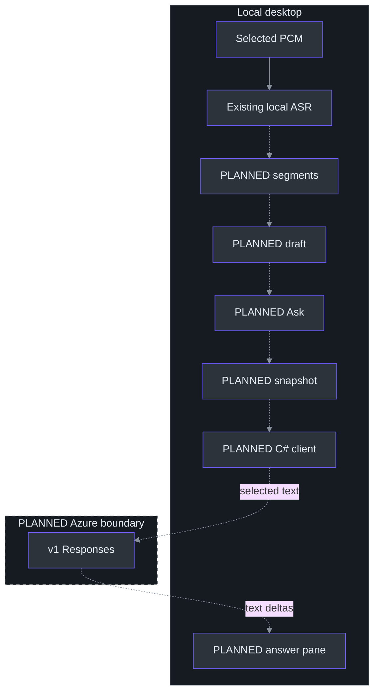
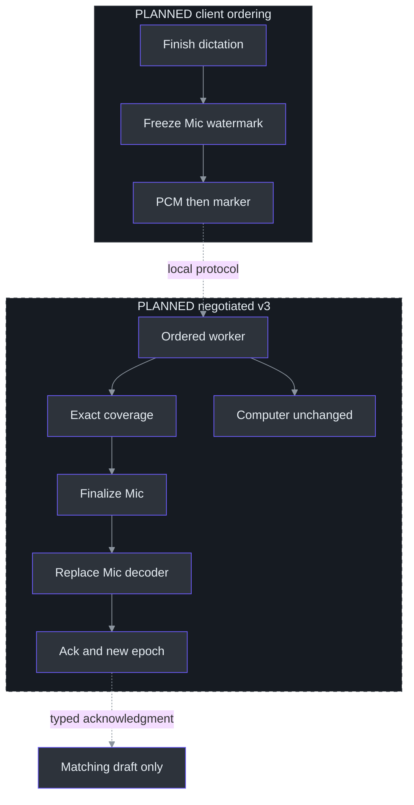

# 13. Proposed Azure Answer Flow

## Why question selection is the architectural center

**Everything concerning QuestionDraft, Ask, source commit, Azure inference, and answer rendering in this chapter is PLANNED, not implemented.** The existing research is complete as a design deliverable; the draft, commit, connection, client, and UI workstreams remain unstarted. No cloud integration or Azure performance result is implied by the diagrams or pseudocode. (TODO\27_AI_ANSWER_RESEARCH.todo:29-36, completion evidence; TODO\28_QUESTION_DRAFTS.todo:3-5, status; TODO\31_STREAMING_ANSWER_CLIENT.todo:30-36, completion evidence; TODO\32_ANSWER_UI_LIFECYCLE.todo:30-36, completion evidence.)

The hard problem is not posting text to a model. It is knowing **which text the user intended to send**, keeping that text stable during asynchronous recognition, and associating every answer with the right question. A microphone may contain earlier conversation; Computer audio may continue while a question is dictated. Treating the entire transcript as a prompt silently changes the product's data boundary. The proposed solution is an explicit editable draft followed by an immutable snapshot at Ask. (docs\AI-ANSWER-ARCHITECTURE.md:44-68, deliberate submission paths; docs\AI-ANSWER-PRIVACY.md:6-20, proposed default.)

A useful mental model has three objects: the transcript is an evolving observation, the draft is the user's working selection, and the snapshot is the exact outbound request content. They are related, but none should substitute for another. In particular, a better late recognition result must not rewrite a question already submitted. (docs\AI-ANSWER-ARCHITECTURE.md:84-122, planned local records and revision rules.)

## Architecture: local speech, explicit text egress

The baseline preserves native Python ASR and adds a direct asynchronous C# answer provider. Sending through the Python speech service merely because it exists would add coupling and another hop without a demonstrated requirement. Authentication, request identity, and WPF updates belong with the desktop coordinator; model network work does not belong in capture callbacks or the recognizer CPU worker. (docs\AI-ANSWER-ARCHITECTURE.md:8-38, recommended baseline.)



Dashed paths represent proposed connections, including the cloud boundary. There is no automatic forwarding of partials, no chat reader, and no implicit full-meeting context. Bounded additional context would require explicit selection and a recorded context policy. Cloud ASR and an enterprise broker are separate optional workstreams; Docker remains final-stage packaging rather than a prerequisite. (docs\AI-ANSWER-ARCHITECTURE.md:30-38, baseline; TODO\36_OPTIONAL_AZURE_SPEECH.todo:13-25, optionality; TODO\37_OPTIONAL_ANSWER_BROKER.todo:13-26, conditional broker; TODO\35_ANSWER_RELEASE_ACCEPTANCE.todo:23-26, Docker-last gate.)

## What the existing interfaces provide—and omit

| Existing component | Implemented contract | Consequence for the proposal |
| --- | --- | --- |
| `AudioSource` | Stable byte values and separate wire/display names | Source identity must not be inferred from rendered labels. |
| `TranscriptEvent` | Type, text, optional final ID, times, source | No capture-session ID, source epoch, or draft revision exists here. |
| `TranscriptBuffer` | Per-source partials, flattened finals, bounded text | Display/export storage is not a segment-selection database. |
| `TranscriptionSocket` | Single-use session, v1/v2 negotiation, strict response fields | New controls and metadata require explicit version/capability negotiation. |
| `Session` | Independent decoders, one work queue, session-global final IDs | Received PCM and processed PCM must be distinguished for commit. |

Sources: (src\PhantomFudge.Core\AudioSource.cs:3-30, `AudioSource`, `AudioSourceNames`); (src\PhantomFudge.App\Audio\TranscriptEvent.cs:9-15, `TranscriptEvent`); (src\PhantomFudge.Core\TranscriptBuffer.cs:6-19, `TranscriptBuffer`); (src\PhantomFudge.App\Audio\TranscriptionSocket.cs:108-160, `ConnectCoreAsync`; src\PhantomFudge.App\Audio\TranscriptionSocket.cs:482-506, property validation); (services\transcription\server.py:225-235, `Session`).

`TranscriptBuffer.AddFinal` appends a formatted line and advances one global final ID; `BeginSession` resets that ID while retaining existing text with a session separator. Therefore an ID such as `17` is not a durable cross-session reference. Likewise, `[Mic]` is presentation text, not an authenticated provenance field. A user can type that literal string. Planned selection must retain structured session/source/segment identity before formatting. (src\PhantomFudge.Core\TranscriptBuffer.cs:23-38, `BeginSession`; src\PhantomFudge.Core\TranscriptBuffer.cs:48-72, `AddFinal`; src\PhantomFudge.Core\TranscriptBuffer.cs:87-96, source formatting.)

## Planned components and dataflow

The structured store would preserve segment references, source epochs, revisions, qualified sample bounds, text, and finality. A draft would record its selection, whether it remains provisional, and whether the user has edited it. A snapshot would copy exact displayed text plus provenance, creation time, and profile version. Retaining copied selected text prevents later transcript eviction from invalidating the submitted question. These are proposed records, not existing classes. (docs\AI-ANSWER-ARCHITECTURE.md:89-122, `TranscriptSegment`, `QuestionDraft`, `QuestionSnapshot`.)

Consider “Explain Service Fabric like I am five.” The owner can dictate it, select complete Mic segments, or type and correct it. **Ask as shown** freezes that revision immediately, even when visibly provisional. **Finish dictation** instead finalizes the armed Mic span and returns it to review; Ask remains a separate action. A timeout must preserve the draft rather than silently sending an unreviewed alternative. No question mark or natural final automatically sends anything. (docs\AI-ANSWER-ARCHITECTURE.md:46-68, example and submission paths; TODO\28_QUESTION_DRAFTS.todo:24-27, explicit-send acceptance.)

The first implementation slice should use a fake answer stream. That allows snapshot, eviction, cancellation, and delayed-event tests before introducing authentication or paid inference. The provider abstraction is planned as `IAnswerProvider.StreamAsync`; a separate `IQuestionCommitter` keeps question finalization independent of the eventual recognizer backend. (docs\AI-ANSWER-ARCHITECTURE.md:211-222, proposed abstractions; docs\AI-ANSWER-ARCHITECTURE.md:262-270, delivery sequence.)

## Planned algorithm: Mic-only commit as an ordered barrier

Today, `SendAudioAsync` drains queued PCM and sends a global Stop. The server accepts only the exact Stop control, then finalizes **every** selected decoder before acknowledging stopped. Calling that path to submit a question would terminate Computer transcription too. (src\PhantomFudge.App\Audio\TranscriptionSocket.cs:313-331, `SendAudioAsync`; services\transcription\server.py:247-252, `Session.receive`; services\transcription\server.py:317-327, `Session.recognize`.)

The proposed v3 capability inserts a Mic commit envelope into the **same ordered sender queue**, under the same synchronization boundary that freezes its delivered-sample watermark. A second concurrent WebSocket sender would break the intended ordering guarantee. Server processing must reach exactly that source watermark before finalization; bytes received into a queue are not evidence of decoded coverage. Current `SourceState.total_bytes` increments in receive, before the worker calls `accept`, so it cannot serve as the proposed processed counter. (docs\AI-ANSWER-ARCHITECTURE.md:124-158, commit design; services\transcription\server.py:274-287, `Session.receive`; services\transcription\server.py:328-333, `Session.recognize`.)



The wrapper already provides a useful implementation pattern: after 30 audio seconds it retrieves a final, advances its cumulative offset, and constructs a new decoder. `finish()` alone retrieves a final but does not prepare continued recognition. The proposed commit must adapt finalize-and-replace for Mic while preserving Computer state and session-global final numbering. This is feasibility evidence, not an existing commit API. (services\transcription\recognizer.py:55-96, `VoskRecognizer`; TODO\29_QUESTION_COMMIT_LATENCY.todo:13-22, planned tasks.)

### Worked pseudocode: retries without duplicate finalization

This sketch specifies invariants for a future implementation, not methods currently callable in the service:

```python
def process_commit(marker, session):
    key = (session.capture_id, marker.source, marker.request_id)
    prior = session.completed_commits.get(key)
    if prior is not None:
        require(prior.parameters == marker.parameters)
        return prior.ack             # no second final or epoch increment

    track = session.sources[marker.source]
    require(marker.epoch == track.epoch)
    require(track.processed_samples == marker.through_sample)
    final = track.finalize_and_replace_preserving_offset()
    final_ref = session.record_final(final)   # including an empty final
    old_epoch = track.epoch
    track.epoch += 1
    ack = Ack(key, old_epoch, track.epoch,
              marker.through_sample, final_ref)
    session.remember_bounded_commit(key, marker.parameters, ack)
    return ack
```

Lookup precedes current-epoch validation so a genuine retry can replay its original acknowledgment after the epoch has advanced. Changed parameters under the same request ID must fail. The eventual implementation also needs a defined publication/failure boundary and bounded deduplication lifetime; the sketch does not promise durable exactly-once delivery across process crashes. (docs\AI-ANSWER-ARCHITECTURE.md:146-158, commit ordering/idempotency; TODO\29_QUESTION_COMMIT_LATENCY.todo:26-28, duplicate/empty-commit acceptance.)

An armed question needs a start boundary as well as an end. Otherwise earlier Mic conversation enters the question. Current partials disable word-level timing, so arbitrary retrospective acoustic cuts cannot be reconstructed exactly from displayed text. A click watermark also covers delivered samples, not audio still inside a device buffer. A bounded tail-drain policy must be specified and measured rather than disguised as sample-exact knowledge of when the user finished speaking. (services\transcription\recognizer.py:64-67, `_new_decoder`; docs\AI-ANSWER-ARCHITECTURE.md:160-166, start and device-buffer boundaries.)

## Planned request, answer states, and UI

The initial provider would call Azure OpenAI **v1 Responses** with `stream:true`, `store:false`, `background:false`, no tools, no conversation ID, and no `previous_response_id`. Its model field identifies the approved deployment alias. “Foreground” describes API execution, not activating the desktop window. The exact SDK must be pinned and compile-checked; research examples are not an installed client. (docs\AI-ANSWER-RESEARCH.md:160-201, inference API; TODO\31_STREAMING_ANSWER_CLIENT.todo:13-21, adapter tasks.)

The research shortlist is `gpt-5.4-mini`, `gpt-5.4-nano`, and `gpt-5-mini`, with documented versions and lifecycle dates as of the existing research. None is established as fastest; subscription entitlement, quota, capacity, processing policy, and actual deployment availability remain unknown. (docs\AI-ANSWER-RESEARCH.md:136-158, shortlist and availability intersection; docs\AI-ANSWER-RESEARCH.md:254-269, uncertainty summary.)

Question, answer, connection, audio, and capture-protection states must remain separate. Every streamed event would carry a request identity and sequence; stale events from A must never append to B. HTTP 200 or stream closure is not completion. Interrupted output stays visibly incomplete, and cancellation does not guarantee stopped remote billing. (docs\AI-ANSWER-ARCHITECTURE.md:168-207, state machines; docs\AI-ANSWER-ARCHITECTURE.md:238-252, streaming failures.)

The pane would remain inside the protected WPF surface. However, the existing `TogglePresentationAsync` hides the window and stops transcription before changing modes. Reusing it for draft correction would violate continuous Computer transcription. The future editor therefore needs a deliberate, separately tested focus transition—not an undocumented change to global mode semantics. (src\PhantomFudge.App\MainWindow.xaml.cs:223-241, `TogglePresentationAsync`; TODO\32_ANSWER_UI_LIFECYCLE.todo:13-21, planned UI requirements.)

## Tradeoffs and adversarial event ordering

Consider an ordinary scheduling race rather than a network attack: the user asks A, cancels it, and asks B; a previously queued A delta then reaches the dispatcher. Disposing the HTTP stream is insufficient because the callback may already exist. The UI must compare the delta's request identity with the current answer generation before appending it. A cancellation acknowledgment and a stale-output guard solve different problems. (docs\AI-ANSWER-ARCHITECTURE.md:185-207, answer state and event rules; TODO\32_ANSWER_UI_LIFECYCLE.todo:19-25, delayed callbacks.)

Likewise, user edits during Mic finalization must remain authoritative for their own draft revision. The final acknowledgment can make a finalized alternative available, but cannot overwrite intervening edits or secretly submit it. Immediate Ask favors speed and visible user control; Finish dictation favors acknowledged recognition coverage. Neither path universally dominates, which is why the plan exposes both instead of hiding a heuristic choice behind one button. (docs\AI-ANSWER-ARCHITECTURE.md:58-68, submission paths; docs\AI-ANSWER-ARCHITECTURE.md:155-166, epochs and boundaries.)

Finally, bounded storage is a correctness decision: transcript eviction, commit-cache eviction, and answer truncation cannot be treated identically. Selected question text needs a retained copy; commit deduplication needs an explicit lifetime; oversized input or output needs a visible policy rather than silent alteration. Each limit should be exercised with synthetic boundary cases before the first authorized model request. (docs\AI-ANSWER-ARCHITECTURE.md:119-122, memory/input limits; docs\AI-ANSWER-ARCHITECTURE.md:155-156, bounded deduplication; TODO\31_STREAMING_ANSWER_CLIENT.todo:19-28, adapter bounds and tests.)

## Exercises

1. Trace Ask on draft revision 4, then a final creating revision 5. Specify what the answer header and editor show without mutating snapshot 4. (docs\AI-ANSWER-ARCHITECTURE.md:114-120, revision rules.)
2. Place a Mic marker behind two Mic frames and an interleaved Computer frame. Explain why acknowledging reception is insufficient and why global Stop is incorrect. (services\transcription\server.py:237-333, `Session.receive`, `recognize`.)
3. Retry a commit after its epoch changes, then retry the same ID with a different watermark. Write expected acknowledgment/rejection assertions without opening audio devices. (TODO\29_QUESTION_COMMIT_LATENCY.todo:16-28, retry and boundary requirements.)

## References

- [Detailed proposal](../../docs/AI-ANSWER-ARCHITECTURE.md), [research and source register](../../docs/AI-ANSWER-RESEARCH.md), and [identity/privacy design](../../docs/AI-ANSWER-PRIVACY.md).
- [Draft workstream](../../TODO/28_QUESTION_DRAFTS.todo), [commit workstream](../../TODO/29_QUESTION_COMMIT_LATENCY.todo), and [streaming workstream](../../TODO/31_STREAMING_ANSWER_CLIENT.todo).
- [Existing transport](../../src/PhantomFudge.App/Audio/TranscriptionSocket.cs), [server](../../services/transcription/server.py), and [recognizer](../../services/transcription/recognizer.py).
- [Azure Responses primary documentation](https://learn.microsoft.com/en-us/azure/foundry/openai/how-to/responses), recorded in the existing research; not newly retrieved or account-verified for this chapter.
