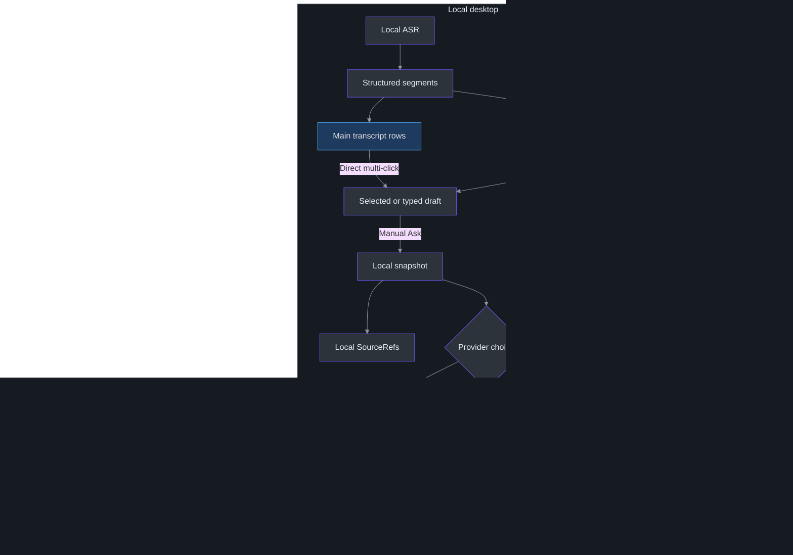
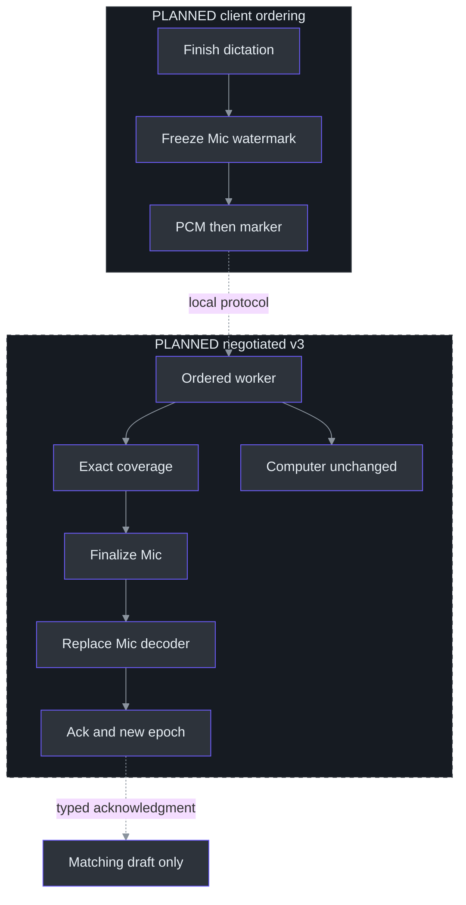

# 13. Local Questions, Installed Providers and Future Azure

## Why question selection is the architectural center

**Persistent Agency ACP now implements controlled direct Q&A; measured evidence is provider-level, not WPF acceptance. Direct Azure remains optional future work.** TODO28 established exact local Freeze. Accurate armed Mic spans remain TODO29; they do not block asking reviewed segments or typed text. Azure30/31 still need an approved profile and adapter. (src\PhantomFudge.App\MainWindow.Questions.cs:265-305, `QuestionAsk_Click`; TODO\29_QUESTION_COMMIT_LATENCY.todo:13-22, planned commit; TODO\31_STREAMING_ANSWER_CLIENT.todo:30-36, completion evidence.)

The owner redirected the primary path to installed **Agency** after an organization-auth popup: no new login and no organization-data access. The parent stopped the owned login and reset the app to SnapshotOnly. Agency mode and `AnswerSettings.AgencyPath` support that direction. The earlier single Copilot smoke **failed at the customization/tool gate**; its allowance remains consumed because a model call cannot be ruled out. The later Agency probe had **new, separate authorization**, not a retry of that allowance. (src\PhantomFudge.Core\Answers\AnswerContracts.cs:5-39, contract and modes; src\PhantomFudge.Core\Answers\AnswerConfiguration.cs:13-29, `Load`.) See [provider setup/status](../../docs/ANSWER-PROVIDERS.md) and [workstream39](../../TODO/39_INSTALLED_CLI_ANSWERS.todo).

The [earlier Sonnet marker smoke](../../docs/answer-provider-smoke.json) established connectivity only. The October9 authorized ledger contains **48 question submissions**, including failures, with no audio, organization data or new login. It selected **`gpt-5.6-sol-fast` / low** using Agency **2026.10.7.4** / Copilot **1.0.92**. Those versions identify the historical benchmark, not today's compatibility gate: [current source checks the runtime contract](../ANSWER-PROVIDERS.md#compatibility-across-agency-updates). LocalModel still has mocks only, and existing authentication can expire. (tools\AgencyProbe\results\summary-final.json:2-31, scope, accounting and selection; tools\AgencyProbe\results\summary-final.json:197-224, catalog/isolation boundaries.)

**H passed three exact-text prepared-session trials:** **4.066, 4.176 and 2.992 s** to complete useful answers, including session close, with **33/33** compiled checks. Two requests used intended wording; one preserved “okay so right mean the solution for the lead good problem to some” and received Two Sum under an explicit assumption. This tests supplied text, not live recognition. Initial preparation took **19.987 s**, outside those completion intervals; the results establish neither a cold-start budget nor an SLO. (tools\AgencyProbe\results\latency-suite-20261009-h-exact-fast.json:2-56, exact inputs/answers/timing; tools\AgencyProbe\results\latency-suite-20261009-h-quality.json:2-186, compiled checks.)

Keep the failed path visible: historical Haiku E passed five prepared original-variation trials below five seconds, but did not use owner ASR. Exact-text Haiku F chose two wrong problems and appended one follow-up; mini G interpreted the title correctly but failed ten wider-range overflow checks. F/G first Asks after transport-only readiness took **5.041/6.470 s**. H does not erase those outcomes or imply every future question is solved correctly. (tools\AgencyProbe\results\latency-suite-20261009-f-exact.json:2-98, Haiku failures; tools\AgencyProbe\results\summary-final.json:141-180, E–H comparison.)

The hard problem is not posting text to a model. It is knowing **which text the user intended to send**, keeping that text stable during asynchronous recognition, and associating a future answer with the right question. A microphone may contain earlier conversation while Computer audio continues. The implemented solution to the local part is an explicit editable draft followed by an immutable snapshot at Ask, not an implicit whole-transcript prompt. (src\PhantomFudge.Core\QuestionDraft.cs:18-45, `ReplaceSelection`; src\PhantomFudge.Core\QuestionDraft.cs:90-95, `Freeze`; docs\AI-ANSWER-PRIVACY.md:26-40, proposed text boundary.)

The October9 source-only update makes direct multi-click selection the normal entrance to that
draft: click Mic/Computer rows, review their combined text, then Ask separately. The historical045022
ZIP does not contain it. Selection changes no provider contract and creates no model request.
(src/PhantomFudge.App/MainWindow.TranscriptSelection.cs:85-147; [local workflow](../LOCAL-QUESTIONS.md).)

A useful mental model has three objects: the transcript is an evolving observation, the draft is a working selection, and the snapshot is an immutable local commitment. Its copied `SourceRefs` remain **local provenance**, not provider input. (src\PhantomFudge.Core\QuestionSnapshot.cs:5-23, `QuestionSnapshot`.) `AnswerRun` now constructs a fresh request ID plus `snapshot.ExactText`; serializing the whole snapshot would undo that deliberately narrow boundary. (src\PhantomFudge.Core\Answers\AnswerRun.cs:15-29, constructor and `Request`.)

## Architecture: local speech, explicit text egress

The implemented path preserves native Python ASR. C# has a common asynchronous answer contract; Agency background prompting is the requested installed-provider path, with direct Azure later if chosen. Routing inference through the speech service would add coupling without a demonstrated requirement. Neither subprocess management nor model work belongs in capture callbacks or the recognizer CPU worker. (docs\AI-ANSWER-ARCHITECTURE.md:82-200, recommended baseline.)



Dashed edges mark destination boundaries or planned Azure, not simultaneous calls or fallback. No partials, chat reader or whole-meeting context are forwarded automatically. Cloud ASR and an enterprise broker remain separate optional workstreams; Docker stays last rather than becoming a CLI prerequisite. (docs\AI-ANSWER-ARCHITECTURE.md:82-200, baseline; TODO\36_OPTIONAL_AZURE_SPEECH.todo:13-25, optionality; TODO\37_OPTIONAL_ANSWER_BROKER.todo:13-26, conditional broker; TODO\35_ANSWER_RELEASE_ACCEPTANCE.todo:23-26, Docker-last gate.)

**Installed Agency is not offline.** `agency copilot` launches locally but may use Agency's remote model service; existing model authentication is distinct from organization-data access. LocalModel remains a separate compatible Copilot-engine OFFLINE/BYOK path with an explicit model and literal-loopback server. Settings reject remote/DNS endpoints, embedded credentials, queries and fragments, but cannot prove a local server never proxies elsewhere. No local-server failure may trigger hosted-model fallback. (src\PhantomFudge.Core\Answers\AnswerContracts.cs:41-74, `AnswerSettings.Validate`, `ValidateLocalEndpoint`.)

## What the existing interfaces provide—and omit

| Existing component | Implemented contract | Consequence for the proposal |
| --- | --- | --- |
| `AudioSource` | Stable byte values and separate wire/display names | Source identity must not be inferred from rendered labels. |
| `TranscriptSegmentKey` | Capture GUID, source, epoch, stable local utterance ID | Local provenance now exists independently of formatted display text. |
| `StructuredTranscriptStore` | Bounded immutable records and revisions | Current v2 events use local epoch 0, not negotiated commit metadata. |
| `TranscriptRow` / selection handler | Main-history display paired with immutable segment identity | Visible rows remain selectable after smaller chooser eviction; click order is not question order. |
| `QuestionDraft` / `QuestionSnapshot` | Explicit selection/editing and copied immutable Freeze | Remains independent of provider settings and armed sample boundaries. |
| `AnswerRequest` / `AnswerRun` | Exact-text projection, fresh request identity and bounded event state | Provider output cannot be associated by mutable draft text alone. |
| `TranscriptBuffer` | Per-source partials, flattened finals, bounded text | Display/export storage is not a segment-selection database. |
| `TranscriptionSocket` | Single-use session, v1/v2 negotiation, strict response fields | New controls and metadata require explicit version/capability negotiation. |
| `Session` | Hybrid per-source PCM queues/workers, a bounded shared finalization queue, and serialized session-global final IDs | Preserve each source's processing order; received PCM is not processed coverage for commit. |

Sources: (src\PhantomFudge.Core\AudioSource.cs:3-30, `AudioSource`, `AudioSourceNames`); (src\PhantomFudge.Core\TranscriptSegment.cs:3-20, `TranscriptSegmentKey`); (src\PhantomFudge.Core\StructuredTranscriptStore.cs:13-37, defaults and sessions); (src\PhantomFudge.Core\QuestionDraft.cs:8-16, draft fields); (src\PhantomFudge.Core\QuestionSnapshot.cs:17-23, snapshot fields); (src\PhantomFudge.Core\TranscriptBuffer.cs:6-19, `TranscriptBuffer`); (src\PhantomFudge.App\Audio\TranscriptionSocket.cs:117-169, `ConnectCoreAsync`; src\PhantomFudge.App\Audio\TranscriptionSocket.cs:491-515, property validation); (services\transcription\server.py:280-290, `Session`).

The additional answer seam is implemented in (src\PhantomFudge.Core\Answers\AnswerContracts.cs:5-31, `AnswerRequest`, `IAnswerProvider`; src\PhantomFudge.Core\Answers\AnswerRun.cs:15-32, run identity/state).

The retained-row seam and common mouse/keyboard/automation composition path are in
(src/PhantomFudge.App/MainWindow.TranscriptSelection.cs:13-83,85-147).

`TranscriptBuffer.AddFinal` appends a formatted line and advances one global final ID; `BeginSession` resets that ID while retaining existing text with a separator. Therefore `17` is not a durable cross-session reference. Likewise, `[Mic]` is presentation text that a user could type. The unchanged display/export buffer is deliberately not the selection database. (src\PhantomFudge.Core\TranscriptBuffer.cs:23-38, `BeginSession`; src\PhantomFudge.Core\TranscriptBuffer.cs:48-72, `AddFinal`; src\PhantomFudge.Core\TranscriptBuffer.cs:87-96, source formatting.)

## Implemented components and local dataflow

The store accepts the local capture GUID supplied with each event and uses epoch 0 for current v2. A partial and its eventual final share a local utterance key; revisions distinguish replacement text. Qualified final times are audio-relative seconds, not word-level/sample-exact boundaries. A stale session/epoch or duplicate/out-of-order protocol final ID is rejected. (src\PhantomFudge.App\MainWindow.Questions.cs:134-142, `UpdateQuestionTranscript`; src\PhantomFudge.Core\StructuredTranscriptStore.cs:36-100, `SetPartial`, `AddFinal`; src\PhantomFudge.Core\StructuredTranscriptStore.cs:120-125, freshness; src\PhantomFudge.Core\TranscriptSegment.cs:28-58, segment fields.)

Direct main-transcript clicks toggle whole Mic/Computer segments without Ctrl, composing raw text
in displayed history order. Wrapped/multiline segments are indivisible rows, not arbitrary text
ranges. Both final and unfinished ListBoxes route `SelectionChanged` to the same validator.
Selection opens Q/A and enters independent editing but never creates a snapshot or submits it.
After a manual edit, further direct changes are rejected with inline retained-draft status and
restored highlights until **Clear question**. (src/PhantomFudge.App/MainWindow.TranscriptSelection.cs:85-147.)

The alternative **Choose source** chooser defaults to **Mic**. **Computer** or **All** are explicit
filters; changing one never selects its contents automatically. **Use selected** is an explicit
replacement action, including after editing, and copies only chosen keys. Typing is another alternative.
Both selection paths use `ReplaceSelection`: one capture session, at most256entries and8,192UTF-16
code units including newline separators. Empty Ask and oversized changes reject without truncation.
(src\PhantomFudge.App\MainWindow.Questions.cs:14-17, default filter; src\PhantomFudge.App\MainWindow.Questions.cs:70-128, selection; src\PhantomFudge.Core\QuestionDraft.cs:18-45, session/copy rules; src\PhantomFudge.Core\QuestionDraft.cs:90-124, validation.)

Store retention is separate: 256 records/64,000 text characters. `ApplyUpdate` stages changes and evicts oldest non-active records except the current update; it fails if protected live data cannot fit. Drafts retain copied selections through eviction. `Refresh` can improve a selected unfinished record, but `EditText` makes user text authoritative—even reasserting the same text blocks later ASR replacement. (src\PhantomFudge.Core\StructuredTranscriptStore.cs:13-18, limits; src\PhantomFudge.Core\StructuredTranscriptStore.cs:134-145, eviction; src\PhantomFudge.Core\QuestionDraft.cs:48-79, edit/refresh.)

Main-history rows retain their own structured identity after chooser eviction and remain bounded
by the unchanged display/export buffer. Archived unfinished partials stay selectable/provisional;
separators are not selectable. Before editing, selected keys follow partial revisions into finals.
New finals follow scrolling only when already at the end, avoiding jumps during history selection.
(src/PhantomFudge.App/MainWindow.TranscriptSelection.cs:13-83;
[`TranscriptBuffer`](../../src/PhantomFudge.Core/TranscriptBuffer.cs).)

### Worked local ordering

For a synthetic Mic partial “Explain Service Fabric like”, the actual Core APIs support this sequence; the assertions illustrate expected behavior rather than a newly executed test:

```csharp
draft.ReplaceSelection(new[] { micPartial });
var frozen = draft.Freeze();                 // local only
store.AddFinal(session, AudioSource.Microphone, 3,
    "Explain Service Fabric like I am five.", 1, 2);
draft.Refresh(store);                        // draft may improve
draft.EditText("Explain Service Fabric like I'm five.");
draft.Refresh(store);                        // user edit wins
Assert(frozen.ExactText == "Explain Service Fabric like");
```

The snapshot copies text and provenance; later recognition, typing, eviction or Clear cannot mutate the already-created object. Copy draft is deliberate and uses the Windows clipboard, outside capture protection. These local objects remain memory-only, but the configured CLI path does not: external profiles can retain prompts and sessions. Clear is not a deletion request to that profile or cloud service. (src\PhantomFudge.Core\QuestionSnapshot.cs:5-23, copied immutable fields; src\PhantomFudge.App\MainWindow.Questions.cs:14-22, state; src\PhantomFudge.App\MainWindow.Questions.cs:265-338, Ask/Copy/Clear.)

**Finish dictation remains planned.** Selecting text does not arm a sample-exact live span. `IQuestionCommitter` remains proposed, whereas `IAnswerProvider.StreamAsync` now exists. Fake streams are validation tools, never pretend real answers. This distinction allows explicit Ask before source commit without claiming acoustic completeness. (docs\AI-ANSWER-ARCHITECTURE.md:625-656, provider/commit separation; TODO\29_QUESTION_COMMIT_LATENCY.todo:13-22, commit work.)

## Planned algorithm: Mic-only commit as an ordered barrier

Today, `SendAudioAsync` drains queued PCM and sends a global Stop. The server accepts only the exact Stop control, then finalizes **every** selected decoder before acknowledging stopped. Calling that path to submit a question would terminate Computer transcription too. (src\PhantomFudge.App\Audio\TranscriptionSocket.cs:322-340, `SendAudioAsync`; services\transcription\server.py:306-316, `Session.receive`; services\transcription\server.py:394-498, `Session.recognize`.)

The proposed v3 capability inserts a Mic commit envelope into the **same ordered sender queue**, under the same synchronization boundary that freezes its delivered-sample watermark. A second concurrent WebSocket sender would break the intended ordering guarantee. Server processing must reach exactly that source watermark before finalization; bytes received into a queue are not evidence of decoded coverage. Current `SourceState.total_bytes` increments in receive, before the worker calls `accept`, so it cannot serve as the proposed processed counter. (docs\AI-ANSWER-ARCHITECTURE.md:473-518, commit design; services\transcription\server.py:339-357, `Session.receive`; services\transcription\server.py:418-451, `Session.recognize`.)



The wrapper already provides a useful implementation pattern: after 30 audio seconds it retrieves a final, advances its cumulative offset, and constructs a new decoder. `finish()` alone retrieves a final but does not prepare continued recognition. The proposed commit must adapt finalize-and-replace for Mic while preserving Computer state and session-global final numbering. This is feasibility evidence, not an existing commit API. (services\transcription\recognizer.py:69-110, `VoskRecognizer`; TODO\29_QUESTION_COMMIT_LATENCY.todo:13-22, planned tasks.)

### Worked pseudocode: retries without duplicate finalization

This sketch specifies invariants for a future implementation, not methods currently callable in the service:

```python
def process_commit(marker, session):
    key = (session.capture_id, marker.source, marker.request_id)
    prior = session.completed_commits.get(key)
    if prior is not None:
        require(prior.parameters == marker.parameters)
        return prior.ack             # no second final or epoch increment

    track = session.sources[marker.source]
    require(marker.epoch == track.epoch)
    require(track.processed_samples == marker.through_sample)
    final = track.finalize_and_replace_preserving_offset()
    final_ref = session.record_final(final)   # including an empty final
    old_epoch = track.epoch
    track.epoch += 1
    ack = Ack(key, old_epoch, track.epoch,
              marker.through_sample, final_ref)
    session.remember_bounded_commit(key, marker.parameters, ack)
    return ack
```

Lookup precedes current-epoch validation so a genuine retry can replay its original acknowledgment after the epoch has advanced. Changed parameters under the same request ID must fail. The eventual implementation also needs a defined publication/failure boundary and bounded deduplication lifetime; the sketch does not promise durable exactly-once delivery across process crashes. (docs\AI-ANSWER-ARCHITECTURE.md:473-518, commit ordering/idempotency; TODO\29_QUESTION_COMMIT_LATENCY.todo:26-28, duplicate/empty-commit acceptance.)

An armed question needs a start boundary as well as an end. Otherwise earlier Mic conversation enters the question. Current partials disable word-level timing, so arbitrary retrospective acoustic cuts cannot be reconstructed exactly from displayed text. A click watermark also covers delivered samples, not audio still inside a device buffer. A bounded tail-drain policy must be specified and measured rather than disguised as sample-exact knowledge of when the user finished speaking. (services\transcription\recognizer.py:78-81, `_new_decoder`; docs\AI-ANSWER-ARCHITECTURE.md:473-518, start and device-buffer boundaries.)

## Common answer state, then optional Azure

`AnswerRun.Apply` accepts only its request's events while Streaming. Sequence values must increase strictly; duplicates or events after a completion marker fail. Text deltas must be nonempty, and the 32,768-code-unit cap rejects an overflowing delta without silently truncating it. `Completed` carries no text and only latches a terminal marker. `Complete` requires that marker and nonblank text after **request enumeration ends**. Persistent ACP process EOF is not normal request completion. (src\PhantomFudge.Core\Answers\AnswerRun.cs:34-65, `Apply`, `Complete`.)

The common UI retains one active request, a 120-second overall deadline and a 40-ms render timer. Hide/Clear/protection invalidation/reload/close stop and dispose the cached Agency provider; cancellation awaits owned-process cleanup. Partial text stays incomplete unless deliberately cleared, and Copy is explicit. Reveal may prepare readiness but never resend a question. The [lifetime owner](../../src/PhantomFudge.App/MainWindow.AnswerLifetime.cs) also suppresses actual warm-up in diagnostic-constructor mode. See the [provider guide](../../docs/ANSWER-PROVIDERS.md); a successful Core transition alone does not prove process cleanup. (src\PhantomFudge.Core\Answers\AnswerRun.cs:67-81, retained cancellation/failure state.)

`Initialize-Answers.ps1 -Provider Agency` resolves the executable without login. The controlled profile is not a personal coding session or organization-data connector. Missing existing authentication must fail visibly, not trigger app-owned sign-in/account switching. Settings/profile separation and a `.exe` path check prove neither isolation nor zero retention; supported launch details belong in the [provider guide](../../docs/ANSWER-PROVIDERS.md). (src\PhantomFudge.Core\Answers\AnswerConfiguration.cs:8-29, paths and strict loading; src\PhantomFudge.Core\Answers\AnswerContracts.cs:35-52, settings fields/path validation.)

### Actual ACP transaction: no implicit provider history

The default-off [Clarify first](../QUESTION-CLARIFICATION.md) extension deliberately sends a bounded
history of this question's interpretation/reply exchanges. Each explicit action still creates a
fresh, terminal provider request; the app never leaves the CLI waiting for interactive user input.
Normal Ask and confirmed answers retain the no-follow-up rule. The earlier latency receipts below
do not establish this loop's end-to-end latency or model interpretation quality.

One cached engine serves at most 32 created sessions before rotation. **Normal configured startup/reveal intentionally calls `WarmUpAsync`**, preparing one empty session with no model prompt. Successful answers close their conversation and prepare another empty one, never a follow-up. The separate `WarmUpTransportAsync` creates no session and leaves that setup cost on Ask; it is not the current app readiness policy. The [lifetime owner](../../src/PhantomFudge.App/MainWindow.AnswerLifetime.cs) keeps the readiness state distinct from question submission. (src\PhantomFudge.Core\Answers\AgencyAcpConnection.cs:40-91, reuse/session creation; tools\AgencyProbe\results\agency-selected-fast-default-preparation.json:2-16, selected-default empty preparation.)

```text
on explicit Ask(exact frozen text):
    acquire provider gate; obtain fresh empty session
    select controlled agent through ACP; verify role/model/allow_all=off
    send ONE user message: fixed policy + JSON { userQuestion: exact text }
    stream identified bounded text; reject tool/plan/capability requests
    require end_turn and acceptable nonblank answer
    await session/close acknowledgment
    emit Completed; end this request's enumeration, keep engine alive
    prepare next EMPTY session; do not submit another question
on cancellation/failure/owned shutdown:
    stop engine; remove owned workspace; retain only incomplete visible text
```

The explicit ACP role selection matters: CLI `--agent` alone did not select the custom agent in this pinned engine. The fixed policy is installed in the **SYSTEM role**. The single user payload also includes fixed policy plus JSON-escaped `ExactText`; it is not a raw-question-only wire message. Default Ask attaches no provenance, notes or previous answers. Opted-in clarification carries typed conversation metadata; the independent Previous answer toggle adds only the displayed completed answer as background. `@` is escaped to prevent file-reference interpretation without changing the decoded question. (src\PhantomFudge.Core\Answers\AgencyAcpConnection.cs:64-125, selection/prompt/close; src\PhantomFudge.Core\Answers\AgencyAnswerPrompt.cs:8-111, policy/envelope; tools\AgencyProbe\results\summary-final.json:197-219, historical role and history-isolation evidence.)

Previous-answer context is **included in Preview 2**, absent from Preview 1 and not covered by the
historical timing trials. It does not resume a server conversation: explicit Ask captures one
string, and each correction/confirmation receives the same snapshot in a fresh session. Clear or
provider change resets the option. A future Azure adapter must preserve this projection rather
than serialize the entire `QuestionSnapshot` or previous `AnswerRequest`.
([Request projection](../../src/PhantomFudge.Core/Answers/AnswerRun.cs),
[context lifecycle](../../src/PhantomFudge.App/MainWindow.AnswerContext.cs),
[usage](../LOCAL-QUESTIONS.md#follow-up-with-the-previous-answer).)

No clarification/permission/tool wait is successful completion. Protocol plans and capability requests fail; the heuristic scans bounded answer prose outside code fences for selected missing-input/follow-up phrases. It is not semantic proof: F chose wrong problems; G chose the correct problem but omitted arithmetic safeguards. H's finite checks support the selected profile, not universal correctness. General arithmetic, title-disambiguation and labelled-assumption policy must not become a hard-coded answer or snapshot rewrite. (src\PhantomFudge.Core\Answers\AgencyAcpConnection.cs:216-268, rejected requests/plans; src\PhantomFudge.Core\Answers\AgencyAcpConnection.cs:333-357, heuristic; src\PhantomFudge.Core\Answers\AgencyAnswerPrompt.cs:12-43, useful-answer requirements; tools\AgencyProbe\results\summary-final.json:109-180, retained failures.)

### Optional Azure preserves the same narrow interface

The optional future Azure provider would call **v1 Responses** with `stream:true`, `store:false`, `background:false`, no tools, conversation ID or `previous_response_id`. Its model field identifies an approved deployment alias. “Foreground” describes API execution, not desktop activation. Research examples are not an installed Azure client or CLI request format. (docs\AI-ANSWER-RESEARCH.md:163-204, inference API; TODO\31_STREAMING_ANSWER_CLIENT.todo:13-21, adapter tasks.)

The research shortlist is `gpt-5.4-mini`, `gpt-5.4-nano`, and `gpt-5-mini`, with documented versions and lifecycle dates as of the existing research. None is established as fastest; subscription entitlement, quota, capacity, processing policy, and actual deployment availability remain unknown. (docs\AI-ANSWER-RESEARCH.md:139-161, shortlist and availability intersection; docs\AI-ANSWER-RESEARCH.md:257-272, uncertainty summary.)

Question, answer, connection, audio and capture-protection states remain separate. Common events now carry identity/sequence; future Azure terminal/filter handling must preserve that separation. HTTP 200 or stream closure is not completion, and local cancellation does not guarantee stopped remote billing. (docs\AI-ANSWER-ARCHITECTURE.md:519-624, state machines; docs\AI-ANSWER-ARCHITECTURE.md:657-684, streaming failures.)

The question pane is inside the protected WPF surface, and common answer UI is integrated there.
Global `TogglePresentationAsync` still stops transcription before changing Notes modes. Question
typing instead uses `SetQuestionEditing`: deliberate focus, no transcription stop and no Notes-edit
enablement. The manual chooser can remain passive, but direct main-row clicks deliberately enter
that question-editing path. Neither selection path is Ask. (src\PhantomFudge.App\MainWindow.xaml.cs:253-275, `TogglePresentationAsync`; src\PhantomFudge.App\MainWindow.Questions.cs:37-58, inline expansion; src\PhantomFudge.App\MainWindow.Questions.cs:156-208, separate focus;
src/PhantomFudge.App/MainWindow.TranscriptSelection.cs:131-147.)

## Tradeoffs and adversarial event ordering

Consider an ordinary scheduling race rather than a network attack: the user asks A, cancels it, and asks B; a previously queued A delta then reaches the dispatcher. Disposing the HTTP stream is insufficient because the callback may already exist. The UI must compare the delta's request identity with the current answer generation before appending it. A cancellation acknowledgment and a stale-output guard solve different problems. (docs\AI-ANSWER-ARCHITECTURE.md:519-624, answer state and event rules; TODO\32_ANSWER_UI_LIFECYCLE.todo:19-25, delayed callbacks.)

User edits already block ordinary ASR replacement; the future commit path must preserve that rule across acknowledgment races. Immediate local Freeze favors visible user control, whereas planned Finish dictation adds acknowledged recognition coverage. Neither permits a later result to overwrite a frozen question or secretly send it. (src\PhantomFudge.Core\QuestionDraft.cs:48-79, edit ownership; docs\AI-ANSWER-ARCHITECTURE.md:473-518, planned epochs and boundaries.)

Core snapshot tests assert stability across later recognition, edits, Clear, eviction and capture restart; these are not provider-process or recipient qualification. (tests\PhantomFudge.Core.Tests\QuestionSnapshotTests.cs:30-70, `SnapshotSurvivesLateAsrEditsClearsEvictionAndCaptureRestart`.) The historical TODO28 handoff recorded an unexplained foreground failure before a successful identical-source repeat and no significant review defects. That local completion is not TODO39 acceptance, proof of CLI restrictions or model latency.

## Exercises

1. Trace Ask on revision 4, then a final producing draft revision 5. Specify the snapshot/editor contents and explain how SnapshotOnly differs from configured provider mode without changing the frozen text. (src\PhantomFudge.Core\QuestionDraft.cs:61-95, `Refresh`, `Freeze`; src\PhantomFudge.App\MainWindow.Questions.cs:265-291, snapshot boundary.)
2. Place a Mic marker behind two Mic frames and an interleaved Computer frame. Explain why acknowledging reception is insufficient and why global Stop is incorrect. (services\transcription\server.py:296-498, `Session.receive`, `recognize`.)
3. Retry a commit after its epoch changes, then retry the same ID with a different watermark. Write expected acknowledgment/rejection assertions without opening audio devices. (TODO\29_QUESTION_COMMIT_LATENCY.todo:16-28, retry and boundary requirements.)

## References

- [Detailed proposal](../../docs/AI-ANSWER-ARCHITECTURE.md), [research and source register](../../docs/AI-ANSWER-RESEARCH.md), and [identity/privacy design](../../docs/AI-ANSWER-PRIVACY.md).
- [Implemented local composer](../../docs/LOCAL-QUESTIONS.md), [draft](../../src/PhantomFudge.Core/QuestionDraft.cs), and [snapshot](../../src/PhantomFudge.Core/QuestionSnapshot.cs).
- [Direct transcript selection](../../src/PhantomFudge.App/MainWindow.TranscriptSelection.cs), [synthetic selection diagnostic](../../src/PhantomFudge.App/MainWindow.TranscriptSelectionDiagnostics.cs), and [workstream44](../../TODO/44_TRANSCRIPT_CLICK_SELECTION.todo).
- [Installed-provider setup](../../docs/ANSWER-PROVIDERS.md), [common contract](../../src/PhantomFudge.Core/Answers/AnswerContracts.cs) and [run state](../../src/PhantomFudge.Core/Answers/AnswerRun.cs).
- [ACP connection](../../src/PhantomFudge.Core/Answers/AgencyAcpConnection.cs), [controlled policy](../../src/PhantomFudge.Core/Answers/AgencyAnswerPrompt.cs), [final provider evidence](../../tools/AgencyProbe/results/summary-final.json) and [metadata diagnostics](../../docs/DIAGNOSTICS.md).
- [H exact-text timing](../../tools/AgencyProbe/results/latency-suite-20261009-h-exact-fast.json) and [H compiled correctness](../../tools/AgencyProbe/results/latency-suite-20261009-h-quality.json).
- [Draft workstream](../../TODO/28_QUESTION_DRAFTS.todo), [commit workstream](../../TODO/29_QUESTION_COMMIT_LATENCY.todo), and [streaming workstream](../../TODO/31_STREAMING_ANSWER_CLIENT.todo).
- [Existing transport](../../src/PhantomFudge.App/Audio/TranscriptionSocket.cs), [server](../../services/transcription/server.py), and [recognizer](../../services/transcription/recognizer.py).
- [Azure Responses primary documentation](https://learn.microsoft.com/en-us/azure/foundry/openai/how-to/responses), recorded in the existing research; not newly retrieved or account-verified for this chapter.
