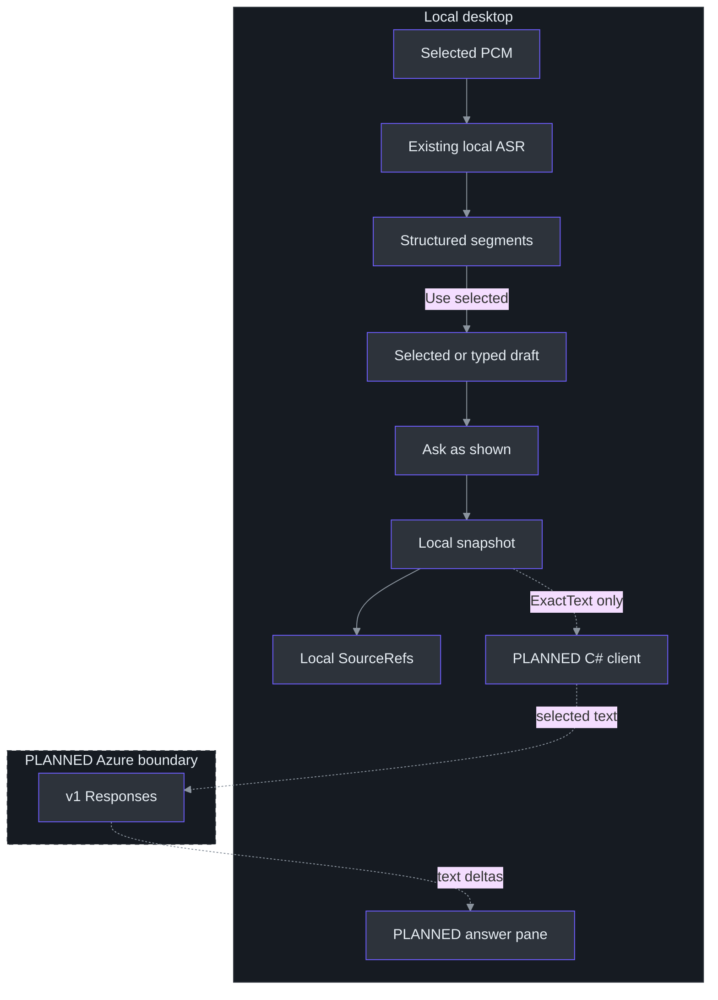
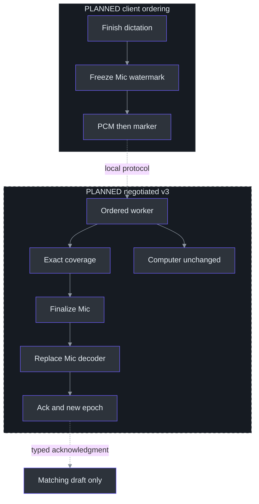

# 13. Local Questions and Proposed Azure Answers

## Why question selection is the architectural center

**Local question selection, editing and immutable Freeze are implemented; TODO28 is locally complete. Azure answers are not connected.** The existing Ask handler freezes a snapshot, displays its text and explicitly reports that no request was sent. There is no fake AI answer or cloud adapter. Accurate armed Mic boundaries/commit remain TODO29; the approved profile is unknown under TODO30; real answers remain TODO31/32. Implementation is not owner acceptance or a cloud-performance result. (src\PhantomFudge.App\MainWindow.Questions.cs:228-247, `QuestionAsk_Click`; TODO\29_QUESTION_COMMIT_LATENCY.todo:13-22, planned commit; TODO\31_STREAMING_ANSWER_CLIENT.todo:30-36, completion evidence.)

The hard problem is not posting text to a model. It is knowing **which text the user intended to send**, keeping that text stable during asynchronous recognition, and associating a future answer with the right question. A microphone may contain earlier conversation while Computer audio continues. The implemented solution to the local part is an explicit editable draft followed by an immutable snapshot at Ask, not an implicit whole-transcript prompt. (src\PhantomFudge.Core\QuestionDraft.cs:18-45, `ReplaceSelection`; src\PhantomFudge.Core\QuestionDraft.cs:90-95, `Freeze`; docs\AI-ANSWER-PRIVACY.md:6-20, proposed text boundary.)

A useful mental model has three objects: the transcript is an evolving observation, the draft is a working selection, and the snapshot is an immutable local commitment. Only its `ExactText` would become question input to a future provider. Its copied `SourceRefs` remain **local provenance**: serializing the entire snapshot would cross a broader privacy boundary than intended. (src\PhantomFudge.Core\QuestionSnapshot.cs:5-23, `QuestionSnapshot`.)

## Architecture: local speech, explicit text egress

The implemented path preserves native Python ASR; the future baseline would add a direct asynchronous C# answer provider. Routing inference through the speech service merely because it exists would add coupling without a demonstrated requirement. Authentication and request identity belong with the desktop coordinator, not capture callbacks or the recognizer CPU worker. (docs\AI-ANSWER-ARCHITECTURE.md:21-89, recommended baseline.)



Dashed paths represent proposed connections, including the cloud boundary. There is no automatic forwarding of partials, no chat reader, and no implicit full-meeting context. Bounded additional context would require explicit selection and a recorded context policy. Cloud ASR and an enterprise broker are separate optional workstreams; Docker remains final-stage packaging rather than a prerequisite. (docs\AI-ANSWER-ARCHITECTURE.md:21-89, baseline; TODO\36_OPTIONAL_AZURE_SPEECH.todo:13-25, optionality; TODO\37_OPTIONAL_ANSWER_BROKER.todo:13-26, conditional broker; TODO\35_ANSWER_RELEASE_ACCEPTANCE.todo:23-26, Docker-last gate.)

## What the existing interfaces provide—and omit

| Existing component | Implemented contract | Consequence for the proposal |
| --- | --- | --- |
| `AudioSource` | Stable byte values and separate wire/display names | Source identity must not be inferred from rendered labels. |
| `TranscriptSegmentKey` | Capture GUID, source, epoch, stable local utterance ID | Local provenance now exists independently of formatted display text. |
| `StructuredTranscriptStore` | Bounded immutable records and revisions | Current v2 events use local epoch 0, not negotiated commit metadata. |
| `QuestionDraft` / `QuestionSnapshot` | Explicit selection/editing and copied immutable Freeze | No deployment profile, armed sample boundary or network request is added. |
| `TranscriptBuffer` | Per-source partials, flattened finals, bounded text | Display/export storage is not a segment-selection database. |
| `TranscriptionSocket` | Single-use session, v1/v2 negotiation, strict response fields | New controls and metadata require explicit version/capability negotiation. |
| `Session` | Independent decoders, one work queue, session-global final IDs | Received PCM and processed PCM must be distinguished for commit. |

Sources: (src\PhantomFudge.Core\AudioSource.cs:3-30, `AudioSource`, `AudioSourceNames`); (src\PhantomFudge.Core\TranscriptSegment.cs:3-20, `TranscriptSegmentKey`); (src\PhantomFudge.Core\StructuredTranscriptStore.cs:13-37, defaults and sessions); (src\PhantomFudge.Core\QuestionDraft.cs:8-16, draft fields); (src\PhantomFudge.Core\QuestionSnapshot.cs:17-23, snapshot fields); (src\PhantomFudge.Core\TranscriptBuffer.cs:6-19, `TranscriptBuffer`); (src\PhantomFudge.App\Audio\TranscriptionSocket.cs:108-160, `ConnectCoreAsync`; src\PhantomFudge.App\Audio\TranscriptionSocket.cs:482-506, property validation); (services\transcription\server.py:225-235, `Session`).

`TranscriptBuffer.AddFinal` appends a formatted line and advances one global final ID; `BeginSession` resets that ID while retaining existing text with a separator. Therefore `17` is not a durable cross-session reference. Likewise, `[Mic]` is presentation text that a user could type. The unchanged display/export buffer is deliberately not the selection database. (src\PhantomFudge.Core\TranscriptBuffer.cs:23-38, `BeginSession`; src\PhantomFudge.Core\TranscriptBuffer.cs:48-72, `AddFinal`; src\PhantomFudge.Core\TranscriptBuffer.cs:87-96, source formatting.)

## Implemented components and local dataflow

The store accepts the local capture GUID supplied with each event and uses epoch 0 for current v2. A partial and its eventual final share a local utterance key; revisions distinguish replacement text. Qualified final times are audio-relative seconds, not word-level/sample-exact boundaries. A stale session/epoch or duplicate/out-of-order protocol final ID is rejected. (src\PhantomFudge.App\MainWindow.Questions.cs:118-126, `UpdateQuestionTranscript`; src\PhantomFudge.Core\StructuredTranscriptStore.cs:36-100, `SetPartial`, `AddFinal`; src\PhantomFudge.Core\StructuredTranscriptStore.cs:120-125, freshness; src\PhantomFudge.Core\TranscriptSegment.cs:28-58, segment fields.)

The chooser defaults to Mic. Computer or All sources must be explicitly chosen, and changing a filter never selects its contents automatically. **Use selected** copies only chosen keys, rejecting mixed capture sessions. Typing is an alternative. The question ceiling is 8,192 .NET string characters; selection composition counts newline separators. Empty Ask and oversized changes reject without silent truncation. (src\PhantomFudge.App\MainWindow.Questions.cs:13-16, default filter; src\PhantomFudge.App\MainWindow.Questions.cs:59-112, selection; src\PhantomFudge.Core\QuestionDraft.cs:18-45, session/copy rules; src\PhantomFudge.Core\QuestionDraft.cs:90-124, validation.)

Store retention is separate: 256 records/64,000 text characters. `ApplyUpdate` stages changes and evicts oldest non-active records except the current update; it fails if protected live data cannot fit. Drafts retain copied selections through eviction. `Refresh` can improve a selected unfinished record, but `EditText` makes user text authoritative—even reasserting the same text blocks later ASR replacement. (src\PhantomFudge.Core\StructuredTranscriptStore.cs:13-18, limits; src\PhantomFudge.Core\StructuredTranscriptStore.cs:134-145, eviction; src\PhantomFudge.Core\QuestionDraft.cs:48-79, edit/refresh.)

### Worked local ordering

For a synthetic Mic partial “Explain Service Fabric like”, the actual Core APIs support this sequence; the assertions illustrate expected behavior rather than a newly executed test:

```csharp
draft.ReplaceSelection(new[] { micPartial });
var frozen = draft.Freeze();                 // local only
store.AddFinal(session, AudioSource.Microphone, 3,
    "Explain Service Fabric like I am five.", 1, 2);
draft.Refresh(store);                        // draft may improve
draft.EditText("Explain Service Fabric like I'm five.");
draft.Refresh(store);                        // user edit wins
Assert(frozen.ExactText == "Explain Service Fabric like");
```

The snapshot copies both text and local provenance; later recognition, typing, eviction or Clear cannot mutate the already-created object. The UI retains only its latest frozen snapshot, and Clear releases that reference. Copy is deliberate and copies draft text to the Windows clipboard, outside capture protection. State is memory-only, not persisted question history. (src\PhantomFudge.Core\QuestionSnapshot.cs:5-23, copied immutable fields; src\PhantomFudge.App\MainWindow.Questions.cs:13-20, state; src\PhantomFudge.App\MainWindow.Questions.cs:228-277, Ask/Copy/Clear.)

**Finish dictation remains planned.** Selecting existing text does not arm a sample-exact live span. The future `IQuestionCommitter` and `IAnswerProvider.StreamAsync` remain design abstractions; fake provider streams belong in future client tests, not the current UI. (docs\AI-ANSWER-ARCHITECTURE.md:356-386, proposed abstractions; TODO\29_QUESTION_COMMIT_LATENCY.todo:13-22, commit work.)

## Planned algorithm: Mic-only commit as an ordered barrier

Today, `SendAudioAsync` drains queued PCM and sends a global Stop. The server accepts only the exact Stop control, then finalizes **every** selected decoder before acknowledging stopped. Calling that path to submit a question would terminate Computer transcription too. (src\PhantomFudge.App\Audio\TranscriptionSocket.cs:313-331, `SendAudioAsync`; services\transcription\server.py:247-252, `Session.receive`; services\transcription\server.py:317-327, `Session.recognize`.)

The proposed v3 capability inserts a Mic commit envelope into the **same ordered sender queue**, under the same synchronization boundary that freezes its delivered-sample watermark. A second concurrent WebSocket sender would break the intended ordering guarantee. Server processing must reach exactly that source watermark before finalization; bytes received into a queue are not evidence of decoded coverage. Current `SourceState.total_bytes` increments in receive, before the worker calls `accept`, so it cannot serve as the proposed processed counter. (docs\AI-ANSWER-ARCHITECTURE.md:264-309, commit design; services\transcription\server.py:274-287, `Session.receive`; services\transcription\server.py:328-333, `Session.recognize`.)



The wrapper already provides a useful implementation pattern: after 30 audio seconds it retrieves a final, advances its cumulative offset, and constructs a new decoder. `finish()` alone retrieves a final but does not prepare continued recognition. The proposed commit must adapt finalize-and-replace for Mic while preserving Computer state and session-global final numbering. This is feasibility evidence, not an existing commit API. (services\transcription\recognizer.py:55-96, `VoskRecognizer`; TODO\29_QUESTION_COMMIT_LATENCY.todo:13-22, planned tasks.)

### Worked pseudocode: retries without duplicate finalization

This sketch specifies invariants for a future implementation, not methods currently callable in the service:

```python
def process_commit(marker, session):
    key = (session.capture_id, marker.source, marker.request_id)
    prior = session.completed_commits.get(key)
    if prior is not None:
        require(prior.parameters == marker.parameters)
        return prior.ack             # no second final or epoch increment

    track = session.sources[marker.source]
    require(marker.epoch == track.epoch)
    require(track.processed_samples == marker.through_sample)
    final = track.finalize_and_replace_preserving_offset()
    final_ref = session.record_final(final)   # including an empty final
    old_epoch = track.epoch
    track.epoch += 1
    ack = Ack(key, old_epoch, track.epoch,
              marker.through_sample, final_ref)
    session.remember_bounded_commit(key, marker.parameters, ack)
    return ack
```

Lookup precedes current-epoch validation so a genuine retry can replay its original acknowledgment after the epoch has advanced. Changed parameters under the same request ID must fail. The eventual implementation also needs a defined publication/failure boundary and bounded deduplication lifetime; the sketch does not promise durable exactly-once delivery across process crashes. (docs\AI-ANSWER-ARCHITECTURE.md:264-309, commit ordering/idempotency; TODO\29_QUESTION_COMMIT_LATENCY.todo:26-28, duplicate/empty-commit acceptance.)

An armed question needs a start boundary as well as an end. Otherwise earlier Mic conversation enters the question. Current partials disable word-level timing, so arbitrary retrospective acoustic cuts cannot be reconstructed exactly from displayed text. A click watermark also covers delivered samples, not audio still inside a device buffer. A bounded tail-drain policy must be specified and measured rather than disguised as sample-exact knowledge of when the user finished speaking. (services\transcription\recognizer.py:64-67, `_new_decoder`; docs\AI-ANSWER-ARCHITECTURE.md:264-309, start and device-buffer boundaries.)

## Planned request, answer states, and UI

The initial provider would call Azure OpenAI **v1 Responses** with `stream:true`, `store:false`, `background:false`, no tools, no conversation ID, and no `previous_response_id`. Its model field identifies the approved deployment alias. “Foreground” describes API execution, not activating the desktop window. The exact SDK must be pinned and compile-checked; research examples are not an installed client. (docs\AI-ANSWER-RESEARCH.md:160-201, inference API; TODO\31_STREAMING_ANSWER_CLIENT.todo:13-21, adapter tasks.)

The research shortlist is `gpt-5.4-mini`, `gpt-5.4-nano`, and `gpt-5-mini`, with documented versions and lifecycle dates as of the existing research. None is established as fastest; subscription entitlement, quota, capacity, processing policy, and actual deployment availability remain unknown. (docs\AI-ANSWER-RESEARCH.md:136-158, shortlist and availability intersection; docs\AI-ANSWER-RESEARCH.md:254-269, uncertainty summary.)

Question, answer, connection, audio, and capture-protection states must remain separate. Every streamed event would carry a request identity and sequence; stale events from A must never append to B. HTTP 200 or stream closure is not completion. Interrupted output stays visibly incomplete, and cancellation does not guarantee stopped remote billing. (docs\AI-ANSWER-ARCHITECTURE.md:310-355, state machines; docs\AI-ANSWER-ARCHITECTURE.md:387-410, streaming failures.)

The local question pane is already inside the protected WPF surface; the streamed-answer pane remains future. Global `TogglePresentationAsync` still stops transcription before changing Notes modes. Question typing instead uses `SetQuestionEditing`: deliberate focus, no transcription stop and no Notes-edit enablement. Passive selection and Ask remain distinct from typing. (src\PhantomFudge.App\MainWindow.xaml.cs:226-245, `TogglePresentationAsync`; src\PhantomFudge.App\MainWindow.Questions.cs:33-48, inline expansion; src\PhantomFudge.App\MainWindow.Questions.cs:139-180, separate focus.)

## Tradeoffs and adversarial event ordering

Consider an ordinary scheduling race rather than a network attack: the user asks A, cancels it, and asks B; a previously queued A delta then reaches the dispatcher. Disposing the HTTP stream is insufficient because the callback may already exist. The UI must compare the delta's request identity with the current answer generation before appending it. A cancellation acknowledgment and a stale-output guard solve different problems. (docs\AI-ANSWER-ARCHITECTURE.md:310-355, answer state and event rules; TODO\32_ANSWER_UI_LIFECYCLE.todo:19-25, delayed callbacks.)

User edits already block ordinary ASR replacement; the future commit path must preserve that rule across acknowledgment races. Immediate local Freeze favors visible user control, whereas planned Finish dictation adds acknowledged recognition coverage. Neither permits a later result to overwrite a frozen question or secretly send it. (src\PhantomFudge.Core\QuestionDraft.cs:48-79, edit ownership; docs\AI-ANSWER-ARCHITECTURE.md:264-309, planned epochs and boundaries.)

Core snapshot tests assert stability across later recognition, edits, Clear, eviction and capture restart; these model checks are not UI-focus, real-endpoint or recipient qualification. (tests\PhantomFudge.Core.Tests\QuestionSnapshotTests.cs:30-70, `SnapshotSurvivesLateAsrEditsClearsEvictionAndCaptureRestart`.) The implementation handoff reports passing question checks, but also an unexplained foreground failure in the first whole-UI attempt before an identical-source repeat passed. Those are reported results, not runs performed for this chapter. Read-only review found no significant defects; local TODO28 is complete, not a qualified cloud release.

## Exercises

1. Trace local Ask on revision 4, then a final producing draft revision 5. Specify the frozen text and editor contents; explain why there is no answer header yet. (src\PhantomFudge.Core\QuestionDraft.cs:61-95, `Refresh`, `Freeze`; src\PhantomFudge.App\MainWindow.Questions.cs:228-241, local snapshot display.)
2. Place a Mic marker behind two Mic frames and an interleaved Computer frame. Explain why acknowledging reception is insufficient and why global Stop is incorrect. (services\transcription\server.py:237-333, `Session.receive`, `recognize`.)
3. Retry a commit after its epoch changes, then retry the same ID with a different watermark. Write expected acknowledgment/rejection assertions without opening audio devices. (TODO\29_QUESTION_COMMIT_LATENCY.todo:16-28, retry and boundary requirements.)

## References

- [Detailed proposal](../../docs/AI-ANSWER-ARCHITECTURE.md), [research and source register](../../docs/AI-ANSWER-RESEARCH.md), and [identity/privacy design](../../docs/AI-ANSWER-PRIVACY.md).
- [Implemented local composer](../../docs/LOCAL-QUESTIONS.md), [draft](../../src/PhantomFudge.Core/QuestionDraft.cs), and [snapshot](../../src/PhantomFudge.Core/QuestionSnapshot.cs).
- [Draft workstream](../../TODO/28_QUESTION_DRAFTS.todo), [commit workstream](../../TODO/29_QUESTION_COMMIT_LATENCY.todo), and [streaming workstream](../../TODO/31_STREAMING_ANSWER_CLIENT.todo).
- [Existing transport](../../src/PhantomFudge.App/Audio/TranscriptionSocket.cs), [server](../../services/transcription/server.py), and [recognizer](../../services/transcription/recognizer.py).
- [Azure Responses primary documentation](https://learn.microsoft.com/en-us/azure/foundry/openai/how-to/responses), recorded in the existing research; not newly retrieved or account-verified for this chapter.
