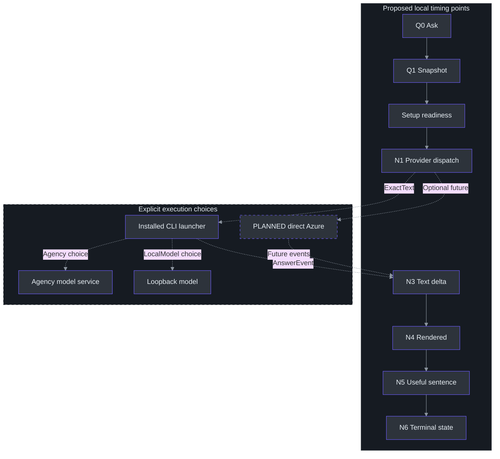

# 14. Answer Latency, Identity, and Privacy

## Why these concerns belong together

**The Agency path is functionally smoke-tested; the installed adapter and local UI checks are complete. Direct Azure remains optional future work.** No Azure endpoint, model entitlement or retention configuration was verified for this chapter. Existing Azure research does not establish Agency privacy or authentication behavior; the successful synthetic Agency probe is not a latency/quality benchmark. (TODO\30_AZURE_ANSWER_CONNECTION.todo:31-37, completion evidence; TODO\33_ANSWER_LATENCY_QUALITY.todo:30-36, completion evidence; docs\AI-ANSWER-PRIVACY.md:133-151, primary-reference scope.)

After an organization-auth popup, the owner rejected new login and organization-data access, choosing the existing installed Agency background-prompt path. The parent stopped the owned login and reset SnapshotOnly. **Local Agency installation does not mean offline inference**; the probe used its remote model service. LocalModel retains a separate literal-loopback OFFLINE/BYOK route. The earlier direct Copilot smoke failed at the customization/tool gate, consuming its allowance because model invocation cannot be ruled out; the later successful Agency request received new, separate authorization. (src\PhantomFudge.Core\Answers\AnswerContracts.cs:14-55, modes and validation; src\PhantomFudge.Core\Answers\AnswerConfiguration.cs:13-29, `Load`.) See [provider boundaries](../../docs/ANSWER-PROVIDERS.md) and [workstream39](../../TODO/39_INSTALLED_CLI_ANSWERS.todo).

The [synthetic Agency receipt](../../docs/answer-provider-smoke.json) records `PHANTOM_OK` after trimming, exit 0 and **69.8812573 seconds elapsed** for the parent-run `tools\AgencyProbe\probe.py --allow-cloud`. It identifies one `claude-sonnet-5` model call, zero model tools and assistant tool requests, disabled `github-mcp-server`/`githubiq`, and no observed new login. Existing authentication was used and no app context was sent. This single process-level elapsed duration is **not** model TTFT, GUI Ask-to-render latency, or a speed/quality benchmark. Final adapter code/replay/UI checks passed; LocalModel has offline mocks only, with no actual model installed or exercised.

Latency, identity and privacy interact. Surprise sign-in delays the answer and introduces an external surface outside capture protection. A whole-transcript prompt violates selected-text scope; retrying partial output can duplicate disclosure and spending. The useful objective remains **an answer to an explicitly frozen question**, not merely an early network byte. The existing Azure design expresses those principles, which the new provider path must preserve. (docs\AI-ANSWER-PRIVACY.md:27-40, authentication flow; docs\AI-ANSWER-PRIVACY.md:112-131, application safeguards; docs\AI-ANSWER-EVALUATION.md:30-40, user-visible metrics.)

The baseline keeps ASR local and permits provider text egress only at explicit configured Ask. Optional cloud audio is a separate decision; good answer performance cannot authorize uploading PCM. Source commit29 remains planned but does not block asking a reviewed draft. (docs\AI-ANSWER-PRIVACY.md:6-20, proposed default; TODO\36_OPTIONAL_AZURE_SPEECH.todo:13-25, separate cloud-audio gate.)

## Measurement architecture: name every boundary

A duration is meaningful only when both endpoints are defined. The evaluation plan uses one local monotonic clock for client observations, retaining source-relative sample positions as a separate coordinate system. Subtracting a server wall clock from a desktop clock is not a defensible latency measurement without a synchronization model. (docs\AI-ANSWER-EVALUATION.md:7-28, stage-clock definitions.)



The diagram describes the configured path, not automatic dispatch in SnapshotOnly. N3 is the first nonempty answer delta; N4 is actual rendering. The existing Azure plan also names HTTP headers N2 and optional commit acknowledgment Q2, neither of which is answer text. For CLI runs, N1 must explicitly mean process/provider dispatch rather than inventing visibility into the CLI's HTTP clock. (docs\AI-ANSWER-EVALUATION.md:19-28, Q/N events.)

| Metric | Definition | What it answers |
| --- | --- | --- |
| First visible partial | A4 − A0 | How soon a controlled utterance becomes visible |
| Natural-final lag | Final A4 − annotated A1 | How much delay follows the last spoken sample |
| Commit latency | Q2 − Q0 | How long explicit finalization takes |
| Provider first-text delay | N3 − N1 | Dispatch-to-text, including CLI startup; direct-HTTP TTFT only when HTTP start is actually observed |
| Ask-to-first-text | N4 − Q0 | Delay the user experiences after Ask |
| First useful sentence | N5 − Q0 | When a task-relevant answer becomes usable |

These are measurement definitions, not implemented telemetry or interchangeable API benchmarks. CLI startup, authentication readiness, local-model loading and hosted-model response need separate strata. Paced Vosk numbers start at stream onset and cannot replace an A1 annotation. (docs\AI-ANSWER-EVALUATION.md:30-40, metrics; docs\SPEECH-BENCHMARK.md:106-118, paced-test limits.)

### Current local mechanisms that affect future measurements

The production callback splits delivered packets into bounded frames under the input audio lock. Silence scheduling shares that lock and follows per-source activity, so device delivery and inserted continuity samples must remain distinguishable from acoustic speech boundaries. `SilenceCadence` waits for 250 ms without a packet and spaces silence scheduling by at least 100 ms; that is **not** a recognizer endpoint-silence setting. (src\PhantomFudge.App\Audio\LoopbackTranscriber.cs:233-257, `OnAudio`; src\PhantomFudge.App\Audio\LoopbackTranscriber.cs:292-312, `SupplySilenceAsync`; src\PhantomFudge.App\Audio\SilenceCadence.cs:11-19, `TrySchedule`.)

The Vosk wrapper's sample counter advances when `accept` processes PCM. It supports partials, natural finals, and periodic decoder replacement. Meanwhile, the transport separately maintains submitted-byte counts and bounded pending queues. Combining these different counters into one generic “audio latency” field would conceal where time was spent. (services\transcription\recognizer.py:82-96, `VoskRecognizer.accept`, `finish`; src\PhantomFudge.App\Audio\TranscriptionSocket.cs:13-18, queue limits; src\PhantomFudge.App\Audio\TranscriptionSocket.cs:185-228, `TryEnqueueAudio`.)

## Targets are hypotheses, not results

The proposed warm-path budgets are starting points for authorization and measurement:

| Planned metric | Proposed target |
| --- | --- |
| Freeze reviewed draft | At most 50 ms |
| Source commit to frozen text | p95 at most 500 ms |
| First visible partial | p95 at most 1.5 s |
| Ask to first rendered answer | p50 at most 1 s; p95 at most 2.5 s |
| Ask to useful short sentence | p50 at most 2 s; p95 at most 4 s |
| Local cancellation acknowledgment | At most 100 ms |
| Stream UI batching | 16–50 ms |

None is a provider SLA or measured result. The common UI currently chooses a **40-ms render timer** and **120-second overall deadline**; neither demonstrates first-text performance or exact scheduling. End-to-end p95 must come from complete observations, not summed stage p95s. Keep cold/warm CLI, credential and model cases separate. (docs\AI-ANSWER-EVALUATION.md:42-59, proposed targets; docs\AI-ANSWER-EVALUATION.md:98-112, controlled comparison.) The current integration choices are described in the [provider guide](../../docs/ANSWER-PROVIDERS.md).

A fair model comparison fixes question content, output requirements, deployment/version, processing policy, and filtering. It preserves errors, filtered outcomes, and incomplete answers rather than dropping slow or unsuccessful samples. A ten-word non-answer must not win against a correct explanation simply by finishing sooner. (docs\AI-ANSWER-EVALUATION.md:94-116, Azure comparison.)

The Azure research shortlist—5.4-mini, 5.4-nano and 5-mini—is not an Agency/CLI model list, speed ranking or entitlement receipt. Hidden reasoning can consume output budgets before visible text appears. Azure asynchronous filtering can expose text before delayed moderation; do not transfer those API-specific assumptions to Agency or a local server. (docs\AI-ANSWER-RESEARCH.md:136-158, candidates; docs\AI-ANSWER-RESEARCH.md:219-233, reasoning budget and filtering.)

## Agency identity: existing model access is not organization-data access

`AnswerConfiguration` separates `answers.json` metadata from CLI-profile state, bounds the settings file and rejects unknown fields/numeric enum values. The corrected mode adds `AnswerSettings.AgencyPath`; parsing its executable path does not establish existing model authentication, policy eligibility or isolation. No new login is authorized by this setup change. (src\PhantomFudge.Core\Answers\AnswerConfiguration.cs:8-29, `Load`; src\PhantomFudge.Core\Answers\AnswerContracts.cs:16-43, `AnswerSettings`.)

The setup entry point `Initialize-Answers.ps1 -Provider Agency` resolves the installed executable without login. The supported launch is `agency copilot`; intended restrictions are profile-only, no-default-mcps, no-config-plugins, no-aec and no model tools. Final adapter validation must reproduce the observed launch/environment/profile, not infer isolation from a success token. Missing authentication should fail visibly rather than initiate a new app-owned login. **Existing credentials may expire, and wrapper versions may change:** one observed no-login run does not prove universal popup or alternate-browser suppression. Model-service authentication does not authorize WorkIQ, Graph, ADO, mail or chat access. See [current setup boundaries](../../docs/ANSWER-PROVIDERS.md).

LocalModel remains a separate compatible Copilot-engine OFFLINE/BYOK route, not an Agency-hosted call. It requires an explicit model and HTTP literal-loopback `/v1` endpoint. Rejecting DNS names, remote hosts and credential-bearing URLs protects destination selection, not the behavior of a separately managed proxy/server. No missing model/server may cause hosted-model fallback. (src\PhantomFudge.Core\Answers\AnswerContracts.cs:34-55, local-mode validation.)

**The configured path is not memory-only.** Agency or its engine may retain prompts/sessions; neither profile restrictions nor local-model mode establish zero retention. Protect retained state and exclude it from repositories/packages. Clear and Cancel affect application-owned state and process consumption, not deletion of downstream copies. “ExactText only” excludes other application content, not system prompts or service metadata. See [provider safety and retention](../../docs/ANSWER-PROVIDERS.md).

## PLANNED direct Azure identity: explicit setup, silent Ask

The desktop is a **public client**. It cannot safely protect a distributed application secret, so the plan uses a tenant-bound Entra user identity through supported MSAL/WAM or broker integration. The registration's client ID is not a secret; API keys, private keys, and refresh tokens must not be bundled into the EXE, Python service, configuration, or ZIP. (docs\AI-ANSWER-PRIVACY.md:22-31, desktop identity.)


The isolated audio node is intentional: there is no raw-audio cloud edge. In this **future Azure adapter**, interactive authentication would occur only through explicit setup; Ask would try cached/silent acquisition and surface sign-in-required inline. These are not claims that the installed CLI already implements WAM or shares an Azure credential cache. (docs\AI-ANSWER-PRIVACY.md:30-40, silent/interactive separation.)

Resource-scoped **Cognitive Services OpenAI User** is the researched inference role for the documented Azure OpenAI path. Management Contributor is not a substitute for data-plane permission, and this feature needs no Graph chat/mail permissions. The exact token audience depends on the pinned adapter: the research records v1's `https://ai.azure.com/.default`, while ARM uses a different audience. Those strings are integration inputs to verify, not evidence that any local account has access. A laptop does not acquire an Azure managed identity merely by using Azure libraries. (docs\AI-ANSWER-PRIVACY.md:41-62, RBAC and token audiences.)

## Privacy is several contracts, not one switch

For future Azure Responses, `store:false` avoids the requested storage behavior; it is **not universal zero retention**, nor a switch applied to the current CLI. Existing research distinguishes training restrictions, service state, abuse monitoring and geography. Flagged content may enter automated/human review; modified monitoring requires separate eligibility and approval. (docs\AI-ANSWER-PRIVACY.md:83-107, data statements and limits.)

Global deployments may process prompts in supported geographies; a DataZone constrains processing to its zone, not necessarily one resource region. Therefore a nearby resource name proves neither locality nor low latency. Destination, deployment type, retention policy, and account configuration require explicit approval before a cloud test. (docs\AI-ANSWER-PRIVACY.md:97-110, geography; TODO\30_AZURE_ANSWER_CONNECTION.todo:13-22, connection prerequisites.)

Local behavior needs equally precise language:

- The current transport rejects nonliteral-loopback ASR endpoints and disables proxying and redirects. CLI inference and any future HTTPS Azure client are **separate** boundaries, not reasons to relax speech validation. (src\PhantomFudge.App\Audio\TranscriptionSocket.cs:26-31, HTTP handler; src\PhantomFudge.App\Audio\TranscriptionSocket.cs:73-89, `ValidateEndpoint`.)
- Remote speech errors are replaced with a generic local message because server text may contain paths, secrets, or transcript content. The answer adapter should preserve that principle while distinguishing useful safe error codes. (src\PhantomFudge.App\Audio\TranscriptionSocket.cs:397-405, `ProcessMessage`; docs\AI-ANSWER-PRIVACY.md:123-129, diagnostics.)
- Application transcript/answer buffers are bounded and Copy/export is explicit. This does not make the external CLI memory-only. App diagnostics should use random IDs, durations, counts and safe result codes, not content or content hashes. (src\PhantomFudge.Core\TranscriptBuffer.cs:6-8, `MaximumCharacters`; src\PhantomFudge.App\MainWindow.xaml.cs:765-792, `ExportTranscriptAsync`; docs\AI-ANSWER-PRIVACY.md:125-131, logging/persistence.)
- `ShowProtected` requests protection before showing the window, but neither it nor the same-HWND answer view guarantees exclusion from every recorder. Authentication surfaces, clipboard, profiles and process memory have separate boundaries. (src\PhantomFudge.App\MainWindow.xaml.cs:81-107, `ShowProtected`; docs\PRODUCT.md:130-145, privacy boundaries.)

The provider receives a new request ID and `ExactText`, never `SourceRefs`; the richer snapshot remains on the run for local association. The 32,768-code-unit answer cap is a memory/display boundary, not a token or retention guarantee. (src\PhantomFudge.Core\Answers\AnswerContracts.cs:3-12, request interface; src\PhantomFudge.Core\Answers\AnswerRun.cs:10-26, projection; src\PhantomFudge.Core\Answers\AnswerRun.cs:45-49, output cap.)

## Worked pseudocode: useful timing without content telemetry

This proposed instrumentation sketch wraps the existing common state machine; it is not installed telemetry. `renderer` must report actual presentation, not merely enqueueing. First-useful-sentence scoring remains an evaluation rubric.

```python
async def measure_explicit_ask(draft, selected_provider):
    q0 = monotonic()
    snapshot = freeze_exact_displayed_revision(draft)
    if selected_provider.is_snapshot_only:
        return snapshot
    run = AnswerRun(snapshot, selected_provider.label)
    # Existing model authentication only; no new login or interactive fallback.
    n1 = monotonic()
    first_delta = None
    first_render = None
    try:
        async for event in selected_provider.stream(run.Request, deadline_token):
            if run.Apply(event) and event.is_text_delta:
                first_delta = first_delta or monotonic()
                await renderer.present_bounded_batch(run.Text)
                first_render = first_render or monotonic()
        run.Complete()  # requires terminal marker AND nonblank text after EOF
    except Cancelled:
        run.Cancel()
    except SafeProviderFailure as error:
        run.Fail(error.safe_message)
    emit_metadata(run.Request.RequestId, run.State,
                  provider_first_text=elapsed_or_missing(n1, first_delta),
                  ask_to_render=elapsed_or_missing(q0, first_render))
```

`Apply` enforces increasing sequence values and rejects further current-request events after a terminal marker; `Complete` requires the marker plus nonblank text. The current integration has no automatic retry. Cancel/Hide/Clear/protection failure/close must cancel the owned process and wait for cleanup before a new request; retained output is incomplete, and Copy must say so. Process cleanup is still under adapter validation. Local cancellation cannot promise stopped remote compute or billing. (docs\AI-ANSWER-ARCHITECTURE.md:366-453, event identity/completion; docs\AI-ANSWER-ARCHITECTURE.md:486-512, failure policy; TODO\31_STREAMING_ANSWER_CLIENT.todo:18-20, adapter requirements.) Common state behavior is implemented in (src\PhantomFudge.Core\Answers\AnswerRun.cs:31-78, `Apply`, `Complete`, `Cancel`, `Fail`).

For a hypothetical trace, Ask at 0 ms, provider dispatch at 70 ms, first text at 480 ms and rendering at 510 ms give 410 ms dispatch-to-text and 510 ms user-visible delay. They are **invented teaching numbers**, not CLI/API measurements. Only an observed HTTP-start boundary permits calling the first value HTTP TTFT. (docs\AI-ANSWER-EVALUATION.md:34-37, metric definitions.)

## Tradeoffs: optimize the critical path without hiding failures

UI batching avoids a dispatcher operation per tiny delta. A 40-ms timer within the earlier 16–50-ms tuning range is not permission for unbounded provider buffering, nor proof every frame appears within 40 ms. A process that emits metadata without answer text must not appear successful or run without bounds. (docs\AI-ANSWER-ARCHITECTURE.md:486-512, batching and deadlines; docs\AI-ANSWER-EVALUATION.md:54-59, no-progress policy.)

A future Azure broker may enforce central quotas/private routing but adds an authentication and streaming hop. APIM buffering and body diagnostics require review because they can defeat streaming or expose content. Neither broker nor direct Azure is required for the installed-CLI path, and neither was provisioned here. (docs\AI-ANSWER-PRIVACY.md:64-81, optional broker and APIM; TODO\37_OPTIONAL_ANSWER_BROKER.todo:28-34, completion evidence.)

## Exercises

1. Design a fake-stream case with headers, metadata, one text delta, and a post-200 error. Identify the timing fields and incomplete UI state. (docs\AI-ANSWER-EVALUATION.md:125-131, failure matrix.)
2. Explain why a 403 must not trigger another region or public-network fallback, even if that alternative appears faster. (docs\AI-ANSWER-EVALUATION.md:127-129, network/auth failure policy.)
3. Review a proposed diagnostic payload containing a prompt hash. Replace it with fields that support correlation without identifying question content. (docs\AI-ANSWER-PRIVACY.md:125-129, metadata-only diagnostics.)
4. Cancel a local-model run after its first delta. List which app, CLI-profile and model-server copies may remain; explain why terminating the local process is not a universal deletion guarantee. (src\PhantomFudge.Core\Answers\AnswerRun.cs:64-78, local terminal state; src\PhantomFudge.Core\Answers\AnswerConfiguration.cs:8-11, separate profile.)

## References

- [Evaluation plan](../../docs/AI-ANSWER-EVALUATION.md), [privacy/identity design](../../docs/AI-ANSWER-PRIVACY.md), and [research](../../docs/AI-ANSWER-RESEARCH.md).
- [Connection workstream](../../TODO/30_AZURE_ANSWER_CONNECTION.todo) and [privacy/resilience gate](../../TODO/34_ANSWER_PRIVACY_RESILIENCE.todo).
- [Installed-provider setup and retention](../../docs/ANSWER-PROVIDERS.md) and [common run implementation](../../src/PhantomFudge.Core/Answers/AnswerRun.cs).
- Existing research primary URLs: [Azure data privacy](https://learn.microsoft.com/en-us/azure/foundry/responsible-ai/openai/data-privacy), [abuse monitoring](https://learn.microsoft.com/en-us/azure/foundry/openai/concepts/abuse-monitoring), and [MSAL.NET WAM](https://learn.microsoft.com/en-us/entra/msal/dotnet/acquiring-tokens/desktop-mobile/wam). These were not freshly retrieved or verified against an account for this chapter.
