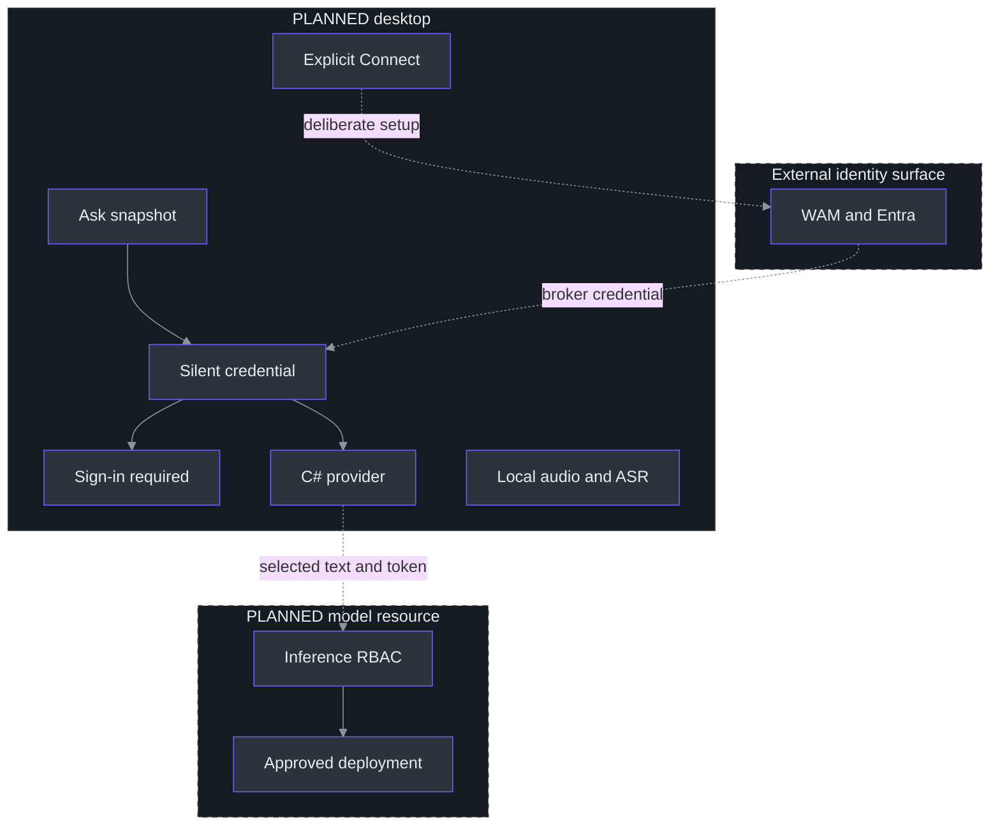

# 14. Answer Latency, Identity, and Privacy

## Why these concerns belong together

**The answer pipeline is PLANNED.** No Azure endpoint, sign-in, model entitlement, retention configuration, or cloud latency was verified while writing this chapter. Its service contracts come from the repository's existing research, not fresh retrieval. Connection and latency workstreams explicitly report no implementation or execution evidence. (TODO\30_AZURE_ANSWER_CONNECTION.todo:31-37, completion evidence; TODO\33_ANSWER_LATENCY_QUALITY.todo:30-36, completion evidence; docs\AI-ANSWER-PRIVACY.md:133-151, primary-reference scope.)

Latency, identity, and privacy interact in practical ways. A surprise sign-in window delays the answer and introduces an external surface not covered by the application's capture policy. Sending the whole transcript makes request content harder to review and violates selected-text scope. Retrying a partial answer may duplicate disclosure and spending while making the UI look continuous. The proposed design therefore optimizes **a useful answer to an explicitly frozen question**, not merely an early network byte. (docs\AI-ANSWER-PRIVACY.md:27-40, authentication flow; docs\AI-ANSWER-PRIVACY.md:112-131, application safeguards; docs\AI-ANSWER-EVALUATION.md:30-40, user-visible metrics.)

The baseline keeps ASR local and adds text egress only at explicit Ask. Optional cloud audio requires a separate decision; good text-model performance cannot authorize uploading microphone or Computer PCM. (docs\AI-ANSWER-PRIVACY.md:6-20, proposed default; TODO\36_OPTIONAL_AZURE_SPEECH.todo:13-25, separate cloud-audio gate.)

## Measurement architecture: name every boundary

A duration is meaningful only when both endpoints are defined. The evaluation plan uses one local monotonic clock for client observations, retaining source-relative sample positions as a separate coordinate system. Subtracting a server wall clock from a desktop clock is not a defensible latency measurement without a synchronization model. (docs\AI-ANSWER-EVALUATION.md:7-28, stage-clock definitions.)

```mermaid
---
config:
  theme: base
  themeVariables:
    lineColor: "#8b949e"
    textColor: "#e6edf3"
---
flowchart LR
    accTitle: PLANNED user-visible answer timing
    accDescr: Ask, snapshot, authentication, HTTP, text arrival, and actual rendering are distinct measured stages.
    subgraph Client["PLANNED local monotonic events"]
        Q0["Q0 Ask"] --> Q1["Q1 Snapshot"]
        Q1 --> N0["N0 Silent auth"]
        N0 --> N1["N1 HTTP start"]
        N3["N3 Text delta"] --> N4["N4 Rendered"]
        N4 --> N5["N5 Useful sentence"]
        N5 --> N6["N6 Terminal state"]
    end
    subgraph Remote["PLANNED Azure boundary"]
        Model["Model and filtering"]
    end
    N1 -. request .-> Model
    Model -. streamed text .-> N3
    style Q0 fill:#2d333b,stroke:#6d5dfc,color:#e6edf3
    style Q1 fill:#2d333b,stroke:#6d5dfc,color:#e6edf3
    style N0 fill:#2d333b,stroke:#6d5dfc,color:#e6edf3
    style N1 fill:#2d333b,stroke:#6d5dfc,color:#e6edf3
    style N3 fill:#2d333b,stroke:#6d5dfc,color:#e6edf3
    style N4 fill:#2d333b,stroke:#6d5dfc,color:#e6edf3
    style N5 fill:#2d333b,stroke:#6d5dfc,color:#e6edf3
    style N6 fill:#2d333b,stroke:#6d5dfc,color:#e6edf3
    style Model fill:#2d333b,stroke:#6d5dfc,color:#e6edf3
    style Client fill:#161b22,stroke:#30363d,color:#e6edf3
    style Remote fill:#161b22,stroke:#30363d,color:#e6edf3,stroke-dasharray:5 5
    linkStyle default stroke:#8b949e
```



The diagram intentionally omits some instrumentation details for readability: N2 is headers, and Q2 is an optional commit acknowledgment. Neither is answer text. The source plan defines these separately from N3, the first nonempty answer-text delta, and N4, its actual WPF rendering. (docs\AI-ANSWER-EVALUATION.md:19-28, Q/N events.)

| Metric | Definition | What it answers |
| --- | --- | --- |
| First visible partial | A4 − A0 | How soon a controlled utterance becomes visible |
| Natural-final lag | Final A4 − annotated A1 | How much delay follows the last spoken sample |
| Commit latency | Q2 − Q0 | How long explicit finalization takes |
| API TTFT | N3 − N1 | Request-start to actual answer text |
| Ask-to-first-text | N4 − Q0 | Delay the user experiences after Ask |
| First useful sentence | N5 − Q0 | When a task-relevant answer becomes usable |

These definitions come from the proposed evaluation, not implemented telemetry. The original paced Vosk numbers start at stream onset and cannot replace an A1 annotation. (docs\AI-ANSWER-EVALUATION.md:30-40, metrics; docs\SPEECH-BENCHMARK.md:106-118, paced-test limits.)

### Current local mechanisms that affect future measurements

The production callback splits delivered packets into bounded frames under the input audio lock. Silence scheduling shares that lock and follows per-source activity, so device delivery and inserted continuity samples must remain distinguishable from acoustic speech boundaries. `SilenceCadence` waits for 250 ms without a packet and spaces silence scheduling by at least 100 ms; that is **not** a recognizer endpoint-silence setting. (src\PhantomFudge.App\Audio\LoopbackTranscriber.cs:230-254, `OnAudio`; src\PhantomFudge.App\Audio\LoopbackTranscriber.cs:289-309, `SupplySilenceAsync`; src\PhantomFudge.App\Audio\SilenceCadence.cs:11-19, `TrySchedule`.)

The Vosk wrapper's sample counter advances when `accept` processes PCM. It supports partials, natural finals, and periodic decoder replacement. Meanwhile, the transport separately maintains submitted-byte counts and bounded pending queues. Combining these different counters into one generic “audio latency” field would conceal where time was spent. (services\transcription\recognizer.py:82-96, `VoskRecognizer.accept`, `finish`; src\PhantomFudge.App\Audio\TranscriptionSocket.cs:13-18, queue limits; src\PhantomFudge.App\Audio\TranscriptionSocket.cs:185-228, `TryEnqueueAudio`.)

## Targets are hypotheses, not results

The proposed warm-path budgets are starting points for authorization and measurement:

| Planned metric | Proposed target |
| --- | --- |
| Freeze reviewed draft | At most 50 ms |
| Source commit to frozen text | p95 at most 500 ms |
| First visible partial | p95 at most 1.5 s |
| Ask to first rendered answer | p50 at most 1 s; p95 at most 2.5 s |
| Ask to useful short sentence | p50 at most 2 s; p95 at most 4 s |
| Local cancellation acknowledgment | At most 100 ms |
| Stream UI batching | 16–50 ms |

None is a provider SLA or a measured application result. End-to-end p95 must be computed from complete request observations; adding individual stage p95s does not establish the overall p95. Warm/cold authentication and connection cases must remain separate strata. (docs\AI-ANSWER-EVALUATION.md:42-59, proposed targets; docs\AI-ANSWER-EVALUATION.md:98-112, controlled comparison.)

A fair model comparison fixes question content, output requirements, deployment/version, processing policy, and filtering. It preserves errors, filtered outcomes, and incomplete answers rather than dropping slow or unsuccessful samples. A ten-word non-answer must not win against a correct explanation simply by finishing sooner. (docs\AI-ANSWER-EVALUATION.md:94-116, Azure comparison.)

The research shortlist—5.4-mini, 5.4-nano, and 5-mini—is an evaluation set, not a speed ranking or entitlement receipt. Hidden reasoning can consume an output budget before visible text appears; model-specific parameters must be verified rather than copied between families. Default filtering also has different semantics from asynchronous filtering, which can expose text before delayed moderation signals. Optimization must preserve the approved quality and filtering policy. (docs\AI-ANSWER-RESEARCH.md:136-158, candidates; docs\AI-ANSWER-RESEARCH.md:219-233, reasoning budget and filtering.)

## Planned identity flow: explicit setup, silent Ask

The desktop is a **public client**. It cannot safely protect a distributed application secret, so the plan uses a tenant-bound Entra user identity through supported MSAL/WAM or broker integration. The registration's client ID is not a secret; API keys, private keys, and refresh tokens must not be bundled into the EXE, Python service, configuration, or ZIP. (docs\AI-ANSWER-PRIVACY.md:22-31, desktop identity.)



The isolated audio node is intentional: this text-inference design has no raw-audio cloud edge. Interactive authentication happens only through explicit setup, preferably outside a presentation. Ask tries cached/silent acquisition; a UI-required result becomes an inline sign-in-required state, not automatic browser or broker fallback. Credential/client reuse avoids adding a new authentication construction path to every question. (docs\AI-ANSWER-PRIVACY.md:30-40, silent/interactive separation.)

Resource-scoped **Cognitive Services OpenAI User** is the researched inference role for the documented Azure OpenAI path. Management Contributor is not a substitute for data-plane permission, and this feature needs no Graph chat/mail permissions. The exact token audience depends on the pinned adapter: the research records v1's `https://ai.azure.com/.default`, while ARM uses a different audience. Those strings are integration inputs to verify, not evidence that any local account has access. A laptop does not acquire an Azure managed identity merely by using Azure libraries. (docs\AI-ANSWER-PRIVACY.md:41-62, RBAC and token audiences.)

## Privacy is several contracts, not one switch

`store:false` avoids the requested Responses storage behavior; it is **not universal zero retention**. Existing research distinguishes model-training restrictions, optional service state, abuse monitoring, and processing geography. Flagged content can enter automated or human review; modified abuse monitoring requires eligibility and approval that have not been established here. (docs\AI-ANSWER-PRIVACY.md:83-107, data statements and limits.)

Global deployments may process prompts in supported geographies; a DataZone constrains processing to its zone, not necessarily one resource region. Therefore a nearby resource name proves neither locality nor low latency. Destination, deployment type, retention policy, and account configuration require explicit approval before a cloud test. (docs\AI-ANSWER-PRIVACY.md:97-110, geography; TODO\30_AZURE_ANSWER_CONNECTION.todo:13-22, connection prerequisites.)

Local behavior needs equally precise language:

- The current transport rejects nonliteral-loopback ASR endpoints and disables proxying and redirects. The proposed HTTPS model client is a **separate** boundary, not a reason to relax the local speech validator. (src\PhantomFudge.App\Audio\TranscriptionSocket.cs:26-31, HTTP handler; src\PhantomFudge.App\Audio\TranscriptionSocket.cs:73-89, `ValidateEndpoint`.)
- Remote speech errors are replaced with a generic local message because server text may contain paths, secrets, or transcript content. The answer adapter should preserve that principle while distinguishing useful safe error codes. (src\PhantomFudge.App\Audio\TranscriptionSocket.cs:397-405, `ProcessMessage`; docs\AI-ANSWER-PRIVACY.md:123-129, diagnostics.)
- The existing transcript is memory-bounded, and export is explicit. Planned Q/A history should likewise remain bounded and memory-only unless deliberately exported; logs should contain random IDs, durations, counts, and result codes—not content or content hashes. (src\PhantomFudge.Core\TranscriptBuffer.cs:6-8, `MaximumCharacters`; src\PhantomFudge.App\MainWindow.xaml.cs:733-760, `ExportTranscriptAsync`; docs\AI-ANSWER-PRIVACY.md:125-131, logging/persistence.)
- The current `ShowProtected` requests protection before showing the window, but neither it nor the planned same-HWND answer pane guarantees exclusion from every recorder. Authentication UI, OS indicators, accessibility, clipboard, and process memory have separate boundaries. (src\PhantomFudge.App\MainWindow.xaml.cs:79-105, `ShowProtected`; docs\PRODUCT.md:125-140, privacy boundaries.)

## Worked pseudocode: useful timing without content telemetry

This is a proposed coordinator sketch. `renderer` must report an actual presented update, not merely a queued dispatcher operation; first-useful-sentence scoring belongs to the controlled evaluation rubric.

```python
async def ask_reviewed_text(draft, profile):
    q0 = monotonic()
    snapshot = freeze_exact_displayed_revision(draft)
    request_id = random_id()
    credential = await silent_token_or_inline_signin_required(profile)
    request = bind_request(request_id, snapshot, profile)
    n1 = monotonic()
    first_delta = None
    first_render = None
    terminal = "incomplete"
    async for event in provider.stream(request, credential):
        if not active_request_matches(request_id, event.request_id):
            continue
        require_monotonic_sequence(event)
        if event.is_nonempty_text:
            first_delta = first_delta or monotonic()
            await renderer.append_bounded_batch(event.text)
            first_render = first_render or monotonic()
        if event.is_terminal:
            terminal = event.safe_terminal_code
    emit_metadata(request_id, terminal,
                  api_ttft=elapsed_or_missing(n1, first_delta),
                  ask_to_render=elapsed_or_missing(q0, first_render))
```

The real implementation must also bound deadlines, cancellation, buffering, and pre-output retries. It must not interpret a closed stream as completion or silently replay after partial output. Cancellation stops local consumption, not necessarily server compute or billing. (docs\AI-ANSWER-ARCHITECTURE.md:205-207, event identity/completion; docs\AI-ANSWER-ARCHITECTURE.md:238-255, failure policy; TODO\31_STREAMING_ANSWER_CLIENT.todo:18-20, adapter requirements.)

For a purely hypothetical trace, let Ask occur at 0 ms, HTTP start at 70 ms, first text at 480 ms, and first rendering at 510 ms. API TTFT would be 410 ms, while user-visible delay would be 510 ms. These invented teaching numbers are **not measurements**; the arithmetic illustrates the evaluation plan's distinct endpoints. (docs\AI-ANSWER-EVALUATION.md:34-37, metric definitions.)

## Tradeoffs: optimize the critical path without hiding failures

UI batching trades a small bounded rendering delay for avoiding a dispatcher operation per tiny delta. The proposed 16–50 ms interval is therefore a tuning range, not permission to accumulate an unbounded queue. Both bytes waiting and time without progress need limits; HTTP activity that never yields useful text should not keep an answer apparently alive forever. (docs\AI-ANSWER-ARCHITECTURE.md:240-249, batching and deadlines; docs\AI-ANSWER-EVALUATION.md:54-59, no-progress policy.)

A broker can enforce central quotas or private routing, but adds another authentication and streaming hop. It should be chosen for a demonstrated governance requirement, not assumed faster. If APIM enters that path, response buffering and body diagnostics become explicit review items because they can defeat streaming or export content. The direct path remains the initial proposal; no infrastructure was provisioned to test either option here. (docs\AI-ANSWER-PRIVACY.md:64-81, optional broker and APIM; TODO\37_OPTIONAL_ANSWER_BROKER.todo:28-34, completion evidence.)

## Exercises

1. Design a fake-stream case with headers, metadata, one text delta, and a post-200 error. Identify the timing fields and incomplete UI state. (docs\AI-ANSWER-EVALUATION.md:125-131, failure matrix.)
2. Explain why a 403 must not trigger another region or public-network fallback, even if that alternative appears faster. (docs\AI-ANSWER-EVALUATION.md:127-129, network/auth failure policy.)
3. Review a proposed diagnostic payload containing a prompt hash. Replace it with fields that support correlation without identifying question content. (docs\AI-ANSWER-PRIVACY.md:125-129, metadata-only diagnostics.)

## References

- [Evaluation plan](../../docs/AI-ANSWER-EVALUATION.md), [privacy/identity design](../../docs/AI-ANSWER-PRIVACY.md), and [research](../../docs/AI-ANSWER-RESEARCH.md).
- [Connection workstream](../../TODO/30_AZURE_ANSWER_CONNECTION.todo) and [privacy/resilience gate](../../TODO/34_ANSWER_PRIVACY_RESILIENCE.todo).
- Existing research primary URLs: [Azure data privacy](https://learn.microsoft.com/en-us/azure/foundry/responsible-ai/openai/data-privacy), [abuse monitoring](https://learn.microsoft.com/en-us/azure/foundry/openai/concepts/abuse-monitoring), and [MSAL.NET WAM](https://learn.microsoft.com/en-us/entra/msal/dotnet/acquiring-tokens/desktop-mobile/wam). These were not freshly retrieved or verified against an account for this chapter.
