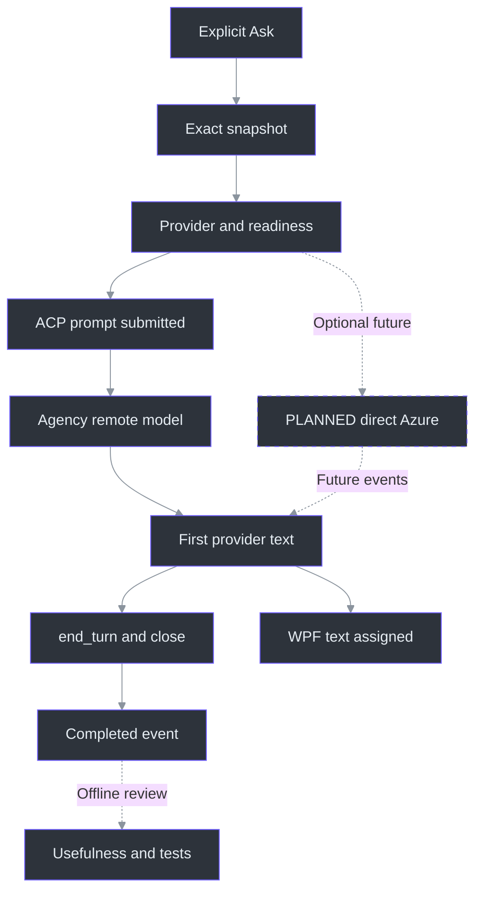

# 14. Answer Latency, Identity, and Privacy

## Why these concerns belong together

**Persistent Agency ACP now has finite provider-level latency and correctness evidence. It does not have a universal five-second guarantee or a voice-to-visible-answer benchmark.** Direct Azure remains optional future work; no Azure entitlement or retention configuration was verified here. Existing Azure research cannot establish Agency's account policies. (TODO\30_AZURE_ANSWER_CONNECTION.todo:31-37, completion evidence; TODO\33_ANSWER_LATENCY_QUALITY.todo:30-36, completion evidence; docs\AI-ANSWER-PRIVACY.md:138-156, primary-reference scope.)

After an organization-auth popup, the owner rejected new login and organization-data access, choosing the existing installed Agency background-prompt path. The parent stopped the owned login and reset SnapshotOnly. **Local Agency installation does not mean offline inference**; the probe used its remote model service. LocalModel retains a separate literal-loopback OFFLINE/BYOK route. The earlier direct Copilot smoke failed at the customization/tool gate, consuming its allowance because model invocation cannot be ruled out; the later successful Agency request received new, separate authorization. (src\PhantomFudge.Core\Answers\AnswerContracts.cs:14-55, modes and validation; src\PhantomFudge.Core\Answers\AnswerConfiguration.cs:13-29, `Load`.) See [provider boundaries](../../docs/ANSWER-PROVIDERS.md) and [workstream39](../../TODO/39_INSTALLED_CLI_ANSWERS.todo).

The [older Sonnet marker receipt](../../docs/answer-provider-smoke.json) remains connectivity evidence, not a useful-answer baseline. The completed authorized ledger records **48 client question submissions**, including failed/superseded trials; hidden upstream retries are not observable and no further model calls are planned. Agency **2026.10.7.4** / Copilot **1.0.92** now defaults to **`gpt-5.6-sol-fast` / low**, selected after catalog discovery and actual exact-text trials. No local model was installed; that alternative still has mocks only. (tools\AgencyProbe\results\summary-final.json:2-31, scope/accounting/selection; tools\AgencyProbe\results\summary-final.json:197-224, catalog and isolation.)

Latency, identity and privacy interact. Surprise sign-in delays the answer and introduces an external surface outside capture protection. A whole-transcript prompt violates selected-text scope; retrying partial output can duplicate disclosure and spending. The useful objective remains **an answer to an explicitly frozen question**, not merely an early network byte. The existing Azure design expresses those principles, which the new provider path must preserve. (docs\AI-ANSWER-PRIVACY.md:32-45, authentication flow; docs\AI-ANSWER-PRIVACY.md:117-136, application safeguards; docs\AI-ANSWER-EVALUATION.md:33-43, user-visible metrics.)

The baseline keeps ASR local and permits provider text egress only at explicit configured Ask. Optional cloud audio is a separate decision; good answer performance cannot authorize uploading PCM. Source commit29 remains planned but does not block asking a reviewed draft. (docs\AI-ANSWER-PRIVACY.md:11-25, proposed default; TODO\36_OPTIONAL_AZURE_SPEECH.todo:13-25, separate cloud-audio gate.)

## Measurement architecture: name every boundary

A duration is meaningful only when both endpoints are defined. The evaluation plan uses one local monotonic clock for client observations, retaining source-relative sample positions as a separate coordinate system. Subtracting a server wall clock from a desktop clock is not a defensible latency measurement without a synchronization model. (docs\AI-ANSWER-EVALUATION.md:10-31, stage-clock definitions.)



The diagram describes configured Agency, not automatic dispatch in SnapshotOnly. The earlier evaluation's N4 means actual rendering; current `FirstAnswerVisible` instrumentation means assignment to a visible WPF control, **not measured paint or a recipient frame**. Keep them distinct. Likewise, ACP `ModelStarted` means prompt submission, not the remote model's internal compute start. HTTP headers N2 and planned commit acknowledgment Q2 are not text. (docs\AI-ANSWER-EVALUATION.md:22-31, Q/N events.) See [diagnostic event semantics](../../docs/DIAGNOSTICS.md).

| Metric | Definition | What it answers |
| --- | --- | --- |
| First visible partial | A4 − A0 | How soon a controlled utterance becomes visible |
| Natural-final lag | Final A4 − annotated A1 | How much delay follows the last spoken sample |
| Commit latency | Q2 − Q0 | How long explicit finalization takes |
| Provider first-text delay | N3 − explicitly named provider start | State whether engine/session preparation is included; ACP submission is not HTTP start |
| Ask-to-first-text | N4 − Q0 | Delay the user experiences after Ask |
| First useful sentence | N5 − Q0 | When a task-relevant answer becomes usable |

These definitions are not interchangeable benchmarks. Stage/process metadata now exists, but does not measure every proposed endpoint. Separate startup, session preparation, credentials, model loading and response. Paced Vosk numbers start at stream onset and cannot replace an A1 annotation. (docs\AI-ANSWER-EVALUATION.md:33-43, metrics; docs\SPEECH-BENCHMARK.md:111-123, paced-test limits.)

### Current local mechanisms that affect future measurements

The production callback splits delivered packets into bounded frames under the input audio lock. Silence scheduling shares that lock and follows per-source activity, so device delivery and inserted continuity samples must remain distinguishable from acoustic speech boundaries. `SilenceCadence` waits for 250 ms without a packet and spaces silence scheduling by at least 100 ms; that is **not** a recognizer endpoint-silence setting. (src\PhantomFudge.App\Audio\LoopbackTranscriber.cs:234-278, `OnAudio`; src\PhantomFudge.App\Audio\LoopbackTranscriber.cs:313-333, `SupplySilenceAsync`; src\PhantomFudge.App\Audio\SilenceCadence.cs:11-19, `TrySchedule`.)

The Vosk wrapper's sample counter advances when `accept` processes PCM. It supports partials, natural finals, and periodic decoder replacement. Meanwhile, the transport separately maintains submitted-byte counts and bounded pending queues. Combining these different counters into one generic “audio latency” field would conceal where time was spent. (services\transcription\recognizer.py:96-110, `VoskRecognizer.accept`, `finish`; src\PhantomFudge.App\Audio\TranscriptionSocket.cs:13-18, queue limits; src\PhantomFudge.App\Audio\TranscriptionSocket.cs:194-237, `TryEnqueueAudio`.)

## Current useful-answer evidence

The visual cover can receive an entire answer while the workspace is detached. Such delivery is
not logged as **FirstAnswerVisible** until the answer control becomes visible on Uncover.
Receiving data and presenting it remain different timestamps; the metric still does not prove
pixel presentation or recipient visibility.
([Current renderer](../../src/PhantomFudge.App/MainWindow.Answers.cs),
[cover fixture](../../src/PhantomFudge.App/MainWindow.CoverDiagnostics.cs).)

The owner's criterion is **a complete useful answer in under five seconds**, not a token, filler or a promise to investigate. An initial mini trial reached first text around 2.946 s but completed at 5.377 s: it missed. Final H selected `gpt-5.6-sol-fast` / low on **complete answers and compiled correctness**, not TTFT alone. (tools\AgencyProbe\results\summary.json:29-40, historical mini timing.)

| H prepared trial | Exact text category | First provider text | Complete, session closed |
| --- | --- | --- | --- |
| 1 | Owner's intended question | 1.868 s | **4.066 s** |
| 2 | Owner-supplied actual ASR wording | 2.473 s | **4.176 s** |
| 3 | Repeated intended question | 1.016 s | **2.992 s** |

The intended text was “Write me the solution for the leet code problem two sum”; the ASR text was
“okay so right mean the solution for the lead good problem to some”. All three answers gave the
Two Sum algorithm, complete C# and complexity without a follow-up; the ASR case labelled its
interpretation as an assumption. **All three compiled implementations passed 33/33 checks**, including
duplicates, indices, negative/zero values, no-pair cases and full-range overflow boundaries.
These were supplied text inputs, not newly recorded speech.
(tools\AgencyProbe\results\latency-suite-20261009-h-exact-fast.json:2-56, exact trials;
tools\AgencyProbe\results\latency-suite-20261009-h-quality.json:2-186, compiled checks.)

### Preparation is real work, not a hidden free operation

H's first empty-session preparation took **19.987 s**, excluded from its 4.066-second first answer.
Residual preparation before trials 2/3 was **396/483 ms**; adding it gives **4.572/3.475 s**,
still below five seconds for those two observations. A separate selected-default preparation
receipt records **21.183 s**, zero questions and no model prompt. **Normal startup/reveal deliberately
uses `WarmUpAsync` to prepare one empty session** before the app advertises readiness; that is allowed
preparation, not automatic Ask. See the [lifetime owner](../../src/PhantomFudge.App/MainWindow.AnswerLifetime.cs).
(tools\AgencyProbe\results\latency-suite-20261009-h-exact-fast.json:13-54, preparation and completion;
tools\AgencyProbe\results\agency-selected-fast-default-preparation.json:2-16, zero-question preparation.)

The separate `WarmUpTransportAsync` stops before session creation. Its first-Ask cost was **5.041 s**
on Haiku F and **6.470 s** on mini G; that boundary is **unmeasured on the final fast model**.
Historical Haiku E took **24.874 s** from cold through completion. None of these is an under-five-second
cold guarantee. H explicitly selected the fast model before its promotion to default, so its
assembly receipt is also not a timing measurement of a subsequently rebuilt WPF package.
(tools\AgencyProbe\results\summary-final.json:58-73, cold/transport boundaries;
tools\AgencyProbe\results\summary-final.json:234-271, assembly and qualification limits.)

### Keep unsuccessful evidence beside the selected result

| Earlier batch | Retained result and why it was insufficient |
| --- | --- |
| A–B, mini | Slow/generic or missing-input answers; not useful-answer passes. |
| C, mini | Explicit SYSTEM-role selection still left fast nonanswers. |
| D, Haiku | Fast responses, but eight overflow failures: only 58/66 checks passed. |
| E, Haiku | Five prepared original-variation answers in 2.928–3.748 s and 66/66 checks; **not owner ASR**. |
| F, exact Haiku | Two wrong-problem guesses, one follow-up footer and three completions over five seconds. |
| G, exact mini | All six understood Two Sum, but ten wider-range overflow checks failed; the first transport-only Ask was slow. |

E's ambiguous control was **“Explain to some problem and give optimal solution.”**, not the actual
owner-supplied ASR string. G's boundary failures were against the required full-int policy, beyond
usual constrained LeetCode inputs. Neither historical speed nor correct title selection alone
established the complete contract that H's three samples passed.
(tools\AgencyProbe\results\latency-suite-20261009-e-haiku.json:9-95, E inputs/timing;
tools\AgencyProbe\results\latency-suite-20261009-e-quality.json:28-364, E correctness;
tools\AgencyProbe\results\latency-suite-20261009-f-exact.json:2-98, retained exact-text failures;
tools\AgencyProbe\results\summary-final.json:109-180, A–H comparison;
tools\AgencyProbe\results\latency-suite-20261009-g-quality.json:361-364, G check totals.)

This is **provider-API evidence**, not a WPF, live-voice, recipient or p95 benchmark. H contains
only three prepared samples and **one** actual-ASR-text case. It supports the selected profile,
not a universal SLO, broad prompt accuracy or speech-recognition quality.

## Other targets remain hypotheses

The later, explicitly requested [Clarify first](../QUESTION-CLARIFICATION.md) loop adds one request
for interpretation and another for each correction or final confirmation. It is off by default.
Neither the earlier three prepared direct-answer timings nor a synthetic UI pass establishes
its end-to-end latency. Its optional history contains only the current clarification conversation,
not telemetry, unselected transcript or a resumed provider session.

The proposed warm-path budgets are starting points for authorization and measurement:

| Planned metric | Proposed target |
| --- | --- |
| Freeze reviewed draft | At most 50 ms |
| Source commit to frozen text | p95 at most 500 ms |
| First visible partial | p95 at most 1.5 s |
| Ask to first rendered answer | p50 at most 1 s; p95 at most 2.5 s |
| Ask to useful short sentence | p50 at most 2 s; p95 at most 4 s |
| Local cancellation acknowledgment | At most 100 ms |
| Stream UI batching | 16–50 ms |

None is a provider SLA or measured result. The common UI currently chooses a **40-ms render timer** and **120-second overall deadline**; neither demonstrates first-text performance or exact scheduling. End-to-end p95 must come from complete observations, not summed stage p95s. Keep cold/warm CLI, credential and model cases separate. (docs\AI-ANSWER-EVALUATION.md:45-62, proposed targets; docs\AI-ANSWER-EVALUATION.md:101-115, controlled comparison.) The current integration choices are described in the [provider guide](../../docs/ANSWER-PROVIDERS.md).

A fair model comparison fixes question content, output requirements, deployment/version, processing policy, and filtering. It preserves errors, filtered outcomes, and incomplete answers rather than dropping slow or unsuccessful samples. A ten-word non-answer must not win against a correct explanation simply by finishing sooner. (docs\AI-ANSWER-EVALUATION.md:97-119, Azure comparison.)

The Azure research shortlist—5.4-mini, 5.4-nano and 5-mini—is not an Agency/CLI model list, speed ranking or entitlement receipt. Hidden reasoning can consume output budgets before visible text appears. Azure asynchronous filtering can expose text before delayed moderation; do not transfer those API-specific assumptions to Agency or a local server. (docs\AI-ANSWER-RESEARCH.md:139-161, candidates; docs\AI-ANSWER-RESEARCH.md:222-236, reasoning budget and filtering.)

## Agency identity: existing model access is not organization-data access

`AnswerConfiguration` separates `answers.json` metadata from CLI-profile state, bounds the settings file and rejects unknown fields/numeric enum values. The corrected mode adds `AnswerSettings.AgencyPath`; parsing its executable path does not establish existing model authentication, policy eligibility or isolation. No new login is authorized by this setup change. (src\PhantomFudge.Core\Answers\AnswerConfiguration.cs:8-29, `Load`; src\PhantomFudge.Core\Answers\AnswerContracts.cs:16-43, `AnswerSettings`.)

`Initialize-Answers.ps1 -Provider Agency` resolves the installed executable without login. The pinned persistent ACP launch uses a controlled profile and only the fixed app-owned direct-Q&A agent. Incoming tool/client requests, plans and authentication failures terminate the answer rather than waiting for permission or opening app-owned login. Existing credentials may expire; supported launch and observed no-login runs do not prove universal popup/browser suppression. Existing model-service authentication does not authorize organization-data connectors. (src\PhantomFudge.Core\Answers\AgencyAcpConnection.cs:213-265, request/update guards.) See [current setup boundaries](../../docs/ANSWER-PROVIDERS.md).

LocalModel remains a separate compatible Copilot-engine OFFLINE/BYOK route, not an Agency-hosted call. It requires an explicit model and HTTP literal-loopback `/v1` endpoint. Rejecting DNS names, remote hosts and credential-bearing URLs protects destination selection, not the behavior of a separately managed proxy/server. No missing model/server may cause hosted-model fallback. (src\PhantomFudge.Core\Answers\AnswerContracts.cs:34-55, local-mode validation.)

**The configured path is not memory-only.** Each question gets a fresh closed conversation, but its engine/workspace can serve up to 32 sessions. Owned artifacts are removed on teardown; prompt/session files may exist until then, and upstream copies are outside that deletion claim. Hide/Clear/protection/reload/close stop the cached owner; successful completion instead prepares another **empty** session. “ExactText only” excludes unrelated application content, not the controlled SYSTEM policy, fixed user-message instructions or service metadata. (src\PhantomFudge.Core\Answers\AgencyAcpConnection.cs:41-122, session lifecycle; src\PhantomFudge.Core\Answers\AgencyAnswerPrompt.cs:8-97, fixed policy/envelope; tools\AgencyProbe\results\summary-final.json:210-224, retention limits.)

## PLANNED direct Azure identity: explicit setup, silent Ask

The desktop is a **public client**. It cannot safely protect a distributed application secret, so the plan uses a tenant-bound Entra user identity through supported MSAL/WAM or broker integration. The registration's client ID is not a secret; API keys, private keys, and refresh tokens must not be bundled into the EXE, Python service, configuration, or ZIP. (docs\AI-ANSWER-PRIVACY.md:27-36, desktop identity.)


The isolated audio node is intentional: there is no raw-audio cloud edge. In this **future Azure adapter**, interactive authentication would occur only through explicit setup; Ask would try cached/silent acquisition and surface sign-in-required inline. These are not claims that the installed CLI already implements WAM or shares an Azure credential cache. (docs\AI-ANSWER-PRIVACY.md:35-45, silent/interactive separation.)

Resource-scoped **Cognitive Services OpenAI User** is the researched inference role for the documented Azure OpenAI path. Management Contributor is not a substitute for data-plane permission, and this feature needs no Graph chat/mail permissions. The exact token audience depends on the pinned adapter: the research records v1's `https://ai.azure.com/.default`, while ARM uses a different audience. Those strings are integration inputs to verify, not evidence that any local account has access. A laptop does not acquire an Azure managed identity merely by using Azure libraries. (docs\AI-ANSWER-PRIVACY.md:46-67, RBAC and token audiences.)

## Privacy is several contracts, not one switch

For future Azure Responses, `store:false` avoids the requested storage behavior; it is **not universal zero retention**, nor a switch applied to the current CLI. Existing research distinguishes training restrictions, service state, abuse monitoring and geography. Flagged content may enter automated/human review; modified monitoring requires separate eligibility and approval. (docs\AI-ANSWER-PRIVACY.md:88-112, data statements and limits.)

Global deployments may process prompts in supported geographies; a DataZone constrains processing to its zone, not necessarily one resource region. Therefore a nearby resource name proves neither locality nor low latency. Destination, deployment type, retention policy, and account configuration require explicit approval before a cloud test. (docs\AI-ANSWER-PRIVACY.md:102-115, geography; TODO\30_AZURE_ANSWER_CONNECTION.todo:13-22, connection prerequisites.)

Local behavior needs equally precise language:

- The current transport rejects nonliteral-loopback ASR endpoints and disables proxying and redirects. CLI inference and any future HTTPS Azure client are **separate** boundaries, not reasons to relax speech validation. (src\PhantomFudge.App\Audio\TranscriptionSocket.cs:26-31, HTTP handler; src\PhantomFudge.App\Audio\TranscriptionSocket.cs:82-98, `ValidateEndpoint`.)
- Remote speech errors are replaced with a generic local message because server text may contain paths, secrets, or transcript content. The answer adapter should preserve that principle while distinguishing useful safe error codes. (src\PhantomFudge.App\Audio\TranscriptionSocket.cs:406-414, `ProcessMessage`; docs\AI-ANSWER-PRIVACY.md:128-134, diagnostics.)
- Application transcript/answer buffers are bounded and Copy/export is explicit. This does not make the external CLI memory-only. App diagnostics should use random IDs, durations, counts and safe result codes, not content or content hashes. (src\PhantomFudge.Core\TranscriptBuffer.cs:6-8, `MaximumCharacters`; src\PhantomFudge.App\MainWindow.xaml.cs:828-855, `ExportTranscriptAsync`; docs\AI-ANSWER-PRIVACY.md:130-136, logging/persistence.)
- `ShowProtected` requests protection before showing the window, but neither it nor the same-HWND answer view guarantees exclusion from every recorder. Authentication surfaces, clipboard, profiles and process memory have separate boundaries. (src\PhantomFudge.App\MainWindow.xaml.cs:99-129, `ShowProtected`; docs\PRODUCT.md:184-200, privacy boundaries.)

`LocalDiagnostics` now defaults to metadata-only records: correlation IDs, monotonic/process times,
durations, counts and safe codes. Its nonblocking bounded queue must not stall capture or UI; files
rotate with bounded retention. Bodies require explicit `RecordContent` opt-in, and Clear does not
delete existing diagnostic files. Do not inspect or export logs casually to demonstrate the feature.
(src\PhantomFudge.Core\Diagnostics\LocalDiagnostics.cs:9-24, metadata fields;
src\PhantomFudge.Core\Diagnostics\LocalDiagnostics.cs:40-111, queue/rotation;
src\PhantomFudge.Core\Diagnostics\LocalDiagnostics.cs:145-184, default and content opt-in.)

The provider receives a new request ID and `ExactText`, never `SourceRefs`; the richer snapshot remains on the run for local association. Only explicitly enabled clarification may attach its bounded typed exchange history and fixed task instruction. The 32,768-code-unit answer cap is a memory/display boundary, not a token or retention guarantee. (src\PhantomFudge.Core\Answers\AnswerContracts.cs:3-12, request interface; src\PhantomFudge.Core\Answers\AnswerRun.cs:10-27, projection; src\PhantomFudge.Core\Answers\AnswerRun.cs:46-50, output cap.)

## Worked pseudocode: useful timing without content telemetry

This teaching sketch distinguishes implemented metadata from a **future measured paint acknowledgment**. Current `FirstAnswerVisible` stops at control assignment; the stronger `renderer.present_bounded_batch` contract below is not yet a pixel measurement. Usefulness and compiled-answer checks remain separate evaluation.

```python
async def measure_explicit_ask(draft, selected_provider):
    q0 = monotonic()
    snapshot = freeze_exact_displayed_revision(draft)
    if selected_provider.is_snapshot_only:
        return snapshot
    run = AnswerRun(snapshot, selected_provider.label)
    # Existing model authentication only; no new login or interactive fallback.
    n1 = monotonic()
    first_delta = None
    first_render = None
    try:
        async for event in selected_provider.stream(run.Request, deadline_token):
            if run.Apply(event) and event.is_text_delta:
                first_delta = first_delta or monotonic()
                await renderer.present_bounded_batch(run.Text)
                first_render = first_render or monotonic()
        run.Complete()  # request enumeration ended; ACP engine can remain alive
    except Cancelled:
        run.Cancel()
    except SafeProviderFailure as error:
        run.Fail(error.safe_message)
    emit_metadata(run.Request.RequestId, run.State,
                  provider_first_text=elapsed_or_missing(n1, first_delta),
                  ask_to_render=elapsed_or_missing(q0, first_render))
```

`Apply` rejects nonmonotonic and post-terminal events; `Complete` requires the marker plus nonblank text. No automatic retry is added by retaining a warm engine. Cancel/Hide/Clear/protection failure/close must await owned cleanup, leaving retained text incomplete. Local cancellation cannot promise stopped remote compute or billing. (docs\AI-ANSWER-ARCHITECTURE.md:507-610, event identity/completion; docs\AI-ANSWER-ARCHITECTURE.md:643-670, failure policy; TODO\31_STREAMING_ANSWER_CLIENT.todo:18-20, adapter requirements.) Common state behavior is implemented in (src\PhantomFudge.Core\Answers\AnswerRun.cs:32-79, `Apply`, `Complete`, `Cancel`, `Fail`).

For a hypothetical trace, Ask at 0 ms, provider dispatch at 70 ms, first text at 480 ms and rendering at 510 ms give 410 ms dispatch-to-text and 510 ms user-visible delay. They are **invented teaching numbers**, not CLI/API measurements. Only an observed HTTP-start boundary permits calling the first value HTTP TTFT. (docs\AI-ANSWER-EVALUATION.md:37-40, metric definitions.)

## Tradeoffs: optimize the critical path without hiding failures

UI batching avoids a dispatcher operation per tiny delta. A 40-ms timer within the earlier 16–50-ms tuning range is not permission for unbounded provider buffering, nor proof every frame appears within 40 ms. A process that emits metadata without answer text must not appear successful or run without bounds. (docs\AI-ANSWER-ARCHITECTURE.md:643-670, batching and deadlines; docs\AI-ANSWER-EVALUATION.md:57-62, no-progress policy.)

A future Azure broker may enforce central quotas/private routing but adds an authentication and streaming hop. APIM buffering and body diagnostics require review because they can defeat streaming or expose content. Neither broker nor direct Azure is required for the installed-CLI path, and neither was provisioned here. (docs\AI-ANSWER-PRIVACY.md:69-86, optional broker and APIM; TODO\37_OPTIONAL_ANSWER_BROKER.todo:28-34, completion evidence.)

## Exercises

1. Design a fake-stream case with headers, metadata, one text delta, and a post-200 error. Identify the timing fields and incomplete UI state. (docs\AI-ANSWER-EVALUATION.md:128-134, failure matrix.)
2. Explain why a 403 must not trigger another region or public-network fallback, even if that alternative appears faster. (docs\AI-ANSWER-EVALUATION.md:130-132, network/auth failure policy.)
3. Review a proposed diagnostic payload containing a prompt hash. Replace it with fields that support correlation without identifying question content. (docs\AI-ANSWER-PRIVACY.md:130-134, metadata-only diagnostics.)
4. Cancel a local-model run after its first delta. List which app, CLI-profile and model-server copies may remain; explain why terminating the local process is not a universal deletion guarantee. (src\PhantomFudge.Core\Answers\AnswerRun.cs:65-79, local terminal state; src\PhantomFudge.Core\Answers\AnswerConfiguration.cs:8-11, separate profile.)

## References

- [Evaluation plan](../../docs/AI-ANSWER-EVALUATION.md), [privacy/identity design](../../docs/AI-ANSWER-PRIVACY.md), and [research](../../docs/AI-ANSWER-RESEARCH.md).
- [Connection workstream](../../TODO/30_AZURE_ANSWER_CONNECTION.todo) and [privacy/resilience gate](../../TODO/34_ANSWER_PRIVACY_RESILIENCE.todo).
- [Installed-provider setup and retention](../../docs/ANSWER-PROVIDERS.md) and [common run implementation](../../src/PhantomFudge.Core/Answers/AnswerRun.cs).
- [Diagnostics semantics](../../docs/DIAGNOSTICS.md), [final ACP summary](../../tools/AgencyProbe/results/summary-final.json), [H exact-text timings](../../tools/AgencyProbe/results/latency-suite-20261009-h-exact-fast.json) and [H correctness](../../tools/AgencyProbe/results/latency-suite-20261009-h-quality.json).
- Existing research primary URLs: [Azure data privacy](https://learn.microsoft.com/en-us/azure/foundry/responsible-ai/openai/data-privacy), [abuse monitoring](https://learn.microsoft.com/en-us/azure/foundry/openai/concepts/abuse-monitoring), and [MSAL.NET WAM](https://learn.microsoft.com/en-us/entra/msal/dotnet/acquiring-tokens/desktop-mobile/wam). These were not freshly retrieved or verified against an account for this chapter.
