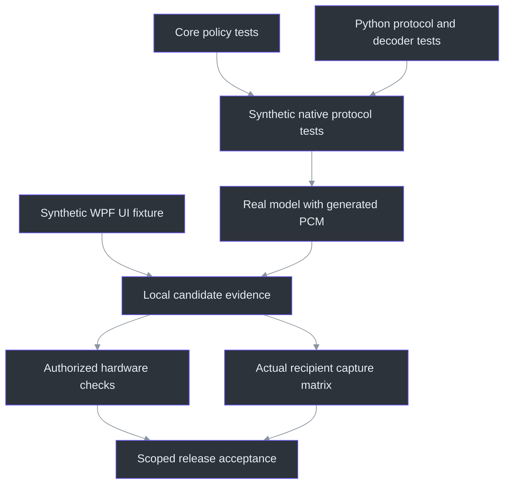
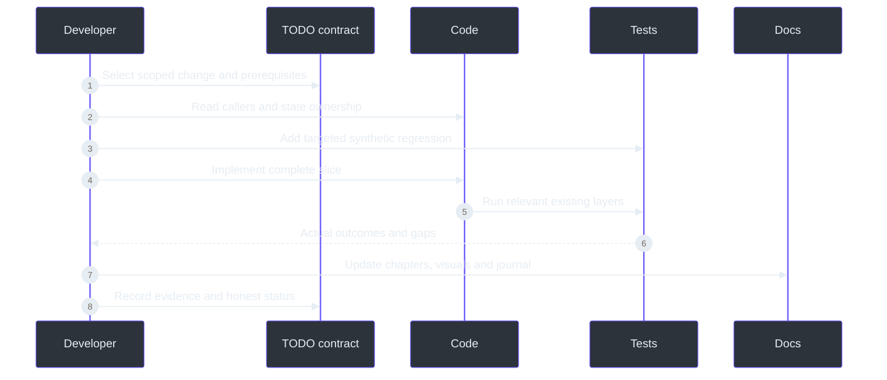

# Development and testing

> **TL;DR:** There is no single command that proves the whole product. Build/unit tests,
> transport tests, real-model synthetic tests, UI fixtures, hardware tests and recipient-side
> capture qualification each establish different evidence. Run the smallest relevant layer,
> then cross the next boundary deliberately.

## Overview: reproducibility starts before a test assertion

The repository pins .NET SDK10.0.112 with patch roll-forward and prerelease disabled
(`global.json:1-7`). Common build properties enable nullable references, implicit usings,
deterministic builds, warnings as errors and dependency lock files
(`Directory.Build.props:1-9`). These choices make local differences easier to diagnose;
they do not eliminate differences in Windows, drivers or external capture applications.

Python dependencies are pinned separately from the .NET graph
(`services\transcription\requirements.txt:1-20`). The service uses a local virtual environment.
Do not install packages globally because a test needs them, and do not add Docker as a shortcut
around understanding the native setup.

## Architecture of the test portfolio

This is not a strict test-pyramid claim. Some layers run independently. The diagram shows how
evidence accumulates before a broad release claim, not a requirement to rerun every test for
every prose edit.

## The real runners

| Layer | Command | What it establishes |
| --- | --- | --- |
| Native build | `dotnet build .\PhantomFudge.slnx -c Release` | Compiler/project consistency |
| Core xUnit | `dotnet test .\tests\PhantomFudge.Core.Tests -c Release` | Text, source, palette and persistence policies |
| Audio console harness | `dotnet run --project .\tests\PhantomFudge.Audio.Tests -c Release` | Synthetic transport/native-lifecycle cases |
| Python unittest | `.\services\transcription\.venv\Scripts\python.exe -m unittest discover -s .\services\transcription\tests` | Server/decoder/management cases |
| Dual real-model fixture | `.\scripts\Test-DualSourceSynthetic.ps1 -NativeClient` | Generated PCM through C# v2 and actual local recognition |
| UI fixture | `PhantomFudge.exe --ui-smoke <private-output>` | Local synthetic rendering/state assertions |
| Documentation views | `.\scripts\Export-HandbookScreenshots.ps1` | Actual UI images with synthetic labels/content and source hashes |

The Core project is an xUnit test project with explicit test SDK/runner references
(`tests\PhantomFudge.Core.Tests\PhantomFudge.Core.Tests.csproj:1-30`). The audio project is an
**executable harness**, not another xUnit assembly; it links the actual audio sources and
references ASP.NET Core for local test servers
(`tests\PhantomFudge.Audio.Tests\PhantomFudge.Audio.Tests.csproj:1-13`).
Do not assume `dotnet test` alone executes its scenarios.

## Safe setup

The initialization script verifies the model manifest, creates a random local token if absent,
restricts its Windows ACL, and creates/repairs the service-local Python environment as needed.
Model download is explicit; it is not performed silently while handling live audio
(`scripts\Initialize-Transcription.ps1:21-53`, `:65-140`).

Use the documented setup command once, then ordinary builds/runs. Existing lock files should
be respected. If a restore fails, inspect the actual failure rather than changing TLS settings
or switching to an unapproved feed. A shell HTTP probe and the .NET restore stack can behave
differently; the development record already contains such a distinction.

## The developer loop

A useful test is tied to an invariant. "The app launches" would not have caught a late final
poisoning the next session's IDs. A source-partial test that proves one track's final leaves
the other pending text intact is much stronger for that specific requirement
(`tests\PhantomFudge.Core.Tests\SourceTranscriptTests.cs:1-80`).

## Working on a shared Windows desktop

An agent or test must not kill a running user's app to overwrite a locked executable. Build
to an isolated output directory or create a new candidate. The native lifecycle script
refuses to touch a preexisting PhantomFudge process and tracks only the processes it starts
(`scripts\Test-NativeLifecycle.ps1:16-22`, `:69-113`).

Avoid parallel .NET commands that write the same project `obj` tree. Parallel research or
independent Python checks are fine; two builds of the same Core project can race on generated
cache files even when they use different final output directories. Compile once, then use
`--no-build` where appropriate for follow-up checks.

The documentation fixture must never use real notes or chat content. It has its own command
line path and validates a synthetic/no-recording result before copying images
(`src\PhantomFudge.App\App.xaml.cs:47-59`,
`scripts\Export-HandbookScreenshots.ps1:1-95`). A screenshot request is not authorization to
capture a meeting or disable display affinity.

## Failure tests worth keeping

The native harness covers authentication, framing, cancellation, bounded queues and delayed
shutdown. Its entry point reports named groups and returns failure on a failing group
(`tests\PhantomFudge.Audio.Tests\Program.cs:18-71`). Tests must also cover the interaction between
layers: a fake device can fail after another input has started, or a final can arrive while UI
Stop is still awaiting cleanup.

Python tests use injected recognizers for deterministic failure cases, while separate real-model
fixtures prove that the production decoder can recognize generated speech. A fake recognizer is
appropriate for protocol determinism, not evidence of speech accuracy. Conversely, one recognized
synthetic sentence does not prove every cancellation path.

## Interpreting results

Record source identity, environment, exact command, pass/failure, sample size and limitations.
The implementation-status document is a bounded receipt, not a badge that everything is safe
(`docs\IMPLEMENTATION-STATUS.md:1-292`).

For capture, an in-process `RenderTargetBitmap` image proves UI appearance. A cropped GDI
fixture proves only the sampled local path. Neither proves what a remote participant sees.
Run an intentionally unprotected positive control only outside a live presentation; it is
supposed to be capturable.

## Contributor exercises

1. Locate the normal audio harness dispatch and explain why it does not open hardware.
2. Identify which tests should change when a source label is added.
3. Explain why a successful model fixture cannot replace a malformed-frame test.
4. Write the expected sequence for Start, immediate Stop, then another Start.
5. Choose the smallest checks for a theme-only change versus a protocol change.

## References

- `global.json:1-7` — SDK pin.
- `Directory.Build.props:1-9` — common build rules.
- `tests\PhantomFudge.Core.Tests\PhantomFudge.Core.Tests.csproj:1-30` — xUnit runner.
- `tests\PhantomFudge.Audio.Tests\PhantomFudge.Audio.Tests.csproj:1-13` — executable harness.
- `tests\PhantomFudge.Audio.Tests\Program.cs:18-71` — synthetic group execution.
- `scripts\Initialize-Transcription.ps1:21-165` — environment/model/token setup.
- `scripts\Test-NativeLifecycle.ps1:16-113` — owned-process testing.
- `docs\QUALIFICATION.md:1-26` — evidence separation.
