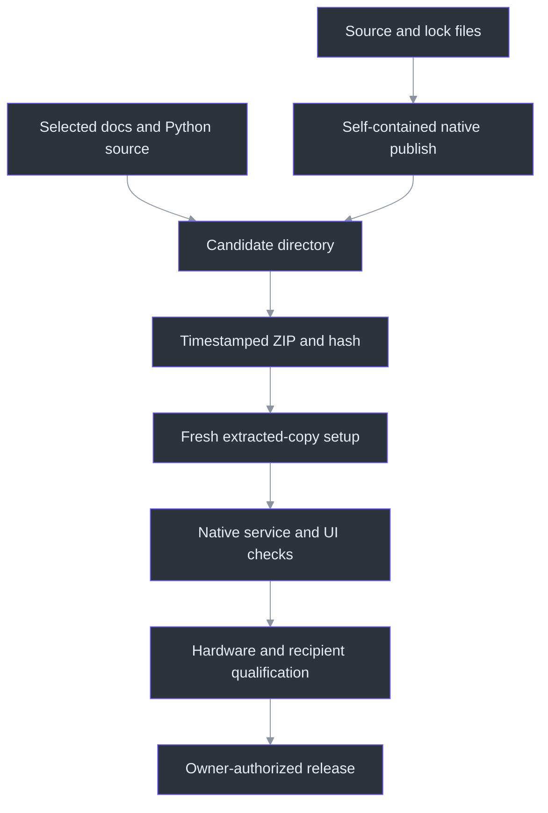
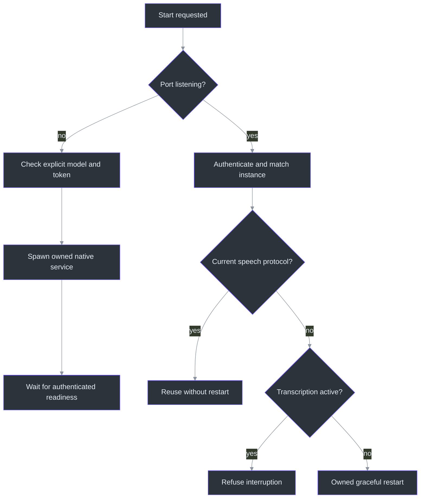

# Distribution and troubleshooting

> **TL;DR:** A ZIP is a candidate, not a release claim. The native bundle carries the C# app
> and the Python service's source/setup contract; it does not carry a secret, a user's notes,
> a virtual environment, or an invisible promise that every machine is supported.

## Overview: what gets shipped

`Publish-Preview.ps1` builds a self-contained win-x64 application into a timestamped directory,
copies a selected documentation/script/service allowlist, and creates a ZIP plus SHA256 output
(`scripts\Publish-Preview.ps1:1-41`). The exact list matters: copying the repository wholesale
would also risk models, token files, captures, temporary data and unrelated development tooling.

The native runtime and Python runtime are different dependencies. Self-contained .NET publishing
includes the .NET runtime needed by the executable. It does not install Python, create the
service's venv or embed the ASR model. Those operations are owned by explicit initialization
(`scripts\Initialize-Transcription.ps1:110-140`).

## Artifact flow

The final arrows are deliberately not automatic. A passing local smoke test is not signing,
distribution authorization, enterprise-policy acceptance or four-product capture qualification.
The implementation-status document identifies the actual local candidate and its remaining
boundaries (`docs\IMPLEMENTATION-STATUS.md:1-100`).

## Source checkout versus extracted bundle

The launcher detects whether `PhantomFudge.exe` sits at the root of its working package. If it
does, it uses that executable without building. Otherwise it targets the source-build path.
An already-running source instance is revealed rather than rebuilt underneath the user
(`scripts\Run-PhantomFudge.ps1:8-36`).

| Situation | Correct action | Avoid |
| --- | --- | --- |
| First source setup | Run explicit initialization with model-download permission | Expecting the app to fetch weights during a meeting |
| First extracted bundle | Keep the full folder, then run its setup/launcher | Copying only the EXE away from dependent files |
| Existing app running | Save/close when an update requires replacement, or reveal it | Killing an unknown process to release a file lock |
| Notes-only use | Use the explicit NotesOnly launcher option | Pretending a missing ASR service is healthy |
| Speech service idle | Use its managed Stop command | Broad process-name termination |
| Service active | Stop transcription in the UI first | Discarding queued audio by terminating the backend |

## Setup is intentionally explicit

The initializer checks a pinned archive size/hash and verifies the extracted model files.
An existing damaged model is not silently overwritten. Token creation uses random bytes,
does not rotate an existing valid token automatically, and restricts the Windows DACL
(`scripts\Initialize-Transcription.ps1:17-67`, `:69-109`).

The recorded archive hash is an observed integrity value from a known public download,
not a publisher-signed guarantee. That distinction is explained in the service guide
(`services\transcription\README.md:120-170`).

The model can be reused from the local cache. Dependency repair is controlled by the requirements
hash/import check and stays in the service's venv. Setup does not mean recording; launching
the service still leaves audio idle until the user presses Start.

## Service ownership is more than a port

A listening port may belong to another workspace or process. The manager authenticates
`/v1/runtime`, checks the service identifier/management version and matches the saved instance
ID before reuse or shutdown (`services\transcription\manage.py:112-144`). A stale owned idle
service can be restarted for the supported speech protocol, but active transcription is refused.

This design refuses ambiguity instead of adopting an arbitrary process. The manager's status
output intentionally reports only readiness/activity/PID, not token or transcript content
(`services\transcription\manage.py:217-239`).

## Troubleshooting by symptom

### The window is missing

First distinguish Hidden, minimized, failed initialization and a different running instance.
Ctrl+Alt+Space and relaunch recovery are intended paths. The single-instance pipe accepts one
fixed recovery command under current-user restrictions, not arbitrary scripts or filenames
(`src\PhantomFudge.App\Native\SingleInstance.cs:18-75`).

If protection setup fails, the app withholds content and records a generic local notice rather
than displaying an unprotected branded error window (`src\PhantomFudge.App\LocalFailureNotice.cs:1-30`).
That notice is diagnostic data, not saved notes.

### Start fails

Check the selected input mode, every requested device, local token, model and service version.
In Both mode, a missing microphone must not silently become Computer-only. The native adapter
validates selection and waits for protocol readiness before opening inputs
(`src\PhantomFudge.App\Audio\LoopbackTranscriber.cs:71-155`).

### Nothing is transcribed

A selected playback endpoint may not be the meeting application's actual output. A microphone
may be muted or denied by Windows policy. A zero meter and an empty transcript are not enough
to diagnose the same problem. Do not "fix" either by opening a different device automatically.
Actual hardware diagnosis needs explicit user authorization and the named device configuration.

### Stop seems slow

The application may be releasing native inputs, draining accepted audio or waiting for final
recognition. IsRunning is not a complete shutdown contract. A hung native call cannot be safely
treated as disposed merely because a UI timeout expired. The source retains ownership and
blocks unsafe restart rather than using a success-shaped fallback.

### Docker is missing

Normal native operation does not require it. Docker recipes are optional final-stage packaging.
Only an explicit Docker mode should require a Docker engine (`scripts\Start-Transcription.ps1:1-35`).
Do not turn a portability task back into a mandatory infrastructure dependency.

## Release discipline

Keep candidate names/hashes immutable. If source, runtime, rendering or protocol changes, create
a new candidate and rerun the affected evidence. Signed versus unsigned status must be explicit;
signing does not guarantee SmartScreen or organizational acceptance.

The handbook and journal are now part of that discipline. A release that changes what the user
sees needs current screenshots; a protocol change needs a current sequence diagram and source
references. Freshness tooling detects changed inputs, but semantic review remains the author's job.

## References

- `scripts\Publish-Preview.ps1:1-41` — package recipe.
- `scripts\Initialize-Transcription.ps1:17-140` — model/token/runtime setup.
- `scripts\Run-PhantomFudge.ps1:8-57` — source/package launch selection.
- `services\transcription\manage.py:112-239` — instance ownership, reuse and stop.
- `src\PhantomFudge.App\Native\SingleInstance.cs:18-75` — window recovery channel.
- `src\PhantomFudge.App\LocalFailureNotice.cs:1-30` — non-content failure notice.
- `docs\IMPLEMENTATION-STATUS.md:1-100` — candidate evidence and limits.
