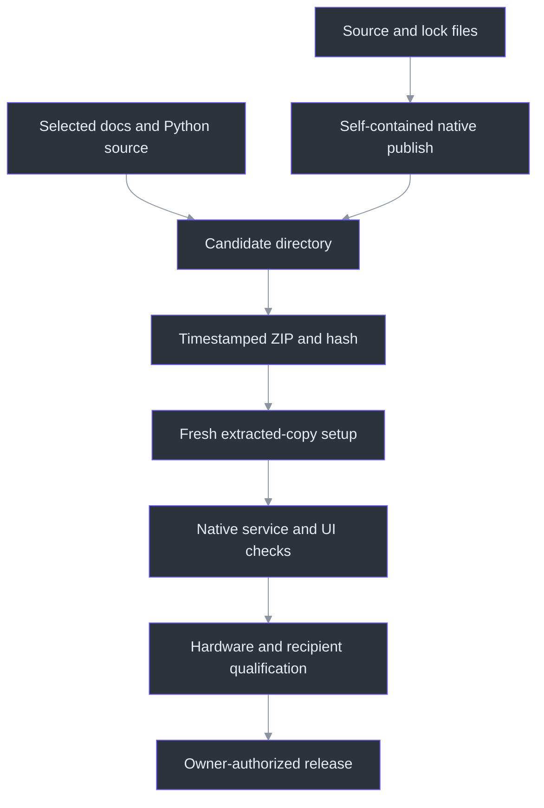
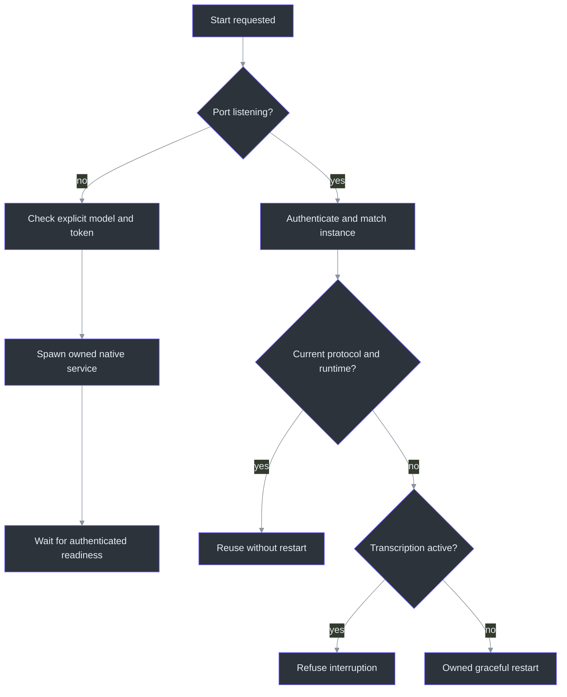

# Distribution and troubleshooting

> **TL;DR:** Use [Installation](../INSTALLATION.md) for the Windows11 x64 installer.
> It bundles runtime/models and adds guarded update/uninstall; the older source/setup ZIP is a
> different workflow. Consult the versioned release for available downloads and exact identities.
> Neither distribution promises that every machine or recorder is supported.

## Installer versus development bundle

The new recipe publishes the app and native launcher self-contained, assembles an offline speech
runtime/model payload and emits versioned Setup, optional Portable ZIP and checksums. The target
is the published `v0.2.0-preview.2` / Windows version `0.2.0.2`, unsigned. End users
do not need PowerShell7, a system Python or the .NET SDK. Builds require actual generated-PCM
inference and natural process exit, separately from import and dependency-metadata checks.
(scripts/Build-Installer.ps1:30-44,76-114)
(tools/Installer/release.json:1-8)

The Inno recipe is per-user, uses a stable AppId, rejects downgrades and unrecognized nonempty
destinations, and gates update/uninstall on maintenance. Repair/update uses
a fresh self-contained helper directory extracted from Setup rather than a potentially corrupted
old launcher. Preview 2's [public receipt](../release-0.2.0-preview.2.json) records11isolated lifecycle checks; Preview 1 lifecycle3 remains historical.
Uninstall invokes the installed launcher. `WindowsVersion` under
`HKCU\Software\PhantomFudge\Installer\<AppId>` is the fallback for a damaged version file.
It does not force-close an app. Save/export, stop capture
and close with X first. External user settings,
diagnostics and saved files are retained; do not save personal content inside managed program
directories. The canonical guide explains the
[directory and retention policy](../INSTALLATION.md#remove-the-application).
(tools/Installer/PhantomFudge.iss:10-40,47-65,107-161)
(src/PhantomFudge.Launcher/Program.cs:50-58,94-100)
(src/PhantomFudge.Launcher/MaintenanceOperation.cs:48-118)

The repository and its published prerelease downloads are now public.
The owner authorized this prerelease work without making it a qualified release or selecting a
project license. Unsigned-policy blocks must be respected, not bypassed. Exact hashes, lifecycle
tests and publication state belong in [implementation status](../IMPLEMENTATION-STATUS.md), not
inferred from this build recipe.

Setup never launches the app. Finish and close it, then open Phantom Fudge from Start. Setup and
launcher status/error windows are ordinary visible UI, not capture-excluded; install and launch
before sharing. (tools/Installer/PhantomFudge.iss:14-76)
(src/PhantomFudge.Launcher/LauncherWindow.cs:18-57)

If an ordinary or notes-only launch detects the installer gate, it returns70 with generic
“operation busy” status, without opening a launcher window or starting a child. Let Setup finish
and retry rather than deleting ownership files. The gate is checked before existing-instance reveal
and again after acquiring the startup mutex; maintenance and layout validation bypass it.
(src/PhantomFudge.Launcher/Program.cs:25-78,240-244)
(src/PhantomFudge.Launcher/LauncherContract.cs:152-165)
(src/PhantomFudge.Launcher/LauncherStatus.cs:15,34)

App startup is not proven by surviving a short delay. The launcher retains its operation mutex
until the main app mutex appears or the exact child exits. Status76 after30seconds is pending,
not success; Close hides progress without releasing that guard, even if the dispatcher shuts down
early. Uncertain liveness stays protected rather than authorizing replacement or process killing.
(src/PhantomFudge.Launcher/ChildProcesses.cs:12-42)
(src/PhantomFudge.Launcher/Program.cs:108-118,186-227)

### Inventory and repair evidence are different checks

The final runtime is not a copy of the developer's venv: it uses pinned embedded CPython3.13.14,
`faster-whisper 1.2.1+phantomfudge1` for PCM-only input and `CTranslate2 4.6.0+phantomfudge2`
with oneDNN3.1.1/Microsoft compiler OpenMP (`vcomp140`). It excludes CUDA/cuDNN/proprietary
Intel OpenMP and PyAV/FFmpeg. Variants/notices are listed in
[third-party notices](../THIRD-PARTY-NOTICES.md#application-private-package-changes).
Preview 2's offline build passed real generated-PCM hybrid inference, production VAD,
forced Whisper encoder/decoder execution and natural exit in a Latin-accented Unicode build path.
Vosk's unmodified package uses a first-party startup adapter for non-ASCII Windows model paths.
The older Ruy stages failed at process exit and remain rejected; metadata closure alone describes
only the modified installed graph and cannot establish execution. No actual capture, service,
provider request or clean-VM test was performed by this runtime qualification.
Its37runtime-packaging source tests are distinct from historical Preview 1's85focused runtime tests.
Published inventories/notices identify the bytes, not legal entitlement or inherited development
speech performance. (docs/release-0.2.0-preview.2.json:26,30-50,68-77)
(tools/Installer/runtime-lock.json:1-11)
(tools/Installer/bundle_runtime.py:246-282,332-376,412-462,538-609)
(services/transcription/recognizer.py:44-63)
(services/transcription/tests/test_packaged_pcm_runtime.py:35-97,126-138)

Fresh-machine confidence needs more than a restricted `PATH`. The frozen builder now checks PE
normal/delay imports and exported forwarder DLL names against bundled files or a reviewed Windows11
inbox list, then observes actual DLL paths in its import and synthetic-PCM probes. The parent
records92speech PE files and bundled CRT paths passing, plus a separate static pass over
861App/Launcher PE files. These Preview 2 results identify the newly assembled payload,
not merely historical candidate2. Neither static closure nor these
selected loaded-module observations are a clean-VM or universal dynamic-loading test.
(tools/Installer/bundle_runtime.py:677-694)
(tools/Installer/runtime_audit.py:126-166,169-234)
(services/transcription/tests/test_packaged_pcm_runtime.py:14,88-97)

The launcher consumes compact `install-manifest.json` metadata with a16KiB size bound, while
`payload-files.json` lists full payload paths, lengths and SHA-256 values. Separating them prevents
the large runtime inventory from invalidating ordinary startup. The inventory includes the compact
manifest but excludes its own self-hash. `Build-Installer` enumerates hidden files/directories
and rejects reparse points and private payload paths before writing the inventory.
(src/PhantomFudge.Launcher/LauncherContract.cs:38-52,94-105)
(scripts/Build-Installer.ps1:56-98)

`Test-Installer.ps1` defines an isolated fixture with a random AppId and a separate installation
path; shortcut creation is omitted and Setup has no launch action. It compares the inventory's filenames
with the payload exactly, then checks installed lengths/hashes. Repair, damaged-launcher/version
record recovery, downgrade rejection, uninstall and a retained synthetic external file are distinct
assertions. Preview 2 passed11checks against3,684inventoried files;3,685Portable entries also matched.
Preview 1's earlier lifecycle3/candidate2 result (3,682files) is historical. (docs/release-0.2.0-preview.2.json:18-20)
(scripts/Test-Installer.ps1:15-18,31-84)
(tools/Installer/PhantomFudge.iss:62-76)

The “upgrade” case writes an older numeric version record into the current fixture. It does not
install a genuine older binary or qualify a clean Windows VM, migration across actual releases,
Start-menu behavior or the supported hardware matrix. Preview 2's PASS retains those limits.
(scripts/Test-Installer.ps1:69-74,96-104)

The frozen launcher's separate `--validate-install` mode checks the owned marker, bounded compact
manifest and expected file/model-directory layout without invoking the app, Python or inference.
Historical pre-gate exact-EXE checks returned0for a synthetic valid layout and65for oversized/corrupt
metadata. Placeholder layout validation is not a model-hash, native ABI, executable-launch or
full installer-repair test. See [current evidence](../IMPLEMENTATION-STATUS.md).
(src/PhantomFudge.Launcher/Program.cs:25-43)
(src/PhantomFudge.Launcher/LauncherContract.cs:87-105)
(tests/PhantomFudge.Core.Tests/InstalledMaintenanceTests.cs:210-239)

## Legacy overview: what gets shipped

`Publish-Preview.ps1` builds a self-contained win-x64 application into a timestamped directory,
copies a selected documentation/script/service allowlist, and creates a ZIP plus SHA256 output
(`scripts\Publish-Preview.ps1:1-52`). The exact list matters: copying the repository wholesale
would also risk models, token files, captures, temporary data and unrelated development tooling.

In this legacy ZIP, the native runtime and Python runtime are different dependencies. Self-contained .NET publishing
includes the .NET runtime needed by the executable. It does not install Python, create the
service's venv or embed either ASR model. Those operations are owned by explicit initialization
(`scripts\Initialize-Transcription.ps1:119-165`).

## Legacy candidate-to-qualified-release flow

The final arrows describe qualification, not a prerequisite for honestly labelled experimental
prerelease access. They are deliberately not automatic. A passing local smoke test is not signing,
distribution authorization, enterprise-policy acceptance or four-product capture qualification.
The implementation-status document identifies the actual local candidate and its remaining
boundaries (`docs\IMPLEMENTATION-STATUS.md:1-326`).

## Source checkout versus legacy extracted bundle

The launcher detects whether `PhantomFudge.exe` sits at the root of its working package. If it
does, it uses that executable without building. Otherwise it targets the source-build path.
An already-running source instance is revealed rather than rebuilt underneath the user
(`scripts\Run-PhantomFudge.ps1:8-36`).

| Situation | Correct action | Avoid |
| --- | --- | --- |
| First source setup | Run explicit initialization with model-download permission | Expecting the app to fetch weights during a meeting |
| First extracted bundle | Keep the full folder, then run its setup/launcher | Copying only the EXE away from dependent files |
| Existing app running | Save/close when an update requires replacement, or reveal it | Killing an unknown process to release a file lock |
| Notes-only use | Use the explicit NotesOnly launcher option | Pretending a missing ASR service is healthy |
| Speech service idle | Use its managed Stop command | Broad process-name termination |
| Service active | Stop transcription in the UI first | Discarding queued audio by terminating the backend |

## Legacy setup is intentionally explicit

The initializer checks a pinned archive size/hash and verifies the extracted model files.
An existing damaged model is not silently overwritten. Token creation uses random bytes,
does not rotate an existing valid token automatically, and restricts the Windows DACL
(`scripts\Initialize-Transcription.ps1:26-76`, `:69-109`).

The recorded archive hash is an observed integrity value from a known public download,
not a publisher-signed guarantee. That distinction is explained in the service guide
(`services\transcription\README.md:140-235`).

Vosk and Whisper models can be reused from verified local caches. The native default is
hybrid-whisper/small.en/int8/four threads/technical vocabulary; explicit legacy Vosk or base.en
are configuration choices, not automatic fallbacks. The new allowlisted runtime includes
accurate/configuration/diagnostics/provisioning modules and both model/vocabulary manifests.
(`services/transcription/configuration.py:11-35,61-70`.) Dependency repair is controlled by the requirements
hash/import check and stays in the service's venv. Setup does not mean recording; launching
the service still leaves audio idle until the user presses Start.

## Service ownership is more than a port

A listening port may belong to another workspace or process. The manager authenticates
`/v1/runtime`, checks the service identifier/management version and matches the saved instance
ID before reuse or shutdown (`services\transcription\manage.py:114-159`). A stale owned idle
service can be restarted for a changed speech protocol, engine/model/source fingerprint, but
active transcription is refused and the selected model is verified before replacement.

This design refuses ambiguity instead of adopting an arbitrary process. The manager's status
output intentionally reports only readiness/activity/PID, not token or transcript content
(`services\transcription\manage.py:244-268`).

## Troubleshooting by symptom

### The window is missing

First distinguish Hidden, minimized, failed initialization and a different running instance.
Ctrl+Alt+Space and relaunch recovery are intended paths. The single-instance pipe accepts one
fixed recovery command under current-user restrictions, not arbitrary scripts or filenames
(`src\PhantomFudge.App\Native\SingleInstance.cs:18-75`).

If protection setup fails, the app withholds content and records a generic local notice rather
than displaying an unprotected branded error window (`src\PhantomFudge.App\LocalFailureNotice.cs:1-30`).
That notice is diagnostic data, not saved notes.

### Start fails

Check the selected input mode, every requested device, local token, model and service version.
In Both mode, a missing microphone must not silently become Computer-only. The native adapter
validates selection and waits for protocol readiness before opening inputs
(`src\PhantomFudge.App\Audio\LoopbackTranscriber.cs:72-156`).

### Nothing is transcribed

A selected playback endpoint may not be the meeting application's actual output. A microphone
may be muted or denied by Windows policy. A zero meter and an empty transcript are not enough
to diagnose the same problem. Do not "fix" either by opening a different device automatically.
Actual hardware diagnosis needs explicit user authorization and the named device configuration.

### Stop seems slow

The application may be releasing native inputs, draining accepted audio or waiting for final
recognition. IsRunning is not a complete shutdown contract. A hung native call cannot be safely
treated as disposed merely because a UI timeout expired. The source retains ownership and
blocks unsafe restart rather than using a success-shaped fallback.

### Answers are slow or return no useful solution

Separate provider preparation, first text, complete answer/session close and UI assignment.
Startup/reveal/reload prepares one empty Agency session without inference; cold preparation can
take roughly 20–31 seconds. Wait for Ready, then Ask. Three prepared exact-text GPT-5.6 Sol Fast / low
responses completed below five seconds; this does not guarantee future latency. Earlier fast wrong
answers and slow cases remain in [the quality record](../QUALITY-UPDATE.md).
(`src/PhantomFudge.App/MainWindow.AnswerLifetime.cs:23-78`.)

Default [local diagnostics](../DIAGNOSTICS.md) provide request/capture IDs, stages, counts and safe
errors, not conversation bodies. `Show-Diagnostics.ps1` excludes synthetic UI timings by default.
`Export-Diagnostics.ps1` strips Text unless explicitly requested and includes only four allowlisted
metadata-only speech logs from that workspace; it does not upload anything
(`scripts/Export-Diagnostics.ps1:14-80`;
`src/PhantomFudge.Core/Diagnostics/LocalDiagnostics.cs:20-24,40-69`).

### Docker is missing

Normal native operation does not require it. Docker recipes are optional final-stage packaging.
Only an explicit Docker mode should require a Docker engine (`scripts\Start-Transcription.ps1:1-35`).
Do not turn a portability task back into a mandatory infrastructure dependency.

## Release discipline

Keep candidate names/hashes immutable. If source, runtime, rendering or protocol changes, create
a new candidate and rerun the affected evidence. Signed versus unsigned status must be explicit;
signing does not guarantee SmartScreen or organizational acceptance.

The handbook and journal are now part of that discipline. A release that changes what the user
sees needs current screenshots; a protocol change needs a current sequence diagram and source
references. Freshness tooling detects changed inputs, but semantic review remains the author's job.

Preview 2 exposed why a documentation freeze is a byte-identity boundary. Queued documentation
work rebuilt the maintained handbook after the first frozen handoff and clean package assembly.
The attachment check caught the mismatch; the parent recovered both committed PDFs and repeated
payload/archive/attachment verification before upload, without changing Setup or Portable.
The published391-page handbook and709-page atlas remain immutable. Later repository editions,
including this publication follow-up, must not replace those attachments.
(docs/release-0.2.0-preview.2.json:61-77,90-100)

## References

- `scripts\Publish-Preview.ps1:1-52` — package recipe.
- `scripts\Initialize-Transcription.ps1:26-165` — model/token/runtime setup.
- `scripts\Run-PhantomFudge.ps1:8-57` — source/package launch selection.
- `services\transcription\manage.py:114-268` — instance ownership, reuse and stop.
- `src\PhantomFudge.App\Native\SingleInstance.cs:18-75` — window recovery channel.
- `src\PhantomFudge.App\LocalFailureNotice.cs:1-30` — non-content failure notice.
- `docs\IMPLEMENTATION-STATUS.md:1-326` — candidate evidence and limits.
