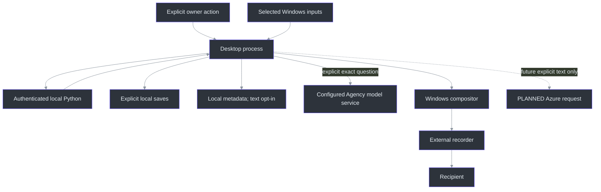
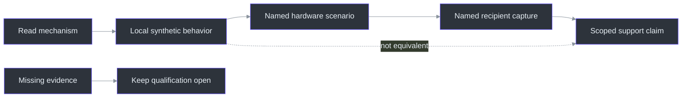

# Privacy and assurance

> **TL;DR:** The application can control its own inputs, storage, windows and requests.
> It cannot turn those controls into a universal guarantee about another recorder, the operating
> system, an administrator, a camera or a person. Assurance requires both a mechanism and the
> right experiment for the claim.

## Overview: separate the questions

"Private" can mean that notes are absent from a recipient's frames, audio stays local, a token
is not logged, a file is encrypted, or a process is not listed. Those are different properties.
The current product explicitly does not promise process invisibility or a security/DRM boundary
(`docs\PRODUCT.md:209-225`).

The first useful threat-model step is therefore to state what is controlled. The app owns
its HWND and can request display affinity. It owns the selected capture objects and can require
explicit Start. It owns the local protocol and can authenticate it. It does not own a meeting
application's cursor-inclusion setting, the Windows microphone indicator or a camera aimed
at the display. Public Preview 2 passed exact-package synthetic UI, isolated lifecycle and generated-PCM checks, not recipient capture or external-provider tests; see the [public receipt](../release-0.2.0-preview.2.json) and [bounded evidence](21-evidence-and-roadmap.md#the-evidence-ladder-stronger-claims-require-additional-proof).

## Trust boundaries

The compositor/recorder boundary is deliberately outside the local socket boundary. Securing
localhost traffic does not prove pixel exclusion; setting display affinity does not authenticate
the local service.

## Window and cursor controls

The visual **Cover** is not a process or screen-reader invisibility feature. It detaches the disabled
workspace and refreshes the current window-peer children while retaining data and ongoing work.
Fresh in-process traversal sees the cover, but an already-retained value provider still reads the
synthetic question. The native protection path also requests `DWMWA_DISALLOW_PEEK`; setter acceptance
is not shell-preview or recipient qualification. The [complete feasibility matrix](../COVER-AND-PRIVACY.md)
separates these implemented measures from cached clients, process/memory inspection, unsupported
capture paths and physical observation.

`WindowProtection.Configure` checks the platform/composition path, updates owned-window styles,
requests exclusion and records readback. It does not inject into a recorder or change a global
system privacy setting (`src\PhantomFudge.App\Native\WindowProtection.cs:19-48`).

The cursor policy chooses the standard Arrow for the app, while the default Present mode avoids
unnecessary activation. The owner still reported a recipient-side disappearing pointer, and
that exact sharing configuration remains unqualified. Local shape/foreground observations
are useful but not substitutes for recipient frames (`docs\CURSOR-AND-THEMES.md:1-69`,
`src\PhantomFudge.App\Native\CursorPolicy.cs:1-25`).

Automatic protection failures should not reveal the application through a new unprotected
message box. A generic, bounded local notice contains no note/transcript payload
(`src\PhantomFudge.App\LocalFailureNotice.cs:1-30`). Explicit OS file/auth surfaces are still
separate from the main protected window.

## Audio authority and retention

The later microphone request changed product authority: Computer, Mic or Both may be selected,
but no endpoint opens before Start. Source labels are not people. Computer can include other
app audio and sidetone; Mic can include speaker echo. Headphones reduce one practical risk but
do not create an acoustic-echo-cancellation guarantee (`docs\DUAL-SOURCE-AUDIO.md:1-26`).

Raw audio is handled as bounded in-memory frames. The test harness uses synthetic PCM and
must not implicitly open real devices. This is a meaningful policy, but it is not a claim of
secure memory erasure, immunity to dumps, or control over host swap/administrators.

## Local service authentication

The server uses a bounded local token, constant-time comparison, a one-active-session admission
rule and explicit frame limits. Management operations additionally match an instance identity;
they are not arbitrary process-control APIs (`services\transcription\server.py:71-215`,
`services\transcription\manage.py:155-200`).

A malicious process running as the same user or an administrator is not contained by calling
the service "localhost." The token and current-user boundaries reduce accidental/cross-context
access; they do not transform the workstation into a trusted enclave. The service itself does
not open microphones or read chats; the C# client owns the selected device operations.

## Storage boundaries

Notes are not automatically persisted. Transcripts remain memory-only unless explicitly exported
or diagnostic Text mode is enabled. Default logs record metadata without conversation bodies. Explicit file
saves are bounded UTF-8 operations with conflict checks and same-directory replacement
(`src\PhantomFudge.Core\NoteFileStore.cs:16-91`). Ordinary file deletion does not establish
secure erasure from SSDs, backups or snapshots. An unsaved warning prevents one kind of data loss,
not every crash.

Do not log note hashes as a supposedly harmless substitute for text. A short predictable
question can be dictionary-tested against a hash. Use random correlation IDs and counts
where diagnostics need identity without content.

App logs rotate at 2 MiB with at most ten files and a 1024-record nonblocking queue; dropped/failed
records are observable. Backend logs rotate separately at 1 MiB with three backups and never include
transcript text. Their identities are independent: correlate UTC/source/stages without inventing a
shared session ID. Text opt-in does not add notes, audio, tokens or provider stderr. Local export
removes Text by default and never uploads (`src/PhantomFudge.Core/Diagnostics/LocalDiagnostics.cs:20-24,40-110`;
`scripts/Export-Diagnostics.ps1:14-80`; [diagnostics](../DIAGNOSTICS.md)).

## Evidence ladder

A screenshot in this book is an actual WPF visual-tree render with generated content. It
proves that the controls can render, not that a recorder did or did not capture them. A GDI
positive/negative fixture is a different experiment. A remote meeting capture is different again.
The qualification matrix names these dimensions and failure cases
(`docs\QUALIFICATION.md:1-40`).

The same separation applies to speech: fake decoder tests prove deterministic protocol handling;
a real recognizer with generated audio proves integration; real-speaker/device/echo tests establish
a different scope. No single green test count can replace the others.

## The planned Azure boundary

The local question implementation does not cross that boundary. It copies only explicitly selected
structured segments or typed text, and freezes the displayed draft on explicit Ask. Source references
stay local, including original text that may differ after editing. A future provider must use
`ExactText` as its question payload; serializing the complete snapshot would defeat that separation.
Snapshot-only mode sends nothing. An explicitly configured Agency provider is connected and normally
uses hosted inference, while the local-model option has a separate loopback endpoint. Neither is a
direct Azure adapter. Startup/reveal/reload may prepare one empty Agency session without a prompt;
only explicit Ask sends question data (`src/PhantomFudge.App/MainWindow.AnswerLifetime.cs:23-78`).
(`src\PhantomFudge.Core\QuestionDraft.cs:18-95`;
`src\PhantomFudge.Core\QuestionSnapshot.cs:5-23`; [local guide](../LOCAL-QUESTIONS.md).)

The future Ask design intentionally sends a chosen immutable question, not the whole transcript.
Cloud audio is optional and separately configured. Model text is displayed as data, not executed
as code or used to choose tools/URLs. The desktop is a public client and must not contain a
distributed application secret (`docs\AI-ANSWER-PRIVACY.md:1-108`).

`store:false` is not universal zero retention, and a resource's nominal region does not necessarily
pin all Global deployment processing to that region. Those statements belong in the product
contract before cloud execution, not after an incident. At this edition, Azure Ask is design
only; no direct Azure identity/profile or Azure latency result exists. Installed Agency has its own
bounded measured results, not evidence that an Azure deployment or universal five-second SLO exists.

## Explicit prior text is another disclosure, not a permission escalation

The local-source Previous answer toggle is off by default and sends nothing until Ask.
Then it includes one displayed completed answer, not the previous question, full meeting or nested
history. That text may contain sensitive quotations, so the user can inspect it and the exact
submitted copy under Setup/details. Busy work/active clarification locks the toggle; Clear and
provider changes reset it. Existing provider/OS/diagnostic retention limits still apply.
([Context controller](../../src/PhantomFudge.App/MainWindow.AnswerContext.cs).)

The prompt labels prior text as background, not an instruction, task mode or tool grant.
Nonblank strict Unicode and32768UTF-16 units bound the field; fresh sessions and existing tool
denial remain. Synthetic input/transport checks are not a universal prompt-injection resistance
or model-quality proof. Preview 2 includes this increment without requalifying recipient capture
or altering the immutable Preview 1 assets.
([Prompt policy](../../src/PhantomFudge.Core/Answers/AgencyAnswerPrompt.cs),
[request validation](../../src/PhantomFudge.Core/Answers/AnswerContracts.cs),
[workstream59](../../TODO/59_PREVIOUS_ANSWER_CONTEXT.todo).)

## Review questions

1. What evidence would establish that an actual Teams screen-share mode excludes the new answer pane?
2. Which data could still be visible through an OS indicator or an explicit file dialog?
3. Why is the source label Mic not proof that the owner spoke?
4. Why does local authentication not defend against every same-user process?
5. What must an Azure Ask implementation avoid logging even when diagnostics are enabled?

## References

- `docs\PRODUCT.md:209-225` — privacy scope.
- `src\PhantomFudge.App\Native\WindowProtection.cs:19-48` — owned-window policy.
- `src\PhantomFudge.App\Native\CursorPolicy.cs:1-25` — standard cursor behavior.
- `src\PhantomFudge.App\LocalFailureNotice.cs:1-30` — generic local error notice.
- `services\transcription\server.py:71-215` — protocol/authentication boundaries.
- `services\transcription\manage.py:155-200` — owned shutdown.
- `src\PhantomFudge.Core\NoteFileStore.cs:16-91` — local file semantics.
- `docs\AI-ANSWER-PRIVACY.md:1-108` — proposed cloud boundary.
