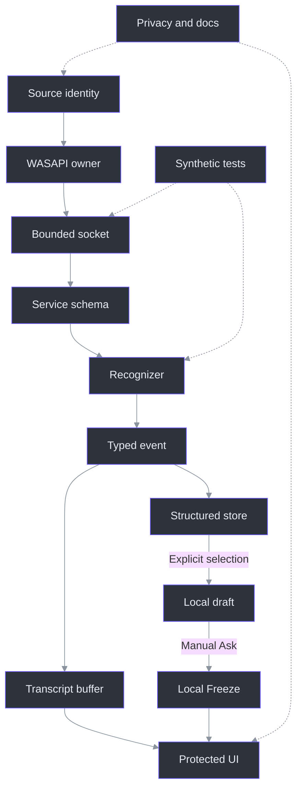
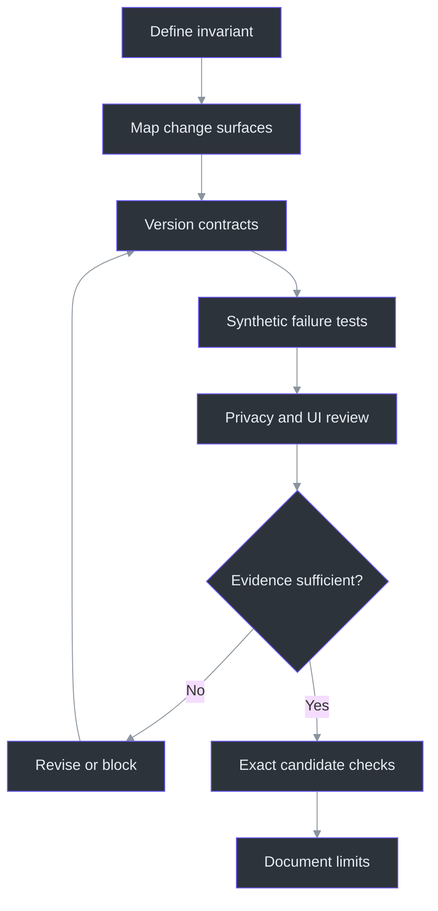

# 18. Extending the System

## Why a small feature can require a wide review

An extension is safe when its responsibilities are narrow **and its consequences are traced completely**. Adding a source is not just another selector; it affects byte framing, queue budgets, timestamp validation, stop behavior, display provenance, tests, and privacy wording. Adding a theme is not just changing a background; selection, disabled controls, alpha composition, and capture qualification also matter. The architecture explicitly prefers small testable interfaces over a generic plugin framework. (docs\ARCHITECTURE.md:35-54, component responsibilities; src\PhantomFudge.Core\AudioSource.cs:3-30, source identity; src\PhantomFudge.App\ThemeBrushes.cs:9-31, semantic resources.)

This chapter teaches change analysis; it does **not** add runtime capabilities. The local TODO28 store, draft, question-focus path and immutable Freeze now exist, with the local slice completed and reviewed. The Ask handler sends nothing and generates no fake answer. Source commit, an approved Azure profile and real streamed answers remain future work—not consequences of adding a button. (src\PhantomFudge.App\MainWindow.Questions.cs:228-247, `QuestionAsk_Click`; TODO\29_QUESTION_COMMIT_LATENCY.todo:13-22, protocol tasks; TODO\30_AZURE_ANSWER_CONNECTION.todo:13-22, prerequisites.)

The key discipline is to write the invariant before the edit. “A selected source cannot borrow another source's queue allowance” is testable. “Support more audio” is not. Existing tests already express this distinction through canonical schemas, bounded per-source resources, independent timing, and explicit rejection of undeclared input. (services\transcription\tests\test_dual_protocol.py:57-92, `StartSchemaTests`; services\transcription\tests\test_dual_protocol.py:150-200, independent tracks; services\transcription\tests\test_dual_protocol.py:250-255, undeclared-source rejection.)

## Architecture: trace both directions across the boundary

For audio changes, follow data downstream from selected device to rendered transcript, then follow failures upstream to cancellation and cleanup. The local capture GUID is now attached to events before dispatcher delivery; a stale callback must not acquire the identity of a later Start. The unchanged display/export buffer and new structured question store are separate consumers, not interchangeable representations. (src\PhantomFudge.App\Audio\LoopbackTranscriber.cs:85-135, `StartCoreAsync`; src\PhantomFudge.App\Audio\TranscriptionSocket.cs:185-228, `TryEnqueueAudio`; services\transcription\server.py:317-333, `Session.recognize`; src\PhantomFudge.App\MainWindow.xaml.cs:732-754, `ReceiveTranscript`; src\PhantomFudge.App\MainWindow.Questions.cs:118-136, `UpdateQuestionTranscript`.)



This map is intentionally not a claim that every box is a formal interface. For example, Python expects recognizer objects with `accept` and `finish`, returning `Recognition`; C# injects a capture-construction delegate for tests. Understanding the actual seam prevents introducing abstraction machinery that the code does not need. (services\transcription\recognizer.py:14-19, `Recognition`; services\transcription\server.py:317-333, recognizer calls; src\PhantomFudge.App\Audio\LoopbackTranscriber.cs:17-27, capture injection.)

## Checklist 1: a new audio source

**Start with product meaning.** Define what the source captures, how the user chooses it, and what its label does not mean. Current `Computer` and `Mic` labels identify inputs, not speakers; no source addition should silently become diarization or automatic meeting discovery. (src\PhantomFudge.Core\AudioSource.cs:16-30, `AudioSourceNames`; tests\PhantomFudge.Core.Tests\SourceTranscriptTests.cs:81-87, `LabelsDescribeInputNotSpeaker`.)

Then inspect these concrete surfaces:

1. **Identity and selection:** extend the enum and explicit selection model deliberately. `AudioInputSelection` currently has only two device fields; `ValidateSelection` constructs at most two inputs and rejects duplicate device IDs. A new enum value alone is insufficient. (src\PhantomFudge.App\Audio\TranscriptEvent.cs:5-7, selection records; src\PhantomFudge.App\Audio\LoopbackTranscriber.cs:141-155, `ValidateSelection`.)
2. **Native ownership:** specify endpoint direction and exact identity matching, construction failure, disconnect, stop, and disposal. `WasapiInput` distinguishes Render from Capture and releases both endpoint notifications and native capture ownership. Do not substitute a default device after selection fails. (src\PhantomFudge.App\Audio\WasapiInput.cs:20-74, constructor and `MatchesSelection`; src\PhantomFudge.App\Audio\WasapiInput.cs:97-119, `Dispose`.)
3. **Transport capacity:** audit fixed arrays of length three, allowed source counts, byte prefixes, and total pending-byte limits. Those structures encode the present two-source contract. Update resource arithmetic explicitly rather than increasing a limit until tests stop failing. (src\PhantomFudge.App\Audio\TranscriptionSocket.cs:13-18, limits; src\PhantomFudge.App\Audio\TranscriptionSocket.cs:51-56, source-indexed fields; src\PhantomFudge.App\Audio\TranscriptionSocket.cs:95-105, source validation.)
4. **Server symmetry:** align `SOURCES`, canonical source ordering, declared-source validation, per-source rate credits, and queue accounting. The existing worker must still publish every selected source's final before stopped. (services\transcription\server.py:23-25, source map; services\transcription\server.py:94-106, `parse_start`; services\transcription\server.py:255-287, `Session.receive`; services\transcription\server.py:317-327, stop drain.)
5. **UI, tests, privacy, documentation:** update selectors, meters, source visibility, export labels, denied-device behavior, and user-facing capture scope. Existing UI branches explicitly on Computer/Microphone/Both; do not let a new value fall into an accidental “Both” default. (src\PhantomFudge.App\MainWindow.xaml.cs:661-699, `UpdateAudioControls`, `SetCaptureMode`; tests\PhantomFudge.Audio.Tests\DualSourceTests.cs:17-44, synthetic regression catalogue.)
6. **Question provenance:** update `TranscriptValidation.Source`, structured keys and chooser filters as well as display names. The Mic default must not silently select a new source. All sources is a visibility filter, not authorization to include every row; Use selected still copies only explicit keys. Test new-source partial/final identity and local provenance retention separately from export formatting. (src\PhantomFudge.Core\TranscriptSegment.cs:5-14, `TranscriptSegmentKey`; src\PhantomFudge.Core\TranscriptSegment.cs:76-80, source validation; src\PhantomFudge.App\MainWindow.Questions.cs:59-104, filtering/selection.)

## Checklist 2: a new recognition backend

Begin at the recognition contract, not the model download. The service requires a `Recognition` object, bounded text, finite ordered times, and final results at stop. Its runtime serializes CPU calls through one executor and marks readiness failed after a decoder failure; a replacement must respect those ownership and timeout semantics. (services\transcription\server.py:109-142, `Runtime.cpu`; services\transcription\server.py:289-333, `Session.publish`, `recognize`.)

Specify the backend's answers to five questions:

- Does `accept` produce useful revisable partials or only completed chunks?
- Does `finish` flush every processed sample, and does it permit continuation?
- Are timestamps cumulative, and how are reset offsets preserved?
- Can independent source decoders share immutable model weights without sharing recognition history?
- Are inference and setup strictly separated so recognition cannot trigger an implicit download?

These questions follow directly from `VoskFactory`'s verified explicit model path and `VoskRecognizer`'s independent decoder, 30-second rotation, and finalization behavior. Synthetic decoder tests check absolute timing and source independence. (services\transcription\recognizer.py:22-52, `verify_model`, `VoskFactory`; services\transcription\recognizer.py:55-96, `VoskRecognizer`; services\transcription\tests\test_recognizer.py:37-75, `RecognizerTests`.)

Do not advertise batch throughput as streaming latency. The existing Whisper result supports an **optional question-only refinement experiment**, not replacement of production Vosk. Refinement must respect the now-implemented edit/snapshot boundary: it cannot overwrite user-edited text or mutate an already-frozen local question. Backend changes still need protocol, UI, privacy, model-provenance and benchmark review even if their wire shape stays unchanged. (docs\SPEECH-BENCHMARK.md:29-35, recommendation; docs\AI-ANSWER-RESEARCH.md:87-96, optional refinement; src\PhantomFudge.Core\QuestionDraft.cs:48-79, edit/refresh; src\PhantomFudge.Core\QuestionSnapshot.cs:5-23, immutability.)

## Checklist 3: a new theme or semantic color role

Theme changes have a narrower code surface but a wider visual evidence surface. `ThemePalette.For` provides semantic colors; `ThemeBrushes.Apply` maps those roles into both application resources and standard WPF control resources. Adding a role requires checking each palette and its consumers, not inserting an isolated literal into one control. (src\PhantomFudge.Core\ThemePalette.cs:5-25, `ThemePalette.For`; src\PhantomFudge.App\ThemeBrushes.cs:9-31, `Apply`.)

Review text, muted text, headings, selection foreground/background, action text, warning/error, input, hover, and border states. Preserve frozen brushes and dynamic-resource bindings. Also decide whether a new theme participates in the two-theme toggle: `NextThemed` currently alternates the companions and exits Plain toward DeepSeaFoam. That behavior is tested and should not change accidentally. (src\PhantomFudge.App\ThemeBrushes.cs:34-40, `Brush`; src\PhantomFudge.App\MainWindow.xaml:15-55, dynamic resources; src\PhantomFudge.Core\ThemePalette.cs:27-28, `NextThemed`; tests\PhantomFudge.Core.Tests\ThemePaletteTests.cs:19-25, toggle test.)

The background slider changes only the root brush alpha. Do not “simplify” it into whole-window opacity, which would fade text and change the product contract. Existing contrast tests cover **opaque** reading/selection pairs; they do not certify readability over arbitrary content behind a translucent window. Recheck actual UI, focus/hit regions, and applicable capture scenarios without promoting local rendering evidence into meeting compatibility. (src\PhantomFudge.App\MainWindow.xaml.cs:447-470, opacity and `ApplyTheme`; tests\PhantomFudge.Core.Tests\ThemePaletteTests.cs:31-40, opaque contrast test; docs\QUALIFICATION.md:111-136, transition matrix.)

Include the local question pane in that review: selected rows, editable/read-only draft, provisional/user-edited indicators and read-only snapshot are different visual states. Verify that theme switching preserves their text; an immutable snapshot alone does not prove visual correctness, recipient invisibility or every contrast combination. (src\PhantomFudge.App\MainWindow.Questions.cs:171-180, interaction states; src\PhantomFudge.App\MainWindow.Questions.cs:210-223, provenance display; src\PhantomFudge.Core\QuestionSnapshot.cs:5-23, immutable snapshot.)

## Checklist 4: a provider is a new trust boundary

The proposed answer provider must stay separate from local speech transport. Do not loosen `ValidateEndpoint` to accept internet ASR URLs simply to accommodate model inference; it deliberately accepts only literal loopback addresses and the exact transcription path. (src\PhantomFudge.App\Audio\TranscriptionSocket.cs:73-89, `ValidateEndpoint`.)

For a **PLANNED** provider, review immutable input, explicit Ask, destination/model allowlists, silent identity, finite buffering/deadlines, cancellation, terminal reasons, output filtering, and metadata-only diagnostics. UI consumers must reject stale request events and display text as data, not execute model-supplied XAML, HTML, code, or links. Add fake-stream tests before an authorized cloud call. (TODO\31_STREAMING_ANSWER_CLIENT.todo:13-28, provider contract; TODO\34_ANSWER_PRIVACY_RESILIENCE.todo:13-28, failure/privacy gates; docs\AI-ANSWER-PRIVACY.md:112-129, output and logging boundaries.)

The existing snapshot is a **local** input contract, not a ready-to-serialize Azure DTO. Project `ExactText` into a new allowlisted wire request; keep the underlying `SourceRefs` records, capture IDs and timings local. Preserve the current no-send banner until a separately authorized provider actually exists. Repeated Freeze can retain the same question ID/revision, so a future network attempt also needs its own request identity. (src\PhantomFudge.Core\QuestionSnapshot.cs:5-23, snapshot data; src\PhantomFudge.Core\QuestionDraft.cs:90-95, `Freeze`; src\PhantomFudge.App\MainWindow.Questions.cs:228-247, current local-only action.)

Cloud ASR changes audio egress; an enterprise broker changes authentication, routing, hosting, and streaming behavior. Neither is a routine interchangeable implementation detail. Both need separately justified policy and evaluation decisions, and neither makes Docker an ordinary runtime requirement. (TODO\36_OPTIONAL_AZURE_SPEECH.todo:13-25, optional Speech; TODO\37_OPTIONAL_ANSWER_BROKER.todo:13-26, optional broker.)

## Checklist 5: a new state field is a lifecycle change

For every proposed field, write down its owner, creation boundary, mutation authority, reset rule, serialization version, memory bound and logging/export policy. Existing display-buffer `BeginSession` resets final numbering, while `AddFinal` deduplicates globally within that session. The new structured key therefore separates capture identity from protocol final numbering. (src\PhantomFudge.Core\TranscriptBuffer.cs:23-38, `BeginSession`; src\PhantomFudge.Core\TranscriptBuffer.cs:48-72, `AddFinal`; src\PhantomFudge.Core\TranscriptSegment.cs:3-20, `TranscriptSegmentKey`.)

The implemented local fields provide a concrete lifecycle checklist:

| Field or owner | Preserve this invariant when extending it |
| --- | --- |
| Capture GUID / local utterance ID | New capture identity per Start; partial→final retains its local key. Store Clear does not recycle local IDs. |
| Source epoch | Current UI events use local 0; a field's existence is not wire negotiation or commit support. |
| Selected records | Copies survive 256-entry/64,000-character store eviction; reject cross-session selection. |
| Draft revision / user edit | Compose and validate the full 8,192-character candidate before assignment; explicit editing blocks ASR replacement. |
| Frozen snapshot | Copy provenance/text; future draft changes cannot mutate a previously returned snapshot. |

Sources: (src\PhantomFudge.Core\StructuredTranscriptStore.cs:13-34, capacity/session;
src\PhantomFudge.Core\StructuredTranscriptStore.cs:76-109, final identity/Clear);
(src\PhantomFudge.App\MainWindow.Questions.cs:118-126, epoch-default calls);
(src\PhantomFudge.Core\QuestionDraft.cs:18-79, selection/refresh transaction);
(src\PhantomFudge.Core\QuestionSnapshot.cs:5-23, immutable copy).

An empty final is not permission to retain the last guessed partial: it settles that selected record to empty. Blank editing remains possible, but blank Ask rejects. Oversized selection, edit or refresh must leave the prior draft intact; do not “help” by truncating its meaning. Preserve the staged-update pattern when adding fields. (src\PhantomFudge.Core\StructuredTranscriptStore.cs:80-86, empty final; src\PhantomFudge.Core\QuestionDraft.cs:90-124, `Freeze`, `Compose`; src\PhantomFudge.App\MainWindow.Questions.cs:184-207, edit/paste rejection.)

Wire evolution is especially surgical. The current service requires exact start objects, accepts only Stop after start, and the C# client checks exact response property sets. Even an apparently optional extra JSON field can break compatibility. Preserve v1/v2 behavior and negotiate a new version or capability rather than silently weakening parsers. (services\transcription\server.py:94-106, `parse_start`; services\transcription\server.py:247-252, `Session.receive`; src\PhantomFudge.App\Audio\TranscriptionSocket.cs:482-506, `RequireTranscriptProperties`, `RequireProperties`.)

Focus is also state, not decoration. `PassiveWindow` depends on presentation **and** question editing. The separate question path deliberately focuses typing without stopping audio or enabling Notes editing; global Notes Edit/Present/Hide behavior is not redefined. A future answer control must not call a global mode transition merely to permit draft correction. Check protection readiness, file-busy rejection, return to passive interaction and audio-start cancellation independently. (src\PhantomFudge.App\MainWindow.Questions.cs:22-23, `PassiveWindow`; src\PhantomFudge.App\MainWindow.Questions.cs:139-180, focus transition.)

## A repeatable change algorithm



This is a recommended engineering workflow, not an executed release pipeline. Qualification must identify the exact packaged candidate and distinguish source tests, UI observations, recipient capture evidence, and owner approval. A successful build cannot fill an untested sharing-product row. (docs\QUALIFICATION.md:3-7, current matrix; docs\QUALIFICATION.md:141-167, result record; TODO\35_ANSWER_RELEASE_ACCEPTANCE.todo:13-26, candidate acceptance.)

### Worked pseudocode: evolving local epochs into negotiated commit

`SourceEpoch` already exists locally; current v2 ingestion supplies 0. TODO29 requires a producer/consumer agreement for armed start/end boundaries, ordered sample coverage and acknowledged epoch advancement—not merely another field. The following **future commit** matrix extends existing local guards; its transition functions are illustrative, not implemented APIs. (src\PhantomFudge.Core\TranscriptSegment.cs:17-20, key fields; src\PhantomFudge.App\MainWindow.Questions.cs:118-126, v2 ingestion.)

```python
cases = [
    ("same_session_same_epoch", "accept"),
    ("old_session_same_segment_id", "reject_stale"),
    ("old_epoch_after_commit", "reject_stale"),
    ("duplicate_commit_same_parameters", "replay_ack"),
    ("duplicate_commit_changed_watermark", "reject"),
    ("late_final_after_user_edit", "preserve_user_revision"),
    ("selected_record_evicted", "preserve_local_copy"),
    ("freeze_then_late_final", "preserve_exact_snapshot"),
    ("new_field_sent_to_v2_peer", "reject_protocol"),
]
for scenario, expected in cases:
    state, event = synthetic_fixture(scenario)
    before = snapshot_unrelated_source(state)
    actual = proposed_transition(state, event)
    assert actual == expected
    assert unrelated_source(state) == before
    assert no_request_was_sent_without_explicit_ask(state)
```

This matrix connects protocol changes to UI/privacy consequences. Existing local guards do not establish a sample-exact live-Mic span from v2 text. Future commit must finalize only Mic, preserve Computer capture and use processed—not merely received—sample coverage. Tests should use generated data and injected capture, not silently open hardware. (tests\PhantomFudge.Core.Tests\SourceTranscriptTests.cs:5-56, source isolation tests; src\PhantomFudge.App\Audio\LoopbackTranscriber.cs:24-27, synthetic capture seam; TODO\29_QUESTION_COMMIT_LATENCY.todo:13-28, proposed commit requirements.)

## Tradeoffs and the final change-surface review

Before calling a surgical change complete, review six surfaces even when some require no edit:

| Surface | Question to answer in the change record |
| --- | --- |
| UI | Did focus, protection lifecycle, source visibility, or status meaning change? |
| Protocol | Can an older peer reject, misinterpret, or accept an unsupported message? |
| Tests | Which existing invariant survives, and which new failure ordering is exercised? |
| Privacy | Did captured, transmitted, retained, logged, or exported data expand? |
| Resources | Are per-source limits, total limits, deadlines, and cleanup still bounded? |
| Documentation | Are implemented behavior, proposed behavior, and qualification gaps still distinguishable? |

This checklist synthesizes the existing strict transport, resource controls, and qualification record rather than introducing a new runtime framework. “No change required” is useful only when accompanied by the reason: a palette-only edit may leave framing unchanged, while a provider edit necessarily revisits egress and credential handling. (src\PhantomFudge.App\Audio\TranscriptionSocket.cs:13-18, limits; src\PhantomFudge.App\Audio\TranscriptionSocket.cs:503-506, strict properties; docs\QUALIFICATION.md:141-167, evidence record; docs\AI-ANSWER-PRIVACY.md:112-131, provider safeguards.)

Prefer a smaller supported contract over a permissive parser or automatic fallback that conceals unsupported behavior. Preserve failed and untested outcomes in the handoff: a new backend passing synthetic tests does not qualify a new window surface, a real microphone, or a cloud data policy. (docs\QUALIFICATION.md:24-26, outcome vocabulary; TODO\35_ANSWER_RELEASE_ACCEPTANCE.todo:23-26, acceptance boundaries.)

## Exercises

1. Find every fixed two-source assumption in the checklist. Explain why changing only the enum can compile in one layer while violating another layer's runtime schema. (src\PhantomFudge.App\Audio\TranscriptionSocket.cs:51-56, arrays; services\transcription\server.py:94-106, `parse_start`.)
2. Propose a warning color with acceptable opaque contrast, then explain why translucent-background readability still needs separate observation. (tests\PhantomFudge.Core.Tests\ThemePaletteTests.cs:31-57, contrast calculation; docs\PRODUCT.md:105-112, translucency limits.)
3. Draft a provider change receipt that records capability and privacy differences without including a real question, token, or account secret. (docs\AI-ANSWER-EVALUATION.md:137-146, receipt requirements.)
4. Select a partial, freeze it, edit the draft, then deliver an empty final and evict the original store row. Explain each object's expected text and why `SourceRefs` must not become the Azure request body. (src\PhantomFudge.Core\QuestionDraft.cs:48-95, edit/refresh/Freeze; src\PhantomFudge.Core\QuestionSnapshot.cs:5-23, local immutable provenance.)

## References

- [Architecture responsibilities](../../docs/ARCHITECTURE.md) and [qualification contract](../../docs/QUALIFICATION.md).
- [Source model](../../src/PhantomFudge.Core/AudioSource.cs), [transport](../../src/PhantomFudge.App/Audio/TranscriptionSocket.cs), and [recognizer](../../services/transcription/recognizer.py).
- [Theme roles](../../src/PhantomFudge.Core/ThemePalette.cs) and [brush mapping](../../src/PhantomFudge.App/ThemeBrushes.cs).
- [Local question contract](../../docs/LOCAL-QUESTIONS.md), [structured store](../../src/PhantomFudge.Core/StructuredTranscriptStore.cs), and [question diagnostics](../../src/PhantomFudge.App/MainWindow.QuestionDiagnostics.cs).
- [Source-state tests](../../tests/PhantomFudge.Core.Tests/SourceTranscriptTests.cs) and [dual-protocol tests](../../services/transcription/tests/test_dual_protocol.py).
- [Planned answer architecture](../../docs/AI-ANSWER-ARCHITECTURE.md) and [release acceptance](../../TODO/35_ANSWER_RELEASE_ACCEPTANCE.todo).
