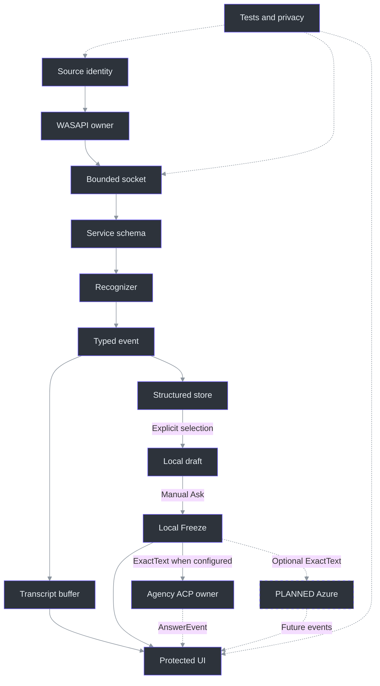
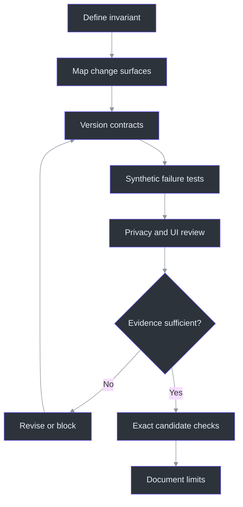

# 18. Extending the System

## Why a small feature can require a wide review

An extension is safe when its responsibilities are narrow **and its consequences are traced completely**. Adding a source is not just another selector; it affects byte framing, queue budgets, timestamp validation, stop behavior, display provenance, tests, and privacy wording. Adding a theme is not just changing a background; selection, disabled controls, alpha composition, and capture qualification also matter. The architecture explicitly prefers small testable interfaces over a generic plugin framework. (docs\ARCHITECTURE.md:47-86, component responsibilities; src\PhantomFudge.Core\AudioSource.cs:3-30, source identity; src\PhantomFudge.App\ThemeBrushes.cs:9-32, semantic resources.)

This chapter teaches change analysis; it does **not** add runtime capabilities. TODO28 established structured questions and exact Freeze; the Agency provider now uses **persistent ACP with controlled fresh sessions**. “Ask never sends” applies only to SnapshotOnly. Source commit29 and direct Azure30/31 remain separate future work, not prerequisites for reviewed explicit Ask. (src\PhantomFudge.App\MainWindow.Questions.cs:265-305, `QuestionAsk_Click`; TODO\29_QUESTION_COMMIT_LATENCY.todo:13-22, protocol tasks; TODO\30_AZURE_ANSWER_CONNECTION.todo:13-22, prerequisites.)

Missing settings select SnapshotOnly, and the parent restored that mode after stopping the owned login. The owner requests existing installed Agency, with no new login or organization-data access; LocalModel remains separate. The earlier Copilot smoke failed at the customization/tool gate and consumed its allowance because a model call cannot be ruled out. The successful Agency probe had new, separate authorization, not a retry of that allowance. (src\PhantomFudge.Core\Answers\AnswerConfiguration.cs:13-29, `Load`; src\PhantomFudge.Core\Answers\AnswerContracts.cs:33-39, modes.) See [provider boundaries](../../docs/ANSWER-PROVIDERS.md) and [workstream39](../../TODO/39_INSTALLED_CLI_ANSWERS.todo).

The [marker smoke](../../docs/answer-provider-smoke.json) remains connectivity history. The completed authorized ledger records **48 client question submissions**, including failed/superseded trials; no further model calls are planned. Agency **2026.10.7.4** / Copilot **1.0.92** now defaults to the advertised and tested **`gpt-5.6-sol-fast` / low**. H's three prepared exact-text responses completed usefully in **4.066, 4.176 and 2.992 s**; all three implementations compiled and passed **33/33** checks. Two inputs used intended wording and one the owner's actual ASR string. These are provider observations, not app/voice acceptance or a universal SLO. LocalModel has mocks only; credentials may expire. (tools\AgencyProbe\results\summary-final.json:2-64, scope/results; tools\AgencyProbe\results\latency-suite-20261009-h-exact-fast.json:2-56, exact-text trials; tools\AgencyProbe\results\latency-suite-20261009-h-quality.json:2-186, compiled checks.)

Keep the failed path visible. Haiku E's five fast original-variation responses were not exact owner-ASR evidence. Haiku F chose two wrong problems and appended one follow-up; mini G understood all six exact questions but failed ten full-range overflow checks. H's selected result does not erase either. Cold Haiku took **24.874 s**; first transport-only Asks took **5.041 s** on F and **6.470 s** on G. Never turn a prepared-session success into a cold-start promise. (tools\AgencyProbe\results\latency-suite-20261009-f-exact.json:2-98, retained failures; tools\AgencyProbe\results\summary-final.json:58-73, cold/transport boundaries; tools\AgencyProbe\results\summary-final.json:141-180, E–H comparison.)

The key discipline is to write the invariant before the edit. “A selected source cannot borrow another source's queue allowance” is testable. “Support more audio” is not. Existing tests already express this distinction through canonical schemas, bounded per-source resources, independent timing, and explicit rejection of undeclared input. (services\transcription\tests\test_dual_protocol.py:57-92, `StartSchemaTests`; services\transcription\tests\test_dual_protocol.py:150-200, independent tracks; services\transcription\tests\test_dual_protocol.py:250-255, undeclared-source rejection.)

## Architecture: trace both directions across the boundary

For audio changes, follow data downstream from selected device to rendered transcript, then follow failures upstream to cancellation and cleanup. The local capture GUID is now attached to events before dispatcher delivery; a stale callback must not acquire the identity of a later Start. The unchanged display/export buffer and new structured question store are separate consumers, not interchangeable representations. (src\PhantomFudge.App\Audio\LoopbackTranscriber.cs:86-136, `StartCoreAsync`; src\PhantomFudge.App\Audio\TranscriptionSocket.cs:194-237, `TryEnqueueAudio`; services\transcription\server.py:394-498, `Session.recognize`; src\PhantomFudge.App\MainWindow.xaml.cs:796-824, `ReceiveTranscript`; src\PhantomFudge.App\MainWindow.Questions.cs:134-153, `UpdateQuestionTranscript`.)



This map is intentionally not a claim that every box is a formal interface. For example, Python expects recognizer objects with `accept` and `finish`, returning `Recognition`; C# injects a capture-construction delegate for tests. Understanding the actual seam prevents introducing abstraction machinery that the code does not need. (services\transcription\recognizer.py:17-22, `Recognition`; services\transcription\server.py:394-498, recognizer calls; src\PhantomFudge.App\Audio\LoopbackTranscriber.cs:18-28, capture injection.)

## Checklist 1: a new audio source

**Start with product meaning.** Define what the source captures, how the user chooses it, and what its label does not mean. Current `Computer` and `Mic` labels identify inputs, not speakers; no source addition should silently become diarization or automatic meeting discovery. (src\PhantomFudge.Core\AudioSource.cs:16-30, `AudioSourceNames`; tests\PhantomFudge.Core.Tests\SourceTranscriptTests.cs:81-87, `LabelsDescribeInputNotSpeaker`.)

Then inspect these concrete surfaces:

1. **Identity and selection:** extend the enum and explicit selection model deliberately. `AudioInputSelection` currently has only two device fields; `ValidateSelection` constructs at most two inputs and rejects duplicate device IDs. A new enum value alone is insufficient. (src\PhantomFudge.App\Audio\TranscriptEvent.cs:5-7, selection records; src\PhantomFudge.App\Audio\LoopbackTranscriber.cs:142-156, `ValidateSelection`.)
2. **Native ownership:** specify endpoint direction and exact identity matching, construction failure, disconnect, stop, and disposal. `WasapiInput` distinguishes Render from Capture and releases both endpoint notifications and native capture ownership. Do not substitute a default device after selection fails. (src\PhantomFudge.App\Audio\WasapiInput.cs:20-74, constructor and `MatchesSelection`; src\PhantomFudge.App\Audio\WasapiInput.cs:97-119, `Dispose`.)
3. **Transport capacity:** audit fixed arrays of length three, allowed source counts, byte prefixes, and total pending-byte limits. Those structures encode the present two-source contract. Update resource arithmetic explicitly rather than increasing a limit until tests stop failing. (src\PhantomFudge.App\Audio\TranscriptionSocket.cs:13-18, limits; src\PhantomFudge.App\Audio\TranscriptionSocket.cs:51-56, source-indexed fields; src\PhantomFudge.App\Audio\TranscriptionSocket.cs:104-114, source validation.)
4. **Server symmetry:** align `SOURCES`, canonical source ordering, declared-source validation, per-source rate credits, and queue accounting. Stop must drain source workers and pending finalization, publishing every selected source's final before stopped. (services\transcription\server.py:26-28, source map; services\transcription\server.py:100-112, `parse_start`; services\transcription\server.py:319-357, `Session.receive`; services\transcription\server.py:394-498, stop drain.)
5. **UI, tests, privacy, documentation:** update selectors, meters, source visibility, export labels, denied-device behavior, and user-facing capture scope. Existing UI branches explicitly on Computer/Microphone/Both; do not let a new value fall into an accidental “Both” default. (src\PhantomFudge.App\MainWindow.xaml.cs:720-760, `UpdateAudioControls`, `SetCaptureMode`; tests\PhantomFudge.Audio.Tests\DualSourceTests.cs:17-44, synthetic regression catalogue.)
6. **Question provenance:** update `TranscriptValidation.Source`, structured keys and chooser filters as well as display names. The Mic default must not silently select a new source. All sources is a visibility filter, not authorization to include every row; Use selected still copies only explicit keys. Test new-source partial/final identity and local provenance retention separately from export formatting. (src\PhantomFudge.Core\TranscriptSegment.cs:5-14, `TranscriptSegmentKey`; src\PhantomFudge.Core\TranscriptSegment.cs:76-80, source validation; src\PhantomFudge.App\MainWindow.Questions.cs:70-120, filtering/selection.)

## Checklist 2: a new recognition backend

Begin at the recognition contract, not the model download. The current hybrid uses **independent per-source provisional queues and single-thread workers**, plus a separate **serial finalizer** for retained PCM spans. It does not funnel both stages through one executor. Source decoders produce provisional `Recognition` or bounded `FinalSpan` handoffs; finalization produces bounded final text with finite ordered times, and Stop drains pending work before stopped. Decoder faults/timeouts still invalidate readiness; native calls cannot simply be killed safely. Preserve these ordering, ownership and deadline rules when adding a backend. (services\transcription\server.py:115-181, `Runtime.cpu` and CPU ownership; services\transcription\server.py:361-498, `Session.publish`, `recognize`.) The current [`Runtime.source_cpu`/`final_cpu` and `Session.recognize_source`/`finalize`](../../services/transcription/server.py) separate source progress from expensive finalization; publication remains serialized.

Specify the backend's answers to five questions:

- Does `accept` produce useful revisable partials, completed text, or bounded PCM-span handoffs?
- Does `finish` flush every processed sample, and does it permit continuation?
- Are timestamps cumulative, and how are reset offsets preserved?
- Can independent source decoders share immutable model weights without sharing recognition history?
- Are inference and setup strictly separated so recognition cannot trigger an implicit download?

`VoskFactory` and `VoskRecognizer` still supply verified local models, independent provisional decoders and the explicit Vosk-only alternative; their absolute-timing/source-isolation tests remain relevant, but do not describe the whole hybrid. (services\transcription\recognizer.py:25-66, `verify_model`, `VoskFactory`; services\transcription\recognizer.py:69-110, `VoskRecognizer`; services\transcription\tests\test_recognizer.py:37-75, `RecognizerTests`.) The production default is **`hybrid-whisper` / `small.en`**: Vosk supplies streaming provisional text while CPU/int8 Whisper finalizes disjoint retained spans. `HybridRecognizer` cuts spans at an endpoint, its bounded rotation threshold or Stop; `WhisperFinalizer` uses explicitly provisioned local files rather than downloading during recognition. (services\transcription\configuration.py:12-34, `DEFAULT`, `load_config`; services\transcription\accurate.py:33-71, `HybridRecognizer`; services\transcription\accurate.py:74-129, `WhisperFinalizer`, `HybridFactory`.)

Do not advertise batch throughput as streaming latency. The earlier benchmark/research recommendation for optional question-only Whisper refinement is **historical**, not the current hybrid runtime configuration. Current Whisper finalization also does not remove Vosk's streaming provisional role or establish a live-latency guarantee. Any later recognition result must respect edit/snapshot ownership: it cannot overwrite user-edited text or mutate an already-frozen question. Backend changes still require protocol, UI, privacy, model-provenance and benchmark review even when their wire shape stays unchanged. (docs\SPEECH-BENCHMARK.md:34-40, historical recommendation; docs\AI-ANSWER-RESEARCH.md:90-99, earlier optional-refinement research; src\PhantomFudge.Core\QuestionDraft.cs:48-79, edit/refresh; src\PhantomFudge.Core\QuestionSnapshot.cs:5-23, immutability.)

## Checklist 3: a new theme or semantic color role

Theme changes have a narrower code surface but a wider visual evidence surface. `ThemePalette.For` provides semantic colors; `ThemeBrushes.Apply` maps those roles into both application resources and standard WPF control resources. Adding a role requires checking each palette and its consumers, not inserting an isolated literal into one control. (src\PhantomFudge.Core\ThemePalette.cs:5-26, `ThemePalette.For`; src\PhantomFudge.App\ThemeBrushes.cs:9-32, `Apply`.)

Review text, muted text, headings, selection foreground/background, action text, warning/error, input, hover, and border states. Preserve frozen brushes and dynamic-resource bindings. Also decide whether a new theme participates in the two-theme toggle: `NextThemed` currently alternates the companions and exits Plain toward DeepSeaFoam. That behavior is tested and should not change accidentally. (src\PhantomFudge.App\ThemeBrushes.cs:35-41, `Brush`; src\PhantomFudge.App\MainWindow.xaml:116-163, dynamic resources; src\PhantomFudge.Core\ThemePalette.cs:28-29, `NextThemed`; tests\PhantomFudge.Core.Tests\ThemePaletteTests.cs:19-25, toggle test.)

The background slider controls the shared translucent backdrop visible behind notes, transcript **and question/answer reading surfaces**. Its setter changes the root brush alpha; transparent Q/A panels and editors let that backdrop show through while reading text remains fully opaque. Do not reintroduce an opaque answer background that masks the slider, or “simplify” this into whole-window opacity that fades text. The [`QuestionPanel`, `QuestionEditor`, `QuestionSnapshotText` and `AnswerText` declarations](../../src/PhantomFudge.App/MainWindow.xaml) make this composition explicit. Existing contrast tests cover **opaque** reading/selection pairs, not arbitrary content behind a translucent window. Recheck actual UI, focus/hit regions and capture scenarios without promoting local rendering into meeting compatibility. (src\PhantomFudge.App\MainWindow.xaml.cs:482-505, opacity and `ApplyTheme`; tests\PhantomFudge.Core.Tests\ThemePaletteTests.cs:31-40, opaque contrast test; docs\QUALIFICATION.md:111-145, transition matrix.)

Include the local question pane in that review: selected rows, editable/read-only draft, provisional/user-edited indicators and read-only snapshot are different visual states. Verify that theme switching preserves their text; an immutable snapshot alone does not prove visual correctness, recipient invisibility or every contrast combination. (src\PhantomFudge.App\MainWindow.Questions.cs:198-208, interaction states; src\PhantomFudge.App\MainWindow.Questions.cs:246-259, provenance display; src\PhantomFudge.Core\QuestionSnapshot.cs:5-23, immutable snapshot.)

## Checklist 4: a provider is a new trust boundary

Answer providers must stay separate from local speech transport. Do not loosen `ValidateEndpoint` to accommodate cloud inference or a model server: it deliberately accepts only literal loopback addresses and the exact transcription path. A second loopback API is not the same protocol simply because both run locally. (src\PhantomFudge.App\Audio\TranscriptionSocket.cs:82-98, `ValidateEndpoint`.)

The future Azure checklist—explicit Ask, destination approval, identity, bounds, cancellation, terminal reasons and safe output—still applies. Installed-CLI integration makes those concerns immediate rather than proving them solved. Render text as data, not XAML/HTML, commands or automatically opened links. Offline fake-stream/process checks must precede a real-call receipt. (TODO\31_STREAMING_ANSWER_CLIENT.todo:13-28, provider contract; TODO\34_ANSWER_PRIVACY_RESILIENCE.todo:13-28, failure/privacy gates; docs\AI-ANSWER-PRIVACY.md:132-149, output and logging boundaries.)

The snapshot remains a **local** provenance contract, not a provider DTO. Repeated Freeze can retain the same question ID/revision, so an answer attempt needs its own identity. Keep mode-specific notices: “nothing sent” is correct for SnapshotOnly, not a guarantee for configured Agency, whose model service may be remote. (src\PhantomFudge.Core\QuestionSnapshot.cs:5-23, snapshot data; src\PhantomFudge.Core\QuestionDraft.cs:90-95, `Freeze`; src\PhantomFudge.App\MainWindow.Questions.cs:265-305, snapshot action.)

Review these additional concrete surfaces before extending the new common interface:

1. **Request projection:** `AnswerRun` generates a fresh GUID and normally passes only `ExactText`; `SourceRefs`, notes, audio and unselected text stay outside `AnswerRequest`. The explicitly requested, default-off [Clarify first](../QUESTION-CLARIFICATION.md) option adds typed instruction/history metadata. Separately, **Previous answer** may add one displayed completed answer in nullable `PreviousAnswer`; null preserves the existing direct path. Do not widen these exceptions into generic app context or recursively serialize earlier requests. (src\PhantomFudge.Core\Answers\AnswerContracts.cs:5-31, request/events/interface; src\PhantomFudge.Core\Answers\AnswerRun.cs:15-29, projection.)
2. **Settings versus readiness:** Agency mode adds `AgencyPath` for the supported `agency copilot` launcher; local installation is not offline inference or authorization to inspect organization data. LocalModel remains the separate Copilot-engine OFFLINE/BYOK route to an explicit literal-loopback `/v1` server. Destination validation cannot verify model installation or prevent server-side proxying. No hosted-model fallback is permitted. (src\PhantomFudge.Core\Answers\AnswerContracts.cs:41-74, settings validation.)
3. **Executable and profile authority:** setup resolves Agency without login; a `.exe` path is not proof of authenticity or isolation. Preserve the pinned profile-only launch and reject ambient hooks, permissions, plugins, MCPs and resumed sessions. The exact generated direct-Q&A agent is a deliberate controlled exception, not permission to import a personal coding agent. Missing existing authentication must not trigger app-owned login/account switching. These controls are not an OS sandbox or organization-data grant. (src\PhantomFudge.Core\Answers\AnswerContracts.cs:47-52, syntactic validation; src\PhantomFudge.Core\Answers\AnswerConfiguration.cs:8-29, profile/settings paths.)
4. **Terminal protocol:** TextDelta/Completed retain request IDs and increasing sequence. Completion carries no text and only latches a marker; nonblank text and clean **request enumeration end** are also required. The persistent engine's pipe must not close after each answer. Test duplicate, late, wrong-request and post-terminal events without turning raw diagnostics into answers. The 32,768-unit cap rejects an overflowing delta whole. (src\PhantomFudge.Core\Answers\AnswerRun.cs:34-65, `Apply`, `Complete`.)
5. **Ownership and retention:** one active request, a 120-second deadline and 40-ms render timer remain unchanged. Cancel/Hide/Clear/protection/reload/close must reach the cached provider and await owned cleanup, even during preparation. Keep partials incomplete and Copy deliberate; never retry/resend automatically. Engine/workspace artifacts can survive individual answers until teardown, so app memory bounds are not end-to-end memory-only operation. (src\PhantomFudge.Core\Answers\AnswerRun.cs:67-81, `Cancel`, `Fail`.) Inspect the [lifetime owner](../../src/PhantomFudge.App/MainWindow.AnswerLifetime.cs) and [provider guide](../../docs/ANSWER-PROVIDERS.md), not just Core state.

### Persistent-provider additions to that checklist

Persistence moves ownership outside a single request's `await foreach`. A new provider must declare
whether success releases a request, conversation, process, workspace or all four. Agency acknowledges
`session/close` before Completed, keeps the engine, then prepares another **empty** session. It never
reuses a question conversation and rotates the engine after at most 32 created sessions.
**Normal startup/reveal intentionally calls `WarmUpAsync`**, preparing one empty session without
a model question. The alternative `WarmUpTransportAsync` prepares only transport and leaves session
creation on Ask; it is not the current app readiness policy. The selected-default preparation took
21.183 seconds with zero questions. Keep that readiness cost separate from prepared completion.
(src\PhantomFudge.Core\Answers\AgencyAcpConnection.cs:41-122, reuse/session/prompt/close;
tools\AgencyProbe\results\agency-selected-fast-default-preparation.json:2-16, empty-session preparation;
tools\AgencyProbe\results\summary-final.json:210-224, cleanup and retention.)

Before prompt submission, verify advertised configuration: controlled agent, exact requested model,
reasoning effort and `allow_all=off`. CLI `--agent` alone was insufficient in pinned ACP; explicit
`session/set_config_option` installs the intended SYSTEM-role policy. Preserve one user text containing
fixed instructions plus JSON `userQuestion`, not a serialized snapshot. Normal Ask excludes history;
only explicit Clarify first requests may include their bounded typed clarification exchanges.
Validate Unicode and escape file-reference syntax while retaining the decoded exact question.
(src\PhantomFudge.Core\Answers\AgencyAcpConnection.cs:61-96, agent selection/one prompt;
src\PhantomFudge.Core\Answers\AgencyAcpConnection.cs:296-319, configuration validation;
src\PhantomFudge.Core\Answers\AgencyAnswerPrompt.cs:8-111, controlled policy and envelope.)

The receiver rejects tools, permission/client requests and protocol plans instead of waiting.
The full-answer prose check excludes code fences and rejects selected missing-input/follow-up phrases;
it is a heuristic, not proof of usefulness. Keep semantic/correctness gates alongside timing:
A–C preserved slow/generic/clarification failures; D failed eight overflow checks; E passed a
surrogate question set; F chose wrong problems; G omitted full-range arithmetic safeguards despite
correct title interpretation. H passed the finite exact-text contract on the new selected model.
Neither three successful samples nor first text establishes a universal complete-answer guarantee.
(src\PhantomFudge.Core\Answers\AgencyAcpConnection.cs:213-265, rejected requests/plans;
src\PhantomFudge.Core\Answers\AgencyAcpConnection.cs:330-354, heuristic;
src\PhantomFudge.Core\Answers\AgencyAnswerPrompt.cs:12-43, answer policy;
tools\AgencyProbe\results\summary-final.json:109-180, retained failures and selected result.)

A default-model change also has a display and diagnostics surface. Keep the
[provider's public `DefaultModel`/`EffectiveModel`](../../src/PhantomFudge.Core/Answers/AgencyCliAnswerProvider.cs)
as the source of truth; the [UI `ProviderLabel`](../../src/PhantomFudge.App/MainWindow.Answers.cs)
already derives its default from that property, so recompilation updates the label. Preserve explicit
overrides, fixed safe model metadata and no fallback. A newly compiled default is not itself a new
latency measurement of the app binary. (tools\AgencyProbe\results\summary-final.json:234-260, measurement assembly and public model properties.)

Finally, extend diagnostics without silently extending disclosure. Default events have correlation,
duration/process/count/code fields; bodies require explicit content opt-in. Preserve the nonblocking
queue and bounded file retention. The diagnostic constructor must suppress real warm-up, and
fixtures must not turn session preparation into a cloud question. See [diagnostics](../../docs/DIAGNOSTICS.md).
(src\PhantomFudge.Core\Diagnostics\LocalDiagnostics.cs:9-24, metadata schema;
src\PhantomFudge.Core\Diagnostics\LocalDiagnostics.cs:40-111, bounds;
src\PhantomFudge.Core\Diagnostics\LocalDiagnostics.cs:145-184, content opt-in.)

Cloud ASR changes audio egress; an enterprise broker changes authentication, routing, hosting, and streaming behavior. Neither is a routine interchangeable implementation detail. Both need separately justified policy and evaluation decisions, and neither makes Docker an ordinary runtime requirement. (TODO\36_OPTIONAL_AZURE_SPEECH.todo:13-25, optional Speech; TODO\37_OPTIONAL_ANSWER_BROKER.todo:13-26, optional broker.)

## Checklist 5: a new state field is a lifecycle change

For every proposed field, write down its owner, creation boundary, mutation authority, reset rule, serialization version, memory bound and logging/export policy. Existing display-buffer `BeginSession` resets final numbering, while `AddFinal` deduplicates globally within that session. The new structured key therefore separates capture identity from protocol final numbering. (src\PhantomFudge.Core\TranscriptBuffer.cs:23-38, `BeginSession`; src\PhantomFudge.Core\TranscriptBuffer.cs:48-72, `AddFinal`; src\PhantomFudge.Core\TranscriptSegment.cs:3-20, `TranscriptSegmentKey`.)

The implemented local fields provide a concrete lifecycle checklist:

| Field or owner | Preserve this invariant when extending it |
| --- | --- |
| Capture GUID / local utterance ID | New capture identity per Start; partial→final retains its local key. Store Clear does not recycle local IDs. |
| Source epoch | Current UI events use local 0; a field's existence is not wire negotiation or commit support. |
| Selected records | Copies survive 256-entry/64,000-character store eviction; reject cross-session selection. |
| Draft revision / user edit | Compose and validate the full 8,192-character candidate before assignment; explicit editing blocks ASR replacement. |
| Frozen snapshot | Copy provenance/text; future draft changes cannot mutate a previously returned snapshot. |
| Answer request/run | New GUID per attempt, exact-text-only request, increasing event sequence and a terminal marker distinct from completed state. |
| Cached engine / readiness | Distinguish transport from empty-session readiness; stop/dispose on owner teardown, not merely at enumeration end. |
| Prepared session / model | One prompt maximum, unique session identity, exact configured role/model and bounded engine rotation. |

Sources: (src\PhantomFudge.Core\StructuredTranscriptStore.cs:13-34, capacity/session;
src\PhantomFudge.Core\StructuredTranscriptStore.cs:76-109, final identity/Clear);
(src\PhantomFudge.App\MainWindow.Questions.cs:134-142, epoch-default calls);
(src\PhantomFudge.Core\QuestionDraft.cs:18-79, selection/refresh transaction);
(src\PhantomFudge.Core\QuestionSnapshot.cs:5-23, immutable copy).

The answer fields have their own lifecycle in (src\PhantomFudge.Core\Answers\AnswerRun.cs:15-65, constructor, `Apply`, `Complete`). They must not reset transcription IDs or turn a new draft revision into a hidden resend.

An empty final is not permission to retain the last guessed partial: it settles that selected record to empty. Blank editing remains possible, but blank Ask rejects. Oversized selection, edit or refresh must leave the prior draft intact; do not “help” by truncating its meaning. Preserve the staged-update pattern when adding fields. (src\PhantomFudge.Core\StructuredTranscriptStore.cs:80-86, empty final; src\PhantomFudge.Core\QuestionDraft.cs:90-124, `Freeze`, `Compose`; src\PhantomFudge.App\MainWindow.Questions.cs:214-243, edit/paste rejection.)

Wire evolution is especially surgical. The current service requires exact start objects, accepts only Stop after start, and the C# client checks exact response property sets. Even an apparently optional extra JSON field can break compatibility. Preserve v1/v2 behavior and negotiate a new version or capability rather than silently weakening parsers. (services\transcription\server.py:100-112, `parse_start`; services\transcription\server.py:306-316, `Session.receive`; src\PhantomFudge.App\Audio\TranscriptionSocket.cs:491-515, `RequireTranscriptProperties`, `RequireProperties`.)

Focus is also state, not decoration. `PassiveWindow` depends on presentation **and** question editing. The separate question path deliberately focuses typing without stopping audio or enabling Notes editing; global Notes Edit/Present/Hide behavior is not redefined. New answer controls must preserve that distinction while adding their own cancellation lifetime. Check protection readiness, file-busy rejection, return to passive interaction and audio-start cancellation independently. (src\PhantomFudge.App\MainWindow.Questions.cs:24-25, `PassiveWindow`; src\PhantomFudge.App\MainWindow.Questions.cs:156-208, focus transition.)

## A repeatable change algorithm



This is a recommended engineering workflow, not an executed release pipeline. Qualification must identify the exact packaged candidate and distinguish source tests, UI observations, recipient capture evidence, and owner approval. A successful build cannot fill an untested sharing-product row. (docs\QUALIFICATION.md:3-7, current matrix; docs\QUALIFICATION.md:150-176, result record; TODO\35_ANSWER_RELEASE_ACCEPTANCE.todo:13-26, candidate acceptance.)

### Worked pseudocode: evolving local epochs into negotiated commit

`SourceEpoch` already exists locally; current v2 ingestion supplies 0. TODO29 requires a producer/consumer agreement for armed start/end boundaries, ordered sample coverage and acknowledged epoch advancement—not merely another field. The following **future commit** matrix extends existing local guards; its transition functions are illustrative, not implemented APIs. (src\PhantomFudge.Core\TranscriptSegment.cs:17-20, key fields; src\PhantomFudge.App\MainWindow.Questions.cs:134-142, v2 ingestion.)

```python
cases = [
    ("same_session_same_epoch", "accept"),
    ("old_session_same_segment_id", "reject_stale"),
    ("old_epoch_after_commit", "reject_stale"),
    ("duplicate_commit_same_parameters", "replay_ack"),
    ("duplicate_commit_changed_watermark", "reject"),
    ("late_final_after_user_edit", "preserve_user_revision"),
    ("selected_record_evicted", "preserve_local_copy"),
    ("freeze_then_late_final", "preserve_exact_snapshot"),
    ("new_field_sent_to_v2_peer", "reject_protocol"),
]
for scenario, expected in cases:
    state, event = synthetic_fixture(scenario)
    before = snapshot_unrelated_source(state)
    actual = proposed_transition(state, event)
    assert actual == expected
    assert unrelated_source(state) == before
    assert no_request_was_sent_without_explicit_ask(state)
```

This matrix connects protocol changes to UI/privacy consequences. Existing local guards do not establish a sample-exact live-Mic span from v2 text. Future commit must finalize only Mic, preserve Computer capture and use processed—not merely received—sample coverage. Tests should use generated data and injected capture, not silently open hardware. (tests\PhantomFudge.Core.Tests\SourceTranscriptTests.cs:5-56, source isolation tests; src\PhantomFudge.App\Audio\LoopbackTranscriber.cs:25-28, synthetic capture seam; TODO\29_QUESTION_COMMIT_LATENCY.todo:13-28, proposed commit requirements.)

## Tradeoffs and the final change-surface review

Before calling a surgical change complete, review six surfaces even when some require no edit:

| Surface | Question to answer in the change record |
| --- | --- |
| UI | Did focus, protection lifecycle, source visibility, or status meaning change? |
| Protocol | Can an older peer reject, misinterpret, or accept an unsupported message? |
| Tests | Which existing invariant survives, and which new failure ordering is exercised? |
| Privacy | Did captured, transmitted, retained, logged, or exported data expand? |
| Resources | Are per-source limits, total limits, deadlines, and cleanup still bounded? |
| Documentation | Are implemented behavior, proposed behavior, and qualification gaps still distinguishable? |

This checklist synthesizes the existing strict transport, resource controls, and qualification record rather than introducing a new runtime framework. “No change required” is useful only when accompanied by the reason: a palette-only edit may leave framing unchanged, while a provider edit necessarily revisits egress and credential handling. (src\PhantomFudge.App\Audio\TranscriptionSocket.cs:13-18, limits; src\PhantomFudge.App\Audio\TranscriptionSocket.cs:512-515, strict properties; docs\QUALIFICATION.md:150-176, evidence record; docs\AI-ANSWER-PRIVACY.md:132-151, provider safeguards.)

Prefer a smaller supported contract over a permissive parser or automatic fallback that conceals unsupported behavior. Preserve failed and untested outcomes in the handoff: a new backend passing synthetic tests does not qualify a new window surface, a real microphone, or a cloud data policy. (docs\QUALIFICATION.md:24-26, outcome vocabulary; TODO\35_ANSWER_RELEASE_ACCEPTANCE.todo:23-26, acceptance boundaries.)

## Exercises

1. Find every fixed two-source assumption in the checklist. Explain why changing only the enum can compile in one layer while violating another layer's runtime schema. (src\PhantomFudge.App\Audio\TranscriptionSocket.cs:51-56, arrays; services\transcription\server.py:100-112, `parse_start`.)
2. Propose a warning color with acceptable opaque contrast, then explain why translucent-background readability still needs separate observation. (tests\PhantomFudge.Core.Tests\ThemePaletteTests.cs:31-73, contrast calculation; docs\PRODUCT.md:121-128, translucency limits.)
3. Draft a provider change receipt that records capability and privacy differences without including a real question, token, or account secret. (docs\AI-ANSWER-EVALUATION.md:140-149, receipt requirements.)
4. Select a partial, freeze it, edit the draft, then deliver an empty final and evict the original store row. Explain each object's expected text and why `SourceRefs` must not become the Azure request body. (src\PhantomFudge.Core\QuestionDraft.cs:48-95, edit/refresh/Freeze; src\PhantomFudge.Core\QuestionSnapshot.cs:5-23, local immutable provenance.)
5. On paper, apply TextDelta(1), Completed(2), then TextDelta(3) to one run; contrast that with request enumeration ending before Completed. Explain why neither is complete, why ACP process EOF is a different failure, and why none permits provider fallback. (src\PhantomFudge.Core\Answers\AnswerRun.cs:34-65, event/terminal guards.)

## References

- [Architecture responsibilities](../../docs/ARCHITECTURE.md) and [qualification contract](../../docs/QUALIFICATION.md).
- [Source model](../../src/PhantomFudge.Core/AudioSource.cs), [transport](../../src/PhantomFudge.App/Audio/TranscriptionSocket.cs), and [recognizer](../../services/transcription/recognizer.py).
- [Theme roles](../../src/PhantomFudge.Core/ThemePalette.cs) and [brush mapping](../../src/PhantomFudge.App/ThemeBrushes.cs).
- [Local question contract](../../docs/LOCAL-QUESTIONS.md), [structured store](../../src/PhantomFudge.Core/StructuredTranscriptStore.cs), and [question diagnostics](../../src/PhantomFudge.App/MainWindow.QuestionDiagnostics.cs).
- [Installed-provider boundaries](../../docs/ANSWER-PROVIDERS.md), [common interface](../../src/PhantomFudge.Core/Answers/AnswerContracts.cs), [run state](../../src/PhantomFudge.Core/Answers/AnswerRun.cs), and [configuration](../../src/PhantomFudge.Core/Answers/AnswerConfiguration.cs).
- [ACP session ownership](../../src/PhantomFudge.Core/Answers/AgencyAcpConnection.cs), [controlled policy](../../src/PhantomFudge.Core/Answers/AgencyAnswerPrompt.cs), [diagnostics](../../docs/DIAGNOSTICS.md) and [evolving provider evidence](../../tools/AgencyProbe/results/summary-final.json).
- [Selected H exact-text timing](../../tools/AgencyProbe/results/latency-suite-20261009-h-exact-fast.json) and [H compiled checks](../../tools/AgencyProbe/results/latency-suite-20261009-h-quality.json).
- [Source-state tests](../../tests/PhantomFudge.Core.Tests/SourceTranscriptTests.cs) and [dual-protocol tests](../../services/transcription/tests/test_dual_protocol.py).
- [Planned answer architecture](../../docs/AI-ANSWER-ARCHITECTURE.md) and [release acceptance](../../TODO/35_ANSWER_RELEASE_ACCEPTANCE.todo).
