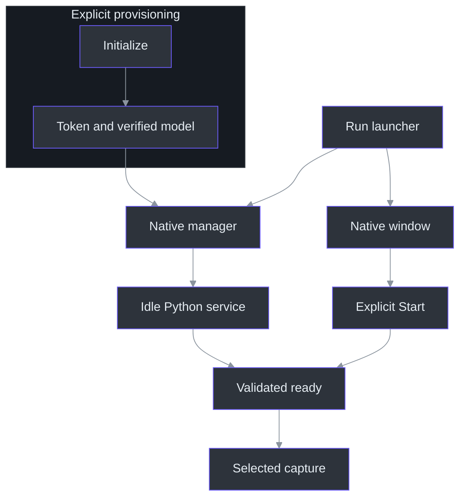
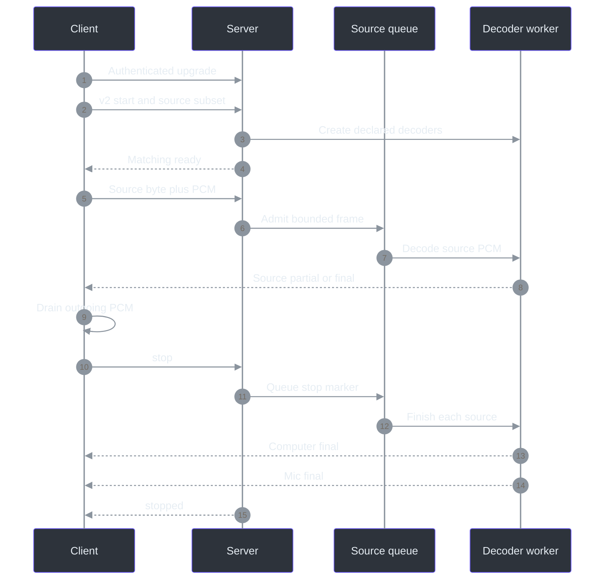

# 19. API and configuration reference

## Readiness is not recording

This reference distinguishes three operations that must never be conflated: **provisioning**, **starting an idle service**, and **starting selected audio capture**. The launcher starts/reuses Python, but the window separately requires explicit Start, valid selections, protection readiness, and a token. Both is the initial input-mode selection, not automatic recording. (`scripts\Run-PhantomFudge.ps1:39-55`, launcher; `src\PhantomFudge.App\MainWindow.xaml.cs:33-54`, initial state; `src\PhantomFudge.App\MainWindow.xaml.cs:589-625`, `Start_Click`.)

Commands below are reference examples from the repository root, not actions performed to produce this chapter. No credential value is reproduced. Follow [capture](07-dual-input-capture.md), [protocol](08-streaming-protocol.md), [recognition](09-python-recognition.md), and [service ownership](10-native-service-lifecycle.md) for the implementation narratives.



The final gate is implemented by `StartCoreAsync`: native construction follows successful transport connection, not merely process launch. (`src\PhantomFudge.App\Audio\LoopbackTranscriber.cs:98-111`, `StartCoreAsync`.)

## 1. Startup commands and argument semantics

The normal operational sequence is:

```powershell
# Explicit provisioning; may download dependencies and the pinned model.
.\scripts\Initialize-Transcription.ps1 -DownloadModel

# Start/reuse native Python and launch/reveal the application.
.\scripts\Run-PhantomFudge.ps1

# After stopping capture in the app, stop the owned idle service.
.\scripts\Stop-Transcription.ps1
```

| Command/switch | Exact implemented meaning |
| --- | --- |
| `Initialize-Transcription.ps1` | Verify/provision token and model; normally create/restore the service-local Python environment. |
| `-DownloadModel` | Permit downloading an absent model archive. A valid cached archive does not require another download. |
| `-SkipPythonSetup` | Skip environment/dependency setup, **not** token/model work. |
| `Start-Transcription.ps1` | Invoke the existing service-local interpreter with `manage.py start`. Missing setup fails; it is not installed here. |
| `Run-PhantomFudge.ps1 -NoBuild` | Skip source-build work; an executable must already exist. Packaged launches skip build regardless. |
| `-NotesOnly` | Skip service startup; it does not remove transcription controls or disable a separately running service. |
| `-PassThru` | Also return the launched process object, including the recovery process on the reveal path. |
| Start/Stop `-Docker` | Explicit optional container branch; never selected automatically. Start requires existing recipes/engine. |

Definitions: `Initialize-Transcription` parameters/provisioning (`scripts\Initialize-Transcription.ps1:1-15`, `scripts\Initialize-Transcription.ps1:69-140`); native/Docker branches (`scripts\Start-Transcription.ps1:8-36`, `scripts\Stop-Transcription.ps1:8-22`); launcher branches (`scripts\Run-PhantomFudge.ps1:1-57`). The launcher requires PowerShell 7.2 or later, prefers the packaged executable when present, and reveals an existing app at the expected executable path **before** any build/service operation. (`scripts\Run-PhantomFudge.ps1:1-37`, launcher.)

The application itself recognizes three exact two-argument diagnostic patterns: `--capture-proof outputDirectory`, `--ui-smoke outputDirectory`, and `--documentation-screenshots outputDirectory`. These dispatch capture/UI diagnostics, not ordinary headless unit tests. Unmatched argument shapes fall through to normal single-instance startup; there is no implemented `--ask`, input-selection, or automatic-capture CLI switch. (`src\PhantomFudge.App\App.xaml.cs:13-52`, `App.OnStartup`.)

## 2. Environment, defaults, and secret ownership

| Variable | Consumer, default, and precedence |
| --- | --- |
| `PHANTOM_TRANSCRIPTION_URI` | App speech endpoint; defaults to `ws://127.0.0.1:8765/v1/transcribe`. Launcher explicitly sets this value. |
| `PHANTOM_TRANSCRIPTION_TOKEN` | App initial token field, empty when absent. Server uses it only when a token-file setting is not supplied. |
| `PHANTOM_TRANSCRIPTION_TOKEN_FILE` | Server reads this file first; native manager supplies the workspace token-file path. It is not an app token-file setting. |
| `PHANTOM_TRANSCRIPTION_MODEL_PATH` | Required by production server; no implicit model download or default model directory in `server.main`. Manager supplies the pinned directory. |
| `PHANTOM_TRANSCRIPTION_HOST` | Server default `127.0.0.1`; only `127.0.0.1` and `0.0.0.0` accepted. Native manager overrides to loopback. |
| `PHANTOM_TRANSCRIPTION_INSTANCE` | Optional canonical UUID-hex identity; manager generates it. Without managed identity/callback, authenticated shutdown is unavailable. |
| `PYTHONDONTWRITEBYTECODE` | Manager sets `1` for its child. |
| `OPENBLAS_NUM_THREADS`, `OMP_NUM_THREADS` | Manager sets each to `1`; these are child environment settings, not WebSocket controls. |
| `PHANTOM_AUDIO_TEST_TOKEN` | Native fixture/playback harness credential; distinct from the application's token-variable name. |

Source: `MainWindow` initialization and `Start_Click` (`src\PhantomFudge.App\MainWindow.xaml.cs:48-54`, `src\PhantomFudge.App\MainWindow.xaml.cs:606-625`); launcher environment (`scripts\Run-PhantomFudge.ps1:43-55`); `load_token`, `main`, and `production_app` (`services\transcription\server.py:69-79`, `services\transcription\server.py:455-485`); manager child environment (`services\transcription\manage.py:167-176`, `start`); harness lookup (`tests\PhantomFudge.Audio.Tests\DualSyntheticServiceCheck.cs:24-27`, `RunDualSyntheticServiceCheckAsync`).

**Do not infer a port setting:** production `server.main` binds port 8765. The C# validator allows other valid ports on literal `127.0.0.1` or `[::1]`, but that does not reconfigure the server. It rejects `localhost`, remote hosts, `wss`, query credentials, fragments, user information, and normalized/escaped alternate paths. The default native server is IPv4 despite client IPv6-loopback acceptance. Redirects and proxies are disabled. (`services\transcription\server.py:475-492`, `main`; `src\PhantomFudge.App\Audio\TranscriptionSocket.cs:26-31`, HTTP handler; `src\PhantomFudge.App\Audio\TranscriptionSocket.cs:73-89`, `ValidateEndpoint`.)

Initialization generates 32 random bytes as 64 hexadecimal characters and restricts the Windows token DACL to the current user. Existing invalid tokens require explicit repair, not silent rotation. Manager/server validation requires `[A-Za-z0-9_-]{32,512}`; the native socket's broader lexical check is not the server's credential contract. Never put credentials in URLs or command arguments. (`scripts\Initialize-Transcription.ps1:33-67`, token setup; `services\transcription\manage.py:33-40`, `token`; `services\transcription\server.py:69-79`, `load_token`; `src\PhantomFudge.App\Audio\TranscriptionSocket.cs:108-135`, `ConnectCoreAsync`.)

Engine/model pins are `vosk==0.3.45`, `aiohttp==3.14.3`, and English `vosk-model-small-en-us-0.15`. The archive is 41,205,931 bytes; its recorded hash is observed download identity, not a publisher-signed checksum. Runtime verifies the exact manifest file set and hashes before explicit-path model loading. (`services\transcription\requirements.txt:1-2`, dependency pins; `services\transcription\model.json:2-10`, manifest; `services\transcription\recognizer.py:22-49`, `verify_model`, `VoskFactory`.)

## 3. Native management contract

```powershell
.\services\transcription\.venv\Scripts\python.exe .\services\transcription\manage.py status
```

`manage.py` accepts exactly one verb: `start`, `stop`, or `status`; exit codes are `0` success, `1` runtime failure, and `64` invalid usage. Status reports `ready`, `active`, and `pid` when it authenticates a listener; no listener produces a textual status instead. (`services\transcription\manage.py:217-239`, `status`, `main`.)

Start/Stop/Status share a workspace byte-range lock. Ownership requires the receipt's UUID plus authenticated service name and management version, not merely a PID or occupied port. A ready v2-capable instance is reused, including an active one. Automatic replacement is limited to an owned, ready, explicitly idle instance lacking speech v2. Active, ambiguous, foreign, or unready instances are not silently repaired. (`services\transcription\manage.py:65-90`, `lifecycle_lock`; `services\transcription\manage.py:112-159`, ownership/capability/start decisions.)

The Python decision can be read as this JavaScript pseudocode:

```javascript
if (listenerExists()) {
  const info = authenticateReceiptInstance();
  require(info.ready === true);
  if (supportsSpeechV2(info)) return; // Reuse, not record.
  require(info.active === false);
  await authenticatedShutdownAndPortClosure();
}
await spawnWithNewReceiptAndVerifyReadiness();
```

Management waits are phase-specific: lock acquisition 50 seconds, HTTP request 2 seconds, startup observation 45 seconds, shutdown-port wait 12 seconds. Failed shutdown/startup preserves ownership evidence rather than killing an arbitrary OS process. The request reader caps JSON at 4,096 bytes and forbids redirects/proxies. (`services\transcription\manage.py:43-90`, request/lock; `services\transcription\manage.py:130-200`, stop/start.)

## 4. HTTP routes

| Route | Authentication and successful response |
| --- | --- |
| `GET /health` | No authentication; `status` (`ready`/`unavailable`) and Boolean `modelAvailable`; HTTP 200/503. This is readiness, not ownership proof. |
| `GET /v1/runtime` | Bearer authentication; `service`, management `protocolVersion: 1`, `speechProtocolVersions: [1,2]`, `instanceId`, `pid`, `ready`, `active`. |
| `POST /v1/shutdown` | Bearer plus matching `X-Phantom-Instance`; no body; idle managed instance returns `{"status":"stopping"}`. |
| `GET /v1/transcribe` | Authenticated WebSocket upgrade; one active session, reserved before the start handshake. |

These routes are registered by `create_app`. Runtime/shutdown/transcription reject query strings and bodies. Authentication requires exactly one Bearer header; nonempty browser Origin is rejected—403 on transcription, 401 on management. An identity mismatch or active shutdown attempt yields 409; unavailable speech yields 503. (`services\transcription\server.py:162-209`, `health`, `authorized`, management handlers; `services\transcription\server.py:353-378`, `transcribe`; `services\transcription\server.py:435-452`, `create_app`.)

## 5. Speech v1/v2 messages and bytes

Both versions use `/v1/transcribe`. Send one of these complete text messages after upgrade:

```json
{"type":"start","sampleRate":16000,"channels":1,"encoding":"pcm_s16le"}
```

```json
{"type":"start","protocolVersion":2,"sampleRate":16000,"channels":1,"encoding":"pcm_s16le","sources":["computer","microphone"]}
```

V1 is Computer-only. V2 source subsets must be nonempty, unique, and canonically ordered: Computer alone, Mic alone, or Computer then Mic. Version/rate/channel values must be integers; extra fields or unknown sources fail. `ready` echoes the accepted start fields with a different `type`; v2 clients reject downgrade. (`services\transcription\server.py:94-106`, `parse_start`; `services\transcription\server.py:378-385`, ready construction; `src\PhantomFudge.App\Audio\TranscriptionSocket.cs:407-426`, `ProcessMessage`.)

| Item | V1 | V2 |
| --- | --- | --- |
| Binary message | Unprefixed PCM | Source byte, then PCM |
| Source byte | Absent | `1` Computer; `2` Microphone; must be declared |
| PCM | Signed 16-bit little-endian, mono, 16 kHz | Same, separate tracks—not mixed |
| PCM length | Even, 2–32,000 bytes | Same |
| Application-message length | 2–32,000 bytes | Odd, 3–32,001 bytes |
| Partial fields | `type`, `text` | Also `source` |
| Final fields | `type`, `text`, `segmentId`, `startSeconds`, `endSeconds` | Also `source` |

The server strips the prefix before validation/accounting. At 32,000 PCM bytes/second, 100 ms means 3,200 PCM bytes or 3,201 v2 message bytes; neither duration nor queue credit includes the prefix. (`services\transcription\server.py:23-25`, source/format constants; `services\transcription\server.py:255-287`, `Session.receive`; `services\transcription\server.py:289-315`, `Session.publish`; `src\PhantomFudge.Core\AudioSource.cs:3-23`, wire identities.)

Final IDs increase globally across the session, while final times and replacement partials are source-local. Thus Computer ending at 5 seconds followed by Mic ending at 2 seconds is valid. Labels identify inputs, not speakers. `{"type":"stop"}` stops the entire session; source-scoped commit, Ask, and speech v3 are **not implemented**. (`services\transcription\server.py:247-252`, control handling; `services\transcription\server.py:289-327`, publication/drain; `docs\DUAL-SOURCE-AUDIO.md:10-17`, identity boundary; `docs\AI-ANSWER-ARCHITECTURE.md:124-158`, proposed commit.)



Stop waits for a queue slot rather than discarding accepted PCM. Each declared source receives a final, even if empty, before `stopped`. Native drain has its own timeout and requires v2 stop-final evidence from every source; disconnection is not equivalent to completed drain. (`services\transcription\server.py:247-252`, `Session.receive`; `services\transcription\server.py:317-327`, `Session.recognize`; `src\PhantomFudge.App\Audio\TranscriptionSocket.cs:232-280`, `StopAsync`; `src\PhantomFudge.App\Audio\TranscriptionSocket.cs:454-465`, `ProcessMessage`.)

## 6. Resource defaults are code limits, not CLI knobs

| Boundary | Current default |
| --- | --- |
| Server control text | 1,024 UTF-8 bytes |
| Server queue per source | 64,000 PCM bytes **and** 32 frames; Both totals 128,000 bytes/64 frames |
| Native pending audio | 64,000 PCM bytes/source, 128,000 total; no server-style 32-frame/source cap |
| Server source rate credit | 64,000-byte burst, 32,000 bytes/s refill; 200-frame burst, 100 frames/s refill |
| Server start / idle / decoder / send waits | 5 / 15 / 5 / 2 seconds |
| Source duration ceiling | 28,800 seconds of received PCM, not wall time |
| Native connection / final-drain waits | 10 / 15 seconds |
| Native capture startup / release waits | 10 / 5 seconds; separate from socket waits |
| Native idle-silence cadence | At least 250 ms without real packets, at least 100 ms between synthetic frames |
| Recognizer history rotation | At least 30 seconds of processed source audio since the previous rotation |
| Native response limit | 32,768 bytes, JSON depth 8 |
| Text limits | Server 8,192 Python characters; native 16,384 .NET string characters |

Defaults are declared in `Limits` and native constants/parser, not environment overrides. Per-source queue quotas cannot borrow another source's spare capacity. For 3,200-byte frames, the byte quota is twenty queued frames; tiny two-byte frames instead reach the server's frame quota first. (`services\transcription\server.py:42-56`, `Limits`; `services\transcription\server.py:225-287`, `Session`; `services\transcription\server.py:289-292`, text validation; `src\PhantomFudge.App\Audio\TranscriptionSocket.cs:13-43`, constants/channel; `src\PhantomFudge.App\Audio\TranscriptionSocket.cs:343-366`, `ReceiveAsync`; `src\PhantomFudge.App\Audio\TranscriptionSocket.cs:430-440`, transcript parser.)

Capture waits, silence scheduling, and decoder rotation are distinct mechanisms, not one end-to-end deadline or acoustic endpoint setting. A timed-out native release retains worker ownership and blocks unsafe restart; a delayed silence tick does not backfill elapsed time. (`src\PhantomFudge.App\Audio\LoopbackTranscriber.cs:12-14`, constants; `src\PhantomFudge.App\Audio\LoopbackTranscriber.cs:79-82`, restart gate; `src\PhantomFudge.App\Audio\LoopbackTranscriber.cs:289-309`, `SupplySilenceAsync`; `src\PhantomFudge.App\Audio\LoopbackTranscriber.cs:384-402`, `FinishSessionAsync`; `src\PhantomFudge.App\Audio\SilenceCadence.cs:11-19`, scheduling; `services\transcription\recognizer.py:82-90`, rotation.)

## 7. Testing commands: choose the evidence layer

```powershell
dotnet run --project .\tests\PhantomFudge.Audio.Tests -c Release
.\services\transcription\.venv\Scripts\python.exe -m unittest discover -s .\services\transcription\tests
```

The native harness is an executable, not an xUnit project; ordinary arguments filter test names case-insensitively. A filter matching nothing still returns success with zero checks, so inspect the reported count. Python protocol tests create isolated test servers with fake recognizers; they do not require a running production listener. (`tests\PhantomFudge.Audio.Tests\PhantomFudge.Audio.Tests.csproj:1-11`, executable definition; `tests\PhantomFudge.Audio.Tests\Program.cs:26-75`, `RunAsync`; `services\transcription\tests\test_protocol.py:23-62`, fixtures/setup.)

| Specialized entry | Inputs and side effects |
| --- | --- |
| `scripts\Test-DualSourceSynthetic.ps1 [-NativeClient]` | Generates in-memory speech; existing cached model and ephemeral loopback server. Switch builds/uses C# transport. |
| `services\transcription\tests\Test-DualSyntheticTranscription.ps1 [-ModelPath path]` | Cached-model Python integration; no playback, real token, or persistent service. |
| Harness `--service URI --synthetic-pcm - --expect phrase` | Raw synthetic PCM stdin, at most 60 seconds; connects to the supplied service using the test-token environment variable. |
| Harness `--service URI --synthetic-wave path --expect phrase` | Same v1 check, but an explicitly supplied synthetic PCM16 WAV. |
| Harness `--service-v2 URI --synthetic-tracks-stdin --expect-computer phrase --expect-microphone phrase` | JSON stdin containing two base64 PCM tracks, at most 60 seconds each; checks source-specific finals. |
| `scripts\Test-PlaybackTranscription.ps1 -AllowPlayback` | **Audible/hardware test:** plays synthetic speech and captures all default render-device output. Explicit approval and paused unrelated audio are required. |

These distinctions follow the actual wrappers and runners: `Test-DualSourceSynthetic` (`scripts\Test-DualSourceSynthetic.ps1:1-43`), probe `run` (`tools\DualSourceProbe\probe.py:18-57`), cached-model wrapper (`services\transcription\tests\Test-DualSyntheticTranscription.ps1:1-45`), v1 runner (`tests\PhantomFudge.Audio.Tests\Program.cs:78-136`), v2 runner (`tests\PhantomFudge.Audio.Tests\DualSyntheticServiceCheck.cs:10-79`), and playback wrapper/runner (`scripts\Test-PlaybackTranscription.ps1:1-14`; `tests\PhantomFudge.Audio.Tests\PlaybackCheck.cs:39-78`, `RunAsync`). The `--playback` executable branch itself has no `-AllowPlayback` switch: do not bypass the consent-bearing wrapper.

The repository's testing contract explicitly requires consent and paused unrelated audio for playback; ordinary development tests must not open the live microphone. (`AGENTS.md:65-67`, unattended-test boundaries.)

## 8. Errors and recovery interpretation

Service errors have exactly `type: "error"`, `code`, and a fixed safe `message`. The client replaces remote error text with its own generic message. Protocol errors normally attempt close code 1008; oversized transport messages can close with 1009 instead. (`services\transcription\server.py:26-66`, catalogue/`error`; `services\transcription\server.py:155-159`, `close_with_error`; `src\PhantomFudge.App\Audio\TranscriptionSocket.cs:397-405`, error handling; `services\transcription\tests\test_dual_protocol.py:257-264`, transport-ceiling test.)

| Code | Meaning and first distinction to check |
| --- | --- |
| `auth`, `origin` | Credential/header failure versus unsupported browser-origin access. |
| `busy` | Another session owns admission; do not kill its process. |
| `bad_format` | Invalid start schema, version, source subset, or PCM format. |
| `bad_frame` | Invalid binary/control message, undeclared source, or disallowed request shape. |
| `backlog`, `rate_limit` | Queue/send pressure versus input arriving faster than permitted live rate. |
| `timeout`, `session_limit` | Expected-message wait expired versus source PCM-duration ceiling. |
| `decoder_error`, `model_unavailable` | Recognition failure versus unavailable readiness/model; neither invokes cloud fallback. |
| `server_stopping` | Service shutdown notification, not a successful transcription-completion acknowledgement. |

The meanings come from `ERRORS` and their enforcing paths. A decoder-operation failure marks runtime readiness failed; an idle-only managed restart cannot safely terminate a stuck native call. Repair and restart are deliberate operational steps, not promises of automatic recovery. (`services\transcription\server.py:26-39`, `ERRORS`; `services\transcription\server.py:126-142`, `Runtime.cpu`; `services\transcription\server.py:237-287`, receive limits; `services\transcription\server.py:422-428`, shutdown; `services\transcription\manage.py:130-144`, `stop_owned`.)

### Checkpoints and reference boundary

Before integrating, answer: Which component reads a token **file**? Does `modelAvailable` prove ownership? Why does a 3,201-byte message represent only 3,200 PCM bytes? Why must empty Mic finals precede `stopped`? The tables and cited functions above resolve these without inspecting generated private files.

This chapter validates source contracts, not running-service health, installed dependencies, microphone quality, or meeting compatibility. No listed command was executed for documentation. Ask/Azure answers and v3 remain proposals, not configuration options. (`docs\AI-ANSWER-ARCHITECTURE.md:1-6`, design status; `docs\QUALIFICATION.md:1-7`, qualification boundary.)

For direct lookup, use the [manager](../../services/transcription/manage.py), [HTTP/session implementation](../../services/transcription/server.py), [native transport](../../src/PhantomFudge.App/Audio/TranscriptionSocket.cs), [initialization script](../../scripts/Initialize-Transcription.ps1), and [fixture entry points](../../tests/PhantomFudge.Audio.Tests/Program.cs). All references resolve to maintained source, not generated receipts or local credentials.
