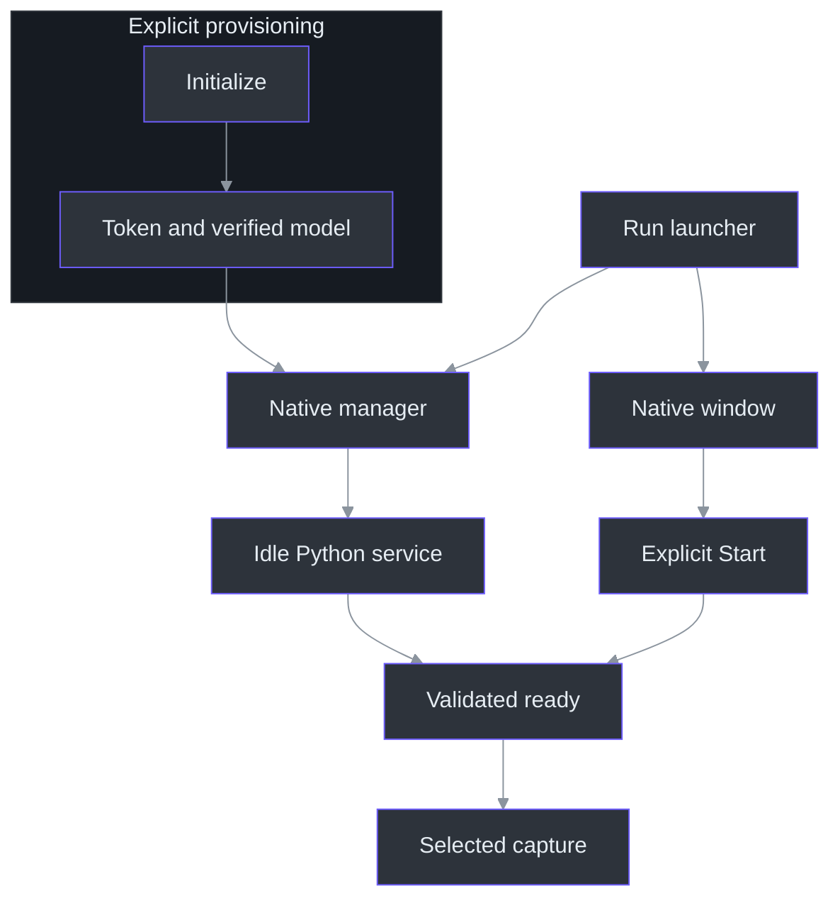
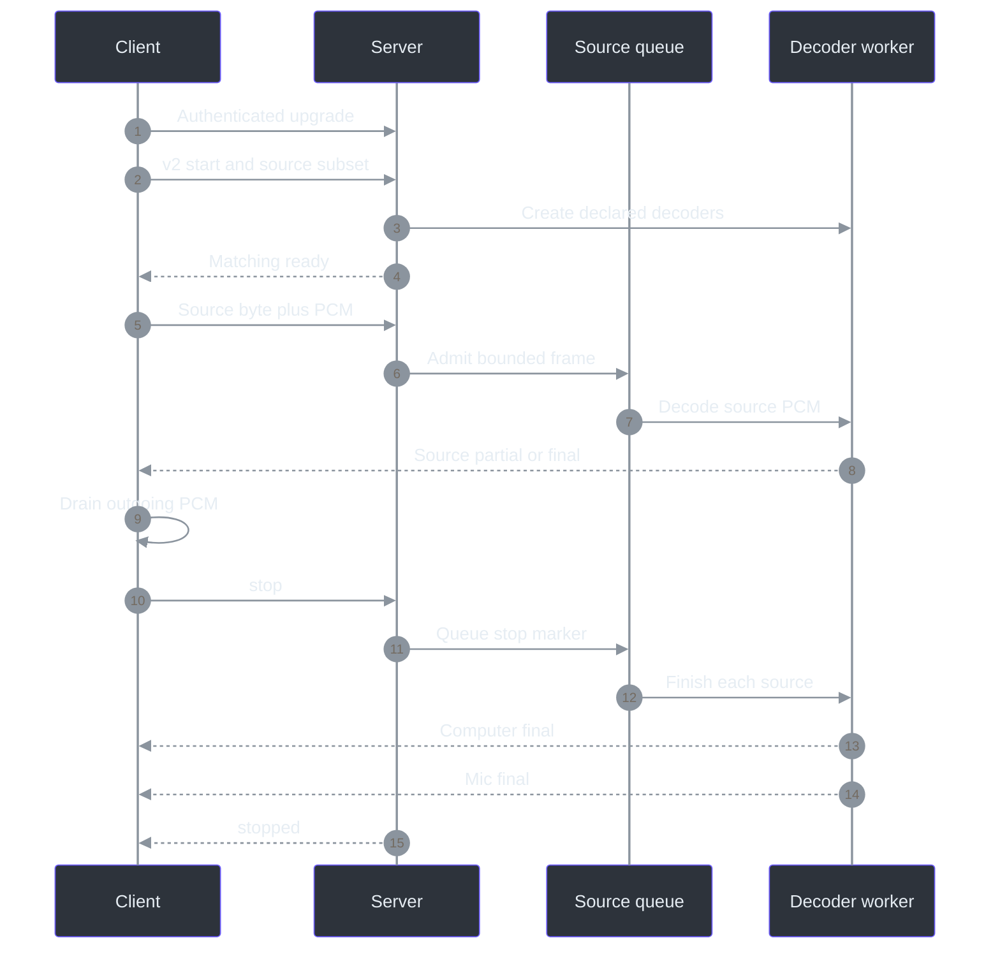

# 19. API and configuration reference

## Readiness is not recording

This reference distinguishes three operations that must never be conflated: **provisioning**, **starting an idle service**, and **starting selected audio capture**. The launcher starts/reuses Python, but the window separately requires explicit Start, valid selections, protection readiness, and a token. Both is the initial input-mode selection, not automatic recording. (`scripts\Run-PhantomFudge.ps1:39-55`, launcher; `src\PhantomFudge.App\MainWindow.xaml.cs:35-65`, initial state; `src\PhantomFudge.App\MainWindow.xaml.cs:652-700`, `Start_Click`.)

Commands below are reference examples from the repository root, not actions performed to produce this chapter. No credential value is reproduced. Follow [capture](07-dual-input-capture.md), [protocol](08-streaming-protocol.md), [recognition](09-python-recognition.md), and [service ownership](10-native-service-lifecycle.md) for the implementation narratives.



The final gate is implemented by `StartCoreAsync`: native construction follows successful transport connection, not merely process launch. (`src\PhantomFudge.App\Audio\LoopbackTranscriber.cs:102-115`, `StartCoreAsync`.)

## Installed launcher reference

The published Windows11 x64 installer has a native entry point, separate from the PowerShell
source/legacy commands below. Versioned assets and their checksums identify the clean committed
release build; broad machine/device qualification remains open. Use
[Installation](../INSTALLATION.md) for current availability and safe update/uninstall steps.

| Installed launcher arguments | Meaning |
| --- | --- |
| No arguments | Refuse while the installer gate is present; otherwise reveal an existing same-user app or prepare the installed local service and open the app with audio still idle |
| `--notes-only` | Same installer gate; open/reveal without speech preparation; does not stop a service or disable configured answer providers |
| `--maintenance [installation-root]` | Noninteractive guard: refuse a running app/busy launcher; require the owned marker and perform native authenticated idle shutdown, independent of old Python/compact manifest |
| `--validate-install installation-root` | Headless marker, compact metadata and required layout validation; no app/service/audio/inference startup |
| `--self-test` | Synthetic launcher contract/child-process checks; not real app, audio, provider or installed-copy qualification |

The presence of `Local\PhantomFudge-Installer-Maintenance` blocks normal/notes-only launch before
coordination or existing-instance reveal. It is checked again after acquiring the startup mutex.
Detection records generic status and exits70 without WPF UI or child processes; maintenance and
validation bypass the gate. The targeted presence/lifetime test uses a randomly named mutex,
not the production gate, so it does not claim a real Setup concurrency run.
(src/PhantomFudge.Launcher/Program.cs:25-78,240-244)
(src/PhantomFudge.Launcher/LauncherContract.cs:152-165)
(src/PhantomFudge.Launcher/LauncherStatus.cs:15,34)
(tests/PhantomFudge.Core.Tests/InstalledLauncherTests.cs:176-195)

The repair/update hook uses a fresh Setup-extracted helper directory and an explicit absolute
installation-root argument, rather than requiring a healthy old launcher. The native path is
covered by lifecycle3's 11-check current-candidate fixture, including damaged-launcher/version repair.
Its 3,682-file inventory pass is not a genuine old-binary upgrade, shortcut or clean-VM qualification.
The explicit root does not
override the fixed current-user data workspace and is not a general startup-path override.
Uninstall continues through the installed helper. A second numeric version record in the
per-user `HKCU\Software\PhantomFudge\Installer\<AppId>` key (`WindowsVersion`) supports repair
of a damaged `app-version.txt`; both invalid means
refusal, not an assumed upgrade.
(tools/Installer/PhantomFudge.iss:51-52,107-161)
(scripts/Test-Installer.ps1:15-18,40-84,96-104)

Arguments are exact whitelist forms, not shell expressions. Validation/maintenance accept an
absolute installation root and require its bounded ownership marker; normal launch paths stay fixed.
The fixed install layout is `app`, `launcher`, `runtime\python`, `services\transcription` and
`models`. Mutable speech data is external at
`%LOCALAPPDATA%\PhantomFudge\InstalledRuntime\.local`. The launcher sets literal-loopback service
coordinates and an offline speech environment; it preserves the app's existing answer/keyboard
settings location.
(src/PhantomFudge.Launcher/LauncherContract.cs:8-23,56-105)
(src/PhantomFudge.Launcher/Program.cs:25-100,127-213)
(src/PhantomFudge.Launcher/ChildProcesses.cs:48-105)

The normal-launch manager argument prefix is `-I -B -X utf8`, followed by the fixed manager path
and `start`; the launcher deadline is 180 seconds. Fresh credentials use 32 random bytes encoded as
64 lowercase hexadecimal characters. Existing valid URL-safe tokens, including earlier Base64URL
tokens, are preserved rather than rotated. These constants match the installed-runtime contract;
the model root is supplied through `PHANTOM_TRANSCRIPTION_MODELS_ROOT`.
(src/PhantomFudge.Launcher/ChildProcesses.cs:48-61,81-105)
(src/PhantomFudge.Launcher/Program.cs:13)
(src/PhantomFudge.Launcher/LauncherContract.cs:31-36)
(src/PhantomFudge.Launcher/LocalToken.cs:12-39,42-63)
(tests/PhantomFudge.Core.Tests/InstalledLauncherTests.cs:135-155)

The model-resolution contract preserves user provisioning separately:
`InstalledRuntime\.local\models\<pinned-model-name>` takes precedence when present; otherwise
the bundled `models` directory is selected. Both paths require the same pinned manifest.
Explicit provisioning writes only user model data, so it cannot silently modify installer-managed
weights. Targeted tests cover both path selection and the write destination.
(tools/Installer/runtime-contract.json:7-12,20-22)
(services/transcription/tests/test_installed_runtime.py:74-91)

Maintenance uses the native authenticated loopback client and shared receipt lock, not a Python
`maintenance` command. It matches instance/activity/process identity before shutdown; confirmed
dead/recycled identity permits removing only an unchanged receipt. A live/unknown process is not
terminated. The runtime's documented manager verbs remain `start`, `stop`, and `status`.
(src/PhantomFudge.Launcher/MaintenanceOperation.cs:48-118)
(src/PhantomFudge.Launcher/OwnedServiceClient.cs:35-84)
(tools/Installer/runtime-contract.json:11-24)

Partial ownership has explicit, different outcomes:

| Installed runtime state | Maintenance behavior |
| --- | --- |
| Token and receipt both absent | Succeed without probing a source-workspace listener |
| Receipt present, token absent | Refuse without authentication or file deletion |
| Token present, receipt absent | Validate the private token locally, then make a credential-free one-second TCP presence probe; succeed only on connection refused, not an occupied/uncertain port |
| Token and receipt present | Prove stale process identity or authenticate the exact owned idle runtime; remove only an unchanged receipt, never kill a PID |

A successful stop intentionally retains the token, so token-only state is not automatically
corruption. The probe sends no token or shutdown request to an untracked listener. For stale
PID-only receipts, Windows must confirm that PID absent before unauthenticated cleanup; an
inspectable live legacy PID still requires matching authenticated service identity. An
uninspectable process remains protected.
(src/PhantomFudge.Launcher/MaintenanceOperation.cs:52-118,121-134)
(tests/PhantomFudge.Core.Tests/InstalledMaintenanceTests.cs:31-108,149-172)

`%LOCALAPPDATA%\PhantomFudge\launcher-status.json` records a bounded generic result. Self-test
uses `launcher-self-test.json`. A runtime timeout preserves uncertain process ownership; it is
not an instruction to terminate Python or delete a retained receipt. Reinstall/repair and manual
data reset are different operations.
(src/PhantomFudge.Launcher/LauncherStatus.cs:6-61)
(src/PhantomFudge.Launcher/ChildProcesses.cs:107-123)

App handoff has a separate wait from the180-second manager deadline:

| Observation after spawning the app | Meaning |
| --- | --- |
| Main-instance mutex appears | Startup handoff succeeds; elapsed time alone never proves this |
| Exact child is proven exited before readiness | AppStartFailed67, even if the child's exit code is0 |
| Neither can be proved | Retain the launcher operation mutex and keep watching |
| Still unresolved after30seconds | Write/show AppStartPending76, not Success and not an automatic exit |
| Close while handoff is pending | Hide progress, retain the guard and continue watching; early dispatcher shutdown retains a synchronous watcher |

Setup never launches the app. Finish/close Setup before using Start. Setup and launcher
status/error UI are ordinary visible windows, not capture-excluded; launch before sharing.
The latest handoff reports55helper tests and10exact-EXE self-checks, including delayed synthetic
child/mutex coordination. It does not claim an interactive WPF Close test.
(src/PhantomFudge.Launcher/ChildProcesses.cs:12-42)
(src/PhantomFudge.Launcher/Program.cs:108-118,186-227,321-354)
(src/PhantomFudge.Launcher/LauncherStatus.cs:20,31,39)
(src/PhantomFudge.Launcher/LauncherWindow.cs:18-57)
(tools/Installer/PhantomFudge.iss:14-76)

The compact `install-manifest.json` contains release metadata and stays within the launcher's
16KiB bound. `payload-files.json` holds the full file inventory separately, including the
compact manifest but excluding its own self-hash. The build enumerates hidden entries and rejects
reparse points/private data; the fixture checks exact inventory coverage and installed hashes.
Those are integrity checks, not publication or cross-version/clean-VM qualification.
(src/PhantomFudge.Launcher/LauncherContract.cs:38-52,94-105)
(scripts/Build-Installer.ps1:56-98)
(scripts/Test-Installer.ps1:40-54,96-104)

`--validate-install` succeeds on file/directory layout and valid compact metadata; it does not
hash every payload/model file or execute those binaries. Validation returns0on success and65on
missing/invalid installation data. Maintenance deliberately does **not** require compact metadata
or old runtime executables, because it must remain usable for repair. The helper itself is a
whole self-contained deployment, not a single-file executable.
(src/PhantomFudge.Launcher/Program.cs:25-43,94-100)
(src/PhantomFudge.Launcher/LauncherStatus.cs:6-19)
(src/PhantomFudge.Launcher/LauncherContract.cs:87-105)
(tools/Installer/PhantomFudge.iss:47-49,143-147)
## 1. Source/legacy startup commands and argument semantics

The source/legacy operational sequence is:

```powershell
# Explicit provisioning; may download dependencies and the pinned model.
.\scripts\Initialize-Transcription.ps1 -DownloadModel

# Start/reuse native Python and launch/reveal the application.
.\scripts\Run-PhantomFudge.ps1

# After stopping capture in the app, stop the owned idle service.
.\scripts\Stop-Transcription.ps1
```

| Command/switch | Exact implemented meaning |
| --- | --- |
| `Initialize-Transcription.ps1` | Verify/provision token and model; normally create/restore the service-local Python environment. |
| `-DownloadModel` | Permit downloading an absent model archive. A valid cached archive does not require another download. |
| `-SkipPythonSetup` | Skip environment/dependency setup, **not** token/model work. |
| `-Engine hybrid-whisper` | Native default: Vosk provisional text plus accurate local Whisper finals; `vosk` is an explicit legacy choice. |
| `-WhisperModel small.en` | Default accurate model; `base.en` explicitly selects a smaller alternative. |
| `-Vocabulary technical` | Default disclosed individual-word hints; `none` disables them. |
| `Start-Transcription.ps1` | Invoke the existing service-local interpreter with `manage.py start`. Missing setup fails; it is not installed here. |
| `Run-PhantomFudge.ps1 -NoBuild` | Skip source-build work; an executable must already exist. Packaged launches skip build regardless. |
| `-NotesOnly` | Skip service startup; it does not remove transcription controls or disable a separately running service. |
| `-PassThru` | Also return the launched process object, including the recovery process on the reveal path. |
| Start/Stop `-Docker` | Explicit optional container branch; never selected automatically. Start requires existing recipes/engine. |

Definitions: `Initialize-Transcription` parameters/provisioning (`scripts\Initialize-Transcription.ps1:1-24`, `scripts\Initialize-Transcription.ps1:78-165`); native/Docker branches (`scripts\Start-Transcription.ps1:8-36`, `scripts\Stop-Transcription.ps1:8-22`); launcher branches (`scripts\Run-PhantomFudge.ps1:1-57`). The launcher requires PowerShell 7.2 or later, prefers the packaged executable when present, and reveals an existing app at the expected executable path **before** any build/service operation. (`scripts\Run-PhantomFudge.ps1:1-37`, launcher.)

The application itself recognizes three exact two-argument diagnostic patterns: `--capture-proof outputDirectory`, `--ui-smoke outputDirectory`, and `--documentation-screenshots outputDirectory`. These dispatch capture/UI diagnostics, not ordinary headless unit tests. Unmatched argument shapes fall through to normal single-instance startup; there is no implemented `--ask`, input-selection, or automatic-capture CLI switch. (`src\PhantomFudge.App\App.xaml.cs:13-75`, `App.OnStartup`.)

## 2. Environment, defaults, and secret ownership

### Keyboard activation is a separate local setting

The optional `%LOCALAPPDATA%\PhantomFudge\keyboard.json` is loaded at app initialization. Use the
[exact three-property JSON and recovery guide](../KEYBOARD-CONTROLS.md#shortcut-configuration-and-recovery):
`schemaVersion: 1`, boolean `enabled`, and string `activationKey` (default `"K"`).
Allowed keys are A–Z except E or F1–F11; F12 is reserved/rejected. Ctrl+Alt+NoRepeat remains
fixed. Missing settings use the default; malformed/unreadable settings disable the shortcut with
a notice, while the Keys button remains available. Registration conflicts also retain Keys.
Restart after editing; this is not the diagnostics reload action.
(src/PhantomFudge.Core/KeyboardShortcutConfiguration.cs:7-28,31-114;
src/PhantomFudge.App/MainWindow.Keyboard.cs:30-63.)

The command prompt uses the finite `KeyboardCommands.Parse` grammar, not a shell or model.
See the [complete command table](../KEYBOARD-CONTROLS.md#built-in-commands-deterministic-not-a-shell-or-model).
Answer font 8–24 is a session-only choice, **not** a permitted JSON property. The final exporter
passed after correcting the configuration-error boundary to catch `InvalidDataException`.
The [guide](../KEYBOARD-CONTROLS.md) records that bounded evidence; citation/atlas/book completion
and external shortcut/foreground qualification remain separate.
(src/PhantomFudge.Core/KeyboardCommands.cs:15-80;
src/PhantomFudge.App/MainWindow.AnswerFont.cs:9-43.)

### Speech environment and secret ownership

| Variable | Consumer, default, and precedence |
| --- | --- |
| `PHANTOM_TRANSCRIPTION_URI` | App speech endpoint; defaults to `ws://127.0.0.1:8765/v1/transcribe`. Launcher explicitly sets this value. |
| `PHANTOM_TRANSCRIPTION_TOKEN` | App initial token field, empty when absent. Server uses it only when a token-file setting is not supplied. |
| `PHANTOM_TRANSCRIPTION_TOKEN_FILE` | Server reads this file first; native manager supplies the workspace token-file path. It is not an app token-file setting. |
| `PHANTOM_TRANSCRIPTION_MODEL_PATH` | Required by production server; no implicit model download or default model directory in `server.main`. Manager supplies the pinned directory. |
| `PHANTOM_TRANSCRIPTION_WORKSPACE` | Shared mutable workspace; installed launch uses `PhantomFudge\InstalledRuntime` beneath LocalAppData. |
| `PHANTOM_TRANSCRIPTION_MODELS_ROOT` | Separate shipped-model root for the installed runtime; not the mutable `.local` data directory. |
| `PHANTOM_TRANSCRIPTION_HOST` | Server default `127.0.0.1`; only `127.0.0.1` and `0.0.0.0` accepted. Native manager overrides to loopback. |
| `PHANTOM_TRANSCRIPTION_INSTANCE` | Optional canonical UUID-hex identity; manager generates it. Without managed identity/callback, authenticated shutdown is unavailable. |
| `PYTHONDONTWRITEBYTECODE` | Manager sets `1` for its child. |
| `OPENBLAS_NUM_THREADS`, `OMP_NUM_THREADS` | Manager sets each to `1`; these are child environment settings, not WebSocket controls. |
| `PHANTOM_AUDIO_TEST_TOKEN` | Native fixture/playback harness credential; distinct from the application's token-variable name. |

Source: `MainWindow` initialization and `Start_Click` (`src\PhantomFudge.App\MainWindow.xaml.cs:50-65`, `src\PhantomFudge.App\MainWindow.xaml.cs:674-700`); launcher environment (`scripts\Run-PhantomFudge.ps1:43-55`); `load_token`, `main`, and `production_app` (`services\transcription\server.py:75-85`, `services\transcription\server.py:658-705`); manager child environment (`services\transcription\manage.py:229-242`, `start`); harness lookup (`tests\PhantomFudge.Audio.Tests\DualSyntheticServiceCheck.cs:24-27`, `RunDualSyntheticServiceCheckAsync`).

**Do not infer a port setting:** production `server.main` binds port 8765. The C# validator allows other valid ports on literal `127.0.0.1` or `[::1]`, but that does not reconfigure the server. It rejects `localhost`, remote hosts, `wss`, query credentials, fragments, user information, and normalized/escaped alternate paths. The default native server is IPv4 despite client IPv6-loopback acceptance. Redirects and proxies are disabled. (`services\transcription\server.py:695-712`, `main`; `src\PhantomFudge.App\Audio\TranscriptionSocket.cs:26-31`, HTTP handler; `src\PhantomFudge.App\Audio\TranscriptionSocket.cs:82-98`, `ValidateEndpoint`.)

Initialization generates 32 random bytes as 64 hexadecimal characters and restricts the Windows token DACL to the current user. Existing invalid tokens require explicit repair, not silent rotation. Manager/server validation requires `[A-Za-z0-9_-]{32,512}`; the native socket's broader lexical check is not the server's credential contract. Never put credentials in URLs or command arguments. (`scripts\Initialize-Transcription.ps1:42-76`, token setup; `services\transcription\manage.py:34-41`, `token`; `services\transcription\server.py:75-85`, `load_token`; `src\PhantomFudge.App\Audio\TranscriptionSocket.cs:117-144`, `ConnectCoreAsync`.)

Engine/model pins are `vosk==0.3.45`, `aiohttp==3.14.3`, and English `vosk-model-small-en-us-0.15`. The archive is 41,205,931 bytes; its recorded hash is observed download identity, not a publisher-signed checksum. Runtime verifies the exact manifest file set and hashes before explicit-path model loading. (`services\transcription\requirements.txt:1-2`, dependency pins; `services\transcription\model.json:2-10`, manifest; `services\transcription\recognizer.py:25-63`, `verify_model`, `VoskFactory`.)

Those are the provisional/legacy pins, not the entire hybrid footprint. The native default also
uses faster-whisper 1.2.1, CPU-int8 small.en and four CPU threads. Configuration lives in
`.local\transcription-config.json`; schema/engine/model/thread/vocabulary fields are validated,
both model families are checked before load, and missing accurate files never trigger fallback.
(`services/transcription/configuration.py:8-34,60-69`;
`services/transcription/accurate.py:75-81`;
`services/transcription/provision_whisper.py:28-90`.)

## 3. Native management contract

```powershell
.\services\transcription\.venv\Scripts\python.exe .\services\transcription\manage.py status
```

The source/legacy management workflow uses `start`, `stop`, or `status`; exit codes are `0` success, `1` runtime failure, and `64` invalid usage. Status reports `ready`, `active`, and `pid` when it authenticates a listener; no listener produces a textual status instead. The installed launcher's maintenance integration is documented separately above. (`services\transcription\manage.py:290-314`, `status`, `main`.)

Start/Stop/Status share a workspace byte-range lock. Ownership requires the receipt's UUID plus authenticated service name and management version, not merely a PID or occupied port. Reuse requires current speech capability and engine/model/source/dependency/vocabulary fingerprint. Automatic replacement is limited to an authenticated owned idle instance after verifying the selected models. Active, ambiguous, foreign, or unready instances are not silently repaired. (`services\transcription\manage.py:66-91`, `lifecycle_lock`; `services\transcription\manage.py:155-220`, ownership/capability/start decisions.)

The Python decision can be read as this JavaScript pseudocode:

```javascript
if (listenerExists()) {
  const info = authenticateReceiptInstance();
  require(info.ready === true);
  if (supportsSpeechV2(info) && matchesRuntimeFingerprint(info)) return;
  require(info.active === false);
  verifySelectedModels();
  await authenticatedShutdownAndPortClosure();
} else if (receiptExists()) {
  clearOnlyConfirmedDeadOrRecycledProcessReceipt();
}
await spawnWithNewReceiptAndVerifyReadiness();
```

Management waits are phase-specific: lock acquisition 50 seconds, HTTP request 2 seconds, startup observation 45 seconds, shutdown-port wait 12 seconds. Failed shutdown/startup preserves ownership evidence rather than killing an arbitrary OS process. The request reader caps JSON at 4,096 bytes and forbids redirects/proxies. (`services\transcription\manage.py:44-91`, request/lock; `services\transcription\manage.py:186-273`, stop/start.)

## 4. HTTP routes

| Route | Authentication and successful response |
| --- | --- |
| `GET /health` | No authentication; `status` (`ready`/`unavailable`) and Boolean `modelAvailable`; HTTP 200/503. This is readiness, not ownership proof. |
| `GET /v1/runtime` | Bearer authentication; `service`, management `protocolVersion: 1`, `speechProtocolVersions: [1,2]`, `instanceId`, `pid`, `ready`, `active`. |
| `POST /v1/shutdown` | Bearer plus matching `X-Phantom-Instance`; no body; idle managed instance returns `{"status":"stopping"}`. |
| `GET /v1/transcribe` | Authenticated WebSocket upgrade; one active session, reserved before the start handshake. |

Authenticated runtime metadata additionally exposes engine/model/revision, configuration fingerprint,
diagnostic availability and numeric queue/fault/drop bounds, including `maxStopSeconds:85`.
This does **not** add fields to strict v1/v2 ready/stopped/speech messages or expose model paths.
(`services/transcription/configuration.py:38-57`;
[runtime contract](../../services/transcription/README.md#protocol-privacy-and-resource-behavior).)

These routes are registered by `create_app`. Runtime/shutdown/transcription reject query strings and bodies. Authentication requires exactly one Bearer header; nonempty browser Origin is rejected—403 on transcription, 401 on management. An identity mismatch or active shutdown attempt yields 409; unavailable speech yields 503. (`services\transcription\server.py:201-260`, `health`, `authorized`, management handlers; `services\transcription\server.py:538-563`, `transcribe`; `services\transcription\server.py:636-655`, `create_app`.)

## 5. Speech v1/v2 messages and bytes

Both versions use `/v1/transcribe`. Send one of these complete text messages after upgrade:

```json
{"type":"start","sampleRate":16000,"channels":1,"encoding":"pcm_s16le"}
```

```json
{"type":"start","protocolVersion":2,"sampleRate":16000,"channels":1,"encoding":"pcm_s16le","sources":["computer","microphone"]}
```

V1 is Computer-only. V2 source subsets must be nonempty, unique, and canonically ordered: Computer alone, Mic alone, or Computer then Mic. Version/rate/channel values must be integers; extra fields or unknown sources fail. `ready` echoes the accepted start fields with a different `type`; v2 clients reject downgrade. (`services\transcription\server.py:100-112`, `parse_start`; `services\transcription\server.py:563-574`, ready construction; `src\PhantomFudge.App\Audio\TranscriptionSocket.cs:416-435`, `ProcessMessage`.)

| Item | V1 | V2 |
| --- | --- | --- |
| Binary message | Unprefixed PCM | Source byte, then PCM |
| Source byte | Absent | `1` Computer; `2` Microphone; must be declared |
| PCM | Signed 16-bit little-endian, mono, 16 kHz | Same, separate tracks—not mixed |
| PCM length | Even, 2–32,000 bytes | Same |
| Application-message length | 2–32,000 bytes | Odd, 3–32,001 bytes |
| Partial fields | `type`, `text` | Also `source` |
| Final fields | `type`, `text`, `segmentId`, `startSeconds`, `endSeconds` | Also `source` |

The server strips the prefix before validation/accounting. At 32,000 PCM bytes/second, 100 ms means 3,200 PCM bytes or 3,201 v2 message bytes; neither duration nor queue credit includes the prefix. (`services\transcription\server.py:26-28`, source/format constants; `services\transcription\server.py:319-357`, `Session.receive`; `services\transcription\server.py:361-392`, `Session.publish`; `src\PhantomFudge.Core\AudioSource.cs:3-23`, wire identities.)

Final IDs increase globally across the session, while final times and replacement partials are source-local. Thus Computer ending at 5 seconds followed by Mic ending at 2 seconds is valid. Labels identify inputs, not speakers. `{"type":"stop"}` stops the entire session; source-scoped commit and speech v3 remain **unimplemented**. The desktop Ask action freezes a snapshot and optionally invokes its configured installed answer
provider; it is not a speech-protocol control or a direct Azure request. (`services\transcription\server.py:306-316`, control handling; `services\transcription\server.py:361-417`, publication/drain; `docs\DUAL-SOURCE-AUDIO.md:10-17`, identity boundary; `docs\AI-ANSWER-ARCHITECTURE.md:473-518`, proposed commit.)



Stop waits for a queue slot rather than discarding accepted PCM. Each declared source receives a final, even if empty, before `stopped`. Native drain has its own timeout and requires v2 stop-final evidence from every source; disconnection is not equivalent to completed drain. (`services\transcription\server.py:306-316`, `Session.receive`; `services\transcription\server.py:394-498`, `Session.recognize`; `src\PhantomFudge.App\Audio\TranscriptionSocket.cs:241-289`, `StopAsync`; `src\PhantomFudge.App\Audio\TranscriptionSocket.cs:463-474`, `ProcessMessage`.)

## 6. Resource defaults are code limits, not CLI knobs

### Answer context is request data, not configuration

The local-source request shape is
`AnswerRequest(RequestId, ExactText, Clarification = null, PreviousAnswer = null)`.
`AnswerRun(snapshot, providerLabel, clarification = null, previousAnswer = null)` validates and
freezes those optional inputs before provider work. Null prior context preserves existing direct
behavior; a non-null string must be nonblank strict Unicode and at most32768UTF-16 units.
Question text remains at8192; clarification history plus current input remains at32768.
These independent character limits exclude JSON/policy overhead and are not model token budgets.
([Contracts](../../src/PhantomFudge.Core/Answers/AnswerContracts.cs),
[coordinator](../../src/PhantomFudge.Core/Answers/AnswerRun.cs),
[clarification](../../src/PhantomFudge.Core/Answers/AnswerClarification.cs).)

**Previous answer** defaults off/session-only; it is not an `answers.json` or `keyboard.json`
setting. `context on/off` are finite built-in commands invoking the same UI handler, never shell
or model commands and never an implicit send. Clear/provider changes reset the option; an active
clarification retains its captured string for explicit replies/retry. The submitted context is
inspectable in Setup/details. This addition is included in Preview 2, not the immutable Preview 1 installer.
([UI controller](../../src/PhantomFudge.App/MainWindow.AnswerContext.cs),
[command grammar](../../src/PhantomFudge.Core/KeyboardCommands.cs).)

| Boundary | Current default |
| --- | --- |
| Server control text | 1,024 UTF-8 bytes |
| Server queue per source | 64,000 PCM bytes **and** 32 frames; Both totals 128,000 bytes/64 frames |
| Native pending audio | 64,000 PCM bytes/source, 128,000 total; no server-style 32-frame/source cap |
| Server source rate credit | 64,000-byte burst, 32,000 bytes/s refill; 200-frame burst, 100 frames/s refill |
| Server start / idle / decoder / send waits | 5 / 15 / 5 / 2 seconds |
| Source duration ceiling | 28,800 seconds of received PCM, not wall time |
| Native connection / final-drain waits | 10 / 90 seconds; backend conservative maximum 85 seconds, not normal latency |
| Native capture startup / release waits | 10 / 5 seconds; separate from socket waits |
| Native idle-silence cadence | At least 250 ms without real packets, at least 100 ms between synthetic frames |
| Recognizer history rotation | Hybrid targets 15-second disjoint spans, at most 16 with a crossing frame; explicit legacy Vosk uses 30 seconds |
| Native response limit | 32,768 bytes, JSON depth 8 |
| Text limits | Server 8,192 Python characters; native 16,384 .NET string characters |

Defaults are declared in `Limits` and native constants/parser, not environment overrides. Per-source queue quotas cannot borrow another source's spare capacity. For 3,200-byte frames, the byte quota is twenty queued frames; tiny two-byte frames instead reach the server's frame quota first. (`services\transcription\server.py:45-59`, `Limits`; `services\transcription\server.py:280-357`, `Session`; `services\transcription\server.py:361-369`, text validation; `src\PhantomFudge.App\Audio\TranscriptionSocket.cs:13-43`, constants/channel; `src\PhantomFudge.App\Audio\TranscriptionSocket.cs:352-375`, `ReceiveAsync`; `src\PhantomFudge.App\Audio\TranscriptionSocket.cs:439-449`, transcript parser.)

Hybrid provisional decoding has independent bounded source workers and a separate serial finalizer.
At most two immutable final spans per source include the executing span. The final native-call
deadline is 20 seconds, distinct from the provisional five-second decoder wait. A failed/timed-out
native call is not silently retried as success. Span ownership is exact audio accounting, not
word-aligned timestamps or an accuracy guarantee (`services/transcription/accurate.py:33-118`;
[recognition lifecycle](09-python-recognition.md)).

Capture waits, silence scheduling, and decoder rotation are distinct mechanisms, not one end-to-end deadline or acoustic endpoint setting. A timed-out native release retains worker ownership and blocks unsafe restart; a delayed silence tick does not backfill elapsed time. (`src\PhantomFudge.App\Audio\LoopbackTranscriber.cs:13-15`, constants; `src\PhantomFudge.App\Audio\LoopbackTranscriber.cs:82-85`, restart gate; `src\PhantomFudge.App\Audio\LoopbackTranscriber.cs:313-333`, `SupplySilenceAsync`; `src\PhantomFudge.App\Audio\LoopbackTranscriber.cs:408-426`, `FinishSessionAsync`; `src\PhantomFudge.App\Audio\SilenceCadence.cs:11-19`, scheduling; `services\transcription\recognizer.py:96-104`, rotation.)

## 7. Testing commands: choose the evidence layer

```powershell
dotnet run --project .\tests\PhantomFudge.Audio.Tests -c Release
.\services\transcription\.venv\Scripts\python.exe -m unittest discover -s .\services\transcription\tests
```

The native harness is an executable, not an xUnit project; ordinary arguments filter test names case-insensitively. A filter matching nothing still returns success with zero checks, so inspect the reported count. Python protocol tests create isolated test servers with fake recognizers; they do not require a running production listener. (`tests\PhantomFudge.Audio.Tests\PhantomFudge.Audio.Tests.csproj:1-11`, executable definition; `tests\PhantomFudge.Audio.Tests\Program.cs:26-75`, `RunAsync`; `services\transcription\tests\test_protocol.py:23-62`, fixtures/setup.)

| Specialized entry | Inputs and side effects |
| --- | --- |
| `scripts\Test-DualSourceSynthetic.ps1 [-NativeClient]` | Generates in-memory speech; existing cached model and ephemeral loopback server. Switch builds/uses C# transport. |
| `services\transcription\tests\Test-DualSyntheticTranscription.ps1 [-ModelPath path]` | Cached-model Python integration; no playback, real token, or persistent service. |
| Harness `--service URI --synthetic-pcm - --expect phrase` | Raw synthetic PCM stdin, at most 60 seconds; connects to the supplied service using the test-token environment variable. |
| Harness `--service URI --synthetic-wave path --expect phrase` | Same v1 check, but an explicitly supplied synthetic PCM16 WAV. |
| Harness `--service-v2 URI --synthetic-tracks-stdin --expect-computer phrase --expect-microphone phrase` | JSON stdin containing two base64 PCM tracks, at most 60 seconds each; checks source-specific finals. |
| `scripts\Test-PlaybackTranscription.ps1 -AllowPlayback` | **Audible/hardware test:** plays synthetic speech and captures all default render-device output. Explicit approval and paused unrelated audio are required. |

These distinctions follow the actual wrappers and runners: `Test-DualSourceSynthetic` (`scripts\Test-DualSourceSynthetic.ps1:1-47`), probe `run` (`tools\DualSourceProbe\probe.py:19-65`), cached-model wrapper (`services\transcription\tests\Test-DualSyntheticTranscription.ps1:1-45`), v1 runner (`tests\PhantomFudge.Audio.Tests\Program.cs:78-136`), v2 runner (`tests\PhantomFudge.Audio.Tests\DualSyntheticServiceCheck.cs:10-79`), and playback wrapper/runner (`scripts\Test-PlaybackTranscription.ps1:1-14`; `tests\PhantomFudge.Audio.Tests\PlaybackCheck.cs:39-78`, `RunAsync`). The `--playback` executable branch itself has no `-AllowPlayback` switch: do not bypass the consent-bearing wrapper.

The repository's testing contract explicitly requires consent and paused unrelated audio for playback; ordinary development tests must not open the live microphone. (`AGENTS.md:65-67`, unattended-test boundaries.)

## 8. Errors and recovery interpretation

Service errors have exactly `type: "error"`, `code`, and a fixed safe `message`. The client replaces remote error text with its own generic message. Protocol errors normally attempt close code 1008; oversized transport messages can close with 1009 instead. (`services\transcription\server.py:29-72`, catalogue/`error`; `services\transcription\server.py:194-198`, `close_with_error`; `src\PhantomFudge.App\Audio\TranscriptionSocket.cs:406-414`, error handling; `services\transcription\tests\test_dual_protocol.py:257-264`, transport-ceiling test.)

| Code | Meaning and first distinction to check |
| --- | --- |
| `auth`, `origin` | Credential/header failure versus unsupported browser-origin access. |
| `busy` | Another session owns admission; do not kill its process. |
| `bad_format` | Invalid start schema, version, source subset, or PCM format. |
| `bad_frame` | Invalid binary/control message, undeclared source, or disallowed request shape. |
| `backlog`, `rate_limit` | Queue/send pressure versus input arriving faster than permitted live rate. |
| `timeout`, `session_limit` | Expected-message wait expired versus source PCM-duration ceiling. |
| `decoder_error`, `model_unavailable` | Recognition failure versus unavailable readiness/model; neither invokes cloud fallback. |
| `server_stopping` | Service shutdown notification, not a successful transcription-completion acknowledgement. |

The meanings come from `ERRORS` and their enforcing paths. A decoder-operation failure marks runtime readiness failed; an idle-only managed restart cannot safely terminate a stuck native call. Repair and restart are deliberate operational steps, not promises of automatic recovery. (`services\transcription\server.py:29-42`, `ERRORS`; `services\transcription\server.py:147-181`, `Runtime.cpu`; `services\transcription\server.py:296-357`, receive limits; `services\transcription\server.py:620-626`, shutdown; `services\transcription\manage.py:186-200`, `stop_owned`.)

### Checkpoints and reference boundary

Before integrating, answer: Which component reads a token **file**? Does `modelAvailable` prove ownership? Why does a 3,201-byte message represent only 3,200 PCM bytes? Why must empty Mic finals precede `stopped`? The tables and cited functions above resolve these without inspecting generated private files.

This chapter describes source contracts, not running-service health, microphone quality or meeting
compatibility. Local question state uses a256entry/64000character structured history and8192character
draft ceiling. `Freeze` validates nonblank exact text and creates an immutable local snapshot, with
no cloud setting or provider. Azure answers and v3 remain proposals, not available configuration
options. (`src\PhantomFudge.Core\StructuredTranscriptStore.cs:13-22`;
`src\PhantomFudge.Core\QuestionDraft.cs:8-9,90-103`; `docs\QUALIFICATION.md:1-7`.)

That is the local `Freeze` operation, not the whole Ask integration. Installed Agency is explicitly
configured separately and uses one exact question per fresh session. Startup prepares one empty
session, never an inferred model prompt (`src/PhantomFudge.App/MainWindow.AnswerLifetime.cs:23-78`).
Default local logs omit bodies; text opt-in, safe summary and local export are documented in
[Diagnostics](../DIAGNOSTICS.md) and implemented with bounded records
(`src/PhantomFudge.Core/Diagnostics/LocalDiagnostics.cs:20-24,40-69,132-159`).

For direct lookup, use the [manager](../../services/transcription/manage.py), [HTTP/session implementation](../../services/transcription/server.py), [native transport](../../src/PhantomFudge.App/Audio/TranscriptionSocket.cs), [initialization script](../../scripts/Initialize-Transcription.ps1), and [fixture entry points](../../tests/PhantomFudge.Audio.Tests/Program.cs). All references resolve to maintained source, not generated receipts or local credentials.
