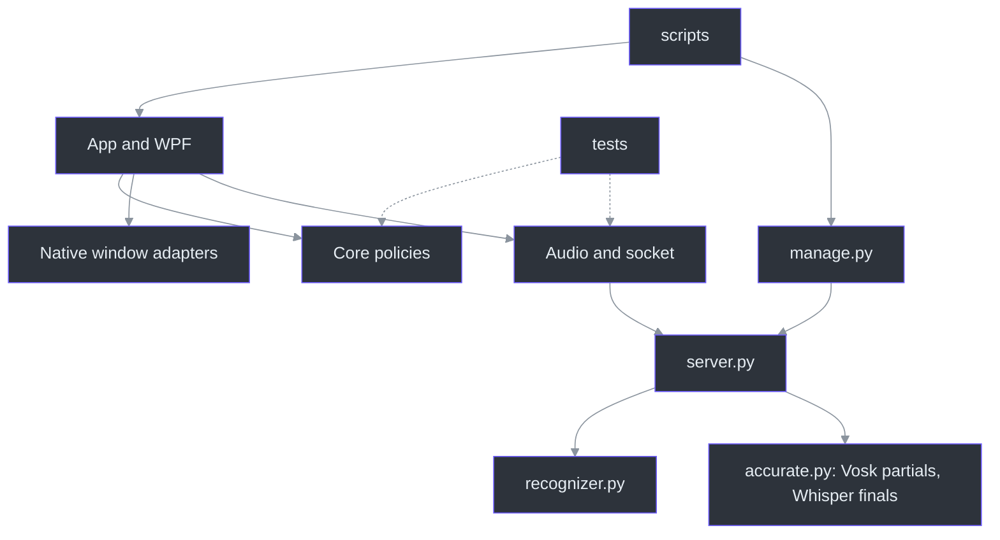
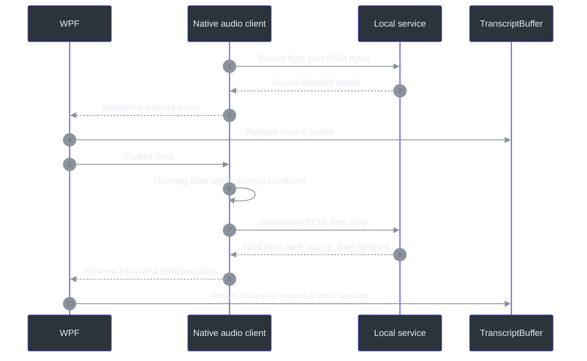

# 20 — Glossary and Repository Map

## Overview: vocabulary is part of the architecture

Many dangerous misunderstandings are substitutions between nearly related words: *source* becomes *speaker*, *configured* becomes *qualified*, or *stopped* becomes *fully drained*. This chapter makes those substitutions visible. A term is useful when it identifies an owner, a unit, or a completion condition—not merely when it expands an acronym.

For example, `AudioSource` names Computer and Microphone, while `Session.RequestStop` clears Running before cleanup finishes. Snapshot-only Ask freezes without sending; a configured installed provider can answer the exact question. Source-specific commit and direct Azure submission remain proposed operations. (src\PhantomFudge.Core\AudioSource.cs:3-30; src\PhantomFudge.App\Audio\LoopbackTranscriber.cs:532-546; src\PhantomFudge.Core\QuestionDraft.cs:90-95; docs\AI-ANSWER-ARCHITECTURE.md:461-506)

Use this chapter as a junction rather than a replacement for the detailed chapters. Start with a question, locate the responsible boundary, then follow the cited function. Source establishes implementation; a test establishes its asserted conditions; qualification requires separate environmental evidence. (docs\QUALIFICATION.md:9-26)

## Architecture and repository map

The main dependency direction is native application → Core policies and local speech service. The service manager owns process lifecycle, not microphone capture. Recognition remains in Python; controls, selected WASAPI inputs, and transcript presentation remain in C#. (src\PhantomFudge.App\PhantomFudge.App.csproj:3-13; src\PhantomFudge.App\Audio\WasapiInput.cs:20-54; services\transcription\manage.py:162-224; services\transcription\server.py:538-576)



This is an ownership map, not a claim that the manager processes PCM. `Run-PhantomFudge.ps1` starts the service unless NotesOnly is selected, then launches the app with a local endpoint; audio still requires `Start_Click`. (scripts\Run-PhantomFudge.ps1:39-55; src\PhantomFudge.App\MainWindow.xaml.cs:637-685)

| Repository area | Open this first; why |
| --- | --- |
| `src\PhantomFudge.App` | [App entry](../../src/PhantomFudge.App/App.xaml.cs), then `MainWindow`: startup, recovery, UI orchestration. `OnStartup` explicitly calls protected reveal. (src\PhantomFudge.App\App.xaml.cs:62-98) |
| `src\PhantomFudge.Core` | [TranscriptBuffer](../../src/PhantomFudge.Core/TranscriptBuffer.cs) and [NoteFileStore](../../src/PhantomFudge.Core/NoteFileStore.cs): text/encoding policies without WPF controls. (src\PhantomFudge.Core\TranscriptBuffer.cs:6-39; src\PhantomFudge.Core\NoteFileStore.cs:10-44) |
| `services\transcription` | [server.py](../../services/transcription/server.py) owns protocol; [recognizer.py](../../services/transcription/recognizer.py) owns Vosk adaptation; [manage.py](../../services/transcription/manage.py) owns authenticated lifecycle. (services\transcription\server.py:636-654; services\transcription\recognizer.py:41-96; services\transcription\manage.py:114-159) |
| `scripts` | [Run-PhantomFudge.ps1](../../scripts/Run-PhantomFudge.ps1): source/package launch and existing-window recovery, not automatic recording. (scripts\Run-PhantomFudge.ps1:9-41) |
| `tests` | [Core file tests](../../tests/PhantomFudge.Core.Tests/NoteFileStoreTests.cs) and [native harness](../../tests/PhantomFudge.Audio.Tests/Program.cs): deterministic policies and synthetic protocol checks. (tests\PhantomFudge.Core.Tests\NoteFileStoreTests.cs:13-109; tests\PhantomFudge.Audio.Tests\Program.cs:26-75) |
| `spikes` and `tools` | [CaptureProof project](../../spikes/CaptureProof/CaptureProof.csproj) links diagnostic code; [SpeechBench](../../tools/SpeechBench/bench.py) and [DualSourceProbe](../../tools/DualSourceProbe/probe.py) serve separate experiments. (spikes\CaptureProof\CaptureProof.csproj:9-12; tools\SpeechBench\bench.py:1-25; tools\DualSourceProbe\probe.py:19-41) |
| `docs` and `TODO` | [Qualification](../QUALIFICATION.md) defines evidence; [TODO index](../../TODO/00_INDEX.todo) records dependencies and status, not executable behavior. (docs\QUALIFICATION.md:142-168; TODO\00_INDEX.todo:49-58) |
| Repository root | [Solution](../../PhantomFudge.slnx) lists projects; [global.json](../../global.json) pins SDK policy. [Compose](../../compose.yaml) is optional, last-stage packaging—not a native prerequisite. (PhantomFudge.slnx:1-13; global.json:2-6; docs\IMPLEMENTATION-STATUS.md:210-213) |

## Navigation by question

New implementation seams are `WorkspaceLayout` for monitor-clamped reading dimensions,
`MainWindow.AnswerLifetime` for retained provider preparation/teardown, and `LocalDiagnostics`
for bounded metadata with explicit text opt-in. Accurate ASR lives behind the unchanged speech
protocol in `accurate.py`; `configuration.py` fingerprints selected models/runtime inputs.
(`src/PhantomFudge.Core/WorkspaceLayout.cs:8-42`;
`src/PhantomFudge.App/MainWindow.AnswerLifetime.cs:23-128`;
`src/PhantomFudge.Core/Diagnostics/LocalDiagnostics.cs:20-24,40-69`;
`services/transcription/configuration.py:39-70`.)

| Question | Read next |
| --- | --- |
| “Where do I start?” | [Reading map](00-reading-map.md), then [newcomer guide](02-zero-to-hero.md) |
| “Why isn't capture affinity a security boundary?” | [Windows and cursors](04-windows-capture-and-cursors.md), [assurance](17-privacy-and-assurance.md) |
| “Which device produced these words?” | [Dual-input capture](07-dual-input-capture.md), [protocol](08-streaming-protocol.md) |
| “Why does Stop take time?” | [State machines](11-state-machines-and-failure-containment.md) |
| “Why is the service ready but nothing recorded?” | [Native lifecycle](10-native-service-lifecycle.md), [recognition](09-python-recognition.md) |
| “What is saved, and what survives collapse?” | [Storage](06-notes-transcripts-and-storage.md), [UI/themes](05-desktop-ui-and-themes.md) |
| “Does the app already send questions to Azure?” | [Proposed answer flow](13-proposed-azure-answer-flow.md), [identity/privacy](14-answer-latency-identity-and-privacy.md) |
| “Which experiment or check should I inspect?” | [Testing](15-development-and-testing.md), [benchmarks](12-performance-and-benchmarks.md), [troubleshooting](16-distribution-and-troubleshooting.md) |

## Grounded glossary

### Audio: units before labels

| Term | Meaning here |
| --- | --- |
| **Sample** | One amplitude value. `VoskRecognizer.accept` counts one sample per two PCM bytes—not one sentence or callback. (services\transcription\recognizer.py:82-84) |
| **PCM16** | Signed 16-bit, little-endian pulse-code modulation. `StartMessage` requires this encoding; compressed audio is not interchangeable. (src\PhantomFudge.App\Audio\TranscriptionSocket.cs:13-24) |
| **Sample rate** | Samples per second per channel: 16,000 in this contract, giving 32,000 PCM bytes/second for mono PCM16. (src\PhantomFudge.App\Audio\TranscriptionSocket.cs:13-23) |
| **Channel** | A waveform dimension, not a person. `WasapiInput` requests one channel for each independently selected input. (src\PhantomFudge.App\Audio\WasapiInput.cs:48-54) |
| **Audio frame** | Here, a bounded transport payload: at most 32,000 PCM bytes. It is not a video frame or necessarily one sample frame. (src\PhantomFudge.App\Audio\TranscriptionSocket.cs:15-18,191-204) |
| **Chunk** | A convenient processing slice, not a fixed-duration semantic unit. `OnAudio` splits a callback's bytes into bounded transport pieces. (src\PhantomFudge.App\Audio\LoopbackTranscriber.cs:234-270) |
| **Source** | Computer or Microphone, explicitly selected; `DisplayName` renders the latter as Mic. Identity describes origin, not speaker recognition. (src\PhantomFudge.Core\AudioSource.cs:3-30) |
| **Stream / track** | One source's ordered PCM and decoder state. Both tracks share a WebSocket without becoming one mixed waveform. (services\transcription\server.py:280-290,319-357,563-576) |
| **Session** | One negotiated transcription conversation: selected sources, decoders, queue, and global final-ID counter. It is shorter-lived than the service process. (services\transcription\server.py:280-290,563-606) |
| **Speaker** | A human identity the current source labels do not establish. Two voices on Computer remain Computer, not automatically separate people. (tests\PhantomFudge.Core.Tests\SourceTranscriptTests.cs:81-87) |
| **Loopback** | Capture of a render endpoint's output through `WasapiLoopbackCapture`, not capture limited to a particular meeting application. (src\PhantomFudge.App\Audio\WasapiInput.cs:48-54; docs\PRODUCT.md:92-105) |
| **Endpoint** | The selected Windows audio device identified by ID, direction, and active state—not the WebSocket network address. (src\PhantomFudge.App\Audio\WasapiInput.cs:64-74) |
| **ASR** | Automatic speech recognition: `VoskRecognizer.accept` turns PCM into recognition results. It does not answer the semantic question spoken aloud. (services\transcription\recognizer.py:82-96) |

### Transport and lifecycle: readiness is not recording

| Term | Meaning here |
| --- | --- |
| **WebSocket** | The persistent local message connection carrying source-prefixed binary PCM and text controls/results. `ConnectCoreAsync` negotiates the session first. (src\PhantomFudge.App\Audio\TranscriptionSocket.cs:144-169,217-227) |
| **Ready** | Scope matters: `Runtime.ready` describes service availability; a session `ready` response confirms negotiated format/sources. Neither means hardware capture already began. (services\transcription\server.py:143-145,563-576; src\PhantomFudge.App\Audio\LoopbackTranscriber.cs:102-113) |
| **Backpressure** | More incoming work than bounded processing capacity permits. `TryEnqueueAudio` faults on overflow rather than silently dropping PCM and continuing. (src\PhantomFudge.App\Audio\TranscriptionSocket.cs:207-238) |
| **Stop** | A session-wide request: close audio admission, drain queued PCM, send `stop`, and await terminal recognition—not a source-only question commit. (src\PhantomFudge.App\Audio\TranscriptionSocket.cs:241-289,322-340) |
| **Drain** | Completion of previously admitted work. `Session.recognize` consumes queued audio before finishing every decoder and sending `stopped`. (services\transcription\server.py:306-316,394-498) |
| **IsRunning** | A current-activity flag, not proof of drain or released devices. `RequestStop` clears Running before asynchronous cleanup finishes. (src\PhantomFudge.App\Audio\LoopbackTranscriber.cs:30,401-447,532-546) |
| **Service instance** | The manager's process-lifecycle identity. `start` generates an instance ID; it is not a transcript session ID or speaker ID. (services\transcription\manage.py:185-193) |
| **Receipt** | Lifecycle metadata checked against authenticated runtime identity by `owned_info`; it is not a transcript or authorization to kill unrelated processes. (services\transcription\manage.py:95-124) |
| **Authentication token** | The local shared credential checked by `authorized`, not an Azure identity or a model token-count unit. (services\transcription\server.py:210-215) |

### Text and storage: provisional, durable, and dirty differ

| Term | Meaning here |
| --- | --- |
| **Partial** | Replaceable unfinished recognition, held separately per source by `SetPartial`; appending every revision would duplicate words. (src\PhantomFudge.Core\TranscriptBuffer.cs:10-19,41-46) |
| **Final** | A recognizer-finalized segment, possibly empty. `AddFinal` clears only its source's partial; “final” does not certify transcription accuracy. (src\PhantomFudge.Core\TranscriptBuffer.cs:48-72) |
| **Segment ID** | Session-global ordering across sources, not a durable cross-session identifier. `publish` increments one counter; `BeginSession` resets the UI baseline. (services\transcription\server.py:378-388; src\PhantomFudge.Core\TranscriptBuffer.cs:35-38) |
| **Audio-relative timestamp** | Position in a source's audio timeline, not wall-clock meeting time. `publish` checks bounds against that source's received PCM duration. (services\transcription\server.py:361-388) |
| **Session reset** | `BeginSession` retains earlier history and marks unfinished text before resetting IDs/partials. It is not `Clear`. (src\PhantomFudge.Core\TranscriptBuffer.cs:23-39,79-85) |
| **Export** | Explicit file persistence of a text snapshot, including labelled unfinished recognition. `ExportTranscriptAsync` writes text, not raw audio. (src\PhantomFudge.App\MainWindow.xaml.cs:813-848; src\PhantomFudge.Core\TranscriptBuffer.cs:75-77) |
| **Dirty** | Current text differs from the last successful save/export baseline. It does not mean the disk file was checked recently. (src\PhantomFudge.App\MainWindow.xaml.cs:294-295,414-428) |
| **UTF-8 byte cap** | `Fits` permits at most 1 MiB encoded bytes; character count alone is insufficient for multibyte Unicode. (src\PhantomFudge.Core\NoteFileStore.cs:12-24) |
| **BOM** | Optional three-byte UTF-8 signature, preserved in `NoteSnapshot` and included in the byte budget—not visible document text. (src\PhantomFudge.Core\NoteFileStore.cs:19,41-44,56-58) |
| **Fingerprint** | SHA-256 of file bytes used by `VerifyUnchangedAsync` for optimistic conflict detection, not encryption or a tamper-proof vault. (src\PhantomFudge.Core\NoteFileStore.cs:41-44,83-95) |
| **Staged rename** | `WriteAsync` writes and flushes bytes beside the destination, rechecks, then moves. This narrows failure exposure without eliminating check-to-move races. (src\PhantomFudge.Core\NoteFileStore.cs:53-80) |

### Desktop: pixels, focus, and discovery are separate

| Term | Meaning here |
| --- | --- |
| **HWND** | Native window handle obtained by `EnsureHandle`; capture affinity is configured on this object, not on every surface in the process. (src\PhantomFudge.App\Native\WindowProtection.cs:24-37) |
| **Visual tree** | WPF's nested content/control structure. Inline setup and confirmation panels belong to `MainWindow`; an external dialog is a different boundary. (src\PhantomFudge.App\MainWindow.xaml:110-124,168-183,500-570) |
| **DWM** | Desktop Window Manager composition, checked and flushed by `Configure`; a flush is not independent recipient observation. (src\PhantomFudge.App\Native\WindowProtection.cs:25-28,46-48) |
| **Affinity** | Here, display affinity `0x11`: a Windows capture-exclusion request. It is unrelated to CPU affinity and not universal invisibility. (src\PhantomFudge.App\Native\WindowProtection.cs:16-48; docs\QUALIFICATION.md:9-26) |
| **Opacity** | The root background brush's alpha, 10–100%; `BackgroundOpacity_ValueChanged` does not fade the whole window or glyphs. (src\PhantomFudge.App\MainWindow.xaml.cs:472-479,1072-1076) |
| **Taskbar presence** | Shell presentation controlled by `ShowInTaskbar` and tool-window styles, not proof of picker omission or hidden processes. (src\PhantomFudge.App\MainWindow.xaml:5-8; src\PhantomFudge.App\Native\WindowProtection.cs:30-32; docs\QUALIFICATION.md:13-18) |
| **Focus** | Keyboard/foreground interaction state, distinct from visibility and cursor shape. `UpdateInteractionControls` changes focusability separately from content. (src\PhantomFudge.App\MainWindow.xaml.cs:269-284) |
| **Present** | Default passive, read-only interaction mode; it neither starts capture automatically nor certifies the sharing configuration. (src\PhantomFudge.App\MainWindow.xaml.cs:33-36,269-284,637-685) |
| **Edit** | Deliberate focusable editing. `TogglePresentationAsync` currently hides and stops transcription before switching—not a purely cosmetic toggle. (src\PhantomFudge.App\MainWindow.xaml.cs:245-266) |
| **Arrow** | Standard local cursor shape set by `CursorPolicy`, not an instruction controlling a recorder's separate pointer stream. (src\PhantomFudge.App\Native\CursorPolicy.cs:8-24; docs\CURSOR-AND-THEMES.md:47-61) |
| **Semantic theme** | Named color roles converted into WPF resources by `ThemeBrushes.Apply`; appearance changes do not constitute content or session replacement. (src\PhantomFudge.Core\ThemePalette.cs:5-29; src\PhantomFudge.App\ThemeBrushes.cs:9-41) |

### Plans and evidence: naming is not implementation

| Term | Meaning here |
| --- | --- |
| **Commit** | Planned source-scoped finalization through a negotiated watermark/acknowledgement—not current global Stop, and not a Git commit. (docs\AI-ANSWER-ARCHITECTURE.md:461-506) |
| **Ask** | Explicitly freeze the exact draft; snapshot mode stays local, while configured Agency/local-model mode submits to that provider. Azure submission is future work, and v2 still has no Ask/commit control. (src\PhantomFudge.Core\QuestionDraft.cs:90-95; services\transcription\server.py:306-316) |
| **QuestionSnapshot** | Implemented immutable exact question text/revision with copied local source provenance, provisional/edit flags and a monotonic creation timestamp. It is not proof of submission. (src\PhantomFudge.Core\QuestionSnapshot.cs:5-23) |
| **Synthetic fixture** | Deliberately generated test content. `RunUiSmokeAsync` uses synthetic text/devices; visual-tree renders are not screen-sharing captures. (src\PhantomFudge.App\MainWindow.xaml.cs:905-953,1189-1202) |
| **Qualification** | Configuration-specific recipient/recording evidence with controls and explicit outcomes; neither build success nor API readback substitutes for it. (docs\QUALIFICATION.md:9-26,79-107) |
| **Preview** | Implemented development software with open release gates, not “planned only” and not a universally supported release. (docs\IMPLEMENTATION-STATUS.md:1-3,305-314) |

## Data flow: one worked boundary trace

A 100 ms mono PCM16 block at 16 kHz contains 1,600 samples and 3,200 PCM bytes. Protocol v2 adds one source byte, so the binary message contains 3,201 bytes. It still represents one source, not 3,201 samples or one recognized sentence. `TryEnqueueAudio` explicitly keeps PCM length separate from prefixed wire bytes. (src\PhantomFudge.App\Audio\TranscriptionSocket.cs:13-17,217-227)

C#'s `ReadOnlySpan<byte>` and Python's `bytes` describe byte containers, not automatic sample counters. `VoskRecognizer.accept` performs the byte-to-sample conversion explicitly; changing languages does not change the units. (src\PhantomFudge.App\Audio\TranscriptionSocket.cs:194-204; services\transcription\recognizer.py:82-84)

This Python-shaped arithmetic is explanatory, not production capture code:

```python
samples = 16_000 // 10
pcm_bytes = samples * 2
wire_bytes = 1 + pcm_bytes
assert (samples, pcm_bytes, wire_bytes) == (1600, 3200, 3201)
```



The diagram shows a graceful path, not a guarantee after transport or device failure. Python's stop sentinel follows queued PCM; the client validates finals before terminal acknowledgement; the UI holds `audioStopping` until its awaited operation finishes. (services\transcription\server.py:306-316,394-498; src\PhantomFudge.App\Audio\TranscriptionSocket.cs:446-474; src\PhantomFudge.App\MainWindow.xaml.cs:748-778)

## Glossary pitfalls and review exercises

**“Two streams means two speakers.”** No: independent source tracks prevent state mixing, not acoustic echo or multiple voices sharing one endpoint. Inspect source labels before inferring people. (docs\PRODUCT.md:92-105)

**“Final means saved.”** No: final concerns recognizer state; export concerns filesystem persistence. The buffer can contain finals while `TranscriptDirty` remains true. (src\PhantomFudge.App\MainWindow.xaml.cs:294-295,813-840)

**“Hidden means stopped and exited.”** No: Hide awaits Stop but retains the process and content; Exit separately evaluates unsaved work. (src\PhantomFudge.App\MainWindow.xaml.cs:232-242,297-330)

**Exercise:** Is 100% background opacity stronger capture exclusion than 10%?  
**Answer:** No. Brush alpha and native affinity are independent mechanisms. (src\PhantomFudge.App\MainWindow.xaml.cs:472-479; src\PhantomFudge.App\Native\WindowProtection.cs:36-48)

**Exercise:** Can an idle ready Python service contain several successive sessions?  
**Answer:** Yes. Session admission is released after cleanup; service identity need not change. (services\transcription\server.py:549-576,601-606)

## References and maintenance rule

Follow the repository links above for implementation; use [qualification](../QUALIFICATION.md) for evidence and [answer architecture](../AI-ANSWER-ARCHITECTURE.md) for proposed contracts. Update a glossary entry when its owner, units, or completion condition changes—not merely when a class is renamed. Preserve the implemented/planned distinction until the corresponding call path exists.
